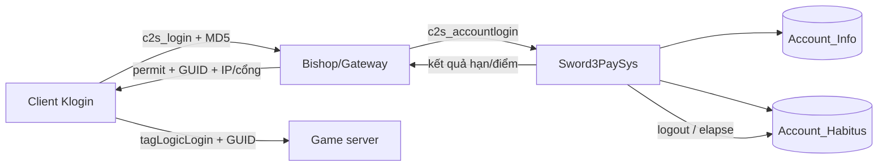

TÓM TẮT 1: [THẤY] Sword3PaySys là cổng tài khoản: mở pool DB theo section `account`, nhận kết nối và định tuyến login/game-login/logout.
TÓM TẮT 2: [THẤY] Login kiểm tra account trong `Account_Info`, sau đó đọc `Account_Habitus` để quyết định còn hạn hoặc còn điểm.
TÓM TẮT 3: [THẤY] Hạn dùng nằm ở `dEndDate`/`iLeftSecond`; điểm nằm ở `nExtPoint`; `iFlag` chọn nhánh tính theo thời gian hay điểm.
TÓM TẮT 4: [CHƯA KIỂM] Cách tạo dòng/schema SQL của tài khoản chưa thấy trong nguồn PaySys; client hiện mở URL đăng ký ngoài, tiện ích quản trị chỉ phát lệnh tạo.
TÓM TẮT 5: [CHƯA KIỂM] Chưa chạy build, exe, VM, SQL hay mạng; tài liệu này chỉ đọc source và báo cáo lịch sử.

# SO-13 — Sổ tay hiểu game: tài khoản và thanh toán (Sword3PaySys)

Loại: tổng hợp
Chủ đề: Tài khoản được xác thực, khóa/mở khóa phiên, tính hạn/điểm và vai trò của Sword3PaySys.
Từ khóa: tài khoản, Account_Info, Account_Habitus, PaySys, Sword3PaySys, S3PAccount, iFlag, dEndDate, nExtPoint, GUID
Trạng thái: DONE — đủ phạm vi đọc tĩnh; phần tạo tài khoản và runtime còn CHƯA KIỂM.
Độ phủ: đã phủ tĩnh 5 trên 7 hạng mục; cách ghi account mới và schema/runtime còn CHƯA KIỂM.
Liên quan: `JX1_OPS/REPORTS/A-02-luong-dang-nhap.md`; `JX1_OPS/REPORTS/A-01-ban-do-tien-trinh.md`; `JX1_OPS/DESIGN/CHUAN-BAO-CAO.md`.
Cần tôi quyết định: không.

## Quy ước gốc nguồn

- PAY/ = C:/Jx1CocoV3/SwordOnline/SwordOnline/jxOnline/gateway/Sources/Sword3PaySys/S3AccServer/
- REG/ = C:/Jx1CocoV3/SwordOnline/SwordOnline/jxOnline/gateway/Sources/Sword3PaySys/S3DBClient/
- CLIENT/ = C:/Jx1CocoV3/Folder/Client2912-20260116T044348Z-3-001/Client2912/Client/Classes/
- GS/ = C:/Jx1CocoV3/SwordOnline/SwordOnline/jxOnline/gameserver/Sources/

Mọi nhận định về code là đọc tĩnh, không đại diện cho binary hoặc runtime.
## Sơ đồ chính

## Phạm vi và độ phủ

| Phần tử | Độ phủ | Bằng chứng / giới hạn |
|---|---|---|
| Sword3PaySys làm gì | Đã phủ | `S3AccServer/main.cpp:198-211`; `S3PDBSocketPool.cpp:377-379` |
| Tạo tài khoản | Chưa phủ cách ghi SQL | Client mở URL đăng ký `gameui/Klogin_f.cpp:1521-1527`; tiện ích phát `DBLOGIN_A_CREATEACCOUNT` `S3DBClient/Page1.cpp:289-353`; chưa thấy handler trong `S3AccServer` |
| Kiểm tên/mật khẩu | Đã phủ tĩnh | `S3PAccount.cpp:35-64`; so mật khẩu `COLLATE Chinese_PRC_CS_AS` ở dòng 50 |
| Khóa/mở khóa phiên | Đã phủ tĩnh | `S3PAccount.cpp:62-100,524-535`; `S3PDBSocketPool.cpp:623-631`; runtime chưa kiểm |
| Tính hạn | Đã phủ tĩnh | `S3PAccount.cpp:582-647`; `Logout` `167-258`; `ElapseTime` `334-352` |
| Tính điểm | Đã phủ tĩnh | `S3PAccount.cpp:104-114,627-635`; `Logout` `260-265` |
| Client vào game | Đã phủ tĩnh | `gameui/Klogin.cpp:471-495`; `gameui/KSelPlayer.cpp:1073-1149,1176-1190` |

## Giải mã tên

| Tên gốc | Mã hóa | Chữ đúng | Nguồn file:dòng |
|---|---|---|---|
| Sword3PaySys | ASCII trong mã | Sword3PaySys — dịch vụ tài khoản/thanh toán | `S3AccServer/main.cpp:198-211` |
| PaySys | ASCII/tên gọi rút gọn | PaySys — tên gọi ngắn của Sword3PaySys | `JX1_OPS/REPORTS/A-02-luong-dang-nhap.md:50-51` |
| S3PAccount | ASCII symbol | S3PAccount — lớp thao tác tài khoản | `S3AccServer/S3PAccount.cpp:35-131` |
| Account_Info | ASCII tên bảng | Account_Info — thông tin định danh/trạng thái phiên theo các câu SQL đã thấy | `S3PAccountInfoDAO.cpp:25-28`; `S3PAccount.cpp:50-99` |
| Account_Habitus | ASCII tên bảng | Account_Habitus — hạn, thời gian còn lại và điểm theo các câu SQL đã thấy | `S3PAccountHabitusDAO.cpp:25-28`; `S3PAccount.cpp:593-640` |
| ServerList | ASCII tên bảng | ServerList — thông tin xác thực dịch vụ và game ID | `S3PAccount.cpp:409-451` |
| GUID | ASCII viết tắt | GUID — mã phiên được chuyển sang game server | `gameui/KSelPlayer.cpp:1128-1134` |
| MD5 | ASCII viết tắt | MD5 — chuỗi client tạo trước khi gửi login; chưa kiểm hash phía server | `gameui/Klogin.cpp:476-495` |
| Bishop | ASCII tên dịch vụ | Bishop — gateway nhận login và cấp địa chỉ/GUID | `JX1_OPS/REPORTS/A-02-luong-dang-nhap.md:50-51`; `gameui/KSelPlayer.cpp:1073-1129` |
| Goddess | ASCII tên dịch vụ | Goddess — dịch vụ nhân vật trong luồng lịch sử; không phải phần PaySys được đọc lần này | `JX1_OPS/REPORTS/A-02-luong-dang-nhap.md:50-51` |
| S3DBClient | ASCII tên công cụ | S3DBClient — tiện ích quản trị account | S3DBClient/Page1.cpp:289-353 |
| DBLOGIN_A_CREATEACCOUNT | ASCII symbol | Mã lệnh tạo account được tiện ích gửi; handler chưa kiểm | S3DBClient/Page1.cpp:306-353 |

## Sắp theo cấu trúc game

1. **Gateway/tài khoản:** Client `Klogin` → Bishop → Sword3PaySys; PaySys trả kết quả đăng nhập về gateway (`gameui/Klogin.cpp:471-495`; `S3PDBSocketPool.cpp:682-766`).
2. **Dữ liệu tài khoản:** `Account_Info` giữ tên, mật khẩu và dấu phiên được dùng trong các truy vấn đã đọc (`S3PAccount.cpp:50-99,150,301-321,532,561`). `Account_Habitus` giữ loại tính phí, hạn, thời gian còn lại và điểm (`S3PAccount.cpp:593-640`).
3. **Tính phí:** nhánh `iFlag=0` dùng số giây tới `dEndDate`; nhánh `iFlag=1` dùng `nExtPoint`; `Logout` và `ElapseTime` cập nhật phần tương ứng (`S3PAccount.cpp:72-89,104-114,167-265,334-352`).
4. **Vào game:** sau khi Bishop cho phép, client nối địa chỉ/cổng được trả, gửi `tagLogicLogin` kèm GUID sang game server (`gameui/KSelPlayer.cpp:1083-1145`).
5. **Tạo tài khoản:** nằm ngoài nhánh login đang đọc; client mở URL đăng ký và công cụ `S3DBClient` phát lệnh quản trị. Handler/server schema chưa được định vị nên không xếp vào luồng đã xác minh (`gameui/Klogin_f.cpp:1521-1527`; `S3DBClient/Page1.cpp:289-353`).

## 1. Sword3PaySys làm gì

- [THẤY] `S3AccServer/main.cpp` khởi tạo `S3PDBConnectionPool`, gọi `Init(szINIPath, "account", nDBConns)`, khởi động socket pool và mở service listener (`main.cpp:186-211`). Điều này chứng minh vai trò cổng dịch vụ tài khoản và kết nối DB theo cấu hình section `account`; không chứng minh giá trị host, cổng hay credential đang dùng.
- [THẤY] `KGatewayDataProcess` chỉ ánh xạ ba nhóm xử lý tài khoản đã thấy: `c2s_accountlogin`, game login và account logout (`S3PDBSocketPool.cpp:375-380`).
- [THẤY] Login của người chơi đi vào `S3PAccount::Login`; game login và logout là các nhánh riêng trong `S3PDBSocketPool.cpp:682-766,769-840`.
- [TÀI LIỆU] Báo cáo A-02 mô tả tuyến lịch sử client → Bishop → PaySys/Goddess → game server; đây là tài liệu định vị, không thay cho source hiện tại (`JX1_OPS/REPORTS/A-02-luong-dang-nhap.md:50-51`).

## 2. Tài khoản được tạo như thế nào

- [THẤY] Nút đăng ký đang hoạt động trong client không tạo dòng SQL tại chỗ; `Klogin_f::accRegCallback` lấy khóa bản địa hóa `CLIENT_UI_URL_DANGKY` rồi gọi `openURL` (`gameui/Klogin_f.cpp:1521-1527`).
- [THẤY] Mã biểu mẫu đăng ký cũ trong `KuiAccreg.cpp` chỉ còn nhánh bị comment; phần đang đọc không phải bằng chứng một luồng đăng ký nội bộ đang chạy.
- [THẤY] Tiện ích `S3DBClient/Page1.cpp` có thao tác quản trị tạo nhiều account: dựng `_DBLOGINSTRUCT`, đặt `DBLOGIN_A_CREATEACCOUNT`, điền tên account và gửi qua `RemoteQuery` (`Page1.cpp:289-353`). Đoạn này không chứa câu `INSERT` vào `Account_Info`/`Account_Habitus`.
- [CHƯA KIỂM] Chưa tìm thấy handler `DBLOGIN_A_CREATEACCOUNT`, câu SQL tạo dòng, stored procedure, schema cột, default hạn/điểm hay quy tắc mật khẩu trong `S3AccServer` đã đọc. Vì vậy chưa kết luận tài khoản mới được tạo ở PaySys, web đăng ký hay một dịch vụ khác.
- [CHƯA KIỂM] Không đọc dữ liệu tài khoản, dump, mật khẩu, khóa hoặc credential; không thử đăng ký.

## 3. Kiểm tra và khóa tài khoản/phiên

- [THẤY] `S3PAccount::Login` trước hết truy vấn `Account_Info` bằng `cAccName` và mật khẩu phân biệt hoa/thường qua `COLLATE Chinese_PRC_CS_AS` (`S3PAccount.cpp:44-64`). Không có dòng thì trả lỗi tài khoản/mật khẩu (`:54-56`).
- [THẤY] Nếu `iClientID` đang khác 0, hàm trả `E_ACCOUNT_EXIST`; trường hợp ID trùng GMID trả `E_ACCOUNT_FREEZE` (`S3PAccount.cpp:58-100`). Đây là trạng thái bận/đóng băng theo source, không phải chứng minh một cờ khóa riêng trong schema.
- [THẤY] Hai nhánh login thành công ở đây lại ghi iClientID=0; đoạn code này không chứng minh login đặt một giá trị khóa khác 0 trong DB (S3PAccount.cpp:72-87).
- [THẤY] Khi gateway xác minh lại, `S3PDBSocketPool` gọi `ElapseAll` rồi `UnlockAll`; `UnlockAll` đặt `Account_Info.iClientID=0` và ghi `dLogoutDate` (`S3PDBSocketPool.cpp:623-631`; `S3PAccount.cpp:524-535`).
- [THẤY] Client hiển thị nhánh “tài khoản bị khóa” khi phản hồi không cho phép (`gameui/KSelPlayer.cpp:1083-1090`). Nhãn UI không đủ để suy ra nguyên nhân server ngoài các mã trả về đã đọc.
- [CHƯA KIỂM] Chưa đo runtime, timeout, giao dịch đồng thời hoặc tác động khi mất kết nối; không xác nhận trạng thái binary đang chạy.

## 4. Tính hạn và điểm trong Account_Habitus

- [THẤY] `GetLeftSecondsOfDeposit` đọc bốn trường `iFlag`, `datediff(second, getdate(), dEndDate)`, `iLeftSecond`, `nExtPoint` theo `cAccName` (`S3PAccount.cpp:582-609`).
- [THẤY] Khi `datediff` còn dương, `liLeft` nhận số giây tới `dEndDate`; `liGameTime` nhận `iLeftSecond` nếu không âm. Khi hết hạn, hàm đặt `iLeftSecond=0` (`S3PAccount.cpp:611-625`).
- [THẤY] Nếu `nExtPoint` dương, trả số điểm; nếu không, trả 0 và ghi lại 0 (`S3PAccount.cpp:627-635`). `liType` nhận `iFlag` (`:638-640`).
- [THẤY] Trong login, `iFlag=0` yêu cầu `nLeftTime>0`; `iFlag=1` yêu cầu `nExtPoint>0`. Nhánh điểm trừ `nPayExtPiont` sau khi kiểm tra (`S3PAccount.cpp:64-114`).
- [THẤY] Logout nhánh thời gian lấy `dEndDate`, cộng `nGameExtTime`, ghi lại `dEndDate` và `iLeftSecond`, rồi reset `iClientID` (`S3PAccount.cpp:181-258,321-328`). `ElapseTime` trừ giây đã dùng ở nhánh thời gian (`S3PAccount.cpp:334-352`).
- [THẤY] Logout có câu cập nhật `View_AccountMoney.nExtPoint` cho điểm mở rộng (`S3PAccount.cpp:260-265`); đoạn này không chứng minh schema view hay trigger phía SQL.
- [CHƯA KIỂM] Không có giá trị mặc định, đơn vị kinh doanh của một điểm, lịch nạp, timezone, transaction/lock SQL hay dữ liệu thực tế trong nguồn được đọc.

## 5. Luồng client đến game server

- [THẤY] `Klogin` đóng gói `c2s_login`, tên tài khoản, MD5 của mật khẩu, khu vực/bản đồ và protocol version rồi gửi qua `SendPackToServer` (`gameui/Klogin.cpp:471-495`).
- [THẤY] Sau phản hồi cho phép, `KSelPlayer` nối tới IP/cổng trả về, tạo `tagLogicLogin`, chép GUID và gửi sang game server (`gameui/KSelPlayer.cpp:1083-1134`).
- [THẤY] Khi chọn nhân vật, `EnterGame` gửi `c2s_dbplayerselect` kèm tên nhân vật (`gameui/KSelPlayer.cpp:1176-1190`).
- [CHƯA KIỂM] Không đọc Bishop trong task này và không xác nhận giá trị protocol byte, địa chỉ/cổng runtime hay tương thích binary.

## Các bảng/view SQL đã thấy

| Tên | Vai trò theo các câu SQL trong source | Giới hạn |
|---|---|---|
| Account_Info | Tên account, trạng thái iClientID và ngày login/logout trong luồng xác thực/phiên | PAY/S3PAccount.cpp:50-99,150,301-321,532,561 |
| Account_Habitus | Loại tính phí, hạn, thời gian còn lại và điểm | PAY/S3PAccount.cpp:593-640,104-124,167-258,334-352 |
| ServerList | Xác thực riêng cho dịch vụ/gateway và lấy game ID | PAY/S3PAccount.cpp:409-451 |
| View_AccountMoney | Nhánh logout cập nhật điểm mở rộng | PAY/S3PAccount.cpp:260-265 |

Tên được lấy từ truy vấn source, không khẳng định schema đang chạy, khóa, trigger hay cấu hình DB. Không đọc dữ liệu dòng thật.
## MỤC SỔ THÔNG SỐ

| Nhóm | Tên/hằng số | file:dòng | Giá trị | Đơn vị | Ảnh hưởng | Đổi an toàn | Nguồn đo |
|---|---|---|---|---|---|---|---|
| Login | `iFlag` | `S3PAccount.cpp:593-640` | 0 hoặc 1 theo nhánh nguồn | loại tính phí | Chọn kiểm hạn hoặc điểm | KHÔNG | đọc tĩnh source; chưa có schema/runtime |
| Hạn | `dEndDate` | `S3PAccount.cpp:593-625` | thời điểm hết hạn | thời gian SQL | Quyết định `datediff` còn dương | KHÔNG | đọc tĩnh source |
| Hạn | `iLeftSecond` | `S3PAccount.cpp:593-625,334-352` | số giây còn lại / thời gian game theo source | giây | Được cập nhật khi hết hạn, logout, elapse | CẨN THẬN | đọc tĩnh source; chưa đo runtime |
| Điểm | `nExtPoint` | `S3PAccount.cpp:593-635,104-114` | số điểm mở rộng | điểm | Điều kiện login nhánh điểm và số bị trừ | CẨN THẬN | đọc tĩnh source; chưa biết quy đổi |
| Phiên | `iClientID` | `S3PAccount.cpp:50-100,301-321,524-535` | trường trạng thái; source kiểm tra 0/khác 0 và có nhánh GMID | ID | Chặn login trùng và mở khóa | KHÔNG | đọc tĩnh source |
| Protocol | `KPROTOCOL_VERSION` | `gameui/Klogin.cpp:487-490` | hằng số build | phiên bản | Server có thể từ chối bản không tương thích | KHÔNG | đọc tĩnh client; chưa chạy |

## Đề xuất tối ưu an toàn

- [ĐỀ XUẤT] Trước khi thiết kế migration, cần lấy schema `Account_Info`/`Account_Habitus` từ nguồn được duyệt và đối chiếu mọi câu SQL; tài liệu hiện tại chỉ ghi tên/cột đã thấy, không đề nghị sửa code hay DB.
- [ĐỀ XUẤT] Tách kiểm chứng tạo tài khoản thành task đọc `S3DBClient` handler/web backend; không dùng `Account_Habitus.iFlag`, `iClientID` hoặc `nExtPoint` làm cờ bot.
- [ĐỀ XUẤT] Khi được duyệt runtime, kiểm tra trên bản sao và không dùng dữ liệu tài khoản thật; task SO-13 chưa cấp quyền đó.

## Đã xác minh

- [ĐÃ XÁC MINH] Đã đọc `JX1_OPS/DESIGN/CHUAN-BAO-CAO.md` trước khi soạn.
- [ĐÃ XÁC MINH] Đã mở các đoạn source hiện tại trong `C:\Jx1CocoV3\...\Sword3PaySys\S3AccServer`, `...\Client2912\Client\Classes\gameui`; các nhận định chính đều có file:dòng nêu trong từng mục.
- [ĐÃ XÁC MINH] Đã đọc báo cáo định vị `JX1_OPS/REPORTS/A-02-luong-dang-nhap.md` và dùng như tài liệu lịch sử, không thay bằng chứng source.
- [ĐÃ XÁC MINH] Đã rà symbol Account/PaySys trong `gameserver/Sources`; không thấy kết quả, nên không gán logic PaySys cho gameserver.

## Chưa xác minh

- [CHƯA XÁC MINH] Cách tạo account và schema/trigger/default thực tế; nơi xử lý `DBLOGIN_A_CREATEACCOUNT`.
- [CHƯA XÁC MINH] Runtime login/logout, SQL transaction, khóa đồng thời, cổng, protocol byte, timezone và quy đổi điểm.
- [CHƯA XÁC MINH] Build, exe, VM, SQL, mạng hoặc dữ liệu account; không thực hiện theo task.

Kỹ năng đã dùng: jx1-retrofit, jx1-read-server, jx1-read-client, jx1-parameters, jx1-knowledge, jx1-report.