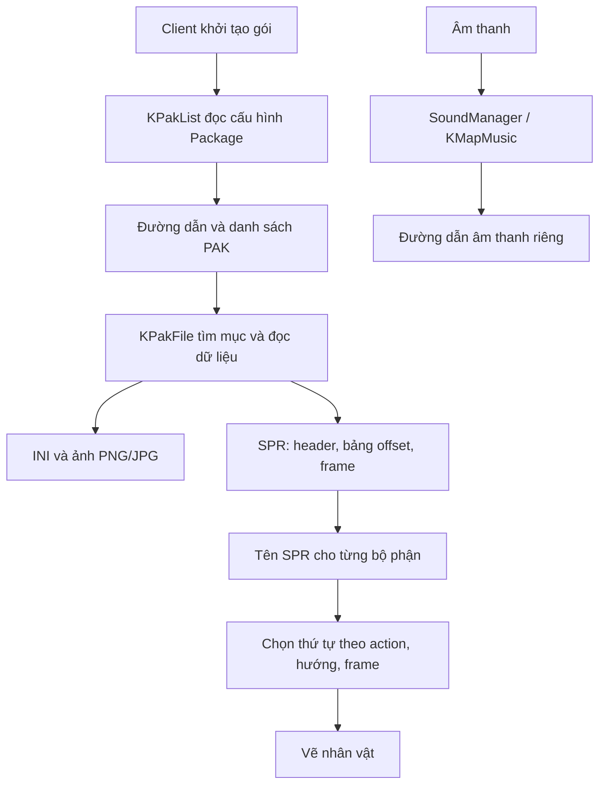

TÓM TẮT 1/5: [NGUỒN] PARTIAL — đã viết sổ tay tài nguyên client từ mã nguồn được giao, không suy rộng thành kết luận runtime.
TÓM TẮT 2/5: [NGUỒN] Client mở cấu hình gói qua `KPakList`; PAK được tìm theo danh sách và `KPakFile` có nhánh đọc file rời.
TÓM TẮT 3/5: [NGUỒN] SPR có luồng đọc header/frame; tên SPR bộ phận và thứ tự vẽ phụ thuộc bảng tài nguyên, hành động, hướng và khung.
TÓM TẮT 4/5: [CHƯA KIỂM] `docs-analysis/tools` không có trong worktree; chưa xác minh công cụ PAK, tài nguyên đóng gói và hành vi client đang chạy.
TÓM TẮT 5/5: [NGUỒN] Không chạy build/exe/VM/mạng; chưa chạy test; không commit/push theo yêu cầu; không có SHA.

# SO-17 — Sổ tay hiểu game: định dạng tài nguyên client (PAK, SPR, INI)

Loại: tổng hợp
Chủ đề: Giải thích đường đọc PAK, SPR, INI, ảnh bộ phận và âm thanh trong mã client được task chỉ định.
Từ khóa: tài nguyên client, gói PAK, sprite SPR, INI, paklist, KPakList, ảnh bộ phận, âm thanh JX1
Trạng thái: PARTIAL — phần đọc mã đã có bằng chứng file:dòng; thư mục công cụ PAK task nêu không tồn tại trong worktree và không kiểm tra runtime.
Độ phủ: 4/5 chủ đề đã được đối chiếu mã client; công cụ PAK 0/1 vì `docs-analysis/tools` không có trong worktree.
Liên quan: JX1_OPS/DESIGN/QUY-LUAT-VE-BO-PHAN.md; JX1_OPS/REPORTS/K-02-giao-dien.md; JX1_OPS/REPORTS/K-02-am-thanh.md; JX1_OPS/REPORTS/K-02-nhan-vat.md; JX1_OPS/REPORTS/K-02-quai-npc.md; JX1_OPS/REPORTS/J-01-animation-nhan-vat-tran.md
Cần tôi quyết định: không

## Phạm vi và độ phủ

| Phần tử của câu hỏi | Kết quả | Trạng thái | Bằng chứng / giới hạn |
|---|---|---|---|
| Client lấy tài nguyên từ PAK hay file rời | Mã client mở danh sách cấu hình gói, tìm mục trong PAK; `KPakFile` có chế độ ưu tiên gói hoặc ưu tiên file tùy mode | Đã đối chiếu tĩnh | `gamescene/KUpdateLayer.cpp:822–831`; `engine/KPakList.cpp:136–205`; `engine/KPakFile.cpp:19–31,256–305`. Chưa xác minh cấu hình và mode của bản client đang chạy. |
| Công cụ PAK ở `docs-analysis/tools` | Thư mục không tồn tại trong worktree hiện tại | Chưa phủ nội dung công cụ | Đã kiểm tra đúng đường dẫn; không mở/chạy công cụ thay thế. |
| SPR và ảnh động | Mã nhận diện đuôi `.spr`, gọi bộ nhớ ảnh để lấy header/frame; metadata chứa số frame, hướng, interval và kích thước/offset frame | Đã đối chiếu tĩnh | `engine/Kgetinidata.cpp:100–153`; `engine/KbugInfo.h:238–269`. Không đọc asset SPR thực. |
| Ảnh bộ phận và thứ tự vẽ | Node tài nguyên tra tên file theo part/action/equip; renderer hỏi bảng sort theo action, hướng, frame. Với NPC thường có nhánh part cố định; nhánh NPC đặc biệt dùng bảng sort | Đã đối chiếu tĩnh | `gamecore/KNpcResNode.cpp:547–627`; `gamecore/KNpcRes.cpp:241–287,415–423`; `JX1_OPS/DESIGN/QUY-LUAT-VE-BO-PHAN.md:18–43`. Bảng dữ liệu thật và hành vi từng asset chưa kiểm. |
| Âm thanh | `SoundManager` tìm âm trong thư mục ghi được hoặc đường dẫn thẻ; `KMapMusic` đọc bảng nhạc và chuyển đường dẫn cho phát nhạc | Đã đối chiếu tĩnh | `manager/SoundManager.cpp:85–168`; `gamecore/KMapMusic.cpp:92–116,261–283`. Chưa xác minh asset nào được dùng khi chạy. |

## Cách hiểu cho người chơi và người làm nội dung

### PAK, đường dẫn và INI

[THẤY] Ở điểm khởi tạo gói trong mã client, `KUpdateLayer` truyền `data/package.ini` cho danh sách gói (`gamescene/KUpdateLayer.cpp:822–831`). `KPakList::Open` đọc mục `Package`, lấy `Path`, rồi thử các khóa đánh số và mở những gói hợp lệ (`engine/KPakList.cpp:136–205`). Vì vậy danh sách cấu hình cho biết nơi tìm PAK và tên các gói; đường dẫn này thuộc mã nguồn, chưa chứng minh tệp cấu hình đó của một bản cài cụ thể.

[THẤY] `KPakFile::Open` có hai nhánh: một nhánh thử file rời rồi mới tra gói, nhánh kia tra gói trước rồi mới thử file rời (`engine/KPakFile.cpp:256–277`). Biến mode được khởi tạo bằng `1`, nhưng có hàm thay mode (`engine/KPakFile.cpp:19–31`); không thể kết luận mode hiệu lực của binary hoặc lần chơi cụ thể chỉ từ source.

[THẤY] Khi đường dẫn trỏ vào mục trong gói, `KPakFile::Read` chuyển việc đọc qua `KPakList`; nếu không có tham chiếu gói thì đọc từ file mở trên đĩa (`engine/KPakFile.cpp:286–305`). Kiểm tra tồn tại chung cũng dò gói trước rồi mới kiểm file rời (`engine/KFilePath.cpp:446–468`). `KIniFile::Load` mở dữ liệu qua `KPakFile`, nên INI có thể được đọc từ gói hoặc file theo nhánh mode trên (`engine/KIniFile.cpp:71–119`).

### PNG/JPG và SPR

[THẤY] Nhánh `Kgetinidata::findinidata_new` phân PNG/JPG khỏi SPR. PNG/JPG đi qua `getpicPath`; đường này chuẩn hóa tên, hỏi `KPakList` và đưa dữ liệu ảnh tìm được vào texture cache (`engine/Kgetinidata.cpp:59–96,570–590`). Đoạn mã đã xem xác nhận nhánh tra gói; nó không xác nhận mọi ảnh của game đều nằm trong PAK.

[THẤY] SPR đi qua bộ đọc riêng. Hàm kiểm đuôi `.spr`, yêu cầu đủ header/frame và bảng offset khi không dùng chế độ nạp một frame; sau đó đưa thông tin header và kích thước, offset frame vào cấu trúc kết quả (`engine/Kgetinidata.cpp:100–153`). Source mô tả header gồm kích thước, tâm, số frame, màu, hướng, interval; mỗi frame có offset, kích thước và dữ liệu sprite (`engine/KbugInfo.h:238–269`). Đây là mô tả format trong source, không phải kiểm tra nội dung gói PAK.

### Ảnh bộ phận và lỗi sai thứ tự vẽ

[THẤY] Với nhân vật ghép nhiều phần, `KNpcResNode::GetFileName` là điểm tra tên SPR theo phần và điều kiện tài nguyên (`gamecore/KNpcResNode.cpp:547–605`). `KNpcRes::Draw` tính hướng/frame cho ảnh bộ phận rồi yêu cầu `GetnSort` với hành động, hướng và frame hiện tại (`gamecore/KNpcRes.cpp:241–287,415–423`). Node trả một part cố định cho NPC thường; nhánh NPC đặc biệt lấy thứ tự từ bảng sort (`gamecore/KNpcResNode.cpp:612–630`).

[TÀI LIỆU] Bảng phủ trong `QUY-LUAT-VE-BO-PHAN.md` ghi rõ thứ tự che không cố định cho mọi tư thế; dữ liệu nữ/đứng được dẫn lại từ BUG-001, còn các tổ hợp khác chưa đo (`JX1_OPS/DESIGN/QUY-LUAT-VE-BO-PHAN.md:18–43`). [THẤY] Mã lấy thứ tự theo action, hướng và frame (`gamecore/KNpcRes.cpp:422`; `gamecore/KNpcResNode.cpp:612–630`). Nếu tra sai tổ hợp trạng thái hoặc bảng sort không khớp, thứ tự part được chọn sẽ khác với thứ tự cần cho trạng thái đó. [CHƯA KIỂM] Chưa có bằng chứng xác định tổ hợp hoặc dòng bảng nào gây ra một ca lỗi cụ thể; không thể gán lỗi cho một file SPR hay thiết lập riêng.

### Đối chiếu bộ đọc gói phía server

[THẤY] Source server tại `C:/Jx1CocoV3/SwordOnline/SwordOnline/jxOnline/gameserver/Sources` cũng có `KPakList::Open` đọc mục `Package`, trường `Path` và các khóa số để mở các gói (`Engine/Src/KPakList.cpp:121–188`). `KPakFile` phía server đọc từ tham chiếu mục gói hoặc từ file đã mở (`Engine/Src/KPakFile.cpp:245–305`). Điều này cho thấy hai source tree có lớp đọc gói tương tự; không dùng server để suy đường dẫn client hoặc xác nhận bản chạy.

### Âm thanh

[THẤY] `SoundManager::PlaySound` tìm tệp âm trong thư mục `ogg` dưới đường dẫn ghi được trước khi nạp và phát; `MyPlaySound` ghép tên với đường dẫn thẻ nhớ/cấu hình rồi kiểm tra tệp (`manager/SoundManager.cpp:85–168`). Đây là một đường âm thanh riêng, không phải bằng chứng cho vị trí mọi âm trong PAK.

[THẤY] `KMapMusic::LoadSetFile` nạp bảng dữ liệu nhạc; các nhánh phát gọi trình phát với biến đường dẫn nhạc đã ghép (`gamecore/KMapMusic.cpp:92–116,261–283`). Tên asset, vị trí cài đặt và việc có fallback nào trong binary cụ thể chưa được kiểm tra.

## Giải mã tên

| Tên gốc | Mã hóa | Chữ đúng | Nguồn file:dòng |
|---|---|---|---|
| PAK, SPR, INI | Ký tự Latin/ASCII; tên định dạng | Giữ nguyên PAK, SPR, INI | `engine/KbugInfo.h:238–283`; `engine/KIniFile.cpp:71–119` |
| Cocos2d-x / CCTextureCache | Tên thư viện và lớp, ký tự Latin/ASCII | Giữ nguyên tên kỹ thuật | `engine/Kgetinidata.cpp:59–96,570–590` |
| FMOD | Tên thư viện âm thanh, ký tự Latin/ASCII | Giữ nguyên FMOD | `manager/SoundManager.cpp:52–60,85–114` |
| Tên kỹ năng, trang bị, quái, NPC hoặc bản đồ | Không có tên thực thể được đọc trong phạm vi này | Chưa áp dụng | Chỉ đọc mã nạp tài nguyên và báo cáo dẫn; không giải mã dữ liệu nội dung game. |

## Sắp theo cấu trúc game

| Cấu trúc | Thứ tự hiểu | Mức xác minh |
|---|---|---|
| Gói tài nguyên | Cấu hình Package → thư mục gốc → các mục PAK → đường dẫn tài nguyên | Đã xác minh luồng source; chưa kiểm cấu hình/PAK của bản cài. |
| Ảnh | PNG/JPG qua nhánh ảnh; SPR qua header → bảng offset → frame | Đã xác minh nhánh source; chưa kiểm asset cụ thể. |
| Nhân vật ghép bộ phận | Loại NPC → tên SPR của part → action → hướng → frame → sort/draw | Đã xác minh lời gọi và giới hạn từ DESIGN; chưa đối chiếu bảng dữ liệu thật. |
| Âm thanh | Âm hiệu qua SoundManager; nhạc bản đồ qua KMapMusic | Đã xác minh lời gọi source; chưa lập danh sách asset thực tế. |

## Đã xác minh / Chưa xác minh

### Đã xác minh
- Client được đọc theo root trong task: `C:/Jx1CocoV3/Folder/Client2912-20260116T044348Z-3-001/Client2912/Client/Classes`; bằng chứng tĩnh nằm ở các file:dòng trong bảng trên.
- Mã client có đường mở danh sách gói, đọc mục PAK, đường đọc INI, nhánh nạp PNG/JPG và SPR, tra tên ảnh bộ phận, yêu cầu sort, và hai đường âm thanh như trích dẫn trên.
- Đã đối chiếu source server `KPakList`/`KPakFile` với client và báo cáo DESIGN về giới hạn thứ tự bộ phận; không đổi kết luận hiện có.

### Chưa xác minh
- Nội dung và thứ tự thật của từng PAK/`package.ini`/`paklist.ini`, các asset SPR thực tế, và thư viện/công cụ PAK ở `docs-analysis/tools`.
- Bản client nào đang dùng cấu hình hoặc mode nào; source có khớp binary/cấu hình được cài không; thứ tự vẽ của từng asset khi runtime.
- Tệp âm thanh nào được nạp trong game và nguồn lưu của chúng ở bản chạy cụ thể.
- Build, test, exe, VM, mạng và đo runtime không thực hiện theo giới hạn task.

### Phạm vi công cụ và nhịp
- `rg` không khả dụng trong môi trường; dùng `Get-ChildItem`/`Select-String` giới hạn theo thư mục và tên tệp, hoàn tất tìm kiếm cần thiết.
- Thử ghi `D:/JX-wt/SO-17.nhip` theo yêu cầu nhưng hệ thống từ chối quyền ghi; nhịp không được lưu. Không đổi quyền hoặc ghi ra ngoài worktree.
- Không có lỗi đọc source nào cần retry; không chạy test/build vì task chỉ duyệt đọc tĩnh và tạo tài liệu.

## Bàn giao

Không commit/push theo yêu cầu; SHA không có. Bước tiếp theo: PM có thể chỉ định đường dẫn đúng của công cụ PAK hoặc đưa thư mục đó vào worktree để hoàn tất phần còn thiếu. Tài liệu mới cần PM gộp vào mục lục:

| Chủ đề | Báo cáo / tài liệu | File, hàm chính | Độ chắc |
|---|---|---|---|
| Tài nguyên client PAK/SPR/INI, ảnh bộ phận và âm thanh | `SO-17` | `KPakList`, `KPakFile`, `Kgetinidata`, `KNpcResNode`, `KNpcRes`, `SoundManager`, `KMapMusic` | Khảo sát tĩnh; PARTIAL |

liên quan: JX1_OPS/DESIGN/QUY-LUAT-VE-BO-PHAN.md; JX1_OPS/REPORTS/K-02-giao-dien.md; JX1_OPS/REPORTS/K-02-am-thanh.md; JX1_OPS/REPORTS/K-02-nhan-vat.md; JX1_OPS/REPORTS/K-02-quai-npc.md; JX1_OPS/REPORTS/J-01-animation-nhan-vat-tran.md

Kỹ năng đã dùng: jx1-retrofit, jx1-read-server, jx1-read-client, jx1-parameters, jx1-knowledge, jx1-report
