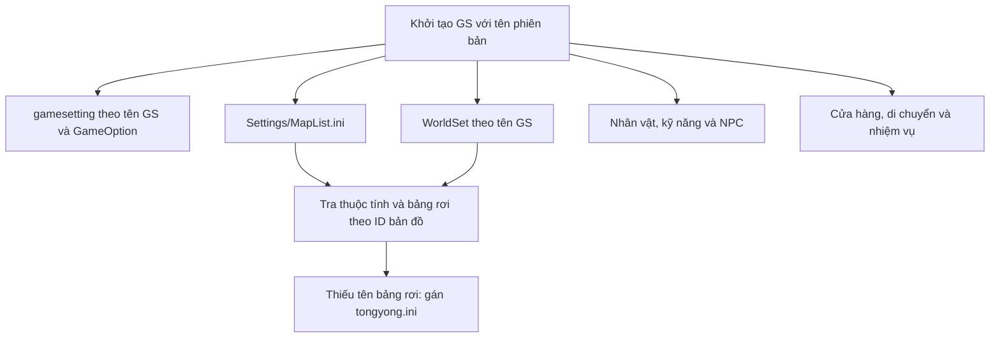

TÓM TẮT 1: [TÀI LIỆU] PARTIAL — đã lập danh mục tệp trọng yếu của gs/Settings và các điểm đọc tĩnh trong mã server.
TÓM TẮT 2: [THẤY] Đã đối chiếu 34 đường dẫn trọng yếu (25 đã có, 9 bổ sung); tầng gốc Settings có 90 tệp, gồm 33 INI và 49 TXT.
TÓM TẮT 3: [TÀI LIỆU] Mỗi nhóm dưới đây nêu công dụng, điểm đọc trong source và mức thận trọng khi sửa.
TÓM TẮT 4: [THẤY] `tongyong.ini` của bản A ghi `Count=0`; bộ đọc từ chối số mục không dương (`Settings/mapdroprate/tongyong.ini:3`; `SRC/Core/Src/KNpcTemplate.cpp:135–143`).
TÓM TẮT 5: [CHƯA KIỂM] Chưa xác nhận cấu hình hiệu lực hay tệp nào sửa an toàn; lượt tiếp tục không build, chạy exe, VM hay dùng mạng.

# SO-16 — Sổ tay tệp cấu hình gs/Settings
Loại: khảo sát
Chủ đề: Danh mục tệp cấu hình GS trọng yếu, công dụng, điểm đọc trong server source và mức an toàn khi chỉnh sửa.
Từ khóa: cấu hình, Settings, gamesetting_gs001.ini, MapList, WorldSet, kỹ năng, Missles, RevivePos
Trạng thái: PARTIAL — đã phủ nhóm trọng yếu nhưng chưa kiểm kê toàn bộ cây Settings và chưa chứng minh tệp nào sửa an toàn.
Độ phủ: đã đối chiếu sự hiện diện và điểm đọc tĩnh của 34/34 đường dẫn được chọn; tầng gốc có 82 tệp .ini/.txt (33 .ini, 49 .txt); chưa đếm toàn bộ cây con.
Liên quan: `JX1_OPS/REPORTS/A-03-kiem-ke-cau-hinh.md`; `JX1_OPS/REPORTS/I-04-khao-sat-map.md`; `JX1_OPS/REPORTS/K-02-ban-do.md`; `JX1_OPS/REPORTS/K-02-du-lieu-ini.md`; `JX1_OPS/REPORTS/A-08d-kinh-nghiem.md`; `JX1_OPS/REPORTS/I-02-vat-pham-ban.md`; `JX1_OPS/REPORTS/A-17-roi-do-boss-trang-bi.md`; `JX1_OPS/DESIGN/CHUAN-BAO-CAO.md`
Cần tôi quyết định: không

[THẤY] Bản dữ liệu được đối chiếu là `C:\Jx1CocoV3\Folder\ServerNew-20260116T043145Z-3-001\ServerNew\_bin_v2_\gs\Settings` (viết tắt `Settings/`). Đây là bản A được A-03 dẫn tại dòng 35–42. Đã kiểm sự hiện diện của các đường dẫn được chọn và đọc một vài khóa/cột không nhạy cảm. Mã server được đọc tại `C:\Jx1CocoV3\SwordOnline\SwordOnline\jxOnline\gameserver\Sources` (`SRC/`); định nghĩa tên tệp ở `C:\Jx1CocoV3\SwordOnline\SwordOnline\jxOnline\header\CoreUseNameDef.h` (`HDR/`).

[CHƯA KIỂM] `D:\JX-build\qh9A\gs\Settings` và `D:\JX-build\qh9A\_bin_v2_\gs\Settings` không hiện hữu. Cây `qh9A` có `Classes` và `Resources`, nhưng chưa xác lập được một bản GS trong đó. Vì vậy không coi `qh9A` là nguồn của các tệp server trong tài liệu này.

## Sơ đồ đọc cấu hình

## Phạm vi và độ phủ

[THẤY] Cả 34 đường dẫn trong bảng đều có ở bản A. Việc kiểm tra sự hiện diện trên đĩa không có số dòng. Các dẫn chiếu `file:dòng` trong bảng cho biết điểm đọc tĩnh trong mã server. Chúng chưa chứng minh tiến trình đang chạy đã nạp các tệp trên đĩa.

| Nhóm theo luồng game | Tệp trong `GS/Settings` | Vai trò và người đọc trong source | Đánh giá sửa |
|---|---|---|---|
| Khởi tạo GS | `gamesetting_gs001.ini` | Chứa tham số phiên bản, số thế giới, chỉ số GS và giới hạn người chơi/NPC/vật phẩm. `SRC/Core/Src/KCore.cpp:262–293` dựng tên theo tham số khởi chạy và đọc các khóa này. | CẨN THẬN; ảnh hưởng khởi tạo và giới hạn server. |
| Khởi tạo GS | `GameOption.ini` | GS đọc bảng tùy chọn chung; nếu mở thất bại thì hàm khởi tạo thoát. Mã khởi tạo người chơi đọc các mục và cặp giá trị theo hạng. `HDR/CoreUseNameDef.h:164`; `SRC/Core/Src/KCore.cpp:317–325`; `SRC/Core/Src/KPlayerSet.cpp:127–156`. | CẨN THẬN; chưa xác định tác động của mọi mục. |
| Dữ liệu lưu của game | `GameData.ini` | GS đọc giá trị và nhóm dữ liệu đã lưu; nếu mở thất bại, mã có nhánh tạo tệp. Hàm `KGameData::Save` ghi lại cùng tệp. `HDR/CoreUseNameDef.h:163`; `SRC/Core/Src/KCore.cpp:699–702`; `SRC/Core/Src/KCoreData.cpp:40–47,168–208,217–247`; `SRC/Core/Src/ScriptFuns.cpp:4612,4743`. | KHÔNG sửa tay như bảng cân bằng game; dữ liệu do chương trình ghi có thể ghi đè thay đổi. |
| Bản đồ | `MapList.ini` | Danh mục thuộc tính/đường dẫn theo ID bản đồ; source nạp bảng rồi lấy loại bản đồ, tên, cấp NPC, drop rate và script. `HDR/CoreUseNameDef.h:161`; `SRC/Core/Src/KCore.cpp:609–610`; `SRC/Core/Src/KSubWorld.cpp:811–925`. | CẨN THẬN; có thể làm sai đường dẫn hoặc dữ liệu bản đồ. |
| Bản đồ và rơi đồ | `mapdroprate/tongyong.ini` | Tên mặc định khi khóa rơi đồ của bản đồ trống. Điểm mở là `g_GenItemDropRate` khi nhánh tạo quái chọn bảng này và bộ nhớ đệm chưa có mục tương ứng. `SRC/Core/Src/KSubWorld.cpp:886–901`; `SRC/Core/Src/KRegion.cpp:417–425,772–778`; `SRC/Core/Src/KNpcSet.cpp:595–616`; `SRC/Core/Src/KNpcTemplate.cpp:129–143,512–558`. | CẨN THẬN; đây là tên mặc định dùng chung. Bản A ghi `Count=0`, giá trị bị bộ đọc từ chối; xem phát hiện bên dưới. |
| Hồi sinh | `RevivePos.ini` | Lưu vùng chọn và tọa độ hồi sinh theo ID thế giới. Hàm `GetRevivalPosFromId` đọc tệp. `SRC/Core/Src/KSubWorldSet.cpp:683–721`. | CẨN THẬN; ảnh hưởng vị trí nhân vật. |
| Lên cấp | `npc/player/level_exp.txt` | Số kinh nghiệm cần cho từng cấp nhân vật. `KLevelAdd::Init` lấy cột 2 theo thứ tự dòng, bắt đầu ở dòng 2. `HDR/CoreUseNameDef.h:110`; `SRC/Core/Src/KPlayerSet.cpp:1291–1299`. | CẨN THẬN; giữ thứ tự dòng và kiểm ngưỡng cấp. |
| Lên cấp | `npc/player/level_add.txt` | Mức tăng sinh lực, thể lực, nội lực và các thuộc tính theo hệ; `KLevelAdd::Init` đọc theo vị trí cột. `HDR/CoreUseNameDef.h:111`; `SRC/Core/Src/KPlayerSet.cpp:1303–1319`. | CẨN THẬN; đảo cột có thể đổi nhầm chỉ số. |
| Đội nhóm | `npc/player/level_lead_exp.txt` | Ngưỡng kinh nghiệm và số thành viên theo cấp lãnh đạo; `KTeamLeadExp::Init` đọc cột 2 và 3. `HDR/CoreUseNameDef.h:112`; `SRC/Core/Src/KPlayerSet.cpp:1481–1494`. | CẨN THẬN; tác động quy mô đội. |
| Tạo nhân vật | `npc/player/NewPlayerBaseAttribute.ini` | Sức mạnh, thân pháp, sinh khí, nội lực và may mắn ban đầu theo ngũ hành; đọc bởi `KNewPlayerAttribute::Init`. `HDR/CoreUseNameDef.h:113`; `SRC/Core/Src/KPlayerSet.cpp:76,1568–1585`. | CẨN THẬN; giữ nguyên tên khóa mà bộ đọc dùng. |
| Di chuyển nhân vật | `npc/player/BaseValue.ini` | Thiết lập chung như tốc độ chạy, đi bộ và số khung phản ứng/đánh. `KNpcSet::LoadPlayerBaseValue` đọc mục `Common`; các mục khung hình nam/nữ ở nhánh client của tệp source. `HDR/CoreUseNameDef.h:115`; `SRC/Core/Src/KNpcSet.cpp:91,135–153`. | CẨN THẬN; chưa kiểm đồng bộ giữa client và server. |
| Kỹ năng và đối tượng | `Skills.txt` | Bảng kỹ năng thường; được nạp trước khi khởi tạo thiết lập kỹ năng. `HDR/CoreUseNameDef.h:139`; `SRC/Core/Src/KCore.cpp:623–630`. | CẨN THẬN; schema và tác động chưa được kiểm thử. |
| Kỹ năng và đối tượng | `Missles.txt` | Bảng đạn/tên lửa dùng trong khởi tạo đối tượng đạn. Tên giữ nguyên theo source. `HDR/CoreUseNameDef.h:140`; `SRC/Core/Src/KCore.cpp:625,629`. | CẨN THẬN; schema chưa kiểm. |
| Kỹ năng và đối tượng | `NpcS.txt` (trên đĩa ghi `Npcs.txt`, chỉ khác hoa thường) | Bảng cấu hình NPC; source nạp trước khi khởi tạo NPC. `HDR/CoreUseNameDef.h:141`; `SRC/Core/Src/KCore.cpp:626,630`. | CẨN THẬN; schema chưa kiểm. |
| Đồ và độ bền | `item/AbradeRate.ini` | Tham số giá sửa và hao mòn theo hành động/trang bị. `HDR/CoreUseNameDef.h:135`; `SRC/Core/Src/KItemSet.cpp:73–125`. | CẨN THẬN; ảnh hưởng kinh tế và hao mòn. |
| Cửa hàng | `buysell.txt` | Mỗi dòng cửa hàng tham chiếu các món ở bảng `goods.txt`. Bộ nạp `KBuySell::Init` trừ 1 ở ID dương để chuyển sang chỉ số nội bộ. `HDR/CoreUseNameDef.h:123`; `SRC/Core/Src/KCore.cpp:760–762`; `SRC/Core/Src/KBuySell.cpp:83–90,223–234`. | CẨN THẬN; kiểm tham chiếu sang bảng hàng, giữ đúng thứ tự dòng/cột. |
| Cửa hàng | `goods.txt` | Bảng món hàng, gồm loại, cấp, giá và loại tiền ở các cột cố định; đọc cùng `buysell.txt` bởi `KBuySell::Init`. `HDR/CoreUseNameDef.h:124`; `SRC/Core/Src/KBuySell.cpp:83–93,110–125`. | CẨN THẬN; chèn/xóa/đảo dòng có thể đổi món được tham chiếu. |
| Vật phẩm/nhiệm vụ | `item/004/questkey.txt` | Bảng vật phẩm nhiệm vụ; nạp thành `g_EventItemTab`. `HDR/CoreUseNameDef.h:93`; `SRC/Core/Src/KCore.cpp:824–830`. | CẨN THẬN; schema chưa kiểm. |
| Vật phẩm/nhiệm vụ | `item/004/mine.txt` | Bảng vật phẩm/nguyên liệu khai thác; nạp thành `g_MineItemTab`. `HDR/CoreUseNameDef.h:94`; `SRC/Core/Src/KCore.cpp:837–840`. | CẨN THẬN; schema chưa kiểm. |
| Vật phẩm/nhiệm vụ | `item/004/fusion.txt` | Bảng vật phẩm ghép; nạp thành `g_FusionTab`. `HDR/CoreUseNameDef.h:95`; `SRC/Core/Src/KCore.cpp:832–835`. | CẨN THẬN; schema chưa kiểm. |
| Vật phẩm/nhiệm vụ | `task/missions.txt` | Bảng nhiệm vụ; nạp thành `g_MissionTabFile`. `HDR/CoreUseNameDef.h:97`; `SRC/Core/Src/KCore.cpp:908–910`. | CẨN THẬN; điều kiện nhiệm vụ chưa kiểm. |
| Dịch chuyển | `WayPoint.txt` | Bảng điểm/đích dịch chuyển; `g_WayPointTabFile` đọc bảng. `HDR/CoreUseNameDef.h:86`; `SRC/Core/Src/KCore.cpp:841–844`. | CẨN THẬN; ảnh hưởng tuyến di chuyển. |
| Dịch chuyển | `Station.txt` | Bảng trạm dịch chuyển; `g_StationTabFile` đọc bảng. `HDR/CoreUseNameDef.h:87`; `SRC/Core/Src/KCore.cpp:846–849`. | CẨN THẬN; ảnh hưởng tuyến di chuyển. |
| Dịch chuyển và phí | `StationPrice.txt` | Bảng phí trạm; source đọc kích thước bảng và đơn vị giá. `HDR/CoreUseNameDef.h:88`; `SRC/Core/Src/KCore.cpp:851–853,871–888`. | CẨN THẬN; ảnh hưởng kinh tế. |
| Dịch chuyển và phí | `WayPointPrice.txt` | Bảng phí điểm đến; source đọc kích thước bảng và đơn vị giá. `HDR/CoreUseNameDef.h:89`; `SRC/Core/Src/KCore.cpp:856–859,871–894`. | CẨN THẬN; ảnh hưởng kinh tế. |
| Đường thủy | `Wharf.txt` | Bảng bến/đường thủy; `g_DockTabFile` đọc bảng. `HDR/CoreUseNameDef.h:90`; `SRC/Core/Src/KCore.cpp:861–864`. | CẨN THẬN; schema chưa kiểm. |
| Đường thủy và phí | `WharfPrice.txt` | Bảng phí đường thủy; `g_DockPriceTabFile` đọc bảng. `HDR/CoreUseNameDef.h:91`; `SRC/Core/Src/KCore.cpp:866–869,875–881,897–900`. | CẨN THẬN; ảnh hưởng kinh tế. |
| Tái sinh | `ReBorn/rebornsetting.txt` | Bảng thiết lập tái sinh; nạp vào `g_ReBornSetting`. `HDR/CoreUseNameDef.h:101`; `SRC/Core/Src/KCore.cpp:678–681`. | CẨN THẬN; quy tắc nhân vật chưa kiểm. |
| VIP | `RoleVip/rolevipsetting.txt` | Bảng thiết lập VIP; nạp vào `g_PlayerVipSetting`. `HDR/CoreUseNameDef.h:102`; `SRC/Core/Src/KCore.cpp:683–685`. | CẨN THẬN; tác động quyền lợi chưa kiểm. |
| Quyền GM | `gmgamelist.txt` | Danh sách được nạp vào `g_gmList`. Không mở nội dung danh sách quyền. `SRC/Core/Src/KCore.cpp:596–597`. | CẨN THẬN; không xác nhận nội dung/quyền. |
| Hạn chế | `ForbititWaiGua.txt` | Bảng hạn chế liên quan công cụ ngoài game; nạp vào `g_ForbitWaiGua`. `HDR/CoreUseNameDef.h:168`; `SRC/Core/Src/KCore.cpp:599–600`. | CẨN THẬN; ý nghĩa từng dòng chưa kiểm. |
| Hạn chế bản đồ | `ForbititMap.txt` | Bảng bản đồ bị hạn chế; nạp vào `g_ForbitMap`. `HDR/CoreUseNameDef.h:167`; `SRC/Core/Src/KCore.cpp:602–603`. | CẨN THẬN; ảnh hưởng luật khu vực. |
| Kinh mạch | `meridian/meridian_level.txt` | Bảng cấp kinh mạch; tên macro được nạp vào `g_FsJinMai`. `HDR/CoreUseNameDef.h:166`; `SRC/Core/Src/KCore.cpp:604–605`. | CẨN THẬN; tác động chỉ số chưa kiểm. |
| Danh hiệu | `playertitle.txt` | Bảng danh hiệu người chơi; source gọi `g_PlayerTitle.Load`. `SRC/Core/Src/KCore.cpp:607`. | CẨN THẬN; định dạng chưa kiểm. |

[CHƯA KIỂM] Chưa có tệp đạt mức CÓ. CẨN THẬN nghĩa là đã biết bộ đọc nhưng chưa đủ căn cứ kết luận chỉnh sửa an toàn. KHÔNG là khuyến nghị không sửa tay tệp lưu trạng thái `GameData.ini` như một tệp điều chỉnh luật chơi. Các mức này không cấp quyền sửa.

## Tên file và cách xếp theo cấu trúc game

| Tên gốc | Mã hóa | Chữ đúng/cách hiểu | Nguồn |
|---|---|---|---|
| `gs001` | ASCII | Tên tham số server giữ nguyên; source dùng để dựng tên cấu hình và danh sách map. | `SRC/Core/Src/KCore.cpp:262,653–656` |
| `MapList.ini` | ASCII | Định danh file danh mục bản đồ, giữ nguyên. | `HDR/CoreUseNameDef.h:161` |
| `WorldSet_<tên>.ini` | ASCII | Mẫu tên file chọn ID thế giới/bản đồ, giữ nguyên. | `SRC/Core/Src/KCore.cpp:653–656` |
| `Missles.txt` | ASCII | Chính tả file trong source; giữ nguyên, không tự sửa tên. | `HDR/CoreUseNameDef.h:140` |
| `NpcS.txt` / `Npcs.txt` | ASCII | Tên source và cách viết trên đĩa chỉ khác hoa thường trên Windows. | `HDR/CoreUseNameDef.h:141`; kiểm tra filesystem bản A |
| `ReBorn`, `RoleVip` | ASCII | Tên thư mục giữ nguyên theo source. | `HDR/CoreUseNameDef.h:101–102` |

[CHƯA KIỂM] Báo cáo không trích tên riêng nhân vật, bản đồ, kỹ năng, NPC hoặc chữ Hán/Việt legacy từ dữ liệu; do đó chưa có chuỗi GBK/TCVN3 nào cần giải mã. Các mục được xếp theo luồng khởi tạo server → bản đồ → kỹ năng/đối tượng → vật phẩm, di chuyển và nhiệm vụ → tái sinh/VIP, không theo thứ tự liệt kê tệp trên đĩa.

## Cấu hình liên quan ngoài thư mục Settings

[TÀI LIỆU] `gs001_cfg.ini` được tạo theo tham số và đọc các nhóm cổng dịch vụ trong `SRC/MultiServer/GameServer/KSOServer.cpp:704–730`. Không sao chép giá trị địa chỉ vào tài liệu. `ServerCfg.ini` có hàm đọc riêng `SetServerPort` tại `SRC/MultiServer/GameServer/KSOServer.cpp:346–356`; chưa truy được hàm này có thuộc luồng khởi động GS đang xét hay không.

[TÀI LIỆU] `maps/WorldSet_<tên>.ini` nằm ngoài Settings. `KCore.cpp:653–656` dựng tên và gọi `LoadSerMaps`; `KSubWorldSet.cpp:441–464` đọc `Count`, các khóa `World%02d` rồi gọi nạp bản đồ. Không suy số bản đồ chạy thực tế chỉ từ tệp này.

## Tệp hiện hữu chưa xếp vào nhóm chính

[CHƯA KIỂM] Các tên `gamesetting.ini`, `gamesetting_bin_v2_bak.ini`, `gamesetting_gs002.ini` đến `gamesetting_gs006.ini`, `MapList_.ini`, `MapsetInfo.txt` và `Task/tasklist.ini` hiện hữu. Chưa xác định bản nào được chọn ngoài mẫu `%s` ở `SRC/Core/Src/KCore.cpp:262`; `Task/tasklist.ini` có lời gọi `g_TaskLoop.Load` bị chú thích ở `SRC/Core/Src/KCore.cpp:688–692`. Chưa truy được người đọc cho các mục còn lại từ các điểm code đã kiểm.

[TÀI LIỆU] `MapTraffic.ini` hiện hữu nhưng điểm nạp thấy được ở `KCore.cpp:710–711` nằm trong `#ifndef _SERVER`; không tính đây là tệp GS đã xác minh sử dụng. Chưa kiểm mọi điểm nạp khác.

[THẤY] Client2912 của task có lời gọi nạp trực tiếp `g_MapTraffic.Load` tại `C:/Jx1CocoV3/Folder/Client2912-20260116T044348Z-3-001/Client2912/Client/Classes/gamecore/KCore.cpp:409–413`. Đây là điểm đọc của client, không bổ sung vào số tệp có bộ đọc GS.

## MỤC SỔ THÔNG SỐ

[THẤY] Cột “Nguồn đo” tách mặc định trong mã và một vài giá trị đọc từ bản A trên đĩa. Chưa có số đo runtime.

| Nhóm | Tên/hằng số | file:dòng | Giá trị | Đơn vị | Ảnh hưởng | Đổi an toàn | Nguồn đo |
|---|---|---|---|---|---|---|---|
| Khởi tạo GS | `MaxSubWorldCount` | `SRC/Core/Src/KCore.cpp:283` | mặc định 1 nếu thiếu khóa | số lượng; ý nghĩa runtime chưa đo | Giới hạn thế giới con được nạp | CẨN THẬN | Đọc tĩnh, mặc định source; chưa đọc cấu hình |
| Khởi tạo GS | `CoreSleepTime` | `SRC/Core/Src/KCore.cpp:290` | mặc định 500 nếu thiếu khóa | chưa xác minh | Thời gian ngủ của core theo tên biến | CẨN THẬN | Đọc tĩnh, mặc định source; chưa đọc cấu hình |
| Khởi tạo GS | `MaxPlayerCount`, `MaxNpcCount`, `MaxItemCount` | `SRC/Core/Src/KCore.cpp:291–293` | mặc định 1 cho mỗi khóa nếu thiếu | số lượng; chưa đo giới hạn hữu hiệu | Giới hạn người chơi, NPC, vật phẩm | CẨN THẬN | Đọc tĩnh, mặc định source; chưa đọc cấu hình |
| Độ bền | `ItemPriceScale`, `MagicPriceScale`, `LevelPriceScale` | `SRC/Core/Src/KItemSet.cpp:76–78` | mặc định lần lượt 100, 10, 1000 nếu thiếu | chưa xác minh | Các hệ số tính giá sửa | CẨN THẬN | Đọc tĩnh; chưa truy công thức đầy đủ hoặc đọc cấu hình |
| Rơi đồ | `Main.Count` | `Settings/mapdroprate/tongyong.ini:2–3`; `SRC/Core/Src/KNpcTemplate.cpp:135–143` | 0 trên đĩa; bộ đọc yêu cầu lớn hơn 0 | số mục rơi | Bảng mặc định bị từ chối nếu nạp đúng tệp này | CẨN THẬN | Đọc tĩnh từ bản A và mã |
| Lên cấp | Ngưỡng kinh nghiệm cấp 1 | `Settings/npc/player/level_exp.txt:2`; `SRC/Core/Src/KPlayerSet.cpp:1295–1299` | 100 trên đĩa | điểm kinh nghiệm | Ngưỡng kinh nghiệm cho cấp 1 | CẨN THẬN | Đọc tĩnh từ bản A, cột 2 |
| Di chuyển | `RunSpeed`, `WalkSpeed` | `Settings/npc/player/BaseValue.ini:3–4`; `SRC/Core/Src/KNpcSet.cpp:139–144` | 10 và 5 trên đĩa; trùng mặc định trong mã | chưa quy đổi ra đơn vị di chuyển | Tốc độ chạy và đi bộ | CẨN THẬN | Đọc tĩnh từ bản A và mã |

## Đã xác minh / Chưa xác minh

**Đã xác minh (đọc tĩnh):** 34 đường dẫn cấu hình trọng yếu tồn tại trong bản A và có điểm đọc trong mã như bảng trên. Điểm nạp danh mục bản đồ ở `SRC/Core/Src/KCore.cpp:609–610`, `SRC/Core/Src/KSubWorld.cpp:811–925`; nhóm hồi sinh ở `SRC/Core/Src/KSubWorldSet.cpp:683–721`; nhóm kỹ năng/NPC ở `SRC/Core/Src/KCore.cpp:623–630`; bảng vận chuyển và nhiệm vụ ở `SRC/Core/Src/KCore.cpp:824–869,908–910`.

**Chưa xác minh:** Toàn bộ nội dung, cấu trúc và mã hóa của các bảng; các tệp ngoài danh mục trọng yếu; bản dựng/tiến trình nào dùng bộ Settings này; cấu hình nào đọc từ tệp rời hay gói dữ liệu; kết quả nếu chỉnh sửa. Lượt tiếp tục chỉ đọc tĩnh, không build, chạy exe, VM hay dùng mạng.

## Phát hiện và giới hạn

- `CLAUDE.md` không có ở gốc worktree nên không thể lấy mục “Bản đồ code” từ file đó. Các báo cáo gợi ý A-03, I-04 và K-02 đã được đọc theo phạm vi liên quan; mã server được mở trực tiếp tại các dòng trích dẫn.
- `rg` không khả dụng; đã dùng PowerShell để tìm tên tệp/chuỗi trong các thư mục và file cụ thể, không cài công cụ và không quét đệ quy toàn bộ thư mục game.
- [THẤY] `tongyong.ini` có các mục đánh số như `[1]` nhưng `Main.Count=0` (`Settings/mapdroprate/tongyong.ini:2–3,25`). Nếu nhánh tạo quái mở đúng bản tệp rời này, bộ đọc trả về rỗng trước khi đọc các mục đó (`SRC/Core/Src/KNpcTemplate.cpp:135–143,192–198`). Không suy rằng mọi quái trên server đều không rơi đồ: nhánh này có điều kiện và bản đồ có thể chỉ định tệp khác (`SRC/Core/Src/KSubWorld.cpp:886–901`; `SRC/Core/Src/KNpcSet.cpp:595–616`).
- [THẤY] `MapList.ini` và `maps/WorldSet_<tên>.ini` được mở riêng: tệp thứ hai chọn các ID, tệp thứ nhất cung cấp thuộc tính theo ID. Sơ đồ đã tách hai nhánh (`SRC/Core/Src/KCore.cpp:609–610,653–656`; `SRC/Core/Src/KSubWorldSet.cpp:441–464`; `SRC/Core/Src/KSubWorld.cpp:811–901`).
- [TÀI LIỆU] Lượt trước gọi Graphify một lần trái giới hạn không chạy exe, không có đầu ra và không dùng làm bằng chứng. Lượt tiếp tục không gọi lại.
- [TÀI LIỆU] Mốc trước ghi 90 tệp ở tầng gốc (33 INI, 49 TXT, 8 phần mở rộng khác). A-03 ghi 2.022 tệp cho lần kiểm kê trước; SO-16 không tái xác minh số lịch sử trong toàn cây.
- Không tạo `JX1_OPS/REPORTS/_CHIMUC/SO-16.tsv` vì ngoài phạm vi tệp được phép; hàng đề nghị nằm trong báo cáo SO-16.
- Không ghi được `D:\JX-wt\SO-16.nhip`: PowerShell trả `Access to the path is denied` khi ghi ngoài worktree.

## Đề xuất tối ưu

Nếu cần đổi cấu hình ở một công việc riêng, hãy chọn đúng bản GS trước, sao lưu file gốc và ghi nhận khác biệt; thay từng khóa có mục tiêu rõ, kiểm schema và thử bằng quy trình được duyệt trước khi dùng. SO-16 chỉ khảo sát tĩnh và không cấp quyền chỉnh hoặc chạy.

## Bàn giao

Không commit theo yêu cầu. Nếu cần xác nhận được phép sửa khóa nào, bước tiếp theo là PM chọn đúng bản GS và một thay đổi cụ thể để kiểm thử riêng trên bản sao có thể hoàn tác.

Kỹ năng đã dùng: jx1-retrofit, jx1-read-server, jx1-read-client (đối chiếu riêng `MapTraffic.ini`), jx1-parameters, jx1-knowledge, jx1-report.
