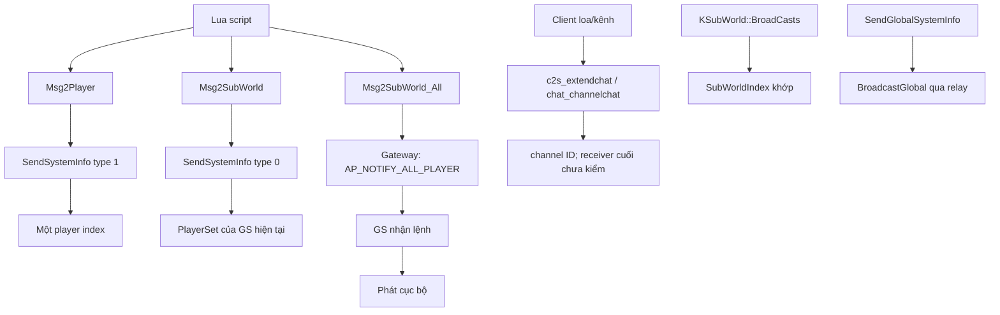

TÓM TẮT 5 DÒNG
1. THẤY — Msg2Player gửi tới một PlayerSet index qua SendSystemInfo(type=1): S/Core/Src/ScriptFuns.cpp:5833-5856; S/Core/Src/KPlayerChat.cpp:1952-1966.
2. THẤY — Msg2SubWorld gọi SendSystemInfo(type=0), helper lặp PlayerSet cục bộ: S/Core/Src/ScriptFuns.cpp:6293-6325; S/Core/Src/KPlayerChat.cpp:1942-1950.
3. THẤY — Msg2SubWorld_All gửi AP_NOTIFY_ALL_PLAYER qua Gateway; GS nhận lệnh gọi thông báo cục bộ: S/Core/Src/ScriptFuns.cpp:6375-6391; S/MultiServer/GameServer/KSOServer.cpp:4252-4255.
4. THẤY — Loa/kênh trực tiếp mang channel ID, cost và item ID trong gói chat mở rộng: C/gamescene/KgameWorld.cpp:3012-3053; C/gamecore/KProtocol.h:2442-2463.
5. CHƯA KIỂM — Không chạy build/test/VM/mạng; fan-out relay chưa rõ; checkpoint .nhip bị Access denied ngoài workspace.

# SO-32 — Sổ tay hiểu game: thông báo hệ thống và loa

Loại: tổng hợp
Chủ đề: Đường phát thông báo/chat và phạm vi người nhận trong source server/client.
Từ khóa: thông báo, loa, chat, Msg2Player, Msg2SubWorld, Gateway, chat_channelchat, BroadcastGlobal
Trạng thái: PARTIAL — tài liệu tĩnh hoàn tất; checkpoint .nhip ngoài writable root không ghi được.
Độ phủ: 6/6 đường mã tĩnh chính; fan-out liên game server chưa xác minh.
Liên quan: JX1_OPS/TASKS/SO-32.md; JX1_OPS/CONTEXT-PACK/GS001-MAP.md; JX1_OPS/DESIGN/MUC-LUC-TRI-THUC.md.
Cần tôi quyết định: không.
liên quan: JX1_OPS/TASKS/SO-32.md; JX1_OPS/CONTEXT-PACK/GS001-MAP.md; JX1_OPS/DESIGN/MUC-LUC-TRI-THUC.md.

Dẫn chứng: S = C:/Jx1CocoV3/SwordOnline/SwordOnline/jxOnline/gameserver/Sources; C = C:/Jx1CocoV3/Folder/Client2912-20260116T044348Z-3-001/Client2912/Client/Classes. Đây là root theo task; đọc tĩnh không đại diện bản đang chạy.

## Cách hiểu nhanh

THẤY — “Thông báo hệ thống” là nhiều đường. Phạm vi nhận phải đọc từ helper và vòng lặp, không suy chỉ từ tên hàm. Nội dung dưới đây tách target người chơi, PlayerSet cục bộ, SubWorld, kênh chat, Gateway và relay.

## Đường phát

### Msg2Player

THẤY — Lua đăng ký Msg2Player cho LuaMsgToPlayer. Hàm lấy chỉ số qua GetPlayerIndex(L), chép đối số đầu vào buffer 256 byte, mã hóa độ dài rồi gọi SendSystemInfo(type=1, playerIndex) (S/Core/Src/ScriptFuns.cpp:5833-5858, 25852-25856).

THẤY — Với type=1, SendSystemInfo kiểm tra chỉ số đích rồi gửi tới Player[nTargetIdx] (S/Core/Src/KPlayerChat.cpp:1912-1930, 1952-1966). Đây là nhánh một người chơi trong server hiện tại.

### Msg2SubWorld và API theo map

THẤY — LuaMsgToSubWorld gọi SendSystemInfo(0,0,...). Nhánh type=0 lặp PlayerSet.GetFirstPlayer/GetNextPlayer, không thấy lọc SubWorldID trong đường này (S/Core/Src/ScriptFuns.cpp:6293-6325; S/Core/Src/KPlayerChat.cpp:1942-1950).

THẤY — KSubWorld::BroadCasts là đường khác: chỉ gửi nếu kết nối hợp lệ và NPC người chơi có m_SubWorldIndex bằng m_nIndex của SubWorld hiện tại (S/Core/Src/KSubWorld.cpp:2366-2376). Không đồng nhất API Lua Msg2SubWorld với helper này.

THẤY — MsgToSubWorldMap là API riêng, nhận map index rồi gọi SendSystemMapInfo; helper so SubWorldID của người chơi với map trước khi gửi (S/Core/Src/ScriptFuns.cpp:6460-6485; S/Core/Src/KPlayerChat.cpp:1841-1884).

CHƯA KIỂM — Trong Msg2SubWorld, nParnCount được gán kết quả Lua_GetTopIndex(L) <= 0 nên chỉ nhận 0 hoặc 1; điều kiện >=2 để đọc tham số kind không tới được theo biểu thức hiện tại (S/Core/Src/ScriptFuns.cpp:6295-6316). Đây là đọc cú pháp source, chưa kiểm runtime.

### Msg2SubWorld_All qua Gateway

THẤY — LuaMsgToSubWorld_All tạo tagMsgInGame với cProtocol=c2s_msginfo_all, cCmdType=AP_NOTIFY_ALL_PLAYER, nSerIdx=nCurSerIdx rồi gửi g_pGateWayClient (S/Core/Src/ScriptFuns.cpp:6375-6391).

THẤY — Khi GS xử lý AP_NOTIFY_ALL_PLAYER, KSOServer gọi CoreServerShell::SendSystemCahtInfo; hàm này gọi SendSystemInfo(type=0), tức PlayerSet cục bộ của GS nhận lệnh đó (S/MultiServer/GameServer/KSOServer.cpp:4252-4255; S/Core/Src/CoreServerShell.cpp:1933-1943).

CHƯA KIỂM — Source Gateway upstream chọn gửi tới những GS nào chưa được đọc; chưa kết luận phạm vi toàn khu/toàn cụm.

### Loa/kênh trực tiếp

THẤY — Client lấy channel ID, cost, Buffer, độ dài và item ID từ dữ liệu kênh. IsHasCost kiểm tra tiền/cấp/mana trước; chỉ khi đạt điều kiện mới gọi OnDirectSendChannelMessage (C/gamescene/KgameWorld.cpp:5461-5517, 5941-6011).

THẤY — OnDirectSendChannelMessage tạo gói c2s_extendchat/chat_channelchat, điền channelid, nItemDwid, cost, sentlen rồi gọi SendNewDataToServer (C/gamescene/KgameWorld.cpp:3012-3053). Cấu trúc gói xác nhận sentlen và cost là BYTE (C/gamecore/KProtocol.h:2442-2463).

TÀI LIỆU — Comment gói liệt kê mã cost 0–4; code client diễn giải yêu cầu tiền, cấp hoặc mana. Đây là kiểm tra phía client trong source đã đọc; không chứng minh server-side enforcement hoặc mức trừ tài nguyên (C/gamecore/KProtocol.h:2447-2451; C/gamescene/KgameWorld.cpp:5941-6011).

CHƯA KIỂM — channelid quyết định kênh và người nhận ở tầng phân phối; chưa đối chiếu đầy đủ relay xử lý gói người chơi gửi. Không suy mọi kênh cost đều phát toàn máy chủ.

### Broadcast cục bộ và qua relay

THẤY — KPlayerSet::Broadcasting từ chối message null/rỗng hoặc độ dài đạt/ngang MAX_SENTENCE_LENGTH, gọi SendSystemInfo(type=0), rồi SendPackToClient(-1) (S/Core/Src/KPlayerSet.cpp:587-601). Đây là broadcast trong PlayerSet cục bộ.

THẤY — SendGlobalSystemInfo tạo s2c_extendchat/chat_channelchat rồi gọi BroadcastGlobal (S/Core/Src/KPlayerChat.cpp:2054-2083). BroadcastGlobal bọc dữ liệu thành relay_c2c_data, INADDR_BROADCAST và s2s_broadcast, gắn nCurSerIdx làm Relay ID đích (S/Core/Src/KNewProtocolProcess.cpp:139-164). Đây là đường qua relay; phạm vi chính xác phụ thuộc định tuyến ngoài đoạn đã đọc.

THẤY — BroadcastLocalServer lặp PlayerSet của server hiện tại rồi gửi tới các kết nối tương ứng (S/Core/Src/KNewProtocolProcess.cpp:167-179).

## Gói tin và hạn chế

THẤY — System info server gửi gói ngoài s2c_extendchat, trong chat_channelchat, channelid=-1, tên người gửi và payload (S/Core/Src/KPlayerChat.cpp:1912-1940).
THẤY — Gói cũ s2c_playersendchat được đăng ký vào s2cGetChat, nhưng handler chỉ cast gói; lời gọi cập nhật chat hiện bị comment (C/gamecore/KProtocolProcess.cpp:92, 1227-1232). Vì vậy không kết luận handler cũ đang hiển thị chat. Client đăng ký s2c_extendchat tới s2cExtendChat; handler chuyển chat_channelchat đến KgameWorld::ChannelMessageArrival (C/gamecore/KProtocolProcess.cpp:202-205, 4292-4312). Client xử lý channelid=-1 như alias GM (C/gamescene/KgameWorld.cpp:13142-13160).

THẤY — Server từ chối channel ngoài miền, prefix dài, câu vượt MAX_SENTENCE_LENGTH hoặc kích thước gói không khớp (S/Core/Src/KPlayerChat.cpp:423-438). CHAT_SPEED=20; timer được kiểm ở một số nhánh screen/team/faction (S/Core/Src/KPlayerChat.h:21; S/Core/Src/KPlayerChat.cpp:474-478, 551-555, 587-591). Đơn vị thời gian chưa xác định.

THẤY — Nhánh CHAT_CUR_CHANNEL_ALL có break trước phần kiểm timer/gửi ở phía sau trong cùng nhánh (S/Core/Src/KPlayerChat.cpp:444-473). Không gộp kênh này với SendSystemInfo(type=0), là đường riêng.

CHƯA KIỂM — Giá trị định nghĩa của MAX_SENTENCE_LENGTH chưa tìm thấy trong header đã đọc; ghi nhận cách code dùng macro và kiểu trường, không đoán số.

## Phạm vi và độ phủ

| Đường mã | Đã phủ | Phạm vi người nhận thấy | Bằng chứng |
|---|---|---|---|
| Msg2Player | THẤY — đã phủ tĩnh | Một PlayerSet index | S/Core/Src/ScriptFuns.cpp:5833-5858; S/Core/Src/KPlayerChat.cpp:1952-1966 |
| Msg2SubWorld | THẤY — đã phủ tĩnh | PlayerSet cục bộ; không thấy lọc SubWorldID | S/Core/Src/ScriptFuns.cpp:6293-6325; S/Core/Src/KPlayerChat.cpp:1942-1950 |
| Msg2SubWorld_All | THẤY — một đầu tuyến | Gateway rồi GS nhận lệnh phát cục bộ; fan-out Gateway chưa kiểm | S/Core/Src/ScriptFuns.cpp:6375-6391; S/MultiServer/GameServer/KSOServer.cpp:4252-4255 |
| Loa/kênh trực tiếp | THẤY — gói gửi | Theo channel ID; receiver cuối chưa kiểm | C/gamescene/KgameWorld.cpp:3012-3053, 5483-5517 |
| KSubWorld::BroadCasts | THẤY — đã phủ tĩnh | Kết nối hợp lệ trong SubWorld khớp m_nIndex | S/Core/Src/KSubWorld.cpp:2366-2376 |
| BroadcastGlobal | THẤY — đã phủ tĩnh | Gói Relay; nhóm nhận chưa kiểm | S/Core/Src/KPlayerChat.cpp:2054-2083; S/Core/Src/KNewProtocolProcess.cpp:139-164 |

Độ phủ: 6/6 đường mã tĩnh; chưa đo người nhận thực tế/runtime.

## Giải mã tên

Không có tên riêng game (phái, kỹ năng, trang bị, NPC, bản đồ) trong phạm vi này; chỉ giữ nguyên tên hàm/giao thức.

| Tên gốc | Mã hóa | Chữ đúng | Nguồn |
|---|---|---|---|
| Msg2Player, Msg2SubWorld, Msg2SubWorld_All | Mã định danh C++/Lua | Giữ nguyên | S/Core/Src/ScriptFuns.cpp:25852-25900 |
| s2c_extendchat, chat_channelchat, c2s_extendchat | Mã định danh giao thức | Giữ nguyên | C/gamecore/KProtocolDef.h:210-214, 440-451 |

## Sắp theo cấu trúc game

Không áp dụng môn phái/nhánh kỹ năng/bộ trang bị/bản đồ/NPC; nội dung được xếp theo đường phát và phạm vi người nhận.

## Chưa kiểm

- CHƯA KIỂM — Không chạy game, build, exe, VM hoặc mạng; chưa xác nhận UI hiển thị hay tài nguyên bị trừ thật.
- CHƯA KIỂM — Chưa đọc routing Gateway upstream/relay nên không xác nhận tập GS/khu nhận.
- CHƯA KIỂM — Chưa tìm thấy giá trị MAX_SENTENCE_LENGTH và SHA của source pin.
- THẤY — rg không có; dùng Select-String/Get-Content trên tệp đã định danh. Lượt tìm symbol đệ quy đầu tiên lẫn binary Release/ipch; đã dừng, các dẫn chứng sau giới hạn vào .cpp/.h cụ thể.
- BỊ CHẶN — Ghi D:\JX-wt\SO-32.nhip trả Access denied ngoài writable root; đã thử tại mốc đầu và không thử vượt quyền.

## Đã xác minh / Chưa xác minh

Đã xác minh bằng đọc tĩnh: các route và gói trong bảng độ phủ. Chưa xác minh: runtime, build/test, client hiển thị, cost server-side và fan-out Gateway/relay.

## Mục sổ thông số

| Nhóm | Tên/hằng số | file:dòng | Giá trị | Đơn vị | Ảnh hưởng | Đổi an toàn | Nguồn đo |
|---|---|---|---|---|---|---|---|
| Nhịp chat | CHAT_SPEED | S/Core/Src/KPlayerChat.h:21; S/Core/Src/KPlayerChat.cpp:474-478, 551-555 | 20 | Đơn vị chưa rõ | Giới hạn một số nhánh chat | CẨN THẬN | Đọc tĩnh |
| Giới hạn câu | MAX_SENTENCE_LENGTH | S/Core/Src/KPlayerChat.cpp:423-438, 1912-1917; S/Core/Src/KPlayerSet.cpp:587-590 | Chưa định vị giá trị | Độ dài, đơn vị chưa xác nhận | Kiểm tra câu/gói/buffer | CẨN THẬN | Đọc tĩnh |
| Kênh trực tiếp | CHAT_CHANNELCHAT_CMD.cost | C/gamecore/KProtocol.h:2442-2463; C/gamescene/KgameWorld.cpp:5941-6011 | BYTE, mã 0–4 | Mã cost / tiền / cấp / mana | Client gate trước khi gửi | CẨN THẬN | Đọc tĩnh, chưa đo mức trừ |

## Đề xuất tối ưu

Không đề xuất sửa source hoặc thông số trong task đọc tĩnh này. Nếu cần chốt fan-out/cost, giao task riêng có source định tuyến và quyền runtime phù hợp.

## Phát hiện khi khảo sát

- Msg2SubWorld gán kết quả so sánh vào nParnCount nên nhánh đọc tham số kind không đạt được theo biểu thức hiện tại (S/Core/Src/ScriptFuns.cpp:6295-6316).
- CHAT_CUR_CHANNEL_ALL có break trước đoạn gửi; chưa kiểm runtime (S/Core/Src/KPlayerChat.cpp:444-473).

## Bàn giao

- Trạng thái: PARTIAL; sổ tay và báo cáo đã xong, checkpoint .nhip còn bị chặn.
- Không commit theo yêu cầu; không có SHA/push.
- PM gộp dòng chỉ mục đề xuất: SO-TAY-THONG-BAO-HE-THONG.md | tổng hợp | thông báo, loa, chat | thông báo, loa, Msg2Player, Msg2SubWorld, Gateway, BroadcastGlobal | PARTIAL | 6/6 đường tĩnh | SO-32, GS001-MAP.
- Kỹ năng đã dùng: jx1-retrofit, jx1-read-server, jx1-read-client, jx1-parameters, jx1-knowledge, jx1-report.
