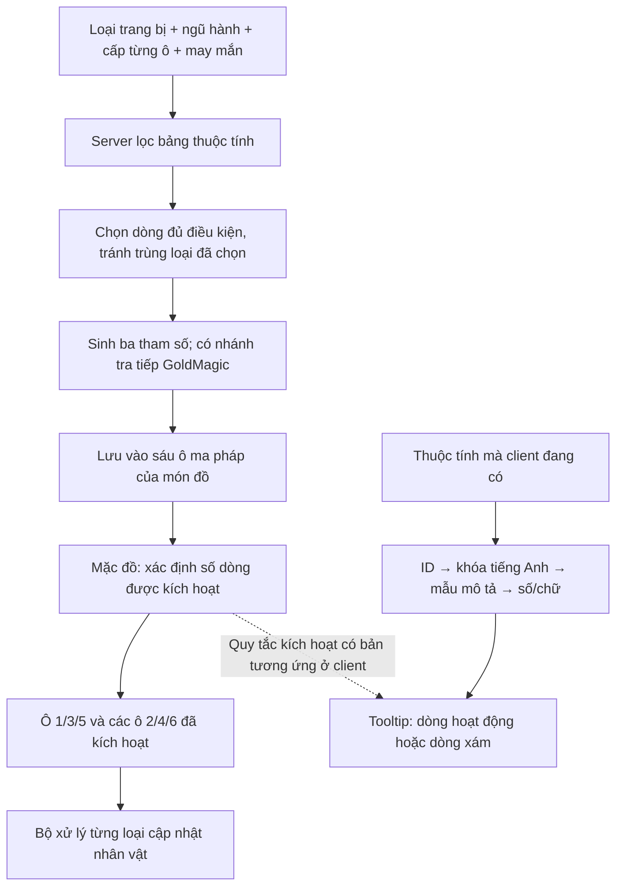

TÓM TẮT 1 [NGUỒN][THẤY]: DONE phần sổ tay khảo sát tĩnh: bảng tra, roll, áp vào nhân vật và tooltip; nguồn chính `S/KItemGenerator.CPP:908`, `S/KItem.cpp:140`, `C/gameui/KuiItemdesc.cpp:1232`.
TÓM TẮT 2 [NGUỒN][THẤY]: Trang bị có sáu ô ma pháp; ô 1/3/5 và ô 2/4/6 có cách kích hoạt khác nhau; `S/KItem.h:219`, `S/KItem.cpp:159-179`.
TÓM TẮT 3 [NGUỒN][THẤY]: Roll lọc theo loại trang bị, ngũ hành, cấp thuộc tính, rồi chọn dòng và sinh tham số; `S/KItemGenerator.CPP:940-1031`.
TÓM TẮT 4 [CHƯA KIỂM]: Chưa kiểm bảng cấu hình triển khai, xác suất thực tế, vật phẩm thật và bản client/server đang chạy; phạm vi nguồn tại `JX1_OPS/TASKS/SO-29.md:24-26`.
TÓM TẮT 5 [CHƯA KIỂM]: Không chạy build, test game, exe, VM hay mạng; không commit/push theo yêu cầu giao việc; bàn giao PM đối chiếu dữ liệu triển khai khi được duyệt.

# SO-29 — Sổ tay hiểu game: thuộc tính ma pháp của trang bị
Loại: khảo sát
Chủ đề: Hiểu các dòng cộng thêm trên trang bị, cách sinh, điều kiện có tác dụng và cách client trình bày.
Từ khóa: trang bị, thuộc tính ma pháp, magic attrib, magicattrib.txt, KItem, roll, ngũ hành, kích hoạt, KMagicDesc, tooltip
Trạng thái: DONE — hoàn thành bốn phần khảo sát tĩnh; không chứng nhận vận hành thực tế.
Độ phủ: 4/4 phần chính; bảng tra gồm 28 nhóm mục, không phải danh sách toàn bộ dòng cấu hình có thể rơi.
Liên quan: `JX1_OPS/TASKS/SO-29.md`; `JX1_OPS/DESIGN/CHUAN-BAO-CAO.md`; `JX1_OPS/DESIGN/MUC-LUC-TRI-THUC.md`; `JX1_OPS/REPORTS/SO-29.md`.
Cần tôi quyết định: không — giới hạn kiểm chứng đã tách ở mục Chưa kiểm.

## 1. Cách đọc và nguồn đã dùng

- **[TÀI LIỆU]** `THẤY` = đã đọc đoạn mã thật tại file:dòng, chỉ kết luận hành vi thể hiện trong source; `TÀI LIỆU` = yêu cầu/quy ước từ tài liệu; `CHƯA KIỂM` = chưa có bằng chứng trong phạm vi. Nhãn này không thay cho kiểm thử game; `JX1_OPS/TASKS/SO-29.md:20-26`.
- **[TÀI LIỆU]** Các dẫn `S/...` mở rộng từ `C:/Jx1CocoV3/SwordOnline/SwordOnline/jxOnline/gameserver/Sources/Core/Src`; `C/...` từ `C:/Jx1CocoV3/Folder/Client2912-20260116T044348Z-3-001/Client2912/Client/Classes`. Đây là hai cây source trên đĩa được task cho đọc, không phải định danh bản đang chạy; `JX1_OPS/TASKS/SO-29.md:25`.
- **[THẤY]** Danh sách nguồn nội dung được giới hạn theo luồng: `S/KItem.h:182-220`, `S/KMagicAttrib.h:39-198`, `S/KBasPropTbl.h:134-160`, `S/KBasPropTbl.cpp:232-284`, `S/KItemGenerator.CPP:628-1082`, `S/KItem.cpp:140-329`, `S/KItemList.cpp:1722-1782`, `S/KNpc.cpp:4458-4463`, `S/KNpcAttribModify.cpp:30-139`; client: `C/gamecore/KItem.h:171-180`, `C/gamecore/KItemGenerator.CPP:757-771`, `C/gamecore/KItemList.cpp:2046-2075`, `C/gamecore/KMagicAttrib.h:97-118`, `C/gamecore/KMagicDesc.cpp:375-502`, `C/gameui/KuiItemdesc.cpp:1125-1370`. Chỉ đọc các đoạn phục vụ câu hỏi.
- **[THẤY]** Chữ Hán trong các đoạn server và `KuiItemdesc.cpp` được đọc bằng GBK/CP936; các đoạn `KMagicDesc.cpp` đọc UTF-8. Kiểm mẫu 4096 byte bằng bộ giải mã UTF-8 nghiêm ngặt, cho phép ký tự dở ở cuối mẫu: `KBasPropTbl.cpp` và `KuiItemdesc.cpp` có byte sai UTF-8 bên trong; `KMagicDesc.cpp` hợp lệ trong mẫu. Không chứng nhận mã hóa toàn bộ từng source, không chuyển mã source.

## 2. Sơ đồ chính

**[THẤY]** Nhánh trên mô tả source server tại `S/KItemGenerator.CPP:940-1051`, `S/KItemList.cpp:1727-1782`, `S/KNpcAttribModify.cpp:322-332`; nhánh tooltip tại `C/gamecore/KMagicDesc.cpp:415-432`, `C/gameui/KuiItemdesc.cpp:1271-1363`. **[CHƯA KIỂM]** Sơ đồ không xác nhận đường truyền hoặc đồng bộ runtime giữa hai bản.

## 3. Phạm vi và độ phủ

| Phần tử phạm vi | Độ phủ và mức chắc | Bằng chứng / giới hạn |
|---|---|---|
| Bảng tra thuộc tính | **[THẤY] Đã phủ** mã định danh, nhóm công dụng và điểm xử lý | `S/KMagicAttrib.h:39-198`; `S/KNpcAttribModify.cpp:30-139`; bảng ở mục 6 |
| Cách roll | **[THẤY] Đã phủ** đường sinh thông thường và nhánh tra tiếp | `S/KBasPropTbl.cpp:232-284`; `S/KItemGenerator.CPP:908-1082` |
| Áp vào nhân vật | **[THẤY] Đã phủ** mặc/tháo, dòng hiện/ẩn, xử lý từng loại | `S/KItemList.cpp:1755-1782`, `:2094-2118`; `S/KItem.cpp:159-179`, `:300-329` |
| Tooltip client | **[THẤY] Đã phủ** nguồn mẫu, thay tham số, nhánh nền tảng và màu kích hoạt | `C/gamecore/KMagicDesc.cpp:375-502`; `C/gameui/KuiItemdesc.cpp:1275-1363` |
| Danh sách đầy đủ các dòng thật trong magicattrib/GoldMagic | **[CHƯA KIỂM] Chưa phủ** | Chưa đọc bản cấu hình triển khai; đường dẫn trong source chỉ là tên tệp mà mã tham chiếu, `S/KItem.h:39-41` |
| Roll riêng của mọi loại đồ đặc biệt, cường hóa, bộ đồ và toàn bộ công thức chiến đấu | **[CHƯA KIỂM] Chưa phủ toàn bộ** | Chỉ nêu ranh giới đã thấy ở `S/KItem.h:207-220`, `S/KItem.cpp:183-244`; không mở rộng thành kiểm toán các hệ đó |
| Game đang chạy, thống kê xác suất, ảnh tooltip thực tế | **[CHƯA KIỂM] Chưa phủ** | Không chạy game/VM/mạng theo `JX1_OPS/TASKS/SO-29.md:24` |

## 4. Giải mã tên

**[THẤY]** Tài liệu không đưa tên riêng của kỹ năng, bộ trang bị, quái, NPC hoặc bản đồ. Các từ dưới đây là nhãn kỹ thuật/khái niệm đã gặp; tên gốc được giữ để tra cứu. Chưa lấy chuỗi tên Việt cũ TCVN3 từ dữ liệu game, nên không có mục TCVN3 nào được nhận là đã giải mã; `S/KBasPropTbl.h:152-158`, `C/gamecore/KMagicDesc.cpp:415-416`.

| Tên gốc | Mã hóa của đoạn đọc | Chữ đúng / nghĩa dùng trong sổ tay | Nguồn file:dòng |
|---|---|---|---|
| `魔法属性` | GBK/CP936 | **[THẤY]** Thuộc tính ma pháp, các dòng cộng thêm của món đồ | `S/KItem.h:219` |
| `前缀` / `后缀` | GBK/CP936 | **[THẤY]** Tiền tố / hậu tố; ở vòng roll là hai nhóm xen kẽ | `S/KItemGenerator.CPP:940-945` |
| `五行` | GBK/CP936 | **[THẤY]** Ngũ hành, dùng làm điều kiện phân nhóm | `S/KBasPropTbl.h:145`, `:154` |
| `参数1最小值` / `参数1最大值` | GBK/CP936 | **[THẤY]** Giá trị nhỏ nhất / lớn nhất của tham số 1 | `S/KItemGenerator.CPP:1045-1047` |
| `参数3最小值` / `参数3最大值` | GBK/CP936 | **[THẤY]** Giá trị nhỏ nhất / lớn nhất của tham số 3 | `S/KItemGenerator.CPP:1049-1051` |
| `熔炼` / `隐藏属性` | GBK/CP936 | **[THẤY]** Nhóm thuộc tính luyện riêng / thuộc tính ẩn riêng; không gộp vào sáu ô thường | `S/KItem.h:207`, `:219-220` |
| `magic_...`, `lifemax_v`, `KMagicDesc` | Định danh ASCII, biểu diễn được bằng UTF-8 | **[THẤY]** Giữ nguyên khóa, lời giải thích tiếng Việt ở mục 6 không được coi là bản dịch đang hiển thị trong game | `S/KMagicAttrib.h:100-107`; `C/gamecore/KMagicDesc.cpp:109-116` |

## 5. Sắp theo cấu trúc game: từ món đồ đến nhân vật

**[THẤY]** Sổ tay đi theo món đồ → nhóm thuộc tính → sinh dòng → kích hoạt khi mặc → bảng nhân vật → tooltip. Không sắp theo thứ tự tên file. Không có bộ trang bị cụ thể để liệt kê từng món; cấu trúc đang khảo sát là các ô thuộc tính dùng chung; `S/KItem.h:217-220`, `S/KItemList.cpp:1722-1782`.

| Lớp thông tin trên món đồ | Hiểu bằng lời thường | Mức chắc và nguồn |
|---|---|---|
| Cơ bản: `m_aryBaseAttrib[7]` | Những chỉ số nền, được xử lý riêng trước các dòng ma pháp | **[THẤY]** `S/KItem.h:217`; `S/KItem.cpp:148-157` |
| Yêu cầu: `m_aryRequireAttrib[6]` | Điều kiện sử dụng, được lưu riêng; không đồng nhất với phần thưởng khi mặc | **[THẤY]** `S/KItem.h:218`; nhóm `require...` tại `S/KMagicAttrib.h:45-63` |
| Ma pháp thường: `m_aryMagicAttrib[6]` | Sáu ô cộng thêm là trọng tâm tài liệu | **[THẤY]** `S/KItem.h:219`; `S/KItem.cpp:159-179` |
| Luyện riêng: `m_ronMagicAttrib[6]` | Một mảng sáu ô khác, có điều kiện áp riêng | **[THẤY]** `S/KItem.h:220`; `S/KItem.cpp:222-244` |
| Ẩn riêng: `m_yinMagicAttrib[2]` | Hai ô riêng; khác với ba dòng hậu tố ẩn nằm trong sáu ô thường | **[THẤY]** `S/KItem.h:207`; `S/KItem.cpp:195-218` |

**[THẤY]** Một thuộc tính gồm loại tác dụng và ba tham số sinh từ ba cặp khoảng; ba tham số không mặc nhiên có nghĩa “min/trung bình/max”. Có loại chỉ dùng tham số đầu; có nhánh dùng tham số thứ ba để tra tiếp bảng khác; `S/KBasPropTbl.h:134-139`, `S/KItemGenerator.CPP:1028-1051`, `S/KNpcAttribModify.cpp:1621-1624`.

## 6. Bảng tra theo công dụng

**[THẤY]** Trong cột khóa, thêm tiền tố `magic_` để được tên enum server; thí dụ `lifemax_v` tương ứng `magic_lifemax_v`. Hậu tố được chú thích là `v` cộng điểm, `p` phần trăm, `b` kiểu bật/tắt, nhưng tác dụng cuối vẫn phải theo hàm xử lý; `S/KMagicAttrib.h:4-6`, `S/KNpcAttribModify.cpp:322-332`.

**[CHƯA KIỂM]** Bảng 28 nhóm dưới đây là bảng tra các loại mã đã thấy, không xác nhận mọi mã đều có trong quỹ roll trang bị đang triển khai. Muốn kết luận “món nào có dòng nào, khoảng bao nhiêu” phải đối chiếu dòng cấu hình thật; `S/KItemGenerator.CPP:941-978`.

| Nhóm game | Khóa giữ nguyên | Hiểu bằng lời thường / giới hạn | Mức chắc và nguồn |
|---|---|---|---|
| Sinh lực tối đa | `lifemax_v`, `lifemax_p` | Cộng điểm / cộng theo % sinh lực nền, không phải hồi đầy máu hiện tại | **[THẤY]** `S/KMagicAttrib.h:100-103`; `S/KNpcAttribModify.cpp:1606-1627` |
| Nội lực tối đa | `manamax_v`, `manamax_p` | Cộng điểm / % nội lực nền | **[THẤY]** `S/KNpcAttribModify.cpp:1751-1768` |
| Thể lực tối đa | `staminamax_v`, `staminamax_p` | Nhóm tăng trần thể lực | **[THẤY]** `S/KMagicAttrib.h:108-111`; `S/KNpcAttribModify.cpp:48-51` |
| Hồi phục | `lifereplenish_v`, `manareplenish_v`, `staminareplenish_v` | Nhóm hệ số hồi; chưa quy thành số điểm mỗi giây | **[THẤY]** `S/KMagicAttrib.h:103-111`; `S/KNpcAttribModify.cpp:43-51` |
| Tiềm năng | `strength_v`, `dexterity_v`, `vitality_v`, `energy_v` | Nhóm sức mạnh, thân pháp, sinh khí, nội công; không tự suy mức tăng sát thương từ mỗi điểm | **[THẤY]** `S/KMagicAttrib.h:112-115`; `S/KNpcAttribModify.cpp:52-55` |
| Né tránh/phòng ngự nền | `armordefense_v`, `adddefense_v`, `adddefense_p` | Nhóm phòng ngự; hai khóa đầu cùng được nối tới `ArmorDefenseV`, chưa diễn giải toàn công thức chiến đấu | **[THẤY]** `S/KMagicAttrib.h:43`, `:165-166`; `S/KNpcAttribModify.cpp:34-39` |
| Kháng vật lý | `physicsres_p` | Chỉ số kháng vật lý, khác chỉ số phòng ngự ở hàng trên | **[THẤY]** `S/KMagicAttrib.h:119`; `S/KNpcAttribModify.cpp:59` |
| Kháng từng hệ | `coldres_p`, `fireres_p`, `lightingres_p`, `poisonres_p` | Kháng băng, hỏa, lôi, độc; giữ đúng cách viết `lighting` của khóa gốc | **[THẤY]** `S/KMagicAttrib.h:116-120`; `S/KNpcAttribModify.cpp:56-60` |
| Kháng tất cả | `allres_p` | Có bộ xử lý riêng, không đọc thành “bất tử” hoặc bỏ qua trần kháng | **[THẤY]** `S/KMagicAttrib.h:129`; `S/KNpcAttribModify.cpp:69`, `:336-349` |
| Trần kháng | `physicsresmax_p`, `coldresmax_p`, `fireresmax_p`, `lightingresmax_p`, `poisonresmax_p`, `allresmax_p` | Nhóm nâng giới hạn kháng, khác cộng kháng hiện có; chưa kiểm mọi công thức chặn trần | **[THẤY]** định nghĩa và chú thích tại `S/KMagicAttrib.h:170-175` |
| Chống trạng thái | `freezetimereduce_p`, `burntimereduce_p`, `poisontimereduce_p`, `stuntimereduce_p` | Nhóm giảm thời gian trạng thái; chưa quy thành thời gian thực tế | **[THẤY]** `S/KMagicAttrib.h:121-125`; `S/KNpcAttribModify.cpp:61-65` |
| Giảm sát thương độc | `poisondamagereduce_v` | Nhóm giảm độc bằng điểm, khác kháng độc % | **[THẤY]** `S/KMagicAttrib.h:124`; `S/KNpcAttribModify.cpp:64` |
| Di chuyển | `fastwalkrun_p` | Nhóm tăng tốc đi/chạy; chưa có số đo tốc độ thực tế | **[THẤY]** `S/KMagicAttrib.h:126`; `S/KNpcAttribModify.cpp:66` |
| Phục hồi động tác | `fasthitrecover_v` | Nhóm giảm thời gian động tác bị thương theo chú thích, không phải hồi máu | **[THẤY]** `S/KMagicAttrib.h:128`; `S/KNpcAttribModify.cpp:68` |
| Tốc đánh ngoài | `attackspeed_v` | Cộng chỉ số tốc đánh; hàm server có nhánh bỏ qua với nhân vật hệ kim và giá trị task 130 bằng 2 | **[THẤY]** `S/KNpcAttribModify.cpp:1143-1158` |
| Tốc xuất chiêu trong | `castspeed_v` | Cộng chỉ số tốc xuất chiêu; chưa phải số đòn/giây | **[THẤY]** `S/KNpcAttribModify.cpp:1161-1171` |
| Chính xác | `attackratingenhance_v`, `attackratingenhance_p` | Nhóm cộng chính xác cho trạng thái/trang bị; có nhóm `attackrating_v/p` riêng | **[THẤY]** `S/KMagicAttrib.h:70-71`, `:181-182`; `S/KNpcAttribModify.cpp:70-76` |
| Bỏ qua né tránh | `ignoredefense_p` | Nối tới chỉ số bỏ qua né tránh, không kết luận xuyên toàn bộ kháng/phòng thủ | **[THẤY]** `S/KMagicAttrib.h:72`; `S/KNpcAttribModify.cpp:77` |
| Sát thương vật lý ngoài | `addphysicsdamage_v`, `addphysicsdamage_p` | Nhóm tăng vật lý ngoài bằng điểm / % | **[THẤY]** `S/KMagicAttrib.h:136-141`; `S/KNpcAttribModify.cpp:93-94` |
| Sát thương hệ ngoài | `addcolddamage_v`, `addfiredamage_v`, `addlightingdamage_v`, `addpoisondamage_v` | Các nhánh băng/hỏa/lôi/độc ngoài; không gộp ba tham số thành ba dòng khác nhau | **[THẤY]** `S/KMagicAttrib.h:137-140`; `S/KNpcAttribModify.cpp:95-98` |
| Sát thương hệ trong | `addphysicsmagic_v`, `addcoldmagic_v`, `addfiremagic_v`, `addlightingmagic_v`, `addpoisonmagic_v` | Nhóm vật lý và bốn hệ trong theo bảng nối hàm | **[THẤY]** `S/KMagicAttrib.h:183-187`; `S/KNpcAttribModify.cpp:99-103` |
| Sát thương của đòn/kỹ năng | `physicsdamage_v`, `colddamage_v`, `firedamage_v`, `lightingdamage_v`, `poisondamage_v` | Nhóm mã khác với các khóa `add...`; không đổi tên để gộp chung | **[THẤY]** `S/KMagicAttrib.h:73-77`; `S/KNpcAttribModify.cpp:78-82` |
| Hút sinh lực/nội lực/thể lực | `steallifeenhance_p`, `stealmanaenhance_p`, `stealstaminaenhance_p` | Cộng chỉ số hút tương ứng; chưa xác nhận phần trăm hồi cuối trên một đòn | **[THẤY]** `S/KMagicAttrib.h:151-153`; `S/KNpcAttribModify.cpp:114-119`, `:2137-2154` |
| Phản đòn | `meleedamagereturn_v/p`, `rangedamagereturn_v/p` | Hai biến thể điểm/% cho gần/xa; dấu `v/p` ở đây viết tắt cho hai khóa riêng | **[THẤY]** `S/KMagicAttrib.h:132-135`; `S/KNpcAttribModify.cpp:30-32` |
| Đẩy lùi/chí mạng | `knockbackenhance_p`, `deadlystrikeenhance_p`, `fatallystrikeenhance_p` | Các loại có tên khác nhau; hai mã chí mạng đang cùng nối tới `DeadlyStrikeP`, không tự đặt công thức phân biệt | **[THẤY]** `S/KMagicAttrib.h:160-167`; `S/KNpcAttribModify.cpp:126-131` |
| Cấp kỹ năng | `allskill_v`, `metalskill_v`, `woodskill_v`, `waterskill_v`, `fireskill_v`, `earthskill_v` | Nhóm tăng cấp kỹ năng chung hoặc theo ngũ hành; chưa kiểm mọi giới hạn kỹ năng cụ thể | **[THẤY]** `S/KMagicAttrib.h:154-159`; `S/KNpcAttribModify.cpp:120-125` |
| May mắn | `lucky_v` | Một loại thuộc tính của nhân vật; không tự đồng nhất với mọi tham số `nLucky` tại mọi nơi gọi roll | **[THẤY]** `S/KMagicAttrib.h:150`; `S/KNpcAttribModify.cpp:113`; đầu vào roll tại `S/KItemGenerator.CPP:909` |
| Không hao mòn | `indestructible_b` | Khi gắn mảng ma pháp, mã này còn đặt độ bền thành -1 | **[THẤY]** `S/KMagicAttrib.h:56`; `S/KItem.cpp:641-654` |

## 7. Roll: vì sao hai món cùng loại có thể khác dòng?

### 7.1. Trước hết cần đúng quỹ thuộc tính

**[THẤY]** Bản ghi quỹ thuộc tính gồm tên, nhóm tiền/hậu tố, ngũ hành, cấp, loại tác dụng, ba khoảng tham số và các ngưỡng theo loại trang bị. Các trường được đọc theo thứ tự trong bộ nạp, không thể tùy ý lấy một cột bất kỳ làm giá trị; `S/KBasPropTbl.h:148-160`, `S/KBasPropTbl.cpp:1930-1960`.

| Trường | Vai trò khi sinh đồ | Mức chắc và nguồn |
|---|---|---|
| `m_nPos`, `m_nClass`, `m_nLevel` | Chọn nhóm tiền/hậu tố, ngũ hành, cấp thuộc tính | **[THẤY]** `S/KBasPropTbl.cpp:244-284` |
| `m_MagicAttrib.nPropKind` | Chọn loại tác dụng nào sẽ được gắn lên ô | **[THẤY]** `S/KBasPropTbl.cpp:1938`; `S/KItemGenerator.CPP:1028` |
| `aryRange[0..2].nMin/nMax` | Ba khoảng để sinh ba tham số | **[THẤY]** `S/KBasPropTbl.cpp:1939-1944`; `S/KItemGenerator.CPP:1029-1031` |
| `m_DropRate[nType]` | Ngưỡng lọc dành cho loại trang bị đang sinh | **[THẤY]** `S/KBasPropTbl.cpp:1946-1960`; `S/KItemGenerator.CPP:978-979` |
| `m_nUseFlag` | Đánh dấu tạm bản ghi đã dùng trong lần sinh; cuối lần sinh xóa cờ | **[THẤY]** `S/KItemGenerator.CPP:1023-1027`, `:1070-1077` |

**[THẤY]** Khi lập quỹ, dòng có ngưỡng theo loại trang bị ≤1 bị bỏ; ngũ hành -1 được đưa vào cả năm nhóm; một dòng cấp L được đưa vào các nhóm từ L đến 10. Vì vậy, chọn cấp cao hơn không có nghĩa chỉ còn các dòng đúng cấp cao đó; `S/KBasPropTbl.cpp:247-284`.

### 7.2. Luồng sinh thông thường

1. **[THẤY]** Server giữ hạt giống ngẫu nhiên, sáu cấp thuộc tính, phiên bản và may mắn trong tham số sinh đồ. Cấp món đồ và sáu cấp thuộc tính là các đầu vào riêng; `S/KItemGenerator.CPP:628-657`, `S/KItem.h:182-194`.
2. **[THẤY]** Nhánh `nPoint == 0` gọi `Gen_MagicAttrib`, chép kết quả vào món đồ, ghi chỉ mục dòng rồi gọi cường hóa. Đây là đường chính được mô tả, không đại diện mọi nhánh đồ đặc biệt; `S/KItemGenerator.CPP:735-747`.
3. **[THẤY]** Đi lần lượt tối đa sáu ô. Gặp cấp bằng 0, cấp ngoài 1..10, quỹ không hợp lệ hoặc không còn ứng viên thì dừng; các ô còn lại được xóa loại và tham số về 0; `S/KItemGenerator.CPP:925-950`, `:1005-1009`, `:1058-1067`.
4. **[THẤY]** Lấy quỹ theo bốn điều kiện: tiền/hậu tố xen kẽ, loại trang bị, ngũ hành, cấp của ô. Bỏ dòng đã dùng và dòng có cùng `nPropKind` với một ô trước; loại cộng điểm và loại cộng % là các mã khác nhau; `S/KItemGenerator.CPP:940-1002`, `S/KBasPropTbl.h:137`.
5. **[THẤY]** Với mỗi ô, mã gọi `GetRandomNumber(0, 99) / (1 + nLucky * 20 / 100)` để lấy ngưỡng; một ứng viên chỉ qua khi `DropRate > 1` và `DropRate > nDecide`. Đây là phép chia số nguyên; với đầu vào không âm, thay đổi may mắn có thể đi theo bậc; `S/KItemGenerator.CPP:959-978`.
6. **[THẤY]** Sau lọc, mã gọi ngẫu nhiên chỉ mục trong danh sách còn lại, rồi sinh riêng từng tham số từ ba khoảng. Không có bước trong đoạn này tự buộc cả ba tham số bằng cực đại; `S/KItemGenerator.CPP:1005-1031`.
7. **[THẤY]** Nếu tham số thứ ba sau roll >1, mã còn thử đọc `GoldMagic.txt`, dùng nó làm chỉ mục dòng để sinh lại tham số 1 và 3. Do đó không được mặc định tham số thứ ba luôn là một trị số tác dụng trực tiếp; `S/KItemGenerator.CPP:1037-1053`.
8. **[THẤY]** Kết quả được lưu vào sáu ô; `SetAttrib_MA` đồng thời giữ bản sao để dùng cho cường hóa. Chỉ mục bản ghi được lưu với cộng thêm 2 tại đường roll; đó là chỉ mục dòng bảng, khác ID loại tác dụng; `S/KItemGenerator.CPP:1034-1035`, `S/KItem.cpp:646-649`, `:662-668`.

**[CHƯA KIỂM]** Không thể đọc `DropRate=...` thành ngay xác suất % cuối cùng: còn bước lập quỹ, ngưỡng dùng chung trong một ô, loại trùng bị loại và bước chọn ứng viên. Chưa đọc dữ liệu triển khai, chưa đo phân bố và chưa kiểm toàn bộ miền đầu vào may mắn từ các caller; `S/KItemGenerator.CPP:959-1031`. Hai biến `nMinDropRate/nMaxDropRate` được lấy ở dòng 923, nhưng công thức dùng chúng ở dòng 960 đang là chú thích; công thức hoạt động nằm ở dòng 959.

## 8. Khi nào một dòng thật sự cộng vào nhân vật?

### 8.1. Sáu ô nhưng không phải sáu dòng luôn hoạt động

| Ô logic của món đồ (đếm từ 1) | Chỉ mục mã (đếm từ 0) | Điều kiện áp trong vòng ma pháp thường |
|---|---|---|
| 1 | 0 | **[THẤY]** Nhóm tiền tố, không tiêu lượt kích hoạt; `S/KItem.cpp:175-178` |
| 2 | 1 | **[THẤY]** Nhóm hậu tố; cần còn lượt kích hoạt thứ nhất; `S/KItem.cpp:166-172` |
| 3 | 2 | **[THẤY]** Nhóm tiền tố; `S/KItem.cpp:175-178` |
| 4 | 3 | **[THẤY]** Hậu tố tiếp theo, cần còn lượt sau các hậu tố trước hợp lệ; `S/KItem.cpp:164-172` |
| 5 | 4 | **[THẤY]** Nhóm tiền tố; `S/KItem.cpp:175-178` |
| 6 | 5 | **[THẤY]** Hậu tố tiếp theo; tối đa ba lượt kích hoạt từ cách đếm bên dưới; `S/KItem.cpp:166-172`, `S/KItemList.cpp:2703-2706` |

**[THẤY]** Đây là số ô logic trong mảng, không cam kết thứ tự từ trên xuống của chữ trên màn hình. Client duyệt chỉ mục từ 5 về 0 rồi bố trí nhãn theo tọa độ; `C/gameui/KuiItemdesc.cpp:1232-1237`, `:1305-1308`.

**[THẤY]** Số lượt kích hoạt thường được tính từ ngũ hành nhân vật tương sinh món đồ, cộng thêm các món ở đúng vị trí trong bảng `ms_ActivedEquip` nếu tương sinh, rồi chặn tối đa 3. Không phải cứ bất kỳ món nào tương sinh trên người cũng được tính; `S/KItemList.cpp:54-70`, `:2688-2706`. Ở client cũng có logic tương ứng; `C/gamecore/KItemList.cpp:2058-2074`.

### 8.2. Mặc, xử lý chỉ số và tháo

- **[THẤY]** Khi mặc, mã cập nhật ô trang bị, lấy số kích hoạt, chuẩn bị thông tin loại đồ. Nhánh chính chỉ gọi áp thuộc tính khi `GetIsCanUse()==1`; có nhánh riêng cho mặt nạ khi cờ bằng 0. Sau đó gọi cập nhật ảnh hưởng lên trang bị liên quan và cập nhật dữ liệu nhân vật; `S/KItemList.cpp:1722-1782`.
- **[THẤY]** Từng dòng được chuyển qua `KNpc::ModifyAttrib` đến bộ xử lý loại thuộc tính. Mã loại ngoài giới hạn hoặc chưa được nối hàm thì bỏ qua; vì thế có chữ trong bảng mô tả chưa đủ chứng minh đã có tác dụng; `S/KNpc.cpp:4458-4463`, `S/KNpcAttribModify.cpp:322-332`.
- **[THẤY]** Sinh lực tối đa cộng điểm được cộng trực tiếp vào trần hiện tại; loại cộng % lấy sinh lực nền nhân tham số rồi chia 100. Hai hàm đều có chặn về 100 nếu kết quả trần ≤0. Không lấy công thức này áp thay cho mọi loại `_p`; `S/KNpcAttribModify.cpp:1606-1627`.
- **[THẤY]** Khi tháo, code gọi gỡ thuộc tính và cập nhật ảnh hưởng kích hoạt trước khi xóa ô mặc. Vòng gỡ tạo bản sao với ba tham số đổi dấu cho các dòng được gỡ; `S/KItemList.cpp:2094-2118`, `S/KItem.cpp:300-329`. **[CHƯA KIỂM]** Chưa kiểm tính hoàn tác hoàn hảo của mọi hàm có chặn biên hoặc mọi loại đồ đặc biệt.

### 8.3. Các phần cộng thêm cần tách riêng

- **[THẤY]** Sáu ô luyện riêng được áp theo nhánh loại đồ/trạng thái; hai ô ẩn riêng được áp ở nhánh loại 3 với mốc cấp 5 và 10. Đây là điều kiện trong hàm, không phải khẳng định mọi món cấp đó đều có hai dòng có dữ liệu; `S/KItem.cpp:195-244`.
- **[THẤY]** Có phần cộng ngoài sáu ô thường: với vũ khí cận chiến hoặc tầm xa, cường hóa từ +12 cộng 1 cấp tất cả kỹ năng, từ +15 cộng 2 thay cho 1. Nhánh tháo dùng giá trị âm tương ứng; `S/KItem.cpp:183-191`, `:272-280`. **[CHƯA KIỂM]** Chưa xác nhận bản client hiện đúng dòng này hoặc đây là hành vi của exe triển khai.

## 9. Tooltip: số đang thấy đến từ đâu?

1. **[THẤY]** Client có mảng sáu ô ma pháp tương ứng; hộp mô tả lấy loại và dữ liệu từng ô, không tự suy giá trị bằng tên món đồ; `C/gamecore/KItem.h:171-180`, `C/gameui/KuiItemdesc.cpp:1237-1273`.
2. **[THẤY]** ID được đổi thành khóa trong `MAGIC_ATTRIB_STRING`, rồi tra mục `Descript` của file mẫu; ví dụ khóa `lifemax_v` hiện trong mảng tên. Không đồng nhất ID loại này với số dòng cấu hình đã lưu khi roll; `C/gamecore/KMagicDesc.cpp:109-116`, `:415-416`, `:986-991`; `S/KItemGenerator.CPP:1035`.
3. **[THẤY]** Hàm khởi tạo đang nạp `settings/MagicDesc_mobile.Ini`. Tên `MagicDesc_mobile_vn.Ini` có khai báo nhưng nhánh lựa chọn nó đang bị chú thích; không được kết luận chỉ nhìn hậu tố `_vn` rằng client đang dùng file đó; `C/gamecore/KMagicDesc.cpp:11-12`, `:375-381`.
4. **[THẤY]** Mẫu mô tả được đưa qua `translate`, sau đó thay các tham số. Ký hiệu chọn 1/2/3 lấy lần lượt `nValue[0]/[1]/[2]`; ký hiệu 4 và 7 còn đọc phần thấp/cao của tham số đầu, nên không coi mọi số là số nguyên độc lập để in thẳng; `C/gamecore/KMagicDesc.cpp:432-500`.
5. **[THẤY]** Có hai đường: `WIN32` gọi `GetDesc`; nhánh còn lại dùng bộ đệm rồi gọi `GetDesc_New`. Cả hai đoạn đã đọc đều tra khóa `Descript`; `C/gameui/KuiItemdesc.cpp:1275-1282`, `C/gamecore/KMagicDesc.cpp:415-416`, `:726-730`.
6. **[THẤY]** Đồ đang mặc lấy số kích hoạt từ danh sách trang bị; nếu `GetIfActive()` đúng, tooltip đặt số đó thành 3. Với ô hậu tố, điều kiện `(i >> 1) < nActive` quyết định hiện màu hoạt động hay màu xám; `C/gameui/KuiItemdesc.cpp:1132-1141`, `:1310-1363`; `C/gamecore/KItemList.cpp:4652-4658`.
7. **[THẤY]** Thiếu mẫu mô tả thì nhánh `GetDesc_New` quay về, và hộp mô tả bỏ dòng có chuỗi rỗng. **[CHƯA KIỂM]** Chưa kiểm nội dung các INI/dữ liệu dịch, font và hình ảnh thật, nên chưa nhận tên Việt trong sổ tay là nguyên văn tooltip; `C/gamecore/KMagicDesc.cpp:418-432`, `C/gameui/KuiItemdesc.cpp:1279-1284`.

## 10. Cách tra một thắc mắc của người chơi

| Thắc mắc | Hướng đọc bằng chứng, chưa thực hiện thử trong game |
|---|---|
| “Có dòng trên đồ mà chỉ số không tăng?” | **[THẤY]** Đối chiếu ô hậu tố, số kích hoạt, cờ dùng được và hàm xử lý ID; `S/KItem.cpp:166-178`, `S/KItemList.cpp:1755-1766`, `S/KNpcAttribModify.cpp:329-332` |
| “Cùng cấp sao vẫn ra dòng thấp?” | **[THẤY]** Quỹ cấp cao có thể chứa dòng cấp thấp hơn vì vòng đưa dòng vào từ cấp tối thiểu đến 10; `S/KBasPropTbl.cpp:266-284` |
| “May mắn cao có chắc số đẹp nhất?” | **[THẤY]** Đoạn đã đọc dùng may mắn để thay ngưỡng lọc, rồi vẫn sinh từng tham số theo khoảng; `S/KItemGenerator.CPP:959-978`, `:1029-1031`. **[CHƯA KIỂM]** Mức cải thiện thực tế chưa đo |
| “Dòng xám là mất thuộc tính?” | **[THẤY]** Client có nhánh giữ chữ nhưng tô xám khi hậu tố chưa kích hoạt; không phải tự xóa mảng thuộc tính; `C/gameui/KuiItemdesc.cpp:1340-1367` |
| “Sửa câu tooltip có đổi sức mạnh?” | **[THẤY]** Mã mô tả và mã cập nhật chỉ số là hai đường khác nhau; `C/gamecore/KMagicDesc.cpp:415-432`, `S/KNpcAttribModify.cpp:322-332`. **[CHƯA KIỂM]** Không sửa file hoặc xác nhận thay đổi nào trong task này |

## 11. Mục sổ thông số

| Nhóm | Tên/hằng số | file:dòng | Giá trị | Đơn vị | Ảnh hưởng | Đổi an toàn | Nguồn đo |
|---|---|---|---|---|---|---|---|
| Ô thường | `m_aryMagicAttrib` | `S/KItem.h:219` | **[THẤY]** 6 | ô/món | Kích thước mảng ma pháp chính | KHÔNG trong task này | Đọc tĩnh, chưa đo runtime |
| Tham số | `KMACP::aryRange` | `S/KBasPropTbl.h:138` | **[THẤY]** 3 | cặp min/max | Sinh ba tham số cho một thuộc tính | KHÔNG trong task này | Đọc tĩnh |
| Cấp thuộc tính | `MATF_LEVEL`, kiểm đầu vào | `S/KBasPropTbl.h:146`; `S/KItemGenerator.CPP:928-934` | **[THẤY]** 1..10; 0 dừng | cấp/ô | Giới hạn quỹ lấy dòng | KHÔNG trong task này | Đọc tĩnh |
| Phân nhóm | `MATF_PREFIXPOSFIX`, `MATF_SERIES`, `MATF_CBDR` | `S/KBasPropTbl.h:143-146` | **[THẤY]** 2; 5; 15 | nhóm | Phân loại tiền/hậu tố, ngũ hành, loại trang bị | KHÔNG trong task này | Đọc tĩnh; không suy thành số món đang có |
| Lọc | `m_DropRate[nType]` | `S/KItemGenerator.CPP:978` | **[THẤY]** phải >1 và >ngưỡng | ngưỡng nguyên | Quyết định vào danh sách ứng viên | CẨN THẬN, chưa được phép sửa | Đọc tĩnh; giá trị bảng thật chưa đọc |
| May mắn | `nDecide` | `S/KItemGenerator.CPP:959` | **[THẤY]** lời gọi khoảng 0..99, chia `1+nLucky*20/100` | số nguyên | Thay ngưỡng, không trực tiếp gán max tham số | CẨN THẬN; miền caller chưa kiểm hết | Đọc tĩnh; chưa đo phân bố |
| Kích hoạt | `GetEquipEnhance` | `S/KItemList.cpp:2688-2706` | **[THẤY]** chặn tối đa 3 | lượt hậu tố | Mở các dòng ẩn trong sáu ô thường | KHÔNG trong task này | Đọc tĩnh |
| Sinh lực | `LifeMaxP` | `S/KNpcAttribModify.cpp:1613-1616` | **[THẤY]** nền × tham số /100; trần ≤0 đặt 100 | điểm sinh lực | Khác cộng điểm trực tiếp | KHÔNG trong task này | Đọc tĩnh, phép toán số nguyên |
| Cường hóa vũ khí | cộng `allskill_v` riêng | `S/KItem.cpp:183-191` | **[THẤY]** +12 → 1; +15 → 2 | cấp kỹ năng | Phần cộng ngoài mảng thường | KHÔNG trong task này | Đọc tĩnh; không xác nhận exe |
| Hiện thời gian | token `t` của `GetDesc_New` | `C/gamecore/KMagicDesc.cpp:653-656` | **[THẤY]** chia 18 khi in | đơn vị hiển thị theo mẫu | Không phải phép đo tick/giây runtime | CẨN THẬN | Đọc tĩnh; chưa đọc mẫu đang triển khai |

## 12. Đã xác minh

- **[THẤY]** Đã đọc trực tiếp các đoạn nguồn nêu trong tài liệu, phân biệt đoạn hoạt động với đoạn bị chú thích, đặc biệt công thức roll cũ và nhánh INI tiếng Việt; `S/KItemGenerator.CPP:959-960`, `:1084-1105`, `C/gamecore/KMagicDesc.cpp:375-381`.
- **[THẤY]** Đã lần đường gọi mặc → áp dòng → chuyển bộ xử lý → ví dụ thay đổi trần sinh lực, và đường tháo; `S/KItemList.cpp:1758`, `S/KItem.cpp:171-178`, `S/KNpc.cpp:4461`, `S/KNpcAttribModify.cpp:1613-1627`, `S/KItemList.cpp:2114-2118`.
- **[TÀI LIỆU]** Giới hạn kết luận chỉ là khảo sát tĩnh theo quyền task, không đổi source hoặc kết luận báo cáo cũ; `JX1_OPS/TASKS/SO-29.md:23-26`, `JX1_OPS/DESIGN/CHUAN-BAO-CAO.md:25-29`.

## Chưa kiểm

- **[CHƯA KIỂM]** Chưa mở bản cấu hình triển khai `magicattrib.txt`, `GoldMagic.txt`, `magicattriblevel_index.txt` hoặc `MagicDesc_mobile*.Ini`; chưa đếm tổng dòng, khoảng min/max cụ thể theo từng loại món, tên hiển thị hoặc quỹ roll thực. Các tên này chỉ được thấy trong source; `S/KItem.h:39-41`, `C/gamecore/KMagicDesc.cpp:11-13`.
- **[CHƯA KIỂM]** Chưa khảo sát mọi nơi cấp sáu level/may mắn, toàn bộ biến thể sinh đồ đặc biệt, công thức cường hóa/luyện/bộ đồ, công thức sát thương và trần kháng. Không lấy đường chính này làm kết luận thay cho chúng; `S/KItemGenerator.CPP:628-640`, `S/KItem.cpp:183-244`.
- **[CHƯA KIỂM]** Chưa kiểm khả năng tái tạo đúng cùng thuộc tính chỉ từ seed/version, đường đồng bộ/lưu dữ liệu và sự khớp đầy đủ enum/tables giữa hai cây source. Client có đoạn đặt lại seed, nhưng đó chưa là bằng chứng đồng bộ thành công; `C/gamecore/KItemGenerator.CPP:767-771`.
- **[CHƯA KIỂM]** Không chạy build, test game, exe, VM hoặc mạng. Chưa có ảnh tooltip, số đo phân bố roll, số đo FPS/tick hay xác minh bản đóng gói nào; ràng buộc tại `JX1_OPS/TASKS/SO-29.md:24`.

## 14. Đề xuất tối ưu và bàn giao

- **[TÀI LIỆU]** Khi cần bổ sung, nên đối chiếu cấu hình thật để nối một hàng đầy đủ: loại món → ô → cấp → ID loại → ba khoảng → điều kiện kích hoạt → khóa mô tả. Đây là đề xuất bước sau; chưa thực hiện và không cấp quyền sửa cấu hình; căn cứ các tầng đã thấy tại `S/KBasPropTbl.cpp:1935-1960`, `S/KItemGenerator.CPP:940-1051`, `C/gamecore/KMagicDesc.cpp:415-416`.
- **[TÀI LIỆU]** Nên kiểm riêng những chỗ dễ hiểu sai: chỉ mục dòng bảng với ID tác dụng; hậu tố ẩn trong mảng thường với hai ô ẩn riêng; bản dịch hiển thị với phép tính server. Không đề xuất chỉnh tỉ lệ/cân bằng khi chưa có dữ liệu đo; `S/KItemGenerator.CPP:1028-1035`, `S/KItem.h:207-220`, `S/KNpcAttribModify.cpp:322-332`.
- **[TÀI LIỆU]** Không commit/push trong lượt này theo chỉ đạo giao việc; báo cáo bàn giao tại `JX1_OPS/REPORTS/SO-29.md`. Hàng chỉ mục để PM gộp được đặt trong báo cáo đó; không ghi ngoài ba tệp được chỉ định.
- **[THẤY]** Nhịp ngoài worktree bị từ chối: lệnh `Set-Content -LiteralPath D:/JX-wt/SO-29.nhip ...` trả `UnauthorizedAccessException / Access ... is denied`. Không đổi quyền hoặc dùng đường vòng; không có bằng chứng đã ghi được file nhịp.
- **[TÀI LIỆU]** Kỹ năng đã dùng: jx1-retrofit (đọc chuẩn/giữ kết luận, không có báo cáo cũ để sửa), jx1-read-server, jx1-read-client, jx1-parameters, jx1-knowledge, jx1-report.
