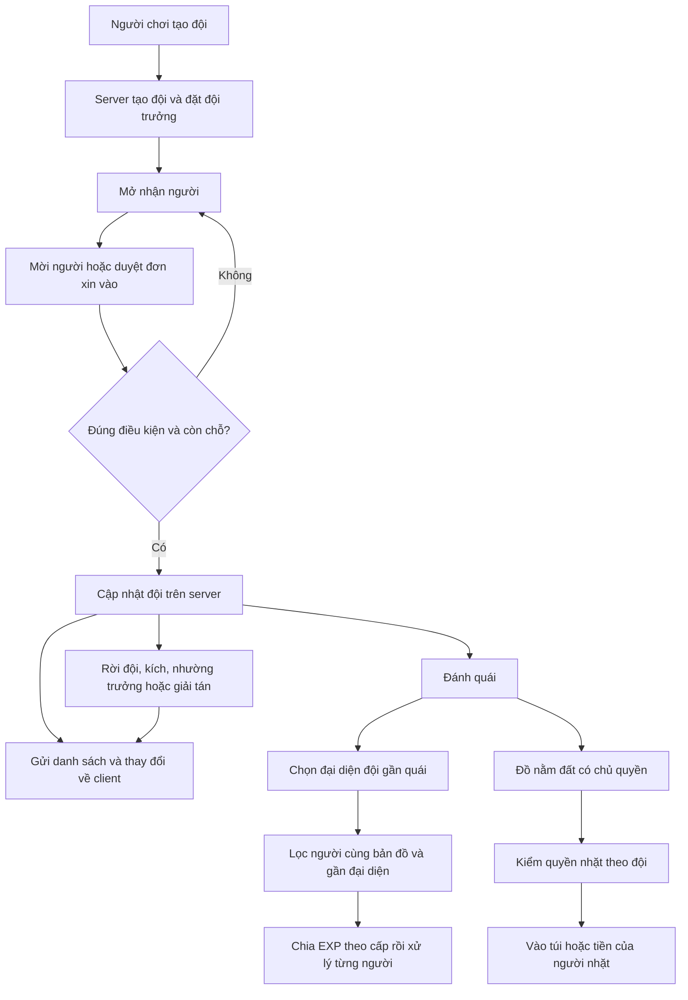

TÓM TẮT 1: [NGUỒN][THẤY] Người tạo đội trở thành đội trưởng; nhận người bằng lời mời hoặc duyệt đơn xin vào đội. Nguồn: Core/Src/KPlayerTeam.cpp:348–364; Core/Src/KPlayer.cpp:1904–1958.
TÓM TẮT 2: [NGUỒN][THẤY] Client định nghĩa 7 ô đội viên, tách đội trưởng; server còn kiểm sức chứa theo cấp thống lĩnh. Chưa chốt giới hạn bản server biên dịch. Nguồn: gamecore/GameDataDef.h:23; Core/Src/KPlayerTeam.cpp:747–750.
TÓM TẮT 3: [NGUỒN][THẤY] EXP đội xét vị trí rồi chia theo cấp, có hệ số cộng thêm theo số người đủ điều kiện; sau đó còn xử lý riêng từng người. Nguồn: Core/Src/KPlayer.cpp:2965–3056; Core/Src/KPlayer.cpp:3099–3154.
TÓM TẮT 4: [NGUỒN][THẤY] Đồ nằm đất có thể được người cùng đội với chủ quyền nhặt; vật phẩm vào túi người nhặt, tiền nhặt cộng cho người nhặt. Nguồn: Core/Src/KPlayer.cpp:5671–5724; Core/Src/KPlayer.cpp:5870–5896.
TÓM TẮT 5: [CHƯA KIỂM] Chỉ khảo sát tĩnh; không chạy build, test game, exe, VM hay mạng; không xác nhận bản đang vận hành. Giới hạn: JX1_OPS/TASKS/SO-21.md:27–29.

# SO-21 — Sổ tay tổ đội và chia kinh nghiệm/đồ

Loại: tổng hợp
Chủ đề: Hiểu cách lập đội, quản lý đội trưởng, nhận EXP và nhặt đồ trong nguồn được SO-21 chỉ định.
Từ khóa: tổ đội, đội trưởng, thống lĩnh, chia kinh nghiệm, nhặt đồ, KPlayerTeam, AddExp, MAX_TEAM_MEMBER, s2c_teamselfinfo
Trạng thái: DONE — hoàn tất tài liệu đọc tĩnh cho 6/6 nhóm mục tiêu; các giới hạn kiểm chứng được công khai bên dưới.
Độ phủ: đã phủ 6 trên tổng 6 nhóm mục tiêu; chưa xác minh runtime, dữ liệu thống lĩnh và header thực sự dùng khi build server.
Liên quan: JX1_OPS/TASKS/SO-21.md; JX1_OPS/REPORTS/SO-21.md; JX1_OPS/DESIGN/CHUAN-BAO-CAO.md; JX1_OPS/DESIGN/MUC-LUC-TRI-THUC.md
Cần tôi quyết định: không — không cần quyết định thêm cho tài liệu tĩnh; kiểm chứng runtime là công việc riêng cần duyệt.

## 1. Cách đọc và nguồn đối chiếu

[TÀI LIỆU] **THẤY** nghĩa là đã đọc lệnh đang có hiệu lực trong source, chưa có nghĩa đã chạy game. **TÀI LIỆU** là quy ước hoặc cách diễn giải. **CHƯA KIỂM** là phần còn thiếu dữ liệu, bản build hoặc phép thử. Tiêu chí và giới hạn: JX1_OPS/TASKS/SO-21.md:21; JX1_OPS/TASKS/SO-21.md:27–29.

[TÀI LIỆU] Các dẫn `file:dòng` dưới đây dùng đường dẫn tương đối với đúng hai root tại JX1_OPS/TASKS/SO-21.md:24:

- `Core/Src/...` tính từ `C:/Jx1CocoV3/SwordOnline/SwordOnline/jxOnline/gameserver/Sources`.
- `gamecore/...`, `gameui/...` tính từ `C:/Jx1CocoV3/Folder/Client2912-20260116T044348Z-3-001/Client2912/Client/Classes`.

[TÀI LIỆU] Danh sách đọc được giới hạn theo mục Nguồn của task và mở rộng theo đúng hàm gọi/include liên quan; không dùng bản backup, binary hoặc kết quả Graphify làm bằng chứng. Danh sách các tệp làm bằng chứng:

| Nhóm | Tệp | Phần cần đọc |
|---|---|---|
| Server: vòng đời đội | `Core/Src/KPlayerTeam.cpp`, `Core/Src/KPlayerTeam.h` | Tạo, mời, nhận thành viên, sức chứa, xóa thành viên, kiểm người trong đội |
| Server: xử lý người chơi | `Core/Src/KPlayer.cpp` | Xin vào đội, nhận người, rời/kích/nhường trưởng/giải tán, EXP, nhặt đồ |
| Server: gói tin | `Core/Src/KProtocolProcess.cpp` | Định tuyến lệnh đội tới phần xử lý server |
| Server: quái chết | `Core/Src/KNpcDeathCalcExp.cpp`, `Core/Src/KNpc.cpp` | Người đại diện gần quái để chia EXP, quyền đồ nằm đất và nhánh tiền mobile |
| Client: cấu trúc và thao tác | `gamecore/GameDataDef.h`, `gamecore/KPlayer.cpp`, `gamecore/KPlayerTeam.cpp`, `gamecore/CoreShell.cpp` | Hằng số, gửi yêu cầu, lời mời, thông báo thay đổi dữ liệu đội |
| Client: nhận và hiển thị | `gamecore/KProtocolProcess.cpp`, `gameui/KuiTeam.cpp` | Áp trạng thái server, tên/cấp/vai trò thành viên, thao tác cửa sổ đội |

## 2. Sơ đồ chính

[THẤY] Cơ sở sơ đồ: Core/Src/KPlayerTeam.cpp:310–364; Core/Src/KPlayer.cpp:1904–1958; Core/Src/KNpcDeathCalcExp.cpp:146–190; Core/Src/KPlayer.cpp:2965–3056; Core/Src/KPlayer.cpp:5671–5896. Nhánh vật phẩm có thể gọi script trước khi vào túi, nên hình chỉ diễn tả luồng nhặt thông thường: Core/Src/KPlayer.cpp:5768–5808.

## 3. Phạm vi và độ phủ

| Nhóm mục tiêu của task | Đã phủ / chưa phủ | Bằng chứng đã đối chiếu | Giới hạn |
|---|---|---|---|
| Lập đội và nhận người | Đã phủ tĩnh | Core/Src/KPlayerTeam.cpp:310–364; Core/Src/KPlayer.cpp:1904–1958 | Chưa thử thao tác thực tế |
| Rời đội | Đã phủ tĩnh | Core/Src/KPlayer.cpp:2026–2056; Core/Src/KPlayerTeam.cpp:814–879 | Chưa thử mất kết nối/đổi máy chủ |
| Đội trưởng | Đã phủ tĩnh | Core/Src/KPlayer.cpp:2064–2077; Core/Src/KPlayer.cpp:2116–2187 | Chưa đo hành vi khi nhận nhiều yêu cầu đồng thời |
| Chia EXP | Đã phủ tĩnh | Core/Src/KNpcDeathCalcExp.cpp:146–190; Core/Src/KPlayer.cpp:2936–3056 | Chưa biết hệ số/cấu hình đang chạy |
| Chia đồ rơi, tiền | Đã phủ tĩnh cho quyền nhặt và người nhận | Core/Src/KPlayer.cpp:5662–5896; Core/Src/KNpc.cpp:11974–11998 | Chưa phủ nội dung script nhặt/rơi đồ và mọi nhánh vật phẩm |
| Giới hạn thành viên và đồng bộ client | Đã phủ tĩnh | gamecore/GameDataDef.h:23; Core/Src/KPlayerTeam.cpp:747–750; gamecore/KProtocolProcess.cpp:2014–2064 | Chưa đối chiếu header server, bảng thống lĩnh, APK hay gói tin thực |

## 4. Giải mã tên

[TÀI LIỆU] Tài liệu không nêu tên riêng kỹ năng, trang bị, quái, NPC hoặc bản đồ cụ thể. Các tên gốc dưới đây là mã định danh ASCII, không phải tên Hán/Việt cần chuyển GBK hay TCVN3. Tài liệu đầu ra là UTF-8 không BOM. Chú thích legacy có đoạn hiển thị lỗi mã hóa; không dùng chúng để kết luận cơ chế. Nguồn đối chiếu tên là các khai báo/lệnh dưới đây.

| Tên gốc giữ nguyên | Mã hóa | Chữ đúng / nghĩa dùng trong sổ tay | Nguồn file:dòng |
|---|---|---|---|
| `KPlayerTeam`, `KTeam` | ASCII | Thông tin đội của một người; thông tin cả đội | Core/Src/KPlayerTeam.h:18; Core/Src/KPlayerTeam.h:86 |
| `TEAM_CAPTAIN`, `TEAM_MEMBER` | ASCII | Đội trưởng, đội viên | Core/Src/KPlayerTeam.cpp:352; Core/Src/KPlayerTeam.cpp:497 |
| `MAX_TEAM_MEMBER` | ASCII | Số ô đội viên, đội trưởng có trường riêng | gamecore/GameDataDef.h:23; Core/Src/KPlayerTeam.h:92–94 |
| `m_dwLeadLevel`, `CalcCaptainPower` | ASCII | Cấp thống lĩnh và sức chứa tương ứng của đội trưởng | Core/Src/KPlayerTeam.cpp:747–750 |
| `AddExp`, `AddSelfExp` | ASCII | Chia EXP đầu vào; xử lý phần EXP riêng từng người | Core/Src/KPlayer.cpp:2936; Core/Src/KPlayer.cpp:3099 |
| `m_nBelong`, `CheckIn` | ASCII | Người có quyền sở hữu; kiểm người đó có thuộc đội | Core/Src/KPlayer.cpp:5671–5710; Core/Src/KPlayerTeam.cpp:991–1003 |

## 5. Sắp theo cấu trúc game

[TÀI LIỆU] Nội dung đi theo trải nghiệm chơi: lập đội → vai trò và sức chứa → chiến đấu nhận EXP → nhặt đồ/tiền → cập nhật trên màn hình. Đây là hệ thống tổ đội, không phải danh mục theo môn phái, bộ trang bị hay bản đồ. Các nhóm bám đúng mục tiêu tại JX1_OPS/TASKS/SO-21.md:20.

## 6. Lập đội, mời và xin vào đội

- [THẤY] **Tạo đội:** khi chưa có đội, client gửi yêu cầu tạo. Server kiểm trạng thái được phép lập đội và việc đã ở đội khác; tạo thành công thì người tạo là đội trưởng và server thử mở nhận người. Nguồn: gamecore/KPlayerTeam.cpp:48–64; Core/Src/KPlayerTeam.cpp:318–364.
- [THẤY] **Đội trưởng mời người ở gần:** server chỉ chuyển lời mời khi người mời là đội trưởng, đội đang mở và tìm được người được mời trong vùng lân cận. Nguồn: Core/Src/KPlayerTeam.cpp:397–425.
- [THẤY] **Người nhận có thể từ chối:** client gửi kết quả 0 khi bật tự từ chối; nếu không thì phát thông báo cần xác nhận. Câu trả lời được gửi lại server. Nguồn: gamecore/KPlayerTeam.cpp:84–137.
- [THẤY] **Đồng ý lời mời vẫn qua kiểm tra server:** hai người phải cùng `m_SubWorldIndex`, người nhận được phép vào đội; phía đội còn kiểm lời mời đã lưu, sức chứa và điều kiện thêm thành viên. Nguồn: Core/Src/KProtocolProcess.cpp:5843–5864; Core/Src/KPlayerTeam.cpp:433–498.
- [THẤY] **Lời mời có thể đưa người đang có đội sang đội mới:** trong nhánh trả lời lời mời, server cho người nhận rời đội cũ trước khi gọi thêm vào đội mới. Điều này xảy ra trước khi biết `AddMember` thành công; không bảo đảm chuyển đội luôn thành công. Nguồn: Core/Src/KPlayerTeam.cpp:474–487.
- [THẤY] **Xin vào đội là nhánh khác:** client chỉ gửi đơn khi mình chưa có đội, không giao dịch và thấy đối phương mở nhận người. Server tìm người nhận đơn ở vùng hiện tại hoặc vùng kề rồi chuyển đơn. Nguồn: gamecore/KPlayer.cpp:1712–1739; Core/Src/KPlayer.cpp:1857–1895.
- [THẤY] **Duyệt đơn:** chỉ đội trưởng của đội đang mở, còn sức chứa mới nhận được; người xin phải ở gần, chưa có đội và đã xin đúng đội trưởng đó. Nguồn: Core/Src/KPlayer.cpp:1904–1958.
- [THẤY] **Điều kiện phe không phải lệnh cấm mọi trường hợp khác phe:** điều kiện đang viết là từ chối khi người xin có `m_Camp != camp_begin` nhưng đội trưởng có `m_Camp == camp_begin`. Không tự gán tên Việt cụ thể cho `camp_begin`. Nguồn: Core/Src/KPlayerTeam.cpp:760–764; Core/Src/KPlayer.cpp:1888–1890.

## 7. Đội trưởng, rời đội và sức chứa

- [THẤY] **Rời đội:** client gửi lệnh rời; server chuyển sang thao tác xóa thành viên. Đội viên rời thì bỏ ô của người đó, giảm số đội viên và gửi thông báo cập nhật. Nguồn: gamecore/KPlayer.cpp:1821–1826; Core/Src/KPlayer.cpp:2026–2056; Core/Src/KPlayerTeam.cpp:850–879.
- [THẤY] **Đội trưởng rời làm giải tán đội theo nhánh này:** server giải phóng trạng thái đội của đội trưởng lẫn các đội viên, rồi giải phóng đội. Không có bước tự chọn trưởng kế nhiệm trong nhánh đã đọc. Muốn giữ đội nên nhường trưởng trước; đây là cách dùng rút ra từ luồng lệnh. Nguồn: Core/Src/KPlayerTeam.cpp:819–848; Core/Src/KPlayer.cpp:2116–2158.
- [THẤY] **Kích người:** server yêu cầu người ra lệnh là đội trưởng, tìm người bị kích trong danh sách rồi dùng thao tác xóa thành viên. Nguồn: Core/Src/KPlayer.cpp:2064–2077.
- [THẤY] **Nhường trưởng:** người nhận phải là đội viên hiện tại, thỏa điều kiện phe và có sức chứa thống lĩnh đủ cho số đội viên hiện hữu. Server đổi chỗ trưởng cũ/trưởng mới và gửi thông báo cho đội. Nguồn: Core/Src/KPlayer.cpp:2116–2187.
- [THẤY] **Đóng nhận người khác với giải tán:** đóng chỉ đổi trạng thái nhận người; lệnh giải tán có nhánh xóa đội riêng, chỉ đội trưởng được gọi. Nguồn: Core/Src/KPlayerTeam.cpp:707–724; Core/Src/KPlayer.cpp:2196–2229.
- [THẤY] **Có hai giới hạn nhận người:** server so số đội viên với `MAX_TEAM_MEMBER` và với sức chứa trả về từ cấp thống lĩnh của đội trưởng. Đội trưởng được lưu riêng, không tăng bộ đếm khi tạo đội; thêm đội viên mới tăng bộ đếm. Nguồn: Core/Src/KPlayer.cpp:1910–1917; Core/Src/KPlayerTeam.cpp:747–750; Core/Src/KPlayerTeam.cpp:772–804.
- [THẤY] **Bản header client có 7 ô đội viên:** kết hợp cách tách trường đội trưởng, cấu trúc biểu diễn được 1 trưởng + 7 đội viên = 8 người. Đây là sức chứa cấu trúc ở nguồn đã đọc; chưa phải xác nhận server đang chạy cho phép 8 người. Nguồn: gamecore/GameDataDef.h:23; Core/Src/KPlayerTeam.h:92–94.
- [CHƯA KIỂM] **Số người thực tế theo từng cấp thống lĩnh và giới hạn server:** chưa đọc được bảng dữ liệu nạp cho `GetMemNumFromLevel`; cũng chưa đối chiếu định nghĩa macro mà project server thực sự sử dụng. Không lấy header phía client thay cho bằng chứng build server. Điểm cần nối tiếp: Core/Src/KPlayerTeam.cpp:747–750; Core/Src/KPlayer.cpp:1913–1914.

## 8. EXP khi đi đội

### 8.1. Ai được xét và đứng gần ai?

- [THẤY] **Bước gần quái:** khi tính EXP quái chết, server chọn một người đại diện trong đội gần quái nhất trong ngưỡng đang xét; khoảng cách hợp lệ phải không âm và nhỏ hơn `PLAYER_SHARE_EXP_DISTANCE²`. Nếu có người đại diện, server gọi `AddExp` trên người đó. Nguồn: Core/Src/KNpcDeathCalcExp.cpp:146–190.
- [THẤY] **Bước gần người đại diện:** `AddExp` xét đội trưởng và các đội viên có cùng `m_SubWorldIndex` với người đang nhận lời gọi, rồi lọc theo khoảng cách tới người đó. Tại bước này, bằng đúng ngưỡng vẫn được xét (`<=` cho trưởng, bỏ qua khi `>` cho đội viên). Vì vậy không diễn giải thành “mọi người chỉ cần đứng gần đội trưởng hoặc gần quái”. Nguồn: Core/Src/KPlayer.cpp:2953–3008.
- [THẤY] **Ngưỡng có tên giống nhau nhưng cần phân biệt nguồn:** giá trị `768` xuất hiện trong nhánh `#ifdef _SERVER` của header nằm ở cây client. Source server dùng cùng tên macro. Chưa xác nhận server build với giá trị ấy; cũng không đổi đơn vị tọa độ thành mét/ô màn hình. Nguồn: gamecore/GameDataDef.h:591–594; Core/Src/KNpcDeathCalcExp.cpp:151–168; Core/Src/KPlayer.cpp:2976–2978.
- [THẤY] **Đếm người đủ điều kiện, không lấy toàn bộ danh sách đội:** chỉ những người qua bước cùng bản đồ/khoảng cách mới được cộng cấp và tăng số người chia. Nguồn: Core/Src/KPlayer.cpp:2980–2982; Core/Src/KPlayer.cpp:2990–3009.

### 8.2. Chia bao nhiêu?

[THẤY] Gọi `E` là EXP đầu vào của một lần `AddExp`, `N` là số người qua bộ lọc và `L` là tổng cấp của những người ấy. Khi `N >= 2`, hệ số là `k = 100 + 15 × N`; phần tỷ lệ của người cấp `l` là `p = k × l / L`, nếu `p <= 0` thì đặt bằng 1. Server truyền `E × p / 100` vào phần xử lý EXP riêng của người đó. Lời gọi nhận số nguyên nên có mất phần lẻ. Nguồn: Core/Src/KPlayer.cpp:3026–3056; Core/Src/KPlayer.cpp:3099.

[TÀI LIỆU] **Ví dụ tính minh họa, không phải số đo game:** giả sử `E = 1.000`, hai người cùng cấp 50 đều qua bộ lọc. Khi đó `N = 2`, `k = 130`, mỗi người có `p = 65` và được truyền 650 EXP vào bước riêng. Tổng trước bước riêng là 1.300 EXP. Đây là phép thay số vào công thức tại Core/Src/KPlayer.cpp:3027–3056; chưa bao gồm các hệ số cấu hình hoặc trạng thái từng người.

- [THẤY] **Không có đội hoặc chỉ một người đủ điều kiện:** đi thẳng sang `AddSelfExp` với EXP đầu vào; trường hợp không có người/tổng cấp hợp lệ thì dừng. Nguồn: Core/Src/KPlayer.cpp:2941–2944; Core/Src/KPlayer.cpp:3018–3023.
- [THẤY] **EXP đầu vào đúng 1 là ngoại lệ:** `AddExp` trả về ngay. Không đánh đồng ngoại lệ này với việc bước riêng có thể tính ra EXP tối thiểu 1. Nguồn: Core/Src/KPlayer.cpp:2936–2939; Core/Src/KPlayer.cpp:3132–3139.
- [THẤY] **Số tăng cuối cùng còn thay đổi:** bước riêng bỏ qua người chết/đang hồi sinh, áp hệ số `ServerExp` và giá trị nhiệm vụ toàn cục, chênh cấp với quái, trạng thái tăng EXP và giới hạn EXP rồi mới cộng. Người đã bị tính vào mẫu số chia vẫn có thể bị bước riêng từ chối; nhánh này không chia lại phần bị từ chối. Nguồn: Core/Src/KPlayer.cpp:2980–3009; Core/Src/KPlayer.cpp:3040–3056; Core/Src/KPlayer.cpp:3099–3154.
- [THẤY] **Đội trưởng có EXP thống lĩnh riêng:** khi đội trưởng nằm trong nhóm chia, server tính `nLeadExp` và gọi `AddLeadExp` ngoài phần EXP nhân vật. Sổ tay chưa định lượng phần này vì còn phụ thuộc dữ liệu chia thống lĩnh. Nguồn: Core/Src/KPlayer.cpp:3030–3044.
- [CHƯA KIỂM] **Không hứa EXP thực nhận từ công thức trên:** chưa đọc cấu hình chạy, dữ liệu hệ số, trạng thái nhân vật và không thử trận đánh. Điểm thay đổi EXP sau chia: Core/Src/KPlayer.cpp:3113–3154; giới hạn khảo sát: JX1_OPS/TASKS/SO-21.md:27–29.

## 9. Đồ rơi và tiền: quyền nhặt, người nhận

- [THẤY] **Quyền đồ nằm đất:** khi `m_nBelong > 0`, người đi lẻ chỉ nhặt được nếu mình là chủ quyền. Người có đội được kiểm tra xem chủ quyền có phải trưởng/đội viên của đội mình hay không. Quy tắc này có cho cả đồ và tiền nằm đất. Nguồn: Core/Src/KPlayer.cpp:5671–5724; Core/Src/KPlayerTeam.cpp:991–1003.
- [THẤY] **Vật phẩm về người nhặt:** sau các bước kiểm tra và gọi script liên quan, nhánh thông thường tìm chỗ trống trong túi người nhặt, thêm vật phẩm rồi xóa vật trên đất. Đoạn này không quay vòng hay bốc thăm người nhận trong đội. Kết luận chỉ áp dụng nhánh đã đọc, không bao trùm script. Nguồn: Core/Src/KPlayer.cpp:5768–5808; Core/Src/KPlayer.cpp:5829–5838; Core/Src/KPlayer.cpp:5870–5885.
- [THẤY] **Tiền nhặt về người nhặt:** nhánh tiền gọi `Earn` trên chính người xử lý yêu cầu, rồi xóa vật tiền. Không có phép chia đều tiền đội trong đoạn này. Nguồn: Core/Src/KPlayer.cpp:5889–5896.
- [THẤY] **Tiền mobile có đường riêng:** khi `getMobileClient()` đúng, hàm rơi tiền cộng trực tiếp một số ngẫu nhiên từ `nMoney/2` đến `nMoney` cho `nBelongPlayer` rồi trả về, không tạo vật tiền nằm đất tại nhánh đó. Không gán nhánh này cho mọi client đang dùng. Nguồn: Core/Src/KNpc.cpp:11974–11998.
- [THẤY] **Không lấy đoạn tìm người gần nhất làm bằng chứng chia đồ:** ở hai đoạn đã đọc, `SetItemBelong` gán cho `nBelongPlayer` hoặc chủ người đồng hành; đoạn quét người đội gần nhất trong khối `m_IsSendItemInfo` chỉ tính người gần và có thân khối rỗng, không thấy lệnh chuyển vật phẩm cho người đó. Nguồn: Core/Src/KNpc.cpp:12529–12587; Core/Src/KNpc.cpp:12978–13036.
- [THẤY] **Có chặn và phần chưa đủ:** `m_nBelong == -2` bị từ chối; nhặt phải cùng `m_SubWorldIndex`. Phép chặn khoảng cách bình phương trong chính hàm này đang nằm trong comment, nên không mô tả như hàng rào đang chạy. Điều này không chứng minh mọi tầng khác đều bỏ kiểm khoảng cách. Nguồn: Core/Src/KPlayer.cpp:5727–5763.
- [CHƯA KIỂM] **Chưa kết luận mọi chế độ chia đồ:** nội dung script vật phẩm, `goldpickup.lua`, script `DropRate`, thời gian hết quyền bảo vệ và xử lý tranh nhặt chưa được đọc/chạy trong task. Những điểm có thể nối sang script: Core/Src/KPlayer.cpp:5771–5808; Core/Src/KNpc.cpp:2485–2487.

## 10. Đồng bộ lên màn hình client

| Sự kiện | [THẤY] Cách client cập nhật | Nguồn file:dòng |
|---|---|---|
| Gửi yêu cầu | Cửa sổ đội gọi thao tác mời/kích/nhường trưởng/rời; CoreShell chuyển tới xử lý nhân vật | gameui/KuiTeam.cpp:426–470; gamecore/CoreShell.cpp:573–624 |
| Tạo thành công | Tạo bản đội ở `g_Team[0]`, ghi ID đội server và vai trò trưởng | gamecore/KProtocolProcess.cpp:1162–1173 |
| Người mới vào | Thêm ID, cấp, tên; tăng số đội viên; gọi cập nhật giao diện | gamecore/KProtocolProcess.cpp:1911–1931 |
| Rời đội | Nếu là mình thì xóa trạng thái đội; nếu người khác thì xóa người đó; gọi cập nhật giao diện | gamecore/KProtocolProcess.cpp:1360–1384 |
| Nhường trưởng | Kiểm trưởng cũ/đội viên khớp, đổi vị trí tên/cấp/ID và vai trò của mình | gamecore/KProtocolProcess.cpp:1947–2008 |
| Danh sách đầy đủ | Đọc vai trò, ID đội, trạng thái nhận người, trưởng và từng ô đội viên từ gói server | gamecore/KProtocolProcess.cpp:2014–2064; Core/Src/KPlayer.cpp:1768–1801 |
| Lệch trạng thái | Một số gói gặp trạng thái không khớp sẽ yêu cầu thông tin đội đầy đủ lại | gamecore/KProtocolProcess.cpp:1914–1916; gamecore/KProtocolProcess.cpp:1949–1962 |
| Cấp đội viên | Cập nhật cấp theo ID, phân biệt ô trưởng và ô đội viên | gamecore/KProtocolProcess.cpp:1323–1341 |
| EXP nhân vật | Server gửi tổng EXP; client nhận rồi gọi hàm đặt EXP | Core/Src/KPlayer.cpp:3176–3179; gamecore/KProtocolProcess.cpp:508–511 |
| Hiển thị đội | Phát `GDCNI_TEAM`/`GDCNI_TEAM_UI`; cửa sổ đội có hàm đọc danh sách và hiện tên | gamecore/KPlayerTeam.cpp:213–238; gameui/KuiTeam.cpp:751–808 |

[CHƯA KIỂM] Bảng trên xác nhận các đầu xử lý có trong source, không chứng minh độ trễ, thứ tự đến, ACK, khả năng tự phục hồi mọi tình huống hoặc APK cài dùng đúng các tệp này. Chưa lần toàn bộ hàm nhận sự kiện UI. Điểm nguồn: gamecore/KPlayerTeam.cpp:213–238; gameui/KuiTeam.cpp:751–808.

## 11. Mục sổ thông số

| Nhóm | Tên/hằng số | file:dòng | Giá trị | Đơn vị | Ảnh hưởng | Đổi an toàn | Nguồn đo |
|---|---|---|---|---|---|---|---|
| Sức chứa | `MAX_TEAM_MEMBER` ở client | gamecore/GameDataDef.h:23 | 7 | Ô đội viên, ngoài trưởng | Trần cấu trúc đội phía nguồn client | CẨN THẬN | Đọc tĩnh; chưa xác minh header server/build |
| Sức chứa | `CalcCaptainPower` | Core/Src/KPlayerTeam.cpp:747–750 | Tra `GetMemNumFromLevel(m_dwLeadLevel)` | Đội viên | Còn có thể thấp hơn trần mảng | CẨN THẬN | Chưa đọc bảng dữ liệu, chưa đo |
| Khoảng cách | `PLAYER_SHARE_EXP_DISTANCE` | gamecore/GameDataDef.h:591–594 | 768 trong nhánh `_SERVER` của header cây client | Đơn vị tọa độ nguồn | Ngưỡng tham chiếu; server thực tế chưa chốt | CẨN THẬN | Đọc tĩnh; không phải giá trị đã đo trên server |
| EXP | Bộ lọc vị trí | Core/Src/KPlayer.cpp:2965–3008 | Cùng bản đồ và khoảng cách không vượt ngưỡng | Bình phương tọa độ | Chọn nhóm được đưa vào phép chia | CẨN THẬN | Đọc tĩnh |
| EXP | `k` | Core/Src/KPlayer.cpp:3027 | `100 + 15 × N` khi `N >= 2` | Phần trăm trước chia cấp | Tăng tổng quỹ EXP đầu vào của nhóm | CẨN THẬN | Đọc tĩnh; ví dụ chỉ là phép tính |
| EXP | `nGetExp` trong phép chia | Core/Src/KPlayer.cpp:3037–3056 | `k × cấp / tổng cấp`, nếu không dương thì 1 | Tỷ lệ phần trăm | Mỗi người nhận theo cấp | CẨN THẬN | Đọc tĩnh |
| EXP | `nExp == 1` | Core/Src/KPlayer.cpp:2938–2939 | Trả về ngay | EXP đầu vào | Không thực hiện chia/cộng tại hàm này | CẨN THẬN | Đọc tĩnh |
| EXP | `ServerExp`, `ServerExpLimit` | Core/Src/KPlayer.cpp:3115–3116; Core/Src/KPlayer.cpp:3145–3149 | Giá trị cấu hình chưa đọc; mặc định lời gọi đều 1 | Hệ số; EXP tích lũy | Thay đổi hoặc chặn EXP riêng | CẨN THẬN | Chỉ đọc mặc định trong lệnh, chưa đọc cấu hình chạy |
| Đồ | `m_nBelong == -2` | Core/Src/KPlayer.cpp:5727–5731 | Cấm nhặt | Giá trị trạng thái | Dừng yêu cầu nhặt | CẨN THẬN | Đọc tĩnh |

[TÀI LIỆU] “CẨN THẬN” là đánh giá thiếu bằng chứng để hứa đổi an toàn, không cấp quyền thay cấu hình hay mã. Task chỉ cho đọc tĩnh: JX1_OPS/TASKS/SO-21.md:27–28.

## 12. Đã xác minh / Chưa kiểm

### Đã xác minh

- [THẤY] Đã đối chiếu source thật cho cả sáu nhóm ở bảng phạm vi; các dẫn nguồn là dòng trong đúng hai root, không phải số dòng từ bản đồ hoặc báo cáo cũ. Các đầu mối chính: Core/Src/KPlayerTeam.cpp:310; Core/Src/KPlayer.cpp:2936; Core/Src/KPlayer.cpp:5662; gamecore/KProtocolProcess.cpp:2014.
- [THẤY] Đã phân biệt lệnh chạy với đoạn comment ở kiểm khoảng cách nhặt và đoạn tìm người gần để thông báo đồ. Nguồn: Core/Src/KPlayer.cpp:5754–5763; Core/Src/KNpc.cpp:12543–12587.

### Chưa kiểm

- [CHƯA KIỂM] Header được project server chọn lúc build, dữ liệu cấp thống lĩnh, các hệ số và giới hạn EXP thực tế. Điểm nối: Core/Src/KPlayerTeam.cpp:750; Core/Src/KPlayer.cpp:3115; Core/Src/KPlayer.cpp:3146.
- [CHƯA KIỂM] Script rơi/nhặt, hết thời gian bảo vệ đồ, ngắt kết nối, chuyển bản đồ/đổi server, tranh nhặt và rời/đổi đội trong lúc nhận EXP. Điểm nối: Core/Src/KNpc.cpp:2487; Core/Src/KPlayer.cpp:5771–5808; Core/Src/KPlayer.cpp:2026–2056.
- [CHƯA KIỂM] Build, test game, exe, VM, mạng, ACK/độ trễ, bản cài client và server vận hành; chưa thực hiện vì ngoài quyền task. Nguồn phạm vi: JX1_OPS/TASKS/SO-21.md:27–29.

## 13. Đề xuất tối ưu

[TÀI LIỆU] Khi có task xác minh riêng, ưu tiên xác định header/bảng thống lĩnh đúng phiên bản, sau đó thử hai người cùng cấp, khác cấp, sát/vượt ngưỡng, một người chết và túi đầy. Đối chiếu số server gửi với số client hiện; không điều chỉnh hệ số trước khi biết đường nhận EXP/đồ đang dùng. Các điểm cần thử bám Core/Src/KPlayer.cpp:2965–3056; Core/Src/KPlayer.cpp:3104–3154; Core/Src/KPlayer.cpp:5829–5838. Đây là đề xuất, chưa thực hiện.

## 14. Bàn giao

- Tài liệu mới; không thay kết luận hoặc số liệu của báo cáo cũ, không sửa source/cấu hình game.
- Chỉ mục đề xuất được ghi trong `JX1_OPS/REPORTS/SO-21.md` để Tổng quan/PM gộp; không sửa mục lục chung hoặc tạo thêm tệp ngoài vùng được giao.
- Không stage, commit hoặc push theo yêu cầu người giao; chưa có SHA mới. Tổng quan nhận phần commit.
- Chưa ghi được `D:/JX-wt/SO-21.nhip`: đường dẫn nằm ngoài writable root `D:/JX-wt/SO-21` của phiên; không thử vượt sandbox. Các mốc và hạn chế được ghi trong báo cáo bàn giao.

## 15. Phát hiện khi chuẩn hóa

- Chưa có sổ tay/báo cáo SO-21 ở đầu lượt, nên đây là tạo mới theo khuôn, không phải sửa kết luận cũ.
- Một lần định vị bằng PowerShell `-LiteralPath` kết hợp `-Include` trả quá nhiều tên tệp. Đã sửa sang `-Path` và `-Filter`; không dùng danh sách tràn làm bằng chứng nội dung. Không tạo parser hoặc script phụ.
- Lần đọc tài liệu đầu hiển thị sai dấu do mã hóa đầu ra console; các lệnh sau đặt UTF-8. Source có chú thích legacy lỗi mã hóa, nên bằng chứng cơ chế dùng mã lệnh/ID ASCII và phần UI đọc được, không tự phục hồi hay sửa nguồn.

Kỹ năng đã dùng: jx1-retrofit, jx1-read-server, jx1-read-client, jx1-parameters, jx1-knowledge, jx1-report (đã nạp từ `.agents/skills`; áp dụng trong phạm vi người giao cho phép).
