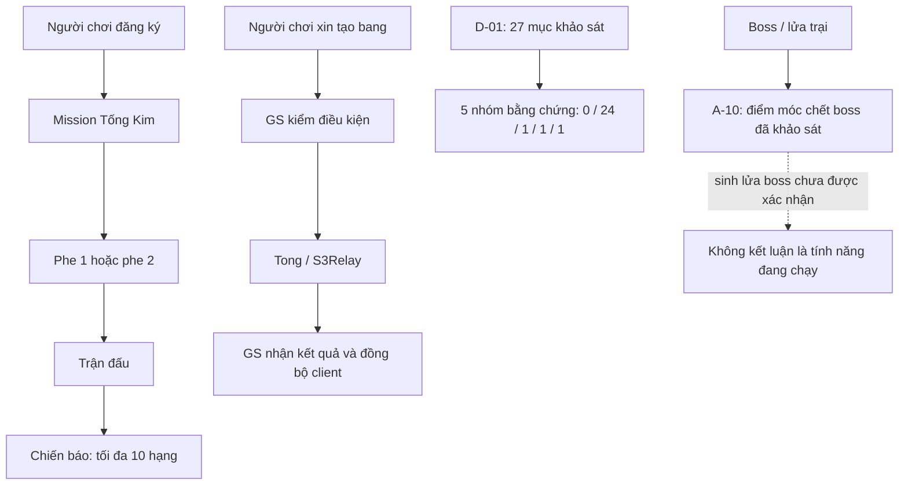

TÓM TẮT 5 DÒNG
1. [NGUỒN] [TÀI LIỆU] Khảo sát A-16 mô tả Tống Kim qua mission ID 11; nhánh được khảo sát đặt 100 người mỗi phe, chênh lệch 2 (`G/settings/Task/missions.txt:12`; `G/script/tnlteam/mission/battlesongjin/battlehead.lua:180,182`).
2. [NGUỒN] [THẤY] Chiến báo có tối đa 10 hạng hiển thị; đây không phải giới hạn người tham chiến (`C/gamecore/GameDataDef.h:428`; `C/vn/gameui/KuiCometoMapVN.cpp:1396`).
3. [NGUỒN] [TÀI LIỆU] D-01 có 27 mục/nhánh, chia năm nhóm bằng chứng 0/24/1/1/1; SO-07 đã đối chiếu thêm đường bang hội Tong/S3Relay trong source GS (`JX1_OPS/REPORTS/D-01-bang-hoat-dong.md:29–35,60–88`; `MS/KSOServer.cpp:6084–6120`).
4. [NGUỒN] [TÀI LIỆU] Báo cáo A-10 ghi nhận lửa trại hiện có và các giới hạn khi nối với boss; sinh lửa boss là đề xuất, chưa được xác nhận là luồng đang chạy (`G/script/item/huozhong.lua:67–83`; `S/KNpc.cpp:2590–2624`).
5. [CHƯA KIỂM] Chỉ tổng hợp tài liệu khảo sát tĩnh; không build, chạy exe hay VM, không xác minh runtime.

# SO-07 — Sổ tay hiểu game: Tống Kim, bang hội và hoạt động

Loại: tổng hợp
Chủ đề: Giải thích Tống Kim, bang hội, hoạt động và lửa trại cho người không lập trình.
Từ khóa: Tống Kim, Songjin, bang hội, S3Relay, hoạt động, campfire, boss, A-16, D-01
Trạng thái: DONE — hoàn tất phạm vi sổ tay tĩnh; các giới hạn vận hành ghi CHƯA KIỂM.
Độ phủ: trả lời 4/4 nhóm câu hỏi; dẫn đủ 27/27 mục D-01. Chưa đếm được số hoạt động chạy thành công vì không thử game.
Liên quan: `JX1_OPS/REPORTS/A-16-tong-kim.md`, `D-01-bang-hoat-dong.md`, `G-01-campfire-design.md`, `A-10-lua-trai-boss.md`.
Cần tôi quyết định: có — trước khi triển khai lửa trại phải chốt nền tính EXP và nghĩa x2 giữa A-10/G-01; không chặn hoàn tất sổ tay.

## Phạm vi và độ phủ

| Nhóm câu hỏi | Kết quả | Bằng chứng / giới hạn |
|---|---|---|
| Tống Kim chạy thế nào | Đã phủ ở mức khảo sát tài liệu: mission ID 11 dẫn vào nhánh TNL; nhánh này có kiểm tra phe, số người và chênh lệch khi đăng ký. | `G/settings/Task/missions.txt:12`; `G/script/tnlteam/mission/battlesongjin/butcher/head.lua:327,333,345,351,380` (dẫn lại trong A-16). Không xác minh nhánh được binary gọi. |
| Bang hội ở đâu | Đã phủ: [THẤY] đường GS → Tong/S3Relay → GS, sau đó cập nhật core và có lệnh báo client. | `MS/KSOServer.cpp:6084–6120,2163–2179`; `S/CoreServerShell.cpp:1972–1998`; `S/KPlayer.cpp:10923–10927`; `S/KPlayerTong.cpp:264–292,305–317`. Nơi lưu bền và tiến trình thật CHƯA KIỂM. |
| Có bao nhiêu hoạt động và năm trạng thái | Đã phủ: [TÀI LIỆU] 27 mục/nhánh, năm nhóm bằng chứng 0/24/1/1/1; không phải năm giai đoạn của sự kiện. | `JX1_OPS/REPORTS/D-01-bang-hoat-dong.md:29–35,60–88`. Tổng tính năng toàn game và số chạy được CHƯA KIỂM. |
| Lửa trại và boss | Đã phủ một phần. A-10 ghi nhận code có điểm móc khi boss chết; callback `OnGoldDeath` được khảo sát không tạo lửa, và hướng tạo lửa boss vẫn là đề xuất. | `S/KNpc.cpp:2590–2624`; `G/script/global/golddeath.lua:110–126,418–431`; `G/script/item/huozhong.lua:67–83` (dẫn lại trong A-10). Chưa xác minh runtime, map hay binary. |

## Giải mã tên

[TÀI LIỆU] Giữ tên/định danh gốc dưới đây. Hán tự được dẫn lại từ báo cáo UTF-8; D-01 ghi nguồn legacy đọc CP936/GBK. SO-07 không tái giải mã byte script; tên Việt cũ chưa có byte gốc thì chưa gán TCVN3 hay đoán chữ (`JX1_OPS/REPORTS/D-01-bang-hoat-dong.md:25–27`; `JX1_OPS/REPORTS/A-10-lua-trai-boss.md:25–31`).

| Tên gốc / định danh | Mã hóa | Chữ đúng / giới hạn | Nguồn file:dòng |
|---|---|---|---|
| `battlesongjin` / `宋金战场pk战` | ASCII / Hán legacy CP936/GBK được báo cáo trình bày | [TÀI LIỆU] Tống Kim TNL / Tống Kim PK cũ; tách nhánh | `JX1_OPS/REPORTS/A-16-tong-kim.md:40`; `JX1_OPS/REPORTS/D-01-bang-hoat-dong.md:79` |
| `S3relay`, `Tong` | ASCII định danh | [THẤY] Đường dịch vụ bang hội S3Relay/Tong | `MS/KSOServer.cpp:1162–1170,6118–6120` |
| `擂台赛` | Hán từ báo cáo; nguồn legacy CP936/GBK | [TÀI LIỆU] Lôi đài | `JX1_OPS/REPORTS/D-01-bang-hoat-dong.md:42,77` |
| `liendau/dondau` | ASCII định danh | [TÀI LIỆU] Liên đấu đơn | `JX1_OPS/REPORTS/D-01-bang-hoat-dong.md:41,65` |
| `攻城战` / `攻城拔寨` | Hán từ báo cáo; nguồn legacy CP936/GBK | [TÀI LIỆU] Công thành chiến / Công Thành Bạt Trại | `JX1_OPS/REPORTS/D-01-bang-hoat-dong.md:42,78,82` |
| `封神竞技` | Hán từ báo cáo; nguồn legacy CP936/GBK | [TÀI LIỆU] Phong Thần thi đấu | `JX1_OPS/REPORTS/D-01-bang-hoat-dong.md:42,81` |
| `bw` | ASCII định danh | [CHƯA KIỂM] Chưa giải mã tên Việt chính xác; giữ “Thi đấu bw” | `JX1_OPS/REPORTS/D-01-bang-hoat-dong.md:85` |
| `fenglingdu` | ASCII định danh | [TÀI LIỆU] Phong Lăng Độ | `JX1_OPS/REPORTS/D-01-bang-hoat-dong.md:63` |
| `challangeoftime` / `过关斩将` | ASCII giữ nguyên chính tả / Hán từ báo cáo, legacy CP936/GBK | [TÀI LIỆU] Vượt ải, Thách thức thời gian / Quá Quan Trảm Tướng; tách nhánh | `JX1_OPS/REPORTS/D-01-bang-hoat-dong.md:64,80` |
| `kiem_mon_quan` / `yandibaozang` | ASCII định danh | [TÀI LIỆU] Kiếm Môn Quan / Viêm Đế Bảo Tàng | `JX1_OPS/REPORTS/D-01-bang-hoat-dong.md:75–76` |
| `thien_bao_kho` / `van_tieu` | ASCII định danh | [TÀI LIỆU] Thiên Bảo Khố / Vận tiêu | `JX1_OPS/REPORTS/D-01-bang-hoat-dong.md:71–72` |
| `hoadang` / `zhongqiudengmi` | ASCII định danh | [TÀI LIỆU] Hoa đăng subject / bộ câu đố hoa đăng cũ | `JX1_OPS/REPORTS/D-01-bang-hoat-dong.md:66,86` |
| `demhuyhoang` / `bosstieuhk` | ASCII định danh | [TÀI LIỆU] Đêm Huy Hoàng / Boss tiểu Hoàng Kim | `JX1_OPS/REPORTS/D-01-bang-hoat-dong.md:67–68` |
| `巴陵活动` / `襄阳` | Hán từ báo cáo; nguồn legacy CP936/GBK | [TÀI LIỆU] Hoạt động Ba Lăng / Tương Dương; tên sự kiện Tương Dương chưa chốt | `JX1_OPS/REPORTS/D-01-bang-hoat-dong.md:42,83–84` |
| `cauca` / `task_hang_ngay` / `System/activity` | ASCII định danh | [TÀI LIỆU] Câu cá / nhiệm vụ hằng ngày / nhận thưởng hoạt động-online | `JX1_OPS/REPORTS/D-01-bang-hoat-dong.md:70,73–74` |
| `Lễ Quan` | UTF-8 trong báo cáo; byte tên gốc chưa có | [CHƯA KIỂM] Giữ tên Việt D-01; chưa giải mã TCVN3/GBK do không đọc script gốc | `JX1_OPS/REPORTS/D-01-bang-hoat-dong.md:70` |
| `Đua top / xếp hạng thế giới` | UTF-8 trong báo cáo | [TÀI LIỆU] Nhãn mô tả D-01, không đặt tên riêng mới | `JX1_OPS/REPORTS/D-01-bang-hoat-dong.md:69` |
| `active_somayman` / `baihutang`, `bach_ho`, `bai_hu` | ASCII định danh / khóa tìm | [TÀI LIỆU] Số may mắn / Bạch Hổ Đường; khóa tìm chưa xác nhận triển khai | `JX1_OPS/REPORTS/D-01-bang-hoat-dong.md:43,87–88` |
| `óô»ð.lua` / `篝火.lua` | Tên vật lý lỗi mã hóa giữ nguyên / tên Hán logic GBK theo A-10 | [TÀI LIỆU] Lửa trại (篝火); liên kết loader chưa kiểm | `JX1_OPS/REPORTS/A-10-lua-trai-boss.md:25,31` |
| `2078`, `1705`, `1706` | ID số, không phải tên đã giải mã | [CHƯA KIỂM] NPC lửa mẫu / skill lửa; tên hiển thị gốc chưa đối chiếu | `JX1_OPS/REPORTS/A-10-lua-trai-boss.md:50,65,85` |

## Sắp theo cấu trúc game

[TÀI LIỆU] Nội dung đi theo cách chơi: báo danh Tống Kim → phân phe → trận → chiến báo; bang hội đi theo yêu cầu → dịch vụ bang hội → đồng bộ; danh sách D-01 nhóm theo chiến trường, hành trình/cửa ải, sự kiện/boss, sinh hoạt/thưởng, rồi nhánh chưa nối được. Giữ ID D-01 để đối chiếu đủ 27 mục. Cách nhóm phục vụ người đọc, không nhận là phân loại của engine (`JX1_OPS/REPORTS/D-01-bang-hoat-dong.md:60–88`).

## Cách đọc nguồn và mức chắc

- [THẤY] = mở đúng đoạn source trong lượt tiếp tục này, chỉ xác nhận văn bản mã. [TÀI LIỆU] = dẫn lại báo cáo, không tự đổi kết luận. [CHƯA KIỂM] = chưa đối chiếu hoặc chưa thử thực tế.
- `S/` = `C:/Jx1CocoV3/SwordOnline/SwordOnline/jxOnline/gameserver/Sources/Core/Src/`; `MS/` = cùng gốc `Sources/MultiServer/GameServer/`; `C/` = `C:/Jx1CocoV3/Folder/Client2912-20260116T044348Z-3-001/Client2912/Client/Classes/` (gốc được giao: `JX1_OPS/TASKS/SO-07.md:25`).
- `G/` = gói GS mà các báo cáo đã khảo sát, gốc được ghi tại `JX1_OPS/REPORTS/A-16-tong-kim.md:12`. SO-07 không đọc lại script/settings G; các dẫn G bên dưới đều là [TÀI LIỆU]. Các đường `battlehead.lua` rút gọn nằm trong nhánh TNL được chỉ ngay trước đó.
- Markdown đọc UTF-8; source server legacy đọc CP936/GBK. Hai đoạn client được xác nhận bằng token ASCII, không dùng comment lỗi dấu để suy tên. G-01 khảo sát root `D:/JX-source/server/...` khác S; không lấy offset CORE của G-01 gán sang S (`JX1_OPS/REPORTS/G-01-campfire-design.md:18–27`).

## Tống Kim

[TÀI LIỆU] Báo cáo A-16 nối `G/settings/Task/missions.txt:12` (mission ID 11) với nhánh `tnlteam/mission/battlesongjin`; trong nhánh, mã đăng ký chấp nhận phe 1 hoặc 2, từ chối khi phe đạt ngưỡng 100 người, và kiểm tra chênh lệch phe ở ngưỡng 2 (`G/script/tnlteam/mission/battlesongjin/butcher/head.lua:327,333,345,351,380`; `battlehead.lua:180,182`). Đây là kết quả đọc tĩnh của bản script được báo cáo trong A-16, chưa xác nhận đó là bản được máy chủ đang chạy (`JX1_OPS/REPORTS/A-16-tong-kim.md:40–56,92–98`).

[THẤY] Giao diện chiến báo duyệt 10 slot (`C/gamecore/GameDataDef.h:428`; `C/vn/gameui/KuiCometoMapVN.cpp:1396`). Báo cáo A-16 phân biệt rõ trần hiển thị chiến báo với số người tham gia; không dùng “top 10” để kết luận chiến trường chỉ có 10 người. Các nhánh cũ được A-16 ghi nhận có giới hạn khác, nên không gộp các con số khác nhánh thành một luật chung (`JX1_OPS/REPORTS/A-16-tong-kim.md:40–56,74–90`).

[CHƯA KIỂM] Lịch mở, loader/binary chọn nhánh nào, đường tham gia qua giao diện trong bản đang chạy, và việc mọi map chiến trường được nạp đều chưa xác minh runtime (`JX1_OPS/REPORTS/A-16-tong-kim.md:92–98`).

[TÀI LIỆU] Hiểu luồng TNL là báo danh → kiểm tra phe/tiền/chỗ trống → vào phe → mở trận → chiến báo. A-16 ghi cấu hình báo danh 10 phút, trận 30 phút và phí 200.000. Hàm phân cấp có điểm lạ ở cấp 40 và dải 80–119; một hàm mở riêng map thứ ba. Chưa viết các cấu hình này thành cam kết mọi người chơi vào được hoặc cả ba map đều mở (`JX1_OPS/REPORTS/A-16-tong-kim.md:44–56`).

## Bang hội và hoạt động

[THẤY] **Bang hội có phần xử lý tại GS và đường trao đổi riêng sang Tong/S3Relay.** Khi xin tạo bang, GS nhờ core kiểm điều kiện rồi gửi yêu cầu bằng `m_pTongClient`. Câu log ngay sau lệnh gửi gọi đích là S3relay; đó là chữ trong mã, không phải log đã thu khi chạy. Kết nối Tong cũng có hàm kết nối và trạng thái thành công/thất bại riêng (`MS/KSOServer.cpp:6084–6120,1160–1175`).

[THẤY] Khi nhận gói tạo bang thành công, GS chuyển về core; core kiểm nhân vật rồi gọi tạo bang. Phần bang hội của nhân vật có tên bang, chức bang chủ và lệnh báo client. Hiểu đơn giản: người chơi gửi đơn qua GS → dịch vụ bang hội trả kết quả → GS cập nhật nhân vật và báo giao diện (`MS/KSOServer.cpp:2163–2179`; `S/CoreServerShell.cpp:1972–1998`; `S/KPlayer.cpp:10923–10927`; `S/KPlayerTong.cpp:264–292,305–317`).

[CHƯA KIỂM] Chưa đọc triển khai phía tiến trình S3Relay, chưa xác nhận lưu bền/khôi phục bang hội, cấu hình kết nối thật hoặc tạo/gia nhập bang trên bản chạy. Không suy nơi lưu cụ thể từ đường gửi yêu cầu (`MS/KSOServer.cpp:6118–6120`; giới hạn `JX1_OPS/TASKS/SO-07.md:25,27–30`).

### Có bao nhiêu hoạt động? Năm trạng thái là gì?

[TÀI LIỆU] **D-01 ghi 27 mục hoạt động/nhánh**, có tách bản cũ và TNL. Đây là phạm vi bảng khảo sát, không phải toàn bộ tính năng game hay số hoạt động chạy được. Năm trạng thái là mức đủ bằng chứng, không phải vòng đời báo danh/thi đấu/kết thúc (`JX1_OPS/REPORTS/D-01-bang-hoat-dong.md:9,25,29–35,90–97`).

| Trạng thái khảo sát | Số mục | Cách hiểu | Nguồn |
|---|---:|---|---|
| [TÀI LIỆU] Có script đầy đủ | 0 | Chưa nhánh nào đủ bằng chứng từ mở đến kết thúc/thưởng; không khẳng định mọi nhánh đều không chơi được. | `JX1_OPS/REPORTS/D-01-bang-hoat-dong.md:31` |
| [TÀI LIỆU] Script thiếu hoặc lỗi | 24 | Thấy thân xử lý nhưng lỗi văn bản, thiếu file/phụ thuộc hoặc lịch bị ngắt. Lịch bị comment không tự thành lỗi cú pháp của thân hoạt động. | `JX1_OPS/REPORTS/D-01-bang-hoat-dong.md:32` |
| [TÀI LIỆU] Có dữ liệu không có script | 1 | Có bảng nhưng chưa nối được chỗ sử dụng trong phạm vi tìm. | `JX1_OPS/REPORTS/D-01-bang-hoat-dong.md:33` |
| [TÀI LIỆU] Chỉ có tham chiếu | 1 | Thấy lời gọi/tên, chưa thấy triển khai tương ứng. | `JX1_OPS/REPORTS/D-01-bang-hoat-dong.md:34` |
| [TÀI LIỆU] Không thấy | 1 | Không khớp tập từ khóa đã công bố; chưa loại trừ tên khác hoặc PAK. | `JX1_OPS/REPORTS/D-01-bang-hoat-dong.md:35,43` |

[TÀI LIỆU] Bảng sau giữ ID D-01 nhưng nhóm theo cách chơi. **Thiếu/lỗi** viết tắt cho “Script thiếu hoặc lỗi”; mọi hàng đều dẫn báo cáo, chưa thử game. Tổng 0+24+1+1+1=27 (`JX1_OPS/REPORTS/D-01-bang-hoat-dong.md:29–35,60–88`).

| Nhóm chơi | ID — hoạt động/nhánh | Trạng thái | Nguồn |
|---|---|---|---|
| Chiến trường, thi đấu | 01 — Tống Kim TNL, mission 11 | [TÀI LIỆU] Thiếu/lỗi | `JX1_OPS/REPORTS/D-01-bang-hoat-dong.md:62` |
| Chiến trường, thi đấu | 18 — Tống Kim PK cũ, map 378 | [TÀI LIỆU] Thiếu/lỗi | `JX1_OPS/REPORTS/D-01-bang-hoat-dong.md:79` |
| Chiến trường, thi đấu | 16 — Lôi đài cũ, mission 1/2 | [TÀI LIỆU] Thiếu/lỗi | `JX1_OPS/REPORTS/D-01-bang-hoat-dong.md:77` |
| Chiến trường, thi đấu | 04 — Liên đấu đơn, mission 12/13 | [TÀI LIỆU] Thiếu/lỗi | `JX1_OPS/REPORTS/D-01-bang-hoat-dong.md:65` |
| Chiến trường, thi đấu | 17 — Công thành chiến cũ, map 221 | [TÀI LIỆU] Thiếu/lỗi | `JX1_OPS/REPORTS/D-01-bang-hoat-dong.md:78` |
| Chiến trường, thi đấu | 21 — Công Thành Bạt Trại cũ, mission 8 | [TÀI LIỆU] Thiếu/lỗi | `JX1_OPS/REPORTS/D-01-bang-hoat-dong.md:82` |
| Chiến trường, thi đấu | 20 — Phong Thần thi đấu cũ, mission 7 | [TÀI LIỆU] Thiếu/lỗi | `JX1_OPS/REPORTS/D-01-bang-hoat-dong.md:81` |
| Chiến trường, thi đấu | 24 — Thi đấu bw, mission 32 | [TÀI LIỆU] Thiếu/lỗi | `JX1_OPS/REPORTS/D-01-bang-hoat-dong.md:85` |
| Tổ đội, hành trình, cửa ải | 02 — Phong Lăng Độ TNL, mission 10 | [TÀI LIỆU] Thiếu/lỗi | `JX1_OPS/REPORTS/D-01-bang-hoat-dong.md:63` |
| Tổ đội, hành trình, cửa ải | 03 — Vượt ải / Thách thức thời gian, mission 9/17 | [TÀI LIỆU] Thiếu/lỗi | `JX1_OPS/REPORTS/D-01-bang-hoat-dong.md:64` |
| Tổ đội, hành trình, cửa ải | 14 — Kiếm Môn Quan, mission 31 | [TÀI LIỆU] Thiếu/lỗi | `JX1_OPS/REPORTS/D-01-bang-hoat-dong.md:75` |
| Tổ đội, hành trình, cửa ải | 15 — Viêm Đế Bảo Tàng | [TÀI LIỆU] Thiếu/lỗi | `JX1_OPS/REPORTS/D-01-bang-hoat-dong.md:76` |
| Tổ đội, hành trình, cửa ải | 19 — Quá Quan Trảm Tướng cũ, map 515 | [TÀI LIỆU] Thiếu/lỗi | `JX1_OPS/REPORTS/D-01-bang-hoat-dong.md:80` |
| Tổ đội, hành trình, cửa ải | 10 — Thiên Bảo Khố | [TÀI LIỆU] Thiếu/lỗi | `JX1_OPS/REPORTS/D-01-bang-hoat-dong.md:71` |
| Tổ đội, hành trình, cửa ải | 11 — Vận tiêu | [TÀI LIỆU] Thiếu/lỗi | `JX1_OPS/REPORTS/D-01-bang-hoat-dong.md:72` |
| Đợt sự kiện, boss | 05 — Hoa đăng subject | [TÀI LIỆU] Thiếu/lỗi | `JX1_OPS/REPORTS/D-01-bang-hoat-dong.md:66` |
| Đợt sự kiện, boss | 06 — Đêm Huy Hoàng | [TÀI LIỆU] Thiếu/lỗi | `JX1_OPS/REPORTS/D-01-bang-hoat-dong.md:67` |
| Đợt sự kiện, boss | 07 — Boss tiểu Hoàng Kim subject | [TÀI LIỆU] Thiếu/lỗi | `JX1_OPS/REPORTS/D-01-bang-hoat-dong.md:68` |
| Đợt sự kiện, boss | 23 — Boss Ba Lăng cũ | [TÀI LIỆU] Thiếu/lỗi | `JX1_OPS/REPORTS/D-01-bang-hoat-dong.md:84` |
| Đợt sự kiện, boss | 22 — Tương Dương, nhóm mission bản đồ cũ | [TÀI LIỆU] Thiếu/lỗi; tên sự kiện chưa chốt | `JX1_OPS/REPORTS/D-01-bang-hoat-dong.md:83` |
| Sinh hoạt, nhiệm vụ, thưởng | 12 — Câu cá TNL | [TÀI LIỆU] Thiếu/lỗi | `JX1_OPS/REPORTS/D-01-bang-hoat-dong.md:73` |
| Sinh hoạt, nhiệm vụ, thưởng | 09 — Nhiệm vụ hằng ngày tại Lễ Quan | [TÀI LIỆU] Thiếu/lỗi | `JX1_OPS/REPORTS/D-01-bang-hoat-dong.md:70` |
| Sinh hoạt, nhiệm vụ, thưởng | 13 — Nhận thưởng hoạt động/online | [TÀI LIỆU] Thiếu/lỗi | `JX1_OPS/REPORTS/D-01-bang-hoat-dong.md:74` |
| Sinh hoạt, nhiệm vụ, thưởng | 08 — Đua top / xếp hạng thế giới | [TÀI LIỆU] Thiếu/lỗi | `JX1_OPS/REPORTS/D-01-bang-hoat-dong.md:69` |
| Chưa nối được luồng chơi | 25 — Bộ câu đố hoa đăng cũ | [TÀI LIỆU] Có dữ liệu không có script | `JX1_OPS/REPORTS/D-01-bang-hoat-dong.md:86` |
| Chưa nối được luồng chơi | 26 — Số may mắn | [TÀI LIỆU] Chỉ có tham chiếu | `JX1_OPS/REPORTS/D-01-bang-hoat-dong.md:87` |
| Chưa nối được luồng chơi | 27 — Bạch Hổ Đường | [TÀI LIỆU] Không thấy theo ba khóa ASCII | `JX1_OPS/REPORTS/D-01-bang-hoat-dong.md:43,88` |

[TÀI LIỆU] Có file chưa bảo đảm tự mở: D-01 ghi tám lời gọi lịch bị comment tại `servertimer.lua:38–52`, chuỗi thiếu dấu nháy tại dòng 125; chưa chạy Lua compiler. Thiếu file rời cũng chưa loại trừ file nằm trong PAK (`JX1_OPS/REPORTS/D-01-bang-hoat-dong.md:41–54,92–96`).

## Lửa trại và boss

[TÀI LIỆU] A-10 mô tả một đối tượng lửa có luồng tạo trong item script, với thời hạn được gán sau khi thêm NPC; thời hạn của những luồng lửa khác trong script/task không giống nhau (`G/script/item/huozhong.lua:67–83`; `G/script/task/gouhuo.lua:27–32`). Không lấy các thời hạn đó làm thời hạn của “lửa sinh từ boss” (`JX1_OPS/REPORTS/A-10-lua-trai-boss.md:50–59`).

[TÀI LIỆU] A-10 tìm thấy callback khi boss bị người chơi hạ và nhánh gọi `OnGoldDeath`, nhưng phần callback được khảo sát không tạo lửa; nhánh đồng bạn hạ boss đi theo callback riêng. Vì vậy gắn lửa vào boss vẫn là thiết kế chưa triển khai/kiểm chứng trong phạm vi báo cáo được dẫn lại (`S/KNpc.cpp:2571–2575,2590–2635`; `G/script/global/golddeath.lua:110–126,418–431`).

[CHƯA KIỂM] Không khẳng định boss nào sinh lửa, lửa tồn tại bao lâu khi gắn với boss, ai được hưởng hiệu ứng, khoảng cách, điều kiện nhận thưởng, hoặc hành vi sau khi NPC bị xóa. A-10 ghi các điều này là cần thử/thiết kế tiếp, không phải kết quả runtime (`JX1_OPS/REPORTS/A-10-lua-trai-boss.md:83–91`).

### Bổ sung G-01 và khác biệt cần giữ nguyên

[TÀI LIỆU] A-10 ghi lửa mẫu là NPC 2078, skill 1705, item đặt 1800 giây và task đặt 3600 giây; có đường gia hạn. Bảng skill rời trong khảo sát đó thiếu ID 1705/1706 nên chưa nối đủ NPC lửa → hiệu ứng → người gần lửa. Đường EXP sẵn có được mô tả là lượng cố định, nhịp ứng viên 10 giây game, không chứng minh thưởng 0,5%/giây hay x2 tổ đội đã chạy (`JX1_OPS/REPORTS/A-10-lua-trai-boss.md:50–73`).

[THẤY] Đã mở lại điểm gọi `golddeath.lua/OnGoldDeath` khi quái bị người chơi hạ và nhánh đồng bạn hạ quái gọi script khác (`S/KNpc.cpp:2590–2635`). [TÀI LIỆU] Thân callback không tạo lửa là kết quả khảo sát A-10, SO-07 không đọc lại toàn thân Lua (`JX1_OPS/REPORTS/A-10-lua-trai-boss.md:41–46`).

[TÀI LIỆU] G-01 đề xuất lửa 120 giây logic, thưởng mỗi giây tối đa 120 lượt, x2 EXP chiến đấu cho từng người đủ điều kiện trong tầm. Thưởng định kỳ tách riêng, không nhân x2; nhiều lửa không thành x4. Bộ điều phối riêng ở vòng lặp server tránh ghi đè timer nhiệm vụ. Đây là thiết kế mới, chưa triển khai/test (`JX1_OPS/REPORTS/G-01-campfire-design.md:10,54–79`).

| Điểm cần chốt trước triển khai | A-10 | G-01 | Mức chắc / nguồn |
|---|---|---|---|
| Nền tính 0,5% | `floor(GetNextExp()/200)`: ngưỡng EXP cho cấp hiện tại | `floor(max(0,m_nExp)/200)`: EXP đã tích lũy trong cấp, tính lại mỗi giây | [TÀI LIỆU] Hai đề xuất khác nhau; SO-07 không chọn ngầm (`JX1_OPS/REPORTS/A-10-lua-trai-boss.md:69`; `JX1_OPS/REPORTS/G-01-campfire-design.md:58,63–65`). |
| Nghĩa x2 | Để mở x2 thưởng lửa hay x2 EXP đánh quái | Chọn EXP chiến đấu; thưởng 0,5% không nhân; không chồng x2 thành x4 | [TÀI LIỆU] Giữ nguyên lựa chọn/giới hạn của mỗi báo cáo (`JX1_OPS/REPORTS/A-10-lua-trai-boss.md:73,87`; `JX1_OPS/REPORTS/G-01-campfire-design.md:57,61`). |
| Ai nhận và lúc sinh lửa | Cần chốt đội/người ngoài đội và lúc boss xuất hiện hoặc chết | Xét từng người đủ điều kiện cùng khu vực bản đồ; nguồn kích hoạt chưa chốt | [CHƯA KIỂM] Chưa có luật cuối thống nhất (`JX1_OPS/REPORTS/A-10-lua-trai-boss.md:46,87`; `JX1_OPS/REPORTS/G-01-campfire-design.md:60,111`). |

[TÀI LIỆU] G-01 không tìm thấy script lửa bằng tập từ khóa của khảo sát đó; A-10 tìm được lửa mẫu có tên file lỗi mã hóa. Đây là kết quả tìm có giới hạn khác nhau, không đủ để chọn kết luận “game không có lửa”. Hai báo cáo còn khảo sát root source khác nhau (`JX1_OPS/REPORTS/G-01-campfire-design.md:18–27`; `JX1_OPS/REPORTS/A-10-lua-trai-boss.md:22–31,50–65`).

[CHƯA KIỂM] Boss cụ thể, nơi sinh, người nhận, bán kính, thưởng thực tế; buff có hết ngay khi xóa lửa và 120 giây logic có bằng 120 giây đồng hồ khi chậm hay không (`JX1_OPS/REPORTS/A-10-lua-trai-boss.md:83–91`; `JX1_OPS/REPORTS/G-01-campfire-design.md:69–76,127–146`).

## Đã xác minh / Chưa xác minh

- **Đã xác minh tĩnh:** [THẤY] 10 hạng chiến báo (`C/gamecore/GameDataDef.h:428`; `C/vn/gameui/KuiCometoMapVN.cpp:1396–1405`), đường gửi/nhận tạo bang (`MS/KSOServer.cpp:6084–6120,2163–2179`) và hai nhánh callback chết (`S/KNpc.cpp:2590–2635`).
- **Đã đối chiếu tài liệu:** [TÀI LIỆU] đủ bốn nguồn; bảng D-01 có 27 ID không trùng, nhóm 0+24+1+1+1=27; A-10/G-01 khác nền EXP (`JX1_OPS/REPORTS/D-01-bang-hoat-dong.md:29–35,62–88`; `JX1_OPS/REPORTS/A-10-lua-trai-boss.md:69`; `JX1_OPS/REPORTS/G-01-campfire-design.md:58`).
- **Chưa xác minh:** [CHƯA KIỂM] bản binary/script thực nạp, số hoạt động chơi được, lưu bền bang hội, boss tự sinh lửa và mọi hành vi runtime. Không build/exe/VM/mạng theo phạm vi (`JX1_OPS/TASKS/SO-07.md:27–30`).

## Bàn giao

[TÀI LIỆU] Nội dung sổ tay hoàn tất; xem kết quả kiểm tra tài liệu, sổ thông số và dòng chỉ mục đề nghị trong `JX1_OPS/REPORTS/SO-07.md`. Không commit/push theo yêu cầu; PM tổng hợp commit.

## Phát hiện khi chuẩn hóa

- [TÀI LIỆU] Bản checkpoint SO-07 chưa đối chiếu D-01/G-01 dù nguồn có đủ số mục và thiết kế. Lượt tiếp tục chỉ bổ sung phần thiếu, giữ kết luận nền Tống Kim/lửa mẫu (`JX1_OPS/REPORTS/D-01-bang-hoat-dong.md:29–35,60–88`; `JX1_OPS/REPORTS/G-01-campfire-design.md:54–76`).
- [TÀI LIỆU] D-01 là bảng hoạt động; đường bang hội lần này được kiểm trực tiếp ở GS. Dẫn task `:18` trong checkpoint chỉ tới dòng trống, đã thay bằng nguồn kỹ thuật thực (`MS/KSOServer.cpp:6084–6120`).
- [TÀI LIỆU] Giữ công khai khác biệt A-10/G-01 về EXP, x2, kết quả tìm lửa và root source; không sửa bốn báo cáo cũ, không nhận đã thống nhất luật (`JX1_OPS/REPORTS/A-10-lua-trai-boss.md:69,73`; `JX1_OPS/REPORTS/G-01-campfire-design.md:18–27,57–63`).

liên quan: `JX1_OPS/REPORTS/A-16-tong-kim.md`, `JX1_OPS/REPORTS/D-01-bang-hoat-dong.md`, `JX1_OPS/REPORTS/G-01-campfire-design.md`, `JX1_OPS/REPORTS/A-10-lua-trai-boss.md`.