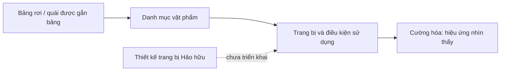

## TÓM TẮT 5 DÒNG
1. [TÀI LIỆU] I-02 ghi nhận nhóm trang bị là `genre 0`: 1.161 dòng, trong đó 326 ID được cửa hàng tham chiếu; đây là kiểm kê theo bảng được báo cáo, không phải toàn bộ vật phẩm đang có trong game (`JX1_OPS/REPORTS/I-02-vat-pham-ban.md:34`).
2. [TÀI LIỆU] Ví dụ A-17 cho thấy cấp nhân vật, giới tính và yêu cầu thuộc tính có thể là điều kiện dùng trang bị; chưa có danh sách đầy đủ chỉ số sức mạnh của từng món (`JX1_OPS/REPORTS/A-17-roi-do-boss-trang-bi.md:117–126`).
3. [TÀI LIỆU] Báo cáo hiệu ứng client nêu các mốc hình ảnh vũ khí +6, +12 và +15; đây là hiệu ứng hiển thị, không xác lập chỉ số chiến đấu (`JX1_OPS/DESIGN/HIEU-HIEU-UNG-VU-KHI.md:5–10,50`).
4. [TÀI LIỆU] Tài liệu A-17 mô tả bảng rơi có Count, RandRange, cấp vật phẩm và RandRate; không thể suy xác suất rơi thực mỗi lần hạ quái chỉ từ các trường đó (`JX1_OPS/REPORTS/A-17-roi-do-boss-trang-bi.md:61–72`).
5. [CHƯA KIỂM] Chưa đối chiếu trực tiếp bảng dữ liệu gốc, client đóng gói, máy chủ đang chạy hoặc hành vi trong game; các mục dưới đây là tổng hợp tài liệu tĩnh.

# SO-03 — Sổ tay trang bị và thuộc tính

Loại: tổng hợp
Chủ đề: Gộp tài liệu hiện có về trang bị, điều kiện sử dụng, cường hóa và nguồn rơi.
Từ khóa: SO-03, trang bị, thuộc tính, cường hóa +N, goods, droprate, Hảo hữu, Bảo vật
Trạng thái: DONE trong phạm vi tổng hợp bốn tài liệu; giới hạn dữ liệu gốc/runtime được đánh dấu CHƯA KIỂM.
Độ phủ: Đã tổng hợp 6/6 chủ đề trong bảng phạm vi; nhiều mục chỉ có ví dụ hoặc tài liệu dẫn lại, chưa có danh mục đầy đủ.
Liên quan: [I-02 — Vật phẩm bán](../REPORTS/I-02-vat-pham-ban.md), [A-14 — Hảo hữu](../REPORTS/A-14-hao-huu-trang-bi-thiet-ke.md), [A-17 — Rơi đồ boss](../REPORTS/A-17-roi-do-boss-trang-bi.md), [Hiểu hiệu ứng vũ khí](HIEU-HIEU-UNG-VU-KHI.md).
Cần tôi quyết định: không.

## Mục đích và cách đọc

Sổ tay giúp người chơi và người tiếp nhận dự án phân biệt nhóm trang bị, điều kiện sử dụng, hiệu ứng cường hóa trên hình ảnh và dữ liệu rơi. Mỗi ý được ghi nhãn **TÀI LIỆU** khi nó được nêu trong một tài liệu JX1 đã có; nhãn này không có nghĩa là đã kiểm tra lại bảng nguồn hay xác nhận trong game. **CHƯA KIỂM** đánh dấu phần còn thiếu bằng chứng.

## Luồng tổng quát

## Phạm vi và độ phủ

| Phần trong phạm vi SO-03 | Độ phủ | Căn cứ tài liệu |
|---|---|---|
| Loại vật phẩm và số trang bị trong bảng I-02 | Đã tổng hợp số kiểm kê; chưa kiểm tra bảng gốc | `JX1_OPS/REPORTS/I-02-vat-pham-ban.md:34–43` |
| Thuộc tính và điều kiện sử dụng | Có ví dụ cấp/giới/yêu cầu thuộc tính; chưa có danh mục đầy đủ | `JX1_OPS/REPORTS/A-17-roi-do-boss-trang-bi.md:117–127` |
| Cường hóa +N | Có các mốc hiệu ứng hình ảnh của vũ khí trong một nhánh client; chưa có công thức tăng chỉ số | `JX1_OPS/DESIGN/HIEU-HIEU-UNG-VU-KHI.md:5–10,45–61` |
| Nguồn rơi trang bị | Có cấu trúc và ví dụ bảng rơi; chưa xác minh NPC, tỉ lệ thực hay bảng đang nạp | `JX1_OPS/REPORTS/A-17-roi-do-boss-trang-bi.md:61–72,138–159` |
| Trang bị Hảo hữu | Có đề xuất thiết kế; chưa triển khai và chưa xác minh hành vi | `JX1_OPS/REPORTS/A-14-hao-huu-trang-bi-thiet-ke.md:1–9,20–22` |
| Giá và nguồn cửa hàng | Có số liệu kiểm kê của I-02; không phải danh sách giá hiệu lực cho mọi trang bị | `JX1_OPS/REPORTS/I-02-vat-pham-ban.md:34–43,70–74,180–186` |

## 1. Loại vật phẩm

- [TÀI LIỆU] I-02 phân nhóm theo trường `genre`: trang bị `0`, thuốc `1`, mine `2`, quest `4`, và vật phẩm truyền tống `5`. Trong bảng được kiểm kê có 1.161 dòng trang bị, 50 thuốc, 195 mine, 57 quest và 1 vật phẩm truyền tống (`JX1_OPS/REPORTS/I-02-vat-pham-ban.md:34–36`).
- [TÀI LIỆU] Có 326 ID trang bị được tham chiếu trong các dòng cửa hàng của tập dữ liệu đó. Số này chỉ nói về tham chiếu cửa hàng, không phải tổng số món trang bị tồn tại hay có thể nhận trong trò chơi (`JX1_OPS/REPORTS/I-02-vat-pham-ban.md:34,38`).
- [TÀI LIỆU] I-02 nêu ví dụ vật phẩm thủy tinh dùng cường hóa trong một tệp vật phẩm nhiệm vụ, nhưng chưa phân loại đầy đủ nguyên liệu cường hóa và chế tạo (`JX1_OPS/REPORTS/I-02-vat-pham-ban.md:36`).
- [CHƯA KIỂM] Các tài liệu trong phạm vi không lập danh mục đầy đủ theo vị trí mặc, bộ trang bị, lớp vũ khí/giáp hoặc phẩm chất. Không suy ra các danh mục còn thiếu từ số tổng.

## 2. Thuộc tính và điều kiện dùng

- [TÀI LIỆU] Báo cáo A-17 khuyến nghị nhận diện món bằng bộ số `(Genre, Detail, Particular, Level)` thay vì đoán tên vật phẩm từ dữ liệu cũ (`JX1_OPS/REPORTS/A-17-roi-do-boss-trang-bi.md:115–126`).
- [TÀI LIỆU] Các ví dụ trong A-17 phân biệt cấp vật phẩm với cấp nhân vật tối thiểu. Ví dụ armor có cấp vật phẩm 1 nhưng yêu cầu nhân vật cấp 1; dòng kế tiếp có cấp vật phẩm 2 và yêu cầu nhân vật cấp 7. Cùng ví dụ đầu ghi giới 0 và yêu cầu loại 32 bằng 30 (`JX1_OPS/REPORTS/A-17-roi-do-boss-trang-bi.md:119–126`).
- [TÀI LIỆU] Một ví dụ mũ yêu cầu nhân vật cấp 140, còn ví dụ ngựa có cấp vật phẩm 1 nhưng yêu cầu nhân vật cấp 90. Vì vậy không nên coi cấp vật phẩm là cấp nhân vật cần để mặc (`JX1_OPS/REPORTS/A-17-roi-do-boss-trang-bi.md:121–126`).
- [CHƯA KIỂM] Các ví dụ trên là điều kiện cấp/giới và một mã yêu cầu; chúng không mô tả đầy đủ sát thương, phòng thủ, sinh lực, thuộc tính cộng thêm, hiệu quả theo phái hay cách các chỉ số được tính. Chưa có căn cứ để nêu những giá trị này.

## 3. Cường hóa +N

- [TÀI LIỆU] Báo cáo hiệu ứng vũ khí mô tả ở client bản A: +6 đến +11 có glow trắng; +12 đến +14 có glow vàng và hiệu ứng sét; từ +15 có glow xanh điện. Báo cáo gắn các mốc này với cấp cường hóa đọc từ vũ khí đang mặc (`nEnChance`) (`JX1_OPS/DESIGN/HIEU-HIEU-UNG-VU-KHI.md:5–10,50`).
- [TÀI LIỆU] Hiệu ứng chỉ được vẽ khi qua các điều kiện client được nêu trong báo cáo, như đang dùng nhân vật local ngoài menu và có ảnh section vũ khí; vì vậy không nên hiểu màu/hiệu ứng là bằng chứng rằng mọi vũ khí ở cùng cấp đều hiển thị như nhau (`JX1_OPS/DESIGN/HIEU-HIEU-UNG-VU-KHI.md:39–50`).
- [TÀI LIỆU] Báo cáo cũng ghi rõ chưa biết cột dữ liệu nào tạo ra cấp cường hóa và chưa kiểm tra bảng item, tên SPR cụ thể hoặc hành vi trên thiết bị (`JX1_OPS/DESIGN/HIEU-HIEU-UNG-VU-KHI.md:57–63,80–88`).
- [CHƯA KIỂM] Chưa có công thức cộng chỉ số theo từng mức +N, nguyên liệu/chi phí cường hóa, xác suất thành công, bảo vệ thất bại hay giới hạn cấp tối đa. Hiệu ứng đồ họa không đủ để kết luận các cơ chế này.

## 4. Nguồn rơi trang bị

- [TÀI LIỆU] A-17 mô tả một số bảng rơi INI với các trường như `Count`, `RandRange`, `Min–MaxItemLevel`, `nTypeNum` và tổng `RandRate` trong phạm vi mục được đọc (`JX1_OPS/REPORTS/A-17-roi-do-boss-trang-bi.md:61–67`).
- [TÀI LIỆU] Báo cáo cảnh báo không chuyển trực tiếp `RandRate` hoặc `RandRange` thành tỉ lệ món rơi trong mỗi lần hạ boss; đường gọi bảng, lựa chọn mục và các điều kiện runtime còn phải xác minh (`JX1_OPS/REPORTS/A-17-roi-do-boss-trang-bi.md:68–72,138–153`).
- [TÀI LIỆU] Ví dụ kiểm tra chênh `Count=52` nhưng có mục `[53]`; theo phân tích tĩnh được ghi trong A-17, vòng lặp nạp từ 1 đến `Count` không đọc mục 53 qua đường nạp đó (`JX1_OPS/REPORTS/A-17-roi-do-boss-trang-bi.md:70`). Đây là ví dụ của một bảng cụ thể, không phải quy tắc đã đo runtime cho mọi bảng.
- [CHƯA KIỂM] Chưa xác định đầy đủ boss/quái nào đang dùng bảng nào, bảng nào thực sự được nạp trên máy chủ, xác suất thực tế, vật phẩm cuối cùng được chọn hay khác biệt giữa dữ liệu máy chủ và client (`JX1_OPS/REPORTS/A-17-roi-do-boss-trang-bi.md:138–159`).

## 5. Cửa hàng và giá

- [TÀI LIỆU] I-02 kiểm kê 1.464 dòng goods và 160 dòng shop; trong tập 474 goods ID được tham chiếu có 326 trang bị. Đây là số tham chiếu trong bảng, không xác nhận shop nào đang hoạt động trong runtime (`JX1_OPS/REPORTS/I-02-vat-pham-ban.md:3–5,34,38`).
- [TÀI LIỆU] I-02 ghi nhận 312 ID được tham chiếu có ô Price trống, gồm 292 trang bị và 20 thuốc; báo cáo nhấn mạnh ô giá trống không đồng nghĩa mua miễn phí (`JX1_OPS/REPORTS/I-02-vat-pham-ban.md:70–74,146`).
- [CHƯA KIỂM] Chưa tính giá cuối cùng của toàn bộ trang bị hoặc xác minh giá, thuế và danh mục shop đang được nạp trên bản game triển khai (`JX1_OPS/REPORTS/I-02-vat-pham-ban.md:180–186`).

## 6. Trang bị cho Hảo hữu — thiết kế riêng

- [TÀI LIỆU] A-14 là khảo sát và đề xuất thiết kế trang bị cho Hảo hữu, không phải tính năng đã triển khai. Báo cáo đề xuất kiểm tra điều kiện và bốn điểm thuộc tính riêng của Hảo hữu, lưu vật phẩm cùng ID Hảo hữu/vị trí mặc, và đồng bộ ngoại hình riêng (`JX1_OPS/REPORTS/A-14-hao-huu-trang-bi-thiet-ke.md:1–9`).
- [CHƯA KIỂM] Không dùng các đề xuất này để mô tả hành vi hiện tại, khả năng tương thích lưu trữ, cân bằng chỉ số hay giao diện đã có trong game; A-14 ghi rõ các phần đó cần task triển khai và kiểm thử riêng (`JX1_OPS/REPORTS/A-14-hao-huu-trang-bi-thiet-ke.md:9,20–22`).

## Giải mã tên

| Tên trong sổ tay | Mã hóa có căn cứ | Chữ đọc được | Nguồn |
|---|---|---|---|
| Bảo vật | UTF-8 trong báo cáo; mã hóa tên gốc trong bảng dữ liệu chưa kiểm | Bảo vật | `JX1_OPS/REPORTS/I-02-vat-pham-ban.md:3–5,37` |
| Kỳ Trân | UTF-8 trong báo cáo; mã hóa tên gốc trong bảng dữ liệu chưa kiểm | Kỳ Trân | `JX1_OPS/REPORTS/I-02-vat-pham-ban.md:4,37` |
| Hảo hữu | UTF-8 trong báo cáo; mã hóa tên gốc trong bảng dữ liệu chưa kiểm | Hảo hữu | `JX1_OPS/REPORTS/A-14-hao-huu-trang-bi-thiet-ke.md:7–9` |

[CHƯA KIỂM] Không bổ sung tên item, NPC hay bản đồ suy đoán từ chuỗi legacy. A-17 khuyến nghị giữ định danh số khi chưa giải mã tên (`JX1_OPS/REPORTS/A-17-roi-do-boss-trang-bi.md:115–117`).

## Sắp theo cấu trúc game

| Thứ tự | Nhóm | Nội dung hiện có | Mức phủ |
|---:|---|---|---|
| 1 | Loại vật phẩm | Trang bị và các nhóm hàng khác theo `genre` | Một phần; chưa chia bộ/vị trí mặc |
| 2 | Điều kiện sử dụng | Cấp nhân vật, giới và ví dụ mã yêu cầu | Một vài ví dụ; chưa có danh sách theo món |
| 3 | Cường hóa vũ khí | Các mốc +6, +12, +15 theo hiệu ứng hình ảnh | Một nhánh client; chưa có dữ liệu chỉ số |
| 4 | Nguồn rơi | Bảng rơi và liên kết boss/quái cần xác định | Cấu trúc, chưa phủ đầy đủ từng boss |
| 5 | Trang bị Hảo hữu | Đề xuất riêng, tách khỏi hành vi hiện hữu | Thiết kế; chưa triển khai |

[CHƯA KIỂM] Không thể sắp từng món theo bộ, vị trí mặc, nhánh cường hóa hoặc bản đồ rơi vì các tài liệu đã đọc không cung cấp danh mục đầy đủ. Không tự lấp các phần còn thiếu.

## Đã xác minh / Chưa xác minh

### Đã đối chiếu trong tài liệu

- [TÀI LIỆU] Số kiểm kê và giới hạn giá được dẫn từ báo cáo I-02 (`JX1_OPS/REPORTS/I-02-vat-pham-ban.md:34–43,70–74,180–186`).
- [TÀI LIỆU] Ví dụ điều kiện dùng và giới hạn suy luận về cấp vật phẩm được dẫn từ A-17 (`JX1_OPS/REPORTS/A-17-roi-do-boss-trang-bi.md:115–127`).
- [TÀI LIỆU] Các mốc hiệu ứng hình ảnh được dẫn từ tài liệu tổng hợp client; chúng không chứng minh chỉ số chiến đấu (`JX1_OPS/DESIGN/HIEU-HIEU-UNG-VU-KHI.md:5–10,50–63`).
- [TÀI LIỆU] Phần Hảo hữu được giữ ở trạng thái đề xuất thiết kế theo A-14 (`JX1_OPS/REPORTS/A-14-hao-huu-trang-bi-thiet-ke.md:1–9,20–22`).

### Chưa xác minh

- [CHƯA KIỂM] Bảng item, bảng rơi, bảng cửa hàng và tên legacy chưa được mở/đọc trực tiếp trong task SO-03; nguồn của các số liệu là các báo cáo đã có.
- [CHƯA KIỂM] Chưa chạy build, test, exe, VM hoặc kiểm tra mạng; chưa xác nhận source/tài liệu khớp binary hay dữ liệu đang triển khai.
- [CHƯA KIỂM] Chưa có bảng đầy đủ chỉ số, công thức +N, chi phí/xác suất cường hóa hoặc tỉ lệ rơi đo thực tế.

## Liên quan và đề xuất mục lục

Liên quan: `I-02-vat-pham-ban.md`, `A-14-hao-huu-trang-bi-thiet-ke.md`, `A-17-roi-do-boss-trang-bi.md`, `HIEU-HIEU-UNG-VU-KHI.md`.

Đề xuất dòng mục lục để PM gộp: `SO-03 | sổ tay | Trang bị, thuộc tính, cường hóa và nguồn rơi | trang bị, thuộc tính, cường hóa +N, goods, droprate, Hảo hữu | DONE (tổng hợp tài liệu tĩnh; dữ liệu gốc/runtime chưa kiểm) | đã tổng hợp 6/6 chủ đề; nhiều nội dung chỉ có ví dụ | I-02, A-14, A-17, HIEU-HIEU-UNG-VU-KHI`.

**Kỹ năng đã dùng:** jx1-retrofit, jx1-read-server, jx1-read-client, jx1-parameters, jx1-knowledge, jx1-report (đọc hướng dẫn; không có bước đọc source client/server trong phạm vi tài liệu này).
