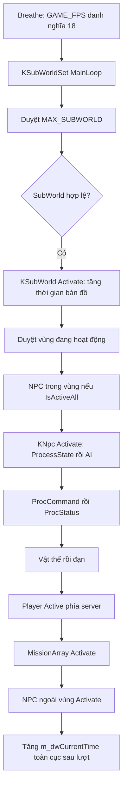

# TÓM TẮT 5 DÒNG
1. [TÀI LIỆU] Mã server khai báo nhịp danh nghĩa 18 tick mỗi giây; [CHƯA KIỂM] nhịp gọi thực tế của Breathe. (CoreServerShell.cpp:2227-2250; KSubWorldSet.cpp:24-28)
2. [THẤY] Breathe gọi KSubWorldSet::MainLoop; MainLoop duyệt các SubWorld và mỗi bản đồ hợp lệ tăng đồng hồ cục bộ. (CoreServerShell.cpp:2229-2251; KSubWorldSet.cpp:505-507,601-612; KSubWorld.cpp:269-293)
3. [THẤY] Bản đồ gọi vùng đang hoạt động; vùng lần lượt cập nhật NPC, vật thể, đạn và Player phía server. (KSubWorld.cpp:301-333; KRegion.cpp:1100-1195)
4. [THẤY] KNpc::Activate chạy trạng thái, AI, lệnh rồi trạng thái hành động; AI rẽ nhánh Player và NPC thường. (KNpc.cpp:939-1004; KNpcAI.cpp:48-134)
5. [CHƯA KIỂM] Không đo runtime, không build/chạy game hoặc VM; tài liệu này chỉ đối chiếu source tĩnh. (CoreServerShell.cpp:2227-2251)

# SO-18 — Sổ tay vòng lặp server (tick, Activate, AI quái)

**Nguồn server:** C:/Jx1CocoV3/SwordOnline/SwordOnline/jxOnline/gameserver/Sources
**Nguồn client dùng để phân biệt:** C:/Jx1CocoV3/Folder/Client2912-20260116T044348Z-3-001/Client2912/Client/Classes
**Phiên bản:** [CHƯA KIỂM] Task không pin SHA/commit cho các root source; kết luận gắn với nội dung hiện có tại các đường dẫn trên.
**Liên quan:** JX1_OPS/DESIGN/MUC-LUC-TRI-THUC.md:14; JX1_OPS/CONTEXT-PACK/GS001-MAP.md:2,6-8.

## Kết luận về nhịp

[TÀI LIỆU] CoreServerShell.cpp định nghĩa GAME_FPS bằng 18, và Breathe gọi g_SubWorldSet.MainLoop. KSubWorldSet tăng m_nLoopRate mỗi lần MainLoop chạy; comment của bộ đếm nêu quy ước 18 khung hình mỗi giây. Đây là nhịp danh nghĩa được khai báo trong source, không phải phép đo tần số tiến trình. (Core/Src/CoreServerShell.cpp:2227,2229-2251; Core/Src/KSubWorldSet.cpp:24-28,505-507)

[THẤY] Mỗi lượt MainLoop duyệt i từ 0 đến MAX_SUBWORLD - 1 rồi gọi SubWorld[i].Activate; cuối lượt tăng m_dwCurrentTime toàn cục. Bản đồ có m_SubWorldID không hợp lệ thoát sớm; bản đồ hợp lệ tăng m_dwCurrentTime cục bộ. (Core/Src/KSubWorldSet.cpp:601-612; Core/Src/KSubWorld.cpp:269-293)

[CHƯA KIỂM] Không có bằng chứng tĩnh trong phạm vi đã đọc cho biết bộ máy gọi Breathe chính xác mỗi 1/18 giây. Vì vậy 18 Hz là nhịp danh nghĩa của mã; tần số runtime cần đo trong một task được phép chạy. (Core/Src/CoreServerShell.cpp:2227-2251)

## Một vòng cập nhật

[THẤY] Trong nhánh server, KSubWorld::Activate duyệt danh sách vùng đang hoạt động và gọi NewRegActivate cho mỗi vùng hợp lệ. Sau các vùng, hàm cập nhật MissionArray, rồi duyệt danh sách NPC ngoài vùng và gọi KNpc::Activate. (Core/Src/KSubWorld.cpp:301-333)

[THẤY] Trong một vùng, NewRegActivate chỉ cập nhật danh sách NPC khi IsActiveAll trả true. Mỗi NPC có thể đồng bộ trước rồi chạy Activate; tiếp theo là vật thể, đạn và cuối cùng danh sách Player server qua Player::Active. (Core/Src/KRegion.cpp:1100-1128,1130-1182,1184-1195)

[THẤY] KNpc::Activate bỏ qua NPC không hợp lệ, NPC đang chuyển server, hoặc NPC đã xử lý trong cùng khung logic. Nếu trạng thái sống cần xử lý thì ProcessState chạy trước; nếu không kết thúc sớm, thứ tự tiếp tục là AI, ProcCommand, rồi ProcStatus. (Core/Src/KNpc.cpp:939-1004)

[THẤY] KNpcAI::Activate gọi ProcessPlayer rồi kết thúc khi đối tượng là Player. Với NPC thường ở server, hàm bỏ qua một số trạng thái không thể chạy AI; khi m_NextAITime đến hạn, đặt lần kế tiếp bằng thời gian hiện tại cộng m_AIMAXTime rồi chọn hành vi theo m_AiMode. (Core/Src/KNpcAI.cpp:48-134)

[THẤY] KRegion gọi Player::Active riêng sau NPC, vật thể và đạn; trong phần đã đọc, Player::Active xử lý bộ đếm m_nPlayerTime. Đây là nhánh cập nhật riêng của Player, không nên đánh đồng với tên hàm KNpc::Activate. (Core/Src/KRegion.cpp:1184-1195; Core/Src/KPlayer.cpp:257-315)

## KNpcSet và khác biệt client/server

[THẤY] KNpcSet::ClearActivateFlagOfAllNpc đi qua các chỉ số đang dùng và đặt m_bActivateFlag về FALSE. Lời gọi đó và lời gọi NpcSet.CheckBalance trong KSubWorldSet::MainLoop đều nằm trong #ifndef _SERVER, nên không thuộc vòng server. Vòng server cập nhật NPC qua danh sách của vùng. (Core/Src/KNpcSet.cpp:1600-1613; Core/Src/KSubWorld.cpp:295-319; Core/Src/KSubWorldSet.cpp:601-607; Core/Src/KRegion.cpp:1108-1124)

[THẤY] Client2912 có nhánh khác: KSubWorld::Activate tăng thời gian, xóa cờ kích hoạt toàn bộ NPC rồi duyệt toàn bộ m_nTotalRegion. Không dùng nhánh client để kết luận thứ tự vùng của server, vốn được lọc qua m_cActRegionIdx. (Client/Classes/gamecore/KSubWorld.cpp:143-160; Core/Src/KSubWorld.cpp:295-319)

## Sơ đồ

## Phạm vi và độ phủ

| Câu hỏi | Kết quả | Độ phủ / bằng chứng |
|---|---|---|
| Tick bao nhiêu Hz? | [TÀI LIỆU] Nhịp danh nghĩa 18 tick/giây; [CHƯA KIỂM] runtime chưa đo. | CoreServerShell.cpp:2227-2251; KSubWorldSet.cpp:24-28 |
| Activate NPC/Player hoạt động thế nào? | [THẤY] NPC chạy theo danh sách vùng; Player có nhánh Active riêng. | KRegion.cpp:1108-1124,1184-1195; KNpc.cpp:939-1004; KPlayer.cpp:257-315 |
| AI quái xử lý ra sao? | [THẤY] KNpcAI rẽ nhánh theo Player/NPC và thời điểm AI đến hạn. | KNpcAI.cpp:48-134 |
| Thứ tự cập nhật? | [THẤY] Breathe → MainLoop → bản đồ → vùng → NPC/vật thể/đạn/Player → mission → NPC ngoài vùng. | CoreServerShell.cpp:2229-2251; KSubWorldSet.cpp:601-612; KSubWorld.cpp:301-333; KRegion.cpp:1100-1195 |
| KNpcSet tham gia thế nào? | [THẤY] Reset cờ đi qua tập chỉ số đang dùng nhưng chỉ nằm trong nhánh client. | KNpcSet.cpp:1600-1613; KSubWorld.cpp:295-319 |

## Giới hạn

[CHƯA KIỂM] Chưa đo thời gian gọi Breathe, tải server hay độ trễ; không suy các số này từ source. Không build, chạy game executable, VM hoặc kết nối mạng.

[CHƯA KIỂM] Các báo cáo B-04, P-02, E-06 và các tham chiếu H-13, B-04a không có trong worktree. Mục lục tri thức chỉ ghi B-04a và H-13 là liên quan tới tick; không thay thế bằng chứng source. (JX1_OPS/DESIGN/MUC-LUC-TRI-THUC.md:14)

## Bàn giao

Đã trả lời theo source tĩnh; không sửa mã hoặc cấu hình. Báo cáo bàn giao: JX1_OPS/REPORTS/SO-18.md.
