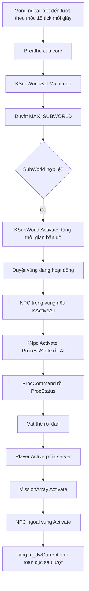

# TÓM TẮT 5 DÒNG
1. [THẤY] Vòng ngoài dùng mốc 18 tick/giây để xét đã đến lượt chưa. [CHƯA KIỂM] Nhịp gọi thực tế của Breathe. (KSOServer.cpp:90,1441-1451,4360-4373)
2. [THẤY] Breathe gọi KSubWorldSet::MainLoop; MainLoop duyệt các SubWorld và mỗi bản đồ hợp lệ tăng đồng hồ cục bộ. (CoreServerShell.cpp:2229-2251; KSubWorldSet.cpp:505-507,601-612; KSubWorld.cpp:269-293)
3. [THẤY] Bản đồ gọi vùng đang hoạt động; vùng lần lượt cập nhật NPC, vật thể, đạn và Player phía server. (KSubWorld.cpp:301-333; KRegion.cpp:1100-1195)
4. [THẤY] KNpc::Activate chạy trạng thái, AI, lệnh rồi trạng thái hành động; AI rẽ nhánh Player và NPC thường. (KNpc.cpp:939-1004; KNpcAI.cpp:48-134)
5. [CHƯA KIỂM] Không đo runtime, không build/chạy game hoặc VM; tài liệu này chỉ đối chiếu source tĩnh. (CoreServerShell.cpp:2227-2251)

# SO-18 — Sổ tay vòng lặp server (tick, Activate, AI quái)

Loại: tổng hợp
Chủ đề: Giải thích một lượt server cập nhật bản đồ, vùng, NPC, Player và AI quái.
Từ khóa: vòng lặp server, tick, Activate, Active, Breathe, KSubWorld, KNpc, KNpcSet, AI quái
Trạng thái: DONE — đã trả lời 5/5 câu hỏi bằng đối chiếu tĩnh; chưa đo runtime.
Độ phủ: 5/5 câu hỏi trong bảng phạm vi; không bao gồm toàn bộ hành vi của từng kiểu AI.
Liên quan: [SO-18](../REPORTS/SO-18.md), [H-13](../REPORTS/H-13-tick-do-tre-don.md), [B-04a](../REPORTS/B-04a-bo-do-tick-bang-thong.md), [P-02](../REPORTS/P-02-bench.md).
Cần tôi quyết định: không

**Nguồn server:** C:/Jx1CocoV3/SwordOnline/SwordOnline/jxOnline/gameserver/Sources
**Nguồn client dùng để phân biệt:** C:/Jx1CocoV3/Folder/Client2912-20260116T044348Z-3-001/Client2912/Client/Classes
**Phiên bản:** [CHƯA KIỂM] Task không pin SHA/commit cho các root source; kết luận gắn với nội dung hiện có tại các đường dẫn trên.
**Liên quan:** JX1_OPS/DESIGN/MUC-LUC-TRI-THUC.md:14; JX1_OPS/CONTEXT-PACK/GS001-MAP.md:2,6-8; [H-13](../REPORTS/H-13-tick-do-tre-don.md), [B-04a](../REPORTS/B-04a-bo-do-tick-bang-thong.md), [P-02](../REPORTS/P-02-bench.md).

## Kết luận về nhịp

[TÀI LIỆU] CoreServerShell.cpp định nghĩa GAME_FPS bằng 18, và Breathe gọi g_SubWorldSet.MainLoop. KSubWorldSet tăng m_nLoopRate mỗi lần MainLoop chạy; comment của bộ đếm nêu quy ước 18 khung hình mỗi giây. Đây là nhịp danh nghĩa được khai báo trong source, không phải phép đo tần số tiến trình. (Core/Src/CoreServerShell.cpp:2227,2229-2251; Core/Src/KSubWorldSet.cpp:24-28,505-507)

[THẤY] Mỗi lượt MainLoop duyệt i từ 0 đến MAX_SUBWORLD - 1 rồi gọi SubWorld[i].Activate; cuối lượt tăng m_dwCurrentTime toàn cục. Bản đồ có m_SubWorldID không hợp lệ thoát sớm; bản đồ hợp lệ tăng m_dwCurrentTime cục bộ. (Core/Src/KSubWorldSet.cpp:601-612; Core/Src/KSubWorld.cpp:269-293)

[THẤY] Vòng ngoài xử lý thông điệp rồi so đồng hồ đã chạy bao lâu với số lượt đã xử lý, theo mốc `GAME_FPS = 18`. Khi đến lượt và kiểm tra `GetGo()` thành công, nó gọi `MainLoop`, rồi `MainLoop` gọi `Breathe` của core. (MultiServer/GameServer/KSOServer.cpp:90,1425-1451,4360-4373)

[CHƯA KIỂM] Khoảng cách thực tế giữa các lần gọi `Breathe` của core chưa được đo. Mốc 18 tick/giây tương ứng khoảng 55,6 ms giữa hai lượt nếu nhịp đều (`1000 ms ÷ 18`). (MultiServer/GameServer/KSOServer.cpp:90,1441-1451)

## Một vòng cập nhật

[THẤY] Trong nhánh server, KSubWorld::Activate duyệt danh sách vùng đang hoạt động và gọi NewRegActivate cho mỗi vùng hợp lệ. Sau các vùng, hàm cập nhật MissionArray, rồi duyệt danh sách NPC ngoài vùng và gọi KNpc::Activate. (Core/Src/KSubWorld.cpp:301-333)

[THẤY] Trong một vùng, NewRegActivate chỉ cập nhật danh sách NPC khi IsActiveAll trả true. Mỗi NPC có thể đồng bộ trước rồi chạy Activate; tiếp theo là vật thể, đạn và cuối cùng danh sách Player server qua Player::Active. (Core/Src/KRegion.cpp:1100-1128,1130-1182,1184-1195)

[THẤY] KNpc::Activate bỏ qua NPC không hợp lệ, NPC đang chuyển server, hoặc NPC đã xử lý trong cùng khung logic. Nếu trạng thái sống cần xử lý thì ProcessState chạy trước; nếu không kết thúc sớm, thứ tự tiếp tục là AI, ProcCommand, rồi ProcStatus. (Core/Src/KNpc.cpp:939-1004)

[THẤY] KNpcAI::Activate gọi ProcessPlayer rồi kết thúc khi đối tượng là Player. Với NPC thường ở server, hàm bỏ qua một số trạng thái không thể chạy AI; khi m_NextAITime đến hạn, đặt lần kế tiếp bằng thời gian hiện tại cộng m_AIMAXTime rồi chọn hành vi theo m_AiMode. (Core/Src/KNpcAI.cpp:48-134)

[THẤY] KRegion gọi Player::Active riêng sau NPC, vật thể và đạn; trong phần đã đọc, Player::Active xử lý bộ đếm m_nPlayerTime. Đây là nhánh cập nhật riêng của Player, không nên đánh đồng với tên hàm KNpc::Activate. (Core/Src/KRegion.cpp:1184-1195; Core/Src/KPlayer.cpp:257-315)

## KNpcSet và khác biệt client/server

[THẤY] KNpcSet::ClearActivateFlagOfAllNpc đi qua các chỉ số đang dùng và đặt m_bActivateFlag về FALSE. Lời gọi đó và lời gọi NpcSet.CheckBalance trong KSubWorldSet::MainLoop đều nằm trong #ifndef _SERVER, nên không thuộc vòng server. Vòng server cập nhật NPC qua danh sách của vùng. (Core/Src/KNpcSet.cpp:1600-1613; Core/Src/KSubWorld.cpp:295-319; Core/Src/KSubWorldSet.cpp:601-607; Core/Src/KRegion.cpp:1108-1124)

[THẤY] Client2912 có nhánh khác: KSubWorld::Activate tăng thời gian, xóa cờ kích hoạt toàn bộ NPC rồi duyệt toàn bộ m_nTotalRegion. Không dùng nhánh client để kết luận thứ tự vùng của server, vốn được lọc qua m_cActRegionIdx. (Client/Classes/gamecore/KSubWorld.cpp:143-160; Core/Src/KSubWorld.cpp:295-319)

## Sơ đồ

## Phạm vi và độ phủ

| Câu hỏi | Kết quả | Độ phủ / bằng chứng |
|---|---|---|
| Tick bao nhiêu Hz? | [THẤY] Vòng ngoài xét đến lượt theo mốc danh nghĩa 18 tick/giây. [CHƯA KIỂM] Tần số thực tế. | KSOServer.cpp:90,1441-1451,4360-4373; CoreServerShell.cpp:2227-2251 |
| Activate NPC/Player hoạt động thế nào? | [THẤY] NPC chạy theo danh sách vùng; Player có nhánh Active riêng. | KRegion.cpp:1108-1124,1184-1195; KNpc.cpp:939-1004; KPlayer.cpp:257-315 |
| AI quái xử lý ra sao? | [THẤY] KNpcAI rẽ nhánh theo Player/NPC và thời điểm AI đến hạn. | KNpcAI.cpp:48-134 |
| Thứ tự cập nhật? | [THẤY] Breathe → MainLoop → bản đồ → vùng → NPC/vật thể/đạn/Player → mission → NPC ngoài vùng. | CoreServerShell.cpp:2229-2251; KSubWorldSet.cpp:601-612; KSubWorld.cpp:301-333; KRegion.cpp:1100-1195 |
| KNpcSet tham gia thế nào? | [THẤY] Reset cờ đi qua tập chỉ số đang dùng nhưng chỉ nằm trong nhánh client. | KNpcSet.cpp:1600-1613; KSubWorld.cpp:295-319 |

## Giải mã tên

| Tên gốc | Mã hóa | Chữ đúng | Nguồn file:dòng |
|---|---|---|---|
| Không có tên riêng của kỹ năng, trang bị, quái, NPC hoặc bản đồ trong phạm vi khảo sát. | Không áp dụng GBK/TCVN3; các tên hàm và biến được dẫn là định danh ASCII, giữ nguyên. | [THẤY] KSubWorld, KNpc, KNpcSet, KNpcAI, KPlayer, Activate và Active là định danh mã nguồn. | Core/Src/KSubWorld.cpp:269; Core/Src/KNpc.cpp:939; Core/Src/KNpcSet.cpp:1603; Core/Src/KNpcAI.cpp:48; Core/Src/KPlayer.cpp:257 |

## Sắp theo cấu trúc game

[TÀI LIỆU] Sổ tay xếp theo cấp cập nhật của game: vòng server → bản đồ → vùng → các đối tượng trong vùng → nhiệm vụ và NPC ngoài vùng. Trong mỗi đối tượng NPC, thứ tự là trạng thái → AI → lệnh → trạng thái hành động. Bảng phạm vi ở trên đối chiếu từng câu hỏi; đây không phải danh sách kỹ năng, trang bị hoặc quái theo bản đồ. (Core/Src/CoreServerShell.cpp:2229-2251; Core/Src/KSubWorldSet.cpp:601-612; Core/Src/KSubWorld.cpp:301-333; Core/Src/KRegion.cpp:1100-1195; Core/Src/KNpc.cpp:939-1004)

## Đã xác minh / Chưa xác minh

- [THẤY] Đã đối chiếu tĩnh đủ 5 câu hỏi trong bảng phạm vi: mốc tick danh nghĩa, Activate NPC/Player, cổng chọn AI, thứ tự cập nhật và vai trò KNpcSet. “Đã phủ” ở đây chỉ tính các câu hỏi đó. (MultiServer/GameServer/KSOServer.cpp:90,1441-1451,4360-4373; Core/Src/KSubWorld.cpp:269-333; Core/Src/KNpc.cpp:939-1004; Core/Src/KNpcAI.cpp:48-134; Core/Src/KNpcSet.cpp:1600-1613; Core/Src/KPlayer.cpp:257-315)
- [CHƯA KIỂM] Chưa xác minh toàn bộ việc tìm mục tiêu, đuổi theo hoặc đánh của từng kiểu AI; đoạn khảo sát mới xác định cổng chọn các hàm xử lý. Chưa xác minh giá trị m_AIMAXTime của từng quái. (Core/Src/KNpcAI.cpp:91-134)
- [CHƯA KIỂM] Chưa đo tần số chạy thật, chưa xác nhận source tương ứng bản đang chạy; giới hạn thử nghiệm và nguồn gián tiếp nêu ở mục Giới hạn bên dưới.

## Giới hạn

[CHƯA KIỂM] Chưa đo thời gian gọi Breathe, tải server hay độ trễ; không suy các số này từ source. Không build, chạy game executable, VM hoặc kết nối mạng.

[TÀI LIỆU] P-02 dùng dữ liệu giả lập và chưa đo trên game. B-04a kiểm cú pháp công cụ đo và phân biệt thời lượng xử lý mỗi lượt với khoảng cách giữa các lượt. (JX1_OPS/REPORTS/P-02-bench.md:26,96-102; JX1_OPS/REPORTS/B-04a-bo-do-tick-bang-thong.md:50-59,71-76)

[TÀI LIỆU] H-13 ghi nhận tùy chọn 18/36 ở bộ mã server khác. Bằng chứng của SO-18 ở trên thuộc gốc mã server được task giao. [CHƯA KIỂM] Chưa đối chiếu tùy chọn của H-13 với bản chạy. B-04 và E-06 chưa tìm thấy trong thư mục báo cáo của worktree. (JX1_OPS/REPORTS/H-13-tick-do-tre-don.md:52-59,65-67,138-141)

## Bàn giao

Đã trả lời theo source tĩnh; không sửa mã hoặc cấu hình. Báo cáo bàn giao: JX1_OPS/REPORTS/SO-18.md.

## Phát hiện khi chuẩn hóa và tiếp tục

[TÀI LIỆU] Giữ nguyên 5 dòng tóm tắt, kết luận, số liệu và bằng chứng đã có. Bổ sung khối thông tin, mục giải mã tên, cách sắp theo cấu trúc game và ranh giới xác minh theo chuẩn; không thay kết luận cũ. (JX1_OPS/DESIGN/CHUAN-BAO-CAO.md:8-35)

[THẤY] Nói bằng lời thường: đến lượt AI thường, server xem quái đã tới giờ quyết định tiếp chưa. Nếu tới, nó hẹn lần sau bằng thời gian bản đồ hiện tại cộng m_AIMAXTime. Kiểu 0 gửi lệnh đứng; kiểu 1–6 gọi sáu hàm xử lý tương ứng. Kiểu 7–10 nằm trong comment, không phải các nhánh hoạt động của switch đã đọc. (Core/Src/KNpcAI.cpp:91-134)

[THẤY] Cần giới hạn cách hiểu câu “AI đến hạn” ở phần trên: Player đi vào ProcessPlayer rồi thoát. Phía server còn có các nhánh FindPathNpc, ProcessChargedart, ProcessCompanion và MoveLuXianAi thoát trước khi tới kiểm tra m_NextAITime. Vì vậy không áp dụng cổng thời gian của AI thường cho mọi nhánh này. (Core/Src/KNpcAI.cpp:53-94)

[THẤY] Nhánh cập nhật Player riêng cũng có việc đếm thời gian: nếu m_nPlayerTime còn dương thì giảm một; khi về 0, đoạn đã đọc xóa các mục m_ExtSkill đang có trong 5 ô, gọi SetSkillLeftTime với thời gian 0 và đặt m_CurNpcTitle về 0. Hàm thoát sớm khi m_nNetConnectIdx bằng -1 hoặc đang chuyển server. Đây chỉ là một phần KPlayer::Active, không phải toàn bộ xử lý người chơi. (Core/Src/KPlayer.cpp:257-315)

[CHƯA KIỂM] Tài liệu lưu bằng UTF-8 không BOM. Một số comment Hán trong hai đoạn source đọc bổ sung hiển thị lỗi khi đọc dưới UTF-8; chưa xác minh mã hóa toàn tệp. Các bổ sung trên dựa vào câu lệnh và định danh ASCII, không diễn giải comment bị lỗi. (Core/Src/KNpcAI.cpp:48-134; Core/Src/KPlayer.cpp:257-315)
