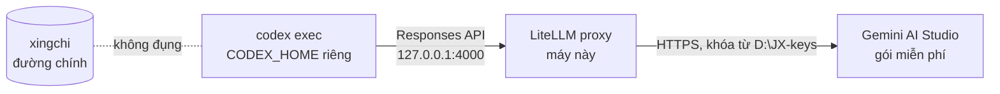

# Thử nhà cung cấp khác cho tiểu yêu (chuẩn bị #171/#172)

**Trạng thái: CHỈ CHUẨN BỊ.** Chưa tạo khóa, chưa chạy so sánh, chưa gửi mã nào ra ngoài. Chờ Chat báo "chủ duyệt Gemini miễn phí". xingchi vẫn là đường chính.

## 1. Vì sao cần lớp chuyển
Codex 0.166 chỉ nói chuyện với nhà cung cấp qua **Responses API** (`wire_api = "responses"`; kiểu `chat` đã bị bỏ). Gemini không có Responses API, nên cần một chương trình nhỏ chạy trên máy này, nhận kiểu Responses rồi gọi Gemini. Dùng công cụ có sẵn **LiteLLM proxy** (cài bằng pip), không tự viết.

[NGUỒN: docs.litellm.ai, hướng dẫn Codex CLI] LiteLLM phục vụ `/v1/responses`, cấu hình Codex trỏ `base_url = http://localhost:4000/v1`, `wire_api = "responses"`, và đổi mô hình bằng `--model`. Dịch sang Gemini dựa vào lớp chuyển của LiteLLM (`drop_params` để bỏ tham số Gemini không nhận). **Chưa kiểm tra trên máy này**: đó là việc của bộ so sánh.

## 2. Điều kiện một nhà cung cấp phải có (để dùng với Codex)
| Cần | Vì sao |
|---|---|
| Responses API (trực tiếp hoặc qua lớp chuyển) | Codex 0.166 chỉ nhận kiểu này |
| Gọi công cụ (function calling) ổn định | tiểu yêu đọc/ghi tệp bằng công cụ |
| Mô hình đủ mạnh, ngữ cảnh lớn | việc đọc mã nhiều tệp |
| Giá/hạn mức rõ | trần ngân sách và số tiểu yêu song song |
| Điều khoản dữ liệu chấp nhận được | mã nguồn đi ra ngoài |

## 3. Các nhà cung cấp
| Nhà cung cấp | Quyết định | Lý do |
|---|---|---|
| xingchi (nhóm công ích 0.25x) | **giữ, đường chính** | đang chạy; hay chết ngang/chậm, đã ghi ở BAI_HOC |
| **Google Gemini gói miễn phí** | **thử (dự phòng/so sánh)** | miễn phí; cần lớp chuyển |
| Meta | đã loại | chặn vùng, chủ không dùng VPN |
| OpenAI trả phí | đã loại | chủ chưa trả tiền |

## 4. Hạn mức miễn phí Gemini (CHƯA KIỂM TRA CHẮC)
Trang chính thức không in bảng cố định cho gói miễn phí; số liệu phải xem trong **AI Studio → Rate limits** của đúng dự án chứa khóa. Nguồn bên thứ ba lệch nhau, chỉ dùng làm thang ước lượng: [rapidevelopers](https://rapidevelopers.com/ai-api-limits-performance-matrix/gemini-2-5-flash), [yingtu.ai](https://yingtu.ai/en/blog/google-gemini-api-free-tier-limits-2026), [tài liệu chính thức](https://ai.google.dev/gemini-api/docs/rate-limits).
- 2.5 Flash: khoảng 10 lượt/phút, 250–500 lượt/ngày. Flash-Lite: khoảng 15 lượt/phút, ~1.000 lượt/ngày. Pro: ít hơn nhiều, và có nguồn nói đã bị trả phí từ 4/2026 (mâu thuẫn, chưa rõ).
- Hệ quả: **một tiểu yêu đọc một tệp đã dùng nhiều lượt** (mỗi bước công cụ = một lượt). Với ~10 lượt/phút, 7 tiểu yêu song song sẽ chạm 429 ngay; bộ so sánh sẽ đo trần thật.
- **Rủi ro dữ liệu:** gói miễn phí của Google có thể dùng nội dung gửi lên để cải thiện/huấn luyện. Chỉ thử với việc đọc **không nhạy cảm** (không tài khoản, khóa, dump, mật khẩu). Cần chủ duyệt điểm này.

## 5. Cách cài và chạy (CHƯA CHẠY)
Tệp nằm ở `TOOLS/nha-cung-cap/`:
1. Chủ bấm đúp `nhap_khoa.bat`, dán khóa AI Studio. Khóa lưu vào `D:\JX-keys\gemini.txt` (ngoài kho, chỉ tài khoản Windows của chủ có quyền), không hiện lại, không vào kho/nhật ký.
2. Cài trong môi trường riêng: `python -m venv D:\JX-keys\venv` rồi `D:\JX-keys\venv\Scripts\pip install "litellm[proxy]"`. Không đụng Python hệ thống.
3. `chay_litellm.ps1` đọc khóa thành biến môi trường **trong tiến trình**, chạy proxy `127.0.0.1:4000` (chỉ nghe máy này; cấu hình `litellm_gemini.yaml`).
4. `codex_home_gemini.ps1` tạo `D:\JX-keys\codex-home-gemini\config.toml` (bản CODEX_HOME riêng; **không sửa** `C:\Users\PC\.codex` của xingchi).
5. `so_sanh.ps1 -Provider gemini|xingchi -Tasks R-06a,R-07a,K-03a -Parallel 1|2|4|7`.

Hoàn tác: dừng tiến trình LiteLLM, xóa `D:\JX-keys\codex-home-gemini` và `D:\JX-keys\venv`; xóa khóa = xóa `gemini.txt` (và thu hồi khóa trong AI Studio).

## 6. Bộ so sánh (chưa chạy)
Cùng 3 việc đọc đã gộp (R-06a, R-07a, K-03a) chạy trong worktree nháp `D:\JX-wt\so-sanh\...`, không commit, không ghi vào kho. Đo mỗi lượt:
| Chỉ số | Cách đo |
|---|---|
| Có báo cáo không rỗng | kích thước tệp trong `REPORTS/` của worktree nháp |
| Độ đủ | đối chiếu tay với báo cáo đã gộp (mục lớn/bảng/đủ nguồn) |
| Thời gian đến token đầu | dòng đầu của log JSON (ghi tay khi cần; script ghi tổng giây) |
| Tổng thời gian | `giay` trong `ketqua.csv` |
| Số lần lỗi | số dòng `turn.failed` |
| Số lượt bị giới hạn | số lần có `429` trong log |
| Token dùng | dòng usage của log |

Chạy lần lượt `-Parallel 1`, rồi `2`, `4`, `7` để biết **trần song song** của gói miễn phí. Trần thử nhỏ: dừng khi 429 vượt vài lần liên tiếp.

## 7. Điều chưa kiểm tra / cần chủ duyệt (vùng Đỏ)
- Chưa tạo khóa Gemini, chưa chạy gì; khóa ngoài 20 khóa đã duyệt và gửi mã ra ngoài = cần chủ nói rõ "duyệt Gemini miễn phí".
- LiteLLM + Gemini + Codex 0.166 gọi công cụ có chạy được không: chưa kiểm tra.
- Số liệu hạn mức: chưa xác nhận trên AI Studio.
