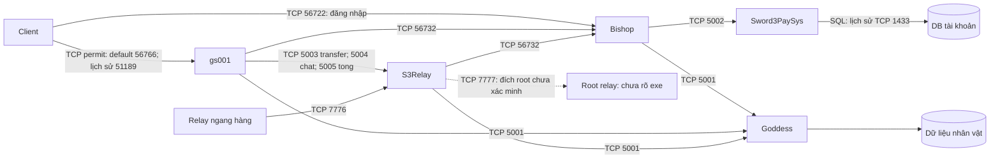

# Truyền tải client–server và các exe server JX1

Ngày đối chiếu: 17/11/2026. Task U-02; hoàn tất tổng hợp tĩnh, chưa đo runtime. liên quan: `../REPORTS/U-02.md`, `../REPORTS/A-01-ban-do-tien-trinh.md`, `../REPORTS/A-06-bang-goi-tin.md`, `../REPORTS/K-01-ban-do-truyen-tin-hieu.md`, `TOI-UU-120FPS.md`.

**[ĐÃ XÁC MINH — TÀI LIỆU]** Người chơi đi qua hai chặng chính: Bishop xác thực và chọn nhân vật; sau khi có giấy phép vào thế giới (permit), client nối trực tiếp tới GS. GS xử lý bản đồ, di chuyển, kỹ năng và máu. PaySys phụ trách quyền chơi, Goddess phụ trách dữ liệu nhân vật, S3Relay phụ trách chuyển GS và liên lạc xã hội. Nguồn: `JX1_OPS/REPORTS/K-01-ban-do-truyen-tin-hieu.md:51`, `:52`, `:53`, `:54`, `:55`, `:56`, `:120`.

## 1. Cách đọc và gốc nguồn

- **ĐÃ XÁC MINH — NGUỒN:** đã mở đúng file và dòng trong U-02; kết luận chỉ về mã trên đĩa.
- **ĐÃ XÁC MINH — TÀI LIỆU:** đã đọc nội dung báo cáo được dẫn; số đo/hành vi trong đó là bằng chứng kế thừa, chưa lặp lại và chưa mặc định đúng với binary hiện tại.
- **CHƯA XÁC MINH:** thiếu kiểm tra binary, cấu hình hiệu lực hoặc phép đo. **GIẢ THUYẾT:** khả năng cần đo hoặc đề xuất chưa triển khai.

Nhãn ở đầu đoạn hoặc trong cột bằng chứng áp dụng cho các khẳng định của đoạn/hàng đó. Toàn bộ listener, hiệu năng, FPS/tick và độ trễ **hiện tại đều CHƯA XÁC MINH**. Không chạy server, client, VM, build, kết nối hoặc bắt gói trong U-02.

| Ký hiệu dùng trong tài liệu | Gốc tuyệt đối; không nhập chung các cây |
|---|---|
| S | `D:/JX-source/server/jxOnline/gameserver/Sources` |
| G | `D:/JX-source/server/jxOnline/gateway/Sources` |
| GH | `D:/JX-source/server/jxOnline/gateway/Headers` |
| O | `C:/Jx1CocoV3/Folder/Client2912-20260116T044348Z-3-001/Client2912/Client/Classes` |
| H | `C:/Jx1CocoV3/SwordOnline/SwordOnline/jxOnline/gameserver/Headers` — cây header được A-06 dùng, không mặc định là header build của S |
| R | `JX1_OPS/REPORTS` trong worktree U-02 |

**[ĐÃ XÁC MINH — TÀI LIỆU]** Nguồn chính là A-01, phần đối chiếu và các ID liên quan trong A-06, K-01 và `JX1_OPS/DESIGN/TOI-UU-120FPS.md:3`. Bổ sung có chọn lọc: `SERVER/05-c2-chay-server.md:24`, `SERVER/14-chay-lai-5-exe.md:14`, `SERVER/30-phan-tich-nhip-xu-ly-jx1.md:18`, `SERVER/37-phan-tich-command-slot.md:6`, `SERVER/43-nghien-cuu-36hz.md:8`, `R/H-13-tick-do-tre-don.md:60`. Các khác biệt cần đối chiếu nguồn được ghi ở mục 6; không dùng số dòng báo cáo cũ thay kiểm tra source hiện tại.

## 2. Mỗi tiến trình làm gì, ai nối đến cổng nào

| Tiến trình | Công việc | Liên kết, cổng và mức xác minh |
|---|---|---|
| SQL Server | Dữ liệu tài khoản và quyền/hạn chơi cho PaySys. | **TÀI LIỆU:** PaySys→SQL, lịch sử TCP `1433` ở `R/A-01-ban-do-tien-trinh.md:14`, `SERVER/14-chay-lai-5-exe.md:17`. Không kết luận cấu hình SQL hiệu lực từ số cổng này. |
| `Sword3PaySys.exe` | Xác thực tài khoản, hạn/điểm và tài khoản dịch vụ. | **NGUỒN:** macro nhận `5002` tại `GH/ServerPort.h:4`. **TÀI LIỆU:** Bishop chủ động nối vào PaySys, PaySys truy vấn SQL; `R/K-01-ban-do-truyen-tin-hieu.md:52`, `:87`, `:116`. |
| `Goddess.exe` | Liệt kê/tạo/nạp/lưu nhân vật; tách khỏi DB tài khoản. | **NGUỒN:** `5001`, `GH/ServerPort.h:5`, GS đọc đích ở `S/MultiServer/GameServer/KSOServer.cpp:733`; Relay đọc đích ở `G/MultiServer/S3Relay/Global.cpp:428`, `:435`. **TÀI LIỆU:** Bishop cũng nối vào Goddess; backend có nhánh Berkeley DB, không coi mọi dữ liệu nhân vật là bảng SQL (`R/K-01-ban-do-truyen-tin-hieu.md:53`, `:88`). |
| `S3Relay.exe` | Chuyển GS/transfer, chat, bang hội và bạn bè. | **NGUỒN:** nhận `5003` transfer, `5004` chat, `5005` tong; `G/MultiServer/S3Relay/Global.cpp:464`, `:466`, `:476`, `:478`, `:489`, `:491`. GS đọc ba đích ở `S/MultiServer/GameServer/KSOServer.cpp:735`, `:737`, `:739`. Relay còn dùng Goddess và Bishop (`G/MultiServer/S3Relay/Global.cpp:428`, `:445`). |
| `Bishop.exe` | Cổng đăng nhập, gọi PaySys/Goddess, chọn GS, điều phối nhân vật/GUID và trả permit. | **NGUỒN:** macro client `56722`, dịch vụ/GS `56732`, `GH/ServerPort.h:6`, `:7`; GS đọc đích `S/MultiServer/GameServer/KSOServer.cpp:731`. **TÀI LIỆU:** listener/config của Bishop ở `R/K-01-ban-do-truyen-tin-hieu.md:55`, `:87`; chưa đọc lại toàn bộ implementation Bishop trong U-02. |
| `gs001.exe` | Mô phỏng thế giới; quyết định di chuyển, skill, đạn, sát thương và HP; phát đồng bộ, yêu cầu nạp/lưu nhân vật. | **NGUỒN:** cổng client mặc định `56766`, cấu hình có thể thay và `g_nPort` ghi đè (`S/MultiServer/GameServer/KSOServer.cpp:306`, `:725`, `:727`, `:728`). **TÀI LIỆU:** `51189` là listener lịch sử ở `SERVER/05-c2-chay-server.md:24`; kết nối đến đủ năm dịch vụ ở `:25`. Không mặc định mọi GS tiếp theo chỉ tăng cổng một đơn vị. |

**[ĐÃ XÁC MINH — NGUỒN]** Relay ngang hàng có listener `7776` (`G/MultiServer/S3Relay/Global.cpp:395`, `:402`); `7777` là **đích kết nối ra** tới root (`:411`, `:418`). **[CHƯA XÁC MINH]** tiến trình nào sở hữu root, root có đang chạy và `S3RelayServer.exe` có vai trò gì. `SERVER/05-c2-chay-server.md:36` chỉ ghi không thấy listener 7777 trong lần kiểm cũ; không chứng minh trạng thái hôm nay.

**[ĐÃ XÁC MINH — TÀI LIỆU]** Thứ tự vận hành từng dùng: SQL → PaySys → Goddess → S3Relay → Bishop → GS (`R/A-01-ban-do-tien-trinh.md:4`, `SERVER/14-chay-lai-5-exe.md:14`). Đây là thứ tự thao tác lịch sử; S3Relay còn cần nối Bishop, nên không suy thành sơ đồ phụ thuộc một chiều hoặc tiêu chí đã sẵn sàng. Thời gian nạp khoảng 7 phút trong A-01 (`:6`) chỉ là ghi nhận cũ; U-02 chưa đo khởi động hoặc xác nhận lỗi nạp/crash của đúng binary hiện tại.

### Sơ đồ kết nối chính

**[ĐÃ XÁC MINH — NGUỒN/TÀI LIỆU theo bảng trên]** Mũi tên chỉ bên chủ động mở socket; kết quả trả về trên cùng kết nối. Đường nét đứt là đích có trong source nhưng vai trò triển khai chưa xác minh. Cổng ghi dưới đây không phải cấu hình mở mạng.

**[GIẢ THUYẾT — TÁC ĐỘNG KHI LỖI]** Mất Bishop/PaySys chủ yếu đe dọa đăng nhập và quản lý phiên; mất Goddess đe dọa nạp/lưu nhân vật; mất Relay đe dọa chat/bang/bạn bè/chuyển GS; mất GS làm mất thế giới trên instance đó. Socket gameplay trực tiếp không bảo đảm phiên sống tiếp khi dịch vụ khác chết: timeout, reconnect, kick và độ bền lần save cuối **CHƯA XÁC MINH** (`R/K-01-ban-do-truyen-tin-hieu.md:51`, `:53`, `:54`, `:55`, `:56`). Không có thử tắt dịch vụ trong U-02.

## 3. Gói tin đi theo hành động người chơi

**[ĐÃ XÁC MINH — TÀI LIỆU]** Bảng sau là lựa chọn ID từ A-06/K-01, không phải kiểm kê mọi gói. Số ID thuộc từng hướng và lớp giao thức; `c2s_npcskill=77` và `s2c_syncnpcmin=77` khác hướng nên không xung đột. ID giống nhau chưa bảo đảm layout byte giống nhau; ABI/build và đường nhận của đúng binary **CHƯA XÁC MINH** (`R/A-06-bang-goi-tin.md:33`, `:60`).

| Thao tác / hướng | Record và vai trò | Nguồn báo cáo có file:dòng |
|---|---|---|
| Đăng nhập: client→Bishop | `c2s_login=65`; Bishop gọi PaySys, rồi lấy danh sách nhân vật từ Goddess. Không mang thông tin tài khoản thực vào tài liệu. | `R/A-06-bang-goi-tin.md:360`, `R/K-01-ban-do-truyen-tin-hieu.md:114`, `:116`, `:117` |
| Chọn nhân vật: client→Bishop→Goddess/GS | `c2s_dbplayerselect=108`; Bishop lấy dữ liệu role, điều phối GUID với GS, trả permit về client. | `R/A-06-bang-goi-tin.md:404`, `R/K-01-ban-do-truyen-tin-hieu.md:118`, `:119` |
| Vào GS: client→GS, GS→client→ACK | Login GUID ID `66` theo K-01; sync thế giới có `s2c_syncworld=73`; cần hoàn tất sync/ACK, không coi cấp GUID là đã vào game. Layout ACK có khác biệt giữa các nhánh. | `R/K-01-ban-do-truyen-tin-hieu.md:120`, `:121`, `:200`; `R/A-06-bang-goi-tin.md:176` |
| Đi/chạy: client→GS | `c2s_npcwalk=75`, `c2s_npcrun=76`; gửi đích, GS dispatch rồi đưa vào xử lý lệnh và mô phỏng. | `R/A-06-bang-goi-tin.md:371`, `:372`; `R/K-01-ban-do-truyen-tin-hieu.md:127`, `:129`, `:130` |
| Đi/chạy: GS→người chơi gần / bản thân | `s2c_npcwalk=85`, `s2c_npcrun=86`; đồng bộ vị trí/trạng thái bằng các record sync, không chỉ phát lại input. | `R/A-06-bang-goi-tin.md:188`, `:189`; `R/K-01-ban-do-truyen-tin-hieu.md:132` |
| Dùng kỹ năng: client→GS | `c2s_npcskill=77`; GS kiểm kỹ năng/mục tiêu rồi xử lý ACT, điều kiện bận và hồi chiêu. | `R/A-06-bang-goi-tin.md:373`; `R/K-01-ban-do-truyen-tin-hieu.md:142`, `:143`, `:144` |
| Thi triển và mất máu: GS→client | `s2c_skillcast=96` báo động tác; `s2c_syncnpcmin=77` mang trạng thái/HP NPC, `s2c_synccurplayernormal=70` cho chỉ số bản thân. Skillcast chưa phải xác nhận hit; số nổi có thể gộp nhiều thay đổi HP. | `R/A-06-bang-goi-tin.md:199`, `:180`, `:173`; `R/K-01-ban-do-truyen-tin-hieu.md:145`, `:147`, `:149` |
| Chat/bạn bè/bang: client↔GS↔Relay | Lớp ngoài gồm `c2s_extendchat=251`, `c2s_extendfriend=252`, `c2s_extendchat_new=253`, `c2s_extendtong=254`; ID con thuộc lớp riêng. 5003/5005 dùng extended, 5004 standard theo header. Không coi mọi ID là một packet đi thẳng đến Relay hoặc mọi đòn đánh đi qua Relay. | `R/A-06-bang-goi-tin.md:497`, `:498`, `:499`, `:501`, `:543`; `R/K-01-ban-do-truyen-tin-hieu.md:101`; `GH/ServerPort.h:9`, `:10`, `:11` |
| Giữ kết nối: GS↔client | `s2c_ping=143`, `c2s_ping=122`; khác với xác nhận thi triển hay lưu dữ liệu. | `R/A-06-bang-goi-tin.md:246`, `:418` |
| Rời mạng / lưu nhân vật | GS/Goddess có đường save riêng; đóng socket hoặc nhận phản hồi save chưa chứng minh dữ liệu đã bền trên đĩa. Chưa chốt một ID logout/save cho mọi nhánh. | `R/K-01-ban-do-truyen-tin-hieu.md:40`, `:53`, `:166` |

**[ĐÃ XÁC MINH — NGUỒN]** Client dùng địa chỉ và cổng từ permit (`O/gameui/KSelPlayer.cpp:1117`, `:1122`), gửi `tagLogicLogin` (`:1134`) rồi dọn socket Bishop (`:1149`, `:1150`). Vì vậy Bishop không phải trạm chuyển tiếp cho mỗi lệnh đi/đánh sau khi chuyển GS thành công. Các bước xác thực liên dịch vụ chi tiết vẫn là bằng chứng kế thừa K-01 ở bảng trên.

### Khung TCP, gom gói và bảo vệ dữ liệu

**[ĐÃ XÁC MINH — NGUỒN]** Socket client là `SOCK_STREAM` (`O/network/SocketClient.cpp:203`, `:212`). Client đặt WORD chiều dài tổng gồm header và payload (`O/network/ClientStage.cpp:140`, `:157`, `:158`, `:283`); mode 0 mới đi tiếp (`:146`), encode payload trước Write (`:160`, `:172`). Hàm update tách nhiều record theo bảng độ dài hoặc độ dài biến thiên (`O/gamescene/KgameWorld.cpp:5126`, `:5142`, `:5145`). Không đồng nhất một lời gọi send, một record, một frame ứng dụng và một TCP segment.

**[ĐÃ XÁC MINH — NGUỒN]** Heaven gameserver gom record vào write buffer, có thể đẩy sớm khi đầy (`S/MultiServer/Heaven/ServerStage.cpp:399`, `:408`, `:413`). Đường flush thêm WORD, encode rồi Write (`:479`, `:488`, `:497`). **[CHƯA XÁC MINH]** DLL thực sự được nạp có đúng implementation này không; source nạp `heaven.dll` ở `S/MultiServer/GameServer/KSOServer.cpp:77`. Encode không tự chứng minh nén, TLS hoặc bảo đảm toàn vẹn; U-02 không kiểm toàn bộ DLL/thuật toán hay chép giá trị khóa.

## 4. Nhịp tick và chỗ phải chờ

**[ĐÃ XÁC MINH — NGUỒN, trừ hàng ghi TÀI LIỆU]** Hz bên dưới là nhịp thiết kế hoặc điều kiện trong code. `T=1000/18≈55,56 ms`; chu kỳ 36 lượt/s là `1000/36≈27,78 ms`; hai lượt full 18 Hz là `2T≈111,11 ms`. Đây là phép đổi đơn vị, không phải số đo latency. Không cộng các chu kỳ thành tổng trễ cố định.

| Chặng | Nhịp / điều kiện | Bằng chứng và giới hạn |
|---|---|---|
| Login, PaySys/SQL, Goddess, permit | Theo yêu cầu và socket/DB; chưa có Hz cố định | **TÀI LIỆU:** `R/K-01-ban-do-truyen-tin-hieu.md:114`, `:116`, `:119`. `Sleep(1)` không chứng minh 1000 yêu cầu/s. |
| Nhận lệnh ở GS | `MessageLoop()` trước gate thời gian của MainLoop | `S/MultiServer/GameServer/KSOServer.cpp:1434`, `:1447`, `:1456`; không buộc một lần nhận bằng một tick thi hành. |
| Vòng ngoài GS | Mặc định 18, chỉ nhận cấu hình 18/36; Sleep 0 hoặc 1 ms theo nhánh | `S/MultiServer/GameServer/KSOServer.cpp:91`, `:1445`, `:1458`, `:1468`. Chưa đo wakeup, jitter hoặc lượt chạy bù. |
| Logic đầy đủ / chiến đấu | Core giữ `GAME_FPS=18`; khi outer=36 thì xen kẽ `JxHalfLoop()` và MainLoop đầy đủ | `S/Core/Src/CoreServerShell.cpp:2227`, `:2237`, `:2238`, `:2263`. Không phải combat đầy đủ 36 Hz. |
| Lệnh MOVE/ACT | Có hai làn riêng cho người chơi nếu `_SERVER` và cấu hình cho phép; mặc định ACT 250 ms, MOVE 120 ms, BufferBusy=0 | `S/Core/Src/KNpc.cpp:6644`, `:6657`, `:6658`, `:6733`, `:6788`, `:6792`, `:6811`, `:6891`. TTL là hạn bỏ lệnh, không phải khoảng chờ bắt buộc. |
| Lấy mẫu NPC | Full-loop gọi NormalSync khi counter lẻ, trước Activate; reset khi counter>2*N | `S/Core/Src/KRegion.cpp:1138`, `:1141`, `:1147`. Thông thường cách 2 lượt full≈9 Hz; với N ổn định có biên cách 3 lượt quanh reset. Half-loop có sync thêm nếu đã di chuyển (`:1113`, `:1115`). |
| HP NPC lên wire | Lấy phần nghìn HPmax trong NormalSync | `S/Core/Src/KNpc.cpp:8193`, `:8212`. **TÀI LIỆU:** damage ở chặng sau lấy mẫu có thể đợi mẫu kế (`R/K-01-ban-do-truyen-tin-hieu.md:148`). |
| Gọi flush GS | Outer18: lượt lẻ≈9 lời gọi/s; outer36: mỗi lượt≈36 lời gọi/s | `S/MultiServer/GameServer/KSOServer.cpp:4383`, `:4384`; hàm khác cũng có điều kiện ở `:5371`, chưa chứng minh cả hai callsite cùng chạy. Sentinel unsigned tại mục 6 khiến Hz gửi thực chưa rõ. |
| Client nhánh `gamescene` | Đọc gói trong update; gate logic 18 nằm ở phần sau, mục tiêu render 60 | `O/gamescene/KgameWorld.cpp:5059`, `:5102`, `:5119`, `:5633`, `:5635`; `O/AppDelegate.cpp:119`. Gate18 đầu update nằm trong block comment, không dùng nó để kết luận chỉ nhận gói 18 Hz. |
| Client nhánh VN | `custom_update` được schedule mỗi 0,1 s = mục tiêu 10 Hz | `O/vn/gamescence/KgameWorldVN.cpp:362`, `:3553`, `:3582`. Nhánh nào nằm trong APK chạy thực tế chưa rõ. |
| Chạm đất gửi MOVE | Gate 5 lượt Active; nếu Active đúng 18 lần/s thì tối đa khoảng 3,6 lần/s ở đường này | `O/gamecore/GameDataDef.h:29`, `O/gamecore/CoreShell.cpp:5034`, `:5094`, `:5099`, `:5103`; điều kiện tăng counter dẫn lại `R/K-01-ban-do-truyen-tin-hieu.md:128`. Không áp gate này cho mọi joystick/AI. |

**[ĐÃ XÁC MINH — TÀI LIỆU]** `SERVER/30-phan-tich-nhip-xu-ly-jx1.md:32` ghi 18,000 nhịp/s trong 14 phút, 0 người chơi. Đây là một baseline lịch sử khi rảnh, không là khả năng chịu tải. Cùng báo cáo `:38` dẫn mẫu 32,4 s gồm đồng bộ ban đầu (6.841 byte lên, 992.799 byte xuống); không dùng mẫu này làm băng thông ổn định/người hoặc suy số người tối đa. U-02 không lặp đo và không cần mở log gốc.

## 5. Điểm nghẽn có căn cứ và điều còn là giả thuyết

| Vấn đề | Bằng chứng | Kết luận được phép và phép đo còn thiếu |
|---|---|---|
| Client VN đợi lịch xử lý gói | **NGUỒN:** timer 0,1 s ở `O/vn/gamescence/KgameWorldVN.cpp:362`; đọc queue ở `:3582` | **GIẢ THUYẾT:** có thêm chờ theo pha timer nếu APK dùng nhánh VN. Đo queue arrival→callback, tuổi gói và frame time; không áp mặc định cho `gamescene`. |
| MOVE gửi theo frame có thể dư | **TÀI LIỆU:** joystick gửi mỗi khung ở bản khảo sát cũ, `SERVER/30-phan-tich-nhip-xu-ly-jx1.md:30`; yêu cầu gửi theo thời gian ở `JX1_OPS/DESIGN/TOI-UU-120FPS.md:9` | **GIẢ THUYẾT:** tăng 30→60→90 FPS có thể tăng lưu lượng mà không tăng logic. Cần đếm MOVE/s và thay đổi hướng trong đúng build; chưa chứng minh tình trạng hiện tại. |
| Đồng bộ trước tính trạng thái mới, lấy mẫu thưa | **NGUỒN:** `S/Core/Src/KRegion.cpp:1138`, `:1141`, `:1147`; **TÀI LIỆU:** đạn/damage về sau, `R/K-01-ban-do-truyen-tin-hieu.md:148` | Có cửa sổ chờ mẫu HP kế. **CHƯA XÁC MINH:** phần trễ thực do sync, flush, mạng hay client; đo HP đổi→sample→buffer→Write→apply. |
| Flush toàn bộ có mâu thuẫn kiểu dữ liệu | **NGUỒN:** gọi `-1` ở `S/MultiServer/GameServer/KSOServer.cpp:4384`, nhận `const unsigned long&` và lọc `>=0`, khác index thì continue ở `S/MultiServer/Heaven/ServerStage.cpp:429`, `:443`, `:445` | Với implementation đọc được, sentinel thành unsigned cực đại và lọc các client index thường. **CHƯA XÁC MINH:** binary/DLL có mắc lỗi này không; chưa kết luận buffer thực bị kẹt hoặc định kỳ gửi đúng 9 Hz. |
| Lệnh bị bỏ/ghi đè khác nhau theo phiên bản | **TÀI LIỆU:** ô đơn cũ, `SERVER/37-phan-tich-command-slot.md:6`, `:31`; **NGUỒN:** hai làn, TTL, busy discard ở `S/Core/Src/KNpc.cpp:6764`, `:6788`, `:6799`, `:6817` | Không coi mọi lệnh mất là do TCP. Đếm nhận, overwrite, hết TTL, busy, thực thi và lý do DoSkill từ chối; chưa biết CmdLane hiệu lực trong exe. |
| Broadcast theo vùng có thể tăng theo đám đông | **TÀI LIỆU:** near-region broadcast ở `R/K-01-ban-do-truyen-tin-hieu.md:132`, `:148`; **NGUỒN:** vùng active mới duyệt NPC, `S/Core/Src/KRegion.cpp:1127` | **GIẢ THUYẾT:** số người nhận và record trùng gây CPU/byte tăng dưới tải. Chưa có profile CPU, phân bố vùng, byte/người hay giới hạn người chơi. |
| Login/save có thể chờ dịch vụ/DB | **TÀI LIỆU:** tuyến Bishop→PaySys/SQL, Bishop→Goddess, `R/K-01-ban-do-truyen-tin-hieu.md:116`, `:117`; lịch sử 1000 kết nối SQL ở `SERVER/14-chay-lai-5-exe.md:17` | **GIẢ THUYẾT:** pool/queue/DB có thể là nút thắt khi login đông. 1000 kết nối cũ không chứng minh 1000 truy vấn đồng thời hoặc độ trễ; phải đo từng chặng. Không quy trễ một hit cho PaySys/SQL từ dữ liệu này. |

## 6. Khác biệt giữa nguồn và báo cáo phải giữ rõ

| Chủ đề | Hai bằng chứng | Cách dùng trong U-02 |
|---|---|---|
| Cổng vào GS | **TÀI LIỆU:** `R/A-01-ban-do-tien-trinh.md:19`, `SERVER/05-c2-chay-server.md:24` ghi 51189; **NGUỒN:** `S/MultiServer/GameServer/KSOServer.cpp:725` default 56766, có override `:728` | Giữ cả hai; endpoint của phiên lấy từ permit. Cổng hiệu lực chưa đo. |
| Ô lệnh đơn / hai làn | **TÀI LIỆU:** `SERVER/37-phan-tich-command-slot.md:6` mô tả bản ô đơn; **NGUỒN:** `S/Core/Src/KNpc.cpp:6730`, `:6733`, `:6891` có CmdLane có điều kiện | Không đề xuất triển khai lại A2 như thể chưa có source; trước hết xác định build và cấu hình. Số liệu mô phỏng ở `SERVER/37-phan-tich-command-slot.md:42` không phải kết quả runtime của source hiện tại. |
| Client 10 Hz / đọc theo update | **TÀI LIỆU:** `SERVER/30-phan-tich-nhip-xu-ly-jx1.md:27` nói VN; **NGUỒN:** `O/vn/gamescence/KgameWorldVN.cpp:362` khác `O/gamescene/KgameWorld.cpp:5119` | Phân biệt nhánh và callstack build. Không tuyên bố mọi client nhận 10 Hz hoặc đã được sửa. |
| Encode của Heaven GS | **TÀI LIỆU:** `R/K-01-ban-do-truyen-tin-hieu.md:102` và `R/H-13-tick-do-tre-don.md:60` nói dòng 488 bị comment; **NGUỒN:** `S/MultiServer/Heaven/ServerStage.cpp:488` hiện là lời gọi hoạt động, dòng 483 mới comment | Ghi nhận khác biệt của lần đọc hiện tại; không tự sửa báo cáo cũ, không suy ai đổi/lúc nào, không coi đã chứng minh cách mã hóa DLL runtime. |
| 36 Hz đầy đủ / 36 hỗn hợp | **TÀI LIỆU:** `SERVER/43-nghien-cuu-36hz.md:5`, `:8`, `:23` là thiết kế quy đổi toàn bộ, chưa cài; **NGUỒN:** `S/Core/Src/CoreServerShell.cpp:2238` trả sớm ở half-loop | Bản hiện đọc giữ logic đầy đủ≈18 Hz. Mô hình CPU ×2 ở `SERVER/43-nghien-cuu-36hz.md:28` chưa đo; không áp máy móc cho half-loop. |
| Cùng ID/version / khác payload | **TÀI LIỆU:** A-06 `:33`, `:35`, `:97`, `:103` cho thấy lệch enum/bảng/ID con; **NGUỒN:** `O/gamecore/KProtocol.h:355`, `:1211`, `:1216` dùng int, `H/KProtocol.h:364`, `:1264`, `:1269` dùng __int64 | Xác nhận khác khai báo cho HP; chưa chốt sizeof/offsetof, macro build, cặp header thực hoặc tác hại runtime. Sửa protocol cần đồng bộ hai đầu, không chỉ sửa số version. |
| S3Relay→PaySys / root | **TÀI LIỆU:** K-01 `:90` giữ câu cũ ở A-02 là chưa chứng minh; **NGUỒN:** `G/MultiServer/S3Relay/Global.cpp:418` là root client | Không vẽ socket Relay→PaySys trực tiếp thành sự thật. Tên `S3RelayServer.exe` không xác định được chủ listener 7777. |
| TCP_NODELAY cũ / client Coco | **TÀI LIỆU:** SERVER30 `:31` nói chưa đặt; H-13 `:46` dẫn bản Coco đã đặt; **NGUỒN:** U-02 không thấy symbol TCP_NODELAY trong riêng `O/network/SocketClient.cpp` khi tìm trực tiếp | Không suy socket hiệu lực của mọi build; rà wrapper và build trước khi cân nhắc đổi. Việc không thấy symbol trong một file không chứng minh toàn client chưa đặt. |

## 7. Đề xuất tối ưu truyền tải theo rủi ro tăng dần

**[GIẢ THUYẾT — CHƯA TRIỂN KHAI, CHƯA ĐO LỢI ÍCH]** Các mục là kế hoạch cho task riêng, không là quyền sửa/chạy của U-02. So sánh trước/sau trên cùng build nền, cùng tình huống và tải; chốt mức CPU/băng thông/frame time chấp nhận được trước thử. Mỗi lần chỉ đổi một yếu tố để quy được nguyên nhân.

| Ưu tiên / rủi ro | Đề xuất và căn cứ | Cần đo gì để biết có ích | Điều kiện đạt / rủi ro phải kiểm |
|---|---|---|---|
| 0 / Thấp: thiết lập bằng chứng | Chốt cặp source–exe/APK–DLL và ABI; lập trace metadata có giới hạn theo các chặng mục 3–5. Căn cứ: K-01 `:166`, A-06 `:812`, điểm flush mục 5. | Độ dài từng chặng, queue age/depth, p50/p95/p99, tỷ lệ mất/loại lệnh; chi phí thu số liệu CPU/byte/log. Dùng sự kiện thử có ID tổng hợp, không raw payload. | Có baseline tái lập, giải thích được phần trễ trước khi sửa. Timestamp hai máy cần đồng bộ/sai số; ưu tiên khoảng cùng tiến trình và RTT. Không bật log `%s` dữ liệu nhị phân ở `O/network/ClientStage.cpp:156`. |
| 1 / Thấp–vừa: hàng gói client | Nếu APK dùng VN10 Hz, thử xử lý queue ở mỗi update với ngân sách thời gian phù hợp. Căn cứ: VN `:362`, `:3582`; nhánh khác đã đọc ở update. | Queue arrival→apply p95/p99, số record/frame, frame time p95/p99, CPU và queue còn dư; riêng đứng yên/chạy/đông người. | Giảm tuổi gói, không tạo giật frame hay queue tăng dài; dispatch giữ đúng luồng và thứ tự, không xử lý record hai lần. Nếu build đã dùng nhánh update, mục này không có lợi ích tương ứng. |
| 2 / Vừa: MOVE theo thời gian | Thử gộp lệnh hướng dư, gửi theo khoảng thời gian và thay đổi đích, đồng thời giữ phản ứng dừng/đổi hướng và thứ tự với ACT. Căn cứ: SERVER30 `:30`, `JX1_OPS/DESIGN/TOI-UU-120FPS.md:9`, source gate mục 4. | MOVE/s, byte lên/s, thời gian input→send/execute, lệch vị trí, số lần correction và ACT bị bỏ ở 30/60/90 FPS; ngưỡng thử phải ghi riêng. | Lưu lượng bớt phụ thuộc FPS, giảm byte/CPU mà không làm chậm dừng, mất skill hoặc tăng giật khi đổi hướng. Không áp gate 5 lượt cho mọi đường bằng suy đoán. |
| 3 / Vừa: socket lệnh nhỏ | Chỉ thử TCP_NODELAY nếu socket đúng build chưa bật, sau khi phân biệt batching ứng dụng và TCP. Căn cứ: khác biệt mục 6. | Send→write/nhận, queue socket, p95 phản hồi, TCP segment/s, byte overhead và CPU; so với trạng thái hiện tại. | Phản hồi cải thiện trong ca thực; không chỉ tăng số segment/CPU. Không sửa mạng, relay route hay hứa giảm RTT. |
| 4 / Vừa: hiển thị giữa các sync | Thử nội suy vị trí riêng phần vẽ, giữ logic/đơn vị game; phục vụ lộ trình 90 rồi 120 FPS ở `JX1_OPS/DESIGN/TOI-UU-120FPS.md:7`, `:12`, `:16`. | Độ giật/correction, tuổi snapshot hiển thị, input→vẽ và HP→hiển thị, frame time, CPU/GPU, byte/s. | Mượt hơn trong ngân sách đã duyệt; đo phần trễ tăng do buffer. Nội suy không làm HP/hit server đến sớm hơn, không được quảng bá thành giảm trễ truyền tin. |
| 5 / Cao: flush GS | Xác minh sentinel/interface/DLL trước; sau đó mới thử lịch flush dày hơn hoặc theo loại sự kiện, trên baseline 18 full. Căn cứ: `S/MultiServer/GameServer/KSOServer.cpp:4383`, Heaven `:429`, `:443`. | Buffer enqueue→Write, bytes/flush, flush/s, segment/s, thời gian giữ lock, CPU và p95 HP/ACT đến client; kiểm flush khi buffer chưa đầy. | Flush đúng người nhận, không mất/trùng record; p95 giảm với chi phí chấp nhận được. Flush dày không tự tạo mẫu HP mới; không hứa số segment tăng đúng gấp đôi. |
| 6 / Cao: giảm phát đồng bộ dư | Sau profile, thử chỉ gửi trường/trạng thái đổi, giữ snapshot phục hồi và phạm vi người nhận đúng; tách sự kiện bắt buộc khỏi state có thể gộp. Căn cứ: near-region và lấy mẫu mục 5. | Record/loại/giây, bytes/người/vùng, số người nhận, CPU pack/broadcast và tỷ lệ correction; thử vào/rời vùng, đổi map, teleport, đông NPC. | Byte/CPU giảm; không mất xuất hiện/biến mất, HP, trạng thái hoặc sự kiện skill. Chưa có căn cứ thu hẹp bán kính vùng hay giảm mọi sync theo một hệ số. |
| 7 / Cao: hàng dịch vụ và DB | Chỉ tối ưu pool, cache dữ liệu ít đổi hoặc truy vấn khi trace chứng minh Bishop/PaySys/Goddess chậm. Căn cứ: K-01 `:116`, `:117`, số kết nối lịch sử mục 5. | Thời gian từng request, queue wait, truy vấn/giây, timeout, thời gian nạp/lưu, độ bền save và lượng request khi login đồng loạt/chuyển GS. | Login/save nhanh hơn nhưng quyền chơi, dữ liệu role và thứ tự lưu vẫn đúng. Không gộp/bỏ save hoặc giảm bảo đảm ghi đĩa để đổi latency. |
| 8 / Rất cao: đổi wire hoặc full tick | Chỉ xem xét sau các mục trên và baseline build ổn định; tách sửa ABI/protocol khỏi đổi 18→36 logic đầy đủ. Căn cứ: A-06 `:60`, SERVER43 `:15`, `:23`, source half/full mục 4. | sizeof/offsetof, golden packet cho đúng cặp build; thời lượng chiêu/cooldown/trạng thái, quãng đường/giây, đạn/va chạm, Lua/timer, CPU/tick overrun và byte/s. | Tương thích và thời gian gameplay giữ đúng; có kế hoạch version/hoàn tác được duyệt. Không suy đổi LogicFps=36 là đã tối ưu toàn bộ game hoặc đạt combat36. |

**[CHƯA XÁC MINH]** U-02 chưa xếp được phần trăm đóng góp độ trễ, mức giảm ms, mức tải tối đa hoặc ngân sách triển khai. Bước kế tiếp có giá trị nhất là chốt build/ABI và đo riêng input→send, receive→ACT, damage→sync→Write, receive→apply→vẽ; không tái khảo sát toàn source nếu các anchor chưa thay đổi.

## Bổ sung #165 (từ N-06, đọc tĩnh, chưa ghép binary)

- [NGUỒN N-06] Thứ tự PaySys–Bishop–Goddess–S3Relay–gs001–client **không** phải chuỗi chuyển tiếp nối tiếp. Client vào Bishop:56722 rồi nhận permit để nối thẳng IP/cổng của GS; GS có năm đầu ra riêng tới Bishop (56732), Goddess (5001) và ba dịch vụ của Relay (5003 transfer, 5004 chat, 5005 bang hội). S3Relay cũng nối Bishop và Goddess, có listener sibling 7776 và đầu ra root 7777. Dự án `Sword3PaySys/S3RELAYSERVER` (xuất `S3RelayServer.exe`, đọc `relay_setup.ini [Local] port`, mặc định 7777) là ứng viên từ mã nguồn, chưa xác nhận exe triển khai.
- [TÀI LIỆU #161/#162] Sau khi khởi lại Goddess, Bishop phải Reconnect DB; Restart Goddess không hồi phục sau 90 giây. Notify all player mới xác nhận bấm không lỗi và GS còn chạy, chưa xác nhận người chơi nhận tin. [NGUỒN] Nhánh broadcast còn reset GameLoop/timer; hai lệnh Announcer dấu * gọi ExitAllPlayer/ReleaseDbData nhưng `SetRunningStatus(FALSE)` bị comment, nên chưa được coi là dừng GS an toàn. Log "Archive successfully" không thay cho byte kết quả lưu và phép đọc lại dữ liệu.
- [GIẢ THUYẾT, cần duyệt riêng] Bật theo điều kiện sẵn sàng từng phụ thuộc; tắt chỉ sau khi chặn login, nhân vật đã rời game và lưu, đọc lại nhân vật và dừng GS bằng đường đã thử. Chi tiết và ca thử client: `NUT-EXE-TAC-DONG.md`, `REPORTS/N-06.md`.
