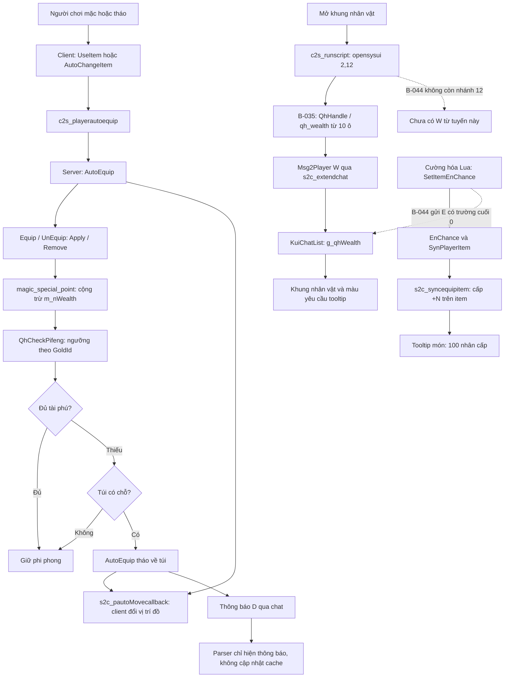

TÓM TẮT 1. [NGUỒN] DONE cho bản đồ đọc tĩnh KT-03A: tài phú, yêu cầu mặc phi phong, tự tháo và hiển thị client; chưa kết luận hành vi trong game.
TÓM TẮT 2. [NGUỒN] Dự án thêm điểm ảo `100 × +N` qua Apply/Remove vào `KPlayer::m_nWealth`; phi phong vàng được hậu kiểm theo GoldId, ngưỡng 6000…15000.
TÓM TẮT 3. [NGUỒN] Tuyến mobile đã đọc đi qua `c2s_playerautoequip → AutoEquip → QhCheckPifeng`; tuyến này không gọi trực tiếp `CanEquip` trước khi mặc.
TÓM TẮT 4. [NGUỒN] Client dùng bộ đệm chat `g_qhWealth`; nhánh xin W của Lua B-035 bị bỏ trong bản B-044, còn kết quả E có thể ghi 0 vào bộ đệm.
TÓM TẮT 5. [CHƯA KIỂM] 0/18 kịch bản động đã chạy; không build, chạy game/server/VM hay dùng mạng; không commit theo yêu cầu, Tổng quản nhận phần Git.

# KT-03A — Bản đồ chuỗi tài phú và phi phong

Loại: tổng hợp
Chủ đề: Từ thao tác mặc/tháo, cấp cường hóa đến tài phú nhân vật, điều kiện phi phong và chữ trên client.
Từ khóa: tài phú, phi phong, 披风, pīfēng, magic_special_point, m_nWealth, magic_item_reserve8, EnoughAttrib, QhCheckPifeng, g_qhWealth
Trạng thái: DONE — hoàn thành khảo sát tĩnh; các mâu thuẫn và mắt xích chưa kiểm động được ghi riêng.
Độ phủ: 8/8 nhóm trong bảng phạm vi được lập bản đồ; 0/18 kịch bản động đã chạy; chưa kiểm bảng item/PAK hoặc binary đang triển khai.
Liên quan: `JX1_OPS/REPORTS/KT-03A.md`; `JX1_OPS/REPORTS/H-07-trang-suc-mat-na-phi-phong.md`; `JX1_OPS/REPORTS/H-08-tai-phu.md`; `JX1_OPS/DESIGN/QH-B035-PHI-PHONG.md`; `JX1_OPS/DESIGN/QH-B039-tai-phu.patch`; `JX1_OPS/DESIGN/BAN-DO-CHUOI-CUONG-HOA.md`; `JX1_OPS/HOP-THU/A-B.md`.
Cần tôi quyết định: không — chưa sửa mã hoặc triển khai; các khác biệt luật cần A/B đối chiếu trong đợt kiểm động.

## 1. Phạm vi và độ phủ

| Nhóm phạm vi | Đã phủ bằng nguồn | Còn thiếu / giới hạn |
|---|---|---|
| Kiến thức cũ và phiên bản | H-07, H-08, B-035, patch B-039, hợp đồng v6 và phần thay đổi v7 | Không đổi kết luận cũ; sổ tay `SO-TAY-*/HIEU-*` không tìm thấy ở hai vị trí giới hạn đã kiểm |
| 10 ô đóng góp tài phú | Enum ô/loại đồ, Apply/Remove và handler `special_point` | Chưa đo tính bất biến khi thay đồ nhiều lần |
| Cấp cường hóa và dữ liệu | Lua API, `nEnChance`, `m_EnChance`, `ienchance` | Chưa kiểm DB, bảng item/PAK, dữ liệu nhân vật thật |
| Điều kiện mặc | Hai overload `CanEquip`, `EnoughAttrib`, cổng GoldId và tuyến mobile thực tế | Chưa chứng minh record item nào đã gắn requirement `reserve8` |
| 11 bậc và biến thể | Công thức, GoldId chuẩn/biến thể từ mã hiện tại | Chưa kiểm tên từng mẫu và chỉ số GoldItem/GoldMagic |
| Tự tháo | Hai nhánh mobile, đường đổi đồ cũ, điều kiện chỗ túi và callback | Chưa kiểm đăng nhập/timer/mọi đường thay đồ khác |
| Lua, gói tin và UI | B-035, B-044, bản script gốc; request, chat, cache và hai tooltip | Chưa xác định bộ Lua/APK/exe nào đang dùng trong game |
| Kiểm động và bàn giao | 18 ca có điều kiện, nơi đọc số và kỳ vọng | Tất cả CHƯA CHẠY; dành cho A/bot sau |

## 2. Quy ước nguồn và mức chắc

- `P/` = `D:/JX-wt/QH-B035/server/jxOnline/gameserver/Sources/Core/Src/` — bản dự án trên đĩa ngày 20/11/2026, task không ghim SHA. Không đồng nhất nó với checkpoint B-039 đã build.
- `S/` = `D:/JX-build/src18/jxOnline/gameserver/Sources/Core/Src/` — nền đối chiếu do task chỉ định; không gọi đây là bản phát hành nguyên thủy chưa từng sửa.
- `C/` = `D:/JX-build/qh9A/Classes/` — client dự án được giao, không suy thành APK đang chạy.
- `G/` = `C:/Jx1CocoV3/Folder/ServerNew-20260116T043145Z-3-001/ServerNew/_bin_v2_/gs/script/` — bản script gốc trên đĩa.
- `D/` = `JX1_OPS/DESIGN/`; `AB` = `JX1_OPS/HOP-THU/A-B.md`.
- **ĐÃ ĐỌC MÃ / ĐÃ XÁC MINH TĨNH**: thấy nội dung tại file:dòng hiện tại. **TÀI LIỆU**: lời ghi ở báo cáo/hợp đồng, không nhận là test do worker chạy. **CHƯA KIỂM TRONG GAME** áp dụng cho mọi kết quả gameplay dưới đây. **GIẢ THUYẾT CẦN ĐO** là hệ quả điều kiện, không phải lỗi runtime đã tái hiện.
- C++ gốc được mở GBK/CP936 khi cần đọc Hán; phần bổ sung tiếng Việt client được đọc UTF-8. Một số file trộn mã cũ nên comment có thể lỗi; không sửa byte nguồn. Tài liệu này là UTF-8 không BOM.

### Danh sách nguồn đã khoanh trước khi đọc mã

ĐÃ ĐỌC KIẾN THỨC: `D/CHUAN-BAO-CAO.md:1`; `D/MUC-LUC-TRI-THUC.md:13`; `REPORTS/H-07-trang-suc-mat-na-phi-phong.md:49,64,146,167`; `REPORTS/H-08-tai-phu.md:2,73,144,182`; `D/QH-B035-PHI-PHONG.md:3–32`; `D/QH-B039-tai-phu.patch:1–138`; `AB:149–161,335–375,440–489`. Mã tự sinh `MA-NGUON/ban-do-server.md:901,928,1095,1221,1727` và `ban-do-client.md:834,989,1088,1797,2636` chỉ dùng định vị. `CONTEXT-PACK/GS001-MAP.md` không có tuyến tài phú cụ thể trong kết quả tìm theo chủ đề.

Tệp mã được lần theo các symbol liên quan, không quét đệ quy: phía P là `KItemList.cpp/.h`, `KItem.cpp/.h`, `KNpcAttribModify.cpp`, `KPlayer.cpp/.h`, `KProtocolProcess.cpp/.h`, `KPlayerChat.cpp`, `ScriptFuns.cpp`, `KMagicAttrib.h`, các dòng persist ở `KPlayerDBFuns.cpp`; tìm tên loader ở `KItemGenerator.CPP`, `KBasPropTbl.CPP` không cho thêm bằng chứng requirement trong lượt này. Phía S chỉ đối chiếu các đoạn tương ứng ở `KItemList.cpp`, `KNpcAttribModify.cpp`, enum và kết quả tìm symbol. Phía C: `gamecore/{KItem,KItemList,KPlayer,KProtocol,KProtocolProcess,KNpcAttribModify,CoreShell}` và header cần thiết; `gameui/{KuiChatList,KuiRoleState,KuiItemdesc}`; `vn/gameui/{KuiItemdescVN,KuiRoleStateVN}`; `gamescene/KgameWorld.cpp/.h`. Các tìm kiếm cache chỉ giới hạn `.cpp` trực tiếp trong gameui/gamescene/gamecore/vn/gameui. Script: `G/system/{opensysui,qianghua}.lua`, `D/QH-B035-deploy/{opensysui,qhcuonghoa}.lua`, `D/QH-B044-deploy/{opensysui,qianghua}.lua`. Không mở khóa, mật khẩu, DB, dump hoặc log người chơi.

ĐÃ TRA ĐỒ THỊ: chạy Graphify trước khi đọc mã. `graphify explain '.QhCheckPifeng()'` tại `D:/JX-build/src18` → không có nút; tại P → gợi ý `KItemList::QhCheckPifeng()` ở `KItemList.cpp L1206`, đã đối chiếu file thật. `graphify explain '.GetDesc()'` tại C → 4 ứng viên, trong đó `gamecore/KItem.h`; đã chọn hướng KItem rồi kiểm file thật. Marker P và C ghi `.`; marker src18 ghi đúng root. `GRAPH_REPORT.md` của P có nhóm KItem/KItemList ở dòng 508/516, C có KItemList/KuiRoleState ở 761/769. Các lệnh explain định danh cụ thể và path đã chờ nhưng không trả kết quả; đã dừng, không coi đó là cạnh đồ thị xác minh. `path 'KItemList::CanEquip()' 'KItemList::EnoughAttrib()'` báo không khớp nút. Không dựng lại graph, không cài hook; caller/callee dưới đây được kiểm bằng mã thật, không suy từ graph.

## 3. Hiểu bằng lời thường

**ĐÃ ĐỌC MÃ** — Tài phú dự án muốn biểu diễn tổng giá trị cường hóa của đồ đang mặc: mỗi cấp +1 góp 100 điểm. Món nằm trong túi vẫn có dòng điểm của riêng nó trên tooltip, nhưng chỉ đường áp thuộc tính khi mặc mới cộng vào nhân vật. Tháo thì trừ; ngựa, mặt nạ, phi phong, ấn và sức phẩm nằm ngoài nhóm loại 0…9. Ví dụ bộ 10 ô đều +6 có tổng công thức 6000; đây là phép tính đối chiếu, chưa phải số đo game (`P/KItem.cpp:194–201,293–300`; `C/gamecore/KItem.cpp:2526–2530`).

**ĐÃ ĐỌC MÃ** — Có hai cơ chế điều kiện khác nhau: requirement của món được `EnoughAttrib` kiểm như sức mạnh; cổng riêng của phi phong đọc GoldId rồi kiểm `m_nWealth`. Không được nói rằng chỉ cần thêm chữ tooltip là đã khóa được mặc. Đặc biệt đường mobile hiện tại mặc/tháo bằng `AutoEquip` rồi hậu kiểm phi phong, không phải mọi đường đều đi vào `CanEquip` trước (`P/KItemList.cpp:1233–1289,1349`; `P/KProtocolProcess.cpp:8368,8487–8488,8577–8578`).

**ĐÃ ĐỌC MÃ** — Số trên khung nhân vật hiện là bản sao lấy từ chat. Nó có thể cũ hoặc bằng 0 dù tổng server khác. Đường cộng/trừ `m_nWealth` đã đọc không tự gửi `[QH]|W|`; nhãn được vẽ lại mỗi 0,5 giây cũng chỉ vẽ lại biến đệm (`P/KNpcAttribModify.cpp:3399–3408`; `C/gameui/KuiChatList.cpp:337–340`; `C/vn/gameui/KuiRoleStateVN.cpp:401–402`).

## 4. Sắp theo cấu trúc game: đồ mặc → phi phong → giao diện

### 4.1. Đủ 10 ô tài phú, không nhầm ô với loại đồ

**ĐÃ ĐỌC MÃ** — Ô (`ITEM_PART`) khác loại (`EQUIPDETAILTYPE`). Hai nhẫn là hai ô, còn hai loại vũ khí cùng chiếm một ô. Nguồn ô: `C/gamecore/GameDataDef.h:211–228`; nguồn loại: `C/gamecore/KItem.h:52–69`, `P/KItem.h:85–102`; ánh xạ: `P/KItemList.cpp:2556–2607`.

| Ô | Tên trong game | Loại đồ (Detail) | Đóng góp theo luật |
|---:|---|---|---|
| 0 | Đầu / mũ | `equip_helm` = 7 | `100 × +N` |
| 1 | Áo | `equip_armor` = 2 | `100 × +N` |
| 2 | Đai | `equip_belt` = 6 | `100 × +N` |
| 3 | Vũ khí | `equip_meleeweapon` = 0 hoặc `equip_rangeweapon` = 1 | Một món, `100 × +N` |
| 4 | Giày | `equip_boots` = 5 | `100 × +N` |
| 5 | Tay | `equip_cuff` = 8 | `100 × +N` |
| 6 | Bùa / dây chuyền | `equip_amulet` = 4 | `100 × +N` |
| 7 | Nhẫn 1 | `equip_ring` = 3 | Tính riêng món này |
| 8 | Nhẫn 2 | `equip_ring` = 3 | Tính riêng món này |
| 9 | Ngọc bội | `equip_pendant` = 9 | `100 × +N` |

**ĐÃ ĐỌC MÃ** — Apply/Remove kiểm loại `<= equip_pendant` và `nEnChance > 0`, không lặp trực tiếp 10 ô. Lua `qh_wealth` lại lặp `GetEquipIdx(0…9)`. Hai cách chỉ bằng nhau khi các đường áp/gỡ giữ đúng số lần và trạng thái sử dụng món. Không nâng công thức mong muốn thành bất biến đã đo (`P/KItem.cpp:194,293`; `D/QH-B035-deploy/qhcuonghoa.lua:24–31`; `P/KItemList.cpp:1849–1860`).

### 4.2. Đủ 11 bậc phi phong theo ID, không lấy Level làm bậc cổng

**ĐÃ ĐỌC MÃ** — `QhPifengWealthOK` chỉ xét `item_equip`, Detail 12, GoldId > 0 và đúng hai dải ID sau. Cấp bậc k được suy từ GoldId; không lấy `GetLevel()` như thiết kế B-035 ban đầu (`P/KItemList.cpp:1149–1167`; `D/QH-B035-PHI-PHONG.md:4`). Không liệt kê tên thương mại từng mẫu vì chưa đối chiếu byte dữ liệu gốc; dùng bậc/ID để tránh gán nhầm tên.

| Bậc k | GoldId chuẩn | GoldId biến thể | Điểm cần | Tổng cấp +N tương đương khi X=100 |
|---:|---:|---|---:|---:|
| 1 | 3465 | Không thuộc dải biến thể đã mã hóa | 6000 | 60 |
| 2 | 3466 | Như trên | 6900 | 69 |
| 3 | 3467 | Như trên | 7800 | 78 |
| 4 | 3468 | Như trên | 8700 | 87 |
| 5 | 3469 | Như trên | 9600 | 96 |
| 6 | 3470 | Như trên | 10500 | 105 |
| 7 | 3471 | 3476…3478 | 11400 | 114 |
| 8 | 3472 | 3479…3481 | 12300 | 123 |
| 9 | 3473 | 3482…3484 | 13200 | 132 |
| 10 | 3474 | 3485…3487 | 14100 | 141 |
| 11 | 3475 | 3488…3490 | 15000 | 150 |

**ĐÃ ĐỌC MÃ** — Công thức nguyên: `100 × 10 × (6 × 10 + 9 × (k−1)) / 10 = 6000 + 900 × (k−1)`. So sánh là `have >= need`. Phi phong thường GoldId=0 và GoldId ngoài hai dải trả TRUE ở cổng này; vẫn có thể chịu điều kiện khác của game (`P/KItemList.cpp:1151–1163`).

### 4.3. Giải mã tên

Không phát sinh tên riêng môn phái, NPC, bản đồ hay tên từng mẫu phi phong trong kết luận mới. Bảng dưới giữ tên gốc thật đã đọc; symbol không được đổi tên. Chữ Hán có pinyin và nghĩa Việt; không khôi phục đoán các chuỗi Việt cũ bị trộn mã trong Lua.

| Tên gốc | Mã hóa | Chữ đúng / cách đọc / tiếng Việt | Nguồn file:dòng |
|---|---|---|---|
| `披风` / `equip_pifeng` | GBK/CP936; symbol ASCII | 披风, pīfēng — phi phong | `P/KItemList.cpp:2595–2596` |
| `头`, `身体`, `腰带`, `武器` | GBK/CP936 | tóu — đầu; shēntǐ — thân/áo; yāodài — đai; wǔqì — vũ khí | `C/gamecore/GameDataDef.h:213–216` |
| `靴子`, `手镯或护腕`, `项链` | GBK/CP936 | xuēzi — giày; shǒuzhuó huò hùwàn — vòng tay/hộ uyển; xiàngliàn — dây chuyền | `C/gamecore/GameDataDef.h:217–219` |
| `戒子`, `香囊或玉佩` | GBK/CP936 | jièzi — nhẫn; xiāngnáng huò yùpèi — hương nang hoặc ngọc bội | `C/gamecore/GameDataDef.h:220–222` |
| `马`, `面具` | GBK/CP936 | mǎ — ngựa; miànjù — mặt nạ | `C/gamecore/GameDataDef.h:223–224` |
| `Diem tai phu`, `Yeu cau tai phu` | ASCII, nguyên văn mã bổ sung | Điểm tài phú; yêu cầu tài phú | `C/gamecore/KItem.cpp:2440,2529`; `C/vn/gameui/KuiRoleStateVN.cpp:396` |
| `Điểm tài phú`, `Yêu cầu tài phú` | UTF-8 | Giữ nguyên tên Việt có dấu | `C/vn/gameui/KuiItemdescVN.cpp:656,666` |

## 5. Bản đồ chuỗi để sửa mã

### 5.1. Mặc/tháo trên client mobile và hậu kiểm server

| Bước | Thao tác / symbol | Bằng chứng ĐÃ ĐỌC MÃ | Dữ liệu, nhánh cần nhớ |
|---:|---|---|---|
| 1 | Bấm mặc: `KuiItemdescVN::chuanCallBackFunc` | `C/vn/gameui/KuiItemdescVN.cpp:2541,2594` | `GOI_USE_ITEM`, đối tượng item và vị trí túi |
| 2 | `KCoreShell::OperationRequest → KPlayer::ApplyUseItem` | `C/gamecore/CoreShell.cpp:4506,4540–4543`; `C/gamecore/KPlayer.cpp:1996,2022` | Gọi `m_ItemList.UseItem`, không tự cộng tổng tài phú |
| 3 | `KItemList::UseItem` | `C/gamecore/KItemList.cpp:2208,2230,2259–2267` | Client kiểm `CanEquip`, gửi `PLAYER_AUTO_EQUIP`, `c2s_playerautoequip`, `bKind=0`; nhẫn có chọn ô thứ hai ở 2224 |
| 4 | Bấm tháo: `ThaoCallBackFunc → AutoChangeItem` | `C/vn/gameui/KuiItemdescVN.cpp:3009,3037`; `C/gamecore/CoreShell.cpp:447–449`; `C/gamecore/KItemList.cpp:2162,2191–2200` | Cùng gói, `bKind=1`; client cần chỗ chứa món tháo |
| 5 | Server dispatch → `c2splayerautoequip` | `P/KProtocolProcess.cpp:316,8368,8396,8487,8577` | Kiểm item/vị trí/độ bền/chỗ túi; `GetEquPlace` chỉ ánh xạ loại sang ô (`P/KItemList.h:89`; `.cpp:2556–2607`) |
| 6 | `KItemList::AutoEquip → UnEquip/Equip` | `P/KItemList.cpp:3120,3160–3163,3198–3208` | Mặc/gỡ thật. Trong tuyến này đã đọc không có lời gọi trực tiếp `CanEquip` trước AutoEquip |
| 7 | Áp/gỡ điểm vào nhân vật | `P/KItemList.cpp:1852,2208`; `P/KItem.cpp:194–201,293–300`; `P/KNpcAttribModify.cpp:3399–3408` | `magic_special_point`, ±`100 × nEnChance`; clamp `m_nWealth` về 0 nếu âm |
| 8 | Hậu kiểm phi phong: `QhCheckPifeng` | `P/KProtocolProcess.cpp:8488,8578`; `P/KItemList.cpp:1206–1220` | Thiếu điểm + có chỗ túi → báo D và gọi AutoEquip tháo; đầy túi → return trước cả thông báo |
| 9 | Đồng bộ vị trí về client | `P/KItemList.cpp:3174–3185,3214–3225`; `C/gamecore/KProtocolProcess.cpp:5223–5250` (`s2cpautoMovecallback`) | `PLAYER_AUTOCALLBACK_EQUIP`, `s2c_pautoMovecallback`, client gọi AutoEquip theo vị trí server |

**ĐÃ ĐỌC MÃ** — Đường kéo/đổi item cũ khác: `c2s_playermoveitem → PlayerMoveItem → ServerMoveItem → ExchangeItem`, sau đó gọi hậu kiểm. Với cờ mobile, `PlayerMoveItem` return trước `ServerMoveItem`; không được lấy đường này thay cho luồng mobile (`P/KProtocolProcess.cpp:238,5728–5737`; `P/KPlayer.cpp:6024–6055`; `C/gamecore/KProtocol.cpp:751–764`). Nhánh `ExchangeItem` có `CanEquip` ở `P/KItemList.cpp:5693`; đây là một nơi cổng trước có thể được dùng.

### 5.2. Điều kiện kiểu sức mạnh: cơ chế đã có, dữ liệu chưa chứng minh

**ĐÃ ĐỌC MÃ** — `KItem::SetAttrib_Req` chép `nType/nPara` vào `m_aryRequireAttrib[i].nAttribType/nValue[0]` (`P/KItem.cpp:567–586`); `GetRequirement` trả lần lượt từng phần tử (`:61–66`). Hai overload `CanEquip` duyệt các requirement và gọi `EnoughAttrib` (`P/KItemList.cpp:1251–1258,1285–1289`). Tương tự `magic_requirestr` so `m_nCurStrength < yêu cầu` ở dòng 1317–1322, case mới `magic_item_reserve8` so `m_nWealth < yêu cầu` tại 1349–1354 rồi trả FALSE khi thiếu.

**ĐÃ ĐỌC MÃ** — Không cần thêm enum `magic_requirewealth` để mô tả bản mã này: slot dùng thực tế là `magic_item_reserve8` (`P/KMagicAttrib.h:64`); `magic_special_point` ở dòng 322 là thuộc tính cộng/trừ, không phải requirement. Số dòng enum khác client, không được dùng số dòng làm opcode/ID.

**CHƯA XÁC MINH** — Chưa đối chiếu record GoldItem/GoldMagic nào đã gắn loại requirement này và giá trị X. Cổng hardcode GoldId tồn tại độc lập, nhưng chỉ hiệu lực trước khi mặc nếu caller đi qua `CanEquip` với ô phi phong. `EnoughAttrib` còn có ngoại lệ `GetUseKind()==1 && GetUseMapIdx()>0` trả TRUE trước switch (`P/KItemList.cpp:1303–1311`). Client `EnoughAttrib` chưa có case reserve8 trong switch đã kiểm, default đi qua (`C/gamecore/KItemList.cpp:918–1039`); dòng yêu cầu màu trên tooltip là đoạn thêm riêng theo GoldId, không chứng minh generic requirement đã đồng bộ đầy đủ.

### 5.3. Cường hóa → dữ liệu item → điểm nhân vật

**ĐÃ ĐỌC MÃ** — Lua `SetItemEnChance(idx, delta, sync)` → `LuaSetItemEnChance` lấy cấp cũ, gọi `QhSetEnChance(idx, cấp_cũ+delta)`, rồi `SynPlayerItem` nếu sync≥1 (`P/ScriptFuns.cpp:10963–10986`, đăng ký `:26126`). Món trong túi chỉ đổi EnChance; món đang mặc đi `UnEquip → EnChance → Equip`, thử khôi phục cấp cũ nếu mặc lại thất bại (`P/KItemList.cpp:1176–1202`). Đây là mã hiện tại Q-92/Q-94, khác phần cộng delta trực tiếp của patch B-039 (`D/QH-B039-tai-phu.patch:124–134`).

**ĐÃ ĐỌC MÃ** — `SynPlayerItem` dùng `ITEM_SYNC/s2c_syncequipitem`, `m_SyncType=2`, trường `m_EnChance=GetEnChance()` (`P/KItemList.cpp:4473–4498`). Client `s2csyncequipitem` cập nhật EnChance theo nhánh phẩm chất (`C/gamecore/KProtocolProcess.cpp:1557,1644–1652`). Tooltip điểm món dựa chính `nEnChance` đó, không xin W. Dòng lưu/nạp cấp item: `P/KPlayerDBFuns.cpp:891,1694` (`ienchance`); không suy rằng `m_nWealth` là trường DB. `KPlayer::Release` đưa `m_nWealth` về 0 (`P/KPlayer.cpp:157`); việc tính lại hoàn chỉnh khi đăng nhập là yêu cầu kiểm động, không nhận đã chứng minh mọi đường nạp.

### 5.4. Xin tổng điểm → Lua → chat → khung và tooltip

| Bước | Bằng chứng ĐÃ ĐỌC MÃ | Ý nghĩa |
|---:|---|---|
| 1 | `C/vn/gameui/KuiRoleStateVN.cpp:395–402` | Mở khung: gửi `(2,12,0,0)`; nhãn tag 9090 vẽ lại cache mỗi 0,5 giây |
| 2 | `C/gamecore/KProtocol.cpp:312–321` (`SendClientRunScript`) | `CLIENT_RUN_SCRIPT`, `c2s_runscript`, bốn trường nKind/nVala/nValb/nValc |
| 3 | `P/KProtocolProcess.cpp:321,8303–8321` (`c2srunscript`) | nKind=2 gọi `opensysui` trong `script/system/opensysui.lua` |
| 4a | `D/QH-B035-deploy/opensysui.lua:22–26`; `qhcuonghoa.lua:24–31,67–79` | Include QhHandle; a=12 tính lại tổng từ 10 ô qua `GetEquipIdx/GetItemEnChance`, gửi W; đây không phải getter đọc thẳng `m_nWealth` |
| 4b | `G/system/opensysui.lua:22–30`; `D/QH-B044-deploy/opensysui.lua:22–31` | Bản gốc chỉ a=1; bản B-044 Include qianghua và cũng chỉ a=1, không trả W cho a=12. `G/system/qhcuonghoa.lua` không tồn tại |
| 5 | `P/ScriptFuns.cpp:10912–10922,10953–10959` | Hai getter Lua trả ô đang mặc và cấp item; danh sách ô nằm trong QH_PARTS của script B-035 |
| 6 | `P/ScriptFuns.cpp:5835–5857,25955` (`LuaMsgToPlayer`) | `Msg2Player` mã hóa text rồi gọi `KPlayerChat::SendSystemInfo` |
| 7 | `P/KPlayerChat.cpp:1912–1966` | `s2c_extendchat → CHAT_CHANNELCHAT_SYNC/chat_channelchat`, channelid=-1; D dùng cùng đường ở `P/KItemList.cpp:1167–1169` |
| 8 | `C/gamecore/KProtocolProcess.cpp:205,4316–4336`; `C/gamescene/KgameWorld.cpp:13322–13352,13408–13428`; `.h:518` | `s2cExtendChat → ChannelMessageArrival → KuiChatList::addmsg`; cần scene, kênh GM hợp lệ và chatLayer |
| 9 | `C/gameui/KuiChatList.cpp:320–362` | Parse W/P/E để gán `g_qhWealth`; D chỉ hiện câu chung, không lấy trường have để cập nhật tổng và không hiện need/have đầy đủ |
| 10 | `C/gameui/KuiRoleState.cpp:31,2646`; `C/vn/gameui/KuiRoleStateVN.cpp:962` | Cache khởi tạo 0; hai khung nhân vật hiển thị cache, không cộng lại các món |
| 11 | `C/gamecore/KItem.cpp:1852,2430–2441,2526–2530`; `C/vn/gameui/KuiItemdescVN.cpp:126,649–681` | Tooltip core và VN: điểm món =100×+N; yêu cầu phi phong theo GoldId, tô đỏ khi cache nhỏ hơn ngưỡng |

**ĐÃ ĐỌC MÃ** — Bản `D/QH-B044-deploy/qianghua.lua:58` gửi `[QH]|E|code|0|lv|rate|c|s|0`. Khi dòng này tới parser trên, `f[7]` bằng 0 nên cache bị gán 0 (`C/gameui/KuiChatList.cpp:338`). **GIẢ THUYẾT CẦN ĐO**: nếu đúng cặp client/Lua này được triển khai, khung và màu yêu cầu có thể sai dù `m_nWealth` không đổi. Không gọi đây là lỗi game đã tái hiện.

## 6. Phần dự án thêm/ghi đè so với nền được giao

| Phần | Nền / tài liệu trước | Dự án hiện tại và giới hạn |
|---|---|---|
| Handler tài phú | `S/KNpcAttribModify.cpp:3399–3402` rỗng dù bảng handler đã có symbol | `P/KNpcAttribModify.cpp:3399–3408` cộng/trừ field mới `P/KPlayer.h:386` |
| Áp/gỡ điểm món | Patch thể hiện dòng mới (`D/QH-B039-tai-phu.patch:9–35`) | `P/KItem.cpp:194–201,293–300` phát thuộc tính ảo |
| Điều kiện chuẩn | `S/KItemList.cpp:1153–1180,1208–1268` có CanEquip/điều kiện sức mạnh, không có case tài phú ở vùng tương ứng | P thêm cổng GoldId ở hai overload và case reserve8; không đồng nghĩa mọi caller gọi cổng |
| Nguồn tổng server | B-035 cộng `GetEquipment`/EnChance; patch bỏ vòng lặp (`D/QH-B039-tai-phu.patch:43–55`) | `P/KItemList.cpp:1161` đọc field nhân vật; Lua B-035 vẫn cộng riêng |
| Đổi +N đang mặc | Patch B-039 cộng delta thủ công (`:124–134`) | Hiện tại `P/ScriptFuns.cpp:10975–10983` dùng QhSetEnChance/UnEquip/Equip; không áp patch lịch sử thêm lần nữa |
| Lua hệ thống | `G/system/opensysui.lua:24–27` chỉ mở Give cũ | B-035 thêm Include/QhHandle 10…12; B-044 thay Include sang qianghua và bỏ nhánh đó. Không lấy sự tồn tại file làm bằng chứng được nạp |
| UI client | H-08 chỉ chứng minh nhánh giàu có bằng tiền; không phải m_nWealth (`REPORTS/H-08-tai-phu.md:2,73,144`) | qh9A thêm tooltip, cache chat, khung nhân vật như mục 5.4; chưa đối chiếu byte với client phát hành gốc |

## 7. Phát hiện khi chuẩn hóa và chỗ dễ làm sai

Không sửa các kết luận/số liệu ở tài liệu cũ. Những khác biệt mới được đặt tại đây để A/B tra:

1. **TÀI LIỆU so với MÃ**: v6 ban đầu gọi requirement là `magic_requirewealth` (`AB:358`); bản ký B-039 và mã thật dùng `magic_item_reserve8` (`AB:369`; `P/KItemList.cpp:1349`). Không tự chèn enum mới hoặc lấy dòng enum làm ID.
2. **TÀI LIỆU so với MÃ**: v6 nói đầy túi vẫn tháo (`AB:360`); mã `P/KItemList.cpp:1217–1218` giữ nguyên, chưa gửi D. Ghi nhận mâu thuẫn, chưa chọn lại luật thay chủ.
3. **TÀI LIỆU theo thời điểm**: B-035 nói chưa tự tháo, lấy Level (`D/QH-B035-PHI-PHONG.md:4,8`); P đã có hậu kiểm/GoldId. Giữ nguyên tài liệu lịch sử, tra mục 4/5 khi sửa bản P.
4. **ĐÃ ĐỌC MÃ**: tuyến mobile không có CanEquip trước AutoEquip; cổng riêng được chạy ở hậu kiểm. Vì vậy bài test phải quan sát cả thời điểm áp chỉ số và kết quả cuối, không chỉ thông báo từ chối.
5. **ĐÃ ĐỌC MÃ**: v6 muốn tổng từ server, nhưng QhHandle W vẫn tự tính tổng các ô (`AB:359–370`; `D/QH-B035-deploy/qhcuonghoa.lua:24–31`). Khi item bị vô hiệu hoặc Apply/Remove lệch lần, không mặc định W bằng field thật.
6. **ĐÃ ĐỌC MÃ**: thay opensysui theo B-044 làm mất đường a=12; E cuối 0 vẫn bị parser hiểu là tài phú. Một lần sửa Lua không kèm rà hợp đồng parser có thể làm khung/màu sai, cần kiểm cặp phiên bản.
7. **ĐÃ ĐỌC MÃ**: handler client `special_point` còn rỗng (`C/gamecore/KNpcAttribModify.cpp:1987–1990`); không thể nói đã có sync thuộc tính nhị phân chuẩn chỉ vì enum cùng tên. D hiện chỉ đổi thành câu chung ở `C/gameui/KuiChatList.cpp:360–361`.
8. **TÀI LIỆU / SỐ HỌC**: cột “cần/100” trong bảng B-035 ghi 6.0…15.0 (`D/QH-B035-PHI-PHONG.md:14–24`) nhưng 6000/100=60, 15000/100=150. Bộ 10 món +6 vẫn đúng ví dụ dòng 26; không lấy 6 làm tổng cấp cả bộ. Bảng mới tách rõ tổng cấp.
9. **CẦN ĐO**: không cộng điểm từ đồ túi, ngựa/phi phong; không đếm nhẫn một lần; không nhầm `GetLevel`, GoldId và `nEnChance`. Không khẳng định đăng nhập, helper đổi cấp, giao dịch hay mọi đường mất hiệu lực đều đã gọi hậu kiểm.

## 8. MỤC SỔ THÔNG SỐ

| Nhóm | Tên/hằng số | file:dòng | Giá trị | Đơn vị | Ảnh hưởng | Đổi an toàn | Nguồn đo |
|---|---|---|---|---|---|---|---|
| Tài phú | `QH_WEALTH_X` và điểm ảo | `P/KItemList.cpp:1146`; `P/KItem.cpp:198,297` | 100 | điểm / cấp +N | Cả cộng trừ, Lua và tooltip phải khớp | CẨN THẬN | Đọc tĩnh, chưa đo |
| Phạm vi | `QH_WEALTH_N`, `QH_PARTS` | `P/KItemList.cpp:1147`; `D/QH-B035-deploy/qhcuonghoa.lua:7` | 10; ô 0…9 | ô | Hai nhẫn riêng, loại bỏ ô 10…14 | CẨN THẬN | Đọc tĩnh |
| Bậc | `QH_PIFENG_K` | `P/KItemList.cpp:1148,1156–1160` | 11 | bậc | Chia 10 ở công thức; ánh xạ ID | CẨN THẬN | Đọc tĩnh |
| Ngưỡng | Công thức cổng | `P/KItemList.cpp:1160–1163` | 6000+900(k−1) | điểm | Đủ bằng ngưỡng được chấp nhận | CẨN THẬN | Suy số học từ mã, chưa đo |
| Loại | `equip_pifeng` / ô phi phong | `P/KItem.h:99`; `C/gamecore/GameDataDef.h:225` | 12 / 12 | enum loại / enum ô | Hai enum khác nhau dù cùng giá trị | KHÔNG tự đổi | Đọc enum |
| ID | GoldId chuẩn / biến thể | `P/KItemList.cpp:1153–1158` | 3465…3475 / 3476…3490 | ID record | ID ngoài dải không bị cổng này chặn | CẨN THẬN | Đọc tĩnh; chưa đối chiếu bảng |
| Requirement | `magic_item_reserve8` | `P/KItemList.cpp:1349–1354` | `nValue[0]` = điểm cần | điểm | Kiểm tương tự sức mạnh nếu caller đi qua requirement | KHÔNG tự đổi enum | Đọc tĩnh; chưa có record đo |
| Nhân vật | `m_nWealth` | `P/KPlayer.h:386`; `P/KNpcAttribModify.cpp:3407–3408` | int, clamp dưới 0 | điểm | Sổ cộng trừ server, không coi cache UI là field | CẨN THẬN | Đọc tĩnh |
| Giao diện | Chu kỳ vẽ cache | `C/vn/gameui/KuiRoleStateVN.cpp:402` | 0,5 | giây / lần | Không phải chu kỳ hỏi server | CẨN THẬN | Source, chưa đo FPS/độ trễ |

## 9. KỊCH BẢN KIỂM ĐỘNG — đợt 2 cho A/bot, worker KHÔNG chạy

**CHƯA KIỂM TRONG GAME: 0/18 ca.** A xác nhận đúng cặp client/server/Lua trước khi chạy ở môi trường đã được duyệt. Cần nhân vật thử có các điều kiện cấp/giới tính/độ bền hợp lệ; 10 món có +N biết trước, hai nhẫn riêng; phi phong theo ID ở mục 4; các mức đầy túi khác nhau. Chỉ dùng fixture do A/B chuẩn bị, không nhận task này là quyền tạo/chạy công cụ mới.

Mỗi ca ghi trước/sau: build hoặc SHA do A xác nhận, phiên bản opensysui/qianghua, 10 ô và +N, GoldId/Level/+N phi phong, tổng công thức, `m_nWealth` nếu công cụ quan sát được duyệt có sẵn, dòng W/E/D thô nếu đã có kênh thu được duyệt, chữ/màu tooltip, khung nhân vật, vị trí phi phong. Không có cách đọc field thật thì ghi **chưa quan sát được**, không thay nó bằng W. D có trường `have` do server lấy từ field tại thời điểm từ chối; UI hiện tại có thể ẩn các số đó.

| Ca | Đồ/nhân vật cần và thao tác | Số đọc ở đâu | Kỳ vọng / điểm phân xử; tất cả CHƯA CHẠY |
|---|---|---|---|
| KT03A-T01 | Món hợp lệ +6 trong túi, chưa mặc; mở tooltip | Tooltip món; field/tổng trước sau | Món hiện 600; để túi không tăng tổng nhân vật |
| KT03A-T02 | 10 ô đều +6, mặc lần lượt; có đủ hai nhẫn | Danh sách ô, field và W nếu có | Tổng công thức tăng 600/món, đủ bộ 6000; nhẫn 2 được tính riêng |
| KT03A-T03 | Bộ 6000, tháo một món +6, túi đủ rộng | Field, vị trí item, cache và khung | Tổng mục tiêu 5400; phân biệt field đổi với cache chưa đổi |
| KT03A-T04 | Bậc 1 GoldId3465; bộ tổng 5900 rồi 6000; thử mặc | Phi phong ở đâu; D.need/have; chỉ số trước/sau | Ngưỡng 6000; tuyến mobile có thể hậu kiểm sau mặc, không nhận “chặn trước” nếu chỉ thấy bị tháo lại |
| KT03A-T05 | Bậc 11 GoldId3475; bộ 14900 rồi 15000 | Cùng các điểm trên | Ngưỡng 15000, đủ bằng ngưỡng được giữ; kiểm cả bộ 10 món +15 |
| KT03A-T06 | Từng bậc 2…10, mỗi bậc thử need−100 / need | Mốc mục 4, D và vị trí cuối | Đối chiếu đủ 9 bậc, không suy PASS từ hai đầu |
| KT03A-T07 | Biến thể 3476/3478/3479/3490; Level fixture khác nhau nếu đã có | GoldId, Level, D.need | Bậc lần lượt 7/7/8/11; Level không đổi ngưỡng cổng GoldId |
| KT03A-T08 | Phi phong thường GoldId0 và vàng ngoài dải nếu fixture có | Loại/ID, kết quả mặc | Cổng tài phú này trả qua; ghi riêng điều kiện khác gây từ chối |
| KT03A-T09 | Đang đủ ngưỡng và mặc phi phong; tháo món làm thiếu, túi còn chỗ phi phong | Field, D, callback/vị trí cuối | Hậu kiểm tháo phi phong về túi; không mất hay nhân đôi món |
| KT03A-T10 | Túi chỉ còn chỗ cho món thường tháo ra, không còn chỗ phi phong sau đó; làm tụt ngưỡng | Chỗ túi, phi phong, D có/không | Theo mã: giữ phi phong, chưa báo D; v6 muốn khác. Ghi bằng chứng để A/B chốt, không tự nhận PASS theo luật cũ |
| KT03A-T11 | Sau T10 tạo lại chỗ túi bằng UI rồi thực hiện một lần đổi đồ hợp lệ | Vị trí phi phong trước/sau | Hậu kiểm ở lần đổi tiếp theo có thể tháo; chưa khẳng định tự chạy chỉ vì vừa có chỗ |
| KT03A-T12 | Mặc/tháo cùng bộ 20 vòng, giữ đồ/+N không đổi | Field sau mỗi vòng, W/cache tách riêng | Mỗi trạng thái trở về cùng tổng; tìm cộng trùng/trừ thiếu khi lan truyền kích hoạt |
| KT03A-T13 | Đổi +N của món đang mặc qua đường thử đã được A/B duyệt, nếu có; nếu không có ghi SKIP | Field, item +N, chỉ số và vị trí | Helper hiện tại dự kiến tháo/đổi/mặc lại; delta điểm +100 khi tăng một cấp. Không bật lại hook cũ chỉ để chạy ca |
| KT03A-T14 | Đăng xuất/vào lại với cùng bộ và phi phong | +N lưu, tổng thực, khung, màu tooltip | Kiểm tái tạo tổng và refresh cache; không dựa mỗi Release=0 để tuyên bố tái tính thành công |
| KT03A-T15 | So hai bộ Lua B-035 và B-044 đã được A xác nhận; mở khung nhân vật | Request a=12; có W hay không; g_qhWealth/nhãn | B-035 có đường QhHandle; B-044 không có nhánh này. Không trộn bằng chứng hai phiên bản |
| KT03A-T16 | Bản B-044 + parser đã đọc; cache ban đầu khác0, thực hiện cường hóa hợp lệ trong túi | E thô trường cuối, cache, field | Nếu E được parse, cache thành0; field nhân vật không tự đổi vì món còn trong túi. Xác định khung/màu bị ảnh hưởng hay không |
| KT03A-T17 | Fixture requirement reserve8 độc lập cổng GoldId, chỉ khi A/B đã có fixture và duyệt cách kiểm | nType/nValue, field, caller thực tế | So thiếu/đủ theo EnoughAttrib; kiểm ngoại lệ UseKind/UseMap và caller có đi qua CanEquip. Chưa có fixture thì SKIP, không sửa Settings trong task |
| KT03A-T18 | Cùng bộ điểm thấp, thao tác mobile thường; đường kéo cũ chỉ khi client/môi trường đã hỗ trợ | Gói thực phát, vị trí, D, thời điểm áp chỉ số | Phân biệt hậu kiểm mobile và chặn trước của đường ExchangeItem; mobile có cờ bị chặn ở PlayerMoveItem. Quan sát cache khi chat/kênh chưa sẵn sàng |

## 10. Đã xác minh / Chưa xác minh và đề xuất

**ĐÃ XÁC MINH TĨNH:** các symbol, caller và dòng mã trong mục 4–8; phân biệt nền src18 với bản P; đường server có field tài phú, đường client hiện dùng cache chat; các mâu thuẫn tài liệu được giữ và nêu riêng. Phép tính bảng ngưỡng là suy từ hằng số, không gắn nhãn số đo.

**CHƯA XÁC MINH:** mọi ca ở mục 9; mã có trong binary/APK đang triển khai; bộ Lua đang nạp; record requirement thật, tài nguyên đóng gói, chuỗi Việt cũ bị trộn mã; tính đúng tổng sau mọi đường nạp/kích hoạt; độ trễ, hình ảnh và việc tự tháo trong game. Không build, chạy game/exe server, VM hay mạng. Chỉ chạy công cụ CLI đọc tệp và Graphify theo task.

**ĐỀ XUẤT TỐI ƯU — chưa triển khai:** A/B thống nhất một nguồn tổng điểm và hợp đồng sync trước khi sửa UI; tách trường tài phú khỏi kết quả E có ý nghĩa khác; xác định chính sách đầy túi và các điểm hậu kiểm; rà đủ tuyến mobile/đường cũ trước khi mô tả CanEquip là cổng chung. Không dùng thay đổi này làm quyền sửa mã trong KT-03A.

## 11. Bàn giao

- Báo cáo thi công và giới hạn công cụ: `JX1_OPS/REPORTS/KT-03A.md`; kết quả ghi cuối `JX1_OPS/TASKS/KT-03A.md`. Không sửa báo cáo cũ, mã nguồn, BAI_HOC hay mục lục chung.
- Hàng đề xuất để Tổng quản gộp vào `DESIGN/MUC-LUC-TRI-THUC.md`: `Tài phú thuộc tính / yêu cầu và tự tháo phi phong | HIEU-GAME/01-trang-bi-cuong-hoa/BAN-DO-TAI-PHU-PHI-PHONG.md; REPORTS/KT-03A.md | magic_special_point, m_nWealth, EnoughAttrib, QhCheckPifeng, g_qhWealth | khảo sát tĩnh; 0/18 ca động`.
- Không tạo `_CHIMUC/KT-03A.tsv` ngoài vùng file; hàng chỉ mục đề xuất nằm trong báo cáo task. Không stage/commit/push theo yêu cầu, chưa có SHA mới; Tổng quản commit hộ.
- Kỹ năng đã dùng: jx1-retrofit, jx1-read-server, jx1-read-client, jx1-parameters, jx1-knowledge, jx1-report (nạp từ `.agents/skills`).
