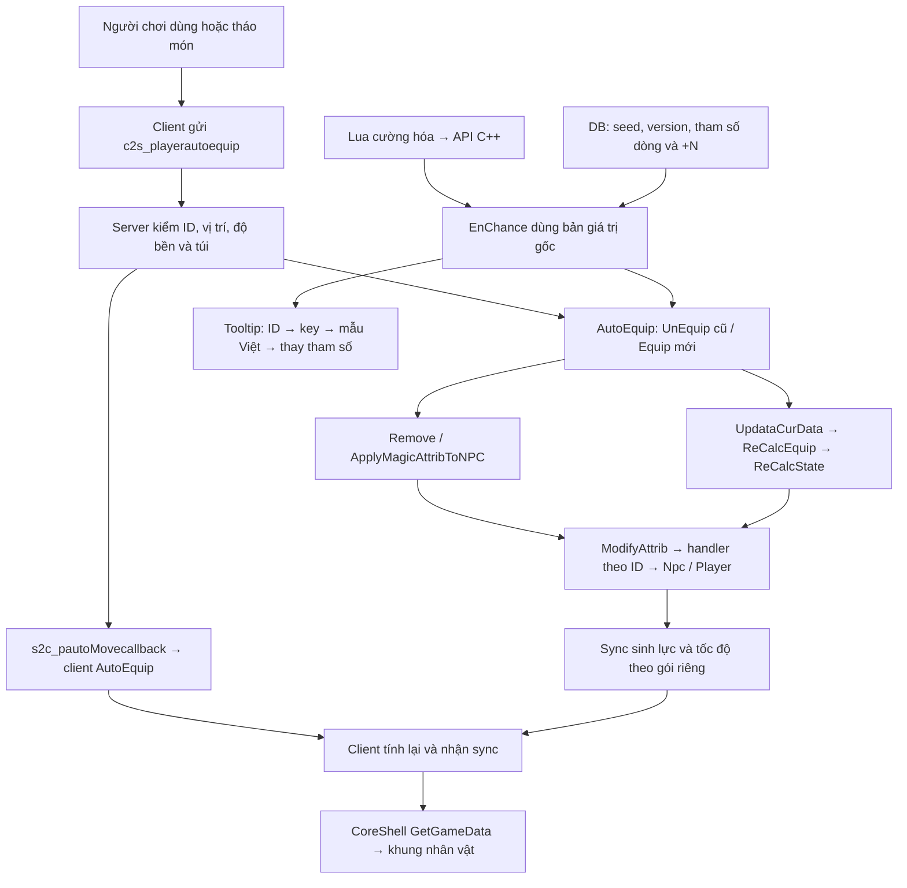

TÓM TẮT 1 — [NGUỒN] PARTIAL: đã nối chuỗi mặc/tháo → áp/gỡ thuộc tính → tính lại → đồng bộ/hiển thị trên các nguồn được giao.
TÓM TẮT 2 — [NGUỒN] Kiểm kê 312 mục enum, cùng thứ tự client/server; 234 đăng ký handler; 211 mẫu tooltip Việt có nội dung trong gói local.
TÓM TẮT 3 — [NGUỒN] Tách src18, qh9A và QH-B035; dự án dùng kỹ năng +14/+15, tài phú và QhSetEnChance cho đồ đang mặc.
TÓM TẮT 4 — [CHƯA KIỂM] Thiếu 73 key, 28 key rỗng, Lua qhcuonghoa.lua và dữ liệu PAK/runtime; đã lập kịch bản kiểm động.
TÓM TẮT 5 — [CHƯA KIỂM] Không build, chạy game/exe game, VM hoặc mạng; không sửa source; không commit/push, Tổng quản commit hộ.

# KT-02 — Bản đồ thuộc tính trang bị lên nhân vật

Loại: khảo sát
Chủ đề: Tra từ dòng trên món đồ tới chỉ số nhân vật, điều kiện kích hoạt, mặc/tháo, cường hóa, lưu/nạp và hiển thị.
Từ khóa: trang bị, magic attrib, KMagicAttrib, Equip, UnEquip, nActiveInfo, EnChance, m_TempMagicAttrib, QH-B035, tooltip
Trạng thái: PARTIAL — chuỗi C++ đã nối; tên Việt thiếu trong nguồn local, chưa có Lua riêng dự án; điều kiện/callee mọi handler mở rộng chưa diễn giải hết.
Độ phủ: 312/312 mục enum và key client; 234/234 đăng ký có vị trí thân handler; 211/312 mẫu tooltip không rỗng; 11 nhóm phạm vi bên dưới.
Liên quan: JX1_OPS/REPORTS/H-01-ngu-hanh.md; H-02-magic-attrib.md; H-03-cuong-hoa.md; H-05-ui-cuong-hoa.md; H-06-he-thong-an.md; H-07-trang-suc-mat-na-phi-phong.md; H-08-tai-phu.md; JX1_OPS/DESIGN/MUC-LUC-TRI-THUC.md.
Cần tôi quyết định: không — phần chưa phủ được chỉ rõ để Tổng quản ghép đúng nguồn.

liên quan: các báo cáo H-01/02/03/05/06/07/08 trong JX1_OPS/REPORTS; JX1_OPS/TASKS/KT-02.md.

## Đọc nhanh bằng lời thường

[ĐÃ ĐỌC MÃ] Mặc đồ không lấy câu tiếng Việt rồi cộng vào nhân vật. Game lấy mã loại thuộc tính và ba tham số, kiểm dòng có được kích hoạt hay không rồi gọi handler tương ứng. Tooltip là đường hiển thị riêng: thấy câu “Sinh lực tối đa” chưa chứng minh sinh lực đã tăng. Nguồn: S/KItem.cpp:140; S/KNpc.cpp:4458; H:322; D:726.

[ĐÃ ĐỌC MÃ] Khi đổi đồ, game gỡ món cũ, đặt món mới vào ô, áp dòng của món mới và cập nhật các món được nó kích hoạt. Sau đó UpdataCurData đặt lại nhiều trường về nền, ReCalcEquip áp lại đồ đang mặc, ReCalcState áp trạng thái kỹ năng. Không cộng thêm lần nữa sau chuỗi tính lại. Nguồn: S/KItemList.cpp:3066, :1722, :1782; S/KPlayer.cpp:3527, :3708.

[ĐÃ ĐỌC MÃ] Cường hóa sửa số của item trước khi chúng đi vào cùng đường cộng lên nhân vật. QH-B035 xử lý đồ đang mặc bằng tháo → đổi cấp → mặc lại; đồ trong túi chỉ đổi cấp. Việc này khác sửa nhãn +N hoặc tooltip: PS/KItemList.cpp:1176; PS/KItem.cpp:3820.

## Phạm vi và độ phủ

| Nhóm yêu cầu | Kết quả / giới hạn | Nguồn hiện tại |
|---|---|---|
| 1. Danh sách attrib | Đủ 312 mục kể cả sentinel; không coi là 312 loại dòng trang bị | E:6; phụ lục A |
| 2. Tên Việt | 211 mẫu có nội dung, 28 rỗng, 73 thiếu key; PAK chưa phủ | T:1; D:17 |
| 3. Chỉ số đích | 234 đăng ký và thân hàm có chỉ mục; nhóm chính diễn giải sâu, callee mọi mở rộng chưa phủ hết | H:18, :322; phụ lục A |
| 4. Mặc/đổi đồ | Đã nối client → server → callback | C/gamecore/KItemList.cpp:2208; S/KItemList.cpp:3026 |
| 5. Tháo đồ | Đã nối gỡ dấu âm và kích hoạt dây chuyền | C/gamecore/KItemList.cpp:2162; S/KItemList.cpp:2061 |
| 6. nActive/nActiveInfo | Đã đối chiếu xanh/tím/vàng, yin/rong, ba dòng ẩn | S/KItem.cpp:159; S/KItemList.cpp:1727 |
| 7. Điều kiện mặc | Đã đọc điều kiện chính và ngoại lệ; chưa chứng minh mọi cửa server gọi lại CanEquip | S/KItemList.cpp:1153, :1208 |
| 8. +N / giá trị gốc | EnChance, allowlist, backup và nhánh Rong/vàng; có sửa dự án | S/KItem.cpp:3756; PS/KItem.cpp:3820 |
| 9. Đồng bộ / UI | Item callback, chỉ số tự tính, sinh lực và tốc độ sync riêng | S/KPlayer.cpp:1147; C/gameui/KuiRoleState.cpp:2550 |
| 10. DB | Serializer phía game và tái tạo từ tham số; chưa kiểm DB thật/toàn tuyến Goddess | S/KPlayerDBFuns.cpp:818, :1618 |
| 11. Lua / sửa đè | Đã đọc qianghua.lua gói local và API QH-B035; không thấy qhcuonghoa.lua trong root script được giao | L/system/qianghua.lua:160; PS/ScriptFuns.cpp:10963 |

## Nguồn, phiên bản và nhãn bằng chứng

Ghép alias + tên file + số dòng để có vị trí tuyệt đối. Dòng hiện tại kiểm ngày 20/11/2026; không khẳng định binary đang chạy khớp bất kỳ root nào.

| Alias | Tệp hoặc root chỉ đọc |
|---|---|
| S/ | D:/JX-build/src18/jxOnline/gameserver/Sources/Core/Src/ |
| C/ | D:/JX-build/qh9A/Classes/ |
| PS/ | D:/JX-wt/QH-B035/server/jxOnline/gameserver/Sources/Core/Src/ |
| PC/ | D:/JX-wt/QH-B035/client/Classes/ |
| E | S/KMagicAttrib.h |
| H | S/KNpcAttribModify.cpp |
| D | C/gamecore/KMagicDesc.cpp |
| T | C:/Jx1CocoV3/Folder/ServerNew-20260116T043145Z-3-001/ServerNew/_bin_v2_/gs/Settings/MagicDesc_mobile.ini |
| L/ | C:/Jx1CocoV3/Folder/ServerNew-20260116T043145Z-3-001/ServerNew/_bin_v2_/gs/script/ |

- ĐÃ ĐỌC MÃ: file thật/dòng hiện tại, chỉ xác nhận tĩnh. TÀI LIỆU: dẫn báo cáo cũ, không tự chuyển thành bằng chứng root mới. CHƯA KIỂM TRONG GAME: toàn bộ runtime, APK/PAK, ABI và số đo.
- Server giải mã GBK; client có UTF-8 xen comment đã lỗi sẵn. Không dịch tên từ comment lỗi. T là TCVN3: đọc theo bảng tcvn_2uni_1/2 ở S/../../AutoUpdateRes/src/tcvn.h:42, :49, :80, chuẩn hóa Unicode NFC. Không đặt tên Việt cho key thiếu. T có ba key trùng: skill_mintimepercast_v (T:8, :209), knockback_p (T:86, :162), manareplenish_p (T:258, :286); phụ lục giữ cả hai mẫu. Chưa kiểm ưu tiên parser khi key lặp, không khẳng định mẫu đầu là câu game dùng.
- ĐÃ ĐỌC KIẾN THỨC: DESIGN/MUC-LUC-TRI-THUC.md:12; phần liên quan H-01:142, H-02:82, :176, :190, H-03:172, H-05:78, H-06:116, H-07:51, H-08:62; MA-NGUON/ban-do-client.md:834, ban-do-server.md:901, goi-tin.md:88. Không có SO-TAY-* ở top-level worktree; không tìm root ngoài phạm vi.
- ĐÃ TRA ĐỒ THỊ: graphify.exe query ApplyMagicAttribToNPC (cwd D:/JX-build/src18/jxOnline) và query Equip (cwd D:/JX-build/qh9A/Classes) → timeout 15 giây, stdout/stderr rỗng. Lần đầu query Equip D:/JX-build/src18 trong cwd worktree báo thiếu graph ở worktree; không coi tham số vị trí này là chọn root thành công.
- ĐÃ TRA ĐỒ THỊ: đọc phần liên quan graphify-out/GRAPH_REPORT.md tại đúng hai root → thấy KItem, KItemList, KPlayer (client:31, :39, :680; server:30, :34, :38). Marker client là dấu chấm tương đối với root chứa graphify-out; server ghi D:/JX-build/src18/jxOnline. Chỉ định vị rồi kiểm mã; không coi là bằng chứng cạnh, không update graph/hook. Không giả định PS/PC dùng cùng đồ thị S/C.

## Giải mã tên

Không nêu món đồ/NPC/bản đồ cụ thể. Tên dòng chỉ số ở phụ lục A giữ key gốc, mẫu TCVN3 → UTF-8 và T:file:dòng; placeholder #d/#l/#f chưa được thay bằng số runtime.

| Tên gốc | Mã hóa | Chữ đúng UTF-8 / pinyin | Nguồn |
|---|---|---|---|
| 蓝装 | GBK | Trang bị xanh — lán zhuāng | S/KItem.cpp:228 |
| 紫装 | GBK | Trang bị tím — zǐ zhuāng | S/KItemList.cpp:1740 |
| 黄金 / 白金 | GBK | Hoàng kim / bạch kim — huáng jīn / bái jīn | S/KItem.cpp:196 |
| 披风 | GBK | Phi phong — pī fēng | S/KItemList.cpp:48 |
| 金 / 木 / 水 / 火 / 土 | GBK | Kim/Mộc/Thủy/Hỏa/Thổ — jīn/mù/shuǐ/huǒ/tǔ | E:155–159 |

| 吸星魇 | GBK; mẫu Việt TCVN3 | Hấp Tinh Yểm — xī xīng yǎn | E:217; T:221 |
| 混天气功 | GBK; mẫu Việt TCVN3 | Hỗn Thiên Khí Công — hùn tiān qì gōng | E:218; T:222 |
| 两仪真气 | GBK; mẫu Việt TCVN3 | Lưỡng Nghi Chân Khí — liǎng yí zhēn qì | E:219; T:223 |
| 魔音噬魄 | GBK; mẫu Việt TCVN3 | Ma Âm Phệ Phách — mó yīn shì pò | E:220; T:224 |

## Sắp theo cấu trúc game

Trình bày theo vòng đời: chọn món → điều kiện → mặc/tháo → kích hoạt → cộng chỉ số → đồng bộ/UI → đổi +N → lưu/nạp. Phụ lục nhóm trang bị/yêu cầu, chỉ số nhân vật, đòn đánh, rồi kỹ năng/đạn. Không trộn enum skill thành dòng thưởng đồ. Không liệt kê bộ/món vì đây là bản đồ cơ chế, không phải kiểm kê GoldItem.

## 1. Thao tác → client → gói tin → server → hiển thị

Bảng là ĐÃ ĐỌC MÃ, chưa chạy game. Mặc thông thường đi vào C++; không thấy Lua giữa AutoEquip và ApplyMagicAttribToNPC. Lua là đường cường hóa riêng, không chèn bước Lua giả vào đường mặc.

| Bước | Hàm / dữ liệu | File:dòng |
|---|---|---|
| Dùng món trong túi | GOI_USE_ITEM → ApplyUseItem → UseItem | C/gamecore/CoreShell.cpp:4506, :4543; C/gamecore/KPlayer.cpp:1996, :2022 |
| Kiểm client | CanEquip, độ bền, GetIsCanUse, khóa thao tác | C/gamecore/KItemList.cpp:2230, :2235, :2243, :2254 |
| Gửi mặc | PLAYER_AUTO_EQUIP / c2s_playerautoequip, bKind=0, DWID và vị trí nguồn | C/gamecore/KItemList.cpp:2259; DWID khác index mảng local |
| Gửi tháo | CoreShell::AutoChangeItem → KItemList::AutoChangeItem, bKind=1 | C/gameui/KuiRoleState.cpp:2178; C/gamecore/CoreShell.cpp:447; C/gamecore/KItemList.cpp:2162, :2193 |
| Dispatch server | c2splayerautoequip; mặc kind0, tháo kind>=1 | S/KProtocolProcess.cpp:315, :8364 |
| Kiểm server đã thấy | ID/sở hữu/vị trí, độ bền<=3 hoặc không dùng được, túi, ô nhẫn | S/KProtocolProcess.cpp:8370, :8395, :8401, :8423, :8456, :8463; khác ngưỡng độ bền client<=1 |
| Đổi món | AutoEquip → UnEquip cũ → Equip mới | S/KProtocolProcess.cpp:8483; S/KItemList.cpp:3026, :3066, :3069 |
| Ghi slot/kích hoạt | m_EquipItem, nActive, nActiveInfo | S/KItemList.cpp:1722, :1727, :1729 |
| Áp/gỡ | Apply/RemoveMagicAttribToNPC → KNpc::ModifyAttrib → bộ điều phối | S/KItem.cpp:140, :265; S/KNpc.cpp:4458; H:322; H:329 bỏ ID ngoài miền hoặc handler NULL |
| Liên đới/tính lại | InfectionNextEquip, GetIfActive, UpdataCurData; vũ khí có SetNpcDamageAttrib | S/KItemList.cpp:1760, :1779, :1782, :1774 |
| Tính từ nền | UpdataCurData → ReCalcEquip → ReCalcState | S/KPlayer.cpp:3479, :3527, :3708, :3712, :3773 |
| Callback món | s2c_pautoMovecallback / PLAYER_AUTOCALLBACK_EQUIP → client AutoEquip | S/KItemList.cpp:3080, :3091; C/gamecore/KProtocolProcess.cpp:5217, :5249; C/gamecore/KItemList.cpp:2333 |
| Sync sinh lực/nội lực/thể lực | SendCurNormalSyncData → s2c_synccurplayernormal → SyncCurNormalData | S/KPlayer.cpp:1147; C/gamecore/KProtocolProcess.cpp:51, :2070, :2098; không phải mọi chỉ số chiến đấu |
| Sync tốc độ đánh/cast | NPC_NORMAL_SYNC.ASpeed/CSpeed → client CurrentAttack/CastSpeed | S/KNpc.cpp:8187, :8231; C/gamecore/KProtocolProcess.cpp:2611; handler client rỗng tại C/gamecore/KNpcAttribModify.cpp:981, :985 |
| Core xuất số | GDI_PLAYER_RT_ATTRIBUTE / GDI_PLAYER_RT_INFO | C/gamecore/CoreShell.cpp:1565, :1689; tiềm năng từ Player, chiến đấu từ Npc |
| Khung nhân vật | BreatheUpdateInfo, BreathAttributeUpdate, update | C/gameui/KuiRoleState.cpp:2550, :2575, :2660; life/max, chính xác, tốc độ, sát thương, kháng lấy từ Info |

Đường kéo cũ tồn tại: C/gamecore/KProtocol.cpp:738 gửi c2s_playermoveitem; S/KProtocolProcess.cpp:5724 trả về nếu getMobileClient() có giá trị. Không lấy đường đó thay chuỗi tự mặc mobile. Client s2cMoveItem dùng ExchangeItem tại C/gamecore/KProtocolProcess.cpp:1399.

## 2. Điều kiện mặc và kích hoạt

[ĐÃ ĐỌC MÃ] CanEquip duyệt GetRequirement rồi EnoughAttrib; Fit kiểm vị trí. Requirement là hàng rào, không phải thưởng: S/KItemList.cpp:1153, :1170, :1208.

| Điều kiện | Trường / quy tắc | Nguồn |
|---|---|---|
| Sức mạnh / thân pháp | m_nCurStrength / m_nCurDexterity >= nValue[0] | S/KItemList.cpp:1229, :1235 |
| Sinh khí / nội công | m_nCurVitality / m_nCurEngergy >= nValue[0] | S/KItemList.cpp:1241, :1247 |
| Cấp | Npc.m_Level >= nValue[0] | S/KItemList.cpp:1253 |
| Phái | m_nCurFaction; ngoại lệ task130 == nValue[0]+1 | S/KItemList.cpp:1261 |
| Hệ / giới tính | m_Series / m_nSex | S/KItemList.cpp:1269, :1275 |
| Cấm phái/hệ; cần skill/trùng sinh | Các nhánh riêng | S/KItemList.cpp:1281, :1287, :1293, :1299 |
| Bang chủ/thành chủ/đồng bạn | Có switch riêng; nghĩa nghiệp vụ cần kiểm theo điều kiện thật, không chỉ tên | S/KItemList.cpp:1305, :1323, :1341 |
| Ngoại lệ chuyên dụng | GetUseKind()==1 và GetUseMapIdx()>0 trả TRUE sớm | S/KItemList.cpp:1220 |
| Phi phong vàng dự án | QhPifengWealthOK trong CanEquip | PS/KItemList.cpp:1149, :1248, :1282 |

[CHƯA XÁC MINH] Chưa chứng minh server kiểm toàn bộ requirement ở mọi cửa. Chuỗi c2splayerautoequip → AutoEquip → Equip đã đọc không thấy CanEquip, còn đầu Equip chỉ kiểm định danh/sở hữu/Fit (S/KItemList.cpp:1525). Cần rà trước sửa; không kết luận đã bỏ qua điều kiện trong game hay đã khai thác.

[ĐÃ ĐỌC MÃ] nActive=min(3, số quan hệ tương sinh từ hệ nhân vật và đồ ở ms_ActivedEquip); mảng S/KItemList.cpp:54, phép tính :2674. Không phải +N. Ma trận đã có H-01:142, không viết lại.

| Nhóm dòng | Điều kiện áp | Gỡ / điểm cần giữ đúng |
|---|---|---|
| Base | Duyệt base, ID khác INVALID_ATTRIB | Đảo dấu cả ba tham số: S/KItem.cpp:149, :285 |
| Sáu magic | Slot zero-based 0/2/4 trực tiếp; 1/3/5 tiêu hao nActive | S/KItem.cpp:159, :300; khác thứ tự 1-based UI |
| Xanh | nActiveInfo={1,GetIsWhere()} | S/KItemList.cpp:1733; Rong chỉ áp nếu phần tử1 >-1 ở S/KItem.cpp:227 |
| Tím | nActiveInfo={2,GetIsWhere()} | S/KItemList.cpp:1739; không đồng nhất nhánh Rong xanh |
| Vàng/bạch kim | nActiveInfo={3,GetLevel()} | S/KItemList.cpp:1744; level item khác +N/cấp nhân vật |
| Yin | Level5..9 áp một, >=10 áp hai dòng | S/KItem.cpp:195; gỡ dùng >5 tại :335, lệch biên5 |
| Bộ/toàn kích hoạt | ReCalcEquip ép nActive=3 khi m_bActiveSet | S/KPlayer.cpp:3727; GetIfActive tại S/KItemList.cpp:1779; không tự sinh mảng magic mới |
| Kích hoạt món khác | InfectionNextEquip áp/gỡ đúng dòng ẩn đích | S/KItemList.cpp:1854; tháo gọi trước xóa slot tại :2116, :2118 |
| Ngựa | ReCalcEquip chỉ áp khi cưỡi | S/KPlayer.cpp:3732; có món trong ô chưa đủ chứng minh áp |

[ĐÃ ĐỌC MÃ] Remove đảo dấu nValue[0..2], cần gỡ giá trị cũ trước thay +N. Không suy nghịch đảo luôn hoàn hảo: có clamp, nhánh ngẫu nhiên, yin lệch biên và bước tính lại từ nền: S/KItem.cpp:293; H:1606, :2605; S/KPlayer.cpp:3479.

## 3. Dòng → trường → số trên khung

ĐÃ ĐỌC MÃ cho bảng dưới; chưa đo. Phụ lục A có đủ ID/key/vị trí handler; bảng này giải thích nhóm chính.

| Dòng / ID | Đích và phép tính tĩnh | Nơi đọc / giới hạn |
|---|---|---|
| Sinh lực điểm /85 | LifeMaxV cộng nValue0 vào CurrentLifeMax, <=0 đặt100 — H:1621 | pLife life/full tại C/gameui/KuiRoleState.cpp:2559; đối chiếu sync |
| Sinh lực % /86 | LifeMaxP cộng m_LifeMax*nValue0/100, dùng nền — H:1606 | Không lấy CurrentLifeMax nhân mọi thưởng |
| Né tránh /30 | ArmorDefenseV cộng CurrentDefend, chặn âm — H:2355 | nDefence → pShanBi: C/gamecore/CoreShell.cpp:1590; C/gameui/KuiRoleState.cpp:2588 |
| Chính xác /166, 167 | AddAttackRatingV/P → CurrentAttackRatingEnhancev/p — H:830, phụ lục | UI=CurrentSkillMingZhong+(CurrentAttackRating+Enhancev)*(100+Enhancep)/100: C/gamecore/CoreShell.cpp:1589 |
| Sức mạnh/thân pháp /97, 98 | ChangeCurStrength/Dexterity; thân pháp thêm CurrentAddDexterity — H:2158, :1307 | Player.m_nCurStrength/Dexterity; gọi tính lại damage: S/KPlayer.cpp:2740, :2752 |
| Sinh khí/nội công /99, 100 | ChangeCurVitality cộng life/stamina theo hệ; ChangeCurEngergy cộng mana và tính damage — S/KPlayer.cpp:2772, :2787 | Tiềm năng và life/mana full; không dùng một hệ số chung |
| Kháng/toàn kháng | ColdresP ghi TempColdResist rồi CurrentColdResist; AllresP xử lý năm kháng — H:1240, :336 | Kháng băng UI vượt trần trừ cùng biến tại C/gamecore/CoreShell.cpp:1638 |
| Tốc đánh/cast /115, 116 | Server tăng CurrentAttack/CastSpeed, có ngoại lệ — H:1143; PS/KNpcAttribModify.cpp:1149 | Client handler rỗng, nhận A/C speed qua sync; không cộng thêm client |
| Chạy nhanh /111 | FastWalkRunP cộng CurrentTempSpeed, tính Walk/Run từ tốc nền, có phần lẻ — H:1440 | nMoveSpeed từ CurrentRunSpeed: C/gamecore/CoreShell.cpp:1591 |
| physicsdamage_v /59 | AddPhysicsMagic cộng nValue0 vào cả CurrentPhysicsMagicDamageV[0] và [2] — H:2596 | Tooltip #d1/#d3 không chứng minh handler dùng hai đầu; khung qua GetEchoDamage: C/gamecore/CoreShell.cpp:1587 |
| Vật lý ngoại công % /126 | AddPhysicsDamagePP dùng abs(nValue2) chọn vũ khí, cộng CurrentMeleeEnhance[]/Hand/Range — H:2814 | nValue2 là bộ chọn; không tăng như min/max ID59..64 |
| Toàn kỹ năng /139 | AllSkillV: value2!=0 chọn skill; =0 duyệt đã học, bỏ1/2/53; QeuipAddPoint/IncreaseLevel — H:687, :743 | s2c_playerskilllevel; câu “Kỹ năng #l3” chưa đủ suy toàn kỹ năng |
| Tài phú dự án /304 | PS/KNpcAttribModify.cpp:3399 cộng/trừ Player.m_nWealth; H:3399 bản S không có phép cộng này | Khác tiền/xếp hạng cũ H-08; client handler rỗng tại C/gamecore/KNpcAttribModify.cpp:1987 |

[CHƯA KIỂM TRONG GAME] Buff, nền, hệ số cấp, kỹ năng tay trái/phải, VIP và callee có thể đổi số cuối. Không dùng tooltip làm damage lên mục tiêu. C/gamecore/CoreShell.cpp:1623 đọc divideMax mặc định15; cấu hình thực nạp/biên0 chưa kiểm.

## 4. +N và bản sao giá trị gốc

[ĐÃ ĐỌC MÃ] SetAttrib_MA lưu pMA vào m_aryMagicAttrib và cả m_TempMagicAttrib (S/KItem.cpp:649; PS/KItem.cpp:669; C/gamecore/KItem.cpp:538). Helper SetBackUpMagicAttrib chỉ chép value0 ở S/KItem.cpp:3756; chưa kết luận mọi đường tạo value2 đúng.

EnChance mới clamp N=0..30, duyệt6 magic chỉ thuộc JxQhScalable, tính từ m_TempMagicAttrib bằng chia nguyên C++:

    V = V0 + (V0*5*N + (V0>=0 ? 50 : -50))/100

[ĐÃ ĐỌC MÃ] Không cộng dồn theo lần nâng; chỉ tăng value0, thêm value2 nếu type59..64 và value2 gốc>0; không tăng value1, không tự nhân base/yin/Rong: S/KItem.cpp:3782, :3795, :3800; PS/KItem.cpp:3820; C/gamecore/KItem.cpp:3533; PC/gamecore/KItem.cpp:3511.

[TÀI LIỆU] H-03:176 mô tả công thức cũ x+=x>>2 và hiệu chỉnh sau cộng từ backup/client cũ. Giữ nguyên kết luận theo root/thời điểm. S hiện đã có bản vá qh, không gọi là gốc nguyên bản chưa sửa.

[ĐÃ ĐỌC MÃ] QiangHua bản S: vàng → EnChanceRong+EnChanceBao; xanh có Rong/IsWhere → EnChanceRong; xanh thường/tím → EnChance (S/KItemList.cpp:5471, :5495, :5500, :5505). Client tái tạo nhánh tại C/gamecore/KProtocolProcess.cpp:1644. PS SetItemEnChance đi thẳng EnChance, cần kiểm riêng; không áp +5% cho mọi món chỉ vì có nhãn +N.

## 5. Lua và phần dự án sửa đè

| Chuỗi/thay đổi | Bằng chứng | Kết luận có giới hạn |
|---|---|---|
| Lua gói local | L/system/opensysui.lua:26 Give với sysqianghua; L/system/qianghua.lua:160 chọn tổ hợp, gọi ItemQiangHua | Cơ chế nền có H-05:78; chưa coi là Lua dự án hiện hành |
| API cũ | S/ScriptFuns.cpp:7926 → QiangHua; đăng ký :26835 | S/KItemList.cpp:5480, :5512 gọi SynPlayerItem |
| API dự án | PS/ScriptFuns.cpp:10963 LuaSetItemEnChance lấy cấp cũ + delta, gọi QhSetEnChance; nIsSyn>=1 mới sync | Tham số2 là delta, không phải cấp tuyệt đối |
| Đồ đang mặc | PS/KItemList.cpp:1176: UnEquip → EnChance → Equip; Equip lỗi thì trả cấp cũ và thử lại | UnEquip lỗi vẫn đổi cấp tại :1194; kết quả Equip khôi phục lần2 không kiểm tại :1201; cần test lỗi |
| Kỹ năng vũ khí | S/KItem.cpp:184:>=12; PS/KItem.cpp:184:>=14; >=15 đều +2 | Khác phiên bản; không sửa kết luận +12/+15 cũ |
| Tài phú thêm ngoài mảng | PS/KItem.cpp:193 tạo magic_special_point=100*N nếu equip và DetailType<=equip_pendant; gỡ tại :292 | Nguồn cộng Player riêng, khác tooltip/tiền DBBackup |
| Phi phong vàng | PS/KItemList.cpp:1149 ngưỡng, :1206 kiểm lại, :1217 túi đầy giữ nguyên chờ; PS/KPlayer.cpp:6049 gọi kiểm | Thuộc B-035, chưa đo |
| qhcuonghoa.lua | Tìm đúng tên, chỉ dưới L/, không thấy | Chưa nối UI dự án → Lua này → API; không tự lấy root triển khai khác |
| Lịch sử qh9A/B-0xx | Đọc comment B-035/Q-90/Q-92 trong PS | Chưa gán cho toàn bộ lịch sử A/B-0xx hoặc commit triển khai |

[ĐÃ ĐỌC MÃ] Đối chiếu byte thấy S/PS khác tại KItem.cpp, KItemList.cpp, KNpcAttribModify.cpp, KPlayer.cpp, KPlayerDBFuns.cpp; C/PC khác tại KItem.cpp/KItemList.cpp/KNpcAttribModify.cpp. Giữ root riêng, không đổi số dòng bằng offset chung.

## 6. Lưu/nạp DB và tái tạo dòng

[ĐÃ ĐỌC MÃ] SavePlayerItemList tuần tự hóa loại đồ, level, hệ, vị trí, version, seed, sáu generator level, sáu Rong level, bảy base level, luck, GoldId/Platina, +N, Point, IsWhere: S/KPlayerDBFuns.cpp:1618, :1644, :1651, :1655, :1657, :1663, :1669, :1683, :1694. Không thấy đoạn này chép nguyên sáu cấu trúc nAttribType+nValue[3] thành giá trị cuối của dòng magic.

[ĐÃ ĐỌC MÃ] LoadPlayerItemList đọc ienchance, iparam1..6, version, seed rồi gọi generator thường/vàng/vàng ngẫu nhiên/bạch kim, truyền cấp +N: S/KPlayerDBFuns.cpp:818, :891, :900, :932, :969, :971, :991, :1004, :1019. Đây là tái tạo từ tham số, không phải DB lưu câu tooltip hay mọi số thưởng cuối.

[CHƯA XÁC MINH] Chưa kiểm mọi generator con, tái lập RNG giữa version/bảng, serializer toàn tuyến Goddess/SQL, save thành công hay relogin. Thay bảng/mã có thể đổi số sau nạp: rủi ro cần đo, chưa kết luận dữ liệu đã đổi. Không đọc dữ liệu người chơi.

## 7. Chỗ dễ làm sai / phát hiện tĩnh

1. Tooltip và handler là hai đường riêng (D:726; H:329). Key không luôn bằng enum bỏ magic_: ID23 dùng missle_reserve3, ID204 dùng nomagic (D:44, :228).
2. Không nhân tham số bộ chọn/ID skill: ID59 handler dùng value0 cho hai đầu, ID126 dùng value2 chọn vũ khí (H:2596, :2814).
3. Gỡ sau khi thay số item sẽ gỡ sai giá trị cũ; dự án UnEquip trước EnChance (PS/KItemList.cpp:1192). Không Apply thêm sau ReCalcEquip.
4. Giữ InfectionNextEquip trước xóa slot (S/KItemList.cpp:2116); nếu đảo thứ tự có thể tính số dòng kích hoạt đích sai.
5. Yin level5: Apply>=5, Remove>5 (S/KItem.cpp:198, :335; client C/gamecore/KItem.cpp:129, :237). Còn tính lại từ nền, chưa khẳng định tồn dư sau toàn thao tác.
6. Rong xanh: Apply kiểm nType[1]>-1, Remove không giữ điều kiện này (S/KItem.cpp:230, :368). Cần kiểm dữ liệu mảng và bước tính lại trước kết luận trừ nhầm runtime.
7. Tốc đánh/cast và tài phú client có handler rỗng (C/gamecore/KNpcAttribModify.cpp:981, :985, :1987); cần đúng kênh sync, tránh cộng kép.
8. src18 khác QH-B035: +12 khác +14, PS thêm m_nWealth. H-08:73 chưa tìm thấy công thức từ đồ trong phạm vi cũ; giữ nguyên, nêu riêng bản vá PS/KNpcAttribModify.cpp:3407.
9. Kháng băng vượt trần UI trừ cùng biến (C/gamecore/CoreShell.cpp:1638); phần dư hiển thị0 không đồng nghĩa kháng thật0. H-01 đã ghi vấn đề này.
10. Requirement/độ bền khác đường client/server; chưa chứng minh mọi cửa server gọi CanEquip. Không thử gói giả/mạng trong task này.

## MỤC SỔ THÔNG SỐ

| Nhóm | Tên/hằng số | file:dòng | Giá trị | Đơn vị | Ảnh hưởng | Đổi an toàn | Nguồn đo |
|---|---|---|---|---|---|---|---|
| Enum | normal_end | E:329 | 311 | sentinel | Dispatcher nhận0..310 trước kiểm con trỏ | CẨN THẬN | Đọc tĩnh; 312 mục kể cả mốc |
| Kích hoạt | nActive | S/KItemList.cpp:2703 | trần3 | dòng ẩn | Mở slot1/3/5 zero-based | CẨN THẬN | Đọc tĩnh |
| Yin | nType[1] | S/KItem.cpp:198 | 5/10 | level item | Một/hai dòng; gỡ lệch biên5 | CẨN THẬN | Đọc tĩnh |
| +N | clamp | PS/KItem.cpp:3825 | 0..30 | cấp trong hàm tính | Không phải trần UI/Lua | CẨN THẬN | Đọc tĩnh |
| +N | hệ số | S/KItem.cpp:3797 | 5 | % nền/cấp | Allowlist, làm tròn nguyên | CẨN THẬN | Đọc tĩnh; V0=100,N=10 →150 là số học, chưa game |
| S | kỹ năng vũ khí | S/KItem.cpp:184 | +12:+1; +15:+2 | cấp skill | Bản S đã có qh | CẨN THẬN | Đọc tĩnh |
| PS | kỹ năng vũ khí | PS/KItem.cpp:184 | +14:+1; +15:+2 | cấp skill | Dự án B-035 | CẨN THẬN | Đọc tĩnh |
| PS | tài phú | PS/KItem.cpp:198 | 100 | điểm/cấp/món hợp lệ | m_nWealth, gỡ đảo dấu | CẨN THẬN | Đọc tĩnh |
| Phi phong | X,N,K | PS/KItemList.cpp:1146 | 100, 10, 11 | điểm/số món/số bậc | need=100*10*(6*10+9*(grade-1))/10; bậc1=6000, 11=15000 | CẨN THẬN | Đọc tĩnh + số học |
| UI kháng | divideMax | C/gamecore/CoreShell.cpp:1623 | mặc định15 | điểm vượt trần/đơn vị dư | Thực nạp chưa kiểm | CẨN THẬN | Source mặc định |
| Lua cũ | Pay | L/system/qianghua.lua:170 | 200000 | đơn vị tiền API | Sau ItemQiangHua; không gán cho Lua dự án | CẨN THẬN | Đọc tĩnh, chưa đo |

## KỊCH BẢN KIỂM ĐỘNG — đợt 2, CHƯA CHẠY

A/bot chỉ chạy sau task runtime riêng. Chuẩn bị nhân vật/đồ dùng thử do môi trường kiểm thử cung cấp, túi đủ chỗ, tắt buff/tự dùng thuốc/tác động đồng đội. Ghi binary/root, hệ, phái, level, nền, cưỡi ngựa, mã món đã lọc. Không ghi thông tin đăng nhập. Ghi trước → mặc → tháo → mặc lại, chờ chu kỳ sync; giữ cùng item/trạng thái khi kiểm relogin.

| Ca | Đồ/nhân vật | Thao tác | Số đọc ở đâu | Kỳ vọng / tiêu chí |
|---|---|---|---|---|
| D01 | Xanh lifemax_v trực tiếp giá trị x, không clamp | Mặc/tháo 3 vòng | Tooltip, server CurrentLifeMax khi có log thử, UI life/full (C/gameui/KuiRoleState.cpp:2559) | Max+x rồi về nền; không tích lũy; current HP không buộc tăng bằng max |
| D02 | Dòng ẩn life và đồ mở0/1/2/3 dòng | Đổi từng món tương sinh rồi tháo nguồn | Màu tooltip, nActive nếu quan sát được, life max | Chỉ dòng mở có hiệu lực; gỡ ảnh hưởng đích đúng |
| D03 | Vàng/bạch kim level item4/5/6/9/10, yin khác0 | Mặc/tháo từng món | Trường đích trước/sau handler và sau tính lại | Áp mốc5/10; xác định level5 có tồn dư hay được recalculation xóa; không kết luận chỉ từ source |
| D04 | Xanh Rong IsWhere=-1 và>=0, mảng đã biết | Mặc/tháo/đổi món | Dòng Rong, trường đích trước/sau tính lại | Apply đúng trạng thái; xác định gỡ có trừ phần chưa áp sau toàn chuỗi |
| D05 | Đồ đủ/thiếu requirement; nhân vật ngưỡng -1/đúng ngưỡng | Dùng UI mặc cho sức mạnh/thân pháp/cấp/phái, ngoại lệ task130 riêng | Thông báo, slot, chỉ số hai đầu | Đủ mặc/thiếu từ chối theo nghiệp vụ; chỉ UI, không gói giả |
| D06 | Xanh/tím/vàng cùng dòng, +0/+1/+10; dòng ngoài allowlist | Nâng/hạ bằng cơ chế thử đã duyệt, mặc lại | +N, giá trị gốc/current item, trường đích | Tách EnChance với Rong/vàng; EnChance hợp lệ V0=100,N=10 →150; dòng ngoài allowlist không tự tăng |
| D07 | ID59..64 hai đầu khác nhau; ID126 chọn vũ khí | Đổi+N và loại vũ khí | Tooltip #d1/#d3, trường damage, GetEchoDamage; damage thật ca riêng | Kiểm scale value2 chỉ đúng nhóm; ID59 xử lý như source; không lấy tooltip làm damage thực |
| D08 | Vũ khí+11/+12/+13/+14/+15, skill đã học | Mặc/tháo/đổi cấp khi mặc/relogin | Cấp/addpoint và sync skill được log lọc nếu cho phép | Xác định binary S(+12) hay PS(+14); +15:+2; bỏ1/2/53; không cộng lặp |
| D09 | Chính xác điểm/%, né tránh, không buff | Mặc riêng rồi phối hợp | Khung nAttack/nDefence và trường server | Công thức C/gamecore/CoreShell.cpp:1589; % khác điểm; tháo về nền |
| D10 | Tốc đánh/cast/chạy; nhân vật thường và hệ Kim/task130=2 | Mặc/tháo, chờ sync, đổi cưỡi ngựa | Attack/Cast/Run UI, server, ASpeed/CSpeed | Đúng điều kiện server; tốc đánh client đến qua sync, không đánh giá một frame |
| D11 | Kháng dưới/đúng/trên trần, dòng riêng/allres | Mặc/tháo băng và kháng khác | Trường server/client và nCoolDef | Phân biệt UI dư0 với kháng thật; đọc divideMax thực, không thử đặt0 |
| D12 | PS, món hợp lệ+N, phi phong đúng bậc | Mặc/tháo/hạ cấp khi mặc; túi đầy ca riêng | m_nWealth, ngưỡng QhPifengWealthOK, slot | Mỗi món hợp lệ100*N; dưới ngưỡng xử lý đúng code; túi đầy không được gọi mất đồ |
| D13 | Cùng món thường/vàng/Rong, tham số/seed/version đã ghi | Save bình thường, thoát/vào lại, không đổi bảng | Loại dòng, value0..2, +N, IsWhere, vị trí, chỉ số | Khớp trước/sau cùng version/bảng; save lỗi không PASS; không đọc DB người chơi thật |
| D14 | Đồ túi/đang mặc, Lua dự án đã xác minh | Thao tác UI cường hóa được duyệt, nhánh mặc lại lỗi bằng điều kiện hợp lệ | PS/ScriptFuns.cpp:10963 delta/nIsSyn và QhSetEnChance | Delta đúng, sync đúng, không cộng kép/mất món; không gọi API ngoài UI khi chưa duyệt |

Tất cả D01..D14: CHƯA CHẠY / CHƯA KIỂM TRONG GAME. Mỗi ca thu thời điểm, điều kiện, số kỳ vọng theo đúng root, số thực, ảnh UI/log đã lọc nếu đợt2 cho phép.

## ĐỀ XUẤT TỐI ƯU

Bổ sung điểm quan sát cho đợt2 ở ranh giới: số gốc dòng, sau+N, nActive, handler nhận, trường server sau tính lại, trường client lúc vẽ. Có dữ liệu rồi mới quyết định sửa cơ chế hay hiển thị. Đây là đề xuất, không cấp quyền sửa/chạy và chưa có số đo hiệu năng.

## Phụ lục A — Đủ enum → key Việt → handler

ĐÃ ĐỌC MÃ cho enum/key/đăng ký; TÀI LIỆU DỮ LIỆU LOCAL cho mẫu T; tất cả CHƯA KIỂM TRONG GAME. E/H/D/T là alias file tuyệt đối ở trên. Đích trong bảng là chỉ mục phép ghi/call trong thân handler đã bỏ comment, không thay cho điều kiện, #ifdef, clamp, phép chia hay callee. Không đăng ký H không đồng nghĩa không hỗ trợ toàn game: requirement/base vũ khí/skill/đạn có tầng khác. Handler không có đích rõ giữ vị trí để tránh đoán nghĩa.

Tên Việt lấy theo vị trí thực MAGIC_ATTRIB_STRING, không suy tên enum. Thiếu/rỗng chỉ đối chiếu T; chưa biết PAK đang nạp cùng T hay không. Giữ sentinel để thấy ranh giới. Các con số 211/28/73 đếm theo mục enum, có cả sentinel/nhóm không phải dòng thưởng; không phải101 lỗi tooltip trong game. Bảng H dùng S; phần dự án sửa nêu mục 5.

### Trang bị: cơ bản và yêu cầu

| ID / enum (E:file:dòng) | Key tooltip (D:file:dòng) | Tên Việt trong gói local (T:file:dòng) | Handler server / đích cần tra (H:file:dòng) |
|---|---|---|---|
| 27 `magic_item_begin` (`E:40`) | `item_begin` (`D:49`) | Rỗng (`T:40`) | Mốc phân nhóm; không phải dòng thưởng |
| 28 `magic_weapondamagemin_v` (`E:41`) | `weapondamagemin_v` (`D:50`) | Sát thương nhỏ nhất: #d1- điểm (`T:41`) | Không đăng ký tại bộ điều phối H:18–315; tra tầng sở hữu, chưa kết luận vô hiệu toàn game |
| 29 `magic_weapondamagemax_v` (`E:42`) | `weapondamagemax_v` (`D:51`) | Sát thương lớn nhất: #d1- điểm (`T:42`) | Không đăng ký tại bộ điều phối H:18–315; tra tầng sở hữu, chưa kết luận vô hiệu toàn game |
| 30 `magic_armordefense_v` (`E:43`) | `armordefense_v` (`D:52`) | Né tránh: #d1- điểm (`T:43`) | `ArmorDefenseV` (`H:2355`; đăng ký `H:39`): m_CurrentDefend |
| 31 `magic_durability_v` (`E:44`) | `durability_v` (`D:53`) | Độ bền: #d1- điểm (`T:44`) | Không đăng ký tại bộ điều phối H:18–315; tra tầng sở hữu, chưa kết luận vô hiệu toàn game |
| 32 `magic_requirestr` (`E:45`) | `requirestr` (`D:54`) | Yêu cầu sức mạnh: #d1- điểm (`T:45`) | Kiểm điều kiện, không cộng thưởng: `S/KItemList.cpp:1227` |
| 33 `magic_requiredex` (`E:46`) | `requiredex` (`D:55`) | Yêu cầu thân pháp: #d1- điểm (`T:46`) | Kiểm điều kiện, không cộng thưởng: `S/KItemList.cpp:1227` |
| 34 `magic_requirevit` (`E:47`) | `requirevit` (`D:56`) | Yêu cầu sinh khí: #d1- điểm (`T:47`) | Kiểm điều kiện, không cộng thưởng: `S/KItemList.cpp:1227` |
| 35 `magic_requireeng` (`E:48`) | `requireeng` (`D:57`) | Yêu cầu nội công: #d1- điểm (`T:48`) | Kiểm điều kiện, không cộng thưởng: `S/KItemList.cpp:1227` |
| 36 `magic_requirelevel` (`E:49`) | `requirelevel` (`D:58`) | Đẳng cấp yêu cầu: #d1- (`T:50`) | Kiểm điều kiện, không cộng thưởng: `S/KItemList.cpp:1227` |
| 37 `magic_requireseries` (`E:50`) | `requireseries` (`D:59`) | Thuộc tính ngũ hành: #s1- (`T:51`) | Kiểm điều kiện, không cộng thưởng: `S/KItemList.cpp:1227` |
| 38 `magic_requiresex` (`E:51`) | `requiresex` (`D:60`) | Giới tính: #x1- (`T:52`) | Kiểm điều kiện, không cộng thưởng: `S/KItemList.cpp:1227` |
| 39 `magic_requiremenpai` (`E:52`) | `requiremenpai` (`D:61`) | Môn phái: #m1- (`T:53`) | Kiểm điều kiện, không cộng thưởng: `S/KItemList.cpp:1227` |
| 40 `magic_weapondamageenhance_p` (`E:53`) | `weapondamageenhance_p` (`D:62`) | Tăng sát thương: #d1-% (`T:55`) | Không đăng ký tại bộ điều phối H:18–315; tra tầng sở hữu, chưa kết luận vô hiệu toàn game |
| 41 `magic_armordefenseenhance_p` (`E:54`) | `armordefenseenhance_p` (`D:63`) | Tăng né tránh: #d1-% (`T:56`) | Không đăng ký tại bộ điều phối H:18–315; tra tầng sở hữu, chưa kết luận vô hiệu toàn game |
| 42 `magic_requirementreduce_p` (`E:55`) | `requirementreduce_p` (`D:64`) | Giảm thiểu yêu cầu: #d1-% (`T:57`) | Không đăng ký tại bộ điều phối H:18–315; tra tầng sở hữu, chưa kết luận vô hiệu toàn game |
| 43 `magic_indestructible_b` (`E:56`) | `indestructible_b` (`D:65`) | Không thể phá hủy (`T:58`) | Không đăng ký tại bộ điều phối H:18–315; tra tầng sở hữu, chưa kết luận vô hiệu toàn game |
| 44 `magic_item_nouser` (`E:57`) | `item_nouser` (`D:66`) | Thiếu key — CHƯA XÁC MINH tên VN | Kiểm điều kiện, không cộng thưởng: `S/KItemList.cpp:1227` |
| 45 `magic_item_needskill` (`E:58`) | `item_needskill` (`D:67`) | Thiếu key — CHƯA XÁC MINH tên VN | Kiểm điều kiện, không cộng thưởng: `S/KItemList.cpp:1227` |
| 46 `magic_item_needreborn` (`E:59`) | `item_needreborn` (`D:68`) | Thiếu key — CHƯA XÁC MINH tên VN | Kiểm điều kiện, không cộng thưởng: `S/KItemList.cpp:1227` |
| 47 `magic_item_needtongban` (`E:60`) | `item_needtongban` (`D:69`) | Thiếu key — CHƯA XÁC MINH tên VN | Kiểm điều kiện, không cộng thưởng: `S/KItemList.cpp:1227` |
| 48 `magic_item_needbangzhu` (`E:61`) | `item_needbangzhu` (`D:70`) | Thiếu key — CHƯA XÁC MINH tên VN | Kiểm điều kiện, không cộng thưởng: `S/KItemList.cpp:1227` |
| 49 `magic_item_needcity` (`E:62`) | `item_needcity` (`D:71`) | Thiếu key — CHƯA XÁC MINH tên VN | Kiểm điều kiện, không cộng thưởng: `S/KItemList.cpp:1227` |
| 50 `magic_item_noseries` (`E:63`) | `item_noseries` (`D:72`) | Thiếu key — CHƯA XÁC MINH tên VN | Kiểm điều kiện, không cộng thưởng: `S/KItemList.cpp:1227` |
| 51 `magic_item_reserve8` (`E:64`) | `item_reserve8` (`D:73`) | Rỗng (`T:68`) | Không đăng ký tại bộ điều phối H:18–315; tra tầng sở hữu, chưa kết luận vô hiệu toàn game |
| 52 `magic_item_reserve9` (`E:65`) | `item_reserve9` (`D:74`) | Rỗng (`T:69`) | Không đăng ký tại bộ điều phối H:18–315; tra tầng sở hữu, chưa kết luận vô hiệu toàn game |
| 53 `magic_item_reserve10` (`E:66`) | `item_reserve10` (`D:75`) | Rỗng (`T:70`) | Không đăng ký tại bộ điều phối H:18–315; tra tầng sở hữu, chưa kết luận vô hiệu toàn game |
| 54 `magic_item_end` (`E:67`) | `item_end` (`D:76`) | Rỗng (`T:71`) | Mốc phân nhóm; không phải dòng thưởng |

### Nhân vật: chỉ số, trạng thái và kỹ năng cộng thêm

| ID / enum (E:file:dòng) | Key tooltip (D:file:dòng) | Tên Việt trong gói local (T:file:dòng) | Handler server / đích cần tra (H:file:dòng) |
|---|---|---|---|
| 84 `magic_normal_begin` (`E:99`) | `normal_begin` (`D:108`) | Rỗng (`T:102`) | Mốc phân nhóm; không phải dòng thưởng |
| 85 `magic_lifemax_v` (`E:100`) | `lifemax_v` (`D:109`) | Sinh lực tối đa: #d1+ điểm (`T:103`) | `LifeMaxV` (`H:1621`; đăng ký `H:40`): m_CurrentLifeMax |
| 86 `magic_lifemax_p` (`E:101`) | `lifemax_p` (`D:110`) | Sinh lực tối đa: #d1+% (`T:104`) | `LifeMaxP` (`H:1606`; đăng ký `H:41`): m_CurrentLifeMax |
| 87 `magic_life_v` (`E:102`) | `life_v` (`D:111`) | Sinh lực: #d1+ điểm (`T:105`) | `LifeV` (`H:1644`; đăng ký `H:42`): m_CurrentLife |
| 88 `magic_lifereplenish_v` (`E:103`) | `lifereplenish_v` (`D:112`) | Phục hồi sinh lực mỗi nửa giây: #d1+ điểm (`T:106`) | `LifeReplenishV` (`H:1632`; đăng ký `H:43`): m_CurrentLifeReplenish |
| 89 `magic_manamax_v` (`E:104`) | `manamax_v` (`D:113`) | Nội lực tối đa: #d1+ điểm (`T:107`) | `ManaMaxV` (`H:1762`; đăng ký `H:44`): m_CurrentManaMax |
| 90 `magic_manamax_p` (`E:105`) | `manamax_p` (`D:114`) | Nội lực tối đa: #d1+% (`T:108`) | `ManaMaxP` (`H:1751`; đăng ký `H:45`): m_CurrentManaMax |
| 91 `magic_mana_v` (`E:106`) | `mana_v` (`D:115`) | Nội lực: #d1+ điểm (`T:109`) | `ManaV` (`H:1796`; đăng ký `H:46`): m_CurrentMana |
| 92 `magic_manareplenish_v` (`E:107`) | `manareplenish_v` (`D:116`) | Phục hồi nội lực mỗi nửa giây: #d1+ điểm (`T:110`) | `ManaReplenishV` (`H:1772`; đăng ký `H:47`): m_CurrentManaReplenish |
| 93 `magic_staminamax_v` (`E:108`) | `staminamax_v` (`D:117`) | Thể lực tối đa: #d1+ điểm (`T:111`) | `StaminaMaxV` (`H:2115`; đăng ký `H:48`): m_CurrentStaminaMax |
| 94 `magic_staminamax_p` (`E:109`) | `staminamax_p` (`D:118`) | Thể lực tối đa: #d1+% (`T:112`) | `StaminaMaxP` (`H:2108`; đăng ký `H:49`): m_CurrentStaminaMax |
| 95 `magic_stamina_v` (`E:110`) | `stamina_v` (`D:119`) | Thể lực: #d1+% (`T:113`) | `StaminaV` (`H:2129`; đăng ký `H:50`): m_CurrentStamina |
| 96 `magic_staminareplenish_v` (`E:111`) | `staminareplenish_v` (`D:120`) | Phục hồi thể lực mỗi nửa giây: #d1+ điểm (`T:114`) | `StaminaReplenishV` (`H:2122`; đăng ký `H:51`): m_CurrentStaminaGain |
| 97 `magic_strength_v` (`E:112`) | `strength_v` (`D:121`) | Sức mạnh: #d1+ điểm (`T:115`) | `StrengthV` (`H:2158`; đăng ký `H:52`): ChangeCurStrength(pMagic-&gt;nValue[0]) |
| 98 `magic_dexterity_v` (`E:113`) | `dexterity_v` (`D:122`) | Thân pháp: #d1+ điểm (`T:116`) | `DexterityV` (`H:1307`; đăng ký `H:53`): m_CurrentAddDexterity; ChangeCurDexterity(pMagic-&gt;nValue[0]) |
| 99 `magic_vitality_v` (`E:114`) | `vitality_v` (`D:123`) | Sinh khí: #d1+ điểm (`T:117`) | `VitalityV` (`H:2194`; đăng ký `H:54`): ChangeCurVitality(pMagic-&gt;nValue[0]) |
| 100 `magic_energy_v` (`E:115`) | `energy_v` (`D:124`) | Nội công: #d1+ điểm (`T:118`) | `EnergyV` (`H:1362`; đăng ký `H:55`): ChangeCurEngergy(pMagic-&gt;nValue[0]) |
| 101 `magic_poisonres_p` (`E:116`) | `poisonres_p` (`D:125`) | Kháng độc: #d1+% (`T:119`) | `PoisonresP` (`H:1996`; đăng ký `H:56`): m_TempPoisonResist; m_CurrentPoisonResist |
| 102 `magic_fireres_p` (`E:117`) | `fireres_p` (`D:126`) | Kháng hỏa: #d1+% (`T:120`) | `FireresP` (`H:2293`; đăng ký `H:57`): m_TempFireResist; m_CurrentFireResist |
| 103 `magic_lightingres_p` (`E:118`) | `lightingres_p` (`D:127`) | Kháng lôi: #d1+% (`T:121`) | `LightingresP` (`H:1670`; đăng ký `H:58`): m_TempLightResist; m_CurrentLightResist |
| 104 `magic_physicsres_p` (`E:119`) | `physicsres_p` (`D:128`) | Phòng thủ vật lý: #d1+% (`T:122`) | `PhysicsresP` (`H:1890`; đăng ký `H:59`): m_TempPhysicsResist; m_CurrentPhysicsResist |
| 105 `magic_coldres_p` (`E:120`) | `coldres_p` (`D:129`) | Kháng băng: #d1+% (`T:123`) | `ColdresP` (`H:1240`; đăng ký `H:60`): m_TempColdResist; m_CurrentColdResist |
| 106 `magic_freezetimereduce_p` (`E:121`) | `freezetimereduce_p` (`D:130`) | Thời gian làm chậm: #d1~% (`T:124`) | `FreezeTimeReduceP` (`H:1583`; đăng ký `H:61`): m_CurrentFreezeTimeReducePercent |
| 107 `magic_burntimereduce_p` (`E:122`) | `burntimereduce_p` (`D:131`) | Rỗng (`T:125`) | `BurnTimeReduceP` (`H:1201`; đăng ký `H:62`): m_CurrentBurnTimeReducePercent |
| 108 `magic_poisontimereduce_p` (`E:123`) | `poisontimereduce_p` (`D:132`) | Thời gian trúng độc: #d1~% (`T:126`) | `PoisonTimeReduceP` (`H:2055`; đăng ký `H:63`): m_CurrentPoisonTimeReducePercent |
| 109 `magic_poisondamagereduce_v` (`E:124`) | `poisondamagereduce_v` (`D:133`) | Độc sát: #d1~ (`T:127`) | `PoisonDamageReduceV` (`H:1974`; đăng ký `H:64`): m_PoisonState.nValue[0]; m_PoisonState.nTime |
| 110 `magic_stuntimereduce_p` (`E:125`) | `stuntimereduce_p` (`D:134`) | Thời gian choáng: #d1~% (`T:128`) | `StunTimeReduceP` (`H:2169`; đăng ký `H:65`): m_CurrentStunTimeReducePercent |
| 111 `magic_fastwalkrun_p` (`E:126`) | `fastwalkrun_p` (`D:135`) | Tốc độ di chuyển: #d1+% (`T:129`) | `FastWalkRunP` (`H:1440`; đăng ký `H:66`): m_CurrentTempSpeed; m_CurrentWalkSpeed; m_CurrentRunSpeed |
| 112 `magic_visionradius_p` (`E:127`) | `visionradius_p` (`D:136`) | Phạm vi sát thương: #d1-% (`T:130`) | `VisionRadiusP` (`H:2187`; đăng ký `H:67`): m_CurrentVisionRadius |
| 113 `magic_fasthitrecover_v` (`E:128`) | `fasthitrecover_v` (`D:137`) | Thời gian phục hồi: #d1~ (`T:131`) | `FastHitRecoverV` (`H:1373`; đăng ký `H:68`): m_CurrentHitRecover |
| 114 `magic_allres_p` (`E:129`) | `allres_p` (`D:138`) | Kháng tất cả: #d1+% (`T:132`) | `AllresP` (`H:336`; đăng ký `H:69`): m_TempFireResist; m_CurrentFireResist; m_TempColdResist; m_CurrentColdResist; m_TempLightResist; m_CurrentLightResist; … xem thân hàm |
| 115 `magic_attackspeed_v` (`E:130`) | `attackspeed_v` (`D:139`) | Tốc độ đánh - ngoại công: #d1+% (`T:133`) | `AttackSpeedV` (`H:1143`; đăng ký `H:72`): m_CurrentAttackSpeed |
| 116 `magic_castspeed_v` (`E:131`) | `castspeed_v` (`D:140`) | Tốc độ đánh - nội công: #d1+% (`T:134`) | `CastSpeedV` (`H:1161`; đăng ký `H:73`): m_CurrentCastSpeed |
| 117 `magic_meleedamagereturn_v` (`E:132`) | `meleedamagereturn_v` (`D:141`) | Phản đòn cận chiến: #d1+ điểm (`T:135`) | `MeleeDamageReturnV` (`H:1822`; đăng ký `H:29`): m_CurrentMeleeDmgRet |
| 118 `magic_meleedamagereturn_p` (`E:133`) | `meleedamagereturn_p` (`D:142`) | Phản đòn cận chiến: #d1+% (`T:136`) | `MeleeDamageReturnP` (`H:1815`; đăng ký `H:30`): m_CurrentMeleeDmgRetPercent |
| 119 `magic_rangedamagereturn_v` (`E:134`) | `rangedamagereturn_v` (`D:143`) | Phản đòn tầm xa:: #d1+ điểm (`T:137`) | `RangeDamageReturnV` (`H:2080`; đăng ký `H:31`): m_CurrentRangeDmgRet |
| 120 `magic_rangedamagereturn_p` (`E:135`) | `rangedamagereturn_p` (`D:144`) | Phản đòn tầm xa: #d1+% (`T:138`) | `RangeDamageReturnP` (`H:2087`; đăng ký `H:32`): m_CurrentRangeDmgRetPercent |
| 121 `magic_addphysicsdamage_v` (`E:136`) | `addphysicsdamage_v` (`D:145`) | Sát thương vật lý - ngoại công: #d1+ điểm (`T:139`) | `Addphysicsdamagevp` (`H:2855`; đăng ký `H:94`): m_CurrentAddPhysicsDamage |
| 122 `magic_addfiredamage_v` (`E:137`) | `addfiredamage_v` (`D:146`) | Hỏa sát - ngoại công: #d1+ điểm (`T:140`) | `Aaddfiredamagevp` (`H:2862`; đăng ký `H:95`): m_CurrentFireDamage.nValue[0]; m_CurrentFireDamage.nValue[2] |
| 123 `magic_addcolddamage_v` (`E:138`) | `addcolddamage_v` (`D:147`) | Băng sát - ngoại công: #d1+ điểm (`T:141`) | `Addcolddamagevp` (`H:2870`; đăng ký `H:96`): m_CurrentColdDamage.nValue[0]; m_CurrentColdDamage.nValue[2]; m_CurrentColdDamage.nValue[1] |
| 124 `magic_addlightingdamage_v` (`E:139`) | `addlightingdamage_v` (`D:148`) | Lôi sát - ngoại công: #d1+ điểm (`T:142`) | `Addlightingdamagevp` (`H:2891`; đăng ký `H:98`): m_CurrentLightDamage.nValue[0]; m_CurrentLightDamage.nValue[2] |
| 125 `magic_addpoisondamage_v` (`E:140`) | `addpoisondamage_v` (`D:149`) | Độc sát - ngoại công: #d1+ điểm/lần (`T:143`) | `Addpoisondamagevp` (`H:2899`; đăng ký `H:97`): m_CurrentPoisonDamage.nValue[0]; m_CurrentPoisonDamage.nValue[1]; m_CurrentPoisonDamage.nValue[2] |
| 126 `magic_addphysicsdamage_p` (`E:141`) | `addphysicsdamage_p` (`D:150`) | Sát thương vật lý - ngoại công: #d1+% (`T:144`) | `AddPhysicsDamagePP` (`H:2814`; đăng ký `H:93`): m_CurrentMeleeEnhance[i]; m_CurrentHandEnhance; m_CurrentRangeEnhance; m_CurrentMeleeEnhance[nType] |
| 127 `magic_slowmissle_b` (`E:142`) | `slowmissle_b` (`D:151`) | Giảm tốc độ xuất chiêu khí công (`T:145`) | `SlowMissleB` (`H:2097`; đăng ký `H:106`): m_CurrentSlowMissle |
| 128 `magic_changecamp_b` (`E:143`) | `changecamp_b` (`D:152`) | Mê hoặc đối phương (`T:146`) | `ChangeCampV` (`H:1209`; đăng ký `H:107`): m_CurrentCamp |
| 129 `magic_physicsarmor_v` (`E:144`) | `physicsarmor_v` (`D:153`) | Phòng thủ vật lý: #d1- điểm (`T:147`) | `PhysicsArmorV` (`H:1873`; đăng ký `H:108`): m_PhysicsArmor.nValue[0]; m_PhysicsArmor.nTime |
| 130 `magic_coldarmor_v` (`E:145`) | `coldarmor_v` (`D:154`) | Kháng băng: #d1- điểm (`T:148`) | `ColdArmorV` (`H:1223`; đăng ký `H:109`): m_ColdArmor.nValue[0]; m_ColdArmor.nTime |
| 131 `magic_firearmor_v` (`E:146`) | `firearmor_v` (`D:155`) | Kháng hỏa: #d1- điểm (`T:149`) | `FireArmorV` (`H:1524`; đăng ký `H:110`): m_FireArmor.nValue[0]; m_FireArmor.nTime |
| 132 `magic_poisonarmor_v` (`E:147`) | `poisonarmor_v` (`D:156`) | Kháng độc: #d1- điểm (`T:150`) | `PoisonArmorV` (`H:1957`; đăng ký `H:111`): m_PoisonArmor.nValue[0]; m_PoisonArmor.nTime |
| 133 `magic_lightingarmor_v` (`E:148`) | `lightingarmor_v` (`D:157`) | Kháng lôi: #d1- điểm (`T:151`) | `LightingArmorV` (`H:1653`; đăng ký `H:112`): m_LightArmor.nValue[0]; m_LightArmor.nTime |
| 134 `magic_damagetomana_p` (`E:149`) | `damagetomana_p` (`D:158`) | Chuyển hóa sát thương thành nội lực: #d1+% (`T:153`) | `Damage2ManaP` (`H:1950`; đăng ký `H:33`): m_CurrentDamage2Mana |
| 135 `magic_lucky_v` (`E:150`) | `lucky_v` (`D:159`) | May mắn: #d1+% (`T:154`) | `LuckyV` (`H:1730`; đăng ký `H:113`): m_nCurNpcLucky; m_nTempLucky_p += pMagic-&gt;nValue[0] |
| 136 `magic_steallifeenhance_p` (`E:151`) | `steallifeenhance_p` (`D:160`) | Hút sinh lực: #d1+% (`T:184`) | `StealLifeP` (`H:2137`; đăng ký `H:115`): m_CurrentLifeStolen |
| 137 `magic_stealmanaenhance_p` (`E:152`) | `stealmanaenhance_p` (`D:161`) | Hút nội lực: #d1+% (`T:185`) | `StealManaP` (`H:2144`; đăng ký `H:119`): m_CurrentManaStolen |
| 138 `magic_stealstaminaenhance_p` (`E:153`) | `stealstaminaenhance_p` (`D:162`) | Hút thể lực: #d1+% (`T:186`) | `StealStaminaP` (`H:2151`; đăng ký `H:117`): m_CurrentStaminaStolen |
| 139 `magic_allskill_v` (`E:154`) | `allskill_v` (`D:163`) | Kỹ năng #l3: #d1+ cấp (`T:156`) | `AllSkillV` (`H:632`; đăng ký `H:120`): m_SkillList.QeuipAddPoint(); m_SkillList.IncreaseLevel() |
| 140 `magic_metalskill_v` (`E:155`) | `metalskill_v` (`D:164`) | Kỹ năng hệ Kim: #d1- cấp (`T:157`) | `MetalSkillV` (`H:1829`; đăng ký `H:121`): m_SkillList.QeuipAddPoint(); m_SkillList.IncreaseLevel() |
| 141 `magic_woodskill_v` (`E:156`) | `woodskill_v` (`D:165`) | Kỹ năng hệ Mộc: #d1- cấp (`T:158`) | `WoodSkillV` (`H:2249`; đăng ký `H:122`): m_SkillList.QeuipAddPoint(); m_SkillList.IncreaseLevel() |
| 142 `magic_waterskill_v` (`E:157`) | `waterskill_v` (`D:166`) | Kỹ năng hệ Thủy: #d1- cấp (`T:159`) | `WaterSkillV` (`H:2205`; đăng ký `H:123`): m_SkillList.QeuipAddPoint(); m_SkillList.IncreaseLevel() |
| 143 `magic_fireskill_v` (`E:158`) | `fireskill_v` (`D:167`) | Kỹ năng hệ Hỏa: #d1- cấp (`T:160`) | `FireSkillV` (`H:1541`; đăng ký `H:124`): m_SkillList.QeuipAddPoint(); m_SkillList.IncreaseLevel() |
| 144 `magic_earthskill_v` (`E:159`) | `earthskill_v` (`D:168`) | Kỹ năng hệ Thổ: #d1- cấp (`T:161`) | `EarthSkillV` (`H:1319`; đăng ký `H:125`): m_SkillList.QeuipAddPoint(); m_SkillList.IncreaseLevel() |
| 145 `magic_knockbackenhance_p` (`E:160`) | `knockbackenhance_p` (`D:169`) | Đẩy lui: #d1-% (`T:187`) | `KnockBackP` (`H:1599`; đăng ký `H:127`): m_CurrentKnockBack |
| 146 `magic_deadlystrikeenhance_p` (`E:161`) | `deadlystrikeenhance_p` (`D:170`) | Tăng tấn công chí mạng: #d1+% (`T:163`) | `DeadlyStrikeP` (`H:1300`; đăng ký `H:131`): m_CurrentDeadlyStrike |
| 147 `magic_stunenhance_p` (`E:162`) | `stunenhance_p` (`D:171`) | Làm choáng: #d1+% (`T:188`) | Không đăng ký tại bộ điều phối H:18–315; tra tầng sở hữu, chưa kết luận vô hiệu toàn game |
| 148 `magic_badstatustimereduce_v` (`E:163`) | `badstatustimereduce_v` (`D:172`) | Thời gian kéo dài trạng thái không tốt: #d1~giây (`T:164`) | `BadStatusTimeReduceV` (`H:1174`; đăng ký `H:132`): m_FreezeState.nTime; m_BurnState.nTime; m_ConfuseState.nTime; m_StunState.nTime |
| 149 `magic_manashield_p` (`E:164`) | `manashield_p` (`D:173`) | Nội lực hộ thân: #d1+% (`T:165`) | `ManaShieldP` (`H:1805`; đăng ký `H:133`): m_ManaShield |
| 150 `magic_adddefense_v` (`E:165`) | `adddefense_v` (`D:174`) | Né tránh: #d1+ điểm (`T:166`) | `ArmorDefenseV` (`H:2355`; đăng ký `H:34`): m_CurrentDefend |
| 151 `magic_adddefense_p` (`E:166`) | `adddefense_p` (`D:175`) | Né tránh: #d1+% (`T:167`) | Không đăng ký tại bộ điều phối H:18–315; tra tầng sở hữu, chưa kết luận vô hiệu toàn game |
| 152 `magic_fatallystrikeenhance_p` (`E:167`) | `fatallystrikeenhance_p` (`D:176`) | Tấn công chí mạng: #d1+% (`T:168`) | `DeadlyStrikeP` (`H:1300`; đăng ký `H:129`): m_CurrentDeadlyStrike |
| 153 `magic_lifepotion_v` (`E:168`) | `lifepotion_v` (`D:177`) | Phục hồi sinh lực mỗi nửa giây: #d1+ điểm (`T:169`) | `LifePotionV` (`H:2407`; đăng ký `H:27`): m_LifeState.nTime; m_LifeState.nValue[0] |
| 154 `magic_manapotion_v` (`E:169`) | `manapotion_v` (`D:178`) | Phục hồi nội lực mỗi nửa giây: #d1+ điểm (`T:170`) | `ManaPotionV` (`H:2460`; đăng ký `H:28`): m_ManaState.nTime; m_ManaState.nValue[0] |
| 155 `magic_physicsresmax_p` (`E:170`) | `physicsresmax_p` (`D:179`) | Phòng thủ vật lý tối đa: #d1+% (`T:171`) | `PhysicsResMaxP` (`H:2482`; đăng ký `H:21`): m_CurrentPhysicsResistMax |
| 156 `magic_coldresmax_p` (`E:171`) | `coldresmax_p` (`D:180`) | Kháng băng tối đa: #d1+% (`T:172`) | `ColdResMaxP` (`H:2494`; đăng ký `H:22`): m_CurrentColdResistMax |
| 157 `magic_fireresmax_p` (`E:172`) | `fireresmax_p` (`D:181`) | Kháng hỏa tối đa: #d1+% (`T:173`) | `FireResMaxP` (`H:2507`; đăng ký `H:23`): m_CurrentFireResistMax |
| 158 `magic_lightingresmax_p` (`E:173`) | `lightingresmax_p` (`D:182`) | Kháng lôi tối đa: #d1+% (`T:174`) | `LightingResMaxP` (`H:2518`; đăng ký `H:24`): m_CurrentLightResistMax |
| 159 `magic_poisonresmax_p` (`E:174`) | `poisonresmax_p` (`D:183`) | Kháng độc tối đa: #d1+% (`T:175`) | `PoisonResMaxP` (`H:2528`; đăng ký `H:25`): m_CurrentPoisonResistMax |
| 160 `magic_allresmax_p` (`E:175`) | `allresmax_p` (`D:184`) | Mức kháng tính tối đa: &lt;c=orange&gt;#d1+%&lt;c&gt; (`T:176`) | `AllResMaxP` (`H:2539`; đăng ký `H:26`): m_CurrentFireResistMax; m_CurrentColdResistMax; m_CurrentLightResistMax; m_CurrentPoisonResistMax; m_CurrentPhysicsResistMax |
| 161 `magic_coldenhance_p` (`E:176`) | `coldenhance_p` (`D:185`) | Kháng băng: #d1+% (`T:177`) | `ColdEnhanceP` (`H:2365`; đăng ký `H:38`): m_CurrentColdEnhance |
| 162 `magic_fireenhance_p` (`E:177`) | `fireenhance_p` (`D:186`) | Kháng hỏa: #d1+% (`T:178`) | `FireEnhanceP` (`H:2379`; đăng ký `H:37`): m_CurrentFireEnhance |
| 163 `magic_lightingenhance_p` (`E:178`) | `lightingenhance_p` (`D:187`) | Kháng lôi: #d1+% (`T:179`) | `LightingEnhanceP` (`H:2386`; đăng ký `H:36`): m_CurrentLightEnhance |
| 164 `magic_poisonenhance_p` (`E:179`) | `poisonenhance_p` (`D:188`) | Kháng độc: #d1~% (`T:180`) | `PoisonEnhanceP` (`H:2396`; đăng ký `H:35`): m_CurrentPoisonEnhance |
| 165 `magic_magicenhance_p` (`E:180`) | `magicenhance_p` (`D:189`) | Sát thương ngũ hành: #d1-% (`T:181`) | Không đăng ký tại bộ điều phối H:18–315; tra tầng sở hữu, chưa kết luận vô hiệu toàn game |
| 166 `magic_attackratingenhance_v` (`E:181`) | `attackratingenhance_v` (`D:190`) | Độ chính xác: #d1+ điểm (`T:182`) | `AddAttackRatingV` (`H:830`; đăng ký `H:70`): m_CurrentAttackRatingEnhancev |
| 167 `magic_attackratingenhance_p` (`E:182`) | `attackratingenhance_p` (`D:191`) | Độ chính xác: #d1+% (`T:183`) | `AddAttackRatingP` (`H:836`; đăng ký `H:71`): m_CurrentAttackRatingEnhancep |
| 168 `magic_addphysicsmagic_v` (`E:183`) | `addphysicsmagic_v` (`D:192`) | Sát thương vật lý - nội công: #d1+ điểm (`T:189`) | `Addphysicsmagicvb` (`H:2933`; đăng ký `H:99`): m_MagicPhysicsDamage.nValue[0]; m_MagicPhysicsDamage.nValue[2] |
| 169 `magic_addcoldmagic_v` (`E:184`) | `addcoldmagic_v` (`D:193`) | Băng sát - nội công: #d1+ điểm (`T:190`) | `Addcoldmagicvp` (`H:2944`; đăng ký `H:100`): m_CurrentMagicColdDamage.nValue[0]; m_CurrentMagicColdDamage.nValue[2]; m_CurrentMagicColdDamage.nValue[1] |
| 170 `magic_addfiremagic_v` (`E:185`) | `addfiremagic_v` (`D:194`) | Hỏa sát - nội công: #d1+ điểm (`T:191`) | `Addfiremagicv` (`H:2968`; đăng ký `H:101`): m_CurrentMagicFireDamage.nValue[0]; m_CurrentMagicFireDamage.nValue[2] |
| 171 `magic_addlightingmagic_v` (`E:186`) | `addlightingmagic_v` (`D:195`) | Lôi sát - nội công: #d1+ điểm (`T:192`) | `Addlightingmagicv` (`H:2979`; đăng ký `H:102`): m_CurrentMagicLightDamage.nValue[0]; m_CurrentMagicLightDamage.nValue[2] |
| 172 `magic_addpoisonmagic_v` (`E:187`) | `addpoisonmagic_v` (`D:196`) | Độc sát - nội công: #d1+ điểm/lần (`T:193`) | `Addpoisonmagicv` (`H:2989`; đăng ký `H:103`): m_CurrentMagicPoisonDamage.nValue[0]; m_CurrentMagicPoisonDamage.nValue[1]; m_CurrentMagicPoisonDamage.nValue[2] |
| 173 `magic_fatallystrikeres_p` (`E:188`) | `fatallystrikeres_p` (`D:197`) | Kháng đòn chí mạng: #d1+% (`T:194`) | `fatallystrikeresP` (`H:3014`; đăng ký `H:134`): đọc điều kiện/thân hàm; không suy cộng trực tiếp |
| 174 `magic_addskilldamage1` (`E:189`) | `addskilldamage1` (`D:198`) | Kĩ năng #l1- #d3-% (`T:195`) | `addskilldamage1` (`H:3236`; đăng ký `H:135`): m_SkillList.AddEnChance() |
| 175 `magic_addskilldamage2` (`E:190`) | `addskilldamage2` (`D:199`) | Kĩ năng #l1- #d3-% (`T:196`) | `addskilldamage2` (`H:3271`; đăng ký `H:136`): m_SkillList.AddEnChance() |
| 176 `magic_expenhance_p` (`E:191`) | `expenhance_p` (`D:200`) | Sát thương địch nhận được kinh nghiệm #d1+% (`T:59`) | `expenhanceP` (`H:3957`; đăng ký `H:137`): m_CurrentUpExp |
| 177 `magic_addskilldamage3` (`E:192`) | `addskilldamage3` (`D:201`) | Kĩ năng #l1- #d3-% (`T:197`) | `addskilldamage3` (`H:3302`; đăng ký `H:138`): m_SkillList.AddEnChance() |
| 178 `magic_addskilldamage4` (`E:193`) | `addskilldamage4` (`D:202`) | Kĩ năng #l1- #d3-% (`T:198`) | `addskilldamage4` (`H:3333`; đăng ký `H:139`): m_SkillList.AddEnChance() |
| 179 `magic_addskilldamage5` (`E:194`) | `addskilldamage5` (`D:203`) | Kĩ năng #l1- #d3-% (`T:199`) | `addskilldamage5` (`H:3364`; đăng ký `H:140`): m_SkillList.AddEnChance() |
| 180 `magic_addskilldamage6` (`E:195`) | `addskilldamage6` (`D:204`) | Kĩ năng #l1- #d3-% (`T:200`) | `addskilldamage6` (`H:3546`; đăng ký `H:141`): m_SkillList.AddEnChance() |
| 181 `magic_dynamicmagicshield_v` (`E:196`) | `dynamicmagicshield_v` (`D:205`) | Nội lực hộ thân: #d1+ điểm (`T:201`) | `dynamicmagicshieldV` (`H:3615`; đăng ký `H:142`): m_CurrentDamageReduce |
| 182 `magic_addstealfeatureskill` (`E:197`) | `addstealfeatureskill` (`D:206`) | Số lần sử dụng còn lại của kỹ năng ngụy trang: #d1- lần (`T:202`) | `addstealfeatureskill` (`H:3624`; đăng ký `H:143`): đọc điều kiện/thân hàm; không suy cộng trực tiếp |
| 183 `magic_lifereplenish_p` (`E:198`) | `lifereplenish_p` (`D:207`) | Hồi phục sinh lực: &lt;c=orange&gt;#d1+%&lt;c&gt; (`T:203`) | `lifereplenishP` (`H:3629`; đăng ký `H:144`): m_CurrentLifeReplenish_p |
| 184 `magic_ignoreskill_p` (`E:199`) | `ignoreskill_p` (`D:208`) | Xác suất bỏ qua bùa giảm kháng: &lt;c=orange&gt;#d1+%&lt;c&gt; (`T:204`) | `ignoreskillP` (`H:3641`; đăng ký `H:145`): m_IgnoreSkill |
| 185 `magic_poisondamagereturn_v` (`E:200`) | `poisondamagereturn_v` (`D:209`) | Phản đòn khi bị trúng độc: &lt;c=orange&gt;#d1+ điểm&lt;c&gt; (`T:205`) | `poisondamagereturnV` (`H:3648`; đăng ký `H:146`): m_CurrentPoisondamagereturnV |
| 186 `magic_poisondamagereturn_p` (`E:201`) | `poisondamagereturn_p` (`D:210`) | Phản đòn khi bị trúng độc: &lt;c=orange&gt;#d1+%&lt;c&gt; (`T:206`) | `poisondamagereturnP` (`H:3657`; đăng ký `H:147`): m_PoisonDamageReturn |
| 187 `magic_returnskill_p` (`E:202`) | `returnskill_p` (`D:211`) | Xác suất phản đòn bùa chú: &lt;c=orange&gt;#d1+%&lt;c&gt; (`T:207`) | `returnskillP` (`H:3669`; đăng ký `H:148`): m_ReturnSkill |
| 188 `magic_autoreplyskill` (`E:203`) | `autoreplyskill` (`D:212`) | Khi bị trúng đòn có xác suất &lt;c=orange&gt;#d9-%&lt;c&gt; tự thi triển &lt;c=water&gt;#l4-&lt;c&gt; &lt;c=orange&gt;cấp #d7-&lt;c&gt; (`T:208`) | `autoreplyskill` (`H:3678`; đăng ký `H:149`): m_AutoRescueSkill.nValue[0]; m_AutoRescueSkill.nValue[1]; m_AutoRescueSkill.nValue[2] |
| 189 `magic_mintimepercastonhorse_v` (`E:206`) | `mintimepercastonhorse_v` (`D:213`) | Thời gian khôi phục chiêu thức trên ngựa: &lt;c=orange&gt;#f1- giây&lt;c&gt; (`T:210`) | `mintimepercastonhorseV` (`H:3696`; đăng ký `H:151`): đọc điều kiện/thân hàm; không suy cộng trực tiếp |
| 190 `magic_poison2decmana_p` (`E:207`) | `poison2decmana_p` (`D:214`) | Hạ độc đối phương, đồng thời làm giảm &lt;c=orange&gt;#d1-%&lt;c&gt; nội lực trong &lt;c=orange&gt;#f2- giây&lt;c&gt; (`T:211`) | `poison2decmanaP` (`H:3701`; đăng ký `H:152`): m_LoseMana.nValue[0]; m_LoseMana.nTime; m_LoseMana.nValue[1] |
| 191 `magic_skill_appendskill` (`E:208`) | `skill_appendskill` (`D:215`) | Gồm kỹ năng: &lt;c=water&gt;#l1-&lt;c&gt;, đẳng cấp cao nhất: &lt;c=orange&gt;cấp #d3-&lt;c&gt; (`T:212`) | `skill_appendskil` (`H:3715`; đăng ký `H:153`): m_IsMoreAura; m_TmpAuraID[i].skillid; m_TmpAuraID[i].level; m_TmpAuraID[i].skilllistIndex |
| 192 `magic_hide` (`E:209`) | `hide` (`D:216`) | ẩn thân &lt;c=orange&gt;#f2- giây&lt;c&gt;, thi triển võ công sẽ hiện hình trở lại (`T:213`) | `hide` (`H:3749`; đăng ký `H:154`): m_Hide.nTime |
| 193 `magic_clearnegativestate` (`E:210`) | `clearnegativestate` (`D:217`) | Xác suất &lt;c=orange&gt;#d1-%&lt;c&gt; loại bỏ trạng thái dị thường cho đồng đội (`T:214`) | `clearnegativestate` (`H:3760`; đăng ký `H:155`): đọc điều kiện/thân hàm; không suy cộng trực tiếp |
| 194 `magic_returnres_p` (`E:211`) | `returnres_p` (`D:218`) | Kháng phản đòn: &lt;c=orange&gt;#d1+%&lt;c&gt; (`T:215`) | `returnresP` (`H:3768`; đăng ký `H:156`): m_CurrentReturnResist |
| 195 `magic_dec_percasttimehorse` (`E:212`) | `dec_percasttimehorse` (`D:219`) | Giảm #l3- thời gian xuất chiêu: dưới ngựa&lt;c=orange&gt;#f7-giây&lt;c&gt;, trên ngựa &lt;c=orange&gt;#f4- giây&lt;c&gt; (`T:216`) | `decPercasttimehorse` (`H:3910`; đăng ký `H:157`): đọc điều kiện/thân hàm; không suy cộng trực tiếp |
| 196 `magic_dec_percasttime` (`E:213`) | `dec_percasttime` (`D:220`) | Giảm #l3- thời gian xuất chiêu: &lt;c=orange&gt;#f1- giây&lt;c&gt; (`T:217`) | `decPercasttime` (`H:3916`; đăng ký `H:158`): đọc điều kiện/thân hàm; không suy cộng trực tiếp |
| 197 `magic_enhance_autoSkill` (`E:214`) | `enhance_autoskill` (`D:221`) | Thiếu key — CHƯA XÁC MINH tên VN | `enhance_autoSkill` (`H:3922`; đăng ký `H:159`): đọc điều kiện/thân hàm; không suy cộng trực tiếp |
| 198 `magic_enhance_life_p` (`E:215`) | `enhance_life_p` (`D:222`) | Thiếu key — CHƯA XÁC MINH tên VN | `enhance_lifeP` (`H:3927`; đăng ký `H:160`): đọc điều kiện/thân hàm; không suy cộng trực tiếp |
| 199 `magic_enhance_life_v` (`E:216`) | `enhance_life_v` (`D:223`) | Thiếu key — CHƯA XÁC MINH tên VN | `enhance_lifeV` (`H:3932`; đăng ký `H:161`): đọc điều kiện/thân hàm; không suy cộng trực tiếp |
| 200 `magic_enhance_711_auto` (`E:217`) | `enhance_711_auto` (`D:224`) | Xác suất phát chiêu [Hấp Tinh Yểm] &lt;c=orange&gt;#d1+%&lt;c&gt; (`T:221`) | `enhance_711_auto` (`H:3937`; đăng ký `H:162`): đọc điều kiện/thân hàm; không suy cộng trực tiếp |
| 201 `magic_enhance_714_auto` (`E:218`) | `enhance_714_auto` (`D:225`) | Xác suất phát chiêu [Hỗn Thiên Khí Công] &lt;c=orange&gt;#d1+%&lt;c&gt; (`T:222`) | `enhance_714_auto` (`H:3942`; đăng ký `H:163`): đọc điều kiện/thân hàm; không suy cộng trực tiếp |
| 202 `magic_enhance_717_auto` (`E:219`) | `enhance_717_auto` (`D:226`) | Xác suất phát chiêu [Lưỡng Nghi Chân Khí] &lt;c=orange&gt;#d1+%&lt;c&gt; (`T:223`) | `enhance_717_auto` (`H:3947`; đăng ký `H:164`): đọc điều kiện/thân hàm; không suy cộng trực tiếp |
| 203 `magic_enhance_723_miss_p` (`E:220`) | `enhance_723_miss_p` (`D:227`) | Xác suất khiến cho đối phương hoảng loạn [Ma Âm Phệ Phách] &lt;c=orange&gt;#d1+%&lt;c&gt; (`T:224`) | `enhance_723_missP` (`H:3952`; đăng ký `H:165`): đọc điều kiện/thân hàm; không suy cộng trực tiếp |
| 204 `magic_no` (`E:221`) | `nomagic` (`D:228`) | Thiếu key — CHƯA XÁC MINH tên VN | Không đăng ký tại bộ điều phối H:18–315; tra tầng sở hữu, chưa kết luận vô hiệu toàn game |
| 205 `magic_skill_collideevent` (`E:222`) | `skill_collideevent` (`D:229`) | Thiếu key — CHƯA XÁC MINH tên VN | Không đăng ký tại bộ điều phối H:18–315; tra tầng sở hữu, chưa kết luận vô hiệu toàn game |
| 206 `magic_skill_vanishedevent` (`E:223`) | `skill_vanishedevent` (`D:230`) | Thiếu key — CHƯA XÁC MINH tên VN | Không đăng ký tại bộ điều phối H:18–315; tra tầng sở hữu, chưa kết luận vô hiệu toàn game |
| 207 `magic_skill_startevent` (`E:224`) | `skill_startevent` (`D:231`) | Thiếu key — CHƯA XÁC MINH tên VN | Không đăng ký tại bộ điều phối H:18–315; tra tầng sở hữu, chưa kết luận vô hiệu toàn game |
| 208 `magic_skill_flyevent` (`E:225`) | `skill_flyevent` (`D:232`) | Thiếu key — CHƯA XÁC MINH tên VN | Không đăng ký tại bộ điều phối H:18–315; tra tầng sở hữu, chưa kết luận vô hiệu toàn game |
| 209 `magic_block_rate` (`E:226`) | `block_rate` (`D:233`) | Xác suất hóa giải sát thương: #d1+% (`T:233`) | `block_rate` (`H:3974`; đăng ký `H:168`): m_CurrentdanggeRate |
| 210 `magic_enhancehit_rate` (`E:227`) | `enhancehit_rate` (`D:234`) | Xác suất trọng kích: #d1+% (`T:234`) | `enhancehit_rate` (`H:3982`; đăng ký `H:169`): m_CurrentzhongjiRate |
| 211 `magic_anti_block_rate` (`E:228`) | `anti_block_rate` (`D:235`) | tỷ lệ hóa giải cách đảng:#d1+% (`T:274`) | `anti_block_rate` (`H:4007`; đăng ký `H:170`): m_CurrentcjdanggeRate |
| 212 `magic_anti_enhancehit_rate` (`E:229`) | `anti_enhancehit_rate` (`D:236`) | tỷ lệ giảm trọng kích:#d1+% (`T:275`) | `anti_enhancehit_rate` (`H:4014`; đăng ký `H:171`): m_CurrentcjzhongjiRate |
| 213 `magic_sorbdamage_p` (`E:230`) | `sorbdamage_p` (`D:237`) | Triệt tiêu sát thương: #d1+ (`T:225`) | `sorbdamage_p` (`H:4022`; đăng ký `H:172`): m_Currentsorbdamage |
| 214 `magic_anti_poisonres_p` (`E:231`) | `anti_poisonres_p` (`D:238`) | Xem nhẹ độc phòng của đổi phương: #d1-% (`T:228`) | `anti_poisonres_p` (`H:4035`; đăng ký `H:173`): m_Currentpoisonres |
| 215 `magic_anti_fireres_p` (`E:232`) | `anti_fireres_p` (`D:239`) | Xem nhẹ hỏa phòng của đổi phương: #d1-% (`T:229`) | `anti_fireres_p` (`H:4040`; đăng ký `H:174`): m_Currentfireres |
| 216 `magic_anti_lightingres_p` (`E:233`) | `anti_lightingres_p` (`D:240`) | Xem nhẹ lôi phòng của đối phương: #d1-% (`T:230`) | `anti_lightingres_p` (`H:4046`; đăng ký `H:175`): m_Currentlightingres |
| 217 `magic_anti_physicsres_p` (`E:234`) | `anti_physicsres_p` (`D:241`) | Xem nhẹ phổ phòng của đối phương: #d1-% (`T:231`) | `anti_physicsres_p` (`H:4052`; đăng ký `H:176`): m_Currentphysicsres |
| 218 `magic_anti_coldres_p` (`E:235`) | `anti_coldres_p` (`D:242`) | Xem nhẹ băng phòng của đối phương: #d1-% (`T:232`) | `anti_coldres_p` (`H:4058`; đăng ký `H:177`): m_Currentcoldres |
| 219 `magic_not_add_pkvalue_p` (`E:236`) | `not_add_pkvalue_p` (`D:243`) | Tỉ lệ không tăng trị số PK: #d1+% (`T:235`) | `not_add_pkvalue_p` (`H:4064`; đăng ký `H:178`): m_Currentnopkvalue |
| 220 `magic_add_boss_damage` (`E:237`) | `add_boss_damage` (`D:244`) | Lực công kích sát thương đối với boss Hoàng Kim&lt;c=orange&gt;#d1+%&lt;c&gt; (`T:236`) | `add_boss_damage` (`H:4070`; đăng ký `H:179`): m_Currentbossdamage |
| 221 `magic_five_elements_enhance_v` (`E:238`) | `five_elements_enhance_v` (`D:245`) | Ngũ hành cường hóa: #d1- điểm. Cường hóa có hiệu quả khắc chế ngũ hành tương khắc (`T:256`) | `five_elements_enhance_v` (`H:4076`; đăng ký `H:180`): m_Currentelementsenhance |
| 222 `magic_five_elements_resist_v` (`E:239`) | `five_elements_resist_v` (`D:246`) | Ngũ hành nhược hóa: #d1- điểm. Nhược hóa hiệu quả khắc chế ngũ hành tương khắc (`T:257`) | `five_elements_resist_v` (`H:4082`; đăng ký `H:181`): m_Currentelementsresist |
| 223 `magic_skill_enhance` (`E:240`) | `skill_enhance` (`D:247`) | Tăng công kích kỹ năng: #d1+% (`T:253`) | `skill_enhance` (`H:3577`; đăng ký `H:182`): m_Currentskillenhance; m_SkillList.AddEnChance() |
| 224 `magic_anti_allres_p` (`E:241`) | `anti_allres_p` (`D:248`) | Thiếu key — CHƯA XÁC MINH tên VN | `anti_allres_p` (`H:4099`; đăng ký `H:183`): m_Currentallres |
| 225 `magic_add_alldamage_p` (`E:242`) | `add_alldamage_p` (`D:249`) | Thiếu key — CHƯA XÁC MINH tên VN | `add_alldamage_p` (`H:4088`; đăng ký `H:184`): đọc điều kiện/thân hàm; không suy cộng trực tiếp |
| 226 `magic_auto_Revive_rate` (`E:243`) | `auto_Revive_rate` (`D:250`) | Thiếu key — CHƯA XÁC MINH tên VN | `auto_Revive_rate` (`H:4093`; đăng ký `H:185`): m_CurrentautoReviverate |
| 227 `magic_addphysicsmagic_p` (`E:244`) | `addphysicsmagic_p` (`D:251`) | Thiếu key — CHƯA XÁC MINH tên VN | `Addphysicsmagicp` (`H:2923`; đăng ký `H:104`): m_CurrentAddmagicphysicsDamageP |
| 228 `magic_addcreatnpc_v` (`E:245`) | `addcreatnpc_v` (`D:252`) | Thiếu key — CHƯA XÁC MINH tên VN | `addcreatnpc_v` (`H:3778`; đăng ký `H:186`): m_CurrentCreatnpcv |
| 229 `magic_reduceskillcd1` (`E:246`) | `reduceskillcd1` (`D:253`) | Thiếu key — CHƯA XÁC MINH tên VN | `reduceskillcd1` (`H:3792`; đăng ký `H:188`): đọc điều kiện/thân hàm; không suy cộng trực tiếp |
| 230 `magic_reduceskillcd2` (`E:247`) | `reduceskillcd2` (`D:254`) | Thiếu key — CHƯA XÁC MINH tên VN | `reduceskillcd2` (`H:3799`; đăng ký `H:189`): đọc điều kiện/thân hàm; không suy cộng trực tiếp |
| 231 `magic_reduceskillcd3` (`E:248`) | `reduceskillcd3` (`D:255`) | Thiếu key — CHƯA XÁC MINH tên VN | `reduceskillcd3` (`H:3806`; đăng ký `H:190`): đọc điều kiện/thân hàm; không suy cộng trực tiếp |
| 232 `magic_clearallcd` (`E:249`) | `clearallcd` (`D:256`) | Thiếu key — CHƯA XÁC MINH tên VN | `clearallcd` (`H:3813`; đăng ký `H:191`): đọc điều kiện/thân hàm; không suy cộng trực tiếp |
| 233 `magic_addblockrate` (`E:250`) | `addblockrate` (`D:257`) | Thiếu key — CHƯA XÁC MINH tên VN | `addblockrate` (`H:3821`; đăng ký `H:192`): đọc điều kiện/thân hàm; không suy cộng trực tiếp |
| 234 `magic_walkrunshadow` (`E:251`) | `walkrunshadow` (`D:258`) | Thiếu key — CHƯA XÁC MINH tên VN | `walkrunshadow` (`H:3828`; đăng ký `H:193`): đọc điều kiện/thân hàm; không suy cộng trực tiếp |
| 235 `magic_returnskill2enemy` (`E:252`) | `returnskill2enemy` (`D:259`) | Thiếu key — CHƯA XÁC MINH tên VN | `returnskill2enemy` (`H:3835`; đăng ký `H:194`): m_Returnskill.nValue[0]; m_Returnskill.nValue[1] |
| 236 `magic_manatoskill_enhance` (`E:253`) | `manatoskill_enhance` (`D:260`) | Thiếu key — CHƯA XÁC MINH tên VN | `manatoskill_enhance` (`H:3857`; đăng ký `H:195`): m_TempFullManaskillenhance; m_CurrentFullManaskillenhance; m_SkillList.AddEnChance() |
| 237 `magic_add_alldamage_v` (`E:254`) | `add_alldamage_v` (`D:261`) | Thiếu key — CHƯA XÁC MINH tên VN | `add_alldamage_v` (`H:3892`; đăng ký `H:196`): m_Currenadddamagev |
| 238 `magic_addskilldamage7` (`E:255`) | `addskilldamage7` (`D:262`) | Thiếu key — CHƯA XÁC MINH tên VN | `addskilldamage7` (`H:3168`; đăng ký `H:197`): m_SkillList.AddEnChance() |
| 239 `magic_ignoreattacrating_v` (`E:256`) | `ignoreattacrating_v` (`D:263`) | Thiếu key — CHƯA XÁC MINH tên VN | `ignoreattacrating_v` (`H:3160`; đăng ký `H:198`): m_CurrentIgnorenAttacRating |
| 240 `magic_alljihuo_v` (`E:257`) | `alljihuo_v` (`D:264`) | Thiếu key — CHƯA XÁC MINH tên VN | `alljihuo_v` (`H:3154`; đăng ký `H:199`): m_CurrentAllJiHuo |
| 241 `magic_addexp_v` (`E:258`) | `addexp_v` (`D:265`) | Thiếu key — CHƯA XÁC MINH tên VN | `addexp_v` (`H:3106`; đăng ký `H:200`): m_ExpState.nMagicAttrib; m_ExpState.nValue[0]; m_ExpState.nValue[1]; m_ExpState.nValue[2]; m_ExpState.nTime |
| 242 `magic_doscript_v` (`E:259`) | `doscript_v` (`D:266`) | Thiếu key — CHƯA XÁC MINH tên VN | `doscript_v` (`H:3096`; đăng ký `H:201`): m_DoScriptState.nMagicAttrib; m_DoScriptState.nValue[0]; m_DoScriptState.nValue[1]; m_DoScriptState.nValue[2]; m_DoScriptState.nTime |
| 243 `magic_me2metaldamage_p` (`E:261`) | `me2metaldamage_p` (`D:267`) | Tăng sát thương đối với hệ Kim: #d1+% (`T:276`) | `me2metaldamage_p` (`H:3019`; đăng ký `H:202`): m_Me2metaldamage_p |
| 244 `magic_metal2medamage_p` (`E:262`) | `metal2medamage_p` (`D:268`) | Giảm sát thương đến từ hệ Kim: #d1-% (`T:277`) | `metal2medamage_p` (`H:3028`; đăng ký `H:203`): m_Metal2medamage_p |
| 245 `magic_me2wooddamage_p` (`E:263`) | `me2wooddamage_p` (`D:269`) | Tăng sát thương đối với hệ Mộc: #d1+% (`T:278`) | `me2wooddamage_p` (`H:3036`; đăng ký `H:204`): m_Me2wooddamage_p |
| 246 `magic_wood2medamage_p` (`E:264`) | `wood2medamage_p` (`D:270`) | Giảm sát thương đến từ hệ Mộc: #d1-% (`T:279`) | `wood2medamage_p` (`H:3043`; đăng ký `H:205`): m_Wood2medamage_p |
| 247 `magic_me2waterdamage_p` (`E:265`) | `me2waterdamage_p` (`D:271`) | Tăng sát thương đối với hệ Thủy: #d1+% (`T:280`) | `me2waterdamage_p` (`H:3050`; đăng ký `H:206`): m_Me2waterdamage_p |
| 248 `magic_water2medamage_p` (`E:266`) | `water2medamage_p` (`D:272`) | Giảm sát thương đến từ hệ Thủy: #d1-% (`T:281`) | `water2medamage_p` (`H:3057`; đăng ký `H:207`): m_Water2medamage_p |
| 249 `magic_me2firedamage_p` (`E:267`) | `me2firedamage_p` (`D:273`) | Tăng sát thương đối với hệ Hỏa: #d1+% (`T:282`) | `me2firedamage_p` (`H:3064`; đăng ký `H:208`): m_Me2firedamage_p |
| 250 `magic_fire2medamage_p` (`E:268`) | `fire2medamage_p` (`D:274`) | Giảm sát thương đến từ hệ Hỏa: #d1-% (`T:283`) | `fire2medamage_p` (`H:3071`; đăng ký `H:209`): m_Fire2medamage_p |
| 251 `magic_me2earthdamage_p` (`E:269`) | `me2earthdamage_p` (`D:275`) | Tăng sát thương đối với hệ Thổ: #d1+% (`T:284`) | `me2earthdamage_p` (`H:3078`; đăng ký `H:210`): m_Me2earthdamage_p |
| 252 `magic_earth2medamage_p` (`E:270`) | `earth2medamage_p` (`D:276`) | Giảm sát thương đến từ hệ Thổ: #d1-% (`T:285`) | `earth2medamage_p` (`H:3087`; đăng ký `H:211`): m_Earth2medamage_p |
| 253 `magic_manareplenish_p` (`E:271`) | `manareplenish_p` (`D:277`) | Nâng cao hiệu suất phục hồi nội lực: &lt;c=orange&gt;#d1+%&lt;c&gt; (T:258) / Nâng cao hiệu suất phục hồi nội lực: &lt;c=orange&gt;#d1+%&lt;c&gt; (T:286) — key trùng, ưu tiên nạp CHƯA XÁC MINH | `ManaReplenishp` (`H:1783`; đăng ký `H:212`): m_CurrentManaReplenish_p |
| 254 `magic_fasthitrecover_p` (`E:272`) | `fasthitrecover_p` (`D:278`) | Thiếu key — CHƯA XÁC MINH tên VN | `fasthitrecover_p` (`H:1393`; đăng ký `H:213`): m_CurrentHitRecover |
| 255 `magic_stuntrank_p` (`E:273`) | `stuntrank_p` (`D:279`) | Thiếu key — CHƯA XÁC MINH tên VN | `stuntrank_p` (`H:1382`; đăng ký `H:214`): m_CurrentStunRank_p |
| 256 `magic_sorbdamage_v` (`E:274`) | `sorbdamage_v` (`D:280`) | Thiếu key — CHƯA XÁC MINH tên VN | `sorbdamage_v` (`H:4028`; đăng ký `H:215`): m_Currentsorbdamage_v |
| 257 `magic_creatstatus_v` (`E:275`) | `creatstatus_v` (`D:281`) | Thiếu key — CHƯA XÁC MINH tên VN | `creatstatus_v` (`H:3143`; đăng ký `H:216`): m_DoScriptState.nMagicAttrib; m_DoScriptState.nValue[0]; m_DoScriptState.nValue[1]; m_DoScriptState.nValue[2]; m_DoScriptState.nTime |
| 258 `magic_randmove` (`E:276`) | `randmove` (`D:282`) | Thiếu key — CHƯA XÁC MINH tên VN | `randmove` (`H:3116`; đăng ký `H:217`): m_randmove.nTime |
| 259 `magic_addbaopoisondmax_p` (`E:277`) | `addbaopoisondmax_p` (`D:283`) | Thiếu key — CHƯA XÁC MINH tên VN | `addbaopoisondmax_p` (`H:3131`; đăng ký `H:218`): m_Currentbaopoisondmax_p |
| 260 `magic_dupotion_v` (`E:278`) | `dupotion_v` (`D:284`) | Thiếu key — CHƯA XÁC MINH tên VN | `dupotion_v` (`H:2431`; đăng ký `H:219`): m_PoisonState.nTime |
| 261 `magic_npcallattackSpeed_v` (`E:279`) | `npcallattackSpeed_v` (`D:285`) | Thiếu key — CHƯA XÁC MINH tên VN | `npcallattackSpeed_v` (`H:1094`; đăng ký `H:220`): đọc điều kiện/thân hàm; không suy cộng trực tiếp |
| 262 `magic_eqaddskill_v` (`E:280`) | `eqaddskill_v` (`D:286`) | Thiếu key — CHƯA XÁC MINH tên VN | `eqaddskill_v` (`H:1023`; đăng ký `H:221`): m_SkillList.Add() |
| 263 `magic_autodeathskill` (`E:281`) | `autodeathskill` (`D:287`) | Thiếu key — CHƯA XÁC MINH tên VN | `autodeathskill` (`H:1012`; đăng ký `H:222`): m_AutoDeathSkill.nValue[0]; m_AutoDeathSkill.nValue[1]; m_AutoDeathSkill.nValue[2] |
| 264 `magic_autorescueskill` (`E:282`) | `autorescueskill` (`D:288`) | Thiếu key — CHƯA XÁC MINH tên VN | `autorescueskill` (`H:1000`; đăng ký `H:223`): m_AutoRescueSkill.nValue[0]; m_AutoRescueSkill.nValue[1]; m_AutoRescueSkill.nValue[2] |
| 265 `magic_staticmagicshield_p` (`E:283`) | `staticmagicshield_p` (`D:289`) | Thiếu key — CHƯA XÁC MINH tên VN | `staticmagicshield_p` (`H:990`; đăng ký `H:224`): m_Staticmagicshield_p |
| 266 `magic_ignorenegativestate_p` (`E:284`) | `ignorenegativestate_p` (`D:290`) | Thiếu key — CHƯA XÁC MINH tên VN | `ignorenegativestate_p` (`H:969`; đăng ký `H:225`): m_IgnoreNegativeState.nValue[0]; m_IgnoreNegativeState.nTime |
| 267 `magic_poisonres_yan_p` (`E:285`) | `poisonres_yan_p` (`D:291`) | Kháng độc: #d1+% (Dương) (`T:238`) | `poisonres_yan_p` (`H:861`; đăng ký `H:227`): đọc điều kiện/thân hàm; không suy cộng trực tiếp |
| 268 `magic_fireres_yan_p` (`E:286`) | `fireres_yan_p` (`D:292`) | Kháng hỏa: #d1+% (Dương) (`T:239`) | `fireres_yan_p` (`H:851`; đăng ký `H:228`): đọc điều kiện/thân hàm; không suy cộng trực tiếp |
| 269 `magic_lightingres_yan_p` (`E:287`) | `lightingres_yan_p` (`D:293`) | Kháng lôi: #d1+% (Dương) (`T:240`) | `lightingres_yan_p` (`H:846`; đăng ký `H:229`): đọc điều kiện/thân hàm; không suy cộng trực tiếp |
| 270 `magic_physicsres_yan_p` (`E:288`) | `physicsres_yan_p` (`D:294`) | Phòng thủ vật lý: #d1+% (Dương) (`T:241`) | `physicsres_yan_p` (`H:856`; đăng ký `H:230`): đọc điều kiện/thân hàm; không suy cộng trực tiếp |
| 271 `magic_coldres_yan_p` (`E:289`) | `coldres_yan_p` (`D:295`) | Kháng băng: #d1+% (Dương) (`T:242`) | `coldres_yan_p` (`H:875`; đăng ký `H:231`): đọc điều kiện/thân hàm; không suy cộng trực tiếp |
| 272 `magic_lifemax_yan_v` (`E:290`) | `lifemax_yan_v` (`D:296`) | Sinh lực tối đa: #d1+(Dương) (`T:243`) | `lifemax_yan_v` (`H:871`; đăng ký `H:232`): đọc điều kiện/thân hàm; không suy cộng trực tiếp |
| 273 `magic_lifemax_yan_p` (`E:291`) | `lifemax_yan_p` (`D:297`) | Sinh lực tối đa: #d1+% (Dương) (`T:244`) | `lifemax_yan_p` (`H:867`; đăng ký `H:233`): đọc điều kiện/thân hàm; không suy cộng trực tiếp |
| 274 `magic_manamax_yan_v` (`E:292`) | `manamax_yan_v` (`D:298`) | Nội lực tối đa: #d1+(Dương) (`T:245`) | Không đăng ký tại bộ điều phối H:18–315; tra tầng sở hữu, chưa kết luận vô hiệu toàn game |
| 275 `magic_manamax_yan_p` (`E:293`) | `manamax_yan_p` (`D:299`) | Nội lực tối đa: #d1+% (Dương) (`T:246`) | Không đăng ký tại bộ điều phối H:18–315; tra tầng sở hữu, chưa kết luận vô hiệu toàn game |
| 276 `magic_sorbdamage_yan_p` (`E:294`) | `sorbdamage_yan_p` (`D:300`) | Triệt tiêu sát thương: #d1+(Dương) (`T:247`) | `sorbdamage_yan_p` (`H:889`; đăng ký `H:234`): đọc điều kiện/thân hàm; không suy cộng trực tiếp |
| 277 `magic_fastwalkrun_yan_p` (`E:295`) | `fastwalkrun_yan_p` (`D:301`) | Tốc độ chạy: #d1+% (Dương) (`T:248`) | Không đăng ký tại bộ điều phối H:18–315; tra tầng sở hữu, chưa kết luận vô hiệu toàn game |
| 278 `magic_attackspeed_yan_v` (`E:296`) | `attackspeed_yan_v` (`D:302`) | Tốc độ đánh - ngoại công: #d1+% (Dương) (`T:249`) | `attackspeed_yan_v` (`H:899`; đăng ký `H:235`): đọc điều kiện/thân hàm; không suy cộng trực tiếp |
| 279 `magic_castspeed_yan_v` (`E:297`) | `castspeed_yan_v` (`D:303`) | Tốc độ đánh - nội công: #d1+% (Dương) (`T:250`) | `castspeed_yan_v` (`H:904`; đăng ký `H:236`): đọc điều kiện/thân hàm; không suy cộng trực tiếp |
| 280 `magic_allres_yan_p` (`E:298`) | `allres_yan_p` (`D:304`) | Kháng tất cả: #d1+% (Dương) (`T:251`) | `allres_yan_p` (`H:908`; đăng ký `H:237`): đọc điều kiện/thân hàm; không suy cộng trực tiếp |
| 281 `magic_fasthitrecover_yan_v` (`E:299`) | `fasthitrecover_yan_v` (`D:305`) | Thời gian phục hồi: #d1~(Dương) (`T:255`) | `fasthitrecover_yan_v` (`H:912`; đăng ký `H:238`): đọc điều kiện/thân hàm; không suy cộng trực tiếp |
| 282 `magic_anti_physicsres_yan_p` (`E:300`) | `anti_physicsres_yan_p` (`D:306`) | bỏ qua phổ phòng đối phương:#d1-% (dương) (`T:267`) | `anti_physicsres_yan_p` (`H:916`; đăng ký `H:239`): đọc điều kiện/thân hàm; không suy cộng trực tiếp |
| 283 `magic_anti_poisonres_yan_p` (`E:301`) | `anti_poisonres_yan_p` (`D:307`) | bỏ qua độc phòng đối phương:#d1-% (dương) (`T:268`) | `anti_poisonres_yan_p` (`H:920`; đăng ký `H:240`): đọc điều kiện/thân hàm; không suy cộng trực tiếp |
| 284 `magic_anti_coldres_yan_p` (`E:302`) | `anti_coldres_yan_p` (`D:308`) | bỏ qua băng phòng đối phương:#d1-% (dương) (`T:269`) | `anti_coldres_yan_p` (`H:924`; đăng ký `H:241`): đọc điều kiện/thân hàm; không suy cộng trực tiếp |
| 285 `magic_anti_fireres_yan_p` (`E:303`) | `anti_fireres_yan_p` (`D:309`) | bỏ qua hỏa phòng đối phương:#d1-% (dương) (`T:270`) | `anti_fireres_yan_p` (`H:928`; đăng ký `H:242`): đọc điều kiện/thân hàm; không suy cộng trực tiếp |
| 286 `magic_anti_lightingres_yan_p` (`E:304`) | `anti_lightingres_yan_p` (`D:310`) | bỏ qua lôi phòng đối phương:#d1-% (dương) (`T:271`) | `anti_lightingres_yan_p` (`H:932`; đăng ký `H:243`): đọc điều kiện/thân hàm; không suy cộng trực tiếp |
| 287 `magic_anti_allres_yan_p` (`E:305`) | `anti_allres_yan_p` (`D:311`) | bỏ qua tất cả kháng tính đối phương:#d1-% (dương) (`T:272`) | `anti_allres_yan_p` (`H:936`; đăng ký `H:244`): đọc điều kiện/thân hàm; không suy cộng trực tiếp |
| 288 `magic_anti_sorbdamage_yan_p` (`E:306`) | `anti_sorbdamage_yan_p` (`D:312`) | gia tăng sát thương:#d1+ (âm dương) (`T:273`) | `anti_sorbdamage_yan_p` (`H:940`; đăng ký `H:245`): đọc điều kiện/thân hàm; không suy cộng trực tiếp |
| 289 `magic_anti_hitrecover` (`E:307`) | `anti_hitrecover` (`D:313`) | Tạo thành sát thương có thời gian hoạt động: #d1+ (`T:226`) | `anti_hitrecover` (`H:945`; đăng ký `H:246`): m_CurrentHitNpcRecover |
| 290 `magic_do_hurt_p` (`E:308`) | `do_hurt_p` (`D:314`) | tỷ lệ tạo thành sát thương:#d1+% (`T:263`) | `do_hurt_p` (`H:961`; đăng ký `H:247`): m_CurrentHitRank |
| 291 `magic_skill_showevent` (`E:309`) | `skill_showevent` (`D:315`) | Thiếu key — CHƯA XÁC MINH tên VN | Không đăng ký tại bộ điều phối H:18–315; tra tầng sở hữu, chưa kết luận vô hiệu toàn game |
| 292 `magic_addskillexp1` (`E:310`) | `addskillexp1` (`D:316`) | Thiếu key — CHƯA XÁC MINH tên VN | `addskillexp1` (`H:955`; đăng ký `H:248`): đọc điều kiện/thân hàm; không suy cộng trực tiếp |
| 293 `magic_anti_poisontimereduce_p` (`E:311`) | `anti_poisontimereduce_p` (`D:317`) | thời gian tạo thành trúng độc:#d1+% (`T:262`) | `anti_poisontimereduce_p` (`H:2073`; đăng ký `H:249`): m_EnemyPoisonTimeReducePercent |
| 294 `magic_anti_stuntimereduce_p` (`E:312`) | `anti_stuntimereduce_p` (`D:318`) | Tạo thành thời gian choáng: #d1+% (`T:227`) | `anti_stuntimereduce_p` (`H:2181`; đăng ký `H:250`): m_EnemyStunTimeReducePercent |
| 295 `magic_addskilldamage8` (`E:313`) | `addskilldamage8` (`D:319`) | Thiếu key — CHƯA XÁC MINH tên VN | `addskilldamage8` (`H:3514`; đăng ký `H:251`): m_SkillList.AddEnChance() |
| 296 `magic_addskilldamage9` (`E:314`) | `addskilldamage9` (`D:320`) | Thiếu key — CHƯA XÁC MINH tên VN | `addskilldamage9` (`H:3483`; đăng ký `H:252`): m_SkillList.AddEnChance() |
| 297 `magic_addskilldamage10` (`E:315`) | `addskilldamage10` (`D:321`) | Thiếu key — CHƯA XÁC MINH tên VN | `addskilldamage10` (`H:3453`; đăng ký `H:253`): m_SkillList.AddEnChance() |
| 298 `magic_anti_do_hurt_p` (`E:316`) | `anti_do_hurt_p` (`D:322`) | tỷ lệ sát thương giảm kháng:#d1+% (`T:264`) | `anti_do_hurt_p` (`H:3438`; đăng ký `H:254`): đọc điều kiện/thân hàm; không suy cộng trực tiếp |
| 299 `magic_do_stun_p` (`E:317`) | `do_stun_p` (`D:323`) | tỷ lệ tạo thành choáng:#d1+% (`T:265`) | `do_stun_p` (`H:3443`; đăng ký `H:255`): đọc điều kiện/thân hàm; không suy cộng trực tiếp |
| 300 `magic_anti_do_stun_p` (`E:318`) | `anti_do_stun_p` (`D:324`) | àệẴạẹÊễẻáỀẨấÊẲ#d1+% (`T:266`) | `anti_do_stun_p` (`H:3448`; đăng ký `H:256`): đọc điều kiện/thân hàm; không suy cộng trực tiếp |
| 301 `magic_meleedamagereturnmana_p` (`E:319`) | `meleedamagereturnmana_p` (`D:325`) | Thiếu key — CHƯA XÁC MINH tên VN | `meleedamagereturnmana_p` (`H:3428`; đăng ký `H:257`): đọc điều kiện/thân hàm; không suy cộng trực tiếp |
| 302 `magic_rangedamagereturnmana_p` (`E:320`) | `rangedamagereturnmana_p` (`D:326`) | Thiếu key — CHƯA XÁC MINH tên VN | `rangedamagereturnmana_p` (`H:3433`; đăng ký `H:258`): đọc điều kiện/thân hàm; không suy cộng trực tiếp |
| 303 `magic_lock_life` (`E:321`) | `lock_life` (`D:327`) | Thiếu key — CHƯA XÁC MINH tên VN | `lock_life` (`H:3395`; đăng ký `H:259`): đọc điều kiện/thân hàm; không suy cộng trực tiếp |
| 304 `magic_special_point` (`E:322`) | `special_point` (`D:328`) | Thiếu key — CHƯA XÁC MINH tên VN | `special_point` (`H:3399`; đăng ký `H:260`): đọc điều kiện/thân hàm; không suy cộng trực tiếp; dự án sửa `PS/KNpcAttribModify.cpp:3399` → `Player.m_nWealth` |
| 305 `magic_resume_life_p` (`E:323`) | `resume_life_p` (`D:329`) | Thiếu key — CHƯA XÁC MINH tên VN | `resume_life_p` (`H:3403`; đăng ký `H:261`): đọc điều kiện/thân hàm; không suy cộng trực tiếp |
| 306 `magic_reset_bufftime` (`E:324`) | `reset_bufftime` (`D:330`) | Thiếu key — CHƯA XÁC MINH tên VN | `reset_bufftime` (`H:3407`; đăng ký `H:262`): đọc điều kiện/thân hàm; không suy cộng trực tiếp |
| 307 `magic_reset_bufftime_recv` (`E:325`) | `reset_bufftime_recv` (`D:331`) | Thiếu key — CHƯA XÁC MINH tên VN | `reset_bufftime_recv` (`H:3411`; đăng ký `H:263`): đọc điều kiện/thân hàm; không suy cộng trực tiếp |
| 308 `magic_cost_sp` (`E:326`) | `cost_sp` (`D:332`) | Thiếu key — CHƯA XÁC MINH tên VN | `cost_sp` (`H:3415`; đăng ký `H:264`): đọc điều kiện/thân hàm; không suy cộng trực tiếp |
| 309 `magic_cast_when_buff_removed` (`E:327`) | `cast_when_buff_removed` (`D:333`) | Thiếu key — CHƯA XÁC MINH tên VN | `cast_when_buff_removed` (`H:3419`; đăng ký `H:265`): đọc điều kiện/thân hàm; không suy cộng trực tiếp |
| 310 `magic_autocastskill` (`E:328`) | `autocastskill` (`D:334`) | Thiếu key — CHƯA XÁC MINH tên VN | `autocastskill` (`H:3423`; đăng ký `H:266`): đọc điều kiện/thân hàm; không suy cộng trực tiếp |
| 311 `magic_normal_end` (`E:329`) | `normal_end` (`D:335`) | Rỗng (`T:237`) | Mốc phân nhóm; không phải dòng thưởng |

### Chiến đấu: thuộc tính đòn đánh

| ID / enum (E:file:dòng) | Key tooltip (D:file:dòng) | Tên Việt trong gói local (T:file:dòng) | Handler server / đích cần tra (H:file:dòng) |
|---|---|---|---|
| 55 `magic_damage_begin` (`E:69`) | `damage_begin` (`D:78`) | Rỗng (`T:72`) | Mốc phân nhóm; không phải dòng thưởng |
| 56 `magic_attackrating_v` (`E:70`) | `attackrating_v` (`D:79`) | Độ chính xác: #d1- điểm (`T:73`) | `AttackRatingV` (`H:823`; đăng ký `H:75`): m_CurrentAttackRating |
| 57 `magic_attackrating_p` (`E:71`) | `attackrating_p` (`D:80`) | Độ chính xác: #d1-% (`T:74`) | `AttackRatingP` (`H:816`; đăng ký `H:76`): m_CurrentAttackRating |
| 58 `magic_ignoredefense_p` (`E:72`) | `ignoredefense_p` (`D:81`) | Bỏ qua né tránh: #d1-% (`T:75`) | `Ignoredefense_p` (`H:798`; đăng ký `H:77`): m_CurrentIgnoredefensep |
| 59 `magic_physicsdamage_v` (`E:73`) | `physicsdamage_v` (`D:82`) | Sát thương vật lý: #d1- đến #d3- điểm (`T:76`) | `AddPhysicsMagic` (`H:2596`; đăng ký `H:78`): m_CurrentPhysicsMagicDamageV.nValue[0]; m_CurrentPhysicsMagicDamageV.nValue[2] |
| 60 `magic_colddamage_v` (`E:74`) | `colddamage_v` (`D:83`) | Băng sát: #d1- đến #d3- điểm (`T:77`) | `AddColdMagic` (`H:2625`; đăng ký `H:79`): m_CurrentMagicColdDamage.nValue[0]; m_CurrentMagicColdDamage.nValue[2]; m_CurrentMagicColdDamage.nValue[1] |
| 61 `magic_firedamage_v` (`E:75`) | `firedamage_v` (`D:84`) | Hỏa sát: #d1- đến #d3- điểm (`T:78`) | `AddFireMagic` (`H:2649`; đăng ký `H:80`): m_CurrentMagicFireDamage.nValue[0]; m_CurrentMagicFireDamage.nValue[2] |
| 62 `magic_lightingdamage_v` (`E:76`) | `lightingdamage_v` (`D:85`) | Lôi sát: #d1- đến #d3- điểm (`T:79`) | `AddLightingMagic` (`H:2664`; đăng ký `H:81`): m_CurrentMagicLightDamage.nValue[0]; m_CurrentMagicLightDamage.nValue[2] |
| 63 `magic_poisondamage_v` (`E:77`) | `poisondamage_v` (`D:86`) | Độc sát: #d1- điểm/lần (`T:80`) | `AddPoisonMagic` (`H:2677`; đăng ký `H:82`): m_CurrentMagicPoisonDamage.nValue[0]; m_CurrentMagicPoisonDamage.nValue[1]; m_CurrentMagicPoisonDamage.nValue[2]; m_WaiPhysicsDamage.nValue[0]; m_WaiPhysicsDamage.nValue[2] |
| 64 `magic_magicdamage_v` (`E:78`) | `magicdamage_v` (`D:87`) | Sát thương ngũ hành #d1- #d3 điểm (`T:81`) | Không đăng ký tại bộ điều phối H:18–315; tra tầng sở hữu, chưa kết luận vô hiệu toàn game |
| 65 `magic_physicsenhance_p` (`E:79`) | `physicsenhance_p` (`D:88`) | Sát thương vật lý: #d1-% (`T:82`) | `Add_neiphysicsenhance_p` (`H:2605`; đăng ký `H:83`): m_CurrentPhysicsMagicDamageP.nValue[0]; m_CurrentPhysicsMagicDamageP.nValue[2] |
| 66 `magic_steallife_p` (`E:80`) | `steallife_p` (`D:89`) | Hút Sinh lực: #d1-% (`T:83`) | `StealLifeP` (`H:2137`; đăng ký `H:114`): m_CurrentLifeStolen |
| 67 `magic_stealmana_p` (`E:81`) | `stealmana_p` (`D:90`) | Hút Nội lực: #d1-% (`T:84`) | `StealManaP` (`H:2144`; đăng ký `H:118`): m_CurrentManaStolen |
| 68 `magic_stealstamina_p` (`E:82`) | `stealstamina_p` (`D:91`) | Hút Thể lực: #d1-% (`T:85`) | `StealStaminaP` (`H:2151`; đăng ký `H:116`): m_CurrentStaminaStolen |
| 69 `magic_knockback_p` (`E:83`) | `knockback_p` (`D:92`) | Đẩy lùi đối phương: #d1-% (T:86) / Đẩy lùi đối phương: #d1-% (T:162) — key trùng, ưu tiên nạp CHƯA XÁC MINH | `KnockBackP` (`H:1599`; đăng ký `H:126`): m_CurrentKnockBack |
| 70 `magic_deadlystrike_p` (`E:84`) | `deadlystrike_p` (`D:93`) | Tấn công chí mạng: #d1-% (`T:87`) | `DeadlyStrikeP` (`H:1300`; đăng ký `H:130`): m_CurrentDeadlyStrike |
| 71 `magic_fatallystrike_p` (`E:85`) | `fatallystrike_p` (`D:94`) | Tấn công chí tử: #d1-% (`T:88`) | `DeadlyStrikeP` (`H:1300`; đăng ký `H:128`): m_CurrentDeadlyStrike |
| 72 `magic_stun_p` (`E:86`) | `stun_p` (`D:95`) | Làm choáng: #d1-% (`T:89`) | Không đăng ký tại bộ điều phối H:18–315; tra tầng sở hữu, chưa kết luận vô hiệu toàn game |
| 73 `magic_damage_reserve1` (`E:87`) | `damage_reserve1` (`D:96`) | Rỗng (`T:90`) | Không đăng ký tại bộ điều phối H:18–315; tra tầng sở hữu, chưa kết luận vô hiệu toàn game |
| 74 `magic_damage_reserve2` (`E:88`) | `damage_reserve2` (`D:97`) | Rỗng (`T:91`) | Không đăng ký tại bộ điều phối H:18–315; tra tầng sở hữu, chưa kết luận vô hiệu toàn game |
| 75 `magic_damage_reserve3` (`E:89`) | `damage_reserve3` (`D:98`) | Rỗng (`T:92`) | Không đăng ký tại bộ điều phối H:18–315; tra tầng sở hữu, chưa kết luận vô hiệu toàn game |
| 76 `magic_damage_reserve4` (`E:90`) | `damage_reserve4` (`D:99`) | Rỗng (`T:93`) | Không đăng ký tại bộ điều phối H:18–315; tra tầng sở hữu, chưa kết luận vô hiệu toàn game |
| 77 `magic_damage_reserve5` (`E:91`) | `damage_reserve5` (`D:100`) | Rỗng (`T:94`) | Không đăng ký tại bộ điều phối H:18–315; tra tầng sở hữu, chưa kết luận vô hiệu toàn game |
| 78 `magic_damage_reserve6` (`E:92`) | `damage_reserve6` (`D:101`) | Rỗng (`T:95`) | Không đăng ký tại bộ điều phối H:18–315; tra tầng sở hữu, chưa kết luận vô hiệu toàn game |
| 79 `magic_damage_reserve7` (`E:93`) | `damage_reserve7` (`D:102`) | Rỗng (`T:96`) | Không đăng ký tại bộ điều phối H:18–315; tra tầng sở hữu, chưa kết luận vô hiệu toàn game |
| 80 `magic_addzhuabu_v` (`E:94`) | `addzhuabu_v` (`D:103`) | Thiếu key — CHƯA XÁC MINH tên VN | `addzhuabu_v` (`H:3785`; đăng ký `H:187`): m_CurrentCreatnpcv |
| 81 `magic_autoattackskill` (`E:95`) | `autoattackskill` (`D:104`) | Thiếu key — CHƯA XÁC MINH tên VN | `autoskill` (`H:4109`; đăng ký `H:167`): m_AutoAttackSkill.nValue[0]; m_AutoAttackSkill.nValue[1]; m_AutoAttackSkill.nValue[2] |
| 82 `magic_seriesdamage_p` (`E:96`) | `seriesdamage_p` (`D:105`) | Ngũ hành tương khắc #d1+% (`T:100`) | `SerisesDamage` (`H:3968`; đăng ký `H:166`): m_CurrentSerisesEnhance |
| 83 `magic_damage_end` (`E:97`) | `damage_end` (`D:106`) | Rỗng (`T:101`) | Mốc phân nhóm; không phải dòng thưởng |

### Nguồn kỹ năng và đạn; không coi là dòng thưởng trang bị

| ID / enum (E:file:dòng) | Key tooltip (D:file:dòng) | Tên Việt trong gói local (T:file:dòng) | Handler server / đích cần tra (H:file:dòng) |
|---|---|---|---|
| 0 `magic_skill_begin` (`E:9`) | `skill_begin` (`D:20`) | Rỗng (`T:3`) | Mốc phân nhóm; không phải dòng thưởng |
| 1 `magic_skill_cost_v` (`E:10`) | `skill_cost_v` (`D:21`) | Tiêu hao: #d1- điểm (`T:5`) | Không đăng ký tại bộ điều phối H:18–315; tra tầng sở hữu, chưa kết luận vô hiệu toàn game |
| 2 `magic_skill_costtype_v` (`E:11`) | `skill_costtype_v` (`D:22`) | Loại hình tiêu hao: #k1- (`T:6`) | Không đăng ký tại bộ điều phối H:18–315; tra tầng sở hữu, chưa kết luận vô hiệu toàn game |
| 3 `magic_skill_mintimepercast_v` (`E:12`) | `skill_mintimepercast_v` (`D:23`) | Thời gian giãn cách #d1- giây (T:8) / Thời gian khôi phục chiêu thức: &lt;c=orange&gt;#f1- giây&lt;c&gt; (T:209) — key trùng, ưu tiên nạp CHƯA XÁC MINH | `skill_mintimepercastV` (`H:3690`; đăng ký `H:150`): đọc điều kiện/thân hàm; không suy cộng trực tiếp |
| 4 `magic_skill_misslenum_v` (`E:13`) | `skill_misslenum_v` (`D:24`) | Đồng thời xuất #d1- (`T:9`) | Không đăng ký tại bộ điều phối H:18–315; tra tầng sở hữu, chưa kết luận vô hiệu toàn game |
| 5 `magic_skill_misslesform_v` (`E:14`) | `skill_misslesform_v` (`D:25`) | Rỗng (`T:10`) | Không đăng ký tại bộ điều phối H:18–315; tra tầng sở hữu, chưa kết luận vô hiệu toàn game |
| 6 `magic_skill_param1_v` (`E:15`) | `skill_param1_v` (`D:26`) | Rỗng (`T:11`) | Không đăng ký tại bộ điều phối H:18–315; tra tầng sở hữu, chưa kết luận vô hiệu toàn game |
| 7 `magic_skill_param2_v` (`E:16`) | `skill_param2_v` (`D:27`) | Rỗng (`T:12`) | Không đăng ký tại bộ điều phối H:18–315; tra tầng sở hữu, chưa kết luận vô hiệu toàn game |
| 8 `magic_skill_attackradius` (`E:17`) | `skill_attackradius` (`D:28`) | Thiếu key — CHƯA XÁC MINH tên VN | Không đăng ký tại bộ điều phối H:18–315; tra tầng sở hữu, chưa kết luận vô hiệu toàn game |
| 9 `magic_skill_mintimepercastonhorse_v` (`E:18`) | `skill_mintimepercastonhorse_v` (`D:29`) | Thiếu key — CHƯA XÁC MINH tên VN | Không đăng ký tại bộ điều phối H:18–315; tra tầng sở hữu, chưa kết luận vô hiệu toàn game |
| 10 `magic_skill_skillexp_v` (`E:19`) | `skill_skillexp_v` (`D:30`) | Thiếu key — CHƯA XÁC MINH tên VN | Không đăng ký tại bộ điều phối H:18–315; tra tầng sở hữu, chưa kết luận vô hiệu toàn game |
| 11 `magic_skill_desc` (`E:20`) | `skill_desc` (`D:31`) | Thiếu key — CHƯA XÁC MINH tên VN | Không đăng ký tại bộ điều phối H:18–315; tra tầng sở hữu, chưa kết luận vô hiệu toàn game |
| 12 `magic_skill_eventskilllevel` (`E:21`) | `skill_eventskilllevel` (`D:32`) | Thiếu key — CHƯA XÁC MINH tên VN | Không đăng ký tại bộ điều phối H:18–315; tra tầng sở hữu, chưa kết luận vô hiệu toàn game |
| 13 `magic_skill_end` (`E:22`) | `skill_end` (`D:33`) | Rỗng (`T:18`) | Mốc phân nhóm; không phải dòng thưởng |
| 14 `magic_missle_begin` (`E:24`) | `missle_begin` (`D:35`) | Rỗng (`T:20`) | Mốc phân nhóm; không phải dòng thưởng |
| 15 `magic_missle_movekind_v` (`E:25`) | `missle_movekind_v` (`D:36`) | Rỗng (`T:22`) | Không đăng ký tại bộ điều phối H:18–315; tra tầng sở hữu, chưa kết luận vô hiệu toàn game |
| 16 `magic_missle_speed_v` (`E:26`) | `missle_speed_v` (`D:37`) | Tốc độ xuất chiêu khí công (`T:24`) | Không đăng ký tại bộ điều phối H:18–315; tra tầng sở hữu, chưa kết luận vô hiệu toàn game |
| 17 `magic_missle_lifetime_v` (`E:27`) | `missle_lifetime_v` (`D:38`) | Hiệu quả xuất chiêu khí công (`T:26`) | Không đăng ký tại bộ điều phối H:18–315; tra tầng sở hữu, chưa kết luận vô hiệu toàn game |
| 18 `magic_missle_height_v` (`E:28`) | `missle_height_v` (`D:39`) | Thiếu key — CHƯA XÁC MINH tên VN | Không đăng ký tại bộ điều phối H:18–315; tra tầng sở hữu, chưa kết luận vô hiệu toàn game |
| 19 `magic_missle_damagerange_v` (`E:29`) | `missle_damagerange_v` (`D:40`) | Phạm vi sát thương khí công (`T:30`) | Không đăng ký tại bộ điều phối H:18–315; tra tầng sở hữu, chưa kết luận vô hiệu toàn game |
| 20 `magic_missle_radius_v` (`E:30`) | `missle_radius_v` (`D:41`) | Thiếu key — CHƯA XÁC MINH tên VN | Không đăng ký tại bộ điều phối H:18–315; tra tầng sở hữu, chưa kết luận vô hiệu toàn game |
| 21 `magic_missle_missrate` (`E:31`) | `missle_missrate` (`D:42`) | Thiếu key — CHƯA XÁC MINH tên VN | Không đăng ký tại bộ điều phối H:18–315; tra tầng sở hữu, chưa kết luận vô hiệu toàn game |
| 22 `magic_missle_hitcount` (`E:32`) | `missle_hitcount` (`D:43`) | Thiếu key — CHƯA XÁC MINH tên VN | Không đăng ký tại bộ điều phối H:18–315; tra tầng sở hữu, chưa kết luận vô hiệu toàn game |
| 23 `magic_missile_drag` (`E:35`) | `missle_reserve3` (`D:44`) | Rỗng (`T:35`) | Không đăng ký tại bộ điều phối H:18–315; tra tầng sở hữu, chưa kết luận vô hiệu toàn game |
| 24 `magic_missle_reserve4` (`E:36`) | `missle_reserve4` (`D:45`) | Rỗng (`T:36`) | Không đăng ký tại bộ điều phối H:18–315; tra tầng sở hữu, chưa kết luận vô hiệu toàn game |
| 25 `magic_missle_reserve5` (`E:37`) | `missle_reserve5` (`D:46`) | Rỗng (`T:37`) | Không đăng ký tại bộ điều phối H:18–315; tra tầng sở hữu, chưa kết luận vô hiệu toàn game |
| 26 `magic_missle_end` (`E:38`) | `missle_end` (`D:47`) | Rỗng (`T:38`) | Mốc phân nhóm; không phải dòng thưởng |

## ĐÃ XÁC MINH / CHƯA XÁC MINH

ĐÃ XÁC MINH (tĩnh): chuỗi dùng/tháo/callback, áp/gỡ/tính lại, requirement chính, thứ tự 312 enum C/S/PS, 312 key D, 234 đăng ký H có thân, 211 mẫu T không rỗng, sửa PS nêu mục 5, serializer/nạp phía game. Có file:dòng ngay từng bảng; không coi số kiểm kê là số loại đồ hợp lệ.

CHƯA XÁC MINH: tên Việt 73 key thiếu/28 rỗng; qhcuonghoa.lua dự án; mọi nhánh callee/điều kiện của 234 handler; PAK/APK/binary/cấu hình thực nạp, RNG/DB đầy đủ và D01..D14. Không build/test game, VM, mạng, exe game/server. Query Graphify timeout, không gọi là tra cạnh thành công.

## Lỗi/cách thử/kết quả và nhịp

| Sự việc | Đã thử / kết quả | Tiếp tục an toàn |
|---|---|---|
| Git status treo | Hai lần exec không ra kết quả, đã dừng; lần3 execFile timeout 20 giây, stdout/stderr rỗng | Không lặp status, không sửa config/quyền. Đọc HEAD xác nhận task/KT-02; diff giới hạn sau ghi thành công, vẫn chưa có status để khẳng định sạch |
| rg thiếu | spawn rg ENOENT | Tìm chuỗi trực tiếp danh sách tệp; không cài |
| Graphify | Sai cwd lần đầu báo thiếu graph; hai query đúng cwd timeout 15 giây | Dùng GRAPH_REPORT định vị rồi source; không rebuild |
| Dữ liệu | MagicDesc ở Settings, không ở gs root; qhcuonghoa.lua không trong L | Giữ phần thiếu, không tìm triển khai khác |
| Mã hóa | Comment client có UTF-8 và lỗi sẵn; T theo bảng TCVN source | Không suy tên từ chuỗi lỗi |
| Nhịp ngoài worktree | D:/JX-wt/KT-02.nhip ngoài writable root D:/JX-wt/KT-02; không ghi, không vượt sandbox | Mốc: bắt đầu → chuẩn/task/skill → kiến thức/graph → mã → phụ lục/test → rà cuối. Tổng quản ghi nhịp ngoài root nếu cần |
| Resume | Hai đầu ra chưa tồn tại lúc bắt đầu | Tạo mới; giữ phần task có sẵn |

## Bàn giao

PARTIAL: bản đồ C++ có thể tra ngay. Cần đúng Lua dự án và nguồn tooltip/update/PAK đã duyệt để đối chiếu 101 mục thiếu/rỗng; nếu cần nghĩa mọi mở rộng, lần theo thân/callee trong chỉ mục. Đợt2 chạy D01..D14 bằng task riêng. Không sửa kết luận H-01..H-08, source hay cấu hình.

Không stage/commit/push theo yêu cầu; chưa có SHA, Tổng quản commit hộ. Git status ban đầu treo sau ba lần thử; lần xem git diff giới hạn ba tệp sau ghi đã thành công. Không thử push vì không được yêu cầu, không có bằng chứng GitHub. Chỉ ghi bản đồ, REPORTS/KT-02 và Kết quả task theo lệnh trực tiếp; không tạo _CHIMUC hay sửa mục lục chung ngoài vung_file.

Hàng đề xuất Tổng quản ghép MUC-LUC-TRI-THUC, chưa sửa tệp đó: Thuộc tính trang bị → nhân vật | JX1_OPS/HIEU-GAME/01-trang-bi-cuong-hoa/BAN-DO-THUOC-TINH-LEN-NHAN-VAT.md; KT-02 | Equip, UnEquip, ModifyAttrib, EnChance, QhSetEnChance | khảo sát tĩnh/PARTIAL.

Kỹ năng đã dùng: jx1-retrofit (giữ tài liệu/kết luận cũ), jx1-read-server, jx1-read-client, jx1-parameters, jx1-knowledge, jx1-report.
