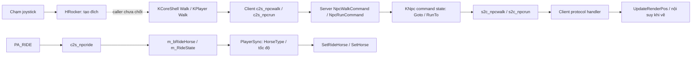

# Bản đồ chuỗi: di chuyển và cưỡi ngựa

## Tóm tắt cho người đọc

[CHƯA KIỂM TRONG GAME] Người chơi báo nhân vật cưỡi ngựa khựng khoảng 4–5 giây một lần; LAN chưa tái hiện theo task. Chưa có phép đo gắn đúng lần khựng này.

[ĐÃ ĐỌC MÃ] Đường đi/chạy: thao tác joystick → đích điều khiển → lệnh đi/chạy → packet → handler server → command/đích NPC → packet sync → vị trí logic client → nội suy khi vẽ. Cạnh gọi đang nối trực tiếp sự kiện joystick sang vòng gửi lệnh chưa được xác nhận.

[ĐÃ ĐỌC MÃ] Cưỡi ngựa là nhánh riêng: `PA_RIDE` → `c2s_npcride` → server đổi `m_bRideHorse` nếu có `m_HorseType` và hết hạn chế lặp → đồng bộ `HorseType`/tốc độ → client cập nhật tài nguyên hiển thị.

[ĐÃ ĐỌC MÃ] `NpcWalkCommand` / `NpcRunCommand` không so tọa độ rồi gọi `SetPos`; `c2s_playersetpos` là packet đặt vị trí riêng. Chưa xác nhận đường “kéo lùi” được task nêu có xảy ra trong luồng đi/chạy thông thường.

[CHƯA KIỂM TRONG GAME] Chưa thấy timer 4–5 giây rõ ràng trong các hàm đã theo. Không đủ căn cứ quy lỗi cho tick, ping, cưỡi ngựa hay nội suy.

## Sơ đồ luồng chính

## Chuỗi theo cấu trúc game

| Pha | Mã và bằng chứng | Ý nghĩa / giới hạn |
|---|---|---|
| Điều khiển | `D:\JX-build\qh9A\Classes\gamescene\KgameWorld.cpp:1534-1538` tạo `HRocker`; `KHRocker.cpp:83-173,293-456` nhận touch, tính hướng và giữ `moveEndPoint`. | Đích được tính, nhưng chưa tìm được lời gọi hoạt động nối trực tiếp từ `onTouchMoved` tới vòng gửi packet. |
| Lệnh client | `gamecore\CoreShell.cpp:5147` gọi `KPlayer::Walk`; `KPlayer.cpp:609-708` đổi tọa độ, cập nhật local command, chọn walk/run và gửi theo nhịp. `KPlayer.cpp:183-254` giữ/flush đích joystick đang chờ. | Lệnh cục bộ và gửi mạng là hai bước khác nhau; không giả định mọi frame đều thành packet. |
| Packet đi/chạy | `gamecore\KProtocol.cpp:261-310`: `SendClientCmdRun` tạo `c2s_npcrun`; `SendClientCmdWalk` tạo `c2s_npcwalk`. | Hai packet mang đích Mps và được gửi qua `SendPackToServer`. |
| Server nhận | `D:\JX-build\src18\jxOnline\gameserver\Sources\Core\Src\KProtocolProcess.cpp:213-216,5437-5482`. | Server kẹp giá trị tọa độ âm; handler walk/run gọi `KNpc::SendSerCommand`. Nhánh run gọi thêm `CheckTrap()`. |
| Thi hành và phát sync | `...\KNpc.cpp:939,1299-1406,4194-4280,6875-6896`. | `SendSerCommand` ghi `CmdKind`/tọa độ; `Activate` chọn `Goto`/`RunTo`; server phát `s2c_npcwalk`/`s2c_npcrun`. |
| Đồng bộ ngựa/tốc độ | Server `...\KNpc.cpp:8077-8087,8351-8375`; `...\KPlayer.cpp:3537,3540`. | Server gửi `HorseType`, `RunSpeed`, `WalkSpeed`; khi xuống ngựa `HorseType=-1`. Đây là state sync, chưa phải chu kỳ khựng. |
| Packet cưỡi | `KgameWorld.cpp:4926`; `CoreShell.cpp:4585-4592`; `KProtocol.cpp:660-666`; server `KProtocolProcess.cpp:278,6294-6322`. | `NpcRideCommand` chỉ đổi `m_bRideHorse` khi có ngựa hợp lệ và `m_RideState<=0`, rồi đặt `m_RideState=50`. Bộ đếm giảm tại server `KNpc.cpp:2165-2167`; không đổi thời gian sang giây vì chu kỳ không được xác minh. |
| Nhận sync/vẽ | Client `KProtocolProcess.cpp:56,66-70,646-659,882-899,3083-...`; `KNpc.cpp:723-731,801,3975-4025`. | Handler cập nhật trạng thái/đích; `UpdateRenderPos` quyết định snap/nội suy; `GetMpsPos` cung cấp vị trí vẽ. Trace `U` ghi `dtick`, `snap`, `dx/dy` ở `KNpc.cpp:3983-3986`. |

## Vị trí đặt lại và Lua

[ĐÃ ĐỌC MÃ] Packet riêng `c2s_playersetpos` được dispatch tại server `KProtocolProcess.cpp:317`, handler ở `:8342-8349` gọi `KNpc::SetPos` (`KNpc.cpp:15117`). Đường này không xuất hiện trong handler `NpcWalkCommand` / `NpcRunCommand` đã kiểm, nên chưa gán cho cơ chế kéo lùi thường xuyên.

[CHƯA KIỂM MÃ] Hai handler đi/chạy nằm ở C++ và không gọi Lua trực tiếp; `NpcRunCommand` gọi `CheckTrap()`, nhánh bẫy chưa được lần tiếp nên không kết luận toàn bộ đường run không kích hoạt script. Chưa tìm được `qhcuonghoa.lua` trong thư mục script của task hoặc bảng cấu hình tốc độ liên quan nhân vật đang thử.

## Tham số cần phân biệt

| Tên/hằng số | Giá trị | Đơn vị / nguồn | Ảnh hưởng và độ an toàn khi đổi | Nguồn đo |
|---|---:|---|---|---|
| `defMAX_PLAYER_SEND_MOVE_FRAME` | 5 | frame logic; `GameDataDef.h:29` | Ngưỡng gửi lệnh; CẨN THẬN, không đổi trong khảo sát | Đọc tĩnh, không phải số đo runtime |
| `SKILL_MOVE_GUARD_TICKS` | 3 | tick client; `KProtocol.cpp:197` ghi tương đương 167 ms, so với tick server 55,6 ms | Chặn xung đột kỹ năng/di chuyển; CẨN THẬN | Comment mã, chưa đo lại |
| `m_RideState` | 50 | tick nội bộ; `KProtocolProcess.cpp:6307`; giảm tại `KNpc.cpp:2165-2167` | Hạn chế lặp toggle cưỡi; CẨN THẬN, chu kỳ giây chưa xác minh | Đọc tĩnh |
| `MAX_SYNC_TIMES` | 120 | tick sync; `KRegion.h:23` | Dọn NPC không phải người chơi thiếu sync; không áp dụng cho người chơi trong điều kiện `KNpc.cpp:636-646` | Đọc tĩnh |
| `NPC_RENDER_SNAP_DIST` | 96 | đơn vị tọa độ Mps; định nghĩa tại `KNpc.cpp:3959` | Ngưỡng snap/nội suy; CẨN THẬN, không đổi khi chưa tái hiện | Đọc tĩnh |
| Tick 116 ms, cực đại 864 ms; khoảng trống gói 657 ms, 62 khoảng trống >250 ms, drain tối đa 16 ms | số liệu một phiên khác | `JX1_OPS/REPORTS/DO-MUOT-MOC-GOC.md:121` | Chỉ số đối chiếu điều tra độ trễ/đánh; không gán cho lỗi cưỡi ngựa | Số đo trong báo cáo cũ, khác tình huống |

## So sánh bản dự án với nguồn đối chiếu

[ĐÃ ĐỌC MÃ] Đối chiếu qh9A với `D:\JX-wt\QH-B035\client\Classes`: các file `KProtocol.cpp`, `KPlayer.cpp`, `KNpc.cpp`, `KProtocolProcess.cpp`, `CoreShell.cpp` khác ở cấp toàn file; trong vùng đã đọc, cả hai cây đều có nhãn/logic `fix33`, `tick-smooth`, `tick-smooth2` hoặc trace chuyển động. Khác hash toàn file không đủ chứng minh khác biệt ảnh hưởng lỗi này.

[ĐÃ ĐỌC MÃ] Đối chiếu handler đi/chạy/cưỡi trong server qh9A với file tương ứng của QH-B035 không thấy hunk khác tại symbol đã dò. Không kết luận toàn bộ hai cây giống nhau.

[CHƯA KIỂM TRONG GAME] Không xác nhận được qh9A-only/B-0xx override, file Lua hoặc bảng dữ liệu cấu hình nào gây hiện tượng. Cần đối chiếu từng hunk và đúng phiên bản chạy trước khi nêu thay đổi dự án là nguyên nhân.

## Chỗ dễ làm sai khi sửa

- Không coi `moveEndPoint` của joystick là tọa độ packet Mps; `KPlayer::Walk` tính đích theo tọa độ nhân vật và hướng.
- Không đồng nhất packet `c2s_playersetpos` với luồng `c2s_npcwalk`/`c2s_npcrun`; handler đi/chạy đã đọc không gọi setter.
- Không đổi `m_RideState=50` thành giây khi chưa biết chu kỳ; `MAX_SYNC_TIMES=120` trong nhánh hiện tại chỉ dọn NPC không phải người chơi.
- Không coi ngưỡng snap hoặc comment lịch sử là bằng chứng nguyên nhân; cần trace `U` tại đúng lúc khựng.

## Kịch bản kiểm động cho A/B

[CHƯA KIỂM TRONG GAME] Worker không chạy thử. Người kiểm thử cần nhân vật có ngựa hợp lệ (`m_HorseType != -1`), giữ cùng bản đồ/đoạn đường và trang bị. So sánh đi/chạy khi không cưỡi với khi cưỡi; chạy LAN trước, rồi phiên từ xa nếu LAN không tái hiện. Ghi thời điểm từng khựng trong ít nhất ba lượt 60 giây mỗi trạng thái.

[CHƯA KIỂM TRONG GAME] Mỗi lượt ghi HUD FPS/ping; client trace `P4` (đích walk), `P1–P3` (sync), `U` (`dtick`, `snap`, `dx/dy`); SvrFPS/tick ở server do người có quyền đọc console ghi. Thiếu `P4` thì kiểm tra đầu vào/client; packet có nhưng sync trễ thì đối chiếu server tick; `U dtick != 1` hoặc `snap=1` đúng lúc khựng thì kiểm tra nhánh nội suy/snap. Kỳ vọng ở lần chạy ổn định: tick liền nhau, đích tiếp tục cập nhật và không có snap mới lúc đang chạy đều.

[CHƯA KIỂM TRONG GAME] Chưa có kết quả đo; chỉ kết luận nguyên nhân khi trace trùng thời điểm hiện tượng.

## Đã đọc kiến thức, đồ thị và báo cáo liên quan

[TÀI LIỆU] Đã đọc `JX1_OPS/DESIGN/MUC-LUC-TRI-THUC.md:7,14`, các bản đồ mã `ban-do-client.md`, `ban-do-server.md`, `goi-tin.md`, `REPORTS/DO-MUOT-MOC-GOC.md` và `REPORTS/VK-04-vc22-doan-sua.txt:6`. File `VK-04` nói về hiệu ứng vũ khí hai tay, không dùng làm chứng cứ di chuyển. Chưa thấy báo cáo `TU-SONNET` / `vc23` liên quan trong `JX1_OPS/REPORTS/`.

[TÀI LIỆU] Đã tra đồ thị có sẵn: `Select-String` trên client `graphify-out/GRAPH_REPORT.md` tìm cộng đồng `KHRocker.cpp` (dòng 1209); trên server graph report tìm `KProtocolProcess.cpp` (1793) và `KNpc.cpp` (1873). Graphify CLI query được gọi hai lần nhưng trả `graph file not found` dưới worktree task; không tạo lại đồ thị. Sau đó kiểm symbol/dòng trong file nguồn thật.

## Đề xuất tối ưu và bàn giao tri thức

Chưa đề xuất sửa code hoặc cấu hình. Ưu tiên thu log của đúng tình huống và chốt cạnh caller joystick trước khi thay đổi. Đề xuất PM thêm mục `Bản đồ chuỗi di chuyển/cưỡi ngựa — KT-03D` dưới kiến thức về di chuyển/tick trong `JX1_OPS/DESIGN/MUC-LUC-TRI-THUC.md`.

liên quan: `JX1_OPS/DESIGN/MUC-LUC-TRI-THUC.md` (H-13, B-04a); `JX1_OPS/REPORTS/DO-MUOT-MOC-GOC.md`; task `KT-03D`.

Kỹ năng đã dùng: jx1-retrofit, jx1-read-server, jx1-read-client, jx1-parameters, jx1-knowledge, jx1-report.
