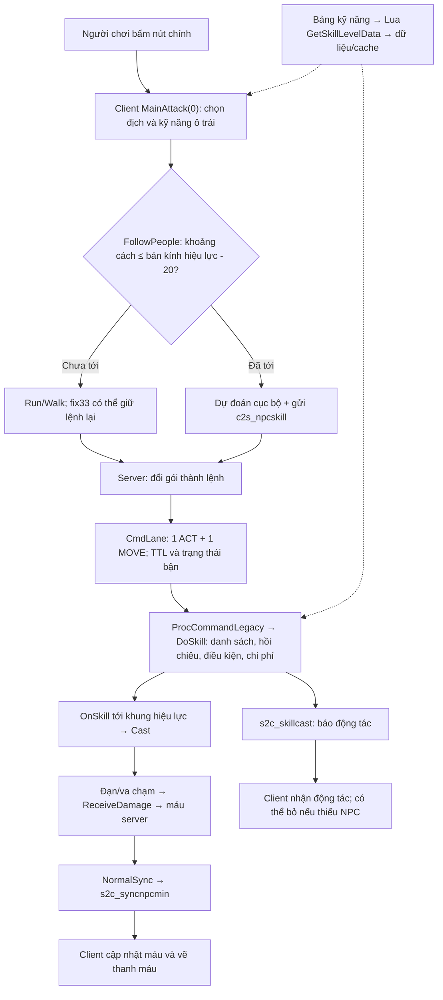

TÓM TẮT 1: [NGUỒN] Đã nối 12 nhóm của chuỗi đánh thường bằng đọc tĩnh: thao tác → ô trái → chọn địch/tầm đánh → gói tin → làn lệnh → thi triển → đồng bộ. Nguồn chính: `C/gamecore/KNpcAI.cpp:614–631,1453–1491,772–844`; `S/KNpc.cpp:6730–6859`.
TÓM TẮT 2: [NGUỒN] Nút `MainAttack(0)` dùng kỹ năng ô trái đang chọn; không tự bảo đảm đó là đòn thường. Điều kiện tiếp cận nằm ở client, so `distance <= m_CurrentAttackRadius - 20`. `C/gamescene/KgameWorld.cpp:2985–3001`; `C/gamecore/KNpcAI.cpp:1483–1491,772`.
TÓM TẮT 3: [NGUỒN] Hai root server hiện giữ kỹ năng chờ khi MOVE tới; client có `fix33` giữ lệnh di chuyển. Đây là khác biệt với một số nhận định bàn giao cũ, được ghi riêng và không sửa tài liệu cũ. `S/KNpc.cpp:6752–6769`; `Q/KNpc.cpp:6757–6774`; `C/gamecore/KProtocol.cpp:192–276,324–343`.
TÓM TẮT 4: [CHƯA KIỂM] Chưa chốt nguyên nhân lỗi trên bản đang chạy. Bộ đếm `exec_skill`, động tác thi triển và máu giảm là ba điểm kiểm riêng; kịch bản đợt 2 bên dưới dành cho A/bot. `S/KNpc.cpp:6823–6829,3690–3749,5713–5719`.
TÓM TẮT 5: [CHƯA KIỂM] Không build, chạy game/exe, VM hoặc mạng; không sửa mã/cấu hình, không commit/push. Đã tra bản xuất Graphify cục bộ; không chạy CLI .exe. Nhịp ngoài worktree bị giới hạn quyền ghi của phiên.

# KT-03B — Bản đồ chuỗi: nút đánh thường và làn lệnh kỹ năng

Loại: khảo sát
Chủ đề: Điểm chuyển từ đuổi mục tiêu sang đánh, cách server nhận kỹ năng và cách phân biệt mất lệnh với chưa gây sát thương.
Từ khóa: đánh thường, ô trái, MainAttack, FollowPeople, AttackRadius, CmdLane, BufferBusy, fix33, c2s_npcskill, s2c_skillcast
Trạng thái: DONE — hoàn tất bản đồ đọc tĩnh; chưa kết luận lỗi trong game, giới hạn vận hành xem báo cáo KT-03B.
Độ phủ: 12/12 nhóm của bản đồ tĩnh; 0 kịch bản động đã chạy.
Liên quan: `JX1_OPS/REPORTS/LAN-LENH-KY-NANG.md`; `JX1_OPS/HOP-THU/A-B.md:266–276,343–352`; `JX1_OPS/DESIGN/SO-TAY-KY-NANG.md`; `JX1_OPS/DESIGN/SO-TAY-KY-NANG-CAP.md`; `JX1_OPS/DESIGN/SO-TAY-GOI-TIN.md`; `JX1_OPS/DESIGN/HIEU-CONG-THUC-SAT-THUONG.md`; `JX1_OPS/REPORTS/KT-03B.md`.
Cần tôi quyết định: không trong phạm vi đọc tĩnh; A/PM chốt riêng môi trường và quyền chạy đợt 2.

## 1. Tóm tắt bằng lời thường

**[ĐÃ ĐỌC MÃ]** Bấm nút chính trước hết chọn một kẻ địch và gắn kỹ năng ô trái hiện tại. Những nhịp xử lý tiếp theo mới quyết định đánh hay tiếp tục đuổi. Nhìn thấy nhân vật chạy chứng minh đường tiếp cận có hoạt động, chưa chứng minh client đã gửi kỹ năng. `C/gamecore/CoreShell.cpp:457–459`; `C/gamecore/KNpcAI.cpp:1453–1491,614–631,772–844`.

**[ĐÃ ĐỌC MÃ]** Sau khi nhận gói, server còn phải tìm đúng mục tiêu, giữ lệnh trong làn, tìm kỹ năng đã học và kiểm điều kiện thi triển. Động tác được phát trước khi khung gây hiệu lực chạy; máu lại đi qua đường đồng bộ riêng. Vì vậy cần tìm điểm đầu tiên chuỗi bị đứt, thay vì dùng số gói hay hoạt ảnh làm số đòn trúng. `S/KProtocolProcess.cpp:5581–5606`; `S/KNpc.cpp:1320–1329,3647–3749,3979–4016,8193–8218`.

## 2. Nguồn, cách đọc bằng chứng và độ phủ

- **[ĐÃ ĐỌC MÃ]**: mở file thật tại root bên dưới, kiểm dòng và nhánh tiền xử lý. Đây là xác minh tĩnh, luôn **[CHƯA KIỂM TRONG GAME]**.
- **[TÀI LIỆU]**: giữ nguyên nội dung nguồn cũ; không nhận là số đo của KT-03B.
- **[GIẢ THUYẾT]**: ứng viên cần kiểm, không phải kết luận nguyên nhân.
- `C/` = `D:/JX-build/qh9A/Classes/`; `S/` = `D:/JX-build/src18/jxOnline/gameserver/Sources/Core/Src/`.
- `Q/` = `D:/JX-wt/QH-B035/server/jxOnline/gameserver/Sources/Core/Src/`.
- `GS/` = `C:/Jx1CocoV3/Folder/ServerNew-20260116T043145Z-3-001/ServerNew/_bin_v2_/gs/`; `D/` = `JX1_OPS/DESIGN/`. Root trên đĩa không đồng nghĩa với binary/APK/dữ liệu đang được nạp.

**ĐÃ ĐỌC KIẾN THỨC:** `D/MUC-LUC-TRI-THUC.md:7–18`; các mục liên quan trong `JX1_OPS/MA-NGUON/{README,ban-do-client,ban-do-server,goi-tin}.md`; `JX1_OPS/REPORTS/LAN-LENH-KY-NANG.md:1–37`; `JX1_OPS/HOP-THU/A-B.md:266–276,343–352`; `D/SO-TAY-KY-NANG.md:110–128`; `D/SO-TAY-KY-NANG-CAP.md:49–61,83–100`; các mục gói chiến đấu trong `D/SO-TAY-GOI-TIN.md:62–63,75,110–112`; `D/SO-TAY-VONG-LAP-SERVER.md:35–47`; `D/HIEU-CONG-THUC-SAT-THUONG.md:74–98`. Bản đồ bổ sung điểm nối, chênh phiên bản và bài kiểm; công thức sát thương chi tiết tiếp tục tra sổ tay cũ.

**ĐÃ TRA ĐỒ THỊ:** `Select-String` có lọc trên bản xuất `C/graphify-out/GRAPH_REPORT.md` trước khi mở mã → định vị `KgameWorld`, `CoreShell.cpp`, `KNpcAI.cpp`. Server không có `src18/graphify-out/GRAPH_REPORT.md`; dùng bản báo cáo tại `src18/jxOnline/graphify-out/GRAPH_REPORT.md:1875,2075,2195,2723,4441–4443` để định vị. Sau đó truy vấn JSON cục bộ bằng `JSON.parse` + lọc `nodes`/`links` trên `graphify-out/graph.json` của đúng hai root: client có cạnh `ProcessPlayer → FollowPeople`; server có `CmdLaneReceive → CmdLane_LoadCfg` và `CmdLaneProc → CmdLane_Feed`. Marker client là `.`, marker server là `D:\JX-build\src18`. Đồ thị client dẫn một số nút tới header/khai báo, nên dòng triển khai bên dưới lấy từ file thật. Không chạy `query/explain/path` của CLI .exe, không update đồ thị hoặc gọi mạng.

### Phạm vi và độ phủ

| # | Nhóm theo diễn biến chơi | Phủ tĩnh | Điểm tra chính |
|---|---|---|---|
| 1 | Nút và cầu nối core | Đã phủ | `C/gamescene/KgameWorld.cpp:683,2985–3001`; `C/gamecore/CoreShell.cpp:457–459` |
| 2 | Chọn địch, ô trái, cổng trạng thái | Đã phủ | `C/gamecore/KNpcAI.cpp:1326–1438,1453–1491` |
| 3 | Khoảng cách và chuyển đánh/chạy | Đã phủ | `C/gamecore/KNpcAI.cpp:663–682,715–772,827–844` |
| 4 | Giữ di chuyển fix33 và đóng gói | Đã phủ | `C/gamecore/KProtocol.cpp:192–276,295–343` |
| 5 | Server đổi ID, nhận đi/chạy/kỹ năng | Đã phủ | `S/KProtocolProcess.cpp:213–215,5436–5481,5581–5606` |
| 6 | Hai ô lệnh, ghi đè và TTL | Đã phủ | `S/KNpc.cpp:6730–6794` |
| 7 | Bận/rảnh, danh sách, hồi chiêu, điều kiện | Đã phủ | `S/KNpc.cpp:6799–6859,1320–1329,3609–3674` |
| 8 | Dữ liệu kỹ năng và Lua cấp chiêu | Đã phủ đường nạp và hai mẫu | `S/KSkillManager.cpp:175–201`; `S/KSkills.cpp:3031–3036,3088–3100,3151–3190`; `GS/Settings/Skills.txt:1–3` |
| 9 | Khung hiệu lực, Cast, nhận sát thương | Đã phủ đường được dẫn | `S/KNpc.cpp:3979–4016,4466,5713–5719`; `S/KSkills.cpp:523–543`; `S/KMissle.cpp:1350,1531–1544` |
| 10 | Trả động tác về client | Đã phủ | `S/KNpc.cpp:3690–3749`; `C/gamecore/KProtocolProcess.cpp:820–878` |
| 11 | Đồng bộ máu và hiển thị | Đã phủ | `S/KNpc.cpp:8193–8218,8335–8343`; `C/gamecore/KProtocolProcess.cpp:2526–2552`; `C/gamecore/KNpc.cpp:5868–5907` |
| 12 | Đối chiếu bản sửa và kế hoạch kiểm | Đã phủ ba hàm server, fix33 và hai bản Lua; bài động chưa chạy | `Q/KNpc.cpp:3614–3783,6735–6857`; `D/QH-B035-deploy/qhcuonghoa.lua:1–2,34–90`; `GS/script/system/qianghua.lua:10,173,178` |

### Giải mã tên

| Tên gốc giữ nguyên | Mã hóa/biểu diễn | Chữ đúng UTF-8, Hán và pinyin nếu có | Nguồn file:dòng |
|---|---|---|---|
| `C«ng kÝch vËt lý` | TCVN3, cột tên | Công kích vật lý — SkillId 1; không tự đổi tên theo script | `GS/Settings/Skills.txt:2` |
| `C«ng kÝch vËt lý gÇn` | TCVN3, cột tên | Công kích vật lý gần — SkillId 2; giữ chữ “gần” dù tên script mang nghĩa tầm xa | `GS/Settings/Skills.txt:3` |
| `³¤±øÎïÀí¹¥»÷.lua` | Chuỗi byte GBK hiển thị kiểu Latin-1; tên Unicode trên đĩa cũng đang mang dạng này. Nội dung file là ASCII hợp lệ UTF-8 | `长兵物理攻击.lua` — cháng bīng wù lǐ gōng jī; tấn công vật lý binh khí dài | `GS/Settings/Skills.txt:2`; `GS/script/skill/special/³¤±øÎïÀí¹¥»÷.lua:1–36` |
| `Ô¶³ÌÎïÀí¹¥»÷.lua` | Tương tự hàng trên, không tự đổi tên tệp | `远程物理攻击.lua` — yuǎn chéng wù lǐ gōng jī; tấn công vật lý tầm xa | `GS/Settings/Skills.txt:3`; `GS/script/skill/special/Ô¶³ÌÎïÀí¹¥»÷.lua:1–36` |

**[ĐÃ ĐỌC MÃ/DỮ LIỆU]** Mở đường dẫn Unicode đã giải GBK của mẫu thứ nhất trả `ENOENT`; tệp tên nguyên dạng mojibake có trên đĩa và đã đọc được cả hai mẫu. Chưa xác minh cơ chế giải tên ở engine/Pak và bộ dữ liệu client thực nạp; không kết luận runtime thiếu script, không đổi tên hoặc mã hóa file. Source server chủ yếu đọc GBK; nhiều file client là UTF-8, một số là GBK/chú thích đã lỗi sẵn. Chỉ dẫn các ký hiệu và dòng rõ nghĩa; không sửa dữ liệu gốc.

### Sắp theo cấu trúc game

Tổ chức theo **người chơi → kỹ năng ô trái đang có → mục tiêu địch → tiếp cận → thi triển → kết quả**. Hai dòng dữ liệu minh họa là nhóm dùng chung, xếp theo SkillId 1 rồi 2; không gán chúng cho một phái hoặc một nhánh học khi chưa có bằng chứng. Cây phái → nhánh → cấp học đã có ở `D/SO-TAY-KY-NANG.md:89–117`, không chép lại ở đây.

## 3. Chuỗi tra từng bước

| Bước | Việc diễn ra và chỗ có thể dừng | File:dòng + hàm; nhãn |
|---|---|---|
| 1. Người chơi bấm | Nút được nối callback; callback kiểm sender/core rồi gọi `MainAttack(0)`. Hiệu ứng nút không chứng minh có đòn. | [ĐÃ ĐỌC MÃ] `C/gamescene/KgameWorld.cpp:683,2985–3001` — `mianSkillCallback` |
| 2. Core chọn đầu vào | `MainAttack` gọi `mainSkillattack`. Hàm kiểm trạng thái, chọn địch gần bằng tham số 180 rồi tìm tiếp nếu chưa có; ghi `m_nPeopleIdx`. Đối số 0 chọn `GetLeftSkillListidx` và gọi `SetActiveSkill`. | [ĐÃ ĐỌC MÃ] `C/gamecore/CoreShell.cpp:457–459`; `C/gamecore/KNpcAI.cpp:1326–1438,1453–1491` |
| 3. Giữ đúng kỹ năng | Ô phải hợp lệ, có SkillId/cấp hiệu lực; `SetActiveSkill` lấy dữ liệu theo cấp đã học và cập nhật `m_CurrentAttackRadius`. Giá trị khởi tạo 30 không phải bán kính mặc định của mọi chiêu. | [ĐÃ ĐỌC MÃ] `C/gamecore/KNpc.cpp:327,4070–4091` |
| 4. Bám mục tiêu | `ProcessPlayer → FollowPeople` ở nhánh không treo máy. Có cổng chết/hồi sinh, chế độ kỹ năng tự đánh, quan hệ, hỗn loạn/đích nhảy. Đo khoảng cách bằng `NpcSet.GetDistance`. | [ĐÃ ĐỌC MÃ] `C/gamecore/KNpcAI.cpp:614–631,663–682,715–717,754–772` |
| 5. Đánh hay tiếp cận | Trong tầm `R - 20`: đặt lệnh kỹ năng cục bộ với index client, gửi server với `(-1, targetDwID)`. Ngoài tầm: gọi Run/Walk tới tọa độ đích; hàm gửi còn có thể hoãn vì fix33. | [ĐÃ ĐỌC MÃ] `C/gamecore/KNpcAI.cpp:772,827–844` — `FollowPeople` |
| 6. Gói tin | `SendClientCmdSkill` bỏ move đang hoãn, xóa move joystick chờ, đặt guard 3 nhịp rồi gửi `NPC_SKILL_COMMAND/c2s_npcskill`. Run/Walk dùng struct/opcode riêng, có guard trước gửi. | [ĐÃ ĐỌC MÃ] `C/gamecore/KProtocol.cpp:261–276,295–309,324–343`; không lấy số opcode từ bản đồ tự sinh |
| 7. Server nhận | Dispatch theo opcode. `NpcSkillCommand` kiểm miền SkillId, tọa độ đích; với X=-1 dùng `FindAroundNpc(dwID)` rồi chuyển thành index server. Không tìm được thì không xếp kỹ năng. | [ĐÃ ĐỌC MÃ] `S/KProtocolProcess.cpp:213–215,5581–5606`; Run/Walk ở `5436–5481` |
| 8. Làn lệnh | `SendSerCommand → CmdLaneReceive` nếu bật và là player; còn lại đường lệnh cũ. Nhận lệnh chỉ đặt ô, chưa thi triển. Đang hỗn loạn có thể return trước làn. | [ĐÃ ĐỌC MÃ] `S/KNpc.cpp:6730–6777,6875–6898` |
| 9. Tick server | `Activate` gọi `ProcCommand(m_ProcessAI)` trước `ProcStatus`. Làn kiểm TTL/bận; khi rảnh đưa ACT tới `ProcCommandLegacy`, tìm kỹ năng đã học rồi `SetActiveSkill → DoSkill`. | [ĐÃ ĐỌC MÃ] `S/KNpc.cpp:997–1003,6780–6859,1320–1329` |
| 10. Điều kiện thi triển | `DoSkill` kiểm vị trí, FightMode, hồi chiêu thường/ngựa; sau đó `CanCastByIndex && CanCastSkill && Cost`. `CanCastSkill` kiểm quan hệ, vũ khí/ngựa ở nhánh tương ứng. Phép so bán kính đang thấy tại `343` nằm trong `#ifndef _SERVER`, không được mô tả là cổng khoảng cách server. | [ĐÃ ĐỌC MÃ] `S/KNpc.cpp:3609–3674`; `S/KSkills.cpp:221–253,279–344` |
| 11. Lua và dữ liệu | Dữ liệu là nhánh cung cấp cho bước 3/10, không phải bắt buộc gọi Lua mới cho mỗi lần bấm. Server nạp bảng, `GetSkill` dùng cache hoặc `GetInfoFromTabFile → LoadSkillLevelData`; `LvlSetScript` dẫn `GetSkillLevelData`. Client có đường nạp riêng. | [ĐÃ ĐỌC MÃ] `S/KCore.cpp:617–628`; `S/KSkillManager.cpp:175–201`; `S/KSkills.cpp:3031–3036,3088–3100,3151–3190`; `C/gamecore/KSkills.cpp:2918–2925,2988–3045` |
| 12. Động tác và gây hiệu lực | Server tạo `s2c_skillcast`, đổi index đích thành dwID, phát vùng rồi `DoOrdinSkill`. `ProcStatus` chuyển trạng thái do_attack/do_magic sang `OnSkill`; khi tới khung hiệu lực mới `Cast`. Kiểu đạn gọi `CastMissles`; đường va chạm `ProcessDamage → ReceiveDamage`, đoạn trừ máu thường ở `5719`. Đây không phải cam kết mọi kiểu chiêu đều có cùng đường sát thương. | [ĐÃ ĐỌC MÃ] `S/KNpc.cpp:1207–1225,3690–3749,3806–3837,3979–4016,4466,5713–5719`; `S/KSkills.cpp:523–543`; `S/KMissle.cpp:1350,1531–1544` |
| 13. Client nhận động tác | `NetCommandSkill` đổi dwID người đánh/đích về index client; thiếu NPC/region có thể return. Việc xử lý động tác trong đoạn này còn qua `ConformIdx`. Không đồng nhất với hit/HP. | [ĐÃ ĐỌC MÃ] `C/gamecore/KProtocolProcess.cpp:820–878` |
| 14. Client nhận máu | `NormalSync` gửi `s2c_syncnpcmin`, HP tối đa và tỷ lệ trên 1000. `SyncNpcMin` tính lại HP bằng tích 64-bit chia 1000, đặt số máu nổi khi HP giảm; `PaintLife` vẽ theo HP đang có và điều kiện hiển thị. | [ĐÃ ĐỌC MÃ] `S/KNpc.cpp:8193–8218,8335–8343`; `C/gamecore/KProtocolProcess.cpp:2526–2552`; `C/gamecore/KNpc.cpp:5868–5907` |

## 4. Hai mẫu dữ liệu và vai trò Lua

| Mẫu dữ liệu đọc trực tiếp | Giá trị trên đĩa | Điều đã và chưa chứng minh |
|---|---|---|
| `GS/Settings/Skills.txt:2`, SkillId 1 | `AttackRadius=100`; `SkillStyle=0`; `TargetOnly=1`; `TargetEnemy=1`; script tên gốc `³¤±øÎïÀí¹¥»÷.lua` | [Đà ĐỌC DỮ LIỆU] Chỉ là mẫu ở root GS được giao; chưa chứng minh nhân vật bấm nút đang dùng ID 1 |
| `GS/Settings/Skills.txt:3`, SkillId 2 | `AttackRadius=320`; cùng các cờ trên; script tên gốc `Ô¶³ÌÎïÀí¹¥»÷.lua` | [Đà ĐỌC DỮ LIỆU] Nhãn tên ghi “gần”, tên script mang nghĩa “tầm xa”; giữ nguyên cả hai |
| Hai script mẫu, mỗi file `1–36` | `GetSkillLevelData` xử lý `physicsenhance_p`, `attackrating_p`, `skill_cost_v`; các helper trả chuỗi ba giá trị 0 | [ĐÃ ĐỌC MÃ] Không có nhánh `skill_attackradius` trong hai file mẫu đã đọc. Không suy ra đòn không gây sát thương: còn dữ liệu nền/trang bị và các bước xử lý khác |
| Đường thuộc tính theo cấp | `S/KSkills.cpp:3643–3650` có thể gán lại bán kính từ `magic_skill_attackradius` rồi kẹp trần toàn cục | [ĐÃ ĐỌC MÃ] Không dùng riêng một ô `AttackRadius` để kết luận bán kính hiệu lực của mọi chiêu |

**[GIẢ THUYẾT]** Nếu R hiệu lực ≤20 và khoảng cách không âm, ngưỡng R−20 rất hẹp hoặc âm; cần log R, khoảng cách và trạng thái chọn chiêu. Với R=30, ngưỡng vẫn là 10, không phải “không bao giờ đúng”; R=20 vẫn có thể đạt ở khoảng cách 0. Hai mẫu bảng 100/320 cũng không chứng minh R client thực tế bằng 100/320. Căn cứ phép so: `C/gamecore/KNpcAI.cpp:772`; cách tính khoảng cách: `C/gamecore/KNpcSet.cpp:809–846`.

## 5. Làn lệnh hiện tại và chỗ dự án đã sửa đè

### Quy tắc đọc được ở cả S và Q

| Tình huống | Hành vi hiện tại | Nguồn [ĐÃ ĐỌC MÃ] |
|---|---|---|
| Run/Walk tới | Thay ô MOVE; chỉ xóa ACT khi ACT không phải kỹ năng. `ctl_overwritten_by_move` không phải bộ đếm kỹ năng bị MOVE xóa ở bản này | `S/KNpc.cpp:6752–6762`; `Q/KNpc.cpp:6757–6767` |
| Skill tới | Ghi đè ACT đang có, xóa MOVE đang chờ; `skill_overwritten` tăng khi ACT hợp lệ, không riêng trường hợp ACT cũ là skill | `S/KNpc.cpp:6764–6769`; `Q/KNpc.cpp:6769–6774` |
| Điều khiển cứng tới | Có thể xóa kỹ năng đang chờ; soft-stop có đường giữ kỹ năng riêng | `S/KNpc.cpp:6740–6750,6772–6777,6866–6872` |
| Hết TTL | Bỏ skill ACT hoặc MOVE theo mili giây thực; kiểm hết hạn diễn ra trước nhánh bận | `S/KNpc.cpp:6787–6797` |
| Bận `nAI=0` | Bỏ MOVE; cho hurt/revive chạy; giữ skill nếu `BufferBusy` bật, nếu không bỏ ACT | `S/KNpc.cpp:6799–6820` |
| Rảnh | ACT đi trước. Có MOVE kèm thì chỉ thực hiện tiếp khi sau xử lý ACT, `m_ProcessAI` vẫn cho phép; nếu đã diễn chiêu thì bỏ MOVE | `S/KNpc.cpp:6823–6849` |

**[ĐÃ ĐỌC MÃ]** So sánh nội dung ba đoạn, không chỉ số dòng: `CmdLaneReceive` S:6730–6779 = Q:6735–6784; `CmdLaneProc` S:6780–6852 = Q:6785–6857; `DoSkill` S:3609–3778 = Q:3614–3783. Ba đoạn giống nhau. Đây là so hai bản dự án hiện có, không phải diff với mã nguyên thủy chưa sửa; không suy toàn bộ hai cây giống nhau.

### Phân biệt bản sửa có trên đĩa với đề xuất cũ

| Nhánh/bản sửa | Bằng chứng và giới hạn |
|---|---|
| Client qh9A `fix33` | [ĐÃ ĐỌC MÃ] Guard có sẵn ở `C/gamecore/KProtocol.cpp:192–257,324–343`; mỗi skill đặt lại 3 nhịp, giữ một move mới nhất, còn chặn khi do_attack/do_magic hoặc có skill cục bộ chờ. `KPlayer.cpp:241` gọi `MoveGuardTick`. Không coi đề xuất “thêm trễ nhả” là chưa từng có |
| Server `A2-CMDLANE` | [ĐÃ ĐỌC MÃ] Dấu móc `S/KNpc.cpp:6891–6893` và quy tắc giữ skill trước MOVE đã tồn tại ở S/Q. `Enable=0` còn đường `ProcCommandLegacy`. Chưa có căn cứ binary Test-36 khớp mã này |
| Đề xuất B-038 | [TÀI LIỆU] `JX1_OPS/HOP-THU/A-B.md:345–350` là đề xuất chưa giao. Mục b gọi `KNpcAI.cpp:772` là server; thực tế ở C đó là phép trừ 20, còn S:771–775 là đầu `ProcessPlayer`/nhánh trap. Giữ bản cũ, đưa khác biệt vào mục 10 |
| `qhcuonghoa.lua` so với `qianghua.lua` | [ĐÃ ĐỌC MÃ] Bản nháp `D/QH-B035-deploy/qhcuonghoa.lua:1–2,34–90` có `QhEnhance/QhHandle` cho cường hóa/tài phú, định đặt tên `system/qianghua.lua`. Tệp ở GS hiện đọc có `sysqianghua/sysError/NO` tại `10,173,178`; không phải cùng giao diện hàm. Chưa chứng minh bản nào được process nạp; không đặt QhHandle vào đường đánh thường |
| Mã gốc/patch lịch sử | [CHƯA KIỂM] `docs-analysis/patches/a2-cmdlane/a2-cmdlane.diff` mà báo cáo cũ dẫn không có trong worktree này. Không tìm sang kho/bản canonical khác. Không dựng lại diff gốc từ lời kể |

## 6. Các giả thuyết lỗi và điểm kiểm phân biệt

Tất cả các hàng sau là **[GIẢ THUYẾT — CHƯA KIỂM TRONG GAME]**; thứ tự là thứ tự tìm điểm đứt, không phải xếp hạng xác suất.

| Mã | Ứng viên | Số/cờ đọc và vị trí | Bằng chứng phân biệt cần có |
|---|---|---|---|
| H1 | Ô trái không đúng đòn hoặc không có cấp hợp lệ | `GetLeftSkillListidx`, `m_ActiveSkillID`, SkillLevel/CurrentSkillLevel, kết quả `SetActiveSkill`; `C/gamecore/KNpcAI.cpp:1483–1491`, `KNpc.cpp:4070–4091` | Đổi ô trái làm đổi ID gói; không suy “nút thường” luôn là ID 1 |
| H2 | Return sớm do trạng thái/chế độ | FightMode, Doing, randmove, getUseSkillModel/m_AutoAttack; `C/gamecore/KNpcAI.cpp:666–682,762–766,1335–1438` | Chỉ ra cổng return cụ thể; trường hợp không gửi gì khác trường hợp đang gửi Run |
| H3 | Không đạt ngưỡng tầm hoặc địch/va chạm làm khoảng cách dao động | R và distance trong cùng nhịp, quan hệ/đích; `C/gamecore/KNpcAI.cpp:715–772,827–844` | Đang chạy mà chưa có lần distance≤R−20 thì chưa đổ lỗi CmdLane; thử mục tiêu đứng yên trước |
| H4 | Có skill nhưng move bị guard giữ/nhả hoặc đang dùng bản client cũ | `s_nMoveGuardTicks`, `s_nDefMove`; log `JXFIX skill send/move flushed` nếu build bật log; `C/gamecore/KProtocol.cpp:197–257,324–343` | Chuỗi thời điểm gửi thật, không chỉ đếm lần gọi SendClientCmdRun; kiểm đúng APK/binary |
| H5 | Sai/mất mục tiêu khi qua gói | SkillId, X=-1, targetDwID, `FindAroundNpc`; `S/KProtocolProcess.cpp:5583–5603` | Có gói client nhưng server không tìm ra đích thì không có recv_skill tại làn |
| H6 | Skill bị thay, hết TTL, điều khiển cứng, bận bỏ ACT | Delta skill_over/expired act/skill_clr_by_ctl/busy discard act/kept_skill; `S/KNpc.cpp:6698–6709,6764–6817` | Tách ba nguyên nhân. MOVE xóa skill chỉ xét nếu binary được chứng minh khác S/Q hiện tại |
| H7 | Đã đến bước thực hiện nhưng bị từ chối | FindSame, cooldown, FightMode, điều kiện vũ khí/ngựa/Cost; `S/KNpc.cpp:1320–1329,3609–3674` | exec_skill tăng trước ProcCommandLegacy; cần kết quả DoSkill và OnSkill, không gọi exec là đòn trúng |
| H8 | Đã thi triển nhưng không gây sát thương | OnSkill tới khung hiệu lực, Cast, ProcessDamage, ReceiveDamage, HP trước/sau; `S/KNpc.cpp:3984–4016,5713–5719`; `S/KMissle.cpp:1531–1544` | Không đánh đồng % hiệu ứng bằng 0 trong Lua với sát thương tổng bằng 0; tra sổ tay sát thương khi đã tới bước này |
| H9 | Đã đổi HP server nhưng client chưa phản ánh | `s2c_syncnpcmin`, nCurrentLifeMax/nLifeDamagePerCent, HP client và PaintLife; `S/KNpc.cpp:8193–8218`; `C/gamecore/KProtocolProcess.cpp:2526–2552` | Đối chiếu HP server với số nhận/client; lưu ý phép chia tỷ lệ trên 1000 và điều kiện vẽ |
| H10 | Thiếu NPC ở client hoặc khác bộ dữ liệu/script | Khóa yêu cầu NPC, SearchID/region khi nhận skill; đường script thực nạp/ID/cấp/R; `C/gamecore/KNpcSet.cpp:1018–1031`; `KProtocolProcess.cpp:852–869` | Tách chậm hiện quái khỏi tầm đánh. Tên mojibake tồn tại không tự chứng minh engine nạp được/không được |

## 7. MỤC SỔ THÔNG SỐ

| Nhóm | Tên/hằng số | file:dòng | Giá trị | Đơn vị | Ảnh hưởng | Đổi an toàn | Nguồn đo |
|---|---|---|---|---|---|---|---|
| Tiếp cận | ATTACK_RADIUS_OFFSET | `C/gamecore/KNpcAI.cpp:30,772` | 20 | Cùng đơn vị tọa độ của GetDistance | Thu hẹp tầm bắt đầu gửi skill; không gọi là 20 ô gạch/mét | CẨN THẬN | Đọc tĩnh; chưa đo |
| Kỹ năng | m_CurrentAttackRadius khởi tạo | `C/gamecore/KNpc.cpp:327,4089` | 30, sau đó có thể thay theo chiêu | Như trên | Không thay cho bán kính chiêu hiệu lực | CẨN THẬN | Mặc định source |
| Dữ liệu | AttackRadius SkillId 1 / 2 | `GS/Settings/Skills.txt:2–3` | 100 / 320 | Đơn vị bán kính trong dữ liệu | Có kẹp trần/đường cập nhật theo cấp; chưa biết client nạp bảng nào | CẨN THẬN | Dữ liệu mẫu trên đĩa |
| Dữ liệu | AttackRadius khi không đọc được trường | `S/KSkills.cpp:3031–3036`; `C/gamecore/KSkills.cpp:2920–2925` | 50, kẹp theo cấu hình toàn cục | Đơn vị bán kính | Khác giá trị 30 của NPC khởi tạo | CẨN THẬN | Mặc định source, không phải số đo |
| Chọn mục tiêu | Tham số tìm đầu tiên | `C/gamecore/KNpcAI.cpp:1453–1456` | 180 | Tham số tìm kiếm; không suy đổi thành ô/mét | Có lượt tìm tiếp khi không ra địch | CẨN THẬN | Đọc tĩnh |
| Giữ di chuyển | SKILL_MOVE_GUARD_TICKS | `C/gamecore/KProtocol.cpp:197,241–245,329` | 3 | Nhịp logic client | Đặt lại mỗi skill; còn điều kiện hoạt ảnh/lệnh chờ | CẨN THẬN | Chưa đo tần số thực; không quy cứng ra ms |
| Làn | Enable / BufferBusy / Stats | `S/KNpc.cpp:6644,6654–6660` | 1 / 0 / 1 mặc định | Cờ | Bật làn / giữ skill khi bận / thống kê | CẨN THẬN | Đọc một lần; không thấy GS/Settings/CmdLane.ini tại root được giao |
| Hạn sống | TtlActMs / TtlMoveMs | `S/KNpc.cpp:6657–6665,6788–6794` | 250 / 120; đều kẹp 30–1000 | ms thực, GetTickCount64 | Lệnh hết hạn bị bỏ trước xử lý bận | CẨN THẬN | Mặc định source; runtime chưa đo |
| Quan sát | Chu kỳ thống kê | `S/KNpc.cpp:6684–6717` | 60000 | ms | Bộ đếm static toàn tiến trình, ghi CmdLane_stat.log nếu mở file thành công | CẨN THẬN | Đọc tĩnh; chưa có log của lượt này |
| NPC | Hạn khóa yêu cầu | `C/gamecore/KNpcSet.cpp:1022` | >100 | Nhịp theo m_dwCurrentTime | Thuộc hiện/nhận NPC, không phải bán kính đánh | CẨN THẬN | Chưa quy đổi giây |
| Hiển thị | Thang HP đồng bộ | `S/KNpc.cpp:8212`; `C/gamecore/KProtocolProcess.cpp:2536–2538` | 1000 | Phần trên HP tối đa | Số hiển thị được dựng lại từ tỷ lệ, không phải raw HP server | KHÔNG tự đổi | Phải giữ đồng bộ hai đầu |

Không có thông số nào được cấp quyền thay đổi trong KT-03B. Đề xuất cũ `BufferBusy=1, TtlActMs=400` chỉ là **[TÀI LIỆU]** tại `JX1_OPS/REPORTS/LAN-LENH-KY-NANG.md:34–37`; không phải cấu hình đã áp dụng.

## 8. KỊCH BẢN KIỂM ĐỘNG — đợt 2, A/bot thực hiện sau

**Trạng thái: CHƯA CHẠY.** Đây là đặc tả kiểm, không cấp quyền khởi động VM/exe, đổi cấu hình hay thêm log trong lượt này. A/PM chọn môi trường đã được duyệt và tự xác nhận bản chạy trước.

**Nhân vật/đồ/quái cần:** một người chơi sống, có cấp kỹ năng dương trong ô trái; vũ khí và trạng thái cưỡi phù hợp chiêu; đủ tài nguyên. Không cần đồ cường hóa để kiểm đường lệnh. Một quái địch còn sống ở vùng có thể chiến đấu, có thể giữ đứng yên; sau đó một mục tiêu di chuyển. Tắt treo máy và chế độ tự dùng kỹ năng để kiểm đường bấm thủ công trước. Ghi ID thật, cấp, vũ khí, bản đồ/địch do người chạy chọn; không bịa tên hoặc ID từ tài liệu.

| Ca | Thao tác | Số đọc ở đâu | Kỳ vọng/điểm phân loại |
|---|---|---|---|
| KĐ-00 — chốt bản chạy | A ghi đường dẫn, phiên bản/hash của client/server/dữ liệu thực dùng và cờ CmdLane lúc nạp; chọn khoảng thử chỉ một người gây lệnh | Banner CmdLane tại `S/KNpc.cpp:6667–6669`; nguồn log tại `6684–6717`; thông tin binary do A cung cấp | Biết bản thực có giữ skill trước MOVE/fix33 hay không. Không nhận file source trên đĩa làm bằng chứng đã deploy |
| KĐ-01 — một lần bấm, đích đứng yên | Chọn ô trái đã biết; đứng ngoài tầm, bấm một lần, theo dõi tới lúc vào tầm; lặp với ô trái khác hợp lệ | A bổ sung/thu probe tại `C/gamecore/KNpcAI.cpp:1477–1491,715–772,827–844`: target index/dwID, SkillId/cấp, R, distance, nhánh gửi | ID gói đi theo ô trái; ngoài ngưỡng là move, trong ngưỡng có nhánh skill. Nếu chưa hề đạt ngưỡng thì ưu tiên H1/H3 |
| KĐ-02 — cổng trạng thái | So bình thường với hòa bình, cưỡi không phù hợp, tự đánh đang bật; chỉ tạo trạng thái trong quyền kiểm đã duyệt | Probe các return ở `C/gamecore/KNpcAI.cpp:666–682,1335–1438` và `S/KNpc.cpp:3620–3674` | Mỗi lần không đánh có cổng giải thích; hòa bình có thể chuyển sang ngồi. Không gọi mọi trường hợp là mất lệnh |
| KĐ-03 — đích di chuyển và joystick | So đích đứng yên/đang chạy, bấm skill rồi di chuyển; tránh đổi nhiều điều kiện cùng lúc | Nếu build bật: JXFIX skill send/move flushed; guard/defmove tại `C/gamecore/KProtocol.cpp:197–257`. Server đọc handler `S/KProtocolProcess.cpp:5581–5606` và delta làn | Biết lệnh move bị hoãn hay đã gửi; ở bản khớp S/Q, MOVE không tự xóa skill ACT còn hạn. Đích mất khỏi vùng phải phân loại riêng |
| KĐ-04 — bận và nhịp bấm | So bấm thưa với bấm dồn, cùng một chiêu/quái; chụp hai mẫu bộ đếm bao trùm chu kỳ 60 s | `CmdLane_stat.log`: delta recv skill, skill_over, expired act, busy discard act, kept_skill, exec skill và histogram; `S/KNpc.cpp:6698–6709` | Không yêu cầu 100% gói trở thành đòn. Tách skill bị thay/expired/busy; bộ đếm cộng dồn toàn tiến trình cần khoảng thử cô lập |
| KĐ-05 — thử cấu hình nếu được duyệt riêng | Sau số đo gốc, A có thể lập lượt A/B cho BufferBusy/TtlActMs theo đề xuất cũ; giữ bản hoàn tác, một biến mỗi lượt | Giá trị thật đọc một lần; cùng bộ đếm ở KĐ-04 và HP server, `S/KNpc.cpp:6648–6669,6788–6820` | Giữ khi bận không bảo đảm tăng sát thương; vẫn có thể hết TTL. Không thay ưu tiên làn/đổi offset cùng lượt |
| KĐ-06 — từ nhận lệnh tới trừ máu | Chọn một chiêu sát thương đã biết có hiệu lực với quái thử; nối thời điểm client gửi → handler server → DoSkill → OnSkill → HP trước/sau | Probe điểm đã chỉ ở mục 3, nhất là `S/KNpc.cpp:6826–6829,3673–3674,3984–4016,5719` và `S/KMissle.cpp:1531–1544` | exec_skill chỉ là đã đưa lệnh đi xử lý; chỉ kết luận gây sát thương khi có đường hiệu lực và HP server đổi. Ghi rõ hồi chiêu, trượt/miễn sát thương nếu có |
| KĐ-07 — Lua/dữ liệu/hiển thị | Với đúng ID/cấp ghi ở KĐ-01, xác nhận bảng và đường script engine thực mở; so HP server với gói và HP client, nhìn thanh máu | `LvlSetScript`/cache theo `S/KSkills.cpp:3088–3092,3151–3190`; `C/gamecore/KSkills.cpp:3010–3045`; `C/gamecore/KProtocolProcess.cpp:2526–2552` | Không suy hai bảng giống nhau; nhận diện tên mojibake/Pak. Có HP server đổi nhưng client không đổi thì chuyển H9/H10, không quay lại sửa CmdLane mù |

**Mẫu ghi kết quả của A/bot:** ca; bản/hash; điều kiện; thời điểm; SkillId/cấp; targetDwID và index mỗi phía; R/distance; gói gửi/handler nhận; delta làn; kết quả DoSkill/OnSkill; HP server trước/sau; HP client; đạt/chưa đạt; bằng chứng và hoàn tác nếu có. Các probe chưa có sẵn phải là nhiệm vụ sửa mã được duyệt khác; KT-03B không thêm probe.

## 9. Chỗ dễ làm sai và đề xuất tối ưu

1. **[ĐÃ ĐỌC MÃ] Sửa nhầm phía hoặc nhầm đơn vị.** Offset nằm ở `C/gamecore/KNpcAI.cpp:30,772`; `S/KNpcAI.cpp:771–779` là nhánh khác. `GetDistance` dùng tọa độ MPS/độ lệch ô, không phải đếm ô gạch. Chưa có phép quy đổi ms cho ba nhịp guard. Đo trước khi chọn offset/hysteresis.
2. **[ĐÃ ĐỌC MÃ] Nhầm ID kỹ năng, ô danh sách và index NPC.** `SetActiveSkill` nhận ô danh sách; gói mang SkillId và dwID; handler mới đổi về index server. Không truyền index client qua mạng. `C/gamecore/KNpc.cpp:4070–4089`; `C/gamecore/KNpcAI.cpp:827–828`; `S/KProtocolProcess.cpp:5583–5603`.
3. **[ĐÃ ĐỌC MÃ] Xóa nhầm nhánh tiền xử lý hoặc dựng thêm hàng đợi.** Bản hiện tại giữ 1 ACT+1 MOVE, có đường legacy/NPC và có soft-stop. Không bê đề xuất ưu tiên cũ vào mã đã giữ skill; không coi check bán kính dưới `#ifndef _SERVER` là đang bảo vệ server. `S/KNpc.cpp:6730–6777,6853–6872`; `S/KSkills.cpp:339–344`.
4. **[ĐÃ ĐỌC MÃ] Chỉ sửa guard hoặc TTL theo cảm giác.** Skill liên tục đặt lại guard; TTL dùng thời gian thật; giữ skill lúc bận vẫn có thể expired. Hãy xác định điểm mất bằng KĐ-01/04/06 rồi mới đề xuất một thay đổi nhỏ. `C/gamecore/KProtocol.cpp:329`; `S/KNpc.cpp:6788–6817`.
5. **[TÀI LIỆU/ĐÃ ĐỌC MÃ] Nhầm cường hóa hoặc hoạt ảnh là nguyên nhân lệnh.** Đường QhHandle trong bản nháp là UI cường hóa; sát thương/trang bị chỉ khảo sát tiếp sau khi xác nhận đã thi triển. Không đổi script cường hóa để chữa tiếp cận. `D/QH-B035-deploy/qhcuonghoa.lua:34–90`; `D/HIEU-CONG-THUC-SAT-THUONG.md:74–98`.
6. **[ĐỀ XUẤT] Ưu tiên hoàn thiện phép đo và định danh bản chạy.** Dùng bộ đếm sẵn trước; chỉ thêm probe đúng cổng return khi được giao. Không có đề xuất thay cấu hình/mã nào đã được triển khai trong KT-03B.

## 10. Phát hiện khi chuẩn hóa — giữ nguyên kết luận cũ

| Nguồn giữ nguyên | Điều cần đọc kèm bản đồ này |
|---|---|
| `JX1_OPS/HOP-THU/A-B.md:267` | [ĐÃ ĐỌC MÃ] Với R=30, ngưỡng bằng 10; với R=20 còn trường hợp distance=0. Không dùng nhận định “≤20 thì không bao giờ đúng” như một chứng minh tổng quát. Chưa biết R của ca lỗi |
| `JX1_OPS/HOP-THU/A-B.md:269,274,347–350` | [ĐÃ ĐỌC MÃ] Mệnh đề MOVE xóa skill và gán `KNpcAI.cpp:772` cho server không khớp S/Q/C hiện đọc. Đây có thể là khác phiên bản hoặc nhầm vị trí; chưa xác minh lịch sử/deploy để chọn nguyên nhân |
| `JX1_OPS/REPORTS/LAN-LENH-KY-NANG.md:8–11,29–35` | [TÀI LIỆU] Giữ số cũ 525/80/291/154 và diễn giải của báo cáo cũ; KT-03B không mở log gốc hay tái đo, không biến tỷ lệ này thành tỷ lệ hit. Busy/ghi đè hiện kiểm theo mã đã dẫn |
| `GS/Settings/Skills.txt:3` | [ĐÃ ĐỌC DỮ LIỆU] Tên TCVN3 có chữ “gần” nhưng tên script giải GBK mang nghĩa tầm xa. Ghi cả hai, không tự đổi nhãn hay suy lỗi gameplay |
| Chú thích nguồn/đồ thị | [ĐÃ ĐỌC MÃ] Comment fix33 mô tả server khe đơn ở `C/gamecore/KProtocol.cpp:193–194` không thay bằng chứng CmdLane hiện tại. Một số chú thích đã lỗi mã hóa; không phục hồi bằng phỏng đoán |

## 11. ĐÃ XÁC MINH / CHƯA XÁC MINH

**ĐÃ XÁC MINH (DA XAC MINH):** các đường đọc tĩnh và nguồn ở mục 3; hai script mẫu được mở bằng tên thật trên đĩa; ba đoạn S/Q giống nhau; nguồn mặc định/cổng chặn/bộ đếm đã chỉ rõ. Không sửa tài liệu cũ, source hoặc Settings.

**CHƯA XÁC MINH (CHUA XAC MINH):** nguyên nhân ca lỗi người chơi; binary/APK/dữ liệu thực nạp; khả năng nạp script qua engine/Pak; giá trị cấu hình runtime; số đòn trúng/sát thương/độ trễ; mọi ca KĐ-00..07. Chưa build, test game, chạy exe, VM, mạng; không có số đo mới. Không thấy `GS/Settings/CmdLane.ini` tại root đĩa được giao, nhưng chưa kiểm file override ở môi trường chạy.

## 12. Bàn giao

- Đầu ra chính của KT-03B là file này; báo cáo thao tác và giới hạn ở `JX1_OPS/REPORTS/KT-03B.md`, kết quả ở `JX1_OPS/TASKS/KT-03B.md`.
- Không commit/stage/push theo phân công; Tổng quản nhận tài liệu và commit hộ. PM ghép mục lục/chỉ mục từ hàng đề nghị trong báo cáo, không sửa nguồn cũ.
- Thứ tự đợt sau: chốt bản chạy → KĐ-01/02 → KĐ-03/04 → KĐ-06/07; chỉ xét đổi mã/cấu hình khi có điểm đứt và quyền riêng.
- Kỹ năng đã dùng: jx1-retrofit, jx1-read-server, jx1-read-client, jx1-parameters, jx1-knowledge, jx1-report.
