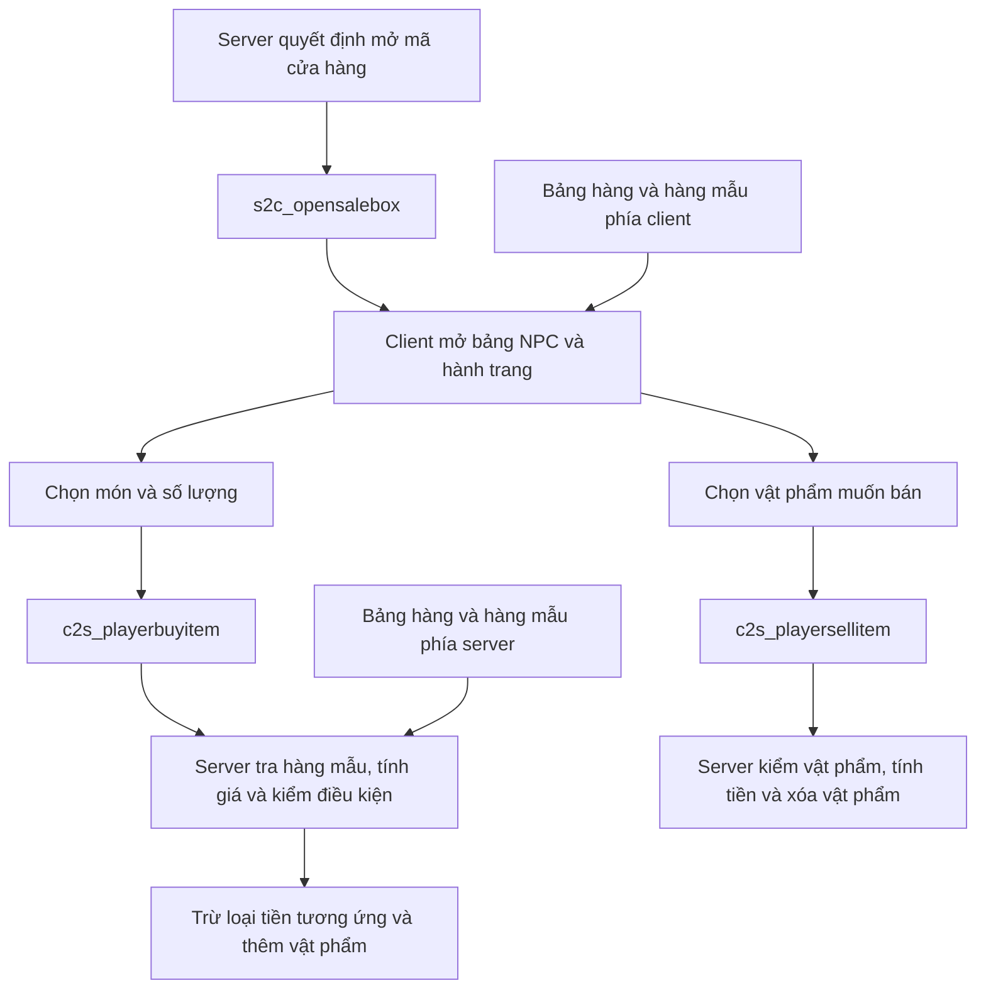

TÓM TẮT 1: [NGUỒN][THẤY] DONE trong phạm vi đọc tĩnh: đã nối bảng hàng, mở cửa hàng, mua, bán, tiền tệ và gói tin; nguồn S/KBuySell.cpp:83, C/gamecore/KProtocol.cpp:264.
TÓM TẮT 2: [NGUỒN][THẤY] Server dùng hàng mẫu và loại tiền để tính giá mua; bán lại lấy giá vật phẩm chia 4, tối thiểu 1; nguồn S/KBuySell.cpp:329, S/KBuySell.cpp:627, S/KBuySell.h:4.
TÓM TẮT 3: [NGUỒN][THẤY] Client mở bảng theo mã cửa hàng do server gửi, rồi lấy danh sách hàng phía client; nguồn S/KBuySell.cpp:767, C/gamecore/KProtocolProcess.cpp:757, C/gameui/KuiShop.cpp:734.
TÓM TẮT 4: [CHƯA KIỂM] Chưa đọc bảng settings thực tế, chưa xác nhận NPC nào bán món nào hoặc giá đang áp dụng; đường dẫn bảng mới thấy trong C/gamecore/CoreUseNameDef.h:116.
TÓM TẮT 5: [CHƯA KIỂM] Không build, không chạy game/exe/VM, không kết nối mạng; tài liệu mô tả source, không xác nhận giao dịch thực tế; phạm vi JX1_OPS/TASKS/SO-20.md:27.

# SO-20 — Sổ tay hiểu game: cửa hàng NPC và giá

Loại: khảo sát
Chủ đề: Cửa hàng NPC lấy hàng ở đâu, mở trên client thế nào và xử lý giá mua/bán ra sao.
Từ khóa: cửa hàng NPC, shop, buysell, goods, giá mua, giá bán, ngân lượng, Xu, PLAYER_BUY_ITEM_COMMAND, GDCNI_NPC_TRADE
Trạng thái: DONE — đủ tiêu chí tài liệu đọc tĩnh; các phần dữ liệu triển khai và chạy thực tế được đánh dấu chưa kiểm.
Độ phủ: đã phủ 7/9 nhóm ở bảng bên dưới; chưa phủ danh mục triển khai và vận hành thực tế, không phải đã kiểm toàn bộ cửa hàng.
Liên quan: JX1_OPS/TASKS/SO-20.md; JX1_OPS/REPORTS/SO-20.md; JX1_OPS/DESIGN/CHUAN-BAO-CAO.md
Cần tôi quyết định: không

## Mục lục

- Cách đọc nguồn và nhãn bằng chứng.
- Sơ đồ chính; phạm vi và độ phủ; giải mã tên; sắp theo cấu trúc game.
- Hàng bán; mở cửa hàng; mua và tiền tệ; bán lại; gói tin.
- Sổ thông số; điểm cần lưu ý; đã xác minh/chưa kiểm; bàn giao.

## Cách đọc nguồn và nhãn bằng chứng

- [TÀI LIỆU] `S/` là `C:/Jx1CocoV3/SwordOnline/SwordOnline/jxOnline/gameserver/Sources/Core/Src/`; `C/` là `C:/Jx1CocoV3/Folder/Client2912-20260116T044348Z-3-001/Client2912/Client/Classes/`. Đây là hai root task giao đọc, không phải bằng chứng chúng đang được triển khai cùng nhau; nguồn `JX1_OPS/TASKS/SO-20.md:24`.
- [TÀI LIỆU] `THẤY` = đã đối chiếu mã nguồn tại dòng dẫn; `TÀI LIỆU` = yêu cầu hoặc mô tả trong tài liệu; `CHƯA KIỂM` = chưa có bằng chứng trực tiếp. `THẤY` ở đây chỉ xác minh tĩnh, không có nghĩa đã đo khi chơi; nguồn `JX1_OPS/TASKS/SO-20.md:21`, `JX1_OPS/TASKS/SO-20.md:27`.
- [THẤY] Các mã hàm, đường dẫn bảng và tên trường dùng trong tài liệu là ASCII. Chú thích Hán trong `S/KBuySell.h:7` đọc được bằng GBK; client có cả chữ Việt UTF-8 và chú thích lỗi mã hóa tại `C/gamecore/CoreShell.cpp:3971`. Dẫn dòng theo ranh giới dòng tệp, không dùng việc giải mã toàn tệp sang GBK để đếm dòng client.

## Sơ đồ chính

[THẤY] Sơ đồ ghép các mắt xích đã đọc, không biểu diễn phản hồi mạng đã đo: `S/KBuySell.cpp:754`, `C/gameui/GameSpaceChangedNotify.cpp:285`, `C/gamecore/KProtocol.cpp:264`, `S/KBuySell.cpp:390`, `S/KBuySell.cpp:558`, `S/KBuySell.cpp:627`.

## Phạm vi và độ phủ

| Nhóm trong phạm vi | Độ phủ | Bằng chứng và giới hạn |
|---|---|---|
| 1. Cách đọc bảng hàng và hàng mẫu | Đã phủ tĩnh | [THẤY] `S/KBuySell.cpp:83`, `S/KBuySell.cpp:113`, `S/KBuySell.cpp:225`; chưa đọc nội dung settings. |
| 2. NPC, mã shop, từng món và giá triển khai | Chưa phủ | [CHƯA KIỂM] Mới có tên bảng từ `C/gamecore/CoreUseNameDef.h:116`; bảng và script NPC nằm ngoài hai root nguồn được giao. |
| 3. Mở bảng trên client | Đã phủ tĩnh | [THẤY] `S/KBuySell.cpp:767`, `C/gamecore/KProtocolProcess.cpp:757`, `C/gamescene/KgameWorld.cpp:13762`. |
| 4. Chọn món, số lượng, gửi mua | Đã phủ tĩnh | [THẤY] `C/gameui/KuiShop.cpp:288`, `C/gamecore/CoreShell.cpp:3971`, `C/gamecore/KProtocol.cpp:282`. |
| 5. Giá mua và các loại tiền/điểm | Đã phủ tĩnh | [THẤY] `S/KBuySell.cpp:329`, `S/KBuySell.cpp:392`, `S/KBuySell.cpp:512`; có khác biệt nhánh client. |
| 6. Bán lại và hạn chế vật phẩm | Đã phủ tĩnh | [THẤY] `S/KPlayer.cpp:1525`, `S/KBuySell.cpp:601`, `S/KBuySell.h:4`. |
| 7. Gói mở/mua/bán | Đã phủ tĩnh | [THẤY] `C/gamecore/KProtocol.h:523`, `C/gamecore/KProtocol.h:1014`, `S/KProtocolProcess.cpp:5736`; chưa đối chiếu ABI hai bản build. |
| 8. Điểm lệch giữa các lớp xử lý | Đã phủ các đoạn đã đọc | [THẤY] `C/gameui/KuiShop.cpp:345`, `C/gamecore/CoreShell.cpp:4025`, `C/gamecore/CoreShell.cpp:4079`. Không phải rà soát toàn bộ hệ thống. |
| 9. Bản chạy, đồng bộ kết quả, giá hiển thị thực tế | Chưa phủ | [CHƯA KIỂM] Không chạy hoặc kết nối theo `JX1_OPS/TASKS/SO-20.md:27`; chưa bắt gói hoặc giao dịch thử. |

## Giải mã tên

| Tên gốc giữ nguyên | Mã hóa của chuỗi được dẫn | Chữ đúng UTF-8 / cách hiểu | Nguồn file:dòng |
|---|---|---|---|
| `Ngan luong` | ASCII, không phải chuỗi Việt TCVN3 | [THẤY] Ngân lượng | `S/KBuySell.cpp:515` |
| `Xu` | ASCII | [THẤY] Xu | `S/KBuySell.cpp:520` |
| `Phuc duyen` | ASCII, không phải chuỗi Việt TCVN3 | [THẤY] Phúc duyên | `S/KBuySell.cpp:526` |
| `Danh vong` | ASCII, không phải chuỗi Việt TCVN3 | [THẤY] Danh vọng | `S/KBuySell.cpp:531` |
| `Diem vinh du` | ASCII, không phải chuỗi Việt TCVN3 | [THẤY] Điểm vinh dự | `S/KBuySell.cpp:437` |
| `Diem tong kim`, `Tong Kim` | ASCII, không phải chuỗi Việt TCVN3 | [THẤY] Điểm Tống Kim; chưa có tên Hán để đối chiếu | `S/KBuySell.cpp:445`, `S/KBuySell.cpp:542` |
| Tên riêng NPC, vật phẩm, bản đồ trong bảng hàng thực tế | Chưa xác định: chưa đọc bảng, chưa có chuỗi gốc | [CHƯA KIỂM] Chưa giải mã GBK/TCVN3; không tự đặt tên thay thế | `C/gamecore/CoreUseNameDef.h:116`, `JX1_OPS/TASKS/SO-20.md:24` |

## Sắp theo cấu trúc game

[THẤY] Tài liệu đi theo trải nghiệm cửa hàng: hàng bán → mở bảng → mua và loại tiền → bán lại → gói tin. Không xếp theo thứ tự tệp. Chưa thể lập danh mục **NPC/bản đồ → cửa hàng → từng món → giá** vì chưa đọc dữ liệu settings và script gắn NPC; nguồn `S/KBuySell.cpp:225`, `C/gamecore/CoreUseNameDef.h:116`.

## 1. Hàng của cửa hàng được xác định thế nào?

- [THẤY] Có hai lớp: **hàng mẫu** mô tả món hàng; **bảng cửa hàng** chọn những hàng mẫu nào được bán trong một shop. Server nạp hai bảng qua `GOODS_FILE` và `BUYSELL_FILE`; nguồn `S/KBuySell.cpp:85`, `S/KBuySell.cpp:89`, `S/KBuySell.cpp:225`.
- [THẤY] Ở client, hai tên cấu hình là `\settings\goods.txt` và `\settings\buysell.txt`; client cũng nạp cả hai. Đây là đường dẫn được mã nguồn tham chiếu, chưa xác nhận tệp tồn tại hoặc nội dung đang dùng. Header định nghĩa macro của server nằm ngoài root được phép đọc, nên không mặc định đường dẫn server giống client; nguồn `C/gamecore/CoreUseNameDef.h:116`, `C/gamecore/KBuySell.cpp:77`, `S/KBuySell.cpp:15`.
- [THẤY] Hàng mẫu được đọc theo các cột: nhóm đồ, loại chi tiết, loại riêng, hệ, cấp, giá, giá Xu, loại tiền, hạn dùng, cờ ràng buộc và loại trang bị. Mô tả này là cách loader đọc cột, không phải xác nhận tiêu đề hay giá trị trong bảng thực; nguồn `S/KBuySell.cpp:113`, `S/KBuySell.cpp:118`, `S/KBuySell.cpp:125`.
- [THẤY] Với hàng mẫu có số dương trong bảng cửa hàng, loader trừ 1 để đổi sang chỉ số nội bộ; ô `-1` được bỏ qua. Khi client chuẩn bị bảng hiển thị, `uId` của hàng là vị trí trong shop, không phải ID của một vật phẩm đã nằm trong hành trang; nguồn `S/KBuySell.cpp:225`, `S/KBuySell.cpp:232`, `C/gamecore/CoreShell.cpp:2666`, `C/gamecore/CoreShell.cpp:2674`.
- [THẤY] Cột giá Xu được đọc nhưng ngay sau đó bị gán bằng giá thường ở cả hai loader. Vì vậy không thể chỉ nhìn tên cột rồi cho rằng cột 7 quyết định giá mua bằng Xu của luồng này; nguồn `S/KBuySell.cpp:120`, `C/gamecore/KBuySell.cpp:108`.

## 2. Client mở cửa hàng ra sao?

| Bước theo luồng | Điều đã thấy |
|---|---|
| Server ghi cửa hàng đang mở | [THẤY] `OpenSSale` xóa trạng thái mua cũ, lưu mã shop, bản đồ và vị trí lúc mở; nguồn `S/KBuySell.cpp:760`. Việc lưu vị trí không chứng minh đã có kiểm khoảng cách khi mua. |
| Server báo mở | [THẤY] Gửi `s2c_opensalebox` cùng `nShopIndex`; nguồn `S/KBuySell.cpp:767`. |
| Client nhận mã shop | [THẤY] `OpenSaleBox` chuyển mã sang `OpenCSale`; hàm này kiểm mã trong số dòng shop đã nạp, lưu mã rồi phát `GDCNI_NPC_TRADE`; nguồn `C/gamecore/KProtocolProcess.cpp:757`, `C/gamecore/KBuySell.cpp:325`. |
| Giao diện hiện bảng và hành trang | [THẤY] Thông báo gọi `openNpcshop`, tạo `KuiShop`, rồi mở bảng hành trang theo kiểu UI được chọn; nguồn `C/gameui/GameSpaceChangedNotify.cpp:285`, `C/gamescene/KgameWorld.cpp:13762`, `C/gamescene/KgameWorld.cpp:13769`. |
| Danh sách và trang hàng | [THẤY] `KuiShop::UpdateData` lấy số món rồi lấy danh sách, đặt trang đầu. `GetDataNpcShop` tra bảng theo shop và xếp các món vào trang; nguồn `C/gameui/KuiShop.cpp:734`, `C/gamecore/CoreShell.cpp:2648`, `C/gamecore/CoreShell.cpp:2706`. |

[CHƯA KIỂM] NPC nào hoặc lựa chọn hội thoại nào dẫn tới `OpenSSale` chưa được xác nhận; không có danh sách script/NPC thực trong hai root task giao. Điểm bắt đầu đã chứng minh ở đây là `S/KBuySell.cpp:754`, không phải thao tác chạm NPC đã thử khi chơi.

## 3. Mua hàng: giá và loại tiền

- [THẤY] Người chơi chọn món và nhập số lượng; ô trống hoặc số không dương được đưa về 1, số lớn hơn 150 được hạ về 150 ở bảng UI. Sau đó UI gửi yêu cầu nội bộ `GOI_TRADE_NPC_BUY`; nguồn `C/gameui/KuiShop.cpp:299`, `C/gameui/KuiShop.cpp:342`, `C/gameui/KuiShop.cpp:363`.
- [THẤY] Lớp xử lý tiếp theo kiểm loại đối tượng, hàng mẫu và chỗ trống. Mua nhiều chỉ đi tiếp với đồ có thể xếp chồng. Lớp này chặn `nBei >= 100`, dù thông báo viết “tối đa 100”; do đó không nên ghi 150 hoặc 100 là giới hạn mua thành công đã xác nhận; nguồn `C/gamecore/CoreShell.cpp:3977`, `C/gamecore/CoreShell.cpp:3997`, `C/gamecore/CoreShell.cpp:4013`, `C/gamecore/CoreShell.cpp:4025`.
- [THẤY] Server tra món bằng bảng shop, lấy giá qua `GetPrice()` và loại tiền qua `GetcModel()`. Nếu số lượng lớn hơn 1 thì cũng đòi món có thể xếp chồng. Giá sau điều chỉnh và tổng tiền phải dương; nguồn `S/KBuySell.cpp:329`, `S/KBuySell.cpp:334`, `S/KBuySell.cpp:383`, `S/KBuySell.cpp:456`.
- [THẤY] Trong đoạn mua đã đọc, biến chọn kiểu thuế được đặt bằng 0; phần đọc kiểu thuế từ bản đồ đang nằm trong chú thích. Nhánh đang hoạt động giảm giá cho `nCityMenber == 1`, còn trường hợp khác tăng giá theo `nShuishou`; nguồn `S/KBuySell.cpp:322`, `S/KBuySell.cpp:345`.
- [THẤY] Cách tính trong source: lấy giá mẫu, cộng/trừ phần trăm thuế vào biến nguyên `nSerPrice`, rồi nhân với số lượng `nBei` thành `nNewPrice`. Có chuyển đổi số thực/số nguyên ngay bước thuế; không mô tả như phép nhân thập phân chính xác đến cuối. Thuế và cờ thành viên được chuyển từ trường gói mua vào hàm; nguồn `S/KBuySell.cpp:350`, `S/KBuySell.cpp:355`, `S/KBuySell.cpp:390`, `S/KPlayer.cpp:1522`.

### Loại tiền/điểm mà server xử lý

| Tên trong game | Mã nguồn; số enum phía client | Điều server kiểm và trừ |
|---|---|---|
| Ngân lượng | [THẤY] `moneyunit_money`; 0 | Kiểm ngân lượng mang theo, gọi `Pay`; `S/KBuySell.cpp:392`, `S/KBuySell.cpp:512`. |
| Nhánh ngân lượng thứ hai | [THẤY] `moneyunit_moneya`; 1 | Cùng kiểm ngân lượng mang theo và gọi `Pay` trong luồng này; chưa xác nhận khác biệt tên hiển thị; `S/KBuySell.cpp:400`, `S/KBuySell.cpp:512`. |
| Xu | [THẤY] `moneyunit_xu`; 2 | Kiểm Xu, gọi `PayXu`; `S/KBuySell.cpp:408`, `S/KBuySell.cpp:517`. |
| Phúc duyên | [THẤY] `moneyunit_fuyuan`; 3 | Kiểm và giảm giá trị Phúc duyên; `S/KBuySell.cpp:416`, `S/KBuySell.cpp:523`. |
| Danh vọng | [THẤY] `moneyunit_repute`; 4 | Kiểm và giảm giá trị Danh vọng; `S/KBuySell.cpp:424`, `S/KBuySell.cpp:528`. |
| Vinh dự | [THẤY] `moneyunit_expoint`; 5 | Kiểm và trừ biến nhiệm vụ 2051; dòng dùng `GetExtPoint` đang là chú thích; `S/KBuySell.cpp:432`, `S/KBuySell.cpp:533`. |
| Điểm Tống Kim | [THẤY] `moneyunit_jifen`; 6 | Kiểm và trừ biến nhiệm vụ 192; `S/KBuySell.cpp:441`, `S/KBuySell.cpp:540`. |

[THẤY] Các số 0–6 ở bảng trên được suy lần lượt từ enum **client** bắt đầu bằng 0; nguồn `C/gamecore/GameDataDef.h:231`. Chưa đọc header enum server ngoài root; bảng không thay cho kiểm chứng tương thích số mã giữa hai bản build.

- [THẤY] Khi đủ điều kiện, server tạo vật phẩm từ hàng mẫu, kiểm có chỗ trong hành trang, xử lý trừ loại tiền tương ứng rồi gọi thêm vật phẩm vào hành trang. Hàm thanh toán ngân lượng và Xu dẫn tới hai thao tác riêng `CostMoney` và `CostXu`; nguồn `S/KBuySell.cpp:478`, `S/KBuySell.cpp:487`, `S/KBuySell.cpp:512`, `S/KBuySell.cpp:558`, `S/KPlayer.cpp:7334`.
- [CHƯA KIỂM] Chưa xác nhận giao diện hiển thị tổng sau thuế, nguồn xác thực các trường thuế/thành viên, khả năng hoàn tác khi thanh toán/thêm vật phẩm thất bại hoặc thứ tự gói đồng bộ. Các lệnh gọi kể trên không đủ chứng minh giao dịch nguyên vẹn khi chạy; nguồn giới hạn `S/KBuySell.cpp:512`, `S/KBuySell.cpp:558`, `JX1_OPS/TASKS/SO-20.md:27`.

## 4. Bán vật phẩm lại cho NPC

- [THẤY] Client có nhánh bán `GOI_TRADE_NPC_SELL`: vật phẩm nhiệm vụ cần cờ được bán; nhánh đồ khác có kiểm khóa vật phẩm trước khi gửi. Đây là kiểm tra client, không được suy thành mọi kiểm tra của server; nguồn `C/gamecore/CoreShell.cpp:4341`, `C/gamecore/CoreShell.cpp:4351`, `C/gamecore/CoreShell.cpp:4365`.
- [THẤY] Gói bán mang ID của vật phẩm thật. Server tìm ID trong danh sách đồ của người chơi rồi mới gọi bán, khác với chỉ số vị trí hàng trong gói mua; nguồn `C/gamecore/KProtocol.cpp:272`, `S/KPlayer.cpp:1527`, `S/KPlayer.cpp:1548`.
- [THẤY] Server từ chối đồ có `GetIsBang()`. Tiền bán lại là `GetPrice() / 4` với phép chia nguyên; kết quả không dương được nâng lên 1. Đây là giá của vật phẩm được bán, không phải lời hứa hoàn lại một phần tư tổng tiền từng mua sau thuế; nguồn `S/KBuySell.cpp:621`, `S/KBuySell.cpp:627`, `S/KBuySell.h:4`, `S/KItem.h:271`.
- [THẤY] Đồ nhiệm vụ chỉ được cộng tiền và xóa khi `GetIsSell() == 1`; các nhóm còn lại đi vào nhánh cộng tiền rồi xóa. Hàm `Earn` gọi cộng tiền thường ở hành trang, không gọi `EarnXu`; nguồn `S/KBuySell.cpp:632`, `S/KBuySell.cpp:643`, `S/KPlayer.cpp:7381`.
- [THẤY] Client này gửi `m_ClinetKind = 1`. Trong hàm bán server, kiểm cửa hàng đang mở chỉ nằm ở nhánh `nClinetKind <= 0`. Không thể viết rằng mọi lệnh bán đều bắt buộc có cửa hàng mở chỉ dựa vào đoạn này; nguồn `C/gamecore/KProtocol.cpp:275`, `S/KBuySell.cpp:609`.
- [CHƯA KIỂM] Chưa xác nhận số tiền bán cả chồng đồ hoặc ảnh hưởng độ bền/hạn dùng trong bản chạy. Hàm bán đã đọc không nhân trực tiếp với số lượng chồng; không tự suy quy tắc hoàn tiền toàn bộ; nguồn `S/KBuySell.cpp:627`, `S/KBuySell.cpp:645`.

## 5. Gói tin mở cửa hàng, mua và bán

| Hướng | Tên gói | Nội dung và nơi xử lý |
|---|---|---|
| Server → client | `s2c_opensalebox` / `SALE_BOX_SYNC` | [THẤY] Có loại gói và `nShopIndex`; hàm mở gửi mã shop, không gửi danh sách đầy đủ ngay trong cấu trúc này; `S/KBuySell.cpp:767`, `C/gamecore/KProtocol.h:523`. |
| Client → server | `c2s_playerbuyitem` / `PLAYER_BUY_ITEM_COMMAND` | [THẤY] Chỉ số hàng trong shop, nơi đặt, tọa độ, thuế, cờ thành viên, mã bản đồ và số lượng; không có trường giá mua trực tiếp trong cấu trúc client này; `C/gamecore/KProtocol.h:1021`, `C/gamecore/KProtocol.cpp:290`. |
| Client → server | `c2s_playersellitem` / `PLAYER_SELL_ITEM_COMMAND` | [THẤY] ID vật phẩm và `m_ClinetKind`; `C/gamecore/KProtocol.h:1014`, `C/gamecore/KProtocol.cpp:272`. |
| Server nhận lệnh mua/bán | `PlayerBuyItem`, `PlayerSellItem` | [THẤY] Bảng điều phối gán hai mã gói cho hai hàm; hai hàm dừng nếu `CheckTrading()` rồi mới chuyển cho người chơi xử lý; `S/KProtocolProcess.cpp:238`, `S/KProtocolProcess.cpp:5736`. |

[CHƯA KIỂM] Không ghi số byte gói hoặc số opcode cố định: chưa đối chiếu packing/header server và hai binary triển khai. Chưa có bắt gói để xác nhận phản hồi thành công/thất bại; nguồn `C/gamecore/KProtocol.h:1014`, `JX1_OPS/TASKS/SO-20.md:27`.

## Mục sổ thông số

| Nhóm | Tên/hằng số | file:dòng | Giá trị | Đơn vị | Ảnh hưởng | Đổi an toàn | Nguồn đo |
|---|---|---|---|---|---|---|---|
| Bán lại | `BUY_SELL_SCALE` | `S/KBuySell.h:4`, `S/KBuySell.cpp:628` | [THẤY] 4 | Hệ số chia | Chia giá vật phẩm khi bán | CẨN THẬN | Đọc tĩnh; chưa đo, không cấp quyền sửa |
| Bán lại | Mức tối thiểu | `S/KBuySell.cpp:630` | [THẤY] 1 | Đơn vị tiền thường | Sàn tiền bán của nhánh được phép bán | CẨN THẬN | Đọc tĩnh; chưa đo |
| Hàng mẫu | `nPriceXu = nPrice` | `S/KBuySell.cpp:121`, `C/gamecore/KBuySell.cpp:109` | [THẤY] Gán giá thường sang giá Xu | Đơn vị giá lưu | Giá trị cột 7 bị ghi đè tại loader | CẨN THẬN | Đọc tĩnh, không phải tỷ giá tiền |
| Thuế | `nShuishou` | `S/KBuySell.cpp:350`, `S/KBuySell.cpp:355` | [THẤY] Tham số phần trăm; chưa có mức triển khai | % | Điều chỉnh trước khi nhân số lượng | CẨN THẬN | Đọc công thức; chưa đo |
| Số lượng UI | Mức chặn ô nhập | `C/gameui/KuiShop.cpp:345` | [THẤY] 150 | Món/lần nhập | Hạ ô nhập xuống mức này | CẨN THẬN | Đọc tĩnh; không phải giới hạn mua đạt |
| Số lượng gửi | `nBei >= 100` | `C/gamecore/CoreShell.cpp:4025` | [THẤY] Chặn từ 100 | Món/lệnh qua nhánh này | Không đi tiếp tới gửi mua | CẨN THẬN | Đọc tĩnh; không suy giới hạn server |
| Vinh dự | Biến nhiệm vụ | `S/KBuySell.cpp:435`, `S/KBuySell.cpp:537` | [THẤY] 2051 | ID biến | Nơi kiểm/trừ Vinh dự của luồng này | CẨN THẬN | Chỉ ID mã nguồn, không đọc giá trị người chơi |
| Tống Kim | Biến nhiệm vụ | `S/KBuySell.cpp:443`, `S/KBuySell.cpp:543` | [THẤY] 192 | ID biến | Nơi kiểm/trừ điểm của luồng này | CẨN THẬN | Chỉ ID mã nguồn, không đọc giá trị người chơi |

## Phát hiện khi đối chiếu / chuẩn hóa

1. [THẤY] **Hai mức số lượng khác nhau:** UI hạ về 150, lớp xử lý chặn từ 100; ghi cả hai, không chọn một số làm quy tắc chơi đã xác nhận. Nguồn `C/gameui/KuiShop.cpp:345`, `C/gamecore/CoreShell.cpp:4025`.
2. [THẤY] **Có nhánh tiền phía server nhưng luồng client chưa đồng đều:** các nhánh Phúc duyên, Danh vọng, Vinh dự ở đoạn client đã đọc kiểm số dư rồi `break`, không gọi `SendClientCmdBuy` trong các nhánh đó. Xu và Tống Kim có lời gọi gửi riêng; nguồn `C/gamecore/CoreShell.cpp:4079`, `C/gamecore/CoreShell.cpp:4089`, `C/gamecore/CoreShell.cpp:4099`, `C/gamecore/CoreShell.cpp:4074`, `C/gamecore/CoreShell.cpp:4130`. [CHƯA KIỂM] Không kết luận mọi đường mua ba loại tiền này đều hỏng.
3. [THẤY] **Cột giá Xu không giữ nguyên sau khi đọc:** ghi đè ngay ở loader cả hai phía; nguồn `S/KBuySell.cpp:121`, `C/gamecore/KBuySell.cpp:109`. [CHƯA KIỂM] Không sửa bảng hoặc suy thành tỷ lệ đổi Xu/ngân lượng.
4. [THẤY] **Ngoại lệ bán của client mobile:** nhánh kiểm shop trong hàm bán phụ thuộc loại client; nguồn `S/KBuySell.cpp:609`, `C/gamecore/KProtocol.cpp:275`. [CHƯA KIỂM] Không kết luận khả năng bán ở mọi vị trí hoặc tính an toàn khi vận hành.

## Đã xác minh / Chưa kiểm

### Đã xác minh — tĩnh

- [THẤY] Đã đọc các hàm chính của loader, mở shop, mua, bán và thanh toán tại đúng root task; các dẫn dòng trong phần 1–5 trỏ tới tệp nguồn, không dùng Graphify thay bằng chứng; nguồn `S/KBuySell.cpp:83`, `S/KBuySell.cpp:754`, `S/KPlayer.cpp:7334`.
- [THẤY] Đã nối thông báo mở shop qua giao diện tới lệnh mua/bán; đã tách điểm khác nhau giữa client và server, giữa code hoạt động và chú thích; nguồn `C/gameui/GameSpaceChangedNotify.cpp:285`, `C/gamecore/CoreShell.cpp:3971`, `S/KBuySell.cpp:324`.

### Chưa kiểm

- [CHƯA KIỂM] Từng NPC, tên hàng, shop ID thực, giá thực và dữ liệu gốc GBK/TCVN3 trong settings; chưa đọc ngoài root được giao. Nguồn giới hạn `JX1_OPS/TASKS/SO-20.md:24` và tên bảng `C/gamecore/CoreUseNameDef.h:116`.
- [CHƯA KIỂM] Script hội thoại dẫn tới mở shop, header server ngoài `Sources`, độ tương thích giữa hai bản nguồn và bản đang chạy; nguồn giới hạn `JX1_OPS/TASKS/SO-20.md:24`, điểm gọi mở `S/KBuySell.cpp:754`.
- [CHƯA KIỂM] Giao dịch thực, mức thuế thực, cách làm tròn hiển thị, ACK/thông báo trả về, cả chồng đồ, hoàn tác khi lỗi và độ trễ; không build/test game/exe/VM/mạng theo `JX1_OPS/TASKS/SO-20.md:27`.

## Đề xuất tối ưu

- [TÀI LIỆU] Khi được giao đợt tiếp theo, ưu tiên đối chiếu bản copy settings và script theo bảng **NPC/bản đồ → shop → món → giá → loại tiền**; giữ nguyên kết luận đọc tĩnh ở đây. Căn cứ khoảng trống: `C/gamecore/CoreUseNameDef.h:116`, `S/KBuySell.cpp:225`.
- [THẤY] Hai việc cần một task riêng nếu muốn sửa: thống nhất giới hạn số lượng và rà các nhánh tiền thiếu lời gọi gửi mua. Sổ tay này chỉ ghi nhận, không thay mã hay cấu hình; nguồn `C/gamecore/CoreShell.cpp:4025`, `C/gamecore/CoreShell.cpp:4079`.

## Bàn giao

- [TÀI LIỆU] Không stage/commit/push theo yêu cầu giao việc; Tổng quan ghép và commit. Báo cáo thực hiện, kiểm tra tài liệu và lỗi môi trường ở `JX1_OPS/REPORTS/SO-20.md`; yêu cầu đầu ra ở `JX1_OPS/TASKS/SO-20.md:21`.
- [TÀI LIỆU] Bước tiếp theo chỉ là đề xuất: duyệt riêng nguồn settings/script hoặc kiểm thử cô lập nếu cần xác nhận trải nghiệm chạy. Task hiện tại chỉ cho phép đọc tĩnh; nguồn `JX1_OPS/TASKS/SO-20.md:27`.

Kỹ năng đã dùng: jx1-retrofit (khuôn trình bày, không sửa kết luận cũ), jx1-read-server, jx1-read-client, jx1-parameters, jx1-knowledge, jx1-report.

## Bảng cửa hàng thật (đọc từ TEST-36, 20/11/2026, #317) — ĐÃ KIỂM
- `gs\Settings\buysell.txt`: dòng 1 là tiêu đề; dòng N (N=1..161) là cửa hàng số N, gồm các số thứ tự dòng trong `goods.txt` (1 = dòng dữ liệu đầu), cách nhau TAB. Lua `Sale(N)` mở cửa hàng N (`ScriptFuns.cpp:5418`, trừ 1 bên trong). Cửa hàng 92–99, 104, 106–147, 157–161 trống. Kết thúc dòng CRLF, mã GBK.
- `gs\Settings\goods.txt` (1464 dòng dữ liệu, GBK, tab): cột 1 Genre (0 trang bị, 1 thuốc, 2 khoáng, 4 nhiệm vụ), 2 Detail, 3 Particular, 4 Series, 5 Level, 6 Price (BẠC; cột 7 PriceXu bị mã bỏ qua: `KBuySell.cpp:121` gán PriceXu = Price), 8 PriceShopType, 9 ThoiGianBan, 10 LockItem, 11 nEquipType, 12 tên, 13 IsShow, 14–19 MagicLevel1..6.
- Trang bị (Genre 0) mua ở cửa hàng KHÔNG có dòng thuộc tính cố định: 1078/1161 dòng để trống cột 11 và cột 14–19 = 0 → ra đồ trắng. MagicLevel1..6 chỉ được đọc khi cột 11 (nEquipType) > 0 (`KBuySell.cpp:129`), rồi chuyển thẳng làm mảng cấp dòng thuộc tính (giống tham số l1..l6 của AddItem) → ra đồ XANH. Cột 11 đi vào tham số nPoint của Gen_Equipment (chưa kiểm ý nghĩa; đặt 1).
- Cách tạo cửa hàng đồ xanh 1 bạc: thêm dòng goods với Price=1, cột 11=1, cột 14–19=6; liệt kê id vào một dòng buysell trống. Cần khởi động lại gs001 (bảng nạp lúc khởi động, `KBuySell.cpp:89`).
- Đồ VÀNG (unique) không tạo được bằng bảng này; dùng AddGoldItem trong Lua.

### Hiệu chỉnh (#317, 20/11 20:05)
- `Sale(N)` hiện dòng file b[N+1] (b[0] là header), không phải dòng N. Ví dụ Sale(92) -> b[93].
- Client dùng BẢN COPY RIÊNG của `goods.txt`/`buysell.txt` trong PAK. Server thêm hàng 1465-1477 + dòng b[93], gs001 khởi động lại, cửa hàng MỞ ĐƯỢC nhưng LƯỚI TRỐNG (đã thử trên LDPlayer). Muốn hiện hàng, phải thêm đúng 13 hàng đó vào goods.txt và dòng b[93] vào buysell.txt phía client (PAK/APK) = việc của SC task, không sửa tay.
