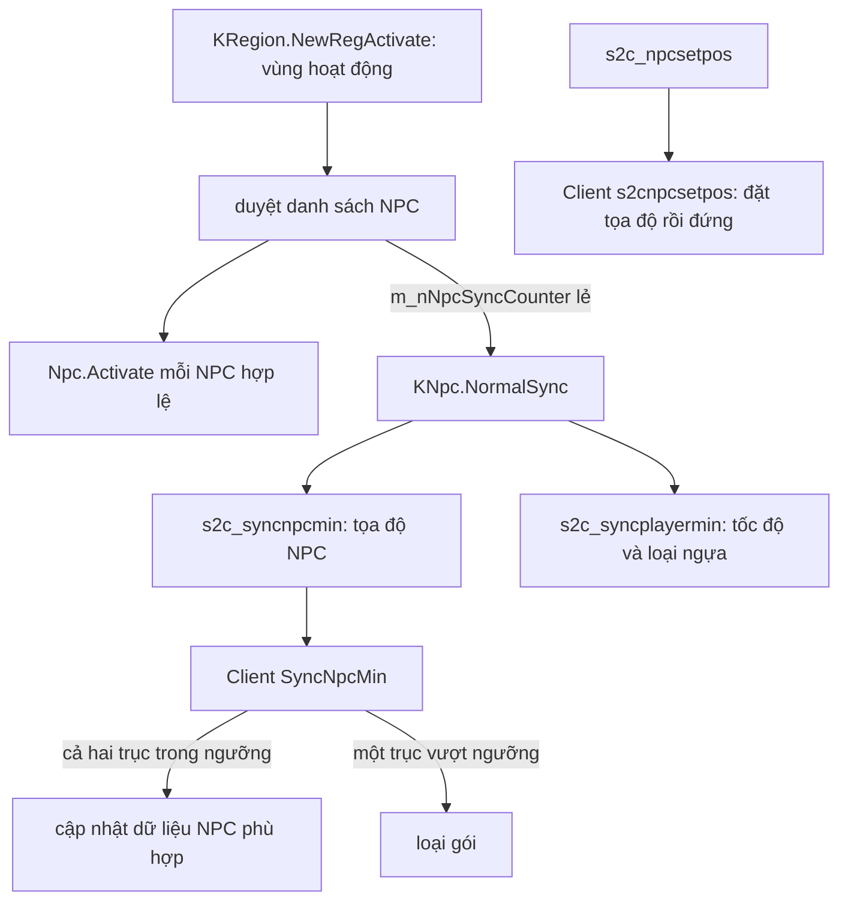

[TÓM TẮT 1/5] [THẤY] Client đăng ký bộ nhận `s2c_syncnpcmin`; `CORRECT_SYNC_RANGE=30` chặn gói theo khoảng cách từng trục X/Y tới người chơi. (`gamecore/KProtocolProcess.cpp:54–60,2410–2440`; `gamecore/KNpc.cpp:1527`)
[TÓM TẮT 2/5] [THẤY] Gói `s2c_npcsetpos` đặt thẳng tọa độ máy chủ và chuyển nhân vật sang đứng; `SyncPlayerMin` đồng bộ loại ngựa/tốc độ, không phải gói tọa độ. (`gamecore/KProtocolProcess.cpp:186,2311–2364,3059–3074`)
[TÓM TẮT 3/5] [TÀI LIỆU] Chín map mẫu có 33–359 bản ghi NPC mỗi map; trung bình 0,46–1,44 bản ghi trên mỗi region đọc được. Đây là mật độ dữ liệu tĩnh, không phải NPC đang hoạt động. (`I-03-khao-sat-quai-vat.md:228–240`)
[TÓM TẮT 4/5] [CHƯA KIỂM] Chưa có số NPC trong region hoạt động hay đủ danh sách “map chính”; chưa đo để xác nhận nghi phạm tick nào nặng nhất. (`KRegion.cpp:1106–1127`; `I-03-khao-sat-quai-vat.md:258`; `A-B.md:1855–1864`)
[TÓM TẮT 5/5] [CHƯA KIỂM] Chỉ đọc source/dữ liệu tĩnh; không build, chạy exe, VM, game hoặc mạng.

# HG-S2 — Giật ngựa phía client và số quái/NPC ăn tick

Loại: khảo sát
Chủ đề: Đối chiếu đường đồng bộ vị trí/loại ngựa ở client với vòng NPC của server và mật độ dữ liệu map.
Từ khóa: giật ngựa, cưỡi ngựa, CORRECT_SYNC_RANGE, SyncNpcMin, SyncPlayerMin, NormalSync, NewRegActivate, NPC, #B-090
Trạng thái: PARTIAL — tìm được ngưỡng và các đường nhận vị trí; dữ liệu map mới có chín mẫu, chưa đo tải runtime.
Độ phủ: 4/4 sổ tay liên quan đã đọc; 9/9 map mẫu trong I-03 có bảng; tổng map chính và số NPC đang hoạt động chưa đếm được.
Liên quan: `JX1_OPS/REPORTS/HG-S1.md`, `SO-04.md`, `I-03-khao-sat-quai-vat.md`, `I-04-khao-sat-map.md`, `A-B.md` (#B-090).
Cần tôi quyết định: không.

ĐÃ ĐỌC SỔ TAY: `JX1_OPS/HIEU-GAME/07-server-luu-tru/SO-TAY-TICK-GS001.md`.
ĐÃ ĐỌC SỔ TAY: `JX1_OPS/HIEU-GAME/01-trang-bi-cuong-hoa/SO-TAY-NGUA-PHI-PHONG.md`.
ĐÃ ĐỌC SỔ TAY: `JX1_OPS/HIEU-GAME/02-nhan-vat-thuoc-tinh/BAN-DO-DI-CHUYEN-CUOI-NGUA.md`.
ĐÃ ĐỌC SỔ TAY: `JX1_OPS/HIEU-GAME/04-quai-npc-ban-do/SO-TAY-QUAI-NPC-BAN-DO.md`.

Nguồn client được giao: `C:/Jx1CocoV3/Folder/Client2912-20260116T044348Z-3-001/Client2912/Client/Classes`.
Nguồn server được giao: `C:/Jx1CocoV3/SwordOnline/SwordOnline/jxOnline/gameserver/Sources/Core/Src`. Task không ghim commit/version cho hai cây source này.
Dữ liệu Settings tìm thấy riêng trong gói `C:/Jx1CocoV3/Folder/ServerNew-20260116T043145Z-3-001/ServerNew/_bin_v2_/gs`; không khẳng định gói dữ liệu này đồng phiên bản với cây source server ở trên. Các số PAK bên dưới được dẫn lại từ báo cáo I-03, không tính lại PAK trong lượt này.

Liên quan: `JX1_OPS/REPORTS/HG-S1.md`; `JX1_OPS/REPORTS/SO-04.md`; `JX1_OPS/REPORTS/I-03-khao-sat-quai-vat.md`; `JX1_OPS/REPORTS/I-04-khao-sat-map.md`; `JX1_OPS/HOP-THU/A-B.md` (#B-090).

## Phạm vi và độ phủ

| Phần | Kết quả | Độ phủ / giới hạn |
|---|---|---|
| Đường nhận gói đồng bộ client | [THẤY] `ProcessFunc` nối `s2c_syncnpcmin`, `s2c_syncplayermin`, `s2c_syncnpcminplayer` và `s2c_npcsetpos` tới các hàm xử lý tương ứng. `gamecore/KProtocolProcess.cpp:54–60,186` | Đã lần các handler trực tiếp; chưa xác minh thứ tự/thời điểm gói thực tế trên mạng. |
| Ngưỡng `CORRECT_SYNC_RANGE` | [THẤY] Giá trị 30; `SyncNpcMin` bỏ gói nếu |ndx| hoặc |ndy| lớn hơn 30. So sánh theo hai trục, không phải bán kính Euclid. `gamecore/KNpc.cpp:1527`; `gamecore/KProtocolProcess.cpp:2431–2440` | Đã xác minh điều kiện tĩnh; đơn vị là bước tọa độ map `MapX/MapY`, chưa quy đổi sang pixel/thời gian. |
| Nhân vật của người chơi và tọa độ | [THẤY] `SyncNpcMin` không sửa tọa độ khi ID là nhân vật local; handler riêng `SyncNpcMinPlayer` đặt tọa độ khi region local chưa khởi tạo hoặc region đích chưa được nạp. `gamecore/KProtocolProcess.cpp:2521–2562,2637–2713` | Đã phủ các nhánh này; chưa khẳng định đây là mọi đường sửa vị trí của nhân vật. |
| Gói đặt vị trí tường minh | [THẤY] `s2cnpcsetpos` đổi tọa độ map/offset từ gói và gọi `SendSerCommand(do_stand)`; trong handler này không thấy kiểm `CORRECT_SYNC_RANGE`. `gamecore/KProtocolProcess.cpp:2311–2364` | Đã xác minh source tĩnh; chưa xác nhận server gọi gói trong tình huống giật ngựa nào. |
| Ngựa và nội suy | [THẤY] `SyncPlayerMin` nhận `HorseType`, `RunSpeed`, `WalkSpeed`, không nhận tọa độ trong đoạn gán thuộc tính. Có nhánh tính bước tới `m_sSyncPos` theo số frame còn lại, nhưng tìm trong `Classes` chỉ thấy xóa/đọc trạng thái này, chưa thấy nơi nạp đích. `gamecore/KProtocolProcess.cpp:3059–3074`; `gamecore/KNpc.cpp:10097–10155` | Chưa xác định nhánh nội suy có được kích hoạt cho gói vị trí server hay không. `MovePos` có lời gọi `ForceSyncPos(TRUE)` bị comment và guard loại trừ Player. `gamecore/KNpc.cpp:1609–1613` |
| Số quái/NPC theo map | [TÀI LIỆU] Có 9 map mẫu trong I-03; toàn mẫu 33–359 bản ghi NPC/map. `I-03-khao-sat-quai-vat.md:228–240` | Đã phủ 9/9 mẫu được báo cáo; chưa định nghĩa/đếm hết tập “map chính”. |
| NPC trong vùng hoạt động | [THẤY] Server chỉ gọi vòng NPC khi `IsActiveAll()` đúng; số phần tử được duyệt là danh sách `m_NpcList` của region. `Core/Src/KRegion.cpp:1106–1127` | Có thể ước mật độ dữ liệu theo region, không suy ra số instance thật trong một region đang hoạt động. |
| Đối chiếu #B-090 | [TÀI LIỆU] Duy trì thứ hạng nghi vấn đã ghi; code hiện tại hỗ trợ tính khả dĩ của chi phí NPC theo danh sách region và phát broadcast. `A-B.md:1855–1864`; `Core/Src/KRegion.cpp:1106–1127`; `Core/Src/KNpc.cpp:8043–8052` | Chưa có phép đo để xác nhận hoặc đảo thứ hạng. Cây source ở #B-090 ghi là SC-006B b13; không mặc định đồng nhất với source được giao lần này. `A-B.md:1850` |

## Cách client xử lý đồng bộ vị trí và ngựa

- [THẤY] Bảng đăng ký giao `s2c_syncnpcmin` cho `SyncNpcMin`, `s2c_syncplayermin` cho `SyncPlayerMin`, `s2c_syncnpcminplayer` cho `SyncNpcMinPlayer`; opcode `s2c_npcsetpos` giao cho `s2cnpcsetpos`. `gamecore/KProtocolProcess.cpp:54–60,186`.
- [THẤY] `SyncNpcMin` đổi tọa độ MPS từ gói sang region/map rồi so khoảng cách từng trục với nhân vật local. Nếu một trục vượt 30 thì handler trả về, không xử lý phần còn lại của gói. `gamecore/KProtocolProcess.cpp:2410–2440`.
- [THẤY] Với `s2c_syncnpcmin`, nhánh cập nhật vị trí chỉ nằm ngoài ID của nhân vật local; các đối tượng `kind_normal`/`kind_partner` được ghi MapX/MapY/offset và tham chiếu region. Vì vậy ngưỡng 30 trong handler này là bộ lọc vùng nhận đồng bộ NPC, không phải bằng chứng rằng client kéo nhân vật của mình về server mỗi lần lệch 30. `gamecore/KProtocolProcess.cpp:2521–2562`.
- [THẤY] `SyncNpcMinPlayer` kiểm ID gói có đúng nhân vật local. Nó ghi vị trí máy chủ khi nhân vật chưa có region, hoặc khi region đích chưa có trong client và phải tải/tìm region; hai nhánh gán MapX/MapY/offset trực tiếp. `gamecore/KProtocolProcess.cpp:2637–2677,2683–2713`.
- [THẤY] Handler `s2cnpcsetpos` giải mã tọa độ, chuyển actor sang region đích, ghi MapX/MapY/offset và đặt hành động đứng. Đoạn này không có bước nội suy hay ngưỡng 30. Đây là đường đặt vị trí trực tiếp mà source thể hiện rõ. `gamecore/KProtocolProcess.cpp:2311–2364`.
- [THẤY] `SyncPlayerMin` nhận `HorseType`, tốc độ chạy và tốc độ đi; handler này không ghi MapX/MapY. `gamecore/KProtocolProcess.cpp:3059–3074`.
- [THẤY] `KNpc::MovePos` khai báo `CORRECT_SYNC_RANGE 30`; nhánh so khoảng cách chỉ áp dụng `!IsPlayer()`, còn lời gọi `ForceSyncPos(TRUE)` trong nhánh đó đang bị comment. `gamecore/KNpc.cpp:1527,1605–1613`.
- [CHƯA KIỂM] Có đoạn tính tọa độ trung gian từ vị trí hiện tại tới `m_sSyncPos` bằng chia cho số frame còn lại; khi còn tối đa một frame thì ghi thẳng đích. Tuy nhiên trong tìm kiếm theo chuỗi `m_sSyncPos` ở `Classes` không thấy nơi nạp giá trị đích, chỉ thấy khởi tạo/xóa và đọc. Do đó chưa gắn nhánh này với luồng sửa vị trí server đang dùng. `gamecore/KNpc.cpp:10097–10155`; kết quả tìm `Classes` theo `m_sSyncPos`.

Kết luận tĩnh: `CORRECT_SYNC_RANGE=30` tồn tại, nhưng đoạn dùng rõ nhất ở `SyncNpcMin` giới hạn vị trí NPC quanh người chơi. Việc đổi ngưỡng đó để giảm “giật ngựa” chưa có cơ sở: riêng `s2cnpcsetpos` đặt thẳng tọa độ và `SyncPlayerMin` chỉ cập nhật thuộc tính ngựa/tốc độ. Chưa xác định được phía server gửi `s2c_npcsetpos` trong trường hợp giật nào, cũng chưa đo được hình ảnh/runtime.

## NPC theo map và mật độ trên region

[TÀI LIỆU] Bảng dưới chép số liệu 9 map mẫu từ phép kiểm kê PAK trong I-03. Mật độ là tổng bản ghi NPC chia cho số region đọc được; đây chỉ là trung bình tĩnh, phân bố từng region có thể lệch mạnh. `I-03-khao-sat-quai-vat.md:228–240`.

| ID map | Region đọc được | Bản ghi NPC mọi Kind | Trong đó `shKind=0` | NPC tĩnh/region (ước tính) | Nguồn |
|---:|---:|---:|---:|---:|---|
| 3 | 397 | 338 | 338 | 0,85 | `I-03-khao-sat-quai-vat.md:232` |
| 4 | 337 | 230 | 230 | 0,68 | `I-03-khao-sat-quai-vat.md:233` |
| 5 | 280 | 182 | 182 | 0,65 | `I-03-khao-sat-quai-vat.md:234` |
| 9 | 387 | 359 | 358 | 0,93 | `I-03-khao-sat-quai-vat.md:235` |
| 10 | 194 | 266 | 266 | 1,37 | `I-03-khao-sat-quai-vat.md:236` |
| 12 | 101 | 46 | 46 | 0,46 | `I-03-khao-sat-quai-vat.md:237` |
| 26 | 41 | 33 | 33 | 0,80 | `I-03-khao-sat-quai-vat.md:238` |
| 50 | 85 | 122 | 122 | 1,44 | `I-03-khao-sat-quai-vat.md:239` |
| 75 | 150 | 216 | 216 | 1,44 | `I-03-khao-sat-quai-vat.md:240` |

- [TÀI LIỆU] Phép kiểm kê rộng hơn trong I-03 ghi 95.952 bản ghi NPC, gồm 94.098 `shKind=0` và 1.854 `shKind=3` trên các dữ liệu PAK được kiểm. Các bản ghi được tính theo ID map; dữ liệu dùng chung có thể được đếm lại giữa các ID. Không diễn giải đây là số NPC đang sống. `I-03-khao-sat-quai-vat.md:224–228`.
- [THẤY] Tệp Settings trực tiếp có header `STT`, `Name`, `Kind`, `ActiveRadius`…; danh sách map khai báo `Count=1000`; WorldSet gs001 khai báo `Count=800`. Đây là header/giá trị cấu hình, không phải phép đếm map nạp thành công. `GS/Settings/Npcs.txt:1–2`; `GS/Settings/MapList.ini:1–2`; `GS/maps/WorldSet_gs001.ini:1–8`.
- [TÀI LIỆU] Sổ SO-04 giải thích đường tra mẫu ở `Settings/Npcs.txt`, map ở `Settings/MapList.ini`, danh sách tải ở `WorldSet_gs001.ini`, rồi dữ liệu region/PAK để tìm spawn. `SO-TAY-QUAI-NPC-BAN-DO.md:28,55–57,88–91`.
- [CHƯA KIỂM] Chưa xác định map nào trong 9 mẫu là “map chính” theo định nghĩa của task; chưa có bảng đếm spawn theo từng region, số region được kích hoạt quanh người chơi, bộ lọc script hoặc NPC sinh động. Không thể lấy trung bình toàn map để khẳng định số NPC của một region đang hoạt động. `I-03-khao-sat-quai-vat.md:258`; `SO-TAY-QUAI-NPC-BAN-DO.md:95–97`.

## Đối chiếu thứ hạng nghi phạm tick #B-090

| Nghi phạm theo #B-090 | Bằng chứng đọc trong source được giao | Kết luận về số lượng |
|---|---|---|
| 1. `NPC Activate + NormalSync` | `NewRegActivate` vào vòng NPC khi `IsActiveAll()` đúng; duyệt từng node hợp lệ, gọi `Activate`; khi bộ đếm lẻ gọi thêm `NormalSync`. Bộ đếm tăng và reset khi lớn hơn `2 × m_NpcList.GetNodeCount()`. `KRegion.cpp:1100–1127` | [THẤY] Số việc trong một region phụ thuộc số node NPC của region; khi N không đổi và region liên tục active, chu kỳ có N lượt gọi `NormalSync` trên 2N+1 lượt xử lý active, xấp xỉ một nửa. `NormalSync` broadcast tới region hiện tại và các region nối kề. `KNpc.cpp:8043–8052`. Đây hỗ trợ khả năng về mặt cấu trúc, không định lượng chi phí CPU. |
| 2. In console/printf | #B-090 ghi nghi vấn nhưng chưa xác định printf thuộc đường nóng. `A-B.md:1857,1864` | [CHƯA KIỂM] Không đếm/đo printf của đúng source root này trong task. |
| 3. Lỗi script lặp | #B-090 xếp riêng và ghi chưa đo. `A-B.md:1858,1864` | [CHƯA KIỂM] Không mở script/log runtime; không có số liệu hiện tại để xác nhận hoặc bác bỏ. |
| 4. Hook ghi dump phi phong | #B-090 ghi là hook thử nghiệm và chưa kiểm. `A-B.md:1859,1864` | [CHƯA KIỂM] Không đo hook; source A-B ghi là cây SC-006B b13, khác cây server được giao lần này. `A-B.md:1850`. |
| 5. Vòng lặp bù trễ timer | #B-090 yêu cầu dùng avg/max/over để phân biệt và chưa có phép đo. `A-B.md:1860–1864` | [CHƯA KIỂM] Không đọc/đo log tick trong task. |

Kết luận: giữ thứ hạng nghi vấn #B-090 như tài liệu gốc; source hiện tại và số bản ghi trên map chỉ hỗ trợ định tính rằng region đông NPC có thể phát sinh nhiều việc hơn. Chưa có phép đo nào chứng minh NPC là nguyên nhân giật hoặc nặng hơn printf, hook, script hay nhịp timer. Không sửa kết luận cũ trong A-B.

## Giải mã tên

Không đưa tên NPC, quái hay bản đồ cụ thể vào bảng số liệu; dùng ID map để tránh suy diễn cách đọc tên từ dữ liệu mã hóa. Các định danh source dưới đây là ASCII, giữ nguyên chữ gốc.

| Tên gốc | Mã hóa | Chữ đúng / ý nghĩa | Nguồn |
|---|---|---|---|
| `CORRECT_SYNC_RANGE` | ASCII | Hằng số ngưỡng đồng bộ; giá trị 30 | `Client/gamecore/KNpc.cpp:1527` |
| `NPC_NORMAL_SYNC` | ASCII | Kiểu gói đồng bộ NPC | `Client/gamecore/KProtocol.h:360` |
| `PLAYER_NORMAL_SYNC` | ASCII | Kiểu gói đồng bộ thuộc tính người chơi | `Client/gamecore/KProtocol.h:119` |
| `NPC_PLAYER_TYPE_NORMAL_SYNC` | ASCII | Kiểu gói đồng bộ người chơi kèm tọa độ | `Client/gamecore/KProtocol.h:371` |
| `NewRegActivate`, `NormalSync` | ASCII | Hàm vòng region và đồng bộ NPC; không dịch tên symbol | `Server/Core/Src/KRegion.cpp:1100`; `KNpc.cpp:7886` |
| `SyncNpcMin`, `SyncNpcMinPlayer`, `SyncPlayerMin`, `s2cnpcsetpos` | ASCII | Các handler client; giữ nguyên tên hàm | `Client/gamecore/KProtocolProcess.cpp:186,2410,2637,3059` |

## Sắp theo cấu trúc game

1. Server: region chỉ chạy nhánh NPC khi `IsActiveAll()` → duyệt `m_NpcList` → `Activate` từng NPC → thỉnh thoảng `NormalSync` → broadcast trạng thái/tọa độ.
2. Client: nhận gói opcode → kiểm tra ID/region/ngưỡng → cập nhật NPC khác hoặc vị trí nhân vật ở nhánh tải/đặt vị trí.
3. Dữ liệu: map ID → số region đọc được → bản ghi NPC theo ID map. Chỉ có 9 map mẫu, chưa đủ nhóm theo khu vực hoặc xác định đủ bản đồ chính; bảng giữ thứ tự ID tăng dần.

## Mục sổ thông số

| Nhóm | Tên/hằng số | file:dòng | Giá trị | Đơn vị | Ảnh hưởng | Đổi an toàn | Nguồn đo |
|---|---|---|---:|---|---|---|---|
| Client đồng bộ | `CORRECT_SYNC_RANGE` | `Client/gamecore/KNpc.cpp:1527`; dùng tại `KProtocolProcess.cpp:2435,2439` | 30 | bước MapX/MapY mỗi trục | Bỏ gói đồng bộ nếu X hoặc Y lệch quá ngưỡng quanh người chơi trong handler NPC | CẨN THẬN | Đọc source tĩnh; chưa đo runtime |
| Tick region | `m_nNpcSyncCounter` | `Server/Core/Src/KRegion.cpp:1117,1125–1127` | điều kiện lẻ; reset khi `> 2 × số node NPC` | lượt gọi region | Xác định lượt gọi NormalSync; Activate vẫn được duyệt trong vòng node | CẨN THẬN | Đọc source tĩnh; không đo CPU |
| Catalog map | `MapList Count` | `GS/Settings/MapList.ini:1–2` | 1000 | mục khai báo | Giới hạn cấu hình; không tự suy là 1000 map dùng được | CẨN THẬN | Đọc file Settings tĩnh |
| Danh sách khởi tạo | `WorldSet Count` | `GS/maps/WorldSet_gs001.ini:1–8` | 800 | mục khai báo | Giới hạn danh sách cấu hình; không xác nhận đã nạp runtime | CẨN THẬN | Đọc file Settings tĩnh |

## Đề xuất tối ưu

[CHƯA KIỂM] Không đề xuất nới `CORRECT_SYNC_RANGE` hoặc đổi tick khi chưa xác định gói gây snap và chưa có phép đo. Nếu có task đo riêng được duyệt, cần ghi đồng thời tọa độ client/server, opcode, chênh lệch X/Y, tick avg/max/over và số `m_NpcList`/region; giữ nguyên giới hạn không chạy trong task hiện tại.

## Đã xác minh / Chưa xác minh

- [THẤY] Đã đọc trực tiếp các nhánh client nêu trên trong cây Classes được giao và hai hàm server `KRegion::NewRegActivate`, `KNpc::NormalSync` trong cây Core/Src được giao.
- [THẤY] Đã mở trực tiếp header/dòng đầu của `Npcs.txt`, `MapList.ini`, `WorldSet_gs001.ini` trong gói dữ liệu ServerNew riêng; ba tệp này không được xem như cùng bản build với cây source server khi chưa có khóa phiên bản chung.
- [TÀI LIỆU] Chín số map/region được dẫn từ kết quả kiểm kê tĩnh của I-03, không phải phép đo mới hoặc số instance sống. `I-03-khao-sat-quai-vat.md:224–240,258`.
- [CHƯA KIỂM] Chưa xác minh việc nạp gói trên client đang chạy, gói nào thực sự kích hoạt snap, nội suy có nhận target trong runtime, số NPC/region hoạt động, hay CPU/tick cost của từng nghi phạm.
- Không build, chạy exe, VM, game hay mạng; không sửa mã/config. Không commit/push theo yêu cầu Tổng quan tự xử lý commit.

## Bàn giao

Đề xuất dòng để PM gộp vào `JX1_OPS/DESIGN/MUC-LUC-TRI-THUC.md`: `Giật ngựa và đồng bộ vị trí | SO-TAY-GIAT-NGUA-CLIENT.md | CORRECT_SYNC_RANGE, SyncNpcMin, SyncPlayerMin, s2cnpcsetpos, NormalSync, NewRegActivate, #B-090 | PARTIAL — phân tích tĩnh, map mẫu 9/9, chưa đo runtime`.

Không tạo bảng `_CHIMUC/HG-S2.tsv` vì file đó không nằm trong `vung_file` task. Không commit/push. Không ghi được `D:\JX-wt\HG-S2.nhip` vì đường dẫn nằm ngoài vùng ghi của worktree hiện tại.

Kỹ năng đã dùng: jx1-retrofit, jx1-read-server, jx1-read-client, jx1-parameters, jx1-knowledge, jx1-report.
