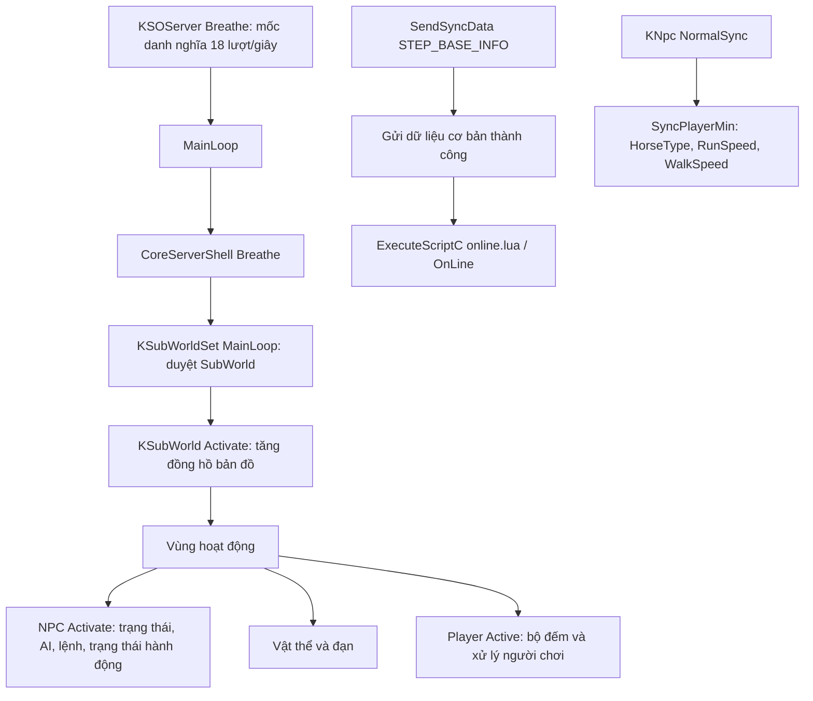

TÓM TẮT 1/5: [NGUỒN][THẤY] Vòng server đặt mốc danh nghĩa 18 lượt/giây; mỗi lượt đi qua MainLoop rồi cập nhật các bản đồ hợp lệ. (MultiServer/GameServer/KSOServer.cpp:90,1425-1450; Core/Src/KSubWorldSet.cpp:601-612)
TÓM TẮT 2/5: [NGUỒN][THẤY] NPC chạy ProcessState → AI → lệnh → trạng thái; Player có nhánh Active riêng, còn vật thể và đạn cũng được cập nhật ở vùng hoạt động. (Core/Src/KNpc.cpp:939-1004; Core/Src/KRegion.cpp:1100-1195; Core/Src/KPlayer.cpp:257-315)
TÓM TẮT 3/5: [NGUỒN][THẤY] OnLine được gọi trong SendSyncData ở bước thông tin cơ bản sau khi gửi gói thành công; nguồn đã đọc không đặt lời gọi này theo chu kỳ mỗi phút. (Core/Src/KPlayer.cpp:980-1042; docs-analysis/out/online.fixed.lua:42)
TÓM TẮT 4/5: [CHƯA KIỂM] SyncPlayerMin mang cờ/mã cưỡi và tốc độ hiện tại; chưa xác minh gói vị trí hay nguyên nhân giật ngựa trên client/runtime. (Core/Src/KNpc.cpp:8058-8180; JX1_OPS/HIEU-GAME/01-trang-bi-cuong-hoa/SO-TAY-NGUA-PHI-PHONG.md:100)
TÓM TẮT 5/5: [CHƯA KIỂM] Chỉ đọc tĩnh; không build, chạy exe, VM hoặc mạng; không commit theo yêu cầu bàn giao của Tổng quan.

ĐÃ ĐỌC SỔ TAY: JX1_OPS/HIEU-GAME/06-mang-goi-tin/SO-TAY-VONG-LAP-SERVER.md
ĐÃ ĐỌC SỔ TAY: JX1_OPS/HIEU-GAME/06-mang-goi-tin/SO-TAY-GOI-TIN.md
ĐÃ ĐỌC SỔ TAY: JX1_OPS/HIEU-GAME/01-trang-bi-cuong-hoa/SO-TAY-NGUA-PHI-PHONG.md

# HG-S1 — Vòng tick gs001, online.lua và trạng thái cưỡi ngựa

Loại: tổng hợp
Chủ đề: Đối chiếu tĩnh vòng cập nhật gs001, lời gọi OnLine và dữ liệu cưỡi ngựa đồng bộ.
Từ khóa: vòng tick, Activate, Active, OnLine, online.lua, cưỡi ngựa, m_bRideHorse, SyncPlayerMin, SyncObjectState
Trạng thái: PARTIAL — đã đối chiếu source cho vòng tick và OnLine; chưa xác định nguyên nhân giật ngựa hoặc luồng gói vị trí.
Độ phủ: 4/4 câu hỏi được phân tích; 3 mục có kết luận tĩnh, mục giật ngựa chỉ khoanh vùng được trạng thái/tốc độ.
Liên quan: SO-18, SO-12, SO-TAY-NGUA-PHI-PHONG.
Cần tôi quyết định: không

Nguồn server: C:/Jx1CocoV3/SwordOnline/SwordOnline/jxOnline/gameserver/Sources. Root không có commit/version được ghim trong task. Nguồn Lua D:/JX-source không tồn tại ở đường dẫn đã kiểm tra; chỉ có bản hook thử C:/Jx1CocoV3/docs-analysis/out/online.fixed.lua, không đại diện cho nội dung đang chạy trên VM.

## Sơ đồ chính

[TÀI LIỆU] Luồng ở trên là thứ tự lời gọi đọc từ source, không phải phép đo thời gian chạy hay sơ đồ thứ tự gói trên dây. (MultiServer/GameServer/KSOServer.cpp:1425-1450,4360-4373; Core/Src/CoreServerShell.cpp:2227-2251; Core/Src/KSubWorldSet.cpp:601-612; Core/Src/KSubWorld.cpp:269-333; Core/Src/KRegion.cpp:1100-1195; Core/Src/KNpc.cpp:8058-8180; Core/Src/KPlayer.cpp:980-1042)

liên quan: JX1_OPS/HIEU-GAME/06-mang-goi-tin/SO-TAY-VONG-LAP-SERVER.md; JX1_OPS/HIEU-GAME/06-mang-goi-tin/SO-TAY-GOI-TIN.md; JX1_OPS/HIEU-GAME/01-trang-bi-cuong-hoa/SO-TAY-NGUA-PHI-PHONG.md.

## Phạm vi và độ phủ

| Phần tử phạm vi | Trạng thái | Kết quả / bằng chứng |
|---|---|---|
| Vòng Activate và tần số tick danh nghĩa | Đã phủ tĩnh | KSOServer xét mốc GAME_FPS=18 rồi gọi MainLoop; bản đồ hợp lệ tăng đồng hồ cục bộ. Nhịp thực tế chưa đo. (MultiServer/GameServer/KSOServer.cpp:90,1425-1450; Core/Src/KSubWorld.cpp:269-293) |
| Công việc đi qua mỗi lượt | Đã phủ tĩnh | Vùng hoạt động cập nhật NPC, vật thể, đạn và Player; KNpc xử lý trạng thái, AI, lệnh và trạng thái. Chưa đo chi phí CPU theo tải. (Core/Src/KRegion.cpp:1100-1195; Core/Src/KNpc.cpp:939-1004) |
| online.lua, OnLine và lỗi script | Đã phủ tĩnh có giới hạn | Callsite và nhánh trả lỗi thấy trong KPlayer; nội dung hook chỉ là mẫu thử, không xác nhận script trên VM. (Core/Src/KPlayer.cpp:980-1042,8415-8443; docs-analysis/out/online.fixed.lua:42,90-92) |
| Cưỡi ngựa, đồng bộ và hiện tượng giật | Phủ một phần | Đã thấy điều kiện cưỡi trong tính lại trang bị và HorseType/tốc độ trong SyncPlayerMin; chưa thấy/đối chiếu gói SyncObjectState, client nhận gói hay số đo vị trí. (Core/Src/KPlayer.cpp:3716-3769; Core/Src/KNpc.cpp:7784-7796,8058-8180) |

## Giải mã tên

| Tên gốc | Mã hóa | Chữ đúng / cách hiểu | Nguồn file:dòng |
|---|---|---|---|
| `Activate`, `Active` | ASCII, định danh mã nguồn | Hàm cập nhật NPC/bản đồ và nhánh cập nhật Player; không dịch tên hàm. | Core/Src/KNpc.cpp:939; Core/Src/KPlayer.cpp:257 |
| `OnLine`, `online.lua` | ASCII, tên hàm/tệp | Hàm Lua được gọi sau bước gửi thông tin cơ bản; không đồng nghĩa bộ hẹn giờ mỗi phút. | Core/Src/KPlayer.cpp:980-1042; docs-analysis/out/online.fixed.lua:42 |
| `m_bRideHorse`, `HorseType` | ASCII, tên biến/trường gói | Cờ đang cưỡi và mã ngựa đồng bộ; khi không cưỡi, trường HorseType được gán -1 trong nhánh đã đọc. | Core/Src/KPlayer.cpp:3732; Core/Src/KNpc.cpp:7784-7790,8174-8179 |
| `SyncPlayerMin`, `SyncObjectState` | ASCII, tên gói/định danh theo task | Source trực tiếp xác nhận `s2c_syncplayermin`; chưa đối chiếu được định nghĩa/consumer `SyncObjectState` trong các tệp được giao. | Core/Src/KNpc.cpp:8058-8180 |

[TÀI LIỆU] Phạm vi này không có tên kỹ năng, NPC, bản đồ hay vật phẩm tiếng Hán/VN cũ cần giải mã GBK/TCVN3. Comment Hán trong source hiển thị lỗi khi đọc theo UTF-8; báo cáo giữ nguyên định danh ASCII và không suy nội dung từ comment lỗi. (Core/Src/KSubWorld.cpp:269-333; Core/Src/KNpc.cpp:939-1004)

## Sắp theo cấu trúc game

[TÀI LIỆU] Nội dung được sắp theo luồng chạy của game: vòng ngoài server → MainLoop/core → SubWorld → vùng hoạt động → NPC, vật thể, đạn và Player. Sau đó tách luồng đồng bộ OnLine và trạng thái cưỡi vì chúng không phải cùng một bước cập nhật. Không có danh sách kỹ năng/trang bị/quái để sắp theo nhánh hoặc bản đồ trong phạm vi task. (MultiServer/GameServer/KSOServer.cpp:1425-1450,4360-4373; Core/Src/KSubWorld.cpp:269-333; Core/Src/KRegion.cpp:1100-1195)

## Vòng tick và phần việc được cập nhật

[THẤY] KSOServer khai báo `GAME_FPS=18`; Breathe so bộ đếm game loop với thời gian đã trôi qua theo mốc này rồi gọi MainLoop khi đến lượt. Đây là nhịp danh nghĩa trong source, không phải kết quả đo. Tài liệu SO-18 cũng phân biệt rõ mốc 18 với tần số runtime chưa xác minh. (MultiServer/GameServer/KSOServer.cpp:90,1425-1450; JX1_OPS/HIEU-GAME/06-mang-goi-tin/SO-TAY-VONG-LAP-SERVER.md:25-31)

[THẤY] MainLoop gọi Breathe của core; CoreServerShell gọi `g_SubWorldSet.MainLoop`. Mỗi lượt duyệt SubWorld, gọi Activate, rồi tăng đồng hồ toàn cục. SubWorld không hợp lệ thoát sớm; bản đồ hợp lệ tăng `m_dwCurrentTime` cục bộ trước khi cập nhật vùng. (MultiServer/GameServer/KSOServer.cpp:4360-4373; Core/Src/CoreServerShell.cpp:2227-2251; Core/Src/KSubWorldSet.cpp:601-612; Core/Src/KSubWorld.cpp:269-293)

[THẤY] Ở nhánh server, SubWorld duyệt danh sách vùng hoạt động, sau đó cập nhật MissionArray và NPC ngoài vùng. Trong vùng hoạt động, NPC được xét Activate; vật thể sống chạy Activate và được chọn đồng bộ theo bộ đếm; đạn chạy Activate; Player được gọi Active. Vì vậy các nhóm đối tượng này là phần việc có thể chạy trong lượt bản đồ, nhưng chưa có số đo thời gian/CPU hay tải theo số lượng đối tượng. (Core/Src/KSubWorld.cpp:301-333; Core/Src/KRegion.cpp:1100-1195)

[THẤY] KNpc::Activate bỏ qua NPC không hợp lệ, đang chuyển server hoặc đã được xử lý trong cùng khung toàn cục. Nếu không thoát ở ProcessState, nhánh tiếp tục qua AI, ProcCommand rồi ProcStatus. Tên Active của KPlayer là hàm riêng: phía server thoát khi kết nối không hoạt động/đang chuyển server, và bộ đếm `m_nPlayerTime` giảm một ở mỗi lần Active. (Core/Src/KNpc.cpp:939-1004; Core/Src/KPlayer.cpp:257-315)

[TÀI LIỆU] CoreServerShell còn gọi `servertimer.lua` hàm Main khi đồng hồ game chia hết cho 18 và đồng hồ hệ thống ở giây 0. KSOServer cũng ghi thống kê khi bộ đếm đạt bội số 1080. Hai đoạn này giải thích mốc tác vụ/ghi log phút; chúng không phải callsite `online.lua` được tìm thấy trong KPlayer. (Core/Src/CoreServerShell.cpp:2227-2251; MultiServer/GameServer/KSOServer.cpp:1453-1459)

## online.lua, OnLine và thông báo lỗi script

[THẤY] Callsite trực tiếp nằm trong `KPlayer::SendSyncData`, nhánh `STEP_BASE_INFO`: sau khi gửi gói thông tin cơ bản thành công, server gọi `ExecuteScriptC("\\script\\system\\online.lua", "OnLine", ...)`. Ngay sau lời gọi, nhánh đặt `bRet=TRUE`; không kiểm giá trị trả về của script. Đoạn nguồn này không cho thấy lời gọi theo chu kỳ mỗi phút. (Core/Src/KPlayer.cpp:980-1042)

[TÀI LIỆU] Bản hook thử `online.fixed.lua` định nghĩa OnLine rồi gọi `JXGive277`, `JXGive282` và `huanyin`; `huanyin` đọc bảy giá trị qua `GetMaptimeInfo`. Đây chỉ là hình dạng của hook được task nêu, không chứng minh script tương ứng đang chạy trên VM. (docs-analysis/out/online.fixed.lua:42-45,90-92)

[THẤY] Với đúng nhánh thông báo `Script error [tên_tệp] please check`, `KPlayer::ExecuteScriptC` đã không lấy được đối tượng script qua `g_GetScript` và trả FALSE. Nếu đối tượng có, wrapper chuyển lời gọi sang ExecuteScriptD; thất bại của CallFunction/catch cũng trả FALSE. Chuỗi thông báo đơn lẻ không chỉ ra nguyên nhân sâu hơn như script chưa nạp, tên hàm thiếu hay lỗi trong Lua. (Core/Src/KPlayer.cpp:8415-8443; Core/Src/KPlayer.cpp:8089-8155,8230-8249)

[THẤY] Trong callsite OnLine đã đọc, giá trị FALSE không được dùng để thoát nhánh SendSyncData; bRet vẫn được đặt TRUE nếu gửi gói thành công. Không thấy nhánh này gọi Release hoặc trả lỗi để dừng MainLoop. Do đó lỗi Lua kiểu được bắt và trả về không tự chứng minh đã chặn vòng tick; source tĩnh cũng không loại trừ việc script chạy lâu/treo hoặc chi phí runtime ảnh hưởng thời gian xử lý. (Core/Src/KPlayer.cpp:1036-1046; MultiServer/GameServer/KSOServer.cpp:1425-1450)

[CHƯA KIỂM] Tên hook `GetMaptimeInfo` khác chữ hoa/thường với handler `GetMapTimeInfo` thấy ở cuối bảng ScriptFuns; bảng còn có tên `GetMaptimeInfo` gắn với `LuaGetNpcMaptimeInfo`, trong khi định nghĩa cũ cùng tên ở vùng đã đọc đang bị comment. Handler mới `LuaGetMapTimeInfo` trả bảy số 0 cho player hợp lệ và được đăng ký bằng tên viết hoa `GetMapTimeInfo`. Đây là chỗ cần xác minh với đúng script/binary; chưa đủ căn cứ để quy nó là nguyên nhân của thông báo. (docs-analysis/out/online.fixed.lua:92; Core/Src/ScriptFuns.cpp:21749-21764,26248,26418)

## Cưỡi ngựa và dữ liệu đồng bộ

[THẤY] Trong `KPlayer.cpp:3716-3769`, vòng tính lại thuộc tính bỏ qua món không dùng được. Riêng ô ngựa chỉ áp thuộc tính khi `m_bRideHorse` đúng. Đoạn này tính thuộc tính trang bị; không xử lý tọa độ hay đường đi của nhân vật. (Core/Src/KPlayer.cpp:3716-3769; JX1_OPS/HIEU-GAME/01-trang-bi-cuong-hoa/SO-TAY-NGUA-PHI-PHONG.md:99)

[THẤY] Bản đồng bộ người chơi thường (`s2c_syncplayer`) ghi HorseType theo `m_bRideHorse` và gửi RunSpeed/WalkSpeed hiện tại. Bản đồng bộ rút gọn (`s2c_syncplayermin`) cũng ghi HorseType theo cùng cờ, đồng thời ghi RunSpeed và WalkSpeed. Đây là dữ liệu trạng thái/hình cưỡi và tốc độ; đoạn dựng gói đã đọc chưa cho thấy tọa độ x/y. (Core/Src/KNpc.cpp:7729-7796,8058-8180; JX1_OPS/HIEU-GAME/01-trang-bi-cuong-hoa/SO-TAY-NGUA-PHI-PHONG.md:100)

[CHƯA KIỂM] Không tìm thấy symbol `SyncObjectState` trong bốn tệp source được chỉ định riêng; chưa đối chiếu được cấu trúc, tần suất gửi hay phía client nhận trạng thái vị trí. Tài liệu SO-12 đã đọc không khẳng định đường đi tọa độ của gói này. Do thiếu client và đo runtime trong phạm vi nguồn, chưa thể kết luận lệch trạng thái cưỡi/tốc độ với vị trí gây ra “giật ngựa”, hay có quan hệ nhân quả nào khác. (Core/Src/KPlayer.cpp:3716-3769; Core/Src/KNpc.cpp:8058-8180; JX1_OPS/HIEU-GAME/06-mang-goi-tin/SO-TAY-GOI-TIN.md:1-5)

## MỤC SỔ THÔNG SỐ

| Nhóm | Tên/hằng số | file:dòng | Giá trị | Đơn vị | Ảnh hưởng | Đổi an toàn | Nguồn đo |
|---|---|---|---|---|---|---|---|
| Nhịp server | `GAME_FPS` | MultiServer/GameServer/KSOServer.cpp:90,1442 | 18 | lượt danh nghĩa/giây | Điều kiện xét đến lượt MainLoop | CẨN THẬN | Đọc tĩnh; chưa đo runtime |
| Đồng hồ bản đồ | `m_dwCurrentTime` | Core/Src/KSubWorld.cpp:269-293 | +1 mỗi Activate của bản đồ hợp lệ | lượt cập nhật bản đồ | Bộ đếm thời gian nội bộ bản đồ | CẨN THẬN | Đọc tĩnh; không quy đổi thành thời gian thực |
| Đồng hồ toàn cục | `m_dwCurrentTime` | Core/Src/KSubWorldSet.cpp:601-612 | +1 sau vòng duyệt SubWorld | lượt MainLoop | Đồng hồ toàn cục dùng để xét khung đã xử lý | CẨN THẬN | Đọc tĩnh |
| Bộ đếm Player | `m_nPlayerTime` | Core/Src/KPlayer.cpp:283-304 | giảm 1 khi dương | lượt gọi Active | Khi về 0, xử lý các ô kỹ năng mở rộng trong đoạn đã đọc | CẨN THẬN | Đọc tĩnh; không có giá trị khởi tạo trong phạm vi này |
| Trạng thái ngựa | `m_bRideHorse`, `HorseType` | Core/Src/KNpc.cpp:7784-7790,8174-8179 | cờ cưỡi; không cưỡi gửi `-1` | cờ / mã loại | Đồng bộ trạng thái ngựa | CẨN THẬN | Đọc tĩnh; chưa đo thời điểm gửi/giao nhận |
| Tốc độ người chơi | `RunSpeed`, `WalkSpeed` | Core/Src/KNpc.cpp:7795-7796,8083-8084 | giá trị hiện thời trong source | giá trị nội bộ | Mang theo trong bản tin đồng bộ đã đọc | CẨN THẬN | Đọc tĩnh; chưa quy đổi hoặc đo quãng đường |

## Đề xuất tối ưu

[TÀI LIỆU] Chưa đề xuất sửa/tối ưu mã từ đọc tĩnh. Nếu được giao khảo sát tiếp, cần đo riêng chu kỳ gửi và nhận trạng thái cưỡi, tốc độ, vị trí cùng khung hình client trước khi chọn nguyên nhân hoặc thay đổi; task hiện tại cấm chạy VM/exe/mạng. Không có số đo để kết luận tối ưu nào sẽ giảm giật. (MultiServer/GameServer/KSOServer.cpp:1425-1450; Core/Src/KNpc.cpp:8058-8180)

## Đã xác minh / Chưa xác minh

- [THẤY] Đã kiểm tra trực tiếp mốc tick trong KSOServer, CoreServerShell, KSubWorldSet và KSubWorld; thứ tự cập nhật đối tượng trong KRegion, KNpc và KPlayer. Đây là source tĩnh, không phải tần số thực đo. (MultiServer/GameServer/KSOServer.cpp:90,1425-1450,4360-4373; Core/Src/CoreServerShell.cpp:2227-2251; Core/Src/KSubWorldSet.cpp:601-612; Core/Src/KSubWorld.cpp:269-333; Core/Src/KRegion.cpp:1100-1195; Core/Src/KNpc.cpp:939-1004; Core/Src/KPlayer.cpp:257-315)
- [THẤY] Đã đối chiếu callsite OnLine, wrapper ExecuteScriptC và handler GetMapTimeInfo; hook online.fixed.lua chỉ dùng làm mẫu hình. (Core/Src/KPlayer.cpp:980-1042,8415-8443; Core/Src/ScriptFuns.cpp:21749-21764,26248,26418; docs-analysis/out/online.fixed.lua:42,90-92)
- [CHƯA KIỂM] D:/JX-source không có tại đường dẫn task nêu; bản hook không xác nhận nội dung Lua đang chạy hoặc nguyên nhân cụ thể của lỗi. (docs-analysis/out/online.fixed.lua:42-45,90-92)
- [CHƯA KIỂM] Chưa xác minh SyncObjectState, client receiver, thời gian gửi/nhận gói hoặc nguyên nhân runtime của hiện tượng giật. Không build/test/chạy exe/VM/mạng theo quyền task.

## Phát hiện và điểm chuyển tiếp

[THẤY] Tiền đề “online.lua gọi OnLine mỗi phút” không khớp callsite đã tìm thấy: call nằm trong bước gửi thông tin cơ bản của Player. Các mốc phút thấy trong phạm vi là log mỗi 1080 lượt của KSOServer và servertimer.lua Main ở điều kiện giây 0; không thấy chúng gọi OnLine. (Core/Src/KPlayer.cpp:980-1042; MultiServer/GameServer/KSOServer.cpp:1453-1459; Core/Src/CoreServerShell.cpp:2227-2251)

[CHƯA KIỂM] Bảng đăng ký GetMaptimeInfo/GetMapTimeInfo có sai khác chữ hoa/thường và handler cũ chưa đối chiếu được trong phạm vi đã đọc. Cần PM giao source script đang dùng hoặc scope kiểm tra cách nạp script nếu cần tìm nguyên nhân thông báo lỗi. (Core/Src/ScriptFuns.cpp:21749-21764,26248,26418; docs-analysis/out/online.fixed.lua:92)

[CHƯA KIỂM] Đề xuất PM gộp mục HG-S1 vào JX1_OPS/DESIGN/MUC-LUC-TRI-THUC.md. Hàng chỉ mục đề xuất: `JX1_OPS/HIEU-GAME/07-server-luu-tru/SO-TAY-TICK-GS001.md` | `tổng hợp` | `Vòng tick gs001, OnLine và trạng thái cưỡi ngựa` | `tick, Activate, Active, OnLine, online.lua, cưỡi ngựa, SyncPlayerMin, SyncObjectState` | `PARTIAL` | `3/4 câu hỏi có kết luận tĩnh; nguyên nhân giật chưa kiểm` | `SO-18; SO-12; SO-TAY-NGUA-PHI-PHONG`.

## Bàn giao

Không sửa mã/configuration; không build, chạy exe, VM hoặc mạng. Không commit/push; Tổng quan tiếp nhận commit. Tệp nhịp được yêu cầu tại D:\JX-wt\HG-S1.nhip nằm ngoài vùng ghi khả dụng; thao tác ghi bị hệ thống từ chối, nên không có mốc nhịp được lưu. Báo cáo và sổ tay nằm trong worktree; kết quả cuối đã ghi vào task.

Kỹ năng đã dùng: jx1-retrofit, jx1-read-server, jx1-read-client (đọc hướng dẫn; không đọc source client vì task không nêu root client), jx1-parameters, jx1-knowledge, jx1-report.