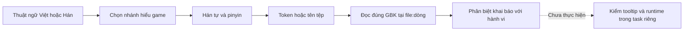

TÓM TẮT 1: [NGUỒN] DONE — bảng tra tĩnh 214 thuật ngữ Hán–pinyin–token–Việt theo 7 nhánh hiểu game.
TÓM TẮT 2: [NGUỒN] Mỗi mục có chữ Hán giải từ dòng GBK, pinyin, tên mã và nguồn file:dòng.
TÓM TẮT 3: [NGUỒN] Đối chiếu tên 11 phái với header Việt TCVN3; giữ nguyên 16 mục INI và giới hạn A-08a.
TÓM TẮT 4: [CHƯA KIỂM] Các tên Việt diễn nghĩa ngoài mẫu TCVN3 chưa đối chiếu toàn bộ tooltip/PAK/bản cài.
TÓM TẮT 5: [NGUỒN] Không build, chạy game/exe game, VM hoặc mạng; không sửa nguồn, commit/push; Tổng quan commit hộ.

# KT-04 — Bảng đối chiếu thuật ngữ Hán–pinyin–tên mã–tiếng Việt

Loại: tổng hợp  
Chủ đề: Tra nhanh thuật ngữ khi đọc mã JX1, phân biệt tên trong dữ liệu với diễn nghĩa chú thích kỹ thuật.  
Từ khóa: thuật ngữ, Hán tự, pinyin, GBK, TCVN3, MonPhai, QiangHua, EnChance, Missle, HIEU-GAME  
Trạng thái: DONE — đủ bảng tra tĩnh; nhịp ngoài worktree bị chặn, xem báo cáo KT-04.  
Độ phủ: 214/214 mục đã đối chiếu dòng và token, 7/7 nhánh chọn; không phải từ điển toàn game.  
Liên quan: [KT-04](../REPORTS/KT-04.md), [mục lục tri thức](../DESIGN/MUC-LUC-TRI-THUC.md), [A-08a](../REPORTS/A-08a-mon-phai-ky-nang.md), [H-03](../REPORTS/H-03-cuong-hoa.md), [I-07](../REPORTS/I-07-cac-loai-tien-te.md), [I-08](../REPORTS/I-08-he-thong-nhiem-vu.md), [K-02 Lua](../REPORTS/K-02-script-lua.md).  
Cần tôi quyết định: không



## Phạm vi và độ phủ

| Nhánh HIEU-GAME dùng để tra | Số mục | Độ phủ | Nguồn trực tiếp |
|---|---:|---|---|
| Nhân vật / môn phái | 25 | Đã phủ các mục liệt kê | `F`, `D` |
| Nhân vật / chỉ số | 25 | Đã phủ các mục liệt kê | `P`, `N` |
| Vật phẩm / trang bị | 49 | Đã phủ các mục liệt kê | `I`, `D`, `R`, `L` |
| Chiến đấu / kỹ năng | 44 | Đã phủ các mục liệt kê | `N`, `K`, `T`, `D` |
| Thế giới / bản đồ / NPC | 25 | Đã phủ các mục liệt kê | `D`, `I`, `P`, `N` |
| Kinh tế / xã hội / nhiệm vụ | 26 | Đã phủ các mục liệt kê | `D`, `I`, `P`, `R` |
| Tài nguyên / giao diện / hoạt ảnh | 20 | Đã phủ các mục liệt kê | `R`, `N`, `K` |
| Tooltip Việt / PAK / bản chạy | Chưa đếm | Chưa phủ toàn bộ | Chưa đọc gói hoặc chạy game |

## Cách đọc bảng và mức xác minh

- **ĐÃ ĐỌC MÃ**: nguồn I/D/N/K/T/R/P là khai báo hoặc chú thích gắn với mã hiện tại; chỉ xác nhận cách định vị thuật ngữ, không xác nhận thuật toán hay chức năng hoạt động.
- **ĐÃ ĐỌC DỮ LIỆU**: F là INI, L là Lua có cả chú thích và mã. **TÀI LIỆU**: báo cáo cũ chỉ hỗ trợ cách gọi và giới hạn; không sửa kết luận của chúng.
- **CHƯA KIỂM TRONG GAME** áp dụng toàn bảng. Cột Việt là tên gameplay quen dùng hoặc diễn nghĩa kỹ thuật; chỉ mẫu tên phái ở mục Giải mã tên có đối chiếu trực tiếp lời thoại Việt. Không coi mọi diễn nghĩa là nguyên văn tooltip VN.
- Pinyin là âm Quan thoại có dấu thanh, không phải tên hàm. Giữ đúng token phân biệt hoa thường, gồm EnChance, Engergy, Missle, nSZo. Một Hán từ có thể ánh xạ khác theo root/ngữ cảnh.
- Nguồn dùng bí danh dưới đây; số sau dấu hai chấm là dòng vật lý từ 1. Hán tự có thể là cụm trích từ chú thích, không phải khóa. Mỗi dòng trích đã giải GBK nghiêm ngặt, không có ký tự thay thế.

### Gốc nguồn và danh sách tệp đọc trực tiếp

`CA/` = `D:/JX-build/qh9A/Classes/`; `S/` = `D:/JX-build/src18/jxOnline/gameserver/Sources/Core/Src/`; `G/` = `C:/Jx1CocoV3/Folder/ServerNew-20260116T043145Z-3-001/ServerNew/_bin_v2_/gs/`.

| Bí danh | Tệp thật | Mã hóa phần trích | Đoạn đã dùng |
|---|---|---|---|
| F | G/Settings/faction/MonPhai.ini | GBK | 1–84 |
| L | G/script/System/qianghua.lua | Hán GBK; lời thoại Việt trộn legacy | 1–180; bảng chỉ trích dòng GBK hợp lệ |
| I | CA/gamecore/KItem.h | GBK ở phần trích | 1–340 |
| D | CA/gamecore/GameDataDef.h | GBK ở phần trích | 1–360, 361–480 |
| N | CA/gamecore/KNpc.h | GBK ở phần trích | 1–360 |
| K | CA/gamecore/KSkills.h | GBK ở phần trích | 1–280 |
| T | CA/gamecore/SkillDef.h | GBK ở phần trích | 1–300 |
| R | CA/gamecore/CoreUseNameDef.h | GBK ở phần trích | 1–190 |
| P | S/KPlayer.h | GBK ở phần trích | 1–390, 391–470 |

Bổ sung đúng tên đã định vị: `CA/gamecore/KItem.cpp:3537` có `KItem::EnChance`; `G/script/header/factionhead.lua:6` đến `:16` có 11 token phái và lời thoại TCVN3. Không dùng root QH-B035 vì nguồn S được giao tồn tại.

## Giải mã tên

Bảng 214 mục phía dưới đồng thời là bảng giải mã: Hán gốc = chữ đọc từ byte GBK; pinyin = cách đọc; Việt = chữ UTF-8; nguồn = file:dòng. Không thay tên gốc. Không tự sửa 戒子 thành 戒指, 纲 thành 钢, 福源 thành 福缘 hoặc 路经 thành 路径.

| Tên Việt gốc trong header | Mã hóa nhận diện | Chữ UTF-8 | Nguồn |
|---|---|---|---|
| ThiÕu L©m | TCVN3, byte xem qua Windows-1252 | Thiếu Lâm / 少林派 | G/script/header/factionhead.lua:6; F:7 |
| Thiªn V­¬ng | TCVN3 | Thiên Vương / 天王帮 | G/script/header/factionhead.lua:7; F:12 |
| §­êng M«n | TCVN3, đoạn lời mời cuối dòng | Đường Môn / 唐门 | G/script/header/factionhead.lua:8; F:17 |
| Ngò §éc | TCVN3 | Ngũ Độc / 五毒教 | G/script/header/factionhead.lua:9; F:22 |
| Nga Mi | ASCII trong câu TCVN3 | Nga Mi / 峨嵋派; A-08a dùng Nga My | G/script/header/factionhead.lua:10; F:27 |
| Thóy Yªn | TCVN3 | Thúy Yên / 翠烟门 | G/script/header/factionhead.lua:11; F:32 |
| C¸i bang | TCVN3 | Cái Bang / 丐帮 | G/script/header/factionhead.lua:12; F:37 |
| Thiªn nhÉn | TCVN3 | Thiên Nhẫn / 天忍教 | G/script/header/factionhead.lua:13; F:42 |
| Vâ §ang | TCVN3 | Võ Đang / 武当派 | G/script/header/factionhead.lua:14; F:47 |
| C«n L«n | TCVN3 | Côn Lôn / 昆仑派 | G/script/header/factionhead.lua:15; F:52 |
| Hoa S¬n | TCVN3 | Hoa Sơn / 华山派 | G/script/header/factionhead.lua:16; F:57 |

Giữ giới hạn A-08a:28,49: 16 mục INI không chứng minh 16 phái chơi được; 11 mục header không chứng minh chỉ có 11 phái hoạt động. Năm mục INI cuối không được tự gán token Lua chưa thấy.

## Sắp theo cấu trúc game

Thứ tự: nhân vật/môn phái/ngũ hành/phe → điểm/chỉ số → trang bị/bộ phận/thuộc tính/cường hóa → kỹ năng/đạn/trạng thái → thế giới/NPC/di chuyển → kinh tế/xã hội/nhiệm vụ → tài nguyên/giao diện/hoạt ảnh. Đây là 7 nhánh nội dung HIEU-GAME trong trang này; không dẫn tới trang nhánh chưa tồn tại. Không xếp kỹ năng theo cấp học hoặc quái theo bản đồ vì phạm vi là từ điển hệ thống, không phải catalog.
### Môn phái → ngũ hành → phe

Nhánh HIEU-GAME: **Nhân vật / môn phái**.

| Mã | Hán gốc (GBK) | Pinyin | Tên mã / tệp / khóa để tìm | Việt / ngữ cảnh | Nguồn |
|---|---|---|---|---|---|
| TN-001 | 少林派 | shàolín pài | `Name; [0]; shaolin` | Thiếu Lâm | `F:7` |
| TN-002 | 天王帮 | tiānwáng bāng | `Name; [1]; tianwang` | Thiên Vương | `F:12` |
| TN-003 | 唐门 | tángmén | `Name; [2]; tangmen` | Đường Môn | `F:17` |
| TN-004 | 五毒教 | wǔdú jiào | `Name; [3]; wudu` | Ngũ Độc | `F:22` |
| TN-005 | 峨嵋派 | éméi pài | `Name; [4]; emei` | Nga Mi; báo cáo A-08a dùng Nga My | `F:27` |
| TN-006 | 翠烟门 | cuìyān mén | `Name; [5]; cuiyan` | Thúy Yên | `F:32` |
| TN-007 | 丐帮 | gàibāng | `Name; [6]; gaibang` | Cái Bang | `F:37` |
| TN-008 | 天忍教 | tiānrěn jiào | `Name; [7]; tianren` | Thiên Nhẫn | `F:42` |
| TN-009 | 武当派 | wǔdāng pài | `Name; [8]; wudang` | Võ Đang | `F:47` |
| TN-010 | 昆仑派 | kūnlún pài | `Name; [9]; kunlun` | Côn Lôn | `F:52` |
| TN-011 | 华山派 | huàshān pài | `Name; [10]; huashan` | Hoa Sơn | `F:57` |
| TN-012 | 李寻欢 | lǐ xúnhuān | `Name; [11]` | Lý Tầm Hoan; chỉ là mục INI | `F:62` |
| TN-013 | 桃花岛 | táohuā dǎo | `Name; [12]` | Đào Hoa Đảo; chỉ là mục INI | `F:67` |
| TN-014 | 明教 | míngjiào | `Name; [13]` | Minh Giáo; chỉ là mục INI | `F:72` |
| TN-015 | 段氏 | duàn shì | `Name; [14]` | Đoàn Thị; chỉ là mục INI | `F:77` |
| TN-016 | 自创门派 | zìchuàng ménpài | `Name; [15]` | Tự sáng môn phái; chưa xác nhận chơi được | `F:82` |
| TN-017 | 金 | jīn | `Series` | Kim | `F:8` |
| TN-018 | 木 | mù | `Series` | Mộc | `F:18` |
| TN-019 | 水 | shuǐ | `Series` | Thủy | `F:28` |
| TN-020 | 火 | huǒ | `Series` | Hỏa | `F:38` |
| TN-021 | 土 | tǔ | `Series` | Thổ | `F:48` |
| TN-022 | 正派 | zhèngpài | `Camp` | Chính phái | `F:9` |
| TN-023 | 中立 | zhōnglì | `Camp` | Trung lập | `F:14` |
| TN-024 | 邪派 | xiépài | `Camp` | Tà phái | `F:24` |
| TN-025 | 门派 | ménpài | `PBP_FACTION` | Môn phái | `D:286` |

### Nhân vật → điểm phát triển → chiến đấu

Nhánh HIEU-GAME: **Nhân vật / chỉ số**.

| Mã | Hán gốc (GBK) | Pinyin | Tên mã / tệp / khóa để tìm | Việt / ngữ cảnh | Nguồn |
|---|---|---|---|---|---|
| TN-026 | 力量 | lìliàng | `m_nStrength` | Sức mạnh | `P:369` |
| TN-027 | 敏捷 | mǐnjié | `m_nDexterity` | Thân pháp; chú thích gốc là mẫn tiệp | `P:370` |
| TN-028 | 活力 | huólì | `m_nVitality` | Sinh khí; chỉ số Vitality, không đồng nhất tên nhánh Ngoại công | `P:371` |
| TN-029 | 精力 | jīnglì | `m_nEngergy` | Nội công; chỉ số Energy, giữ lỗi chính tả Engergy của mã | `P:372` |
| TN-030 | 运气 | yùnqi | `m_nLucky` | May mắn | `P:373` |
| TN-031 | 命中 | mìngzhòng | `m_nDexterity` | Độ chính xác / đánh trúng | `P:370` |
| TN-032 | 体力 | tǐlì | `m_nVitality` | Thể lực | `P:371` |
| TN-033 | 生命 | shēngmìng | `m_nVitality` | Sinh lực | `P:371` |
| TN-034 | 内力 | nèilì | `m_nEngergy` | Nội lực | `P:372` |
| TN-035 | 经验值 | jīngyàn zhí | `m_nExp` | Điểm kinh nghiệm | `P:387` |
| TN-036 | 属性点 | shǔxìng diǎn | `m_nAttributePoint` | Điểm tiềm năng chưa phân phối | `P:366` |
| TN-037 | 技能点 | jìnéng diǎn | `m_nSkillPoint` | Điểm kỹ năng chưa phân phối | `P:367` |
| TN-038 | 统率力 | tǒngshuài lì | `m_dwLeadLevel` | Thống soái | `P:392` |
| TN-039 | 声望 | shēngwàng | `m_cRepute` | Danh vọng | `P:409` |
| TN-040 | 福源 | fúyuán | `m_cFuYuan` | Phúc duyên; giữ chữ 源 trong nguồn | `P:411` |
| TN-041 | 转生 | zhuǎnshēng | `m_cReBorn` | Chuyển sinh | `P:413` |
| TN-042 | 称号 | chēnghào | `m_NpcTitle` | Danh hiệu | `N:302` |
| TN-043 | 世界排名 | shìjiè páimíng | `nRankInWorld` | Xếp hạng thế giới | `N:306` |
| TN-044 | 真元值 | zhēnyuán zhí | `m_ZhenYuan` | Chân nguyên | `N:317` |
| TN-045 | 物理伤害 | wùlǐ shānghài | `damage_physics` | Sát thương vật lý | `N:126` |
| TN-046 | 火焰伤害 | huǒyàn shānghài | `damage_fire` | Sát thương hỏa | `N:127` |
| TN-047 | 冰冻伤害 | bīngdòng shānghài | `damage_cold` | Sát thương băng | `N:128` |
| TN-048 | 闪电伤害 | shǎndiàn shānghài | `damage_light` | Sát thương lôi | `N:129` |
| TN-049 | 毒素伤害 | dúsù shānghài | `damage_poison` | Sát thương độc | `N:130` |
| TN-050 | 无属性伤害 | wú shǔxìng shānghài | `damage_magic` | Sát thương không thuộc tính; không suy mọi magic là nội công | `N:131` |

### Vật phẩm → bộ phận → thuộc tính → cường hóa

Nhánh HIEU-GAME: **Vật phẩm / trang bị**.

| Mã | Hán gốc (GBK) | Pinyin | Tên mã / tệp / khóa để tìm | Việt / ngữ cảnh | Nguồn |
|---|---|---|---|---|---|
| TN-051 | 装备 | zhuāngbèi | `item_equip` | Trang bị | `I:42` |
| TN-052 | 药品 | yàopǐn | `item_medicine` | Dược phẩm | `I:43` |
| TN-053 | 矿石 | kuàngshí | `item_mine` | Khoáng thạch | `I:44` |
| TN-054 | 药材 | yàocái | `item_materials` | Dược liệu | `I:45` |
| TN-055 | 道具 | dàojù | `nItemGenre` | Vật phẩm | `I:85` |
| TN-056 | 武器 | wǔqì | `itempart_weapon` | Vũ khí | `D:216` |
| TN-057 | 头盔 | tóukuī | `emNPCRES_PART_HELM` | Nón / mũ | `R:10` |
| TN-058 | 盔甲 | kuījiǎ | `emNPCRES_PART_ARMOR` | Áo giáp | `R:11` |
| TN-059 | 腰带 | yāodài | `itempart_belt` | Đai lưng | `D:215` |
| TN-060 | 靴子 | xuēzi | `itempart_foot` | Giày | `D:217` |
| TN-061 | 手镯 | shǒuzhuó | `itempart_cuff` | Vòng tay | `D:218` |
| TN-062 | 护腕 | hùwàn | `itempart_cuff` | Hộ uyển; cùng slot vòng tay | `D:218` |
| TN-063 | 项链 | xiàngliàn | `itempart_amulet` | Dây chuyền | `D:219` |
| TN-064 | 戒子 | jièzi | `itempart_ring1` | Nhẫn; giữ 戒子 của nguồn | `D:220` |
| TN-065 | 香囊 | xiāngnáng | `itempart_pendant` | Hương nang | `D:222` |
| TN-066 | 玉佩 | yùpèi | `itempart_pendant` | Ngọc bội | `D:222` |
| TN-067 | 马 | mǎ | `itempart_horse` | Ngựa | `D:223` |
| TN-068 | 面具 | miànjù | `itempart_mask` | Mặt nạ | `D:224` |
| TN-069 | 披风 | pīfēng | `emNPCRES_PART_MANTLE` | Phi Phong; bộ phận hình ảnh, không suy cùng hệ điểm tài phú | `R:14` |
| TN-070 | 套装 | tàozhuāng | `nSet` | Bộ trang bị | `I:110` |
| TN-071 | 等级 | děngjí | `nLevel` | Cấp trang bị | `I:94` |
| TN-072 | 五行属性 | wǔxíng shǔxìng | `nSeries` | Thuộc tính ngũ hành | `I:95` |
| TN-073 | 颜色 | yánsè | `nColor` | Màu vật phẩm | `I:98` |
| TN-074 | 基础属性 | jīchǔ shǔxìng | `m_aryBaseAttrib` | Thuộc tính cơ bản | `I:172` |
| TN-075 | 需求属性 | xūqiú shǔxìng | `m_aryRequireAttrib` | Điều kiện sử dụng | `I:173` |
| TN-076 | 魔法属性 | mófǎ shǔxìng | `m_aryMagicAttrib` | Thuộc tính ma pháp / dòng xanh | `I:174` |
| TN-077 | 隐藏属性 | yǐncáng shǔxìng | `m_yinMagicAttrib` | Thuộc tính ẩn | `I:177` |
| TN-078 | 耐久度 | nàijiǔdù | `m_nCurrentDur` | Độ bền | `I:188` |
| TN-079 | 随机种子 | suíjī zhǒngzi | `uRandomSeed` | Hạt giống sinh thuộc tính | `I:150` |
| TN-080 | 幸运值 | xìngyùn zhí | `nLuck` | Trị số may mắn khi sinh đồ | `I:156` |
| TN-081 | 叠放 | diéfàng | `bStack` | Xếp chồng | `I:89` |
| TN-082 | 叠放数量 | diéfàng shùliàng | `nStackNum` | Số lượng chồng | `I:116` |
| TN-083 | 限时 | xiànshí | `LimitTime` | Thời hạn vật phẩm | `I:119` |
| TN-084 | 绑定 | bǎngdìng | `nIsBang` | Khóa gắn vật phẩm; khác LockItem | `I:129` |
| TN-085 | 快捷栏 | kuàijié lán | `nIsKuaiJie` | Ô phím tắt | `I:131` |
| TN-086 | 外观 | wàiguān | `nRes` | Ngoại hình trang bị | `I:142` |
| TN-087 | 翅膀 | chìbǎng | `nChiBangRes` | Cánh; có trường không chứng minh đã hiển thị | `I:137` |
| TN-088 | 强化 | qiánghuà | `nEnChance; EnChance; qianghua.lua` | Cường hóa | `I:117` |
| TN-089 | 熔炼 | róngliàn | `m_ronMagicAttrib` | Luyện hóa | `I:175` |
| TN-090 | 白金装 | báijīn zhuāng | `nIsPlatina` | Trang bị bạch kim | `I:115` |
| TN-091 | 紫装 | zǐzhuāng | `nPoint` | Trang bị tím | `I:118` |
| TN-092 | 黄金装 | huángjīn zhuāng | `nSZo` | Trang bị hoàng kim | `L:65` |
| TN-093 | 辨识 | biànshí | `nSZj` | Nhận dạng / giám định | `L:60` |
| TN-094 | 纹钢 | wéngāng | `nSZc` | Văn Cương; giữ chữ 钢, không sửa 纲 ở dòng khác | `L:53` |
| TN-095 | 打孔 | dǎkǒng | `nSZb` | Đục lỗ | `L:52` |
| TN-096 | 强蓝石 | qiáng lán shí | `nSZe; 403` | Đá cường hóa Lam | `L:89` |
| TN-097 | 强纲石 | qiáng gāng shí | `nSZe; 404` | Đá cường hóa Cương; nguồn viết 纲 | `L:92` |
| TN-098 | 强辨石 | qiáng biàn shí | `nSZe; 405` | Đá cường hóa Biện | `L:95` |
| TN-099 | 普通蓝装 | pǔtōng lán zhuāng | `ItemQiangHua` | Trang bị xanh thường | `L:165` |

### Kỹ năng → loại → đạn → mục tiêu → trạng thái

Nhánh HIEU-GAME: **Chiến đấu / kỹ năng**.

| Mã | Hán gốc (GBK) | Pinyin | Tên mã / tệp / khóa để tìm | Việt / ngữ cảnh | Nguồn |
|---|---|---|---|---|---|
| TN-100 | 技能 | jìnéng | `m_SkillID` | Kỹ năng | `N:264` |
| TN-101 | 技能等级 | jìnéng děngjí | `m_Level` | Cấp kỹ năng | `N:265` |
| TN-102 | 武功流派 | wǔgōng liúpài | `m_nAttrib` | Nhánh võ công | `K:103` |
| TN-103 | 光环 | guānghuán | `m_bIsAura` | Vầng sáng / aura | `K:89` |
| TN-104 | 被动技能 | bèidòng jìnéng | `m_bIsPassivity` | Kỹ năng bị động | `K:90` |
| TN-105 | 近身攻击 | jìnshēn gōngjī | `m_bIsMelee` | Cận chiến | `K:91` |
| TN-106 | 命中率 | mìngzhòng lǜ | `m_bUseAttackRate` | Tỷ lệ đánh trúng | `K:92` |
| TN-107 | 射程 | shèchéng | `m_nAttackRadius` | Tầm đánh; không mặc định bán kính sát thương vùng | `K:144` |
| TN-108 | 熟练度 | shúliàndù | `m_nSKillExp` | Độ thuần thục | `K:151` |
| TN-109 | 骑马限制 | qímǎ xiànzhì | `m_nHorseLimited` | Giới hạn cưỡi ngựa | `K:152` |
| TN-110 | 武器限制 | wǔqì xiànzhì | `GetEquiptLimited` | Giới hạn vũ khí | `K:233` |
| TN-111 | 技能图标 | jìnéng túbiāo | `m_szSkillIcon` | Biểu tượng kỹ năng | `K:66` |
| TN-112 | 最小等级 | zuìxiǎo děngjí | `m_usReqLevel` | Cấp tối thiểu để học | `K:71` |
| TN-113 | 子技能 | zǐ jìnéng | `m_nChildSkillId` | Kỹ năng con | `K:127` |
| TN-114 | 子技能的数量 | zǐ jìnéng de shùliàng | `m_nChildSkillNum` | Số kỹ năng con; không suy số mục tiêu trúng | `K:111` |
| TN-115 | 子弹 | zǐdàn | `MAX_MISSLESTYLE` | Đạn kỹ năng; mã dùng Missle, giữ nguyên cách viết | `T:9` |
| TN-116 | 原地 | yuándì | `MISSLE_MMK_Stand` | Đạn tại chỗ | `T:18` |
| TN-117 | 直线飞行 | zhíxiàn fēixíng | `MISSLE_MMK_Line` | Đạn bay thẳng | `T:19` |
| TN-118 | 随机飞行 | suíjī fēixíng | `MISSLE_MMK_Random` | Đạn bay ngẫu nhiên | `T:20` |
| TN-119 | 环行飞行 | huánxíng fēixíng | `MISSLE_MMK_Circle` | Đạn bay vòng | `T:21` |
| TN-120 | 跟踪目标 | gēnzōng mùbiāo | `MISSLE_MMK_Follow` | Bám theo mục tiêu | `T:23` |
| TN-121 | 抛物线 | pāowùxiàn | `MISSLE_MMK_Parabola` | Đường đạn parabol | `T:25` |
| TN-122 | 墙形 | qiángxíng | `SKILL_MF_Wall` | Đạn dạng tường | `T:119` |
| TN-123 | 线形 | xiànxíng | `SKILL_MF_Line` | Đạn dạng đường | `T:120` |
| TN-124 | 散形 | sànxíng | `SKILL_MF_Spread` | Đạn tỏa | `T:121` |
| TN-125 | 圆形 | yuánxíng | `SKILL_MF_Circle` | Đạn dạng vòng tròn | `T:122` |
| TN-126 | 区域 | qūyù | `SKILL_MF_Zone` | Vùng phát đạn | `T:124` |
| TN-127 | 定点 | dìngdiǎn | `SKILL_MF_AtTarget` | Phát tại điểm đích | `T:125` |
| TN-128 | 本身 | běnshēn | `SKILL_MF_AtFirer` | Phát tại người dùng | `T:126` |
| TN-129 | 等待状态 | děngdài zhuàngtài | `MS_DoWait` | Trạng thái chờ của đạn | `T:45` |
| TN-130 | 飞行状态 | fēixíng zhuàngtài | `MS_DoFly` | Trạng thái bay | `T:46` |
| TN-131 | 消亡状态 | xiāowáng zhuàngtài | `MS_DoVanish` | Trạng thái tiêu biến | `T:47` |
| TN-132 | 碰撞 | pèngzhuàng | `MS_DoCollision` | Va chạm | `T:48` |
| TN-133 | 敌人 | dírén | `m_bTargetEnemy` | Kẻ địch | `K:94` |
| TN-134 | 同盟 | tóngméng | `m_bTargetAlly` | Đồng minh | `K:95` |
| TN-135 | 物件 | wùjiàn | `m_bTargetObj` | Đối tượng vật thể | `K:96` |
| TN-136 | 必中技能 | bìzhòng jìnéng | `m_bMustBeHit` | Kỹ năng chắc trúng theo cờ source | `K:139` |
| TN-137 | 毒 | dú | `STATE_NOTE_POISON` | Trúng độc | `D:184` |
| TN-138 | 冰 | bīng | `STATE_NOTE_FREEZE` | Đóng băng | `D:185` |
| TN-139 | 燃烧 | ránshāo | `STATE_NOTE_BURN` | Thiêu đốt | `D:186` |
| TN-140 | 混乱 | hùnluàn | `STATE_NOTE_CONFUSE` | Loạn | `D:187` |
| TN-141 | 眩晕 | xuànyūn | `STATE_NOTE_STUN` | Choáng | `D:188` |
| TN-142 | 隐藏状态 | yǐncáng zhuàngtài | `STATE_NOTE_HIDE` | Ẩn thân / trạng thái ẩn | `D:193` |
| TN-143 | 剩余时间 | shèngyú shíjiān | `m_LeftTime` | Thời gian còn lại của trạng thái | `N:266` |

### Thế giới → NPC → di chuyển → vật thể

Nhánh HIEU-GAME: **Thế giới / bản đồ / NPC**.

| Mã | Hán gốc (GBK) | Pinyin | Tên mã / tệp / khóa để tìm | Việt / ngữ cảnh | Nguồn |
|---|---|---|---|---|---|
| TN-144 | 玩家 | wánjiā | `kind_player` | Người chơi | `D:366` |
| TN-145 | 同伴 | tóngbàn | `kind_partner` | Đồng bạn; không mặc định là hảo hữu xã hội | `D:367` |
| TN-146 | 对话者 | duìhuàzhě | `kind_dialoger` | NPC đối thoại | `D:368` |
| TN-147 | 动物 | dòngwù | `kind_normal` | Động vật / nhóm quái Kind=0 | `D:365` |
| TN-148 | 地图 | dìtú | `nObjIdx` | Bản đồ | `I:88` |
| TN-149 | 传送门 | chuánsòngmén | `item_townportal` | Cổng truyền tống | `I:47` |
| TN-150 | 重生点 | chóngshēng diǎn | `m_ReviveID` | Điểm hồi sinh | `P:67` |
| TN-151 | 站立 | zhànlì | `do_stand` | Đứng | `N:66` |
| TN-152 | 行走 | xíngzǒu | `do_walk` | Đi bộ | `N:67` |
| TN-153 | 跑动 | pǎodòng | `do_run` | Chạy | `N:68` |
| TN-154 | 跳跃 | tiàoyuè | `do_jump` | Nhảy | `N:69` |
| TN-155 | 打坐 | dǎzuò | `do_sit` | Ngồi thiền | `N:73` |
| TN-156 | 受伤 | shòushāng | `do_hurt` | Trúng đòn | `N:74` |
| TN-157 | 死亡 | sǐwáng | `do_death` | Chết | `N:75` |
| TN-158 | 格挡 | gédǎng | `do_defense` | Đỡ đòn | `N:76` |
| TN-159 | 重生 | chóngshēng | `do_revive` | Hồi sinh | `N:86` |
| TN-160 | 瞬间移动 | shùnjiān yídòng | `do_movepos` | Dịch chuyển tức thời | `N:88` |
| TN-161 | 震退 | zhèntuì | `do_knockback` | Đẩy lùi | `N:89` |
| TN-162 | 拉扯 | lāchě | `do_drag` | Kéo mục tiêu | `N:90` |
| TN-163 | 尸体 | shītǐ | `Obj_Kind_Body` | Thi thể | `D:306` |
| TN-164 | 宝箱 | bǎoxiāng | `Obj_Kind_Box` | Rương báu | `D:307` |
| TN-165 | 陷阱 | xiànjǐng | `Obj_Kind_Trap` | Bẫy | `D:314` |
| TN-166 | 光源 | guāngyuán | `Obj_Kind_Light` | Nguồn sáng bản đồ | `D:312` |
| TN-167 | 寻路 | xúnlù | `m_IsInfindPathState` | Tìm đường | `P:250` |
| TN-168 | 回城 | huíchéng | `nIsReTurn` | Về thành | `P:205` |

### Kinh tế → túi kho → giao dịch; xã hội → nhiệm vụ

Nhánh HIEU-GAME: **Kinh tế / xã hội / nhiệm vụ**.

| Mã | Hán gốc (GBK) | Pinyin | Tên mã / tệp / khóa để tìm | Việt / ngữ cảnh | Nguồn |
|---|---|---|---|---|---|
| TN-169 | 银两 | yínliǎng | `moneyunit_money` | Bạc / ngân lượng | `D:233` |
| TN-170 | 金币 | jīnbì | `moneyunit_xu` | Xu tại enum này; không áp một tên tiền cho mọi root | `D:235` |
| TN-171 | 点卡 | diǎnkǎ | `moneyunit_expoint` | Điểm thẻ | `D:238` |
| TN-172 | 积分 | jīfēn | `moneyunit_jifen` | Điểm tích lũy; loại điểm cụ thể tùy luồng | `D:239` |
| TN-173 | 商店购买价格 | shāngdiàn gòumǎi jiàgé | `nPrice` | Giá mua tại cửa hàng | `I:93` |
| TN-174 | 摆摊 | bǎitān | `nSellModel` | Bày bán / gian hàng | `I:101` |
| TN-175 | 摆摊购买价格 | bǎitān gòumǎi jiàgé | `uPrice` | Giá mua gian hàng | `I:105` |
| TN-176 | 交易 | jiāoyì | `m_cTrade` | Giao dịch | `P:365` |
| TN-177 | 包袱 | bāofu | `room_equipment` | Hành trang | `D:245` |
| TN-178 | 贮物箱 | zhùwùxiāng | `room_repository` | Rương kho | `D:246` |
| TN-179 | 扩展箱 | kuòzhǎn xiāng | `room_exbox1` | Rương mở rộng | `D:247` |
| TN-180 | 同伴包袱 | tóngbàn bāofu | `room_equipmentex` | Túi đồng bạn | `D:250` |
| TN-181 | 交易栏 | jiāoyì lán | `room_trade` | Ô giao dịch | `D:251` |
| TN-182 | 给予 | jǐyǔ | `room_give` | Trao vật phẩm | `D:255` |
| TN-183 | 打造 | dǎzào | `room_dazao` | Chế tạo | `D:257` |
| TN-184 | 材料 | cáiliào | `room_cailiao` | Nguyên liệu | `D:258` |
| TN-185 | 好友 | hǎoyǒu | `CHAT_CHANNEL_NAME_SINGLE` | Hảo hữu / bạn bè | `R:81` |
| TN-186 | 队友 | duìyǒu | `CHAT_CHANNEL_NAME_TEAM` | Đồng đội | `R:82` |
| TN-187 | 同门 | tóngmén | `CHAT_CHANNEL_NAME_FACTION` | Đồng môn | `R:83` |
| TN-188 | 帮众 | bāngzhòng | `CHAT_CHANNEL_NAME_TONG` | Thành viên bang | `R:84` |
| TN-189 | 陌生人 | mòshēngrén | `CHAT_CHANNEL_NAME_SCREENSINGLE` | Người lạ | `R:85` |
| TN-190 | 组队 | zǔduì | `m_cTeam` | Lập tổ đội | `P:396` |
| TN-191 | 帮会 | bānghuì | `m_cTong` | Bang hội | `P:417` |
| TN-192 | 私聊频道 | sīliáo píndào | `CHAT_TAKE_CHANNEL_NAME_SCREENSINGLE` | Kênh mật | `R:91` |
| TN-193 | 任务 | rènwu | `m_cTask` | Nhiệm vụ; task lưu biến không phải một quest riêng | `P:401` |
| TN-194 | 死亡脚本 | sǐwáng jiǎoběn | `m_dwDeathScriptId` | Script khi chết | `P:419` |

### Hình ảnh → tài nguyên → bảng tra → lớp vẽ

Nhánh HIEU-GAME: **Tài nguyên / giao diện / hoạt ảnh**.

| Mã | Hán gốc (GBK) | Pinyin | Tên mã / tệp / khóa để tìm | Việt / ngữ cảnh | Nguồn |
|---|---|---|---|---|---|
| TN-195 | 人物类型 | rénwù lèixíng | `NPC_RES_KIND_FILE_NAME` | Loại ngoại hình nhân vật | `R:30` |
| TN-196 | 普通npc资源 | pǔtōng NPC zīyuán | `NPC_NORMAL_RES_FILE` | Tài nguyên NPC thường | `R:41` |
| TN-197 | 普通npc资源信息 | pǔtōng NPC zīyuán xìnxī | `NPC_NORMAL_SPRINFO_FILE` | Thông tin tài nguyên NPC thường | `R:42` |
| TN-198 | 界面状态与图形对照表 | jièmiàn zhuàngtài yǔ túxíng duìzhào biǎo | `PLAYER_MENU_STATE_RES_FILE` | Bảng trạng thái giao diện và hình | `R:29` |
| TN-199 | 状态图形对照表 | zhuàngtài túxíng duìzhào biǎo | `STATE_MAGIC_TABLE_NAME` | Bảng hình trạng thái | `R:43` |
| TN-200 | 主角动作阴影对应表 | zhǔjué dòngzuò yīnyǐng duìyìng biǎo | `PLAYER_RES_SHADOW_FILE` | Bảng bóng theo động tác nhân vật | `R:44` |
| TN-201 | 主角动作声音表 | zhǔjué dòngzuò shēngyīn biǎo | `PLAYER_SOUND_FILE` | Bảng âm thanh động tác nhân vật | `R:46` |
| TN-202 | 动作编号表 | dòngzuò biānhào biǎo | `ACTION_FILE_NAME` | Bảng mã động tác | `R:50` |
| TN-203 | 瞬间特效 | shùnjiān tèxiào | `PLAYER_INSTANT_SPECIAL_FILE` | Hiệu ứng tức thời | `R:52` |
| TN-204 | 部件说明文件名 | bùjiàn shuōmíng wénjiànmíng | `KIND_FILE_SECT1` | Tên tệp mô tả bộ phận | `R:58` |
| TN-205 | 武器行为关联表1 | wǔqì xíngwéi guānlián biǎo yī | `KIND_FILE_SECT2` | Bảng liên kết động tác vũ khí 1 | `R:59` |
| TN-206 | 动作贴图顺序表 | dòngzuò tiētú shùnxù biǎo | `KIND_FILE_SECT4` | Bảng thứ tự lớp ảnh theo động tác | `R:61` |
| TN-207 | 资源文件路经 | zīyuán wénjiàn lùjīng | `KIND_FILE_SECT5` | Đường dẫn tài nguyên; giữ lỗi 路经 của nguồn | `R:62` |
| TN-208 | 小地图颜色 | xiǎo dìtú yánsè | `defLITTLE_MAP_SET_FILE` | Màu bản đồ nhỏ | `R:64` |
| TN-209 | 基础层 | jīchǔ céng | `emNPCRES_PART_LAYER_BASE` | Lớp hình cơ sở | `R:22` |
| TN-210 | 特效层 | tèxiào céng | `emNPCRES_PART_LAYER_EFFECT` | Lớp hiệu ứng | `R:23` |
| TN-211 | 全部帧 | quánbù zhēn | `nTotalFrame` | Tổng khung của động tác | `N:159` |
| TN-212 | 当前帧 | dāngqián zhēn | `nCurrentFrame` | Khung hiện tại | `N:160` |
| TN-213 | 状态动画 | zhuàngtài dònghuà | `m_StateGraphics` | Hoạt ảnh trạng thái | `N:269` |
| TN-214 | 残影 | cányǐng | `m_nMaxShadowNum` | Dư ảnh | `K:142` |

## Cách tìm chữ Hán trong mã GBK

Chọn đúng tệp từ bảng/map trước, chuyển byte GBK thành Unicode trong bộ nhớ rồi tìm. Không ghi đè hoặc đổi tên tệp nguồn. Ví dụ PowerShell (cùng phương pháp đọc tĩnh đã dùng):

```powershell
$p = 'D:\JX-build\qh9A\Classes\gamecore\KItem.h'
$gbk = [Text.Encoding]::GetEncoding(936)
$lines = [IO.File]::ReadAllLines($p, $gbk)
for ($i = 0; $i -lt [Math]::Min(340, $lines.Length); $i++) {
    if ($lines[$i].Contains('强化')) {
        '{0}:{1}: {2}' -f $p, ($i + 1), $lines[$i]
    }
}
```

Kết quả đã đọc: `I:117` có `nEnChance //强化`; `CA/gamecore/KItem.cpp:3537` có `KItem::EnChance`. Chỉ chứng minh cách định vị, không kiểm lại công thức H-03. Mỗi lần xem tối đa khoảng 400 dòng; ưu tiên tìm token ASCII khi chưa rõ encoding.

Ví dụ Python chuyển mã rồi tìm trong bộ nhớ (minh họa, chưa chạy nguyên văn; chưa kiểm Python trên máy):

```powershell
@'
from pathlib import Path
p = Path(r'D:\JX-build\qh9A\Classes\gamecore\KItem.h')
skipped = []
for n, raw in enumerate(p.read_bytes().splitlines()[:340], 1):
    try:
        text = raw.decode('gbk', errors='strict')
    except UnicodeDecodeError:
        skipped.append(n)  # Kiểm riêng dòng trộn Việt, không kết luận Hán.
        continue
    utf8 = text.encode('utf-8')  # Không ghi lại source.
    if '强化' in utf8.decode('utf-8'):
        print(f'{p}:{n}: {text}')
print('Dong can kiem encoding rieng:', skipped)
'@ | python -I -
```

Nếu có rg và tệp đã xác nhận GBK thuần: `rg -n --encoding gbk '强化' <file>` (minh họa, chưa chạy; máy này thiếu rg). Với tệp trộn Hán GBK và Việt TCVN3, không giải GBK toàn tệp để kết luận tên Việt. Giữ byte nguồn; xem riêng byte Việt qua Windows-1252 để nhận diện TCVN3 và đối chiếu tên/bảng chuyển mã đã biết. Tên đường dẫn mojibake cần giữ tên vật lý đã xác nhận. Xem [K-02 Lua](../REPORTS/K-02-script-lua.md#giải-mã-tên).

## Đã xác minh / Chưa xác minh

**ĐÃ XÁC MINH / ĐÃ ĐỌC MÃ:** 214 Hán từ duy nhất; token đầu và số dòng khớp nguồn hiện tại; từng dòng được giải GBK nghiêm ngặt. Pinyin biên soạn cho Hán tự trong bảng, không phải token trích từ mã. Đối chiếu mẫu tên 11 phái với lời thoại TCVN3. Không thay kết luận cũ.

**CHƯA XÁC MINH / CHƯA KIỂM TRONG GAME:** nguyên văn mọi tooltip Việt, toàn bộ thuật ngữ game, source có khớp binary/PAK hay không, tính năng cánh/đồng bạn/cường hóa đang bật, đơn vị thời gian/cân bằng. Chưa chạy game/build/VM/mạng; chưa chạy Python/rg minh họa.

## Bàn giao

Chi tiết tra đồ thị, lỗi lệnh và chỉ mục gộp: [KT-04](../REPORTS/KT-04.md). Không sửa thông số/mã game. Chưa có SHA mới, Tổng quan commit hộ. Nếu cần nguyên văn giao diện, đối chiếu tooltip đúng bản trong task riêng được duyệt.

Kỹ năng đã dùng: jx1-retrofit, jx1-read-server, jx1-read-client, jx1-parameters, jx1-knowledge, jx1-report.
