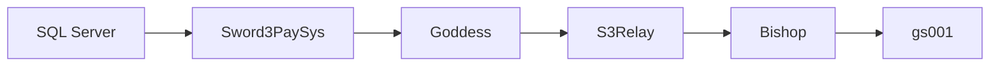

TÓM TẮT 1: [NGUỒN] Chuỗi tổng hợp gồm SQL Server, Sword3PaySys, Goddess, S3Relay, Bishop và gs001.
TÓM TẮT 2: [NGUỒN] Các thao tác GUI và thời gian nạp là ghi nhận cũ, chưa đo lại trong A-01 hoặc R-01.
TÓM TẮT 3: [NGUỒN] Cổng 7777 chưa rõ ảnh hưởng; danh sách cổng cũ được giữ nguyên.
TÓM TẮT 4: [NGUỒN] R-01 đối chiếu được tên các nhóm kết nối trong gs001_cfg.ini, chưa chứng minh dịch vụ đang chạy.
TÓM TẮT 5: [CHƯA KIỂM] R-01 không chạy build, exe, VM hoặc mạng; kết quả build/VM có trong thân là ghi nhận lịch sử, chưa tái kiểm.

# A-01 — Bản đồ tiến trình server

Loại: tổng hợp
Chủ đề: Thứ tự dịch vụ, cổng và giới hạn vận hành của chuỗi server.
Từ khóa: tiến trình, process, đăng nhập, Sword3PaySys, Goddess, S3Relay, Bishop, gs001
Trạng thái: PARTIAL — bản tổng hợp lịch sử; chưa kiểm lại tiến trình và cổng trên VM.
Độ phủ: đã phủ 6 trên tổng 6 dịch vụ trong nội dung gốc; đối chiếu mới và phần chưa phủ ghi riêng trong bảng.
Liên quan: `JX1_OPS/REPORTS/A-02-luong-dang-nhap.md`; `JX1_OPS/REPORTS/A-03-kiem-ke-cau-hinh.md`; `JX1_OPS/REPORTS/A-04-kien-truc-tong.md`; `JX1_OPS/DESIGN/CHUAN-BAO-CAO.md`; `JX1_OPS/DESIGN/MUC-LUC-TRI-THUC.md`; `JX1_OPS/DESIGN/HUONG-DAN-TRA-CUU.md`
Cần tôi quyết định: không (đối với đợt chuẩn hóa R-01).

## Sơ đồ chính

## Phạm vi và độ phủ

[NGUỒN] Đơn vị đếm là hạng mục ghi trong bảng, không phải toàn bộ hệ thống JX1. “Đã phủ” chỉ phần đã được mô tả trong báo cáo gốc; cột cuối phân biệt phần trực tiếp đối chiếu trong R-01 với phần chưa phủ dữ liệu gốc. Không nâng bằng chứng cũ thành xác minh mới.

Ký hiệu riêng của phần chuẩn hóa: `GS/` = `C:\Jx1CocoV3\Folder\ServerNew-20260116T043145Z-3-001\ServerNew\_bin_v2_\gs\`; `CA/` = `D:\JX-build\qh9A\Classes\`. Alias trong thân gốc giữ nguyên ý nghĩa lịch sử.

| Hạng mục | Độ phủ nội dung gốc | Bằng chứng trong báo cáo này | Đối chiếu dữ liệu gốc R-01 / phần chưa phủ |
|---|---|---|---|
| SQL Server / SQLEXPRESS | Đã phủ (theo mức chắc ghi trong thân) | `A-01-ban-do-tien-trinh.md:57` | Chưa phủ dữ liệu DB/tiến trình: không nằm trong hai gốc được giao. |
| Sword3PaySys | Đã phủ (theo mức chắc ghi trong thân) | `A-01-ban-do-tien-trinh.md:58` | Chưa phủ dịch vụ xác thực: gs chỉ là dữ liệu game server. |
| Goddess | Đã phủ (theo mức chắc ghi trong thân) | `A-01-ban-do-tien-trinh.md:59` | GS/gs001_cfg.ini:5 có nhóm Database; chưa xác minh binary Goddess. |
| S3Relay: Transfer, Chat, Tong | Đã phủ (theo mức chắc ghi trong thân) | `A-01-ban-do-tien-trinh.md:60` | GS/gs001_cfg.ini:9, :13, :17 có đủ ba nhóm kết nối. |
| Bishop | Đã phủ (theo mức chắc ghi trong thân) | `A-01-ban-do-tien-trinh.md:61` | GS/gs001_cfg.ini:1 có nhóm Gateway; chưa xác minh binary Bishop. |
| gs001 | Đã phủ (theo mức chắc ghi trong thân) | `A-01-ban-do-tien-trinh.md:62` | GS/gs001_cfg.ini:21 có nhóm GameServer; file GS/gs001.exe hiện hữu, chỉ đọc byte. |

## Nội dung gốc (bảo toàn)

**TÓM TẮT**
1. Chuỗi khởi động bắt buộc: SQL Server (1433) → `Sword3PaySys` (5002) → `Goddess` (5001, bấm Start) → `S3Relay` (5003-5005, 7776; đăng nhập root) → `Bishop` (56722 cho client, 56732 cho game server; Login rồi Startup) → `gs001` (51189).
2. Thao tác tay trong exe có giao diện (Goddess Start, S3Relay root, Bishop Login/Startup) đã được script hóa bằng task `JX-ChainUp` trong VM thử; cần phiên desktop mu1 đang đăng nhập.
3. `gs001` nạp ~7 phút (~805 dòng log); không được mở kết nối tới 51189 trong lúc nạp (crash do con trỏ NULL, báo cáo 29).
4. Cổng 7777 (`RELAY_ROUTE_PORT`) chưa có tiến trình nghe, chưa rõ ảnh hưởng.
5. Nhãn tin cậy: toàn bộ bảng dưới là **tổng hợp từ `docs-analysis/BAI_HOC.md` và `CLAUDE.md`**, mỗi dòng đã được kiểm lúc dựng Main VM; **chưa kiểm lại trên VM thử trong A-01** (VM thử đang treo, xem TRANG-THAI 0-07).

## Tiến trình và cổng

| Thứ tự | Tiến trình | Cổng | Vai trò | Ghi chú vận hành | Log |
|---|---|---|---|---|---|
| 1 | SQL Server (`SQLEXPRESS`) | 1433 | DB `account` | Chỉ nội bộ VM | SQL |
| 2 | `Sword3PaySys` | 5002 | Tài khoản, đăng nhập dịch vụ | Tài khoản chơi cần `Account_Info` và `Account_Habitus` còn hạn | `gw\payserver_log` |
| 3 | `Goddess` | 5001 | Lưu nhân vật (`Goddess/DBTable.cpp`, `IDBRoleServer.cpp`) | Phải bấm Start; tiêu đề `[Enable DB]` là đã chạy | `gw\goddes_log` |
| 4 | `S3Relay` | 5003, 5004, 5005, 7776 | Transfer, Chat, Tong (bang hội, bạn bè); 7776 = `RELAY_SIBLING_PORT` | Hộp thoại `login root` | `gw\relay_log` |
| 5 | `Bishop` | 56722 (client), 56732 (game server) | Cổng vào, định tuyến (`Bishop/GameServer.cpp`, `SmartClient.cpp`, `Intercessor.cpp`) | Login rồi Startup; 56722 mã cứng trong client | `gw\bishop_log` |
| 6 | `gs001` | 51189 (`gs002` trở đi: cổng kế tiếp) | Game server; kết nối tới 5001, 5003, 5004, 5005, 56732 | Địa chỉ gửi client lấy từ `gs001_cfg.ini` `[GameServer] Ip` (phải chứa `localIp`) | `gs\gameser_log` + console |

## File cấu hình chính
`gs001_cfg.ini` (cổng relay, Ip), `gs\Settings\MapList.ini`, `gs\maps\WorldSet_gs001.ini`, `Resources/package.ini` phía client (địa chỉ tải), `data/paklist.ini`.

## Bẫy đã biết
- Hộp thoại tường lửa chiếm focus khi exe mở cổng: tạo luật Inbound Block theo exe trước khi chạy.
- Nút không bấm được khi cửa sổ không ở phía trước: đưa cửa sổ lên (Alt+Tab hoặc `AppActivate`) rồi gửi Space.
- Luật `portproxy` còn không có nghĩa là cổng đang nghe: kiểm `netstat -ano | Select-String LISTENING`.
- 28 bản đồ của `gs001` không nạp được vì thiếu `.wor` trong PAK server.

## Chưa kiểm
- Kiểm lại cổng và tiến trình trên VM thử sau khi nó hoạt động lại (`jx_env_up.ps1` in danh sách cổng đang nghe).
- Ảnh hưởng của cổng 7777; mã nguồn server có khớp exe đang chạy hay không.

## Đã xác minh / Chưa xác minh

**ĐÃ XÁC MINH — R-01:** Đã đọc cấu trúc GS/gs001_cfg.ini:1, :5, :9, :13, :17, :21; chỉ trích tên section, không trích giá trị địa chỉ hoặc thông tin xác thực. Báo cáo được đọc UTF-8 nghiêm ngặt, lưu UTF-8 không BOM; bảo toàn phần thân gốc, gồm tóm tắt, kết luận, số liệu và bằng chứng.

**CHƯA XÁC MINH — R-01:** các phần ghi chưa phủ trong bảng; tính tương thích giữa nguồn lịch sử, dữ liệu hiện có và binary đang chạy; mọi kết quả build/test/VM cũ chưa được tái hiện. Các gốc source server hoặc checkpoint ngoài GS/CA không được đọc mở rộng trong nhiệm vụ này.

## Bàn giao

Đợt chuẩn hóa thuộc `task/R-01`, commit theo nhóm tối đa 5 file, không push. SHA thực tế được ghi ở phản hồi hoàn tất; xem `JX1_OPS/REPORTS/R-01.md` và chỉ mục `JX1_OPS/REPORTS/_CHIMUC/R-01.tsv`. Trạng thái Git trong thân là lịch sử của nhiệm vụ gốc. Bước tiếp theo: PM gộp chỉ mục, giao khảo sát riêng nếu cần bù phần chưa phủ; R-01 không cấp quyền chạy lệnh vận hành có trong thân.

## Phát hiện khi chuẩn hóa

- Báo cáo gốc dùng nguồn tổng hợp, chưa có file:dòng riêng cho các ghi nhận vận hành; không nâng mức chắc của chúng khi chuẩn hóa.
- Các section kết nối không chứng minh dịch vụ đang lắng nghe. Cổng 7777 và 28 bản đồ lỗi vẫn là vấn đề lịch sử chưa kiểm lại.
