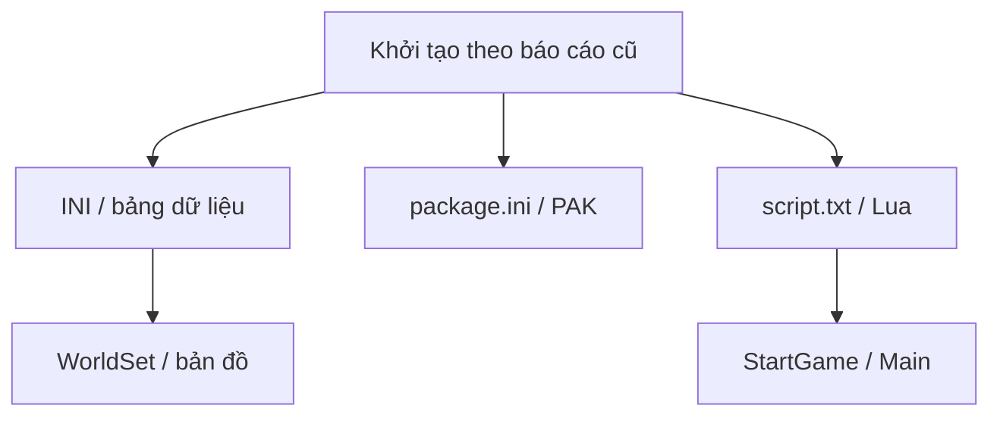

TÓM TẮT 1: [NGUỒN] Số 0 INI/Lua/TAB/PAK của A-03 thuộc cây source cũ; không phải số của thư mục gs được giao cho R-01.
TÓM TẮT 2: [NGUỒN] R-01 đếm Settings có 2022 file, script có 4085 file và maps có 503 file; chỉ là kiểm kê file rời.
TÓM TẮT 3: [NGUỒN] Các điểm nạp cấu hình, script, PAK và quy tắc mã hóa trong thân báo cáo được bảo toàn.
TÓM TẮT 4: [NGUỒN] Hai Lua khởi động/timer không qua được giải mã UTF-8 và GBK nghiêm ngặt; chỉ dùng symbol ASCII.
TÓM TẮT 5: [CHƯA KIỂM] R-01 không chạy build, exe, VM hoặc mạng; kết quả build/VM có trong thân là ghi nhận lịch sử, chưa tái kiểm.

# A-03 — Kiểm kê cấu hình và script

Loại: khảo sát
Chủ đề: Phạm vi file cấu hình, bảng dữ liệu, script và mã hóa trong khảo sát cũ.
Từ khóa: cấu hình, configuration, script, Lua, INI, TAB, PAK, GBK, UTF-8, gs001
Trạng thái: PARTIAL — cây source cũ và dữ liệu gs hiện tại khác phạm vi; chưa kiểm nội dung toàn bộ dữ liệu.
Độ phủ: đã phủ 18 trên tổng 19 nhóm cấu hình/script trong nội dung gốc; đối chiếu mới và phần chưa phủ ghi riêng trong bảng.
Liên quan: `JX1_OPS/REPORTS/A-01-ban-do-tien-trinh.md`; `JX1_OPS/REPORTS/A-02-luong-dang-nhap.md`; `JX1_OPS/REPORTS/A-04-kien-truc-tong.md`; `JX1_OPS/REPORTS/A-05-diem-tuong-tac-gs001.md`; `JX1_OPS/DESIGN/CHUAN-BAO-CAO.md`; `JX1_OPS/DESIGN/MUC-LUC-TRI-THUC.md`; `JX1_OPS/DESIGN/HUONG-DAN-TRA-CUU.md`
Cần tôi quyết định: không (đối với đợt chuẩn hóa R-01).

## Sơ đồ chính

## Phạm vi và độ phủ

[NGUỒN] Đơn vị đếm là hạng mục ghi trong bảng, không phải toàn bộ hệ thống JX1. “Đã phủ” chỉ phần đã được mô tả trong báo cáo gốc; cột cuối phân biệt phần trực tiếp đối chiếu trong R-01 với phần chưa phủ dữ liệu gốc. Không nâng bằng chứng cũ thành xác minh mới.

Ký hiệu riêng của phần chuẩn hóa: `GS/` = `C:\Jx1CocoV3\Folder\ServerNew-20260116T043145Z-3-001\ServerNew\_bin_v2_\gs\`; `CA/` = `D:\JX-build\qh9A\Classes\`. Alias trong thân gốc giữ nguyên ý nghĩa lịch sử.

| Hạng mục | Độ phủ nội dung gốc | Bằng chứng trong báo cáo này | Đối chiếu dữ liệu gốc R-01 / phần chưa phủ |
|---|---|---|---|
| gs001_cfg.ini | Đã phủ (theo mức chắc ghi trong thân) | `A-03-kiem-ke-cau-hinh.md:104` | GS/gs001_cfg.ini:1, :21 có Gateway và GameServer. |
| ServerCfg.ini | Đã phủ (theo mức chắc ghi trong thân) | `A-03-kiem-ke-cau-hinh.md:105` | GS/ServerCfg.ini không có ở vị trí được chỉ định; chưa tái kiểm hàm SetServerPort. |
| package.ini / PAK | Đã phủ (theo mức chắc ghi trong thân) | `A-03-kiem-ke-cau-hinh.md:106` | GS/package.ini:1 có [Package]; chưa giải nén hoặc kiểm ưu tiên PAK. |
| gamesetting_gs001.ini | Đã phủ (theo mức chắc ghi trong thân) | `A-03-kiem-ke-cau-hinh.md:107` | GS/Settings/gamesetting_gs001.ini:419, :455, :548, :556 có các nhóm và khóa giới hạn. |
| WorldSet_gs001.ini | Đã phủ (theo mức chắc ghi trong thân) | `A-03-kiem-ke-cau-hinh.md:108` | GS/maps/WorldSet_gs001.ini:1, :2, :3: Init, Count, World; đếm 872 khóa World, chưa suy số map nạp. |
| MapList / drop-rate | Đã phủ (theo mức chắc ghi trong thân) | `A-03-kiem-ke-cau-hinh.md:109` | GS/Settings/MapList.ini và Settings/mapdroprate/tongyong.ini hiện hữu; chưa kiểm toàn bộ nội dung. |
| RevivePos | Đã phủ (theo mức chắc ghi trong thân) | `A-03-kiem-ke-cau-hinh.md:110` | GS/Settings/RevivePos.ini hiện hữu; chưa kiểm nội dung/nhánh hồi sinh runtime. |
| AbradeRate | Đã phủ (theo mức chắc ghi trong thân) | `A-03-kiem-ke-cau-hinh.md:111` | GS/Settings/item/AbradeRate.ini hiện hữu; chưa kiểm giá sửa và hao mòn. |
| Skills / Missles / NpcS | Đã phủ (theo mức chắc ghi trong thân) | `A-03-kiem-ke-cau-hinh.md:112` | Cả ba file GS/Settings/Skills.txt, Missles.txt, NpcS.txt hiện hữu; chưa kiểm schema. |
| Vật phẩm và missions | Đã phủ (theo mức chắc ghi trong thân) | `A-03-kiem-ke-cau-hinh.md:113` | Bốn file GS/Settings/item/004/{questkey,mine,fusion}.txt và Settings/task/missions.txt đều hiện hữu; chưa kiểm dữ liệu. |
| Dịch chuyển và giá | Đã phủ (theo mức chắc ghi trong thân) | `A-03-kiem-ke-cau-hinh.md:114` | Cả sáu file GS/Settings/{WayPoint,Station,StationPrice,WayPointPrice,Wharf,WharfPrice}.txt hiện hữu; chưa kiểm giá trị. |
| Tái sinh và VIP | Đã phủ (theo mức chắc ghi trong thân) | `A-03-kiem-ke-cau-hinh.md:115` | GS/Settings/ReBorn/rebornsetting.txt và Settings/RoleVip/rolevipsetting.txt hiện hữu; chưa kiểm dữ liệu. |
| script/ và script.txt | Đã phủ (theo mức chắc ghi trong thân) | `A-03-kiem-ke-cau-hinh.md:125` | GS/script/script.txt:1: đếm 442 dòng không rỗng, giải mã GBK được; chưa coi là 442 script hiệu lực. |
| system/serverscript.lua | Đã phủ (theo mức chắc ghi trong thân) | `A-03-kiem-ke-cau-hinh.md:126` | GS/script/system/serverscript.lua:13 có function StartGame() theo byte ASCII. |
| servertimer.lua | Đã phủ (theo mức chắc ghi trong thân) | `A-03-kiem-ke-cau-hinh.md:127` | GS/script/servertimer.lua:23 có function Main() theo byte ASCII. |
| gm_operation.lua | Đã phủ (theo mức chắc ghi trong thân) | `A-03-kiem-ke-cau-hinh.md:128` | GS/script/system/gm_operation.lua hiện hữu; chưa đọc quyền GM hoặc chạy script. |
| script/task | Đã phủ (theo mức chắc ghi trong thân) | `A-03-kiem-ke-cau-hinh.md:129` | GS/script/task là thư mục hiện hữu; chưa chứng minh scheduler hoạt động. |
| Script trap theo ID | Đã phủ (theo mức chắc ghi trong thân) | `A-03-kiem-ke-cau-hinh.md:130` | Có điểm gọi trong báo cáo; chưa ánh xạ đầy đủ trap/map. |
| Nội dung, mã hóa và ưu tiên toàn bộ dữ liệu | Chưa phủ | `A-03-kiem-ke-cau-hinh.md:156` | Chưa phủ từng file/PAK và trạng thái nạp thực tế. |

## Nội dung gốc (bảo toàn)

Trạng thái: **PARTIAL** – đã kiểm tra source; runtime chưa kiểm [E05]; commit **BLOCKED** do quyền ghi Git metadata.
Phạm vi: chỉ đọc cây source được giao; không chạy exe, kết nối VM hoặc build/test (task:15–17,26–27).
Số file vật lý: INI 0, Lua 0, TAB 0, PAK 0; 31 TXT chưa được coi là 31 bảng gameplay [E02–E03].
Tên cấu hình sinh từ tham số GS: `%s_cfg.ini`, `gamesetting_%s.ini`, `WorldSet_%s.ini` (KSOServer.cpp:708; KCore.cpp:262,654).
Mã hóa source có cả GBK và UTF-8 BOM; mã hóa của script/bảng runtime **chưa kiểm** (bảng mã hóa bên dưới).

Ngày kiểm tra: 2026-11-16. Gốc source: `C:\Jx1CocoV3\SwordOnline\SwordOnline\jxOnline`.
Trong các dẫn chứng, `G/` = `gameserver/Sources/`, `H/` = `header/`; mọi số dòng tính từ 1.
[NGUỒN] mô tả code, không xác nhận exe đang chạy có cùng hành vi.

## Worker kiểm tra trước khi làm

[XÁC MINH] Đã đọc phần bắt buộc của task trước khi điều tra source. `cd` trả về `D:\JX-wt\A-03`; `git status --short --branch` trả về nhánh `task/A-03-kiem-ke-cau-hinh`, đúng `JX1_OPS/TASKS/A-03.md:7–8`. Ban đầu chỉ có file task chưa được Git theo dõi, báo cáo chưa tồn tại. Phạm vi ghi cuối cùng chỉ gồm báo cáo này và mục Kết quả của task (`JX1_OPS/TASKS/A-03.md:15–17,22–23`).

## Bằng chứng filesystem và số lượng

[XÁC MINH] Duyệt đệ quy bằng `fs.readdir(..., {withFileTypes:true})` trong phiên công cụ; đếm phần mở rộng không phân biệt hoa thường, không tạo script phụ. File không tồn tại không có dòng source để dẫn; E01–E05 là kết quả đọc filesystem:

~~~text
E01 C:\Jx1CocoV3\SwordOnline\SwordOnline\jxOnline -> bin, gameserver, gateway, header
E02 Toàn cây E01: 5226 file; .ini=0; .lua=0; .tab=0; .pak=0; .wor=0; .txt=31
E03 E01\gameserver: 2585 file; .ini=0; .lua=0; .tab=0; .txt=13
E04 E01\bin\server\release: rỗng; không thấy thư mục gs\script trong cây E01
E05 dir C:\JX\ServerNew\_bin_v2_ -> The system cannot find the path specified. (exit 1)
~~~

31 TXT ở E02 có cả tài liệu/ReadMe/metadata build, ví dụ `G/Core/Src/脚本说明.txt`, `G/Core/Src/技能系统.txt`, `G/AutoUpdateRes/Release/AutoUpdateRes.vcxproj.FileListAbsolute.txt`. Nội dung và định dạng TAB của 31 TXT **chưa kiểm**; không cộng chúng vào số bảng gs001.

Thống kê bổ sung literal chuỗi trong `.cpp`/`.h` toàn cây E01 (suy từ văn bản source):

| Đuôi literal | Chuỗi khác nhau, không phân biệt hoa thường | Lượt xuất hiện |
|---|---:|---:|
| `.ini` | 75 | 131 |
| `.txt` | 149 | 240 |
| `.lua` | 69 | 203 |
| `.tab` | 0 | 0 |

Các số literal gồm cả comment, backup, nhánh client/gateway và mẫu `%s`, chưa chuẩn hóa đường dẫn hoặc phân tích preprocessor. Đây không phải số file runtime/script hoạt động. Các điểm nạp quan trọng được đối chiếu riêng ở dưới.

## Bảng kiểm kê INI và bảng dữ liệu

Tất cả tên runtime dưới đây là [NGUỒN]; số file INI/Lua/TAB vật lý trong source là 0 [E02], số lượng/nội dung runtime **chưa kiểm** [E05]. Tên `gs001` là phép thế khi tham số bằng `gs001`, chưa kiểm tham số khởi chạy thực tế (`G/MultiServer/GameServer/KSOServer.cpp:704–718`; `G/Core/Src/KCore.cpp:249,262,654`).

| File / nhóm thư mục logic | Hành vi quyết định trong source | File và số dòng |
|---|---|---|
| `gs001_cfg.ini` (`%s_cfg.ini`) | `InitServer` đọc `GameServer.Port`, `Gateway.Ip/Port`, `Database.Ip/Port`; nhánh `m_IsWm` đọc `GameServer.Ip/localIp` và kiểm tra quan hệ chuỗi giữa hai giá trị. Không đưa giá trị địa chỉ vào báo cáo. | `G/MultiServer/GameServer/KSOServer.cpp:704–730,872–889` |
| `ServerCfg.ini` | Hàm riêng `SetServerPort` đọc `GameServer.Port`; chưa kiểm hàm này có được gọi trong chuỗi khởi động gs001 không. | `G/MultiServer/GameServer/KSOServer.cpp:346–356` |
| `package.ini` | `g_InitCore` trong `_SERVER` mở danh sách PAK; số gói/thứ tự gói runtime chưa kiểm. | `G/Core/Src/KCore.cpp:249–256` |
| `Settings/gamesetting_gs001.ini` | `gamesetting_%s.ini` đọc `GameVersion`, `MaxSubWorldCount`, `SYSTEM.ServerIdx/GsNumBer`, `CoreSleepTime`, `MaxPlayerCount/MaxNpcCount/MaxItemCount`. | `G/Core/Src/KCore.cpp:262–293` |
| `maps/WorldSet_gs001.ini` | `LoadSerMaps` đọc `[Init] Count`, `[World] World%02d`, gọi `LoadMapS` cho từng ID. Số map và danh sách map thực tế chưa kiểm. | `G/Core/Src/KCore.cpp:653–656`; `G/Core/Src/KSubWorldSet.cpp:441–464` |
| `Settings/mapList.ini`, `settings/mapdroprate/tongyong.ini` | Macro `MAP_DROPRATE_FILE` trỏ `mapList.ini`, nạp vào `g_NpcMapDropRate`; `LoadMapS` đọc thuộc tính NPC/drop/script, mặc định drop-rate về `tongyong.ini`, tra đường dẫn rồi mở `maps/<tên>.wor`. | `H/CoreUseNameDef.h:161`; `G/Core/Src/KCore.cpp:609–610`; `G/Core/Src/KSubWorld.cpp:829–925` |
| `settings/RevivePos.ini` | Đọc section ID map, dải `region` khi chọn ngẫu nhiên và cặp tọa độ theo ID hồi sinh. | `G/Core/Src/KSubWorldSet.cpp:683–721` |
| `settings/item/AbradeRate.ini` | Các section `Repair`, `Attack` quyết định tham số giá sửa và hao mòn trang bị. | `H/CoreUseNameDef.h:135`; `G/Core/Src/KItemSet.cpp:73–90` |
| `settings/Skills.txt`, `Missles.txt`, `NpcS.txt` | Bảng TAB nạp vào `g_OrdinSkillsSetting`, `g_MisslesSetting`, `g_NpcSetting`, sau đó khởi tạo skill/đạn/NPC. | `H/CoreUseNameDef.h:139–142`; `G/Core/Src/KCore.cpp:145–148,623–630` |
| `settings/item/004/{questkey,mine,fusion}.txt`, `settings/task/missions.txt` | Macro chỉ định nhóm bảng vật phẩm nhiệm vụ/nguyên liệu/ghép và nhiệm vụ; nội dung, schema và đường dùng đầy đủ từng bảng chưa kiểm. | `H/CoreUseNameDef.h:93–97` |
| `settings/{WayPoint,Station,StationPrice,WayPointPrice,Wharf,WharfPrice}.txt` | Macro chỉ định nhóm bảng dịch chuyển và giá; logic đầy đủ từng bảng chưa kiểm. | `H/CoreUseNameDef.h:86–91` |
| `Settings/ReBorn/rebornsetting.txt`, `Settings/RoleVip/rolevipsetting.txt` | Bảng TAB nạp vào cấu hình tái sinh/VIP trong `_SERVER`; nội dung/mức áp dụng chưa kiểm. | `H/CoreUseNameDef.h:101–102`; `G/Core/Src/KCore.cpp:145–148,673–685` |

`BaoShiMagicDesc.ini` và `MapTraffic.ini` xuất hiện trong `KCore.cpp` dưới `#ifndef _SERVER`; các đoạn đó chưa chứng minh gs001 dùng chúng (`G/Core/Src/KCore.cpp:586–591,710–714`).

## Bảng kiểm kê script và thư mục chính

Không có thư mục script runtime để đếm theo nhánh [E02, E04–E05]. Các đường dẫn logic có điểm tham chiếu [NGUỒN]:

| Thư mục / file logic | Điểm quyết định hành vi | File và số dòng |
|---|---|---|
| `script/`, `script/script.txt` | Server gọi `g_IniScriptEngine` mặc định chế độ server; quét Lua đệ quy trên đĩa và đọc cột 1 của `script.txt` để nạp đường dẫn Lua, có thể từ PAK. Đếm file rời chưa đủ để suy ra tổng script. | `G/Core/Src/KCore.cpp:617–620`; `G/Core/Src/KSortScript.h:46`; `G/Core/Src/KSortScript.cpp:208–242,260–272,313–365` |
| `script/system/serverscript.lua` | `CoreServerShell::OnLunch` lấy script và gọi `StartGame`. | `G/Core/Src/CoreServerShell.cpp:2203–2215` |
| `script/servertimer.lua` | `Breathe` gọi `Main` theo điều kiện game-time và giây hệ thống; chức năng bên trong Lua chưa kiểm. | `G/Core/Src/CoreServerShell.cpp:2227–2240` |
| `script/system/gm_operation.lua` | Yêu cầu GM chuyển vào hàm `gm_operation` khi tìm được player hợp lệ; quyền GM thực tế chưa kiểm. | `G/Core/Src/CoreServerShell.cpp:316–325` |
| `script/task/` | Có mẫu dựng `script/task/%s`; hàm `SubExecuteScriptA` đổi tên sang chữ thường rồi tìm/chạy script. Lời gọi `LoadTaskInfo` ở init bị comment, chưa coi là scheduler hoạt động. | `G/Core/Src/KSubWorldSet.cpp:224–253,272–303`; `G/Core/Src/KCore.cpp:688–692` |
| Script trap theo ID | `KNpc::CheckTrap` lấy ID từ ô bản đồ và gọi `main` qua `ExecuteScriptD`; tên Lua và thư mục trap từng map chưa kiểm. | `G/Core/Src/KNpc.cpp:15298–15325` |

Đường gọi C++ chỉ xác định điểm chuyển điều khiển; tác dụng cuối cùng bên trong Lua **chưa kiểm** do thiếu Lua (`G/Core/Src/CoreServerShell.cpp:325,2215,2240`; `G/Core/Src/KNpc.cpp:15325`; E02).

## Mã hóa GBK ở đâu và cách đọc đúng

[XÁC MINH] Kiểm tra BOM/UTF-8 nghiêm ngặt, sau đó thử `new TextDecoder('gbk', {fatal:true})` khi UTF-8 lỗi. Khả năng giải mã phù hợp GBK/CP936 không chứng minh đây là mã hóa duy nhất có thể phù hợp:

| File source | Kết quả byte/decoder | Dòng đối chiếu |
|---|---|---|
| `G/Core/Src/KCore.cpp` | Không BOM; UTF-8 nghiêm ngặt lỗi, GBK nghiêm ngặt đọc được | `256,618` (chú thích nạp PAK/script) |
| `G/Core/Src/KSubWorld.cpp` | Không BOM; UTF-8 nghiêm ngặt lỗi, GBK đọc được | `899–905` (drop-rate/script) |
| `G/Core/Src/KSubWorldSet.cpp` | Không BOM; UTF-8 nghiêm ngặt lỗi, GBK đọc được | `681–697` (điểm hồi sinh) |
| `G/Engine/Src/KIniFile.cpp` | Không BOM; UTF-8 nghiêm ngặt lỗi, GBK đọc được | `87,105,119` |
| `G/Engine/Src/KLuaScript.cpp` | Không BOM; UTF-8 nghiêm ngặt lỗi, GBK đọc được | `110–111` (biên dịch buffer) |
| `H/CoreUseNameDef.h` | Không BOM; UTF-8 nghiêm ngặt lỗi, GBK đọc được | `113–116,139–142` (tên file) |
| `G/Engine/Src/KTabFile.cpp` | BOM UTF-8 `EF BB BF`; UTF-8 nghiêm ngặt đọc được | `89,116–119` |
| `G/MultiServer/GameServer/KSOServer.cpp` | BOM UTF-8 `EF BB BF`; UTF-8 nghiêm ngặt đọc được | `704–722` |

Cách đọc để đối chiếu source và dữ liệu:

1. Kiểm tra BOM/UTF-8 trước; với mẫu legacy trong bảng, mở lại bằng GBK/CP936, kiểm tra lỗi nghiêm ngặt, giữ nguyên byte/file gốc. Dùng các dòng đối chiếu trong bảng để phát hiện chữ lỗi do đọc sai encoding.
2. `KIniFile` đọc byte rồi tách section/key; `KTabFile` đọc byte và dùng TAB `0x09`, CR/LF `0x0D/0x0A`. Khi xem TSV, giữ TAB thật và ô trống, không tách bằng khoảng trắng hoặc tự coi mọi `.txt` là bảng (`G/Engine/Src/KIniFile.cpp:117–129,421–442`; `G/Engine/Src/KTabFile.cpp:89–91,103–123,171–177`).
3. Lua nhận bytes qua `KPakFile`, gọi `LoadBuffer` rồi `Lua_CompileBuffer`; không có bước chuyển Unicode trong chuỗi hàm này (`G/Engine/Src/KLuaScript.cpp:96–115,123–159`). Encoding runtime cần kiểm trên chính bản copy dữ liệu, không suy từ encoding source [E02, E05].
4. Xác định cả file rời lẫn PAK trước khi kết luận cấu hình có hiệu lực: mode 0 ưu tiên đĩa rồi PAK, nhánh khác ưu tiên PAK rồi đĩa; mode gs001 thực tế **chưa kiểm** (`G/Engine/Src/KPakFile.cpp:245–274`).

## Chưa kiểm

- Bản runtime `C:\JX\ServerNew\_bin_v2_`: không có đường dẫn [E05]; chưa đếm file/thư mục con `gs/script`, bảng TAB, INI trong PAK hoặc số map gs001.
- Encoding/nội dung Lua/INI/bảng runtime, schema/số dòng/cột từng bảng; chưa trích PAK vì source không chứa PAK [E02].
- Tham số khởi chạy, mode PAK/đĩa, danh sách/ưu tiên gói và việc exe khớp source (`G/Core/Src/KCore.cpp:249–265`; `G/Engine/Src/KPakFile.cpp:254–270`).
- Hành vi runtime của script/trap/skill/NPC/scheduler. Không chạy exe/build/test hoặc kết nối VM theo phạm vi task (`JX1_OPS/TASKS/A-03.md:15–17,26–27`).

Bước tiếp tục: có bản copy runtime được phép đọc thì đối chiếu `package.ini`, `%s_cfg.ini`, `Settings/gamesetting_%s.ini`, `maps/WorldSet_%s.ini`, `script/script.txt`, đếm file theo thư mục và PAK (`G/Core/Src/KCore.cpp:256,262,654`; `G/MultiServer/GameServer/KSOServer.cpp:708`; `G/Core/Src/KSortScript.cpp:223–242`).

## Lỗi đã gặp và cách xử lý

| Lỗi / giới hạn | Cách đã thử, kết quả và bước tiếp tục |
|---|---|
| PowerShell không trả kết quả, hai lời gọi | Lần sau dùng `login:false` vẫn không có kết quả; dừng chờ và chuyển `cmd.exe`/Node filesystem đọc được. Nguyên nhân PowerShell chưa rõ; không đổi cấu hình hệ thống. |
| `'rg' is not recognized as an internal or external command, operable program or batch file.` | Một lần thử; thay bằng filesystem trong phiên công cụ. Không cài công cụ ngoài phạm vi. |
| `The system cannot find the path specified.` với runtime | Kiểm tra đường dẫn một lần; hoàn tất phần source, đánh dấu runtime chưa kiểm và nêu bước bổ sung bản copy [E05]. |
| `[10:1-10:2]: Unexpected token: 'identifier'` khi soạn chuỗi báo cáo | Lỗi cú pháp REPL trước khi ghi file; đổi cách biểu diễn chuỗi và ghi được báo cáo. Không ảnh hưởng source. Bộ dò bí mật ban đầu nhận nhầm chữ `token:` trong thông báo lỗi này; đã đối chiếu và sửa bộ dò, không có giá trị bí mật. |

Kiểm chứng: đọc source/filesystem và rà nội dung báo cáo; build/test không chạy theo task.

## Commit và điểm tiếp tục

**Commit: BLOCKED. BỊ CHẶN – CHƯA PUSH.** Lệnh `git add -- JX1_OPS/REPORTS/A-03-kiem-ke-cau-hinh.md JX1_OPS/TASKS/A-03.md` thất bại (exit 128):

~~~text
fatal: Unable to create 'D:/jx1-reports/.git/worktrees/A-03/index.lock': Permission denied
~~~

Git metadata ở ngoài writable root `D:\JX-wt\A-03`; phiên này không được nâng quyền. Không đổi ACL/credential/config, không tạo repo thay thế. Chưa stage được, chưa tạo commit và không có SHA. Không chạy push; người dùng chỉ yêu cầu commit.

Tiếp tục từ hai file local bằng phiên có quyền ghi Git metadata, trên nhánh `task/A-03-kiem-ke-cau-hinh` đã xác nhận:

~~~text
git -C "D:\JX-wt\A-03" add -- JX1_OPS/REPORTS/A-03-kiem-ke-cau-hinh.md JX1_OPS/TASKS/A-03.md
git -C "D:\JX-wt\A-03" commit -m "A-03 Kiem ke cau hinh va script gs001"
~~~

## Đã xác minh / Chưa xác minh

**ĐÃ XÁC MINH — R-01:** Kiểm kê file rời bằng Get-ChildItem -File -Recurse tại đúng ba thư mục GS/Settings, GS/script, GS/maps: Settings 2022 file (767 INI, 1240 TXT, 0 Lua, 0 TAB); script 4085 file (3 INI, 4029 Lua, 10 TXT, 0 TAB); maps 503 file (14 INI, 1 WOR). Không đọc account, DumpInfo hoặc log. Số tổng gồm cả phần mở rộng khác, không được cộng các cột đã chọn rồi coi là tổng. Báo cáo được đọc UTF-8 nghiêm ngặt, lưu UTF-8 không BOM; bảo toàn phần thân gốc, gồm tóm tắt, kết luận, số liệu và bằng chứng.

**CHƯA XÁC MINH — R-01:** các phần ghi chưa phủ trong bảng; tính tương thích giữa nguồn lịch sử, dữ liệu hiện có và binary đang chạy; mọi kết quả build/test/VM cũ chưa được tái hiện. Các gốc source server hoặc checkpoint ngoài GS/CA không được đọc mở rộng trong nhiệm vụ này.

## Bàn giao

Đợt chuẩn hóa thuộc `task/R-01`, commit theo nhóm tối đa 5 file, không push. SHA thực tế được ghi ở phản hồi hoàn tất; xem `JX1_OPS/REPORTS/R-01.md` và chỉ mục `JX1_OPS/REPORTS/_CHIMUC/R-01.tsv`. Trạng thái Git trong thân là lịch sử của nhiệm vụ gốc. Bước tiếp theo: PM gộp chỉ mục, giao khảo sát riêng nếu cần bù phần chưa phủ; R-01 không cấp quyền chạy lệnh vận hành có trong thân.

## Phát hiện khi chuẩn hóa

- Số 5226/0 INI/Lua/TAB/PAK trong thân mô tả cây jxOnline lịch sử. Kiểm kê GS của R-01 là gốc khác nên không sửa hoặc cộng vào số cũ.
- GS/maps/WorldSet_gs001.ini có 872 khóa World; chưa so sánh Count, danh sách ID, PAK và lỗi nạp, nên chưa kết luận số bản đồ hoạt động.
- GS/script/system/serverscript.lua và GS/script/servertimer.lua đều lỗi khi giải mã UTF-8/GBK nghiêm ngặt. Không sửa byte gốc, không đoán TCVN3; chỉ trích các symbol ASCII.
- Đối chiếu trực tiếp cho thấy đủ các file runtime được gọi tên trong bảng (trừ GS/ServerCfg.ini không có đúng vị trí); sự hiện hữu không chứng minh file được nạp hoặc cấu hình có hiệu lực.
