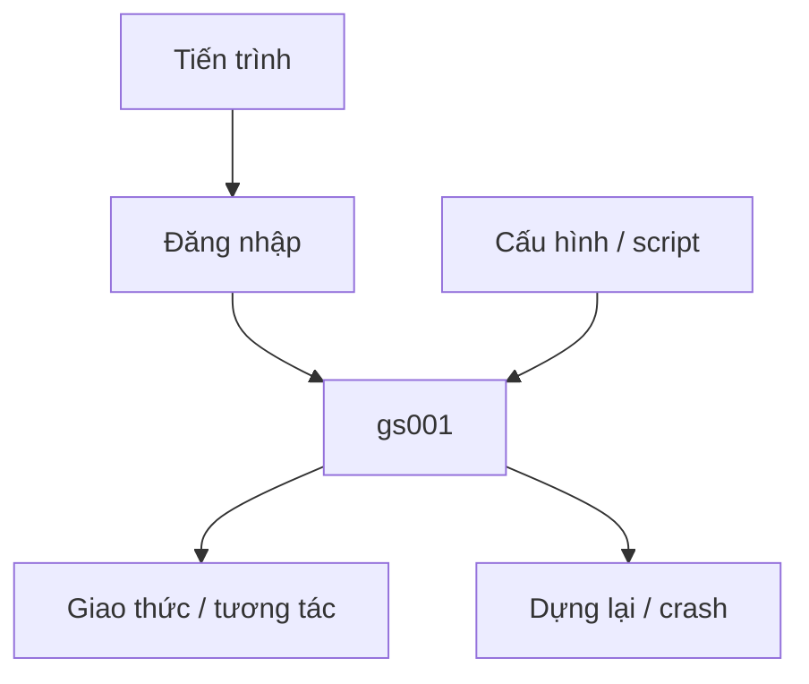

TÓM TẮT 1: [NGUỒN] Báo cáo gộp sáu mảng từ tiến trình đến crash; bằng chứng gốc nằm ở A-01…A-07.
TÓM TẮT 2: [NGUỒN] Luồng đăng nhập và game dùng các dịch vụ khác nhau; R-01 chỉ đối chiếu tên nhóm kết nối và phía client.
TÓM TẮT 3: [NGUỒN] Cảnh báo lệch gói và đính chính sync đã có trong thân được giữ nguyên.
TÓM TẮT 4: [NGUỒN] Các ghi nhận VM và câu hỏi 36 Hz là lịch sử chưa tái kiểm ở R-01.
TÓM TẮT 5: [CHƯA KIỂM] R-01 không chạy build, exe, VM hoặc mạng; kết quả build/VM có trong thân là ghi nhận lịch sử, chưa tái kiểm.

# A-04 — Kiến trúc tổng

Loại: tổng hợp
Chủ đề: Liên hệ giữa tiến trình, đăng nhập, dữ liệu, giao thức, tương tác và crash.
Từ khóa: kiến trúc, architecture, tiến trình, login, protocol, BroadCast, gs001, crash
Trạng thái: PARTIAL — tổng hợp sáu mảng; giới hạn và khác biệt nguồn/runtime còn nguyên.
Độ phủ: đã phủ 6 trên tổng 6 mảng kiến trúc trong nội dung gốc; đối chiếu mới và phần chưa phủ ghi riêng trong bảng.
Liên quan: `JX1_OPS/REPORTS/A-01-ban-do-tien-trinh.md`; `JX1_OPS/REPORTS/A-02-luong-dang-nhap.md`; `JX1_OPS/REPORTS/A-03-kiem-ke-cau-hinh.md`; `JX1_OPS/REPORTS/A-05-diem-tuong-tac-gs001.md`; `JX1_OPS/REPORTS/A-06-bang-goi-tin.md`; `JX1_OPS/REPORTS/A-07-goc-re-crash-gs001.md`; `JX1_OPS/DESIGN/CHUAN-BAO-CAO.md`; `JX1_OPS/DESIGN/MUC-LUC-TRI-THUC.md`; `JX1_OPS/DESIGN/HUONG-DAN-TRA-CUU.md`
Cần tôi quyết định: không (đối với đợt chuẩn hóa R-01).

## Sơ đồ chính

## Phạm vi và độ phủ

[NGUỒN] Đơn vị đếm là hạng mục ghi trong bảng, không phải toàn bộ hệ thống JX1. “Đã phủ” chỉ phần đã được mô tả trong báo cáo gốc; cột cuối phân biệt phần trực tiếp đối chiếu trong R-01 với phần chưa phủ dữ liệu gốc. Không nâng bằng chứng cũ thành xác minh mới.

Ký hiệu riêng của phần chuẩn hóa: `GS/` = `C:\Jx1CocoV3\Folder\ServerNew-20260116T043145Z-3-001\ServerNew\_bin_v2_\gs\`; `CA/` = `D:\JX-build\qh9A\Classes\`. Alias trong thân gốc giữ nguyên ý nghĩa lịch sử.

| Hạng mục | Độ phủ nội dung gốc | Bằng chứng trong báo cáo này | Đối chiếu dữ liệu gốc R-01 / phần chưa phủ |
|---|---|---|---|
| Tiến trình và cổng | Đã phủ (theo mức chắc ghi trong thân) | `A-04-kien-truc-tong.md:58` | GS/gs001_cfg.ini:1, :5, :9, :13, :17, :21: các nhóm kết nối; chưa kiểm cổng nghe. |
| Đăng nhập và dữ liệu | Đã phủ (theo mức chắc ghi trong thân) | `A-04-kien-truc-tong.md:69` | CA/gameui/KSelPlayer.cpp:1128, :1185: client chọn nhân vật/gửi GUID; chưa phủ DB. |
| Cấu hình và script | Đã phủ (theo mức chắc ghi trong thân) | `A-04-kien-truc-tong.md:72` | GS/package.ini:1; GS/script/system/serverscript.lua:13; chưa phủ PAK/runtime. |
| Giao thức | Đã phủ (theo mức chắc ghi trong thân) | `A-04-kien-truc-tong.md:75` | CA/gamecore/KProtocolDef.h:20, :218; hash khớp bản C được A-06 ghi nhận. |
| Hiển thị và tương tác | Đã phủ (theo mức chắc ghi trong thân) | `A-04-kien-truc-tong.md:78` | Có tám nhóm trong A-05; chưa tái kiểm source server. |
| Dựng lại và crash | Đã phủ (theo mức chắc ghi trong thân) | `A-04-kien-truc-tong.md:81` | Đọc hash GS/gs001.exe khớp bản O trong A-07; chưa phủ bản tự dựng/VM. |

## Nội dung gốc (bảo toàn)

**TÓM TẮT**
1. Chuỗi bắt buộc: SQL Server → `Sword3PaySys` (5002) → `Goddess` (5001) → `S3Relay` (5003-5005, 7776) → `Bishop` (56722 client, 56732 game server) → `gs001` (51189). Chi tiết: `A-01-ban-do-tien-trinh.md`.
2. Đăng nhập: client → Bishop → PaySys (tài khoản, cần `Account_Info` + `Account_Habitus` còn hạn) / Goddess (nhân vật, `roledb` Berkeley DB) → client nối gs001 bằng GUID. Chi tiết: `A-02`.
3. gs001: 500 người cứng, 1 luồng, 18 Hz; cấu hình đọc ở `KSOServer.cpp`, `KCore.cpp`; cây nguồn không chứa INI/Lua/TAB, nên mọi nội dung runtime là CHƯA KIỂM (`A-03`).
4. Hiển thị/tương tác: lọc theo ô bản đồ (`KRegion::BroadCast`), không theo bán kính; còn nhiều đường gửi khác (`A-05`). Giao thức client↔server có chỗ lệch (`A-06`).
5. Mọi thứ trong tài liệu này là KIỂM TRA TĨNH hoặc tổng hợp từ báo cáo cũ; chưa có kết luận runtime nào mới. Crash gs001 tự dựng chưa tìm ra dòng gây lỗi (`A-07`).

## Nhãn tin cậy
- **[ĐÃ KIỂM VẬN HÀNH]** chạy thật trên Main VM trước đây (BAI_HOC, báo cáo cũ): chuỗi khởi động, cổng, thứ tự.
- **[NGUỒN]** đọc mã, chưa kiểm exe đang chạy có cùng hành vi (nguồn mới hơn exe).
- **[CHƯA KIỂM]** chưa chạy, chưa đo.

## 1. Tiến trình và cổng [ĐÃ KIỂM VẬN HÀNH, lại kiểm cổng trên VM thử 16/11 23:48]
| Tiến trình | Cổng | Vai trò |
|---|---|---|
| SQL Server | 1433 | DB `account`, nội bộ VM |
| Sword3PaySys | 5002 | tài khoản |
| Goddess | 5001 | lưu nhân vật (cần bấm Start) |
| S3Relay | 5003, 5004, 5005, 7776 | transfer, chat, bang hội/bạn bè |
| Bishop | 56722, 56732 | cổng vào cho client / cho game server |
| gs001 | 51189 | game server, nạp ~7 phút; không mở kết nối khi đang nạp |
Cổng 7777 không có tiến trình nghe, ảnh hưởng chưa rõ [CHƯA KIỂM].

## 2. Luồng đăng nhập và dữ liệu [NGUỒN]
Khung gói: 2 byte độ dài, XOR khóa cuộn từ `ACCOUNT_BEGIN` (đã cài đặt và test offline ở E-01). `roledb` là B-tree, khóa là tên nhân vật; sao lưu tích hợp ghi dump theo cặp khóa/dữ liệu. Cờ `is_bot` đề xuất lưu ở bảng metadata SQL theo `cAccName` (A-02), chưa triển khai.

## 3. Cấu hình và script [NGUỒN]
Tên sinh từ tham số GS: `%s_cfg.ini`, `gamesetting_%s.ini`, `WorldSet_%s.ini`. Cây `jxOnline` có 5226 file nhưng 0 INI/Lua/TAB/PAK; cấu hình thật nằm ở bản chạy `_bin_v2_` (D-01 đã quét: 27 hoạt động, 0 có script đầy đủ; `servertimer.lua:125` thiếu dấu nháy đóng). 28 bản đồ không nạp được vì thiếu `.wor`.

## 4. Giao thức [NGUỒN]
Gateway lệch mã c2s từ 185; client thiếu 3 relay + 4 chat; 18 struct dùng chung khác khai báo; bảng độ dài client đặt nhầm một mục (A-06). A-06 ghi nhầm gói sync (enum 67) là mốc không payload, E-01 đã đính chính. Bot thiếu các record đồng bộ thế giới để vào game trọn vẹn (E-01).

## 5. Hiển thị và tương tác [NGUỒN]
`KRegion::BroadCast` (`KRegion.cpp:2223`), tối đa 100 người/ô, lọc khoảng cách bị comment. Đường gửi khác: `KNpc.cpp:7718, 7822, 14993-15030`, `KSubWorld.cpp:2366`, `KObj.cpp:1468-1621`. Điểm chèn lọc xếp theo rủi ro ở `A-05`.

## 6. Dựng lại và crash [NGUỒN, CHƯA KIỂM RUNTIME]
Exe gốc và bản tự dựng đều x64 (linker 10.00 / 14.44). Nghi vấn: `KSOServer.cpp:960`, `:4966`, `KSortScript.cpp:328`. Chưa có dump; thiếu `cdb.exe` ở host và VM. Câu hỏi "server tự dựng 36 Hz" của báo cáo 45 CHƯA TRẢ LỜI.

## Chưa kiểm (tổng)
Số online thật chịu được; nguồn có khớp exe đang chạy không; tạo hàng loạt tài khoản/nhân vật; cổng 7777; mọi hành vi Bot trên server thật.

## Đã xác minh / Chưa xác minh

**ĐÃ XÁC MINH — R-01:** Bản này ban đầu có BOM UTF-8. Đợt R-01 bỏ BOM khi ghi; phần thân, số liệu và các nhãn tin cậy cũ được giữ nguyên. Đối chiếu trực tiếp các điểm GS/CA nêu trong bảng, không suy runtime từ chúng. Báo cáo được đọc UTF-8 nghiêm ngặt, lưu UTF-8 không BOM; bảo toàn phần thân gốc, gồm tóm tắt, kết luận, số liệu và bằng chứng.

**CHƯA XÁC MINH — R-01:** các phần ghi chưa phủ trong bảng; tính tương thích giữa nguồn lịch sử, dữ liệu hiện có và binary đang chạy; mọi kết quả build/test/VM cũ chưa được tái hiện. Các gốc source server hoặc checkpoint ngoài GS/CA không được đọc mở rộng trong nhiệm vụ này.

## Bàn giao

Đợt chuẩn hóa thuộc `task/R-01`, commit theo nhóm tối đa 5 file, không push. SHA thực tế được ghi ở phản hồi hoàn tất; xem `JX1_OPS/REPORTS/R-01.md` và chỉ mục `JX1_OPS/REPORTS/_CHIMUC/R-01.tsv`. Trạng thái Git trong thân là lịch sử của nhiệm vụ gốc. Bước tiếp theo: PM gộp chỉ mục, giao khảo sát riêng nếu cần bù phần chưa phủ; R-01 không cấp quyền chạy lệnh vận hành có trong thân.

## Phát hiện khi chuẩn hóa

- BOM UTF-8 có ở bản đầu vào; đã bỏ BOM theo chuẩn, không chuyển mã nội dung tiếng Việt.
- Mục giao thức đã ghi A-06 nhầm gói sync và dẫn đính chính E-01; giữ cả cảnh báo này, không sửa bảng A-06 trong nhiệm vụ chuẩn hóa.
- Các số INI/Lua bằng 0 và ghi nhận VM trong thân có mốc/phạm vi riêng; xem phát hiện của A-03 và chuỗi A-07 để tránh đọc như trạng thái hiện tại.
