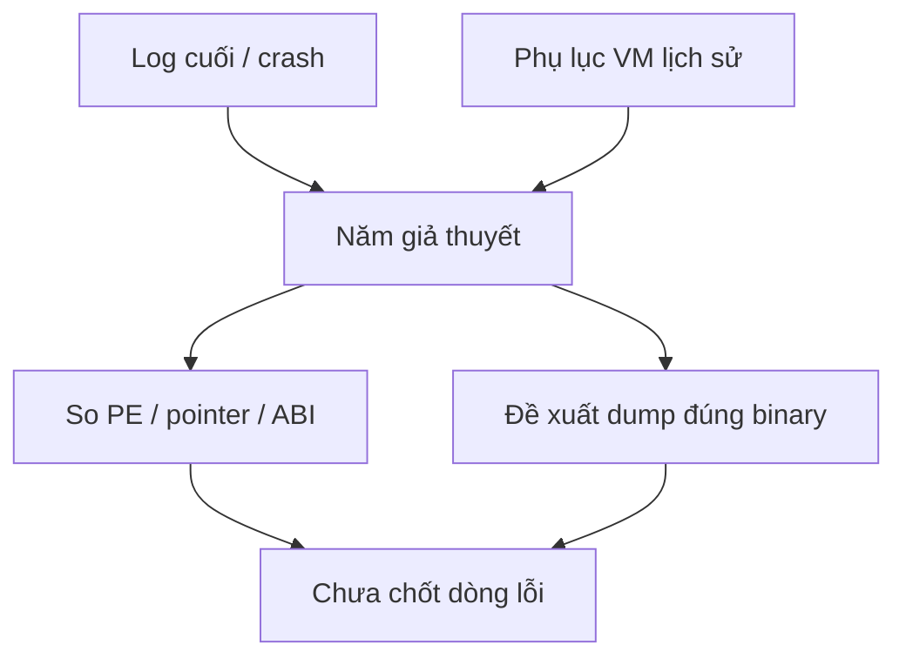

TÓM TẮT 1: [NGUỒN] Giữ năm giả thuyết crash và thứ tự kiểm theo khảo sát gốc, chưa xác định RIP/dòng lỗi.
TÓM TẮT 2: [NGUỒN] GS/gs001.exe hiện tại khớp hash và kích thước binary gốc O được bảng PE ghi nhận.
TÓM TẮT 3: [NGUỒN] Đề xuất Debug, WER và cdb trong thân không phải các lệnh đã chạy bởi R-01.
TÓM TẮT 4: [NGUỒN] Phụ lục 01:25 về HighEntropyVA có mốc VM riêng, không thay mọi giới hạn của phần khảo sát ban đầu.
TÓM TẮT 5: [CHƯA KIỂM] R-01 không chạy build, exe, VM hoặc mạng; kết quả build/VM có trong thân là ghi nhận lịch sử, chưa tái kiểm.

# A-07 — Crash gs001 tự dựng: bằng chứng tĩnh và cách bắt dòng lỗi

Loại: khảo sát
Chủ đề: Giả thuyết crash, đối chiếu binary và phương án thu bằng chứng lỗi.
Từ khóa: crash, gs001, HighEntropyVA, ASLR, con trỏ, pointer, QueryInterface, WER, cdb, PE
Trạng thái: PARTIAL — chưa chốt dòng crash; phần bổ sung VM là ghi nhận lịch sử chưa tái kiểm.
Độ phủ: đã phủ 10 trên tổng 11 hạng mục điều tra trong nội dung gốc; đối chiếu mới và phần chưa phủ ghi riêng trong bảng.
Liên quan: `JX1_OPS/REPORTS/A-04-kien-truc-tong.md`; `JX1_OPS/REPORTS/A-07b-ep-con-tro.md`; `JX1_OPS/REPORTS/A-07c-link-gs001.md`; `JX1_OPS/REPORTS/A-07d-breakpoint.md`; `JX1_OPS/REPORTS/A-07e-rtc.md`; `JX1_OPS/DESIGN/CHUAN-BAO-CAO.md`; `JX1_OPS/DESIGN/MUC-LUC-TRI-THUC.md`; `JX1_OPS/DESIGN/HUONG-DAN-TRA-CUU.md`
Cần tôi quyết định: không (đối với đợt chuẩn hóa R-01).

## Sơ đồ chính

## Phạm vi và độ phủ

[NGUỒN] Đơn vị đếm là hạng mục ghi trong bảng, không phải toàn bộ hệ thống JX1. “Đã phủ” chỉ phần đã được mô tả trong báo cáo gốc; cột cuối phân biệt phần trực tiếp đối chiếu trong R-01 với phần chưa phủ dữ liệu gốc. Không nâng bằng chứng cũ thành xác minh mới.

Ký hiệu riêng của phần chuẩn hóa: `GS/` = `C:\Jx1CocoV3\Folder\ServerNew-20260116T043145Z-3-001\ServerNew\_bin_v2_\gs\`; `CA/` = `D:\JX-build\qh9A\Classes\`. Alias trong thân gốc giữ nguyên ý nghĩa lịch sử.

| Hạng mục | Độ phủ nội dung gốc | Bằng chứng trong báo cáo này | Đối chiếu dữ liệu gốc R-01 / phần chưa phủ |
|---|---|---|---|
| Luồng sau public net IP | Đã phủ (theo mức chắc ghi trong thân) | `A-07-goc-re-crash-gs001.md:79` | Chưa tái kiểm KSOServer/CoreServerShell/KCore của server. |
| Giả thuyết 1: QueryInterface/Core/biên DLL | Đã phủ (theo mức chắc ghi trong thân) | `A-07-goc-re-crash-gs001.md:98` | Chưa phủ source đúng snapshot, HRESULT và stack thực tế. |
| Giả thuyết 2: callback khi shell NULL | Đã phủ (theo mức chắc ghi trong thân) | `A-07-goc-re-crash-gs001.md:99` | Chưa phủ thứ tự callback thực tế trong runtime. |
| Giả thuyết 3: clone NULL/cắt con trỏ | Đã phủ (theo mức chắc ghi trong thân) | `A-07-goc-re-crash-gs001.md:100` | Chưa phủ producer/consumer trong binary đang vận hành. |
| Giả thuyết 4: IServerFactory/size_t | Đã phủ (theo mức chắc ghi trong thân) | `A-07-goc-re-crash-gs001.md:101` | Chưa phủ header mà DLL thật đã biên dịch. |
| Giả thuyết 5: _findfirst | Đã phủ (theo mức chắc ghi trong thân) | `A-07-goc-re-crash-gs001.md:102` | Chưa tái kiểm handle ở đúng snapshot tự dựng. |
| Binary gốc và bản tự dựng | Đã phủ (theo mức chắc ghi trong thân) | `A-07-goc-re-crash-gs001.md:106` | Đã đọc byte GS/gs001.exe, CoreServer.dll, Engine.dll, LuaLibDll.dll, Heaven.dll; bản tự dựng R ngoài gốc không kiểm lại. |
| Kế hoạch Debug và cờ build | Đã phủ (theo mức chắc ghi trong thân) | `A-07-goc-re-crash-gs001.md:127` | Chỉ giữ hướng dẫn lịch sử; không thực thi MSBuild hoặc script build. |
| Kế hoạch WER/cdb/dump | Đã phủ (theo mức chắc ghi trong thân) | `A-07-goc-re-crash-gs001.md:147` | Chỉ giữ hướng dẫn; không sửa registry, attach hoặc thu dump. |
| Phụ lục HighEntropyVA 01:25 | Đã phủ (theo mức chắc ghi trong thân) | `A-07-goc-re-crash-gs001.md:200` | Giữ ghi nhận VM lịch sử, chưa kiểm hash/bản B/runtime hiện tại. |
| RIP, dump và dòng crash gốc | Chưa phủ | `A-07-goc-re-crash-gs001.md:94` | Chưa phủ bằng chứng quyết định ở đúng lần crash. |

## Nội dung gốc (bảo toàn)

## Tóm tắt 5 dòng

1. **[XÁC MINH]** Đúng worktree/nhánh; chỉ đọc nguồn và phân tích PE, không chạy exe server hay tác động VM.
2. **[XÁC MINH]** Exe gốc là x64/linker 10.00; artifact tự dựng đang có là x64/linker 14.44. Không phải khác kiến trúc x86/x64.
3. **[NGUỒN]** Sau log IP là QueryInterface (:944), CoreGetServerShell (:952), OperationRequest (:960); chưa có RIP/dump T1 để chọn một dòng gây crash.
4. **[XÁC MINH]** Có lỗi cắt con trỏ/handle trong canonical; artifact hiện có đã truyền pointer 64-bit. Lỗi _findfirst của A2T2 là vụ riêng được báo cáo 44 xác nhận.
5. **PARTIAL:** đã soạn build Debug /Od /Zi /RTC1, WER có backup/restore và cdb bắt first-chance AV; build A-07 bị giới hạn sandbox, debugger trong JX-Test-36 **chưa chạy**.

## 1. Kiểm tra bắt buộc và phạm vi bằng chứng

- [XÁC MINH] Trước khi ghi: cwd = D:\JX-wt\A-07; git status --short --branch trả nhánh task/A-07-crash-gs001 và duy nhất task A-07.md chưa được track. Chưa có báo cáo/tools A-07 cũ; không reset hay ghi đè checkpoint.
- [XÁC MINH] C:\Jx1CocoV3 chỉ đọc; không sửa source canonical, bản copy src18 hay binary cũ; không chạy gs001/Heaven hoặc exe server nào, không kết nối/khởi động VM.
- [CHƯA KIỂM] D:\JX-build\a07 chưa tồn tại (stat: ENOENT). Sandbox chỉ cho ghi D:\JX-wt\A-07 và không cho nâng quyền; không thử tạo thư mục ngoài sandbox. Chưa gọi MSBuild để tạo binary A-07.
- [BÁO CÁO] Đã tái dùng đúng báo cáo 29, 35, 41, 44 trong C:\Jx1CocoV3\docs-analysis\reports. Nội dung cuối báo cáo 44 có lỗi mã hóa; không sửa bản gốc.

Quy ước đường dẫn để truy xuất số dòng:

| Tên | Đường dẫn đầy đủ |
|---|---|
| S | C:\Jx1CocoV3\SwordOnline\SwordOnline\jxOnline\gameserver\Sources |
| H | C:\Jx1CocoV3\SwordOnline\SwordOnline\jxOnline\gameserver\Headers |
| B | D:\JX-build\src18\jxOnline\gameserver\Sources (bản copy đã có trước) |
| O | C:\Jx1CocoV3\Folder\ServerNew-20260116T043145Z-3-001\ServerNew\_bin_v2_\gs |
| R | D:\JX-build\_bin_v2_\gs (artifact đang có, không mặc định là binary T1) |

29-dieu-tra-gs001-crash.md:36–57 ghi crash cũ đọc NULL, luồng Heaven; 35-bien-dich-server-tu-nguon.md:13–24 ghi build Release/workaround; 41-xac-nhan-server-18hz.md:4–8,26–30 cảnh báo nguồn/ABI khác exe; 44-dieu-tra-a2-thoat-som.md:15–18,38–48 phân biệt T1 và A2T2. Kết quả runtime dưới đây gắn nhãn [BÁO CÁO], không phải test mới.

## 2. Luồng chạy sau public net IP

| Thứ tự | File:dòng | Thao tác / giới hạn kết luận |
|---|---|---|
| 1 | S\MultiServer\GameServer\KSOServer.cpp:916 | In public net IP và endl. Log này không xác định thread/RIP gây ngoại lệ. |
| 2 | Cùng file:943–944 | Khởi tạo pCloneServer=NULL rồi gọi m_pServer->QueryInterface; bỏ qua HRESULT, không kiểm pCloneServer sau đó. |
| 3 | Cùng file:951–958 | Gọi CoreGetServerShell(parmName), sau khi hàm trả về mới gán m_pCoreServerShell; có kiểm NULL. |
| 4 | S\Core\Src\CoreServerShell.cpp:227–230 | CoreGetServerShell gọi g_InitCore trước khi trả địa chỉ shell tĩnh. |
| 5 | S\Core\Src\KCore.cpp:249–264,618 | g_InitCore mở package.ini trước log gamesettings, rồi tới g_IniScriptEngine. Nếu log gamesettings cũng không có thì cần kiểm đầu Core trước OperationRequest, với điều kiện cùng source/buffering. |
| 6 | S\Core\Src\KSortScript.cpp:208–220,260–272,313–371 | LoadAllScript gọi LoadScriptInDirectory, dùng _findfirst/_findnext/_findclose. |
| 7 | S\MultiServer\GameServer\KSOServer.cpp:960 | OperationRequest(SSOI_LAUNCH,(unsigned int)pCloneServer,0), chỉ xảy ra sau khi khởi tạo Core trả về. |
| 8 | S\Core\Src\CoreServerShell.cpp:2048,2059–2060,2203–2215; S\Core\Src\KCore.cpp:1128–1130 | uParam 32-bit được cast về LPVOID; OnLunch lưu thành g_pServer rồi gọi StartGame. Không phục hồi được 32 bit cao đã mất. |

[NGUỒN] Callback có thể chạy đồng thời: KSOServer.cpp:324 đặt shell=NULL; :856–860 mở server/đăng ký callback trước :952. ServerEventNotify (:153–176) gọi SetNetStatus khi client đóng; :4966 gọi PreparePlayerForLoginFailed không guard shell. CreateServerInterface (:832) cũng bỏ qua HRESULT, nhánh m_pServer NULL (:845–849) đã comment return rồi gọi Startup (:856). Điểm sau cùng nằm trước log IP nên không khớp crash sau log của cùng lần chạy nếu không có race/hỏng bộ nhớ.

## 3. Giả thuyết xếp hạng và phép kiểm

| Hạng | Giả thuyết | Bằng chứng / điều chưa biết | Phép kiểm trong VM thử |
|---|---|---|---|
| 1 | Lỗi trong QueryInterface hoặc đầu CoreGetServerShell / biên DLL | S\MultiServer\GameServer\KSOServer.cpp:944,952; S\Core\Src\KCore.cpp:256 trước log :264. 44:5–6,17 ghi T1 chết sớm dù dùng DLL gốc. Chưa có RIP; chưa chứng minh ABI/CRT là nguyên nhân. | Dừng first-chance AV; lấy .exr -1, .ecxr, kv, lmvm và dòng với PDB. Break ngay trước/sau :944, :952; ghi HRESULT, this/vtable và module. |
| 2 | Race callback dereference shell NULL khi Core còn nạp | S\MultiServer\GameServer\KSOServer.cpp:858–860,952,4966. 29:36–57 ghi dump luồng Heaven đọc vtable tại 0. 44:27 nói T1 chưa thấy client; không mặc định hai crash cùng nguyên nhân. | Break SetNetStatus và CoreGetServerShell; ghi thread và shell; kiểm callback thực tế trước khi shell được gán. Không mở kết nối thử ngoài phạm vi được phép. |
| 3 | Cắt pCloneServer hoặc dùng clone NULL | S\MultiServer\GameServer\KSOServer.cpp:944,960; S\Core\Src\CoreServerShell.h:217,239 dùng unsigned int/unsigned long (32-bit theo LLP64 Windows). B đã đổi OperationRequest/Info sang uintptr_t, R truyền r8 64-bit. Lỗi source chắc chắn khi địa chỉ vượt 32-bit, chưa chứng minh T1. | Trước :960 so pointer đầy đủ với uParam và g_pServer; nếu Core chưa trả về thì loại lỗi này khỏi crash sớm. Sửa đồng bộ caller/header/implementation trên copy sau bằng chứng. |
| 4 | Header IServerFactory / tham số size_t theo tham chiếu lệch DLL | S\MultiServer\Heaven\Interface\IServer.h:173–180 có 5 tham số; H\IServer.h:173–179 có 4. S\MultiServer\GameServer\GameServer.vcxproj:177 ưu tiên Interface, KSOServer.cpp:830 gọi 5; hai bản IServer trước factory tương đương khai báo, chỉ khác comment/whitespace. Chưa biết Heaven runtime dùng header nào. SetEnvironment nằm trước log IP. | /showIncludes xác nhận header thật kể cả PCH. Kiểm args/factory vtable và hash Heaven được nạp; chỉ đổi include sau khi xác nhận hợp đồng DLL. |
| 5 | Handle _findfirst bị cắt khi nạp script | S\Core\Src\KSortScript.cpp:328 long dir; dùng ở :332,369,371. B:328 đã sửa intptr_t. [BÁO CÁO] 44:44–48 ghi dump A2T2 sau ~2,5 phút, sống >10 phút sau sửa; :45 nói T1 còn riêng. | Debug nạp script, so handle trả về với dir; giữ intptr_t. Không dùng vụ A2T2 làm bằng chứng dòng crash T1. |

sizeof(void*)/intptr_t/size_t trên Windows x64 là 8; sizeof(long)/unsigned int/DWORD là 4. long không phải kiểu chứa con trỏ; DWORD dùng cho IPv4/client ID không tự động là lỗi, phải xét dữ liệu đang mang. Source có sprintf vào szRealDir[MAX_PATH] ở KSortScript.cpp:318 không kiểm độ dài; /RTC1 có thể giúp tìm hỏng stack nhưng không bắt mọi lỗi heap/pointer; chưa có bằng chứng lỗi này xảy ra.

## 4. So sánh PE / cờ / thư viện

[XÁC MINH] Dùng Microsoft dumpbin.exe 14.44.35207, chỉ đọc /headers /imports /exports và /disasm:nobytes. Không chạy binary được phân tích.

| Mục | O (gốc đối chiếu A2T2 theo báo cáo 44) | R (artifact hiện tại) |
|---|---|---|
| gs001 kiến trúc/linker | 8664 x64; PE32+ 20B; linker 10.00 | 8664 x64; PE32+ 20B; linker 14.44 |
| Kích thước / SHA-256 | 543232 B; dd44d425e205fd482fd287144bdc3d95ad90f42bda92556a66c1214a463d4295 | 1267200 B; 2c2e0a8c9a9724377e41092e5617c59ca1cfdd20403932819dea503cd6f02571 |
| ASLR | DLL characteristics 8040: Dynamic base | 8060: Dynamic base + High Entropy Virtual Addresses |
| Import trực tiếp gs001 | WS2_32, KERNEL32, USER32, Engine, CoreServer, VERSION, ADVAPI32 | Cùng 7 tên DLL. Heaven/Rainbow nạp động: S\MultiServer\GameServer\KSOServer.cpp:77–78,824,967 |
| Export gs001 | Không có export được dumpbin liệt kê | Tương tự |
| PDB record | RSDS F9B7E30A-3238-45A3-BE2F-FF5D0C5E8241 age 2; record không chứng minh PDB gốc đang tồn tại | RSDS 23680020-C535-45C5-B7E8-1013E74D63EC age 7; R có gs001.pdb/map, chưa xác thực GUID file PDB |
| CoreServer | 1893376 B; linker 10.00; 271 export | 11803648 B; linker 14.44; 275 export; cùng export C CoreGetServerShell không chứng minh vtable đồng nhất |
| Engine | 1195520 B; 831 export; import MSVCR100/MSVCP100 | 1206784 B; 865 export; import MSVCP140/VCRUNTIME140/VCRUNTIME140_1 và api-ms-win-crt-* |
| LuaLibDll | 350720 B; 104 export; linker 10.00 | 755712 B; 104 export; linker 14.44 |
| Heaven | x64; linker 10.00; export CreateInterface | Không có trong R; R cũng không có Rainbow. Hash/module T1/T2 trong VM chưa kiểm |

[NGUỒN] Cờ source không phải cờ đã khôi phục từ exe gốc: S\MultiServer\GameServer\GameServer.vcxproj:168–216 đặt Release x64 /MT, /Od, link debug/map, /FORCE:MULTIPLE; :262–303 đặt Debug x64 /MT (không phải /MTd), /Od, /RTC1, link debug nhưng output GameServer.exe và post-build copy cần override. Common Debug dùng /MTd (:149–182 trong S\MultiServer\Common\Common.vcxproj); Engine Debug dùng /MDd (:250–300); Core Server Debug dùng /MTd (:473–527). Script chỉ dựng Common + GameServer, ép cả hai /MT để không tự trộn CRT Debug. Cờ compiler gốc (/MT hay /MD, packing, tối ưu) **chưa kiểm**; import Engine chứng minh CRT động VC100 có mặt, không chứng minh toàn bộ module dùng /MD.

[XÁC MINH – MÃ MÁY] O tại VA 140012281 nạp r8d từ dword clone, call [rax+150h] tại 14001228E. R tại 140022411 nạp r8 từ qword clone, call [rax+150h] tại 14002241E. Cả hai gọi slot 150h; chưa giải mã vtable Core runtime. R đã sửa pointer; O cũng cắt 32-bit. High Entropy ASLR có thể làm lỗi tiềm ẩn lộ ra; **chưa kiểm** địa chỉ heap thực tế. Không dùng map R để gán dòng cho exe O/T1 khác hash.

## 5. Build Debug: lệnh và giới hạn

JX1_OPS/TOOLS/a07/build-debug-a07.ps1 chỉ đọc canonical, copy source/resource/import library cần sang D:\JX-build\a07\src\gameserver; từ chối ghi đè BuildRoot đã có. Chỉ dựng Common + gs001; không dựng/thay DLL, không đổi logic nghi vấn, không chạy exe. Engine/Core dùng import x64 từ Lib\release; .lib cùng tên ở project/Lib gốc là x86 (đã kiểm dumpbin), nên chỉ rõ đường dẫn. vcxproj copy giữ .a07-original, tắt post-build, tách obj; tạo /Od /Zi /RTC1 /MT và /DEBUG:FULL bằng metadata XML, không dựa vào property AdditionalOptions chung của MSBuild.

Lệnh dự kiến từ máy phát triển có quyền ghi (chưa chạy):

~~~powershell
& .\JX1_OPS\TOOLS\a07\build-debug-a07.ps1
# Neu can workaround tu build 35, chi truyen object shim da duoc kiem tra rieng:
# & .\JX1_OPS\TOOLS\a07\build-debug-a07.ps1 -IobShimObject 'D:\JX-build\shim\iob_shim.obj'
~~~

Lệnh MSBuild GameServer, script ghi chính xác arguments vào logs\commands.txt:

~~~text
MSBuild.exe D:\JX-build\a07\src\gameserver\Sources\MultiServer\GameServer\GameServer.vcxproj /t:Rebuild /m:1 /nologo /v:minimal /p:Configuration=Debug /p:Platform=x64 /p:PlatformToolset=v143 /p:WindowsTargetPlatformVersion=10.0.19041.0 /p:OutDir=D:\JX-build\a07\out\ /p:IntDir=D:\JX-build\a07\obj\GameServer\ /p:BuildProjectReferences=false /flp:logfile=D:\JX-build\a07\logs\GameServer-debug.log;verbosity=diagnostic
~~~

35:19–24 ghi lỗi compatibility v143, nhất là __imp___iob_func từ ms64.lib. Script không tự tạo shim FILE giả hoặc /FORCE để che lỗi; nếu link lỗi phải giữ checkpoint, kiểm ABI shim cũ trước khi dùng -IobShimObject. PDB/map/log/hash mới, header thật /showIncludes và hiệu quả /RTC đều **chưa kiểm**. Không gọi đây là build thành công.

## 6. WER, cdb và đọc dump trong VM thử – CHƯA CHẠY

README trong tools có lệnh đầy đủ. enable-wer-localdumps.ps1 chỉ chạm LocalDumps\gs001.exe trong guest VirtualBox và yêu cầu xác nhận VmName JX-Test-36; tên VM không mặc định trùng hostname. Script backup key cũ rồi bật DumpType=2, DumpCount=10; -Disable khôi phục key cũ, giữ dump/backup. Cần PowerShell Admin **trong VM**, không dùng UAC/Admin máy thật.

debug-gs001.ps1 yêu cầu người vận hành đã có bằng chứng cô lập mạng, Defender, log/audit; ghi hash exe/DLL/PDB, chạy cdb từ đúng package thử có DLL/config/dữ liệu giả. Bắt first-chance AV bằng sxe av, ghi .exr -1/.ecxr/r/kv/lm/!analyze -v và .dump /ma, dừng để kiểm. Chỉ dùng PDB local, không tự gọi symbol server. WER có thể bị bộ lọc riêng chặn: S\MultiServer\GameServer\GameServer.cpp:129–146; 44:48 ghi WER không bắt được A2T2.

Trong WinDbg/cdb mở đúng dump và PDB khớp GUID/age:

~~~text
.sympath D:\JX-build\a07\out
.lines -e
.reload /f
.exr -1
.ecxr
kv
lmvm gs001
lmvm CoreServer
lmvm Heaven
!analyze -v
ln @rip
ub @rip L10
~~~

Breakpoint dùng module gs001, không phải KSOServer (tên file):

~~~text
bu gs001!KSwordOnLineSever::InitServer
bu gs001!KSwordOnLineSever::SetNetStatus
bu CoreServer!CoreGetServerShell
bu CoreServer!g_SetServer
~~~

g_SetServer cần PDB Core tương ứng; DLL gốc không mặc định có symbol này. Không có PDB thì dùng module+RVA/disassembly; không gán dòng bằng PDB DLL khác. Log/dump có thể chứa dữ liệu nhạy cảm: giữ local trong VM, không commit/push.

## 7. Lỗi đã gặp, kiểm chứng và bàn giao

- Kênh exec ban đầu không trả kết quả; ngừng đợi, dùng kênh đọc dự phòng; không chạy lại preflight/model/config.
- rg không có trong PATH (spawn rg ENOENT); dùng đọc file/thư mục cụ thể và dumpbin. Git canonical báo fatal: detected dubious ownership; không đổi safe.directory/credential, dùng filesystem chỉ đọc. Hai đường dẫn exe suy từ project không tồn tại; đã tìm đúng file, không chạy.
- Parser PowerShell ban đầu có lỗi biểu thức in Message và phát hiện UTF-8 không BOM bị PowerShell 5.1 đọc sai. Đã sửa biểu thức, BOM/chuỗi ASCII. Kết quả parse cuối ghi trong Kết quả task; kiểm cú pháp không phải test registry/debugger/build. Một lệnh soạn Markdown bị parser JavaScript từ chối do ký tự backtick; đã sửa, không phát sinh ghi file từ lệnh lỗi.
- Đọc header MSVC include/io.h theo đường dẫn đã biết trả ENOENT; không dùng nó làm bằng chứng; phân biệt width dựa mô hình Windows x64 và mã máy đã kiểm.
- PowerShell Parser cuối: build-debug-a07.ps1, debug-gs001.ps1, enable-wer-localdumps.ps1 đều syntax-ok; biểu thức metadata PCH Count=2, Value=$(IntDir)Common.pch.
- Đã kiểm PE/import/export/disassembly và source. MSBuild A-07, WER, cdb/WinDbg, Defender, mạng và runtime: **chưa chạy**. Chưa có dump T1 nên **chưa xác định dòng gây crash 0xC0000005 T1**.
- **PARTIAL.** Tiếp theo: PM/chủ máy build trong đúng thư mục có quyền ghi, đưa binary+PDB vào package VM thử, thu first-chance dump rồi đối chiếu breakpoint. VM đang treo theo task, không tự bật/reset.
- **BỊ CHẶN – CHƯA COMMIT / CHƯA PUSH.** git add đúng sáu file thất bại một lần: fatal: Unable to create 'D:/jx1-reports/.git/worktrees/A-07/index.lock': Permission denied. Metadata Git ngoài writable root D:\JX-wt\A-07; không thay quyền/config hay vượt sandbox. Chưa stage/commit, SHA chưa có; không push (người dùng không yêu cầu).

Lệnh bàn giao commit (chưa chạy thành công; chỉ dùng phiên được phép ghi metadata Git):

~~~powershell
git add -- JX1_OPS/TASKS/A-07.md JX1_OPS/REPORTS/A-07-goc-re-crash-gs001.md JX1_OPS/TOOLS/a07/build-debug-a07.ps1 JX1_OPS/TOOLS/a07/enable-wer-localdumps.ps1 JX1_OPS/TOOLS/a07/debug-gs001.ps1 JX1_OPS/TOOLS/a07/README.md
git commit -m 'A-07: Phan tich crash gs001 va soan cong cu debug'
git log -1 --format=%H
~~~

## Bo sung 2026-11-17 01:25 - THI NGHIEM HIGHENTROPYVA (Sonnet, tren JX-Test-36)
Ket qua: **gs001 tu dung chi crash khi co co HighEntropyVA.** Cung ma, chi doi co DllCharacteristics.
- Ban A (goc tu dung, DllCharacteristics 0x8060, SHA-256 2C2E0A8C...2571): chay luc 01:15, ket thuc voi ma 3221225477 = 0xC0000005 (LastTaskResult cua task JX-gs001), khong thay log moi.
- Ban B (ban sao editbin /HIGHENTROPYVA:NO, 0x8040, SHA-256 D41A273C...4F62; ban A khong bi sua): chay luc 01:05, nap map xong ~01:08, noi du 5001/5003/5004/5005/56732, nghe 51189, luong chinh o Sleep (vong lap binh thuong); chay it nhat 10 phut khong crash. Da lay dump full 1.5 GB va xoa (khong can).
- Ket luan: nguyen nhan goc rat co the la **cat con tro 64->32 bit** (dia chi cao khi ASLR cao). Cac dong nghi ngo: KSOServer.cpp:960, :4966, KSortScript.cpp:328 (xem phan tren). Chua kiem: chua co client/bot vao game de thu tai thuc te voi ban B; chua kiem ban B qua nhieu gio.
- Viec tiep: A-07b - ra soat moi cho ep con tro/handle sang unsigned int/long/DWORD/int trong server (S\ va Core\), doi sang uintptr_t/intptr_t, dung lai khong can co.
- Muc tieu van hanh ngay: dung ban B (hoac ban dung 32-bit-safe) cho B-02/test, khong dung ban A.

## Đã xác minh / Chưa xác minh

**ĐÃ XÁC MINH — R-01:** Chỉ đọc byte binary trong GS: gs001.exe 543232 byte, SHA-256 dd44d425e205fd482fd287144bdc3d95ad90f42bda92556a66c1214a463d4295; CoreServer.dll 1893376 byte, Engine.dll 1195520 byte, LuaLibDll.dll 350720 byte. Các kích thước và hash exe khớp cột O trong bảng gốc. Không chạy dumpbin hoặc binary; không xác nhận PE/import mới từ kích thước/hash. Báo cáo được đọc UTF-8 nghiêm ngặt, lưu UTF-8 không BOM; bảo toàn phần thân gốc, gồm tóm tắt, kết luận, số liệu và bằng chứng.

**CHƯA XÁC MINH — R-01:** các phần ghi chưa phủ trong bảng; tính tương thích giữa nguồn lịch sử, dữ liệu hiện có và binary đang chạy; mọi kết quả build/test/VM cũ chưa được tái hiện. Các gốc source server hoặc checkpoint ngoài GS/CA không được đọc mở rộng trong nhiệm vụ này.

## Bàn giao

Đợt chuẩn hóa thuộc `task/R-01`, commit theo nhóm tối đa 5 file, không push. SHA thực tế được ghi ở phản hồi hoàn tất; xem `JX1_OPS/REPORTS/R-01.md` và chỉ mục `JX1_OPS/REPORTS/_CHIMUC/R-01.tsv`. Trạng thái Git trong thân là lịch sử của nhiệm vụ gốc. Bước tiếp theo: PM gộp chỉ mục, giao khảo sát riêng nếu cần bù phần chưa phủ; R-01 không cấp quyền chạy lệnh vận hành có trong thân.

## Phát hiện khi chuẩn hóa

- Tóm tắt khảo sát ban đầu và phụ lục 01:25 có mức bằng chứng khác nhau: một phần là kế hoạch chưa chạy, phần sau ghi thử VM. Giữ cả hai theo đúng mốc.
- Khuyến nghị /RTC1 của A-07 không còn là kết luận cuối chuỗi A-07; A-07d/e phân tích riêng. Không chỉnh lặng hướng dẫn cũ.
- Bản GS gốc không phải snapshot A-07b/c/e. Hash khớp cột O không xác nhận bản đang chạy trong VM hoặc hiệu quả sửa lỗi.
- Phụ lục cũ có tiếng Việt không dấu; giữ nguyên để tránh diễn giải lại kết luận, phần chuẩn hóa dùng tiếng Việt có dấu.
