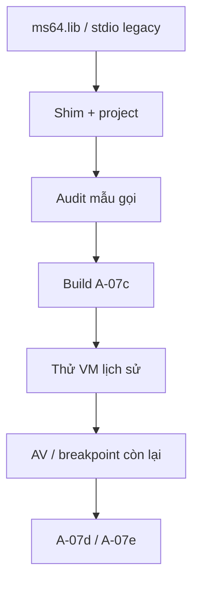

TÓM TẮT 1: [NGUỒN] Bản ghi sửa gồm shim MiraclLegacyStdio.cpp và khai báo compile trong GameServer.vcxproj.
TÓM TẮT 2: [NGUỒN] Audit 97 lời gọi và build năm project là bằng chứng lịch sử của đúng snapshot A-07c.
TÓM TẮT 3: [NGUỒN] Hash gs001 A-07c khác binary gốc GS của R-01, không dùng lẫn các mốc hoặc map.
TÓM TẮT 4: [NGUỒN] Phần PM ghi crash AV và breakpoint sau build; giữ giới hạn runtime theo từng mốc.
TÓM TẮT 5: [CHƯA KIỂM] R-01 không chạy build, exe, VM hoặc mạng; kết quả build/VM có trong thân là ghi nhận lịch sử, chưa tái kiểm.

# A-07c — Link gs001 x64

Loại: sửa lỗi
Chủ đề: Shim stdio VC100/UCRT, build gs001 x64 và các bổ sung thử VM của PM.
Từ khóa: liên kết, link, gs001, x64, MiraclLegacyStdio, __imp___iob_func, VC100, UCRT, HighEntropyVA, breakpoint
Trạng thái: PARTIAL — build lịch sử đạt; các thử VM tiếp theo còn crash và chưa chốt dòng lỗi.
Độ phủ: đã phủ 11 trên tổng 12 hạng mục link/kiểm chứng trong nội dung gốc; đối chiếu mới và phần chưa phủ ghi riêng trong bảng.
Liên quan: `JX1_OPS/REPORTS/A-07-goc-re-crash-gs001.md`; `JX1_OPS/REPORTS/A-07b-ep-con-tro.md`; `JX1_OPS/REPORTS/A-07d-breakpoint.md`; `JX1_OPS/REPORTS/A-07e-rtc.md`; `JX1_OPS/DESIGN/CHUAN-BAO-CAO.md`; `JX1_OPS/DESIGN/MUC-LUC-TRI-THUC.md`; `JX1_OPS/DESIGN/HUONG-DAN-TRA-CUU.md`
Cần tôi quyết định: không (đối với đợt chuẩn hóa R-01).

## Sơ đồ chính

## Phạm vi và độ phủ

[NGUỒN] Đơn vị đếm là hạng mục ghi trong bảng, không phải toàn bộ hệ thống JX1. “Đã phủ” chỉ phần đã được mô tả trong báo cáo gốc; cột cuối phân biệt phần trực tiếp đối chiếu trong R-01 với phần chưa phủ dữ liệu gốc. Không nâng bằng chứng cũ thành xác minh mới.

Ký hiệu riêng của phần chuẩn hóa: `GS/` = `C:\Jx1CocoV3\Folder\ServerNew-20260116T043145Z-3-001\ServerNew\_bin_v2_\gs\`; `CA/` = `D:\JX-build\qh9A\Classes\`. Alias trong thân gốc giữ nguyên ý nghĩa lịch sử.

| Hạng mục | Độ phủ nội dung gốc | Bằng chứng trong báo cáo này | Đối chiếu dữ liệu gốc R-01 / phần chưa phủ |
|---|---|---|---|
| MiraclLegacyStdio.cpp | Đã phủ (theo mức chắc ghi trong thân) | `A-07c-link-gs001.md:65` | Chưa phủ file source/snapshot A-07c trong hai gốc được giao. |
| GameServer.vcxproj | Đã phủ (theo mức chắc ghi trong thân) | `A-07c-link-gs001.md:66` | Chưa phủ project đã build; không dùng project/source khác để thay. |
| Audit 97 lời gọi stdio | Đã phủ (theo mức chắc ghi trong thân) | `A-07c-link-gs001.md:74` | Giữ số 97/97 lịch sử; chưa kiểm disassembly đúng hash A-07c. |
| LuaLibDll | Đã phủ (theo mức chắc ghi trong thân) | `A-07c-link-gs001.md:94` | Giữ exit 0 lịch sử; GS/LuaLibDll.dll là bản gốc khác snapshot. |
| Engine | Đã phủ (theo mức chắc ghi trong thân) | `A-07c-link-gs001.md:94` | Giữ exit 0 lịch sử; GS/Engine.dll là bản gốc khác snapshot. |
| Common | Đã phủ (theo mức chắc ghi trong thân) | `A-07c-link-gs001.md:94` | Giữ exit 0 lịch sử; không có snapshot static lib trong gốc dữ liệu. |
| CoreServer | Đã phủ (theo mức chắc ghi trong thân) | `A-07c-link-gs001.md:95` | Giữ exit 0 lịch sử; GS/CoreServer.dll là bản gốc khác snapshot. |
| GameServer / gs001 | Đã phủ (theo mức chắc ghi trong thân) | `A-07c-link-gs001.md:96` | Giữ exit 0 lịch sử; hash A-07c 0c142506… khác GS gốc dd44d425…. |
| Artifact, map, log và hash | Đã phủ (theo mức chắc ghi trong thân) | `A-07c-link-gs001.md:100` | Chưa phủ checkpoint-a07c-final trong R-01. |
| Thử VM 03:05 | Đã phủ (theo mức chắc ghi trong thân) | `A-07c-link-gs001.md:133` | Ghi nhận PM lịch sử, không tái kiểm HEVA bật/tắt. |
| Bổ sung breakpoint 03:30 | Đã phủ (theo mức chắc ghi trong thân) | `A-07c-link-gs001.md:138` | Ghi nhận PM lịch sử, chưa thu lại dump hoặc tái hiện 225 giây. |
| Runtime stdout, crypto và ổn định dài hạn | Chưa phủ | `A-07c-link-gs001.md:127` | Chưa phủ kiểm chứng runtime của shim/bộ binary. |

## Nội dung gốc (bảo toàn)

TÓM TẮT 1/5: Đúng worktree D:\JX-wt\A-07c, nhánh fix/a07c-link, HEAD 8fde733 kế thừa A-07b; không stage/commit/push.
TÓM TẮT 2/5: Thêm shim stdio riêng cho VC100 x64 ms64.lib và 3 dòng khai báo compile trong project; không sửa logic game.
TÓM TẮT 3/5: Build sạch v143 x64: LuaLibDll, Engine, Common, CoreServer, GameServer đều exit 0; 0 lỗi compile/link.
TÓM TẮT 4/5: gs001.exe mới 1.346.560 byte; SHA-256 0c14250622f79ee2db90653ce769afb3f48d5005641662cc880f451f6dbfbe5c.
TÓM TẮT 5/5: Chưa kiểm runtime/VM/SQL/HighEntropyVA khi vận hành; chưa chạy binary sản phẩm, chưa deploy hay đè bản đang chạy.

## Thay đổi

Đã đọc JX1_OPS/TASKS/A-07c.md và D:\JX-wt\A-07b\A-07b-ep-con-tro.md. Không tìm thấy AGENTS.md trong worktree và các thư mục cha đã kiểm. Trước khi sửa chỉ có thư mục ops untracked.

Hai file sản phẩm dưới server/jxOnline/gameserver/Sources/MultiServer/GameServer/:

- MiraclLegacyStdio.cpp: cung cấp con trỏ hàm C __imp___iob_func, chỉ với _WIN64 và _MSC_VER >= 1900. Trả địa chỉ stdout thật của CRT hiện tại trừ 0x30 bằng uintptr_t.
- GameServer.vcxproj: thêm translation unit với PrecompiledHeader=NotUsing (3 dòng). Giữ nguyên cấu hình/link options project gốc; helper A-07b override toolset/output/options trên bản sao.

legacy_stdio_definitions.lib đã có trong helper A-07b nên chỉ thêm thư viện đó không chữa được symbol thiếu. Không sao chép FILE: layout VC100 và UCRT khác nhau; buffer/lock cần thuộc stream CRT thật.

## Cơ sở tương thích và giới hạn

ms64.lib SHA-256: 1a43e921941024edd0fe2cac4b2985dadcb65f2bbb49fa4f8b45aee871512514.

Đọc disassembly binary thăm dò, rồi kiểm lại binary cuối: 97/97 lời gọi qua __imp___iob_func đưa result + 0x30 vào rdx rồi gọi __imp_fputc (96 call thường, 1 tail jump sau epilogue). Không có tham chiếu gián tiếp khác đến symbol trong disassembly cuối. 0x30 là stride FILE x64 VC100 được mã hóa cho stdout. Bias địa chỉ giúp fputc nhận đúng stdout UCRT, không nhận FILE giả hoặc FILE từ CRT khác.

Map xác nhận symbol do MiraclLegacyStdio.obj cung cấp, fputc từ libucrt:fputc.obj. Import table không có MSVCR100.dll hoặc import __iob_func. Đối chiếu nguồn SDK ucrt/stdio/_file.cpp: __acrt_iob_func trả stream thật; shim dùng macro stdout của CRT đang compile.

Đây là adapter cho đúng mẫu sử dụng của thư viện/binary đã audit, không phải implementation tổng quát của mảng FILE legacy. Nếu đổi thư viện, toolchain, routine kéo vào link hoặc mẫu gọi, cần audit lại. Không áp dụng cho consumer dùng stdin/stderr hoặc truy cập field FILE legacy. Kiểm tra tĩnh hỗ trợ tính tương thích đường gọi này; chưa chứng minh tương đương runtime. Không sửa giao thức, allocator hoặc logic game.

## Build và bằng chứng

Lệnh build sạch đã chạy từ gốc worktree:

~~~powershell
python server/jxOnline/gameserver/Sources/A07b/build-check.py --checkpoint=checkpoint-a07c-final
~~~

Helper A-07b không thay đổi. Copy source/header/resource và đọc legacy lib/ADO/icon từ D:\JX-build\src18. Output/obj/log ở snapshot riêng. Dùng v143, SDK 10.0.19041.0, Release/Server Release, /Od /Zi /RTC1 /MT /GL-, charset .936, /we4302 /we4311 /we4312 /we4313, /DEBUG:FULL /INCREMENTAL:NO. Không dùng /FORCE để bỏ qua lỗi trong build kiểm tra. Post-build copy/deploy tắt trên bản sao như A-07b.

Lệnh MSBuild đầy đủ của cả 5 project lưu dạng argument array tại Sources/A07b/checkpoint-a07c-final/logs/commands.jsonl. GameServer dùng /t:Rebuild /m:1 /nologo /v:minimal /p:Configuration=Release /p:Platform=x64 /p:PlatformToolset=v143 /p:WindowsTargetPlatformVersion=10.0.19041.0 /p:BuildProjectReferences=false /p:TargetName=gs001; OutDir/IntDir trỏ vào snapshot cuối.

| Thành phần | Kết quả |
|---|---|
| LuaLibDll, Engine, Common | exit 0 |
| CoreServer | exit 0 |
| GameServer / gs001 | exit 0; 0 lỗi compile/link; không LNK2001/LNK1120 |

Vẫn có warning legacy, ví dụ numeric conversion, C4172 và LNK4099 thiếu PDB vendor; không tuyên bố hết warning.

Artifact cuối:

~~~text
D:\JX-wt\A-07c\server\jxOnline\gameserver\Sources\A07b\checkpoint-a07c-final\out\gs001.exe
~~~

- Kích thước: 1.346.560 byte.
- SHA-256: 0c14250622f79ee2db90653ce769afb3f48d5005641662cc880f451f6dbfbe5c.
- PE machine 0x8664 (x64), optional-header magic 0x020b (PE32+).
- DllCharacteristics 0x8060: có HighEntropyVA 0x20 và DynamicBase 0x40.

Bằng chứng dưới Sources/A07b/checkpoint-a07c-final/, ignored theo .gitignore sẵn có:

- logs/results.json, logs/commands.jsonl, log thường và diagnostic của 5 project.
- source-sha256.json: manifest trước khi helper rewrite project.
- out/GameServer.map, out/gs001-headers.txt, out/gs001-imports.txt, out/gs001-disasm.txt.
- logs/a07c-verification.json, logs/a07c-iob-call-sites.json: hash/PE và 97 mẫu gọi.
- logs/verify-a07c.py: chỉ đọc binary/map/log để tái tạo bằng chứng; đã chạy exit 0. Shim source khớp byte với snapshot đã build.

~~~powershell
python server/jxOnline/gameserver/Sources/A07b/checkpoint-a07c-final/logs/verify-a07c.py
Get-FileHash server/jxOnline/gameserver/Sources/A07b/checkpoint-a07c-final/out/gs001.exe -Algorithm SHA256
git diff --check
~~~

Snapshot checkpoint-a07c trước đó dùng tái hiện lỗi và link thăm dò import CRT để đọc mã máy; không dùng artifact thăm dò để bàn giao. Build sạch cuối không có thư viện/import thăm dò. Giữ nguyên checkpoint; không đưa vào commit.

## Chưa kiểm và bàn giao PM

Chưa chạy gs001 hoặc DLL sản phẩm; không kết nối VM/SQL/server. Chưa kiểm stdout runtime, đường lỗi MIRACL, crypto/round-trip, crash HighEntropyVA hoặc tương thích triển khai. Chưa build Win32, VS100 hoặc Debug gốc. DLL cùng snapshot đã rebuild; cần môi trường được phép chạy để xác nhận runtime.

Không sửa task ops. Không stage/commit/push. PM review/stage đúng hai file sản phẩm và báo cáo này; thư mục ops đã untracked từ đầu, không gom toàn bộ nó. git diff --check thành công.

## Thử trong VM thử (PM, 2026-11-17 03:05, JX-Test-36)
- gs001 build A-07c, HighEntropyVA BẬT (SHA-256 0C142506...FBE5C): crash 0xC0000005 sau ~40 giây. => A-07b chưa đủ, còn chỗ cắt con trỏ.
- Cùng bản, HighEntropyVA TẮT (SHA-256 D2EABEDC...BE24D): chạy, cổng 51189 nghe, không crash trong lúc theo dõi (vài phút; chưa đo dài hạn).
- Kết luận: bản dựng từ nguồn dùng được khi tắt cờ (build tái lập được); lỗi nằm ở logic con trỏ, cần A-07d (tìm bằng dump/gỡ lỗi). Bản đang chạy trong VM thử: bản tắt cờ A-07c.

## Bo sung 03:30 - bo moi chet 0x80000003 co dinh (PM)
- Bo moi (exe A-07c + CoreServer/Engine/LuaLibDll dung lai tu nguon), co HEVA tat: chay 3 lan, chet sau ~225 s moi lan (03:14, 03:22), ma 0x80000003 (breakpoint). Co HEVA bat cung chet 0x80000003 o ~4 phut.
- Khong co su kien Application Error trong VM; chup console that bai (console.ps1 "attach failed 5" khi chay qua WinRM sau khi bo execution policy) -> CHUA biet dong console cuoi. Dung theo luat 3 lan.
- Do deu ~225 s: nghi mot tac vu dinh ky/timer hoac assert/DebugBreak trong ma dung lai; can dump hoac WinDbg/cdb trong VM thu (A-07d, Codex doc ma tim DebugBreak/_CrtDbgBreak/assert trong Core\ Engine\ + de xuat bat WER LocalDumps).
- VM thu da khoi phuc bo on dinh: gs001 = gs001_nohe.exe (SHA D41A273C0F12) + 3 DLL goc (.orig-a07c). Bo moi luu o *.a07c-new / gs001.exe.a07c-new-nohe. Chay on (2.7 GB sau 60 s).

## Đã xác minh / Chưa xác minh

**ĐÃ XÁC MINH — R-01:** Đọc đủ hai thay đổi sản phẩm, bảng năm project, hash artifact và hai phần bổ sung PM trong báo cáo gốc. GS/gs001.exe có SHA-256 dd44d425e205fd482fd287144bdc3d95ad90f42bda92556a66c1214a463d4295, khác hash A-07c được thân ghi; chỉ xác nhận không được thay nguồn bằng chứng. Báo cáo được đọc UTF-8 nghiêm ngặt, lưu UTF-8 không BOM; bảo toàn phần thân gốc, gồm tóm tắt, kết luận, số liệu và bằng chứng.

**CHƯA XÁC MINH — R-01:** các phần ghi chưa phủ trong bảng; tính tương thích giữa nguồn lịch sử, dữ liệu hiện có và binary đang chạy; mọi kết quả build/test/VM cũ chưa được tái hiện. Các gốc source server hoặc checkpoint ngoài GS/CA không được đọc mở rộng trong nhiệm vụ này.

## Bàn giao

Đợt chuẩn hóa thuộc `task/R-01`, commit theo nhóm tối đa 5 file, không push. SHA thực tế được ghi ở phản hồi hoàn tất; xem `JX1_OPS/REPORTS/R-01.md` và chỉ mục `JX1_OPS/REPORTS/_CHIMUC/R-01.tsv`. Trạng thái Git trong thân là lịch sử của nhiệm vụ gốc. Bước tiếp theo: PM gộp chỉ mục, giao khảo sát riêng nếu cần bù phần chưa phủ; R-01 không cấp quyền chạy lệnh vận hành có trong thân.

## Phát hiện khi chuẩn hóa

- Build thành công không tương đương hết crash: các mục PM 03:05 và 03:30 trong cùng file ghi thêm lỗi, chưa được phản ánh trong tóm tắt gốc. Giữ nguyên cả tóm tắt và bổ sung.
- Mục 03:05 suy lỗi con trỏ và mục 03:30 nghi timer/assert là các nhận định ở hai mốc/bộ chạy khác nhau; R-01 không chọn ngầm một nguyên nhân.
- Giới hạn adapter 97 mẫu gọi vẫn còn; không diễn giải shim thành hỗ trợ tổng quát mọi FILE legacy.
- Phần bổ sung cũ không dấu được giữ nguyên; không chạy lại lệnh build/VM được trích trong thân.
