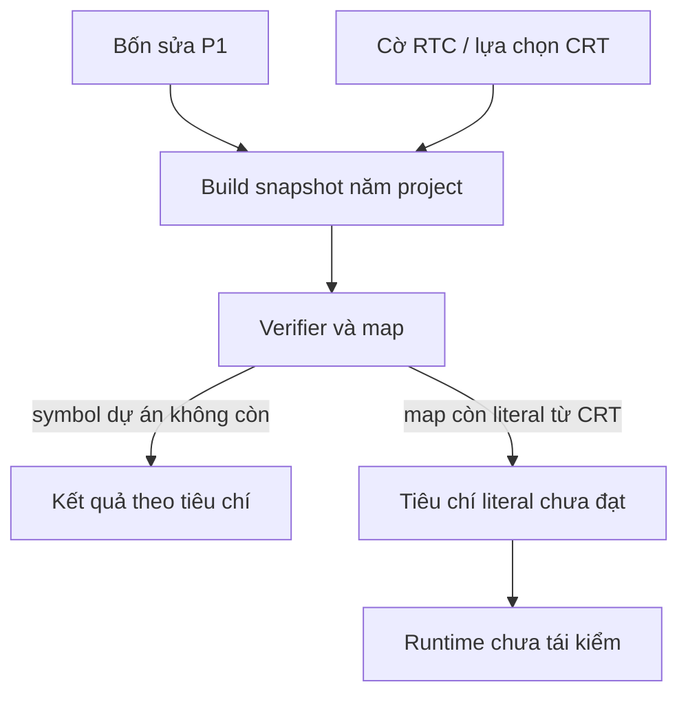

TÓM TẮT 1: [NGUỒN] Giữ bốn sửa P1 và đổi BasicRuntimeChecks trong build snapshot; không chuyển lỗi hoặc hash sang binary khác.
TÓM TẮT 2: [NGUỒN] Năm project và verifier có kết quả thành công lịch sử; tiêu chí map không có _RTC_ literal đã báo rõ chưa đạt.
TÓM TẮT 3: [NGUỒN] Engine có ngoại lệ lựa chọn CRT trong project snapshot; tương thích allocator qua biên DLL chưa kiểm.
TÓM TẮT 4: [NGUỒN] Các ghi nhận VM PM có mốc thời gian riêng, không được tái hiện bởi chuẩn hóa R-01.
TÓM TẮT 5: [CHƯA KIỂM] R-01 không chạy build, exe, VM hoặc mạng; kết quả build/VM có trong thân là ghi nhận lịch sử, chưa tái kiểm.

# A-07e — Bỏ /RTC1 và sửa lỗi mảng/biến chưa gán

Loại: sửa lỗi
Chủ đề: Bản ghi sửa lỗi P1, cấu hình RTC trong snapshot, build và giới hạn literal map.
Từ khóa: RTC, /RTC1, gs001, mảng, biến chưa gán, HighEntropyVA, GameServer.map, Engine.map, MSVC
Trạng thái: PARTIAL — tiêu chí không có _RTC_ literal trong mọi map chưa đạt; runtime chỉ là mốc PM lịch sử.
Độ phủ: đã phủ 23 trên tổng 25 hạng mục sửa/kiểm chứng trong nội dung gốc; đối chiếu mới và phần chưa phủ ghi riêng trong bảng.
Liên quan: `JX1_OPS/REPORTS/A-07-goc-re-crash-gs001.md`; `JX1_OPS/REPORTS/A-07b-ep-con-tro.md`; `JX1_OPS/REPORTS/A-07c-link-gs001.md`; `JX1_OPS/REPORTS/A-07d-breakpoint.md`; `JX1_OPS/DESIGN/CHUAN-BAO-CAO.md`; `JX1_OPS/DESIGN/MUC-LUC-TRI-THUC.md`; `JX1_OPS/DESIGN/HUONG-DAN-TRA-CUU.md`
Cần tôi quyết định: không (đối với đợt chuẩn hóa R-01).

## Sơ đồ chính



## Phạm vi và độ phủ

[NGUỒN] Đơn vị đếm là hạng mục ghi trong bảng, không phải toàn bộ hệ thống JX1. “Đã phủ” chỉ phần đã được mô tả trong báo cáo gốc; cột cuối phân biệt phần trực tiếp đối chiếu trong R-01 với phần chưa phủ dữ liệu gốc. Không nâng bằng chứng cũ thành xác minh mới.

Ký hiệu riêng của phần chuẩn hóa: `GS/` = `C:\Jx1CocoV3\Folder\ServerNew-20260116T043145Z-3-001\ServerNew\_bin_v2_\gs\`; `CA/` = `D:\JX-build\qh9A\Classes\`. Alias trong thân gốc giữ nguyên ý nghĩa lịch sử.

| Hạng mục | Độ phủ nội dung gốc | Bằng chứng trong báo cáo này | Đối chiếu dữ liệu gốc R-01 / phần chưa phủ |
|---|---|---|---|
| Helper: BasicRuntimeChecks | Đã phủ (theo mức chắc ghi trong thân) | `A-07e-rtc.md:80` | Giữ thay đổi lịch sử tại build-check.py:55; không chạy helper. |
| P1: KPlayer.cpp / nRItemLevel | Đã phủ (theo mức chắc ghi trong thân) | `A-07e-rtc.md:81` | Giữ chỉ số [5] được sửa trong snapshot; chưa đọc lại source snapshot. |
| P1: KItemList.cpp / nMagRows | Đã phủ (theo mức chắc ghi trong thân) | `A-07e-rtc.md:82` | Giữ bỏ lần ghi [6]; chưa đọc lại source snapshot. |
| P1: ScriptFuns.cpp / LuaGetShopItemData | Đã phủ (theo mức chắc ghi trong thân) | `A-07e-rtc.md:83` | Giữ chỉ số [5] trong sửa cũ; chưa đọc lại source snapshot. |
| P1: ScriptFuns.cpp / LuaITEM_DropOneItem | Đã phủ (theo mức chắc ghi trong thân) | `A-07e-rtc.md:84` | Giữ biến nItemIdx được trả về; chưa tái kiểm runtime. |
| Ngoại lệ cấu hình link Engine | Đã phủ (theo mức chắc ghi trong thân) | `A-07e-rtc.md:88` | Giữ lựa chọn CRT trong snapshot; allocator qua DLL chưa kiểm. |
| Build LuaLibDll | Đã phủ (theo mức chắc ghi trong thân) | `A-07e-rtc.md:110` | Exit 0 lịch sử; chưa build lại. |
| Build Engine | Đã phủ (theo mức chắc ghi trong thân) | `A-07e-rtc.md:111` | Exit 0 lịch sử; chưa build lại. |
| Build Common | Đã phủ (theo mức chắc ghi trong thân) | `A-07e-rtc.md:112` | Exit 0 lịch sử; chưa build lại. |
| Build CoreServer | Đã phủ (theo mức chắc ghi trong thân) | `A-07e-rtc.md:113` | Exit 0 lịch sử; chưa build lại. |
| Build GameServer | Đã phủ (theo mức chắc ghi trong thân) | `A-07e-rtc.md:114` | Exit 0 lịch sử; chưa build lại. |
| Verifier compile và object | Đã phủ (theo mức chắc ghi trong thân) | `A-07e-rtc.md:116` | 239 lệnh / 240 object là số lịch sử; chưa chạy verifier. |
| GameServer.map | Đã phủ (theo mức chắc ghi trong thân) | `A-07e-rtc.md:124` | Giữ 8 dòng _rtc_ lịch sử từ CRT; tiêu chí literal chưa đạt. |
| CoreServer.map | Đã phủ (theo mức chắc ghi trong thân) | `A-07e-rtc.md:125` | Giữ 8 dòng _rtc_ lịch sử; tiêu chí literal chưa đạt. |
| LuaLibDll.map | Đã phủ (theo mức chắc ghi trong thân) | `A-07e-rtc.md:126` | Giữ 8 dòng _rtc_ lịch sử; tiêu chí literal chưa đạt. |
| Engine.map | Đã phủ (theo mức chắc ghi trong thân) | `A-07e-rtc.md:127` | Giữ 32 dòng _rtc_ lịch sử; tiêu chí literal chưa đạt. |
| Artifact gs001.exe | Đã phủ (theo mức chắc ghi trong thân) | `A-07e-rtc.md:137` | Giữ hash/kích thước snapshot; GS gốc không thay thế được. |
| Artifact CoreServer.dll | Đã phủ (theo mức chắc ghi trong thân) | `A-07e-rtc.md:138` | Giữ bảng artifact; chưa đọc checkpoint A-07e. |
| Artifact Engine.dll | Đã phủ (theo mức chắc ghi trong thân) | `A-07e-rtc.md:139` | Giữ bảng artifact; chưa đọc checkpoint A-07e. |
| Artifact LuaLibDll.dll | Đã phủ (theo mức chắc ghi trong thân) | `A-07e-rtc.md:140` | Giữ bảng artifact; chưa đọc checkpoint A-07e. |
| Bàn giao PM | Đã phủ (theo mức chắc ghi trong thân) | `A-07e-rtc.md:159` | Hai điều kiện chưa đạt nguyên văn được thân ghi rõ. |
| Thử VM 04:13 | Đã phủ (theo mức chắc ghi trong thân) | `A-07e-rtc.md:162` | Ghi nhận PM lịch sử, chưa chạy lại. |
| Thử HEVA BAT 04:35 | Đã phủ (theo mức chắc ghi trong thân) | `A-07e-rtc.md:166` | Ghi nhận PM lịch sử, chưa chạy lại. |
| Literal map hoàn toàn không có _RTC_ | Chưa phủ | `A-07e-rtc.md:120` | Chưa đạt nguyên văn dù không có instrumentation trong object dự án. |
| Đóng gói ngoài workspace và runtime lâu/có tải | Chưa phủ | `A-07e-rtc.md:161` | Chưa đạt hoặc chưa kiểm; không mở rộng thao tác R-01. |

## Nội dung gốc (bảo toàn)

TÓM TẮT 1/5: Đã sửa 4 lỗi P1, đặt BasicRuntimeChecks=Default; không có /RTC trong 239 lệnh compile x64 đã kiểm.
TÓM TẮT 2/5: LuaLibDll, Engine, Common, CoreServer và GameServer đều build exit 0; cần chỉnh link CRT của Engine trên project snapshot khi bỏ /RTC1.
TÓM TẮT 3/5: gs001.exe 1.286.656 byte; SHA-256 988175a79c24c57b07d24d62b5f43e7acdd135e03e911bf347b123d92ff48a91; bộ EXE/DLL/PDB/map ở checkpoint-a07e-final/a07e.
TÓM TẮT 4/5: CHƯA ĐẠT điều kiện “không còn _RTC_ trong map”: không còn _RTC_CheckStackVars hoặc tham chiếu _RTC_ từ 240 object dự án, nhưng thư viện CRT vẫn mang symbol _RTC_.
TÓM TẮT 5/5: D:\JX-build\a07e bị từ chối quyền ghi; bộ bàn giao sẵn trong workspace, có lệnh copy cho PM. Không chạy EXE/DLL sản phẩm, không stage/commit/push.


Ngày 2026-11-17, Asia/Bangkok. Đã đọc task A-07e và báo cáo A-07d mục 2. Nhánh `fix/a07c-link`, HEAD `3802d29`. Không thấy AGENTS.md trong worktree hoặc thư mục cha đã kiểm. Ban đầu Git chỉ có `?? JX1_OPS/`.

`D:\JX-wt\A-07e` là reparse point tới `D:\JX-wt\A-07c`; Git xác nhận toplevel A-07c. Đường dẫn A-07e truy cập cùng nội dung; helper dùng `Path.resolve()` nên log ghi A-07c. Không tạo nhánh hoặc đổi metadata Git. Đường dẫn source dưới đây tính từ `server/jxOnline/gameserver/Sources/`.

## Thay đổi

| File:dòng hiện tại | Thay đổi |
|---|---|
| `A07b/build-check.py:55` | `BasicRuntimeChecks='EnableFastChecks'` thành `'Default'`. Áp dụng các project snapshot Release/Server Release x64, gồm Common. Giữ `/Od /Zi /MT /GL-`, charset .936, `/we4302 /we4311 /we4312 /we4313`, HighEntropyVA, DynamicBase, `/DEBUG:FULL /INCREMENTAL:NO`. |
| `Core/Src/KPlayer.cpp:1377` | Ghi `iparamr6` vào `nRItemLevel[5]` thay vì `[6]`; giữ mảng 6 phần tử khai báo tại :1362. |
| `Core/Src/KItemList.cpp:4141` | Bỏ riêng `nMagRows[6]=0`; giữ khởi tạo `[0]` đến `[5]`, không tăng kích thước mảng tại :4140. |
| `Core/Src/ScriptFuns.cpp:1068` | Ghi `iparamr6` vào `nRItemLevel[5]` thay vì `[6]`; giữ mảng 6 phần tử tại :1053. |
| `Core/Src/ScriptFuns.cpp:9440` | LuaITEM_DropOneItem trả `nItemIdx` đã gán khi tạo item; bỏ khai báo `nItemIndex` không còn dùng ở dòng cũ :9325. Dòng cũ :9441 dịch thành :9440. |

Sửa C++ theo byte ASCII, giữ encoding, line ending và nội dung tiếng Trung còn lại. Không sửa client, project gốc, logic game khác hoặc checkpoint A-07c.

### Ngoại lệ cấu hình link Engine

`A07b/build-check.py:68–78`: chỉ trong project Engine sao chép, bỏ `MSVCRT.LIB;MSVCPRT.LIB` khỏi AdditionalDependencies và bỏ `LIBCMT.lib` khỏi IgnoreSpecificDefaultLibraries. Giữ thư viện khác và metadata kế thừa. Không dùng `/FORCE` hoặc cho phép multiple definitions.

Project gốc Engine Release x64 (`Engine.vcxproj:400,403`) loại LIBCMT và ép DLL CRT, trong khi helper compile `/MT`. Lần chỉ đổi RTC bị LNK2005 std::_Xlength_error giữa libcpmt và MSVCPRT, rồi LNK1169. Bỏ DLL CRT nhưng còn loại LIBCMT gây 108 unresolved externals. Cho phép CRT static mà `/MT` chọn giải quyết cả hai lỗi. Đây là thay đổi thêm cần thiết để link được: các cờ compile khác giữ nguyên, nhưng lựa chọn thư viện CRT của Engine thay đổi. Chưa kiểm runtime hoặc allocator qua biên DLL.

## Build và xác minh

VS2022 Community v143, MSVC 14.44.35207, SDK 10.0.19041.0, x64. LuaLibDll/Engine/Common/GameServer dùng Release; Core dùng Server Release. Helper tắt post-build deploy trên snapshot như sẵn có; chỉ đọc input legacy từ `D:\JX-build\src18`.

```powershell
python server/jxOnline/gameserver/Sources/A07b/build-check.py --checkpoint=checkpoint-a07e
python server/jxOnline/gameserver/Sources/A07b/build-check.py --checkpoint=checkpoint-a07e-final
python server/jxOnline/gameserver/Sources/A07b/build-check.py --checkpoint=checkpoint-a07e-final --resume --incremental Engine CoreServer GameServer
python server/jxOnline/gameserver/Sources/A07b/checkpoint-a07e-final/logs/verify-a07e.py
git diff --check
```

Hai lệnh đầu là Rebuild vào snapshot mới; giữ lại các lần thất bại, không giao bộ output lỗi. Sau sửa link CRT đầy đủ, lệnh thứ ba compile/link Engine và build lại CoreServer/GameServer trên cùng nguồn đã sửa. Có thêm relink Engine để ghi diagnostic, rồi relink lại với options đúng helper; argument array trong commands.jsonl và Engine-final-link.log exit 0. Không thêm /VERBOSE:LIB vào helper giao PM.

| Project | Exit cuối | Lệnh compile trong tlog | Object kiểm symbol |
|---|---:|---:|---:|
| LuaLibDll | 0 | 30 | 30 |
| Engine | 0 | 90 | 91, gồm testsrc.obj do assembler tạo |
| Common, static lib | 0 | 26 | 26 |
| CoreServer | 0 | 88 | 88 |
| GameServer | 0 | 5 | 5 |

Verifier exit 0: 239 lệnh compile giữ `/Od /Zi /MT`, không có switch `/RTC`; 240 object không có symbol UNDEF chứa `_RTC_`; ba file C++ sửa và MiraclLegacyStdio khớp byte snapshot; bốn binary machine 0x8664, PE32+ 0x20b, giữ HighEntropyVA/DynamicBase. Log CoreServer cuối không có C4789/C4700; còn warning legacy khác như conversion, C4172 và LNK4099 thiếu PDB vendor. Không tuyên bố toàn source hết lỗi. git diff --check thành công.

### Map: tiêu chí literal chưa đạt

**Không thể xác nhận map hoàn toàn không có `_RTC_` với bộ build này.** Verifier ghi `literal_no_rtc_in_all_maps=false`; exit 0 xác nhận các kiểm tra kỹ thuật nêu trên, không có nghĩa tiêu chí literal đã đạt.

| Map | Dòng chứa `_rtc_`, không phân biệt hoa thường | Còn lại |
|---|---:|---|
| GameServer.map | 8 | _RTC_Initialize, _RTC_Terminate, unwind và bốn marker __rtc_*, đều từ LIBCMT:initsect.obj. Không có _RTC_UninitUse, _RTC_StackFailure hoặc _RTC_CheckStackVars. |
| CoreServer.map | 8 | Như GameServer. |
| LuaLibDll.map | 8 | Như GameServer. |
| Engine.map | 32 | Startup như trên; thêm handler _RTC_UninitUse, _RTC_StackFailure, _RTC_AllocaFailure, API/data/unwind từ LIBCMT:error.obj, userapi.obj, pdblkup.obj. Không có _RTC_CheckStackVars. |

Đã đối chiếu CRT cài tại `MSVC/14.44.35207/crt/src/vcruntime/exe_common.inl:162–165` và `dll_dllmain.cpp:50–52,184–186`: source startup có gọi initialize/terminate dưới guard `_RTC`. Startup binary lấy từ thư viện toolchain; đổi cờ compile game không rebuild CRT này.

`dumpbin /linkermember:1 libcmt.lib` cho thấy `_RTC_UninitUse`, `sprintf_s`, `_vsprintf_s_l` và `__local_stdio_printf_options` cùng member offset `4F0C4A` (error.obj). Điều này giải thích khả năng handler được giữ khi member CRT được kéo vào, chưa chứng minh đường game gọi handler. Bằng chứng trực tiếp về bỏ instrumentation: không có /RTC trên lệnh compile và không có tham chiếu UNDEF _RTC_ từ object dự án. Không vá CRT, thêm stub hoặc đổi tối ưu linker chỉ để xóa tên khỏi map.

## Artifact và SHA-256

| File | Byte | SHA-256 |
|---|---:|---|
| gs001.exe | 1.286.656 | `988175a79c24c57b07d24d62b5f43e7acdd135e03e911bf347b123d92ff48a91` |
| CoreServer.dll | 3.231.744 | `d508a609f29f870b42f72a0adc300595422589e68797d9243e2f991c60a7a26e` |
| Engine.dll | 1.878.016 | `639e64c0b3fc5ed5e7901e703d386244b56257423b2d0ea7c1c5be49c2b15cba` |
| LuaLibDll.dll | 790.528 | `ed8012a037ec3ff2c804792779f9e75d0e0424b8d753f19d863a489de45134b7` |

Bộ 15 file: bốn binary, bốn PDB tương ứng, bốn map, build-results.json, verification.json và SHA256SUMS.txt. Hash bản copy đã đối chiếu output. Vị trí qua workspace hiện tại:

```text
D:\JX-wt\A-07e\server\jxOnline\gameserver\Sources\A07b\checkpoint-a07e-final\a07e\
```

Đường dẫn vật lý là A-07c thay cho A-07e. Tạo `D:\JX-build\a07e` bằng New-Item nhận `UnauthorizedAccessException: Access to the path 'a07e' is denied`. **Chưa có bộ artifact tại D:\JX-build\a07e**; phiên chỉ được ghi workspace và không được yêu cầu nâng quyền. PM có thể copy bộ đã chuẩn bị trong phiên có quyền ghi đích:

```powershell
$jxA07ePack = 'D:\JX-wt\A-07e\server\jxOnline\gameserver\Sources\A07b\checkpoint-a07e-final\a07e'
New-Item -ItemType Directory -Path 'D:\JX-build\a07e' -Force -ErrorAction Stop
Get-ChildItem -LiteralPath $jxA07ePack -File | Copy-Item -Destination 'D:\JX-build\a07e' -ErrorAction Stop
Get-FileHash 'D:\JX-build\a07e\gs001.exe' -Algorithm SHA256
```

Bằng chứng trong checkpoint-a07e-final: source-sha256.json; snapshot project/source; logs/results.json, commands.jsonl; CL/link tlog dưới obj; log build/diagnostic/final-link; logs/a07e-verification.json, verify-a07e.py; import table bốn binary; logs/libcmt-linkermember.txt; out/ chứa artifact gốc. Lần lỗi trước sửa CRT giữ tại logs/attempt-before-crt-fix/ và checkpoint-a07e. Checkpoint đều ignored theo .gitignore sẵn có.

## Bàn giao PM

Đã sửa source, bỏ cờ RTC khi compile, build và gom artifact trong workspace. Hai điều kiện chưa đạt nguyên văn: chép đến thư mục ngoài workspace và map không còn bất kỳ _RTC_. Không chạy/load sản phẩm; chưa xác nhận lỗi dừng ~225 giây, VM/SQL, gameplay hoặc runtime/allocator sau chỉnh link Engine. Không sửa task, không stage/commit/push. PM review bốn file source/helper thay đổi và báo cáo này; không gom toàn bộ JX1_OPS untracked hoặc checkpoint vào commit.
## Thu trong VM thu (PM, 04:13)
- Bo A-07e (exe HEVA tat SHA 91BC8EB67058 = 988175A7... da editbin; CoreServer D508A609F29F, Engine 639E64C0B3FC, LuaLibDll ED8012A037EC) trong JX-Test-36 tu 04:02:49: SONG QUA MOC ~225 s (bo A-07c cu chet o moc nay 3/3 lan), >610 s, nghe 51189, bo nho rieng 6,3 GB. Ket luan so bo: nguyen nhan 0x80000003 la /RTC1 (hoac cac loi mang P1), da het khi bo.
- CHUA thu: bat HEVA (cho dung khong can co); chua co nguoi/bot vao; chua chay du lau. Con theo doi.

## Thu HEVA BAT (PM, 04:35)
- Sau 21 phut on dinh voi HEVA tat, nap gs001.exe nguyen ban tu build (HEVA BAT, SHA 988175A79C24...) + cung 3 DLL A-07e: chay tu 04:24:14, >10 phut, qua moc 40 s (bo cu chet 0xC0000005) va 225 s (0x80000003). => Bo A-07e chay duoc KHONG can tat co. Can giu chay lau hon va co tai (bot/nguoi) truoc khi ket luan "da sua".


## Đã xác minh / Chưa xác minh

**ĐÃ XÁC MINH — R-01:** Đối chiếu các heading và bảng dự án/map/artifact trong bản gốc; không đọc snapshot A-07e ngoài các gốc R-01, không chạy verifier/dumpbin/build. Hash máy hiện có tại GS là binary gốc O và khác hash gs001 build A-07e trong thân. Báo cáo được đọc UTF-8 nghiêm ngặt, lưu UTF-8 không BOM; bảo toàn phần thân gốc, gồm tóm tắt, kết luận, số liệu và bằng chứng.

**CHƯA XÁC MINH — R-01:** các phần ghi chưa phủ trong bảng; tính tương thích giữa nguồn lịch sử, dữ liệu hiện có và binary đang chạy; mọi kết quả build/test/VM cũ chưa được tái hiện. Các gốc source server hoặc checkpoint ngoài GS/CA không được đọc mở rộng trong nhiệm vụ này.

## Bàn giao

Đợt chuẩn hóa thuộc `task/R-01`, commit theo nhóm tối đa 5 file, không push. SHA thực tế được ghi ở phản hồi hoàn tất; xem `JX1_OPS/REPORTS/R-01.md` và chỉ mục `JX1_OPS/REPORTS/_CHIMUC/R-01.tsv`. Trạng thái Git trong thân là lịch sử của nhiệm vụ gốc. Bước tiếp theo: PM gộp chỉ mục, giao khảo sát riêng nếu cần bù phần chưa phủ; R-01 không cấp quyền chạy lệnh vận hành có trong thân.

## Phát hiện khi chuẩn hóa

- Bản đầu vào có 5 dòng tóm tắt trước tiêu đề; phần chuẩn hóa đặt 5 dòng mới theo khuôn và giữ đủ 5 dòng cũ trong thân.
- Phần literal_no_rtc_in_all_maps đã ghi không đạt dù verifier exit 0. Giữ phân biệt hai kết quả, không đổi trạng thái thành đạt.
- Các thử VM BAT/HighEntropyVA là cập nhật PM trong báo cáo; R-01 giữ nhãn lịch sử, không dùng làm kết quả thử mới.
- Tiếng Việt không dấu trong thân gốc và SHA không đổi; metadata mới dùng tiếng Việt có dấu.
