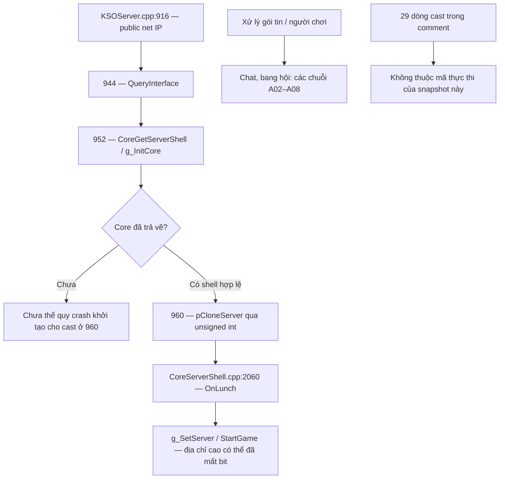

TÓM TẮT 1: [NGUỒN] DONE cho khảo sát tĩnh: rà 14/14 tệp C/C++ và header trong MultiServer/GameServer; kiểm kê 37 điểm có vị trí và cách kiểm.
TÓM TẮT 2: [NGUỒN] Có 7 dòng cast con trỏ ngoài comment, 1 chuỗi trả địa chỉ qua int và 29 dòng cast trong comment; các điểm này không đồng nghĩa với 37 lỗi runtime.
TÓM TẮT 3: [NGUỒN] Ưu tiên kiểm KSOServer.cpp:960 sau khi Core trả về; giữ nguyên kết luận A-07/A-07b rằng chưa chốt dòng gây crash gốc.
TÓM TẮT 4: [CHƯA KIỂM] Nhịp ngoài worktree bị Access denied; đã ghi bản nhịp trong vùng được phép. Không commit/push theo prompt; Tổng quan nhận bàn giao và gộp chỉ mục.
TÓM TẮT 5: [CHƯA KIỂM] Không chạy build, exe, VM, debugger hoặc mạng; địa chỉ thực, ABI binary và nguyên nhân crash sau public net IP đều chưa kiểm.

# A-07f — Điểm ép con trỏ 32-bit trong MultiServer/GameServer

Loại: khảo sát
Chủ đề: Kiểm kê ép địa chỉ qua số nguyên 32-bit, phân loại trạng thái mã và ưu tiên điều tra crash sau log public net IP.
Từ khóa: con trỏ, pointer truncation, unsigned int, unsigned long, DWORD, KSOServer, CoreServerShell, SSOI_LAUNCH, bang hội, gs001
Trạng thái: DONE — hoàn thành phạm vi đọc tĩnh và bảng trên 10 điểm; nhịp ở đường dẫn ngoài worktree bị chặn riêng.
Độ phủ: đã rà 14 trên tổng 14 tệp .c/.cpp/.h/.hpp/.inl tìm thấy trong MultiServer/GameServer; đối chiếu thêm project và ba tệp Core phụ thuộc; 37 điểm ở hai bảng A/D.
Liên quan: `JX1_OPS/REPORTS/A-07-goc-re-crash-gs001.md`; `JX1_OPS/REPORTS/A-07b-ep-con-tro.md`; `JX1_OPS/DESIGN/CHUAN-BAO-CAO.md`
Cần tôi quyết định: không

## Sơ đồ chính



## Phạm vi và độ phủ

**Quy ước đường dẫn:** `S/` = `C:\Jx1CocoV3\SwordOnline\SwordOnline\jxOnline\gameserver\Sources\`; `G/` = `S/MultiServer/GameServer/`; `C/` = `S/Core/Src/`. Mọi `file:dòng` bên dưới tính theo file thật đọc trong lượt A-07f, không dùng số dòng của bản copy A-07b thay thế. Gốc S được báo cáo nguồn chỉ rõ tại `JX1_OPS/REPORTS/A-07-goc-re-crash-gs001.md:71`.

Danh sách đọc xuất phát từ mục nguồn task: hai báo cáo A-07/A-07b và cây Sources. Trong cây này chỉ rà G, đọc `GameServer.vcxproj`, rồi lần hợp đồng trực tiếp tới `CoreServerShell.h`, `CoreServerShell.cpp`, `KCore.cpp`; `G/KSOServer.cpp:66` và `G/KSOServer.h:11` dẫn tới header đó. Không mở rộng sang toàn MultiServer, client, dữ liệu game, binary hoặc snapshot build A-07b. Map/Graphify và mục lục không được mở thêm theo giới hạn nguồn Q-51 trong prompt.

| Phần tử | Độ phủ | Bằng chứng / giới hạn |
|---|---|---|
| `G/KSOServer.cpp` | Đã phủ phép rà và ngữ cảnh liên quan | 47 dòng khớp biểu thức tìm; phân loại tại bảng A/D/N; các mốc chính `G/KSOServer.cpp:960`, `G/KSOServer.cpp:5295`, `G/KSOServer.cpp:6641`. |
| `G/KSOServer.h` | Đã phủ phép rà | `G/KSOServer.h:258` là cast hằng số, không phải địa chỉ. |
| `G/GameServer.cpp` | Đã phủ phép rà | Không có dòng khớp mẫu cast hẹp; phạm vi tìm từ `G/GameServer.cpp:1` tới hết file. |
| `G/KTransferUnit.cpp` | Đã phủ phép rà | Không có dòng khớp; phạm vi từ `G/KTransferUnit.cpp:1`. |
| `G/KTransferUnit.h` | Đã phủ phép rà | Không có dòng khớp; phạm vi từ `G/KTransferUnit.h:1`. |
| `G/StdAfx.cpp` | Đã phủ phép rà | Không có dòng khớp; phạm vi từ `G/StdAfx.cpp:1`. |
| `G/StdAfx.h` | Đã phủ phép rà | Không có dòng khớp; phạm vi từ `G/StdAfx.h:1`. |
| `G/CRC32.C` | Đã phủ phép rà | Không có dòng khớp; phạm vi từ `G/CRC32.C:1`; không nằm trong bốn translation unit ở `G/GameServer.vcxproj:306`. |
| `G/CRC32.h` | Đã phủ phép rà | Không có dòng khớp; phạm vi từ `G/CRC32.h:1`. |
| `G/miracl.h` | Đã phủ phép rà | `G/miracl.h:106` là `sizeof(long)`, không phải cast. |
| `G/MIRACL32.H` | Đã phủ phép rà | Không có dòng khớp; phạm vi từ `G/MIRACL32.H:1`. |
| `G/mirdef.h` | Đã phủ phép rà | Không có dòng khớp; phạm vi từ `G/mirdef.h:1`. |
| `G/MIRDEF32.H` | Đã phủ phép rà | Không có dòng khớp; phạm vi từ `G/MIRDEF32.H:1`. |
| `G/resource.h` | Đã phủ phép rà | Không có dòng khớp; phạm vi từ `G/resource.h:1`. |
| `G/GameServer.vcxproj` | Đã phủ cấu hình liên quan | Có cấu hình x64 ở `G/GameServer.vcxproj:8`; bốn translation unit từ `G/GameServer.vcxproj:306`; không suy thành build đã chạy. |
| `C/CoreServerShell.h`, `.cpp` và `C/KCore.cpp` | Đã phủ các hợp đồng dùng trong bảng A | `C/CoreServerShell.h:217`, `C/CoreServerShell.h:231`, `C/CoreServerShell.cpp:1184`, `C/CoreServerShell.cpp:2048`, `C/KCore.cpp:1128`. Không rà toàn Core. |
| Hai báo cáo nguồn | Đã đọc làm nền, không chỉnh sửa | Giữ giới hạn crash tại `JX1_OPS/REPORTS/A-07-goc-re-crash-gs001.md:94` và `JX1_OPS/REPORTS/A-07b-ep-con-tro.md:183`. |
| Binary, PDB, dump, runtime; nguồn ngoài G trừ ba tệp Core kể trên | Chưa phủ | Ngoài phạm vi chạy/đọc mở rộng của A-07f; kết quả lịch sử A-07b không được tính là lần kiểm mới. |

### Giải mã tên

Không phát sinh tên riêng kỹ năng, trang bị, quái, NPC hoặc bản đồ cần giải mã. Các mục dưới là mã chức năng ASCII, giữ nguyên tên gốc; không gán tên Hán/TCVN3 hoặc tên game khi nguồn chưa cung cấp.

| Tên gốc | Mã hóa | Chữ đúng / diễn giải tiếng Việt UTF-8 | Nguồn file:dòng |
|---|---|---|---|
| `SSOI_LAUNCH` | ASCII | Khởi chạy thế giới game | `G/KSOServer.cpp:960` |
| `chat_everyone` / `SSOI_BROADCASTING` | ASCII | Thông báo toàn máy chủ | `G/KSOServer.cpp:1708`, `C/CoreServerShell.cpp:2056` |
| `SGDI_CHECK_TONG`, nhóm `SGDI_TONG_*` | ASCII | Truy vấn và thao tác bang hội | `C/CoreServerShell.cpp:1329`, `G/KSOServer.cpp:6600` |

**Mã hóa đã kiểm:** KSOServer.cpp giải mã UTF-8 nghiêm ngặt thành công, có BOM. KSOServer.h và ba tệp Core không giải mã UTF-8 nghiêm ngặt; mã hóa chú thích legacy, gồm khả năng GBK, **chưa kiểm**. Chỉ dùng token mã ASCII làm bằng chứng; không diễn giải phần chữ lỗi, không chuyển mã hay ghi lại source. Báo cáo này và bản nhịp được lưu UTF-8 không BOM.

### Sắp theo cấu trúc game

Thứ tự kiểm là khởi tạo thế giới → thông báo → tài khoản/chuyển trạng thái → bang hội → danh sách bản đồ. Trong bảng A, thứ hạng thể hiện mức phù hợp với crash sau log và đường dùng địa chỉ, không phải xác suất đã đo. Không có danh mục phái/kỹ năng/trang bị để sắp trong task này.

## Kết quả khảo sát và cách đọc thứ hạng

**ĐÃ XÁC MINH — mã nguồn:** log nằm ở `G/KSOServer.cpp:916`; sau đó gọi QueryInterface tại `G/KSOServer.cpp:944`, CoreGetServerShell tại `G/KSOServer.cpp:952`, rồi mới truyền clone qua unsigned int tại `G/KSOServer.cpp:960`. CoreGetServerShell gọi g_InitCore trước khi trả shell (`C/CoreServerShell.cpp:227`). Vì vậy, cast 960 là điểm ưu tiên trong nhóm mất bit nếu đường chạy đã tới đó; chỉ thấy log cuối chưa chứng minh đã thực hiện cast này.

**GIẢ THUYẾT — Windows x64:** dùng mô hình LLP64 đã nêu tại `JX1_OPS/REPORTS/A-07-goc-re-crash-gs001.md:104`: con trỏ 8 byte; unsigned int, unsigned long, DWORD và int 4 byte. Chưa đo sizeof trong build A-07f. Địa chỉ có bit cao khác 0 mất thông tin khi đi qua kiểu 32-bit; cast ngược không khôi phục địa chỉ. Đường int có thêm vấn đề dấu. Điều kiện địa chỉ thực và điểm dereference trong binary **chưa kiểm**.

**Quy ước kiểm:** cột “đối chiếu tĩnh” là việc đã làm. Cột “cách kiểm tiếp” là đề xuất **chưa chạy**, chỉ dành cho task sau có quyền build/debug trên bản copy và môi trường thử được duyệt. Mỗi phép kiểm cần đúng binary/PDB và ghi địa chỉ đầy đủ trước cast, giá trị tham số sau cast, stack/thread, nơi đọc/ghi đầu tiên; không dùng riêng việc hết crash khi tắt HighEntropyVA làm bằng chứng đã sửa lỗi.

### Bảng A — Tám chuỗi ngoài comment, xếp theo ưu tiên

| ID / hạng | Nhóm game; vị trí | Đối chiếu tĩnh và đánh giá | Cách kiểm tiếp từng điểm — chưa chạy |
|---|---|---|---|
| A01 / P1 | Khởi tạo: `G/KSOServer.cpp:960`, `InitServer` tại `G/KSOServer.cpp:704` | `(unsigned int)pCloneServer` đi qua `C/CoreServerShell.h:217` → `C/CoreServerShell.cpp:2060` → `C/CoreServerShell.cpp:2205` → `C/KCore.cpp:1130`. Mất bit có điều kiện địa chỉ cao; shell/clone NULL là câu hỏi riêng. Đây là đường khởi tạo gần log nhất trong bảng. | Đặt mốc trước/sau 944, 952, 960; ghi HRESULT/clone. So clone đầy đủ với uParam và g_pServer; chỉ quy lỗi cho cast khi đã tới 960 và xác nhận địa chỉ thay đổi trước lần sử dụng. Nếu crash trước Core trả về, điều tra nhánh khởi tạo khác. |
| A02 / P2 | Thông báo: `G/KSOServer.cpp:1712`, `chat_everyone` ở `G/KSOServer.cpp:1708` | `(unsigned int)(pCeo + 1)` được nhận như char* tại `C/CoreServerShell.cpp:2057`. Cần gói chat đi vào nhánh này; không phải bước nối tiếp trực tiếp log khởi tạo. | Theo dõi đúng nhánh chat; so địa chỉ payload trước cast với địa chỉ Broadcasting nhận, ghi độ dài và lần đọc đầu tiên. Chưa gửi gói hoặc mở kết nối thử. |
| A03 / P2 | Bang hội/cập nhật: `G/KSOServer.cpp:2019`, `G/KSOServer.cpp:2020`, `G/KSOServer.cpp:2027` | Core tạo địa chỉ bằng `(int)&...m_szName` tại `C/CoreServerShell.cpp:1337`; kết quả API và TongBase đều int (`C/CoreServerShell.h:231`). Sau đó dùng làm const char* cho strcpy. Một chuỗi có điểm cắt ở producer và điểm dùng ở GameServer, không đếm hai lần. | Khi có cập nhật bang hội và người chơi hợp lệ, so địa chỉ tên ở Core với nRet, TongBase và nguồn strcpy; kiểm cả mở rộng dấu. Xác nhận nhánh thực chạy trước khi gắn với crash. |
| A04 / P2 | Bang hội/mời: `G/KSOServer.cpp:6600` | `(unsigned int)&sInvite`; Core khôi phục struct* tại `C/CoreServerShell.cpp:1400` rồi đọc trường tại `C/CoreServerShell.cpp:1401`. Cần yêu cầu mời và bang hội hợp lệ (`G/KSOServer.cpp:6592`). | So &sInvite với pInvite, dừng trước lần đọc m_nPlayerIdx; xác nhận nhánh và vòng đời biến cục bộ, địa chỉ cao và stack. |
| A05 / P2 | Bang hội/cấp quyền: `G/KSOServer.cpp:6734` | `(unsigned int)pApply`; Core nhận tại `C/CoreServerShell.cpp:1193`, chuyển cho CheckPowerPower tại `C/CoreServerShell.cpp:1198`. Điều kiện người chơi/quyền ảnh hưởng việc đi tới nơi dùng. | Theo yêu cầu APPLY_POWER hợp lệ, so pApply trước/sau API; bước vào CheckPowerPower tới lần đọc struct đầu tiên. Chưa mở rộng đọc hàm đó trong task này, chưa khẳng định RIP cụ thể. |
| A06 / P3 tiềm ẩn | Bang hội/thông tin tên: `G/KSOServer.cpp:6652` | `(unsigned int)name` sẽ được dùng làm char* tại `C/CoreServerShell.cpp:1212`. Nhưng trong cùng nhánh, dwTongNameID khởi tạo 0 ở `G/KSOServer.cpp:6640`, không được cập nhật bởi A07, rồi break tại `G/KSOServer.cpp:6642`; đường tuần tự bình thường chưa tới cast 6652. | Trước hết xác nhận nhánh có tới 6652 không; nếu task sau sửa cách nhận ID, kiểm lại buffer name với địa chỉ Core ghi và nhánh lỗi đặt byte 0 tại `C/CoreServerShell.cpp:1214`. Không tự sửa ID để kích hoạt trong A-07f. |
| A07 / P4, lỗi logic nhận kết quả | Bang hội/MORE_INFO: `G/KSOServer.cpp:6641` | Có cast `(unsigned int)&dwTongNameID`, nhưng case nhận chỉ đọc nParam và trả nRet, không đọc/ghi uParam (`C/CoreServerShell.cpp:1723`, `C/CoreServerShell.cpp:1729`). Caller bỏ giá trị trả về; biến vẫn 0 và break ở `G/KSOServer.cpp:6642`. Không có dereference địa chỉ bị cắt trong case này. | Ghi giá trị return và dwTongNameID trước/sau lời gọi, xác nhận break; kiểm hợp đồng lấy ID qua return, không coi địa chỉ cắt đơn thuần là bằng chứng crash ở đây. |
| A08 / P4, lỗi logic nhận kết quả | Bang hội/GET_POWER: `G/KSOServer.cpp:6763` | Cùng hợp đồng bỏ qua uParam như A07; biến 0 tại `G/KSOServer.cpp:6762`, bỏ return rồi break tại `G/KSOServer.cpp:6764`. Chưa có cơ sở xếp là crash do pointer. | Ghi return và biến cục bộ ở riêng nhánh GET_POWER; xác nhận không đi tới tạo gói sPower vì break. Không gộp phép kiểm này với A07 dù cùng ID truy vấn. |

P2 cùng hạng vì chưa có tần suất gói, thread hoặc dump để phân hạng sâu hơn. Bảng A gồm **7 dòng cast ngoài comment và 1 chuỗi trả con trỏ qua int**, trong đó A06 bị chặn bởi luồng logic hiện tại, A07/A08 có tham số bị bỏ qua. Không gọi cả tám là tám crash đã chứng minh.

### Bảng D — Đủ 29 dòng cast con trỏ trong comment, hạng P0 (không thực thi)

Các cast dạng unsigned int dưới đây vẫn được ghi để đủ kiểm kê; chúng không bổ sung số lỗi đang hoạt động. Hai dòng có hai toán hạng cast là D20 và D27. Toàn bảng là đối chiếu tĩnh đã làm; kiểm runtime chỉ có ý nghĩa nếu một task khác phục hồi mã trên bản copy. Không khôi phục comment trong A-07f.

| ID | Nhóm / file:dòng | Con trỏ và trạng thái | Cách kiểm riêng |
|---|---|---|---|
| D01 | Khởi tạo — `G/KSOServer.cpp:1069` | m_pTransferClient; cả lời gọi có `//`. | Xác nhận `//` trước SSOI_TRAN_INIT; nếu phục hồi, so client pointer với tham số nhận. |
| D02 | Khởi tạo — `G/KSOServer.cpp:1123` | m_pChatClient; `//`. | Xác nhận SSOI_CHAT_INIT đang bị bỏ; nếu phục hồi, kiểm client pointer trước/sau API. |
| D03 | Khởi tạo — `G/KSOServer.cpp:1174` | m_pTongClient; `//`. | Xác nhận SSOI_TONG_INIT đang bị bỏ; nếu phục hồi, kiểm pointer của kết nối bang hội. |
| D04 | Khởi tạo — `G/KSOServer.cpp:1234` | m_pGatewayClient; `//`. | Xác nhận SSOI_GATEWAYINIT đang bị bỏ; nếu phục hồi, kiểm gateway pointer. |
| D05 | Thông báo — `G/KSOServer.cpp:4344` | szData; chỉ cast cũ nằm trong `/*...*/` nội dòng. | Kiểm uParam thực là 0, chuỗi đi bằng strdata; đối chiếu receiver `C/CoreServerShell.cpp:1955`. |
| D06 | Tài khoản — `G/KSOServer.cpp:3341` | szName; `//`. | Kiểm lời gọi thay thế tại `G/KSOServer.cpp:3342` truyền trực tiếp strdata. |
| D07 | Tên nhân vật — `G/KSOServer.cpp:3345` | szRoleName; `//`. | Xác nhận cast bị bỏ; không suy rằng buffer đã được điền chỉ vì có tên biến trong dòng comment. |
| D08 | Chuyển trạng thái — `G/KSOServer.cpp:3379` | reg.Name; `//`. | Kiểm lời gọi strdata trực tiếp tại `G/KSOServer.cpp:3380`. |
| D09 | Chuyển trạng thái — `G/KSOServer.cpp:3407` | reg.Name; `//`. | Kiểm lời gọi strdata tại `G/KSOServer.cpp:3408`. |
| D10 | Tài khoản — `G/KSOServer.cpp:3780` | eg.szAccountName; `//`. | Kiểm buffer truyền ở strdata tại `G/KSOServer.cpp:3781`. |
| D11 | Tên nhân vật — `G/KSOServer.cpp:3790` | eg2.szCharacterName; `//`. | Kiểm strdata tại `G/KSOServer.cpp:3791`. |
| D12 | Chuyển trạng thái — `G/KSOServer.cpp:4730` | reg.Name; `//`. | Kiểm strdata tại `G/KSOServer.cpp:4731`. |
| D13 | Hết hạn đăng nhập — `G/KSOServer.cpp:4812` | szName; `//`. | Kiểm strdata tại `G/KSOServer.cpp:4813`. |
| D14 | Hết hạn đăng nhập — `G/KSOServer.cpp:4816` | szRoleName; `//`. | Kiểm strdata tại `G/KSOServer.cpp:4817`. |
| D15 | Chuyển trạng thái — `G/KSOServer.cpp:4842` | reg.Name; `//`. | Kiểm strdata tại `G/KSOServer.cpp:4843`. |
| D16 | Tài khoản — `G/KSOServer.cpp:4869` | szName; `//`. | Kiểm strdata tại `G/KSOServer.cpp:4870`. |
| D17 | Chuyển trạng thái — `G/KSOServer.cpp:4900` | reg.Name; `//`. | Kiểm strdata tại `G/KSOServer.cpp:4901`. |
| D18 | Thoát người chơi — `G/KSOServer.cpp:5326` | szName; không có `//` tại dòng cast nhưng nằm trong comment khối. | Đối chiếu mở `/*` tại `G/KSOServer.cpp:5295` và đóng tại `G/KSOServer.cpp:5348`; không đưa vào bảng active. |
| D19 | Chuyển trạng thái — `G/KSOServer.cpp:5964` | reg.Name; `//`. | Kiểm strdata tại `G/KSOServer.cpp:5965`. |
| D20 | Bang chiến — `G/KSOServer.cpp:1891` | Hai `(int)&...m_szAttackName`, `(int)&...m_szDAttackName` trong comment nội dòng. | Kiểm lời gọi SetAttackMsg thực nhận `(void*)pChar, 2`; không tính hai cast bị bỏ là tham số hiện tại. |
| D21 | Tạo bang — `G/KSOServer.cpp:2178` | &sSuccess; `//`. | Kiểm đường OperationRequestInfo nhận &sSuccess ở pdata tại `G/KSOServer.cpp:2179`. |
| D22 | Thêm thành viên — `G/KSOServer.cpp:2212` | &sAdd; `//`. | Kiểm lời gọi hiện tại ở `G/KSOServer.cpp:2211` dùng pdata trực tiếp. |
| D23 | Bang chiến — `G/KSOServer.cpp:6051` | szPlayerName; `//`. | Kiểm dòng bị bỏ và nhánh tạo gói hiện tại; không giả định đã gọi Core lấy tên. |
| D24 | Bang chiến — `G/KSOServer.cpp:6072` | szPlayerName; `//`. | Kiểm dòng bị bỏ và trường hợp yêu cầu thông tin riêng này, không gộp với D23. |
| D25 | Tạo bang — `G/KSOServer.cpp:6104` | szPlayerName; `//`. | Kiểm strdata tại `G/KSOServer.cpp:6105`. |
| D26 | Nhận thành viên — `G/KSOServer.cpp:6163` | szPlayerName; `//`. | Kiểm strdata tại `G/KSOServer.cpp:6164`. |
| D27 | Nhận thành viên — `G/KSOServer.cpp:6185` | szTongName và &sAdd; hai cast unsigned int trong một dòng `//`. | Kiểm thay thế tại `G/KSOServer.cpp:6186` truyền qua strdata/pdata, không qua uParam/nParam số nguyên. |
| D28 | Danh sách bang — `G/KSOServer.cpp:6350` | &sGet trong comment khối. | Kiểm cặp mốc `G/KSOServer.cpp:6342` / `G/KSOServer.cpp:6352`; nhánh hiện tạo gói sGetList từ `G/KSOServer.cpp:6353`. |
| D29 | Danh sách bản đồ — `G/KSOServer.cpp:4120` | &sMapID trong comment khối. | Kiểm mốc `G/KSOServer.cpp:4117` / `G/KSOServer.cpp:4144`; nhánh hiện bắt đầu tại `G/KSOServer.cpp:4146`. Nếu phục hồi còn phải đối chiếu char buffer với receiver int* tại `C/CoreServerShell.cpp:1285`. |

### Bảng N — Các dòng khớp còn lại, không phải ép địa chỉ sang số nguyên

| Vị trí | Phân loại / phép kiểm đã thực hiện |
|---|---|
| `G/KSOServer.cpp:1839`, `G/KSOServer.cpp:2225`, `G/KSOServer.cpp:2274`, `G/KSOServer.cpp:2305`, `G/KSOServer.cpp:2370`, `G/KSOServer.cpp:2409` | `(int)pInfo/pSync->m_dwParam` là lấy giá trị trường rồi so giới hạn chỉ số; không cast bản thân pInfo/pSync. Không đánh giá mọi lỗi miền giá trị của các trường này. |
| `G/KSOServer.cpp:2832`, `G/KSOServer.cpp:2833` | Ép giá trị phần tử WORD sang unsigned long; `WORD* pPlayers` được khai báo tại `G/KSOServer.cpp:2827`. |
| `G/KSOServer.cpp:4242` và dòng comment `G/KSOServer.cpp:4247` | Cast giá trị trường nMgsIdx; nơi nhận hoạt động dùng làm tham số SetMissionValue tại `C/CoreServerShell.cpp:2054`, không khôi phục thành địa chỉ. |
| `G/KSOServer.cpp:5655` | `(DWORD*)` là cast con trỏ sang con trỏ, `sizeof(DWORD)` là kích thước; không hạ địa chỉ xuống DWORD. Chưa kiểm an toàn chiều dài/alignment của gói tin. |
| `G/KSOServer.h:258` | `(DWORD)(-1)` là hằng sentinel, không mang pointer. |
| `G/miracl.h:106` | `sizeof(long)` khớp mẫu từ vựng nhưng không phải phép cast. |

**Đối soát đếm:** 49 dòng khớp mẫu ban đầu = 7 dòng cast con trỏ ngoài comment + 29 dòng cast con trỏ trong comment + 10 dòng xử lý giá trị số + 3 dòng còn lại ở cuối bảng N. Chuỗi TongBase được lần thêm qua return, không nằm trong 49 dòng khớp ở G. Do đó bảng A/D có **8 + 29 = 37 điểm**; không đếm số toán hạng trong cùng dòng thành nhiều điểm. Chưa chứng minh không còn macro/typedef hoặc đường gián tiếp ngoài mẫu và ngoài phạm vi đã nêu.

## Mục sổ thông số

| Nhóm | Tên/hằng số | file:dòng | Giá trị | Đơn vị | Ảnh hưởng | Đổi an toàn | Nguồn đo |
|---|---|---|---|---|---|---|---|
| ABI giả định | void* / uintptr_t; int / unsigned int / unsigned long / DWORD | `JX1_OPS/REPORTS/A-07-goc-re-crash-gs001.md:104` | 8; 4 trên Windows x64 LLP64 | byte | Mất bit nếu đưa địa chỉ qua kiểu 4 byte; chưa đo trong A-07f | KHÔNG đổi riêng lẻ ABI | Nguồn gián tiếp + đọc chữ ký; chưa compile sizeof |
| API | OperationRequest.uParam | `C/CoreServerShell.h:217`, `C/CoreServerShell.cpp:2048` | unsigned int | kiểu tham số | Mang clone hoặc payload ở A01/A02 | KHÔNG đổi một phía | Đọc tĩnh |
| API | GetGameData.uParam / return | `C/CoreServerShell.h:231`, `C/CoreServerShell.cpp:1184` | unsigned int / int | kiểu tham số / kết quả | Trộn ID và địa chỉ; A03–A08 phải xét từng uDataId | KHÔNG đổi một phía | Đọc tĩnh |
| API bổ sung | GetGameDataInfo / OperationRequestInfo.uParam | `C/CoreServerShell.h:235`, `C/CoreServerShell.h:239` | unsigned long; có char*/void* riêng | kiểu tham số | unsigned long vẫn 32-bit theo giả định LLP64; tên Info không tự bảo đảm an toàn cho địa chỉ | KHÔNG coi long là cách sửa pointer | Đọc tĩnh; các đường strdata/pdata được đối chiếu riêng |
| Địa chỉ thử | Biên kiểm mất bit | `G/KSOServer.cpp:960`, `C/CoreServerShell.cpp:2060` | 2^32 = 4.294.967.296 | byte trong không gian địa chỉ | Biên toán học cho cast unsigned 32-bit; địa chỉ thực chưa kiểm | CẨN THẬN; chỉ kế hoạch đo | Suy từ độ rộng giả định, không phải số đo runtime |

## Đề xuất tối ưu và kiểm tiếp

1. Thu bằng chứng thứ tự trước/sau Core trước khi chọn sửa A01; đây vẫn là giới hạn của khảo sát gốc (`JX1_OPS/REPORTS/A-07-goc-re-crash-gs001.md:98`). Các nhánh chat/bang hội cần gói tương ứng; không suy chúng chạy chỉ từ log IP.
2. Khi được giao sửa trên copy, giữ địa chỉ bằng kiểu con trỏ/uintptr_t/intptr_t nhất quán cả caller, interface và implementation, rebuild các module dùng ABI đó cùng nhau. Thay unsigned int bằng unsigned long trên Windows x64 hoặc chỉ đổi một cast caller chưa đủ (`C/CoreServerShell.h:217`, `C/CoreServerShell.h:231`, `C/CoreServerShell.h:239`). Không sửa mã trong A-07f.
3. Tách task sửa cách nhận return của A07/A08; trước khi sửa phải lưu ý thay đổi này có thể mở đường tới cast name A06. Đối chiếu ba điểm cùng nhau (`G/KSOServer.cpp:6641`, `G/KSOServer.cpp:6652`, `G/KSOServer.cpp:6763`).
4. Task build/debug sau có thể dùng cảnh báo C4302/C4311/C4312 và C4313 như kế hoạch lịch sử A-07b, nhưng phải kiểm macro/cấu hình và PDB đúng binary. A-07f chưa chạy compiler và không nhận kết quả build cũ là kiểm tra mới (`JX1_OPS/REPORTS/A-07b-ep-con-tro.md:152`).

## Đã xác minh / Chưa xác minh

**ĐÃ XÁC MINH:** Git ban đầu trả `## task/A-07f`, không có local changes; report A-07f và các report A-07f-*.md chưa có trước khi làm. Đã đọc nguồn chỉ định, tìm giới hạn 14 tệp, đối chiếu 49 dòng khớp, comment khối/nội dòng, chữ ký API và các nhánh nhận ghi trong bảng A/D/N. Đã tính SHA-256 để phân biệt snapshot source hiện tại với nguồn lịch sử; hash không chứng minh binary tương ứng.

| Tệp source | SHA-256 tại lần đọc A-07f |
|---|---|
| `G/KSOServer.cpp` | `8dd7edc03a29dbdbb2feca83e0700bd15bad029776f758dc4bcf4ab9477a2598` |
| `G/KSOServer.h` | `b0ee3fcdea60a3e6053b4137ce0433d057926206885dde4529ff7661f9a18ac3` |
| `G/GameServer.vcxproj` | `ac8b75049296e2fb82655ad0d79dcac069f13f9ffd4ca9717cbd5d839bc844b6` |
| `C/CoreServerShell.cpp` | `a5c8b0bf093517758e181b0212a0f962a39c2c3c39a3edcdd1d982c5c8307ebd` |
| `C/CoreServerShell.h` | `762ac7d88f79cf1b7a6ebd5ccdb6209fd50af0e31420455ae4411c867bbb29d2` |
| `C/KCore.cpp` | `37ee6bea7b036549d88e3a0d22f462a5290489fc8a71acbeb1f95d146b41ee23` |

**CHƯA XÁC MINH / CHƯA KIỂM:** runtime, địa chỉ heap/stack, HRESULT thực, thứ tự thread, nơi dereference đầu tiên, binary/PDB/ABI đang vận hành, toàn bộ đường build/client/VM. Không build, không chạy test game, exe, debugger, VM hoặc mạng theo prompt. Source trên đĩa này không mặc định là bản A-07b đã sửa; A-07b nói rõ baseline và snapshot riêng tại `JX1_OPS/REPORTS/A-07b-ep-con-tro.md:83`, `JX1_OPS/REPORTS/A-07b-ep-con-tro.md:171`. Chưa có bằng chứng mới thay kết luận crash gốc.

### Lỗi, cách thử và kết quả

| Vấn đề | Cách thử thực tế | Kết quả / xử lý |
|---|---|---|
| Nhịp ngoài writable root | Thử WriteAllText tới `D:\JX-wt\A-07f.nhip` một lần ở mốc bắt đầu | UnauthorizedAccessException: `Access to the path 'D:\JX-wt\A-07f.nhip' is denied.` Không thử nâng quyền/đổi ACL. Các mốc tiếp ghi `JX1_OPS/REPORTS/A-07f-nhip.md`; đường dẫn nhịp yêu cầu vẫn BỊ CHẶN. |
| rg không có | Gọi rg một lần tại thư mục GameServer | CommandNotFoundException; dùng Get-ChildItem + Select-String giới hạn G, không cài công cụ. |
| Source không nằm dưới worktree báo cáo | Kiểm đường dẫn Sources tương đối: không có; đọc alias S từ báo cáo A-07 | Root chính xác tồn tại; chỉ đọc root này, không quét ổ đĩa tìm nguồn khác. |
| Xuống dòng khi nối Kết quả/nhịp | git diff --check phát hiện CR ở dòng cuối phần nối task; kiểm byte thấy nhịp cũng có LF/CRLF trộn | Chuẩn hóa LF cho task/nhịp, giữ UTF-8 không BOM và nội dung; kiểm lại diff sau sửa. |
| Hiển thị tiếng Việt lần đọc đầu | Get-Content mặc định làm lỗi hiển thị chuẩn/task | Dùng UTF-8 cho tài liệu, đọc lại chuẩn để phục hồi phần hiển thị; source legacy chỉ trích mã ASCII và ghi giới hạn mã hóa. Không sửa file gốc. |

**Kiểm tra tài liệu thực chạy:** kiểm UTF-8 không BOM, số dòng tóm tắt, số hàng A/D, đối soát tập vị trí với kết quả Select-String, lỗi khoảng trắng và diff các file task. Kết quả cuối được ghi tại mục Kết quả của task; đây là kiểm tài liệu, không phải test runtime.

## Bàn giao

Không stage, commit hoặc push theo prompt “Tổng quan commit hộ”; chưa có SHA mới, không có bằng chứng push GitHub. Đầu ra: báo cáo này, `JX1_OPS/REPORTS/A-07f-nhip.md` và mục Kết quả nối cuối `JX1_OPS/TASKS/A-07f.md`. Vùng glob của task là A-07f-*.md; hai đường dẫn báo cáo chính/task là ngoại lệ được prompt hiện tại chỉ định đích danh. Không sửa báo cáo cũ, source, cấu hình hoặc BAI_HOC.

Chỉ mục `_CHIMUC/A-07f.tsv` và `MUC-LUC-TRI-THUC.md` không thuộc vùng ghi được giao. Hàng TSV đề nghị PM gộp, giữ trong báo cáo để không tự mở rộng vùng file:

```tsv
file	loại	chủ đề	từ khóa	trạng thái	độ phủ	liên quan
JX1_OPS/REPORTS/A-07f.md	khảo sát	Ép con trỏ 32-bit trong MultiServer/GameServer	con trỏ;pointer truncation;KSOServer;CoreServerShell;SSOI_LAUNCH;bang hội	DONE	14/14 tệp rà tĩnh;37 điểm A/D;runtime chưa kiểm	JX1_OPS/REPORTS/A-07-goc-re-crash-gs001.md;JX1_OPS/REPORTS/A-07b-ep-con-tro.md
```

Tổng quan nhận commit tài liệu; PM chỉ giao bước debug/sửa ABI sau khi có phạm vi và quyền riêng. Không có việc chạy máy chủ hoặc mở kết nối nằm trong bàn giao A-07f.

## Phát hiện khi chuẩn hóa

- Giữ nguyên mọi kết luận/số liệu của A-07 và A-07b. Các dòng 4120, 5326, 6350 có cast nhưng nằm trong comment khối của source hiện tại (`G/KSOServer.cpp:4117`, `G/KSOServer.cpp:5295`, `G/KSOServer.cpp:6342`); phát hiện này chỉ phân loại inventory A-07f.
- A07/A08 không dùng tham số địa chỉ trong case nhận, và return bị bỏ tại caller; A06 vì thế bị chặn ở luồng tuần tự (`C/CoreServerShell.cpp:1723`, `G/KSOServer.cpp:6642`, `G/KSOServer.cpp:6764`). Không sửa lặng báo cáo cũ hoặc diễn giải thành lỗi crash đã xác minh.
- Trường worktree trong task ghi placeholder `D:\JX-wt$id`; prompt đã chỉ rõ worktree thật. Làm tại `D:\JX-wt\A-07f`, nhánh task/A-07f đã kiểm; không sửa metadata mẫu.

Kỹ năng đã dùng: jx1-retrofit (khuôn, bảo toàn kết luận); jx1-read-server (root, caller/receiver, đọc tĩnh); jx1-read-client (ranh giới nhánh/client và runtime, không đọc source client); jx1-parameters (sổ thông số); jx1-knowledge (nhãn độ chắc, sơ đồ, hàng mục lục trong vùng được giao); jx1-report (báo cáo, bàn giao, nhịp). Đã nạp sáu SKILL.md trong `.agents/skills`; các giới hạn nguồn/ghi/commit tuân prompt hiện tại.
