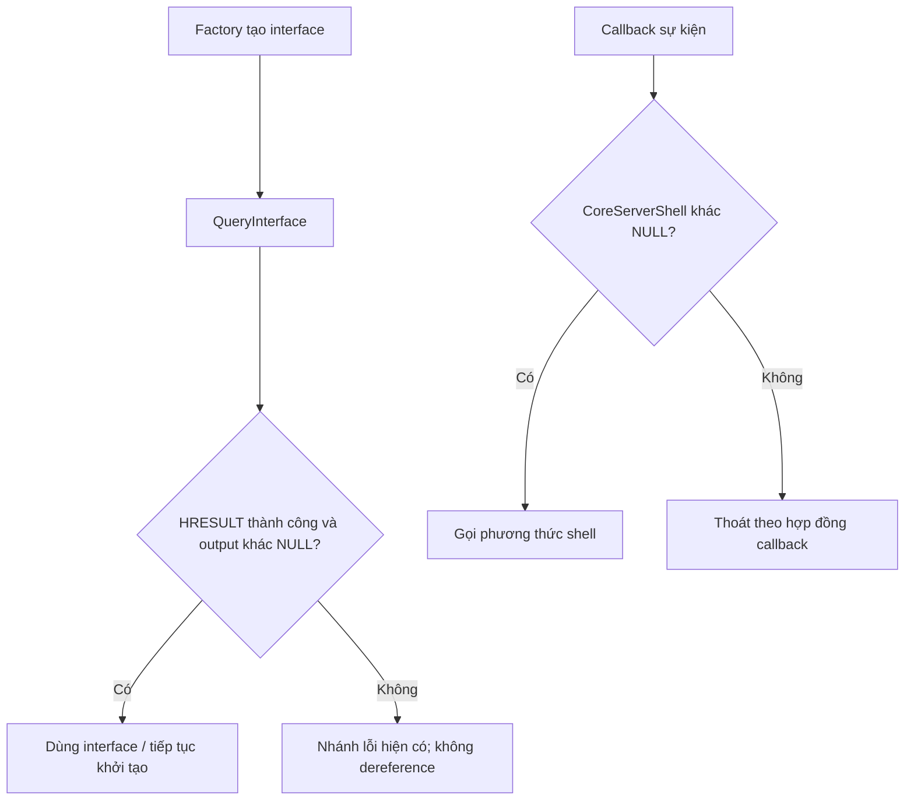

TÓM TẮT 1: [NGUỒN] Liệt kê 5 nhóm điểm QueryInterface/factory, thứ tự đăng ký và callback NULL được báo cáo A-07 dẫn lại; mức nguy cơ là đánh giá tĩnh.
TÓM TẮT 2: [NGUỒN] A-07 dẫn HRESULT ở nhánh CreateServerInterface quanh KSOServer.cpp:832 và QueryInterface ở :943–944; callback ở :4966 được dẫn là thiếu guard shell.
TÓM TẮT 3: [CHƯA KIỂM] Source server không có trong worktree nên chưa đối chiếu các dòng, chữ ký hàm, kiểu trả về hoặc nhánh dọn dẹp.
TÓM TẮT 4: [NGUỒN] Đề xuất diff nhỏ dạng minh họa: chỉ dùng interface sau HRESULT thành công và con trỏ khác NULL; callback kiểm shell trước dereference.
TÓM TẮT 5: [CHƯA KIỂM] Chỉ đọc báo cáo; không sửa source, không chạy build/exe/VM/mạng; diff minh họa chưa biên dịch hay chạy.

# A-07g — Kiểm QueryInterface bỏ qua HRESULT và callback NULL

Loại: khảo sát
Chủ đề: Đánh giá tĩnh các lời gọi QueryInterface/factory và callback có thể dereference shell NULL.
Từ khóa: QueryInterface, HRESULT, callback, con trỏ NULL, KSOServer, m_pCoreServerShell, crash, A-07g
Trạng thái: PARTIAL — các nguồn báo cáo được rà; source gốc thiếu trong worktree nên điểm và diff chưa đối chiếu.
Độ phủ: đã rà 5 nhóm điểm trên tổng 5 nhóm được dẫn trong báo cáo nguồn; chưa phủ source trực tiếp (0/1 gốc server có mặt trong worktree).
Liên quan: `JX1_OPS/REPORTS/A-07-goc-re-crash-gs001.md`; `JX1_OPS/REPORTS/A-07b-ep-con-tro.md`; `JX1_OPS/DESIGN/CHUAN-BAO-CAO.md`
Cần tôi quyết định: không.

## Sơ đồ chính



## Phạm vi và độ phủ

| Điểm cần rà | Bằng chứng được báo cáo dẫn lại | Mức nguy cơ tĩnh | Độ phủ trực tiếp trong task |
|---|---|---|---|
| Factory/interface trong `CreateServerInterface` và xử lý HRESULT | `JX1_OPS/REPORTS/A-07-goc-re-crash-gs001.md:92` dẫn `KSOServer.cpp:832`, :845–849, :856; HRESULT bị bỏ qua và nhánh `m_pServer == NULL` bị comment. API cụ thể tại :832 chưa đối chiếu source. | Cao nếu nhánh lỗi vẫn vào `Startup`; có thể dùng trạng thái interface không hợp lệ. Chưa xác định contract/failure path. | Chưa kiểm source |
| Query interface clone sau log IP | `JX1_OPS/REPORTS/A-07-goc-re-crash-gs001.md:84,98` dẫn `KSOServer.cpp:943–944`; output khởi tạo NULL, HRESULT bị bỏ qua, sau đó có lời gọi tiếp theo được dẫn ở :960 | Cao nếu QI thất bại hoặc output còn NULL rồi bị truyền/dereference; không chứng minh đây là crash thực tế. | Chưa kiểm source |
| Thứ tự đăng ký callback và gán shell | `JX1_OPS/REPORTS/A-07-goc-re-crash-gs001.md:92,99` dẫn `KSOServer.cpp:324,856–860,952`; callback được đăng ký trước khi shell được gán | Trung bình–cao, phụ thuộc callback có thể chạy đồng thời trong cửa sổ này; runtime race chưa xác minh. | Chưa kiểm source |
| Callback `ServerEventNotify` / đường gọi `SetNetStatus` | `JX1_OPS/REPORTS/A-07-goc-re-crash-gs001.md:92,99` dẫn `KSOServer.cpp:153–176` và cho biết có callback xử lý khi client đóng | Trung bình; phải kiểm mọi nhánh và giá trị shell trước dereference. | Chưa kiểm source |
| Callback `PreparePlayerForLoginFailed` | `JX1_OPS/REPORTS/A-07-goc-re-crash-gs001.md:92,99` dẫn `KSOServer.cpp:4966` là lời gọi không guard shell | Cao nếu shell có thể NULL tại thời điểm callback; chưa xác minh chữ ký, contract hoặc đồng bộ hóa. | Chưa kiểm source |

Đơn vị đếm là năm nhóm vị trí được báo cáo nguồn dẫn lại; không đại diện toàn bộ server. Bằng chứng trên là gián tiếp, được giữ nguyên nhãn nguồn, không coi số dòng là hiện hành.

## Đề xuất vá nhỏ (minh họa, chưa đối chiếu chữ ký nguồn)

Đối với cả `CreateServerInterface` và lời gọi lấy clone: lưu HRESULT, chỉ tiếp tục khi `FAILED(hr)` là false và output interface không NULL. Khi thất bại, dùng nhánh lỗi/dọn dẹp phù hợp với hàm hiện có; không tự đặt giá trị trả về hay quyền sở hữu interface khi chưa đọc source.

```diff
- m_pServer->QueryInterface(iid, (void**)&pCloneServer);
+ HRESULT hr = m_pServer->QueryInterface(iid, (void**)&pCloneServer);
+ if (FAILED(hr) || pCloneServer == NULL) {
+     // Chuyển tới nhánh lỗi hiện có; không gọi tiếp với pCloneServer.
+ }
```

Với callback, kiểm `m_pCoreServerShell` ngay trước lần dereference; khi NULL, thoát bằng giá trị/cleanup tương ứng hợp đồng callback. Không dùng một `return` cụ thể cho tới khi xác minh kiểu trả về và tài nguyên cần giải phóng. NULL check đơn lẻ không bảo đảm lifetime nếu callback đồng thời với teardown. Không thêm khóa đồng bộ hoặc thay đổi thứ tự khởi tạo nếu chưa có bằng chứng về thread/lifetime.

```diff
- m_pCoreServerShell->PreparePlayerForLoginFailed(...);
+ if (m_pCoreServerShell == NULL) {
+     // Dùng đường thoát phù hợp chữ ký callback và giữ cleanup cần thiết.
+ }
+ m_pCoreServerShell->PreparePlayerForLoginFailed(...);
```

Các đoạn diff chỉ minh họa điều kiện bảo vệ, chưa phải patch áp dụng được: biểu thức đối số, tên IID, kiểu output, log, cleanup, kiểu trả về và quyền sở hữu cần đối chiếu source thật trước khi lập diff chính xác.

## Mục sổ thông số

Không có thông số gameplay hoặc giá trị định lượng thuộc task này để ghi sổ; HRESULT và trạng thái con trỏ là điều kiện điều khiển, không phải chỉ số đo.

## Giải mã tên

Không có tên riêng trong game (kỹ năng, trang bị, quái, NPC, bản đồ) trong phạm vi khảo sát này; không áp dụng bảng giải mã tên. Tên API và symbol kỹ thuật được giữ nguyên theo nguồn.

## Sắp theo cấu trúc game

Không áp dụng phân loại phái/nhánh/kỹ năng, bộ trang bị hoặc bản đồ/quái/NPC. Các điểm được nhóm theo vòng đời interface: tạo → truy vấn → đăng ký callback → kiểm tra shell trước dùng.

## Đã xác minh / Chưa xác minh

**ĐÃ XÁC MINH:** Hai báo cáo nguồn tồn tại và được đọc trong worktree này. `JX1_OPS/REPORTS/A-07-goc-re-crash-gs001.md:84,92,98–99` nêu các vị trí/nhận định được tổng hợp ở bảng; `JX1_OPS/REPORTS/A-07b-ep-con-tro.md:115` ghi một sửa đổi lịch sử khác tại `KSOServer.cpp:2021`, không phải bằng chứng trực tiếp cho HRESULT/callback trong task này. Đây là xác minh nội dung báo cáo, không phải tái kiểm source.

**CHƯA XÁC MINH:** `SwordOnline/SwordOnline/jxOnline/gameserver/Sources` và `KSOServer.cpp` không hiện diện trong worktree. Vì vậy chưa thể xác nhận source revision, dòng hiện hành, điều kiện nhánh, kiểu trả về/cleanup, danh sách đầy đủ điểm tương tự hoặc khả năng biên dịch diff. Chưa có kết luận về crash runtime; không chạy test/build/exe/VM/mạng.

## Bàn giao

Không commit theo yêu cầu. Báo cáo được đặt dưới tên khớp vùng `JX1_OPS/REPORTS/A-07g-*.md`. Không tạo chỉ mục vì `JX1_OPS/REPORTS/_CHIMUC/` nằm ngoài `vung_file` của task. Không cập nhật `JX1_OPS/TASKS/A-07g.md` vì file task nằm ngoài `vung_file`; do đó mục “Kết quả cuối” và yêu cầu nhịp ngoài worktree chưa thể ghi trong các vùng được cấp. PM cần bổ sung/cho phép source worktree và giao quyền cập nhật task/nhịp nếu muốn hoàn tất xác minh trực tiếp.

Kỹ năng đã dùng: jx1-retrofit, jx1-read-server, jx1-report. Đã đọc jx1-read-client, jx1-parameters, jx1-knowledge; không áp dụng vì task chỉ kiểm source server, không khảo sát client hoặc nội dung gameplay.
