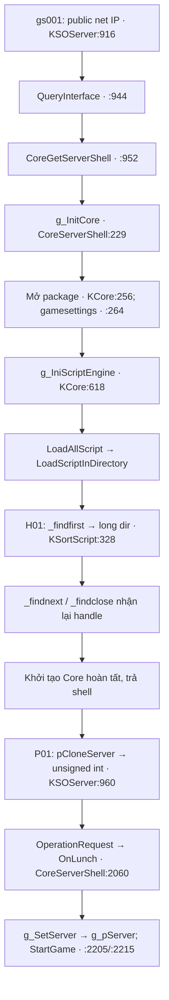

TÓM TẮT 1: [NGUỒN] DONE khảo sát tĩnh: canonical vẫn dùng `long` nhận `_findfirst`, rồi truyền handle tới `_findnext`/`_findclose` (`S/Core/Src/KSortScript.cpp:328`, `:332`, `:369`, `:371`).
TÓM TẮT 2: [NGUỒN] Hai điểm trực tiếp trên đường khởi động là handle duyệt script và kênh truyền `pCloneServer` 32 bit; cần lần lượt `intptr_t` và `uintptr_t` xuyên suốt ABI (`S/Core/Src/KCore.cpp:618`; `S/MultiServer/GameServer/KSOServer.cpp:960`).
TÓM TẮT 3: [NGUỒN] Có bảng 9 nhóm cần sửa/kiểm và các trường hợp giữ kiểu hiện tại; không đổi kết luận A-07/A-07b hoặc coi canonical là snapshot đã sửa (`JX1_OPS/REPORTS/A-07b-ep-con-tro.md:83`).
TÓM TẮT 4: [CHƯA KIỂM] Chưa xác định dòng crash T1, chưa chứng minh nhánh legacy/fallback đang chạy; ghi nhịp ngoài worktree bị từ chối quyền.
TÓM TẮT 5: [CHƯA KIỂM] Không sửa source, không chạy build, exe, VM hay mạng; không stage/commit/push theo prompt, Tổng quan nhận phần commit.

# A-07h — Soát kiểu handle và con trỏ x64 trong KSortScript/Core

Loại: khảo sát
Chủ đề: Xác định chỗ thu hẹp handle/con trỏ và vị trí tương ứng trên đường khởi động gs001.
Từ khóa: duyệt script, handle, con trỏ, _findfirst, intptr_t, uintptr_t, KSortScript, CoreServerShell, gs001, x64
Trạng thái: DONE — đủ tiêu chí khảo sát tĩnh; nhịp ngoài sandbox bị chặn và runtime chưa kiểm.
Độ phủ: 10/10 hạng mục đọc tĩnh trong bảng phạm vi; sàng lọc API trên 580 file trực tiếp thuộc bốn thư mục, không phải kiểm toán toàn bộ Sources.
Liên quan: `JX1_OPS/REPORTS/A-07-goc-re-crash-gs001.md`; `JX1_OPS/REPORTS/A-07b-ep-con-tro.md`; `JX1_OPS/DESIGN/CHUAN-BAO-CAO.md`; `JX1_OPS/DESIGN/MUC-LUC-TRI-THUC.md`.
Cần tôi quyết định: không đối với khảo sát; sửa mã, build và thử runtime cần nhiệm vụ được duyệt riêng.

## Sơ đồ chính



[ĐÃ XÁC MINH — TĨNH] Sơ đồ mô tả thứ tự gọi đồng bộ trong source, với điều kiện Core chưa khởi tạo và không rẽ lỗi trước đó. Bằng chứng: `S/MultiServer/GameServer/KSOServer.cpp:951`, `:960`; `S/Core/Src/CoreServerShell.cpp:227`, `:229`, `:230`; `S/Core/Src/KCore.cpp:256`, `:264`, `:618`; `S/Core/Src/KSortScript.cpp:208`, `:219`, `:220`, `:260`, `:272`. Không thể dùng thứ tự này để gán RIP cho binary chưa kiểm.

## Nguồn, phiên bản và danh sách file cần đọc

- `S/` = `C:\Jx1CocoV3\SwordOnline\SwordOnline\jxOnline\gameserver\Sources\`, canonical chỉ đọc ngày 19/11/2026. Root được giải từ `JX1_OPS/REPORTS/A-07-goc-re-crash-gs001.md:71`, vì đường dẫn tương đối trong worktree không tồn tại. Không đọc bản copy A-07b hoặc mặc định source này trùng binary đang chạy.
- Nguồn bắt buộc: chuẩn báo cáo, task A-07h và hai báo cáo A-07/A-07b. Định vị bổ sung giới hạn ở mục liên quan của `JX1_OPS/CONTEXT-PACK/GS001-MAP.md:2` và `JX1_OPS/DESIGN/MUC-LUC-TRI-THUC.md:18`; không dùng chúng thay bằng chứng file thật.
- Nhóm khởi động: `Core/Src/KSortScript.cpp`, `.h`, `KCore.cpp`, `CoreServerShell.cpp`, `.h`; `MultiServer/GameServer/KSOServer.cpp`, `.h`; `Core/Core.vcxproj`.
- Nhóm mở rộng theo A-07b và hit API: `Core/Src/LuaFuns.cpp`, `S3PDBConnection.cpp`, `.h`, `CoreShell.cpp`, `.h`, `KInventory.cpp`, `KForBitGua.cpp`; `Engine/Src/KCodecLzo.cpp`, `KMemManager.cpp`, `KFile.cpp`, `.h`, `KPackFileManager.cpp`, `KFileCopy.cpp`, `KScanDir.cpp`, `KThread.cpp`, `.h`, `KNetThread.cpp`, `.h`, `KEvent.h`, `KMutex.h`; `Engine/Engine.vcxproj`; `MultiServer/Common/IOCompletionPort.cpp`, `.h`, `OpaqueUserData.h`, `Buffer.cpp`, `SocketServer.cpp`. `KPlayer.cpp` chỉ lấy hit định vị, không kiểm toán lại toàn file.
- Sàng lọc tên/API chỉ trên file `.cpp/.h/.c` nằm trực tiếp trong `Core/Src` (234), `Engine/Src` (272), `MultiServer/GameServer` (14), `MultiServer/Common` (60). Có 102 dòng khớp chuỗi API, gồm comment và nhánh không biên dịch; không phải 102 lỗi. Không liệt kê đệ quy các thư mục lớn, không tạo parser/helper, không đọc toàn đồ thị. Không có `graphify-out/GRAPH_REPORT.md` tại root canonical đã kiểm; lần caller/callee bằng file thật.
- Báo cáo dùng UTF-8 không BOM. Đoạn source đọc sâu được giải theo CP936/GBK để xem chú thích Hán; kết luận dựa trên identifier/kiểu ASCII. Đây không phải chứng nhận mọi file nguồn có cùng mã hóa; không ghi lại hay chuyển mã source.

## Phạm vi và độ phủ

| Hạng mục đọc tĩnh | Độ phủ | Bằng chứng / giới hạn |
|---|---|---|
| 1. Kết luận và giả thuyết A-07 | Đã phủ | `JX1_OPS/REPORTS/A-07-goc-re-crash-gs001.md:98`, `:102`, `:104`; giữ riêng T1/A2T2. |
| 2. Baseline và giới hạn A-07b | Đã phủ | `JX1_OPS/REPORTS/A-07b-ep-con-tro.md:83`, `:137`, `:139`, `:185`; không mở lại checkpoint/build cũ. |
| 3. Handle duyệt script, mọi điểm dùng trong nhánh WIN32 | Đã phủ | `S/Core/Src/KSortScript.cpp:325`, `:328`, `:332`, `:369`, `:371`, `:372`; declaration mặc định server ở `S/Core/Src/KSortScript.h:46`. |
| 4. Chuỗi khởi tạo gs001 → Core → script → launch | Đã phủ | `S/MultiServer/GameServer/KSOServer.cpp:952`, `:960`; `S/Core/Src/CoreServerShell.cpp:229`, `:2205`; `S/Core/Src/KCore.cpp:618`. |
| 5. Kênh con trỏ vào/ra CoreServerShell | Đã phủ | `S/Core/Src/CoreServerShell.h:217`, `:231`, `:233`, `:239`; `S/Core/Src/CoreServerShell.cpp:1155`, `:1193`, `:1337`, `:1958`, `:2060`. |
| 6. Handle Win32/CRT lân cận | Đã phủ về kiểu | `S/Engine/Src/KPackFileManager.cpp:243`; `S/Engine/Src/KScanDir.cpp:68`; `S/Engine/Src/KFileCopy.cpp:28`; `S/Engine/Src/KNetThread.cpp:78`; không xác nhận toàn bộ quản lý lifetime. |
| 7. Lua cũ và adapter MySQL cũ | Đã phủ có điều kiện | `S/Core/Src/LuaFuns.cpp:1`, `:84`, `:123`; `S/Core/Src/S3PDBConnection.h:38`; `S/Core/Core.vcxproj:934`, `:938`; adapter không có trong danh sách project đã đọc. |
| 8. Con trỏ Engine và log Core lân cận | Đã phủ | `S/Engine/Src/KCodecLzo.cpp:51`, `:213`; `S/Engine/Src/KMemManager.cpp:150`, `:192`, `:200`; `S/Core/Src/KInventory.cpp:660`, `:666`. |
| 9. User pointer, atomic fallback và completion key | Đã phủ có điều kiện | `S/MultiServer/Common/OpaqueUserData.h:26`, `:28`; `S/MultiServer/Common/IOCompletionPort.h:36`; `S/MultiServer/Common/SocketServer.cpp:354`; chưa kiểm tiền xử lý SDK thực tế. |
| 10. Ranh giới client dùng chung Core | Đã phủ để loại khỏi đường gs001 | `S/Core/Src/CoreShell.cpp:480`; `S/Core/Src/CoreShell.h:1014`; `S/Core/Core.vcxproj:956`, `:962`; không đọc thêm Cocos/APK. |

### Giải mã tên

Không trích tên riêng kỹ năng, trang bị, quái, NPC hoặc bản đồ; đây là khảo sát kiểu dữ liệu. Tên gốc của identifier và file được giữ nguyên, không dịch thành tên nội dung game.

| Tên gốc | Mã hóa | Chữ đúng UTF-8 / ý nghĩa | Nguồn file:dòng |
|---|---|---|---|
| `gs001` | ASCII | Tiến trình máy chủ game trong phạm vi task | `JX1_OPS/REPORTS/A-07-goc-re-crash-gs001.md:7` |
| `KSortScript`, `LoadScriptInDirectory` | ASCII | Bộ nạp script, duyệt thư mục script | `S/Core/Src/KSortScript.cpp:313` |
| `CoreServerShell`, `SSOI_LAUNCH` | ASCII | Giao diện Core và lệnh khởi chạy | `S/Core/Src/CoreServerShell.cpp:2048`, `:2059` |
| `SGDI_CHECK_TONG` | ASCII | Mã lấy địa chỉ tên bang hội; không phải tên riêng bang hội | `S/Core/Src/CoreServerShell.cpp:1329`, `:1337` |
| `serverscript.lua`, `StartGame` | ASCII | Script hệ thống và hàm khởi chạy | `S/Core/Src/CoreServerShell.cpp:2208`, `:2215` |

### Sắp theo cấu trúc game

Dữ liệu xếp theo vòng đời máy chủ: khởi tạo tài nguyên/script → bàn giao giao diện mạng cho Core → xử lý thông tin bang hội sau khởi tạo → nhánh client/legacy. Không có dữ liệu phái/nhánh/cấp học hoặc bộ trang bị để sắp theo các trục đó. Thứ tự này bám chuỗi gọi đã dẫn ở sơ đồ và các case của `S/Core/Src/CoreServerShell.cpp:1329`, `:2059`.

## Bảng điểm sai kiểu và cách sửa đề xuất

[ĐÃ XÁC MINH — TĨNH] “Sai kiểu” dưới đây nói về giá trị mang địa chỉ/handle ở ABI Windows x64; không đồng nghĩa đã xảy ra crash. Quy ước độ rộng LLP64 được báo cáo nguồn nêu ở `JX1_OPS/REPORTS/A-07-goc-re-crash-gs001.md:104`; A-07h chưa biên dịch phép `sizeof`. Chỉ đề xuất, không áp dụng thay đổi mã.

| ID / bộ phận | Producer → chỗ thu hẹp → consumer, file:dòng | Cách sửa đúng trên bản copy khi được giao | Quan hệ với khởi động gs001 |
|---|---|---|---|
| H01 — nạp script | `_findfirst` → `long dir` ở `S/Core/Src/KSortScript.cpp:328`; handle dùng tại `:332`, `:369`, `:371`. Trên x64 việc gán có thể mất 32 bit cao; truyền lại sẽ mở rộng giá trị đã cắt. | Khai báo `intptr_t dir`, include `<stdint.h>` tường minh; giữ cùng biến đủ độ rộng tới `_findnext` và `_findclose`. Giữ sentinel có dấu `-1`; không đổi sang `HANDLE`, không dùng `CloseHandle` cho CRT search handle. | **Trực tiếp, trước launch:** `S/Core/Src/KCore.cpp:618` → `S/Core/Src/KSortScript.cpp:272`, `:220`. Điều kiện server mặc định TRUE ở `S/Core/Src/KSortScript.h:46`; WIN32 được đặt trong cấu hình server x64 ở `S/Core/Core.vcxproj:596`. |
| P01 — bàn giao mạng cho Core | `pCloneServer` → `(unsigned int)` ở `S/MultiServer/GameServer/KSOServer.cpp:960` → `unsigned int uParam` ở `S/Core/Src/CoreServerShell.h:217`, `.cpp:2048` → `(LPVOID)uParam` ở `.cpp:2060` → `g_pServer` ở `S/Core/Src/KCore.cpp:1130`. | Dùng `uintptr_t` cho kênh `uParam`, đồng bộ caller, interface, class declaration và implementation; chỉ cast về pointer tại consumer. `OnLunch`/`OperationRequest` trả trạng thái thì vẫn có thể trả `int`. Rebuild các module dùng chung ABI, không trộn DLL cũ. | **Trực tiếp, sau khi Core đã trả về:** caller `:952` rồi `:960`; `OnLunch` lưu server ở `S/Core/Src/CoreServerShell.cpp:2205` trước gọi `StartGame` ở `:2215`. |
| P02 — biến thể lệnh Core | `unsigned long uParam` ở `S/Core/Src/CoreServerShell.h:239`, `.cpp:1946` được cast thành `LPVOID` cho `SSOI_LAUNCH` ở `.cpp:1958`. `unsigned long` vẫn 32 bit trên Windows x64. | Dùng `uintptr_t` cho kênh địa chỉ, sửa đồng bộ interface/declaration/definition và caller tương ứng; không chỉ sửa cast cuối. | Có case launch nhưng caller khởi động vừa kiểm dùng `OperationRequest`, không phải biến thể này (`S/MultiServer/GameServer/KSOServer.cpp:960`). Chưa kiểm có caller khác chạy sớm. |
| P03 — tham số buffer/struct của Core | `GetGameData` nhận `unsigned int uParam` rồi dựng pointer ở `S/Core/Src/CoreServerShell.cpp:1184`, `:1193`, `:1204`; `GetGameData_New` nhận `int nParam` rồi dựng `pAdd` ở `:1136`, `:1155`. Interface tương ứng ở `S/Core/Src/CoreServerShell.h:231`, `:233`. | Kênh `uParam` mang địa chỉ dùng `uintptr_t`; `nParam` vừa có dấu vừa mang địa chỉ dùng `intptr_t`, hoặc tách API có pointer rõ kiểu. Kiểm đủ producer/consumer và giữ các ID số theo hợp đồng hiện tại. | Không thấy lời gọi các case này trong chuỗi init đã kiểm. Caller thêm bang hiện dùng `strdata`/`pdata` đúng kiểu ở `S/MultiServer/GameServer/KSOServer.cpp:6186`, `:6692`; dòng cũ `:6185` là comment. Không coi comment là đường đang chạy. |
| P04 — kết quả tên bang hội | `&(Player[uParam].m_cTong.m_szName)` → `(int)`/`nRet` ở `S/Core/Src/CoreServerShell.cpp:1337`, `:1186` → return `int` ở `S/Core/Src/CoreServerShell.h:231` → `int TongBase` ở `S/MultiServer/GameServer/KSOServer.cpp:2019`, `:2020` → `const char*` ở `:2027`. | Dùng `intptr_t` cho kết quả chứa địa chỉ, local `nRet`, interface/declaration/definition và `TongBase`; hoặc tách hàm trả `const char*`. Chỉ đổi `TongBase` không cứu được địa chỉ đã mất ở producer. | Thuộc xử lý đồng bộ bang hội; không có trong chuỗi khởi tạo đồng bộ đã dẫn. Không gán nó làm nguyên nhân crash trước `CoreGetServerShell` trả về. |
| L01 — handle trạng thái Lua cũ | `Lua_State*` → `(unsigned int)` tại `S/Core/Src/LuaFuns.cpp:123`; consumer `unsigned int Addr` ở `:84`, cast pointer `:85`; `stateid` ở `:175`, `:177`, `:180`. | Chuyển cả hai chiều sang opaque userdata/pointer được Lua hỗ trợ. `intptr_t` chỉ giải quyết độ rộng phía C++; không bảo đảm round-trip nếu vẫn truyền địa chỉ qua số thực Lua. | Có `#ifdef USEOLD` ở `:1`; file bị loại khỏi Server Debug/Release x64 tại `S/Core/Core.vcxproj:934`, `:938`. Không quy lỗi này cho đường gs001 của cấu hình đã đọc. |
| L02 — kết quả MySQL cũ | `&m_res`/`&m_res2` → `(DWORD)` tại `S/Core/Src/S3PDBConnection.cpp:72`, `:103` → field `DWORD m_pRes` tại `.h:38`. | Ưu tiên `void*`/pointer rõ kiểu để chứa hai loại kết quả; nếu hợp đồng buộc kiểu số, dùng `uintptr_t` đồng bộ mọi nơi đọc/ghi. Không đổi ABI vendor khi chưa có thư viện tương ứng. | Hai project Core/Engine không có mục `S3PDBConnection` trong văn bản đã tìm. Chưa chứng minh adapter này được biên dịch/nạp bởi đường khởi động hiện tại; phù hợp giới hạn lịch sử `JX1_OPS/REPORTS/A-07b-ep-con-tro.md:139`. |
| E01 — địa chỉ trong bộ nén LZO | `m_pos`, `pIn`, `ip` bị cast về `unsigned` trước so sánh/trừ ở `S/Engine/Src/KCodecLzo.cpp:51`, `:52`, `:63`, `:64`; bảng `BYTE** dict` ở `:34`, chỉ số mask `0x3fff` ở `:48` nhưng `Encode` cấp 65536 byte ở `:213`. | Giữ địa chỉ bằng pointer/`uintptr_t` tới lúc kiểm khoảng hợp lệ rồi mới hạ xuống offset đã kiểm. Cấp bảng theo số slot × `sizeof(BYTE*)` và khởi tạo trước dùng; không chỉ thay cast. Đổi định dạng dữ liệu nén cần đánh giá riêng. | File có trong Engine ở `S/Engine/Engine.vcxproj:628`, nhưng các dòng này thuộc `Compress`/`Encode`; chưa kiểm chúng được gọi lúc khởi động. Không suy việc mở package đồng nghĩa chạy nhánh nén. |
| N01 — user pointer/atomic dự phòng | Fallback `InterlockedExchangePointer` chuyển `Value` sang `LONG` và `Target` sang `PLONG` tại `S/MultiServer/Common/OpaqueUserData.h:26`, `:28`; dùng trong `GetUserPtr`/`SetUserPtr` tại `:46`, `:55`. | Dùng atomic pointer của SDK đúng kiến trúc; không thay bằng phép gán số không atomic. Getter đọc pointer cần thiết kế đồng bộ đúng. Các accessor số ở `:58`, `:63` phải phân biệt ID 32 bit và địa chỉ, không tự đổi wire format. | Sai độ rộng **nếu fallback được chọn**. Chưa tiền xử lý header với SDK thực tế, chưa chứng minh fallback đang dùng hoặc gây crash sớm. `JX1_OPS/REPORTS/A-07b-ep-con-tro.md:114` là ghi nhận sửa ở snapshot khác. |

### Nhánh lỗi handle cần giữ cùng bản sửa H01

[ĐÃ XÁC MINH — TĨNH] Khi `_findfirst` trả `-1`, vòng lặp bị bỏ qua ở `S/Core/Src/KSortScript.cpp:329` nhưng `_findclose(dir)` vẫn được gọi ở `:371`. Đề xuất chỉ duyệt/đóng khi handle hợp lệ, đồng thời luôn phục hồi thư mục ở `:372` sau lần `chdir` thành công tại `:326`; nếu thêm `return` sớm phải giữ phục hồi thư mục. Đây là lỗi xử lý thất bại tách biệt với cắt bit. Phản ứng của CRT/invalid-parameter handler và việc nó có xảy ra trong lần crash đang xét: **chưa kiểm**.

### Những hit không được đổi hàng loạt sang intptr_t

| Trường hợp | Phân loại và bằng chứng |
|---|---|
| Duyệt file Win32 | `KPackFileManager` dùng `HANDLE`, kiểm `INVALID_HANDLE_VALUE`, đóng bằng `FindClose` (`S/Engine/Src/KPackFileManager.cpp:243`, `:246`, `:284`). `KFileCopy` và `KScanDir` cũng dùng `HANDLE` (`S/Engine/Src/KFileCopy.cpp:28`, `:29`, `:74`, `:75`; `S/Engine/Src/KScanDir.cpp:68`, `:74`). Đã xác minh kiểu, chưa xác nhận mọi nhánh lifetime. |
| File stdio | `S/Engine/Src/KFile.h:24` lưu `FILE*`; lời gọi `CreateFile` ở `.cpp:64` nằm trong comment mở tại `:56`, đóng tại `:71`; nhánh thật dùng `fopen` ở `:90`. `m_dwLen`/`m_dwPos` là kích thước/vị trí file ở `.h:26`, `:27`, không phải pointer. |
| Thread/event/mutex | Thread handle giữ bằng `HANDLE`, ID giữ số 32 bit: `S/Engine/Src/KThread.h:26`, `KThread.cpp:88`, `KNetThread.h:22`, `KNetThread.cpp:78`, `:79`, `:85`; `S/MultiServer/GameServer/KSOServer.cpp:1284`, `:1285`. Event/mutex cũng có field `HANDLE` tại `S/Engine/Src/KEvent.h:15`, `KMutex.h:25`. |
| Completion key | Dùng `ULONG_PTR` ở cả khai báo, implementation và producer: `S/MultiServer/Common/IOCompletionPort.h:36`, `:42`; `.cpp:66`, `:95`; `S/MultiServer/Common/SocketServer.cpp:354`, `:441`. Không thu hẹp sang `DWORD`. |
| Biến tên dwHandle | `dwHandle` của API version-info là giá trị DWORD theo chữ ký có `LPDWORD`; module thật giữ `HMODULE`: `S/Core/Src/KForBitGua.cpp:331`, `:334`, `:335`, `:357`. Tên biến không đủ chứng minh nó chứa pointer. Core project chọn bản `Engine/Src/KForBitGua.cpp` ở `S/Core/Core.vcxproj:1092`; bản trong Core/Src chỉ là đối chiếu phân loại. |
| Script ID, cờ, số lượng | `nFlag` là cờ ở `S/Core/Src/KSortScript.cpp:315`, `:341`; `g_IniScriptEngine`/`LoadAllScript` trả số script qua `nCurrentScriptNum` ở `:19`, `:257`, `:272`. Không phải mọi `int`/`unsigned long` trong bộ nạp đều chứa địa chỉ. |
| Tag trong allocator | `bh->next` giữ chỉ số pool khi block được cấp (`S/Engine/Src/KMemManager.cpp:150`), đọc lại thành chỉ số ở `:200`, rồi trở lại pointer freelist ở `:203`. Sentinel bị cast qua `int` ở `:192` đáng làm rõ bằng `intptr_t`/so pointer đầy đủ; chưa đủ căn cứ coi tag số hợp lệ là một địa chỉ heap bị mất bit. Không đổi layout allocator theo regex. |
| Log địa chỉ | `%d` nhận `m_pArray` tại `S/Core/Src/KInventory.cpp:660`, `:666` là sai hợp đồng format; đề xuất `%p` với `void*`. Đây không phải field `int` đang giữ pointer, cũng chưa là bằng chứng crash khởi động. |
| Client dùng chung Core | `CoreDataChanged(...,(unsigned int)&Msg,...)` ở `S/Core/Src/CoreShell.cpp:480` có rủi ro client x64, nhưng translation unit bị loại khỏi server x64 tại `S/Core/Core.vcxproj:958`, `:962`. Các callback 32 bit ở `S/Core/Src/CoreShell.h:1014`, `:1123` cần task client riêng; không sửa Cocos/callback UI ở đây. |

## Điểm nào có thể ảnh hưởng khởi động

[ĐÃ XÁC MINH — TĨNH] **Ưu tiên H01 trước P01 theo thứ tự chạy.** `CoreGetServerShell` chỉ trả shell sau `g_InitCore` (`S/Core/Src/CoreServerShell.cpp:229`, `:230`); `g_InitCore` nạp script server ở `S/Core/Src/KCore.cpp:618`. Handle lỗi có thể ảnh hưởng lần duyệt thư mục này. P01 chỉ được gọi sau khi shell trả về và qua kiểm NULL (`S/MultiServer/GameServer/KSOServer.cpp:952`, `:954`, `:960`).

[CHƯA XÁC MINH] Chưa có stack/RIP, địa chỉ handle đầy đủ, `pCloneServer` thực tế hoặc danh tính DLL được nạp. Nếu cùng lần chạy chưa tới log gamesettings tại `S/Core/Src/KCore.cpp:264`, thì chưa đủ bằng chứng quy cho bước script `:618`; còn phải xét đầu Core/biên DLL như A-07. Không khẳng định sửa H01/P01 sẽ hết crash T1.

[NGUỒN GIÁN TIẾP — GIỮ KẾT LUẬN CŨ] `JX1_OPS/REPORTS/A-07-goc-re-crash-gs001.md:102` dẫn vụ A2T2 và tách khỏi T1; `JX1_OPS/REPORTS/A-07b-ep-con-tro.md:83` ghi baseline khác đã dùng `intptr_t` và `uintptr_t`. Canonical A-07h đọc vẫn có `long`/cast 32 bit ở các dòng đã dẫn; đó là khác nguồn, không phải bằng chứng A-07b sửa thất bại hoặc hồi quy. Kết quả build và VM lịch sử không được nâng thành kiểm thử của A-07h.

## Mục sổ thông số

| Nhóm | Tên/hằng số | file:dòng | Giá trị | Đơn vị | Ảnh hưởng | Đổi an toàn | Nguồn đo |
|---|---|---|---|---|---|---|---|
| ABI x64 | pointer / intptr_t / uintptr_t | `JX1_OPS/REPORTS/A-07-goc-re-crash-gs001.md:104` | 8 / 8 / 8 | byte | Kênh chứa địa chỉ phải đủ độ rộng | CẨN THẬN — ABI phải đồng bộ | Nguồn gián tiếp về LLP64; chưa compile/đo sizeof ở A-07h |
| ABI x64 | long / unsigned int / DWORD / LONG | `JX1_OPS/REPORTS/A-07-goc-re-crash-gs001.md:104`; `S/MultiServer/Common/OpaqueUserData.h:22`, `:23` | 4 / 4 / 4 / 4 | byte | Không dùng để chứa pointer đầy đủ | KHÔNG đổi độ rộng kiểu SDK hoặc wire format | Đọc tĩnh/nguồn gián tiếp; chưa đo runtime |
| CRT search | Sentinel thất bại | `S/Core/Src/KSortScript.cpp:329`, `:371` | -1 | giá trị handle có dấu | Hiện đóng cả handle thất bại | CẨN THẬN — giữ nhánh phục hồi thư mục | Đọc tĩnh |
| LZO | Mask chỉ số dict | `S/Engine/Src/KCodecLzo.cpp:34`, `:48` | 0x3fff → 16384 slot | slot pointer | x64 cần 16384 × 8 = 131072 byte | CẨN THẬN — không đổi thuật toán nén chỉ để hết warning | Tính từ source + giả định Windows x64; chưa chạy |
| LZO | WorkMem đang cấp | `S/Engine/Src/KCodecLzo.cpp:213` | 65536 | byte | Bằng 16384 × 4; thiếu so với bảng pointer x64 | CẨN THẬN — cấp theo sizeof và khởi tạo bảng | Đọc tĩnh; chưa đo cấp phát |

## Đã xác minh / Chưa xác minh

**ĐÃ XÁC MINH:** đọc đúng chuẩn/task và hai báo cáo nguồn; `git status --short --branch` thực chạy một lần cho `## task/A-07h`, worktree sạch trước ghi. Chưa có `A-07h.md` hay `A-07h-*.md` để resume. Đã kiểm file thật/dòng hiện tại cho các bảng và thứ tự khởi động; đã đối chiếu metadata project để phân biệt server, client và legacy. Không sửa hai báo cáo cũ.

| Kiểm tra thực chạy | Kết quả / giới hạn |
|---|---|
| `Test-Path` các nguồn bắt buộc và root canonical | Hai báo cáo tồn tại; source tương đối không có trong worktree, root canonical được A-07 dẫn tồn tại. |
| `rg` trên hai tài liệu định vị | Không có lệnh: `CommandNotFoundException`; chuyển sang `Select-String`, không cài công cụ. |
| `Select-String` trên bốn tập file đã giới hạn, rồi đọc đoạn file thật | 580 file / 102 dòng API lexical; số này gồm comment/nhánh loại, không phải số lỗi. Chỉ một chỗ nhận `_findfirst` trong tập đã quét là `S/Core/Src/KSortScript.cpp:328`. |
| Tìm `S3PDBConnection`/`USEOLD` trong hai `.vcxproj` | 0 dòng khớp; riêng `LuaFuns.cpp` còn có bằng chứng `ExcludedFromBuild` ở `S/Core/Core.vcxproj:934`, `:938`. Không thay phép kiểm build thực. |
| Kiểm tài liệu sau ghi | Kiểm UTF-8 không BOM, 5 dòng tóm tắt, các mục bắt buộc, một sơ đồ Mermaid, tham chiếu file:dòng và diff tài liệu; không phải test game. |

**CHƯA XÁC MINH / CHƯA CHẠY:** build/compiler warnings; `sizeof` trong toolchain thật; binary/DLL đang nạp; tiền xử lý SDK cho atomic fallback; hoạt động legacy/MySQL/client x64; giá trị handle/pointer thật; nhánh `_findclose(-1)`; stack/RIP hoặc khả năng tái hiện T1/A2T2. Không chạy exe, VM, mạng, debugger hay helper build/scan lịch sử do task cấm. Không tuyên bố build/test/runtime đạt.

## Đề xuất tối ưu và kiểm tra tiếp theo

1. Khi có task sửa trên bản copy, xử lý H01 cùng nhánh đóng/khôi phục thư mục, rồi P01 với ABI đủ độ rộng. Không thay toàn bộ `long`/`DWORD` theo tên biến. Bằng chứng ưu tiên: `S/Core/Src/KSortScript.cpp:328`, `:371`, `:372`; `S/MultiServer/GameServer/KSOServer.cpp:960`; `S/Core/Src/CoreServerShell.h:217`.
2. Khi được phép build, kiểm cả declaration/definition/caller, bật cảnh báo mất độ rộng phù hợp và kiểm `sizeof` x64. Khi được phép thử VM, so handle thực từ `_findfirst` tới hai hàm dùng lại; thử duyệt nhiều cấp và nhánh thất bại; so pointer clone đầy đủ tới `g_pServer`. Đây là kế hoạch, chưa thực chạy.
3. Xử lý P02–P04 đồng bộ kênh vào/ra sau đó; legacy, atomic fallback và LZO cần phép kiểm riêng đúng nhánh. Chưa đo CPU/RAM/thời gian khởi động nên không đưa số cải thiện hiệu năng. Bằng chứng phạm vi: bảng 9 nhóm, `S/Core/Core.vcxproj:938`, `S/Engine/Src/KCodecLzo.cpp:207`.

## Lỗi, cách thử và kết quả

| Lỗi/vướng mắc | Cách thử / kết quả | Bước tiếp tục |
|---|---|---|
| Console đọc mặc định làm chữ UTF-8 bị hiển thị sai | Đọc lại hai file hướng dẫn bằng `-Encoding UTF8`, chữ có dấu đúng; không kết luận file gốc hỏng. | Ghi báo cáo UTF-8 không BOM. |
| Source tương đối không tồn tại | Kiểm đường dẫn chính xác; dùng root S do A-07 chỉ rõ ở `JX1_OPS/REPORTS/A-07-goc-re-crash-gs001.md:71`. | Đã đọc file thật đúng root, không quét ổ đĩa. |
| Thiếu rg/đồ thị tại vị trí đã kiểm | Dùng `Select-String` và caller/callee tĩnh; không cài hoặc dựng lại graph. | Không chặn tiêu chí khảo sát. |
| Kiểm diff file mới báo lỗi giả | Lần đầu wrapper coi exit 1 của `git diff --no-index --check -- NUL` là thất bại dù không có chẩn đoán whitespace. Sửa điều kiện kiểm: chấp nhận exit 1 khi file mới khác NUL và không có chẩn đoán; lỗi lệnh hoặc chẩn đoán whitespace vẫn phải xử lý. | Kiểm lại điều kiện đúng rồi xem diff tài liệu; không stage file để vượt tình huống này. |
| Nhịp `D:\JX-wt\A-07h.nhip` ngoài vùng ghi sandbox | `Set-Content` bị `UnauthorizedAccessException`: `Access to the path 'D:\JX-wt\A-07h.nhip' is denied.` Cả 3 lần thử đều bị từ chối: bắt đầu 5%, xong phần khảo sát 45% lúc 19:18:12 +07:00, sắp xong 95% lúc 19:25:08 +07:00 ngày 19/11/2026. Không có bằng chứng ghi nhịp thành công; dừng thử cùng lỗi sau 3 lần. | Không đổi quyền/cấu hình hoặc vượt sandbox; Tổng quan nhận giới hạn nhịp qua báo cáo. |

## Bàn giao

- Đầu ra duy nhất của khảo sát: `JX1_OPS/REPORTS/A-07h.md`; ghi thêm mục `Kết quả` cuối `JX1_OPS/TASKS/A-07h.md` theo prompt trực tiếp. Không sửa source, báo cáo cũ, chỉ mục chung hoặc `docs-analysis/BAI_HOC.md`.
- Metadata task có `worktree: D:\JX-wt$id` và `vung_file` chỉ liệt kê mẫu `A-07h-*.md`. Áp dụng worktree/nhánh và hai vị trí ghi được prompt trực tiếp chỉ định; giữ nguyên metadata gốc. Không tự mở rộng sang các báo cáo khác.
- Chưa stage, chưa commit, chưa push; chưa có SHA của A-07h vì người dùng giao Tổng quan commit. Đây không phải lỗi Git hoặc push bị chặn.
- Hàng chỉ mục đề xuất bên dưới dành cho Tổng quan gộp. Không tạo `_CHIMUC/A-07h.tsv` vì đường dẫn đó ngoài vùng ghi tài liệu được prompt/task chỉ định.

```tsv
file	loại	chủ đề	từ khóa	trạng thái	độ phủ	liên quan
JX1_OPS/REPORTS/A-07h.md	khảo sát	Kiểu handle và con trỏ x64 trong KSortScript/Core	duyệt script,handle,con trỏ,_findfirst,intptr_t,uintptr_t,gs001,x64	DONE	10/10 hạng mục tĩnh; runtime chưa kiểm	A-07-goc-re-crash-gs001.md;A-07b-ep-con-tro.md
```

Hàng đề xuất cho `JX1_OPS/DESIGN/MUC-LUC-TRI-THUC.md`: `| Handle duyệt script và kênh con trỏ Core x64 | A-07h | _findfirst, intptr_t, uintptr_t, gs001 | Đã xác minh tĩnh; runtime chưa kiểm |`.

## Phát hiện khi chuẩn hóa

- Chuẩn hóa cấu trúc báo cáo mới và cách dẫn nguồn, không đổi kết luận/số liệu/bằng chứng của A-07/A-07b. Khác biệt canonical/baseline đã được ghi rõ, không sửa lặng báo cáo cũ.
- Giữ lỗi đóng handle thất bại tách khỏi lỗi độ rộng; giữ case client/legacy, ID và tag allocator tách khỏi đường khởi động đã chứng minh. Không nâng 102 hit lexical hoặc 6169 hit lịch sử thành số lỗi.

Kỹ năng đã dùng: jx1-retrofit, jx1-read-server, jx1-read-client, jx1-parameters, jx1-knowledge, jx1-report (đã nạp từ `.agents/skills`; chỉ áp dụng trong phạm vi khảo sát này).
