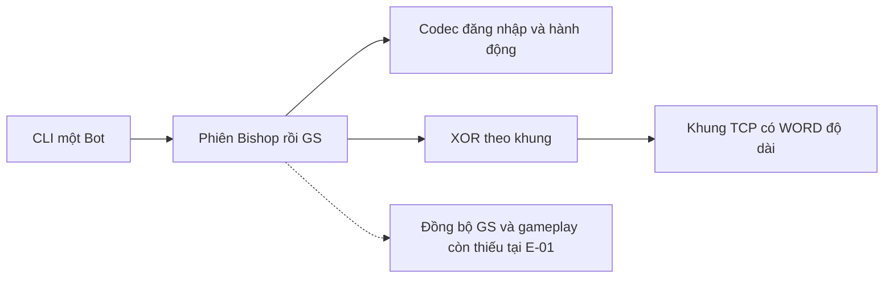

TÓM TẮT 5 DÒNG
1. [NGUỒN] PARTIAL: client một Bot có mã và test offline; đăng nhập/gameplay thật chưa kiểm.
2. [NGUỒN] Đã triển khai năm mô-đun framing, crypto, packets, session, cli; bộ nhận đồng bộ GS còn thiếu tại mốc E-01.
3. [NGUỒN] Báo cáo gốc ghi 29 test đạt; bảng phạm vi R-04a đối chiếu đủ 5/5 mô-đun hiện có.
4. [CHƯA KIỂM] ABI binary, role list, khóa ứng dụng, encoding, online và kết quả hành động còn giới hạn như thân báo cáo.
5. [CHƯA KIỂM] R-04a chỉ đọc và chuẩn hóa; không chạy lại test, build, exe, VM hoặc mạng; trạng thái Git lịch sử giữ nguyên.

# E-01 — Client một Bot và phần giao thức còn thiếu

Loại: công cụ
Chủ đề: Client Python một Bot và các phần giao thức còn thiếu tại mốc E-01.
Từ khóa: Bot, đăng nhập, login, Bishop, gs001, framing, RollingXor, SYNC_END, E-01
Trạng thái: PARTIAL — giữ kết luận gốc: offline có mã/test, đồng bộ GS và gameplay thật chưa hoàn chỉnh.
Độ phủ: đã phủ 5 trên tổng 5 mô-đun offline; chưa phủ 1 trên tổng 1 phiên đăng nhập/gameplay thật. Đếm mô-đun không đồng nghĩa hoàn tất Bot online.
Liên quan: [A-02](A-02-luong-dang-nhap.md), [A-06](A-06-bang-goi-tin.md), [E-01b](E-01b-thieu-giao-thuc.md), [R-04a](R-04a.md), [chuẩn báo cáo](../DESIGN/CHUAN-BAO-CAO.md).
Cần tôi quyết định: không — R-04a chỉ chuẩn hóa; bước chạy thật phải được giao riêng như bàn giao gốc.

## Sơ đồ chính



## Phạm vi và độ phủ

[ĐÃ XÁC MINH — đọc tĩnh R-04a] Năm mô-đun lấy từ `JX1_OPS/TASKS/E-01.md:22`, đối chiếu file thật trong worktree. Các kết quả test phía dưới là bằng chứng lịch sử của E-01, không phải lần chạy R-04a. Báo cáo và mã BOT đọc bằng UTF-8; mã hóa đường truyền runtime chưa xác minh.

| Phần tử của phạm vi | Đã phủ / chưa phủ | Nguồn file:dòng và giới hạn |
| --- | --- | --- |
| `framing` | Đã phủ — đọc tĩnh mô-đun và test | `JX1_OPS/BOT/framing.py:10`, `JX1_OPS/BOT/test_bot.py:34`; không chạy TCP. |
| `crypto` | Đã phủ — đọc tĩnh mô-đun và test | `JX1_OPS/BOT/crypto.py:15`, `JX1_OPS/BOT/test_bot.py:72`; không dùng khóa thật. |
| `packets` | Đã phủ — codec login, role, permit, sync, ping, Run, skill, Sit/Stand | `JX1_OPS/BOT/packets.py:18`, `JX1_OPS/BOT/packets.py:88`, `JX1_OPS/BOT/packets.py:219`, `JX1_OPS/BOT/test_bot.py:126`; file hiện tại có bổ sung sau E-01. |
| `session` | Đã phủ — luồng Bishop/GS, admission, chờ sync, giữ phiên và hành động offline | `JX1_OPS/BOT/session.py:121`, `JX1_OPS/BOT/session.py:172`, `JX1_OPS/BOT/test_bot.py:236`; không chứng minh server chấp nhận. |
| `cli` | Đã phủ — tham số, chế độ kết nối tường minh | `JX1_OPS/BOT/cli.py:24`, `JX1_OPS/BOT/cli.py:43`; không gọi CLI trong R-04a. |
| Một phiên đăng nhập/vào game/đứng yên/đi/đánh/ngồi-đứng trên server thật | Chưa phủ | `JX1_OPS/TASKS/E-01.md:21`, `JX1_OPS/BOT/README.md:3`; toàn bộ giới hạn runtime/ABI giữ nguyên ở phần gốc. |

## Nội dung gốc E-01

Trạng thái: **PARTIAL**. Ngày 17/11/2026. Mã và test offline đã triển khai; đăng nhập/vào game/hành động trên server thật **chưa kiểm**. Không suy runtime từ source. Bộ nhận GS còn thiếu các record đồng bộ thế giới, nên chưa đạt mục tiêu Bot online hoàn chỉnh.

## Worker kiểm tra trước khi làm

- CWD trong phiên là `D:\JX-wt\E-01`, nhánh qua `git status --short --branch` là `task/E-01-bot-client`, khớp task; status ban đầu sạch. Đã thực hiện trước khi ghi.
- Đã đọc task và các tài liệu bắt buộc A-02, A-06, A-03, JIBS, A-01; chỉ đối chiếu các source cần cho login/framing/action. Đọc file tiếng Việt lại bằng UTF-8 khi PowerShell mặc định hiển thị sai encoding; thu hẹp phần bảng A-06 khi đầu ra quá dài.
- Chỉ ghi `JX1_OPS/BOT/`, báo cáo này và mục Kết quả trong `JX1_OPS/TASKS/E-01.md` theo yêu cầu trực tiếp của người dùng. `C:\Jx1CocoV3` chỉ đọc. Không chạy exe server/game, không kết nối VM/SQL/server, không đổi snapshot/network/config/model/credential.

## Phần đã triển khai

| Mô-đun | Kết quả |
| --- | --- |
| `framing.py` | WORD little-endian gồm cả header 2 byte; payload 1..65533 byte; TCP bị chia/gộp, EOF bị cắt, khung sai độ dài. Decoder dừng khi sai, không tìm ranh giới bằng phỏng đoán. |
| `crypto.py` | ACCOUNT_BEGIN 32 byte chưa XOR; chỉ mode 0; lấy phần bù uint32 của ServerKey/ClientKey, tách khóa nhận/gửi; XOR từng payload rồi tiến khóa một lần, wrap uint32. |
| `packets.py` | 14 ID được sinh trong bộ nhớ từ các dòng tương ứng bảng A-06; MD5 chữ hoa; codec login, phản hồi, role list, chọn role, permit, GUID login, sync, ping, Run, skill, Sit/Stand. Không lưu script/parser sinh bảng phụ. |
| `session.py` | Một Bot; Bishop → xác thực → danh sách/chọn nhân vật → kiểm permit → gs001 → chờ sync. Chỉ cho phép VM thử/cổng được giao; chặn Main cả lúc nhập và redirect. Phải vào trạng thái IN_GAME mới gửi hành động; tối đa 18 hành động/giây, giữ đứng yên/trả ping; đóng khi lỗi, không tự retry. |
| `cli.py` | Chạy trực tiếp với `python -I`; mặc định chỉ hướng dẫn, có `--connect` mới mở socket; tài khoản/mật khẩu/role/khóa client qua biến môi trường. Không in hoặc lưu payload nhạy cảm. |

Giới hạn online 100 được biểu diễn bằng kiểm tra `--observed-online` 0..99 trước thêm một Bot. Chưa có bằng chứng/gói đo online hay đặt chỗ nguyên tử; không khẳng định mã bảo đảm giới hạn toàn server khi có đăng nhập đồng thời. Hướng dẫn sử dụng và các giới hạn ở `JX1_OPS/BOT/README.md`.

## Quy ước nguồn

- `C/` = `C:\Jx1CocoV3\Folder\Client2912-20260116T044348Z-3-001\Client2912\Client\Classes\`.
- `B/` = `C:\Jx1CocoV3\SwordOnline\SwordOnline\jxOnline\gateway\Sources\MultiServer\Bishop\`.
- `GH/` = `C:\Jx1CocoV3\SwordOnline\SwordOnline\jxOnline\gateway\Headers\`.
- `SH/` = `C:\Jx1CocoV3\SwordOnline\SwordOnline\jxOnline\gameserver\Headers\`.
- `SS/` = `C:\Jx1CocoV3\SwordOnline\SwordOnline\jxOnline\gameserver\Sources\`.
- `H/` = `C:\Jx1CocoV3\SwordOnline\SwordOnline\jxOnline\header\`.

Các số dòng dưới đây là trong source đã đọc, không phải địa chỉ trong binary.

## Chi tiết đã có bằng chứng nguồn

| Chi tiết | File:dòng và kết luận |
| --- | --- |
| Framing | `C/network/ClientStage.cpp:136-166,235-264,279-284`: 2 byte đầu là độ dài tổng; chỉ XOR phần sau header. `287-315` giữ khung chưa đủ/tách khung gộp. |
| Khởi tạo khóa | `C/network/Cipher.h:15-27`: `BYTE ProtocolType`, `BYTE nMode`, 6 byte reserve, unsigned ServerKey, unsigned ClientKey, 16 byte reserve. `C/network/SocketClient.h:87-93` thêm WORD wLen; `SocketClient.cpp:487-510` kiểm 0x20/mode 0 rồi lấy `~key`. |
| Khóa cuộn | `C/network/KSG_EncodeDecode.cpp:14-35`: các word 4 byte XOR cùng key, phần dư dùng byte thấp lần lượt; `next=(key*31+134775813) mod 2^32`. `KSG_EncodeDecode.h:19-43` gọi đúng bản này, payload rỗng không tiến khóa. Không dùng biến thể New/ASM đang không được gọi. |
| MD5/login | `C/engine/KSG_MD5_String.cpp:31-48`: hash byte đến NUL, định dạng `%02X`. `C/gamescene/LoginDef.h:46,59-105` và `B/LoginDef.h:46,59-105` khớp field; `C/gamecore/KProtocol.h:1477-1482` password 64 byte. Profile pack(1), int/unsigned 4 byte cho KLoginAccountInfo 146 byte, cộng ID 1 byte =147. |
| Giá trị login | `C/gameui/Klogin.cpp:471-495`: 65, Size=sizeof(struct), Param=0x050000, account/hash/region/map/version. `B/GamePlayer.cpp:822-856` đọc các field này; `1384-1399` trả s2c_login. `C/gamecore/KProtocolDef.h:8-9` version 1. Các field phản hồi không dùng trong request được zero hóa, không sao chép bộ nhớ ngẫu nhiên. |
| Độ dài tên | `C/gamecore/GameDataDef.h:152-153`, `H/GameDataDef.h:134-135`: NAME_LENGHT=64, ACC_LENGTH=32. |
| Danh sách/chọn role | `C/gamecore/KProtocol.h:1800-1809,1819-1826`, `GH/KProtocol.h:1910-1919,1929-1936`: RoleBaseInfo 67 byte; offset pDataBuffer 14 trên profile này. `C/gameui/Klogin.cpp:1033-1065` đọc count byte rồi các role; `KSelPlayer.cpp:1181-1190` gửi tên, ID 108. `B/GamePlayer.cpp:1495-1497` chuyển tiếp dữ liệu nhận từ Goddess. |
| Permit/GUID | `C/gamecore/KProtocol.h:1557-1586`, `SH/KProtocol.h:1625-1654`: GUID, role[64], account[32], strRoleNmae[64], bool permit, IP 4 byte và port. `C/gameui/KSelPlayer.cpp:1063-1134`: kiểm permit/identity, IP đọc theo bốn byte, giữ nguyên GUID gửi ID 66. Bot còn kiểm cả endpoint trước khi mở GS. |
| Run/skill/Sit | `SH/KProtocol.h:508-535,2238-2242`: Run=`<Biii>` gồm X,Y,map; skill=`<Biii>` gồm skill,X,Y; Sit=`<BB>`. `SS/Core/Src/KProtocolProcess.cpp:5452-5481,5581-5606,6041-6056`: Run gọi do_run; skill X=-1 tìm NPC ID ở Y, X>=0 dùng tọa độ; flag Sit khác 0 ngồi, 0 đứng. Map được serialize theo struct, handler Run đã đọc không dùng field map. |
| Ping/sync | `SH/KProtocol.h:1321-1326,2225-2236`, `C/gamecore/KProtocol.h:1268-1273`; `C/gamecore/KProtocolProcess.cpp:433-438,3332-3365`: ping trả timestamp, sync kiểm IsLogin/clientKey rồi trả struct 9 byte và CP_LOCK(mobile=1). `SS/Core/Src/KProtocol.cpp:173-174,229-231` nhánh `_SERVER` nhận tagLogicLogin/CLIENT_SYNC_END/PING reply/CP_LOCK. |

## Thiếu hoặc mơ hồ — không tự đoán

| Mục | File:dòng | Vì sao chưa đủ / hành vi hiện tại |
| --- | --- | --- |
| Binary/ABI trong VM thử | `JX1_OPS/REPORTS/A-06-bang-goi-tin.md:54-102` liệt kê struct khác; `C/gamecore/KProtocol.h:10-11`, `SH/KProtocol.h:18-19` packing | Chưa đối chiếu binary hoặc sizeof/offsetof bằng đúng build. Mã chọn profile Windows LE/pack1 rõ ràng; offline pass chỉ chứng minh profile đó. Không khẳng định nguồn client/Bishop/GS cùng version wire. |
| Đồng bộ thế giới để vào game | `C/gamecore/KProtocol.cpp:19-25`, `SS/Core/Src/KProtocol.cpp:19-50`; bảng A-06 mô tả 18 struct chung khác | Trước/ngoài SYNC_END có CURPLAYER_SYNC, skill, normal/world/NPC/item và có record biến độ dài. Chưa xây dựng bộ chia record đủ cho các luồng đó theo ABI runtime. Parser chỉ biết ID 67 và143, từ chối toàn payload khi có ID khác; không quét tìm byte sync/ping và không tự bỏ unknown frame. Đây là blocker chính để Bot online hoàn chỉnh. |
| A-06 đánh dấu nhầm sync là mốc không payload | `JX1_OPS/REPORTS/A-06-bang-goi-tin.md:170,363`; đối chiếu `C/gamecore/KProtocol.cpp:19`, `SS/Core/Src/KProtocol.cpp:174` | Enum 67 thực tế có CLIENT_SYNC_END trong bảng và handler. `packets.py` lấy ID từ A-06 nhưng layout lấy trực tiếp source. Không sửa báo cáo A-06 ngoài phạm vi. |
| Hai cách ACK sync trong các cây source | `C/gamecore/KProtocolProcess.cpp:3332-3354`; `SS/Core/Src/KProtocolProcess.cpp:3647-3662` dưới nhánh client `#ifndef _SERVER` | Cocos dùng struct 9 byte và so curMobileKey; phần client cũ trong cây gameserver gửi một byte. Đây không phải bằng chứng gs001 đang chạy gửi một byte. Bot dùng profile Cocos 9 byte phù hợp bảng nhận `_SERVER`:174, từ chối payload 1 byte. |
| Khóa client ứng dụng | `C/gamecore/KProtocolProcess.cpp:3340-3351` so curMobileKey | Chưa xác minh giá trị/nguồn khởi tạo khóa ứng dụng của đúng binary thử. Bắt buộc truyền JX_BOT_CLIENT_KEY qua môi trường khi connect, kiểm khớp. Không ghi khóa thật, không tự tin cậy/echo khóa server để vượt kiểm tra. |
| NDataLen, padding/gộp role list | `C/gamecore/KProtocol.h:1819-1826`; `GH/KProtocol.h:1929-1936`; `B/GamePlayer.cpp:1472-1497`; `C/gameui/Klogin.cpp:1033-1065` | Client đọc count/record, Bishop chuyển tiếp nguyên buffer. Chưa đối chiếu cách Goddess/CPackager chốt nDataLen, byte đệm hoặc gộp nhiều message trên một frame. Mã chỉ nhận độ dài đúng offset+count*67, chưa dùng nDataLen để đoán ranh giới. Layout khác sẽ dừng. |
| Region, map và encoding runtime | `C/gameui/Klogin.cpp:487-489`; A-03 mục Chưa kiểm; `B/GamePlayer.cpp:855-856` | Chưa đọc runtime VM, không tự đặt region/map. CLI bắt buộc tham số; encoding mặc định ASCII, khác ASCII cần giá trị đã xác minh. Tên nhân vật giữ byte từ danh sách để so; không suy CP936 từ source GBK. |
| Điều kiện skill/chiến đấu, tọa độ và kết quả | `SS/Core/Src/KProtocolProcess.cpp:5587-5606`; `C/gamecore/KProtocol.h:47` cờ 0x02 | Chưa xác minh map hiện tại, skill đã học, MAX_SKILL/runtime, NPC target, fight mode và ACK/kết quả. Có codec và kiểm int32/các điều kiện dấu; không tự bật chiến đấu/tìm NPC hay khẳng định đánh trúng/chạy tới đích. |
| Tổng online và 18 Hz runtime | JIBS mục 2; `SS/MultiServer/GameServer/KSOServer.cpp:90` được JIBS dẫn; task E-01 | Một Bot, action limiter 18 Hz và admission theo số quan sát tối đa 99; chưa đọc online thật/đo tick hay bảo đảm giới hạn toàn server. Không thay server 18 Hz. |
| Logout/reconnect | `C/gamecore/KProtocol.h:1748-1759`; giới hạn ABI từ A-06 | tagLeaveGame có field account/IP/điểm/thời gian, chưa đủ để tự đặt semantics an toàn. Hiện chỉ đóng TCP, không tự reconnect; chưa kiểm server giải phóng tài khoản sau ngắt. |

## Kiểm chứng

Các vector đều tự dựng từ source, không phải capture hoặc dữ liệu tài khoản thật:

- XOR key giả `0x12345678`, plaintext `00 01 02 03 04 05 06` → `78 57 36 11 7c 53 32`, next key `0x3c5efc8d`; tiếp payload `82 01` → `0f fd`.
- Frame Sit `82 01` → `04 00 82 01` trước XOR. Có test ranh giới 65535 tổng byte, mọi vị trí cắt của luồng nhiều frame, coalescing/chunks từng byte, EOF bị cắt và length 0/1/2.
- Vector login kiểm size, offset, MD5 hoa, kết quả từ chối, identity/hash/version sai. Vector Run/skill/Sit/Stand/ping, role/permit/GUID/sync và khóa không khớp.
- Phiên giả đi qua các bước Bishop/GS, đóng Bishop sau chuyển, chỉ action sau sync, từ chối redirect Main trước mở GS, unknown sync không ACK, không tìm byte sync trong dữ liệu, nhịp 18 Hz. Không có server/game exe được chạy trong test.

Kết quả thực chạy:

```text
python -I -m unittest discover -s JX1_OPS/BOT -v
Ran 29 tests in 0.053s
OK
exit 0

python -I JX1_OPS/BOT/cli.py --help
exit 0, in hướng dẫn tiếng Việt bằng UTF-8

python -I JX1_OPS/BOT/cli.py
exit 0, chỉ in hướng dẫn, không mở socket
```

Rà mã tạo trong lượt: chỉ import thư viện chuẩn, không có tài khoản/mật khẩu/khóa thật; dữ liệu trong test được tạo tổng hợp. Không chạy build game, test với server, đo online/tick hoặc kiểm gameplay thực tế. Các mục này **chưa kiểm**.

## Lỗi và cách đã xử lý trong lượt

| Lỗi | Xử lý/kết quả |
| --- | --- |
| `rg : The term 'rg' is not recognized ...` | Một lần; dùng Select-String và Node filesystem trong các thư mục source liên quan, không cài công cụ. |
| PowerShell mặc định hiển thị tiếng Việt sai encoding; đầu ra báo cáo dài bị truncate | Đọc UTF-8 rõ ràng, trích trực tiếp các dòng/gói liên quan. Không thay file gốc. |
| `ENOENT ... gateway\Headers\LoginDef.h` | Một lần giả định sai vị trí. Tìm đúng file `gateway\Sources\MultiServer\Bishop\LoginDef.h`, đọc và đối chiếu với client thành công. |
| CLI `--help`: `UnicodeEncodeError: 'charmap' codec can't encode character '\u1ed9' ...` | Phát hiện dù 27 test ban đầu pass; nguyên nhân stdout Windows pipe cp1252, -I bỏ PYTHONIOENCODING. Sửa CLI reconfigure stdout/stderr UTF-8; chạy lại --help và mặc định đều exit 0. |
| Git không ghi được index.lock | Một lần `git add` đúng 11 file của task trả `fatal: Unable to create 'D:/jx1-reports/.git/worktrees/E-01/index.lock': Permission denied`. Chưa stage, không chạy commit trên index chưa stage được. Không thử index/object database khác, không sửa quyền/config/credential hoặc vượt sandbox. |

## Commit và bước tiếp tục

**Commit: BLOCKED. BỊ CHẶN – CHƯA PUSH.** Chưa có commit SHA/link vì `git add` không tạo được `D:/jx1-reports/.git/worktrees/E-01/index.lock` (Permission denied); metadata này ở ngoài writable root `D:\JX-wt\E-01`. Không có cơ chế nâng quyền trong phiên. Không chạy push; người dùng chỉ yêu cầu commit. Nội dung và mục Kết quả được giữ local. Đã rà diff đúng một lượt trước bàn giao; không reset/clean/checkout hay thay đổi dữ liệu có sẵn.

Khi có phiên được phép ghi Git metadata, tiếp tục trên nhánh hiện tại `task/E-01-bot-client`, stage đúng các file sau rồi commit, không làm lại code/test đã có bằng chứng nếu không có thay đổi mới:

```text
git -C D:\JX-wt\E-01 add -- JX1_OPS/BOT/.gitignore JX1_OPS/BOT/__init__.py JX1_OPS/BOT/framing.py JX1_OPS/BOT/crypto.py JX1_OPS/BOT/packets.py JX1_OPS/BOT/session.py JX1_OPS/BOT/cli.py JX1_OPS/BOT/test_bot.py JX1_OPS/BOT/README.md JX1_OPS/REPORTS/E-01-thieu-giao-thuc.md JX1_OPS/TASKS/E-01.md
git -C D:\JX-wt\E-01 commit -m "E-01: thêm client Bot và kiểm thử giao thức offline"
```

Tiếp tục từ mã local: xác minh ABI và build client/server trong bản copy VM thử; hoàn thiện bộ chia record đồng bộ thế giới, đối chiếu role list và khóa ứng dụng, rồi mới thử một tài khoản tổng hợp khi gs001 nạp xong. Chưa đạt/chưa kiểm không được chuyển thành DONE chỉ vì test offline pass.

## Sổ thông số bổ sung khi chuẩn hóa

[ĐÃ XÁC MINH — đọc tĩnh] Chỉ ghi lại hợp đồng liên quan; không thay cấu hình hay giá trị trong nội dung gốc.

| Nhóm | Tên/hằng số | file:dòng | Giá trị | Đơn vị | Ảnh hưởng | Đổi an toàn (CÓ/CẨN THẬN/KHÔNG) | Nguồn đo |
| --- | --- | --- | --- | --- | --- | --- | --- |
| Framing | Miền độ dài payload | `JX1_OPS/BOT/framing.py:10` | 1..65533 | byte | Ranh giới khung có header 2 byte | KHÔNG — hợp đồng giao thức | Đọc tĩnh; chưa đo runtime |
| Admission | `MAX_ONLINE` | `JX1_OPS/BOT/session.py:20`, `JX1_OPS/BOT/session.py:37` | 100; quan sát 0..99 trước thêm Bot | phiên | Chỉ là điều kiện đầu vào, không đặt chỗ toàn server | CẨN THẬN | Đọc tĩnh; chưa đo online |
| Nhịp | `SERVER_HZ` | `JX1_OPS/BOT/session.py:21` | 18 | hành động/giây theo limiter | Không phải số đo tick server | CẨN THẬN | Đọc tĩnh; chưa đo tick |

## Đã xác minh / Chưa xác minh

- **ĐÃ XÁC MINH:** đã đọc đủ năm file mô-đun theo bảng phạm vi; các liên kết báo cáo tồn tại. Client bản A được phép đọc là `D:\JX-build\qh9A`; các root C/B/GH/SH/SS/H trong phần gốc là dẫn nguồn lịch sử, chưa được tái đối chiếu bằng root đó trong R-04a.
- **CHƯA XÁC MINH:** không chạy lại 29 test, CLI hay bất kỳ build/exe/VM/mạng nào; không nâng nhãn của ABI, đồng bộ, encoding, gameplay hoặc Git lịch sử.

## Bàn giao chuẩn hóa R-04a

Chỉ sửa cấu trúc tài liệu, giữ nguyên toàn bộ nội dung gốc dưới mục tương ứng. Chỉ mục: `JX1_OPS/REPORTS/_CHIMUC/R-04a.tsv`; commit chuẩn hóa và tình trạng bàn giao xem `JX1_OPS/REPORTS/R-04a.md`. PM tiếp tục các phần thiếu theo báo cáo gốc khi có task riêng.

## Phát hiện khi chuẩn hóa

- Bản gốc chưa có tóm tắt năm dòng, metadata, Mermaid và bảng phạm vi; đã bổ sung, không đổi trạng thái PARTIAL.
- `JX1_OPS/BOT/README.md:3` và `JX1_OPS/BOT/worldsync.py:47` hiện đã có phần bổ sung E-01b; `JX1_OPS/BOT/packets.py:124` cũng ghi cập nhật role list từ E-07. Đây là chênh lệch thời điểm, không dùng để viết lại kết luận thiếu giao thức tại E-01.
- Kết quả 29 test và lỗi Git trong thân là lịch sử E-01; R-04a không xác nhận lại hoặc nhận là kết quả hiện tại.
