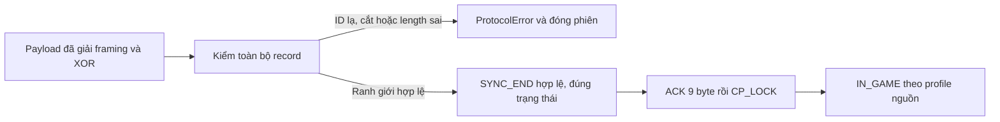

TÓM TẮT 5 DÒNG
1. [NGUỒN] PARTIAL khi bàn giao E-01b do Git bị chặn; phần triển khai/test offline được báo cáo gốc ghi DONE.
2. [NGUỒN] Bộ tách có 50 ID cố định và 25 ID biến độ dài, kiểm toàn frame trước ACK SYNC_END 9 byte rồi CP_LOCK.
3. [NGUỒN] Đã liệt kê đủ 156 ID trong dải 65..220 thành 75 ID hỗ trợ ranh giới và 81 ID chưa hỗ trợ.
4. [CHƯA KIỂM] ABI binary, nội dung phần lớn record biến độ dài và gameplay thật chưa xác minh; 41 test là kết quả lịch sử.
5. [CHƯA KIỂM] R-04a không chạy lại test, build, exe, VM hoặc mạng; giữ nguyên kết luận và tình trạng Git lịch sử.

# E-01b — Bộ tách record đồng bộ thế giới GS

Loại: công cụ
Chủ đề: Chia bản ghi đồng bộ thế giới nhận từ GS và kiểm điều kiện ACK cuối đồng bộ.
Từ khóa: đồng bộ thế giới, worldsync, record, gs001, SYNC_END, CP_LOCK, ABI, E-01b
Trạng thái: PARTIAL — giữ kết luận gốc: offline DONE, Git bị chặn và runtime chưa kiểm.
Độ phủ: đã phủ ranh giới 75 trên tổng 156 ID trong dải 65..220, gồm 50 cố định và 25 biến độ dài; 81 ID chưa phủ. Không đếm semantic hay mọi ID mở rộng.
Liên quan: [E-01](E-01-thieu-giao-thuc.md), [A-06](A-06-bang-goi-tin.md), [E-02](E-02-hanh-vi-bot.md), [E-05a](E-05a-khung-tester.md), [R-04a](R-04a.md).
Cần tôi quyết định: không — chỉ chuẩn hóa; xác minh binary và chạy thật cần task riêng.

## Sơ đồ chính



## Phạm vi và độ phủ

[ĐÃ XÁC MINH — đọc tĩnh R-04a] Hai tập ID lấy trực tiếp từ `JX1_OPS/BOT/worldsync.py:24` và `JX1_OPS/BOT/worldsync.py:39`; mẫu số 220 - 65 + 1 = 156. Bảng liệt kê toàn bộ tập trong dải, không suy từ tên comment. Báo cáo/BOT là UTF-8. Client bản A `D:\JX-build\qh9A\Classes\gamecore\KProtocol.cpp:17` đối chiếu loại độ dài; `CoreShell.cpp:2750` đối chiếu cách tra bảng. Những kích thước GS cũ vẫn là bằng chứng lịch sử trong thân, chưa xác nhận binary.

| Phần tử của phạm vi | Đã phủ / chưa phủ | Nguồn file:dòng và giới hạn |
| --- | --- | --- |
| 50 ID cố định: 67, 68, 70, 73, 74, 75, 77, 78, 80, 81, 82, 83, 84, 85, 86, 89, 90, 91, 92, 93, 94, 95, 96, 118, 119, 120, 121, 122, 143, 144, 145, 147, 150, 154, 155, 158, 159, 160, 174, 177, 188, 189, 192, 197, 203, 204, 206, 207, 210, 213 | Đã phủ ranh giới | `JX1_OPS/BOT/worldsync.py:24`; không đồng nghĩa giải mã nội dung hoặc khớp ABI runtime. |
| 25 ID biến độ dài: 65, 66, 69, 71, 72, 76, 79, 87, 88, 97, 112, 123, 129, 136, 139, 141, 148, 149, 162, 163, 170, 172, 195, 215, 216 | Đã phủ ranh giới | `JX1_OPS/BOT/worldsync.py:39`; 69/76/79 có giới hạn riêng tại `JX1_OPS/BOT/worldsync.py:44`; 22 ID còn lại chỉ kiểm header/range. |
| 81 ID: 98..111, 113..117, 124..128, 130..135, 137..138, 140, 142, 146, 151..153, 156..157, 161, 164..169, 171, 173, 175..176, 178..187, 190..191, 193..194, 196, 198..202, 205, 208..209, 211..212, 214, 217..220 | Chưa phủ; gặp thì từ chối | Phần bù của hai tập trên; `JX1_OPS/BOT/worldsync.py:65`. ID ngoài dải không thuộc mẫu số và không mặc nhiên được hỗ trợ. |
| Nối bộ tách vào phiên và API cũ | Đã phủ — đọc tĩnh | `JX1_OPS/BOT/session.py:172`, `JX1_OPS/BOT/packets.py:249`; không cộng vào số ID. |
| ACK, replay và frame bị cắt | Đã phủ hợp đồng/test nguồn; chưa chạy lại | `JX1_OPS/BOT/test_worldsync.py:97`, `JX1_OPS/BOT/test_worldsync.py:119`, `JX1_OPS/BOT/test_worldsync.py:137`. |
| Đúng binary GS, nội dung thế giới và gameplay thật | Chưa phủ | `JX1_OPS/TASKS/E-01b.md:23`; các giới hạn gốc được giữ nguyên bên dưới. |

## Nội dung gốc E-01b

Ngày 17/11/2026. Trạng thái bàn giao: **PARTIAL** do Git bị chặn. Nội dung triển khai/test offline: **DONE**. Runtime server thật: **chưa kiểm**.

## Worker kiểm tra trước khi làm

- `Get-Location` trả `D:\JX-wt\E-01b`; `git status --short --branch` trả `task/E-01b-bot-sync`, khớp task. Ban đầu chỉ có `?? JX1_OPS/TASKS/E-01b.md`; giữ nguyên nội dung task ngoài mục Kết quả. Kiểm tra trước khi ghi.
- Đã đọc task, mục “Thiếu hoặc mơ hồ” của E-01, phần đối chiếu/bảng độ dài A-06 và mã BOT liên quan. Không làm lại workflow/preflight/model/config.
- Chỉ ghi BOT, báo cáo này và mục Kết quả của task. Nguồn `C:\Jx1CocoV3` chỉ đọc; không chạy exe server/game, không kết nối mạng/VM/server, không đưa dữ liệu dự án lên dịch vụ ngoài. Test dùng socket giả và dữ liệu tổng hợp.

## Quy ước dẫn nguồn

- C = `C:\Jx1CocoV3\Folder\Client2912-20260116T044348Z-3-001\Client2912\Client\Classes\gamecore\`.
- S = `C:\Jx1CocoV3\SwordOnline\SwordOnline\jxOnline\gameserver\Headers\`.
- SS = `C:\Jx1CocoV3\SwordOnline\SwordOnline\jxOnline\gameserver\Sources\Core\Src\`.
- H = `C:\Jx1CocoV3\SwordOnline\SwordOnline\jxOnline\header\`.
- CP/SP/CX/SX = C/KProtocol.cpp, SS/KProtocol.cpp, C/KProtocolProcess.cpp, SS/KProtocolProcess.cpp.

## Kết quả triển khai

`worldsync.py` có bảng 50 ID cố định và 25 ID biến độ dài; `Session.poll` dùng trực tiếp bộ tách này, `packets.game_messages` giữ API cũ và chuyển vào cùng bộ tách. Không cần source gốc khi chạy Bot.

CoreShell lấy phần tử bảng theo `ID - 64 - 1` (C/CoreShell.cpp:2746-2750). Client tăng con trỏ theo sizeof khi bảng dương; khi -1 thì tăng **1 + WORD little-endian ở offset 1** (C/../gamescene/KgameWorld.cpp:5136-5145). WORD này bao gồm chính trường WORD, không bao gồm byte ID; khác WORD khung TCP vốn bao gồm header ngoài. Parser chỉ áp quy tắc biến độ dài cho ID đã có -1 rõ ràng trong CP, không biến mọi ID lạ thành record có length.

Parser kiểm toàn bộ payload trước khi trả list. Unknown ID, length 0/1, header/body bị cắt, skill sai bước 8 byte/quá 80 entry, NPC/OBJ ngắn hơn prefix hoặc dài hơn vùng tên đều gây `ProtocolError`; phiên đóng socket. Không nối record dở qua frame khác, không scan byte 67/143 trong body. TCP fragmentation/coalescing do `FrameDecoder` và XOR theo frame xử lý như E-01.

Các record khác sync/ping được bỏ qua sau khi kiểm ranh giới. Chỉ khi nhận SYNC_END đủ 9 byte, IsLogin=1, khóa khớp, đang SYNCING và không lặp trong frame, phiên mới gửi ACK rồi CP_LOCK và chuyển IN_GAME. Unknown/đuôi lỗi cùng frame với SYNC_END không được ACK. Sync lặp ở frame sau đóng phiên, không ACK lần hai. Timeout giữ hành vi có sẵn.

## Bảng độ dài có bằng chứng

Profile nhận thế giới chọn **source GS**, Windows LE, pack1, int/UINT/BOOL=4, WORD=2, BYTE=1, __int64=8. Không tự dò biến thể Cocos. S/KProtocol.h:18-19 và C/KProtocol.h:10-11 khai báo pack1; H/GameDataDef.h:114,134 cho MAX_SKILL_STATE=18, NAME_LENGHT=64. Đây là tính toán từ khai báo, chưa phải sizeof từ đúng compiler/binary runtime.

| ID | Record / tổng byte | Bằng chứng |
| --- | --- | --- |
| 67 | CLIENT_SYNC_END: 9 | CP:19; S/KProtocol.h:1321-1326 |
| 68 | CURPLAYER_SYNC: 83 | C/KProtocolDef.h:56 đặt tên `s2c_synonlineplayer`; CP:20; S/KProtocol.h:1276-1319, C/KProtocol.h:1223-1266 |
| 69 | skill: 3 + 8*n, n=0..80 | CP:21; C/KProtocol.h:1345-1358; S/KProtocol.h:1398-1411; CX:3301-3304 |
| 70 | CURPLAYER_NORMAL_SYNC: GS 55, C 31 | CP:22; S/KProtocol.h:1261-1274 dùng sáu __int64; C/KProtocol.h:1208-1221 dùng int |
| 73 | WORLD_SYNC: 304 | CP:25; C/KProtocol.h:1367-1388; S/KProtocol.h:1419-1440 |
| 74 / 75 | PLAYER_SYNC 211 / PLAYER_NORMAL_SYNC 302 | CP:26-27; C/KProtocol.h:28-119, khai báo chung không lệch theo A-06 |
| 76 | NPC_SYNC: 42 + số byte tên (0..64) | CP:28; C/KProtocol.h:293-312; SS/KNpc.cpp:7709 tính length=sizeof-1-sizeof(name)+strlen(name) |
| 77 | NPC_NORMAL_SYNC: GS 227, C 223 | CP:29; S/KProtocol.h:323-369 dùng __int64 nCurrentLifeMax; C/KProtocol.h:314-360 dùng int |
| 78 / 145 / 206 | NPC_PLAYER_TYPE_NORMAL_SYNC: 25 | CP:30,97,158; C/KProtocol.h:362-371 |
| 79 | OBJ_ADD_SYNC: 62 + số byte tên (0..80) | CP:31; C/KProtocol.h:738-762; H/GameDataDef.h:25; SS/KObj.cpp:1452 tính length theo strlen |
| 80 / 81 / 82 / 83 | OBJ state 6 / dir 6 / remove 6 / trap 13 | CP:32-35; C/KProtocol.h:782-809 |
| 84 / 85 / 86 / 89 | NPC remove 9 / walk 13 / run 13 / jump 13 | CP:36-41; C/KProtocol.h:403-449 |
| 90 / 91 / 92 | NPC talk 265 / hurt 17 / death 69 | CP:42-44; C/KProtocol.h:395-416,451-458; C/GameDataDef.h:24 MAX_SENTENCE_LENGTH=256 |
| 93 / 94 / 95 / 96 / 147 | camp 6 / camp 6 / tmpcamp 2 / skillcast 37 / directly skillcast 37 | CP:45-48,99; C/KProtocol.h:460-492 |
| 118 / 192 | ITEM_SYNC: 808 | CP:70,144; S/KProtocol.h:993-1038; C/KProtocol.h:946-992; KTime=20, KLockItem=8 tại H/GameDataDef.h:472-479,491-505 |
| 119 / 120 / 121 / 122 | item remove 21 / money 13 / xu 5 / move item 37 | CP:71-74; C/KProtocol.h:1004-1012,1119-1125,1134-1138,1154-1166 |
| 143 / 174 | PING_COMMAND: 5 | CP:95,126; codec E-01 |
| 144 / 154 / 155 / 158 | sit 69 / revive 9 / NPC request fail 69 / auto move item 37 | CP:96,106-110; C/KProtocol.h:395-401,427-433,1168-1181 |
| 150 / 159 / 160 / 177 / 188 / 189 / 197 | 1 / 1 / weather 2 / 1 / 1 / 1 / 1 | CP:102,111-112,129,140-141,149; weather C/KProtocol.h:1360-1364 |
| 203 / 204 / 207 / 210 / 213 | normalmap 9 / onestate 13 / mission 5 / item shop 525 / findpath 13 | CP:155-165; C/KProtocol.h:122-136,373-377,774-780,994-1001; S/KProtocol.h:1040-1047 |

Các ID biến độ dài khác dùng trực tiếp quy tắc CP -1 và chỉ kiểm header/range, không giải mã nội dung: **65, 66, 71, 72, 87, 88, 97, 112, 123, 129, 136, 139, 141, 148, 149, 162, 163, 170, 172, 195, 215, 216**. Nguồn lần lượt CP:17-24,39-40,49,64,75,81,88,91,93,100-101,114-115,122,124,147,167-168. Không khẳng định nội dung các record này hợp lệ cho game; mục tiêu là chia/bỏ qua đúng ranh giới nguồn đã quy định.

## Chuỗi đồng bộ và hai cách ACK

SS/KPlayer.cpp:983-1051: STEP_BASE_INFO gửi world (990), NPC (996), sau đó CURPLAYER_SYNC (1003-1036). Các bước fight/life là no-op (1052-1059); STEP_ITEM_LIST gọi SendSyncData_Skill (1060-1071). Các bước task/friend/sync-end trong hàm này chỉ trả TRUE (1073-1081), vì vậy không suy ra bản thân hàm đó đã gửi marker END. Hàm skill đặt WORD=2 rồi cộng 8*j và gửi WORD+1 (1091-1135); khớp client tính số skill ở CX:3304. Script OnLine được gọi tại 1041 có thể phát sinh record bổ sung; không ép mọi phiên phải có số lượng hay thứ tự record giống vector. Marker thực nhận là điều kiện ACK.

ACK **9 byte payload**, sau đó thêm 2 byte framing bên ngoài trước khi gửi TCP; không gọi nhầm tổng frame là 9 byte. Cocos kiểm IsLogin và curMobileKey tại CX:3332-3343, gán đủ ba field rồi `SendPackToServer(...sizeof(CLIENT_SYNC_END))` tại 3348-3354. Tiếp đó gửi CP_LOCK mobile=1 tại 3360-3365. S/KProtocol.h:1321-1326 => 1+4+4=9; bảng nhận `_SERVER` tại SP:171-174 cũng lấy sizeof(CLIENT_SYNC_END).

ACK **1 byte** tại SX:3660-3662 nằm trong nhánh client `#ifndef _SERVER` mở tại SX:338. Đây là client cũ trong cây gameserver, không phải đường nhận/gửi của `_SERVER`. Không dùng ACK 1 byte làm fallback, không thử lần lượt hai cách trên server. Bằng chứng nguồn đủ chọn 9 byte cho profile này; binary gs001 thực tế **chưa kiểm**.

## Thiếu hoặc chưa xác minh — đóng kết nối thay vì đoán

| Mục | Bằng chứng / giới hạn / bước tiếp |
| --- | --- |
| ABI/binary gs001 | Hai record normal lệch 55/31 và 227/223 như bảng trên. Chưa xác minh source nào khớp binary. Bot chọn layout GS rõ ràng; không suy từ offline pass rằng đăng nhập thực đã được. Xác minh sizeof/offsetof trong đúng build/bản copy VM trước thử thật. |
| ID cố định ngoài bảng | Chưa đối chiếu và khai triển layout trong task này; nhận là đóng socket và báo ID. Không dùng comment của SP làm ánh xạ vị trí: A-06 chỉ ra nhánh client của SP thiếu tmpcamp (SP:49-50) và CP dư phần tử ở 172-173. |
| Danh sách ID chưa hỗ trợ trong dải 65..220 | 98–111, 113–117, 124–128, 130–135, 137–138, 140, 142, 146, 151–153, 156–157, 161, 164–169, 171, 173, 175–176, 178–187, 190–191, 193–194, 196, 198–202, 205, 208–209, 211–212, 214, 217–220. Mọi ID ngoài dải và ngoài hai bảng cũng bị từ chối. |
| ID 220/chestpwsync | CP:171-173 bị lệch như A-06; không tự lấy kích thước PLAYER_TRADE_ITEM_SYNC hay sửa A-06/source. |
| Record biến độ dài | Ngoài skill/NPC/OBJ mới chỉ kiểm ranh giới theo bảng, không kiểm semantic/cấu trúc bên trong. Không tái dựng thế giới, học skill, tọa độ hay mục tiêu từ dữ liệu bỏ qua. |
| Phần E-01 còn lại | Role list/NDataLen, khóa ứng dụng đúng binary, encoding/region/map, logout, online/18Hz và kết quả di chuyển/đánh thực tế vẫn **chưa kiểm**; E-01b không giải quyết bằng giả định. |

## Kiểm chứng và lỗi trong lượt

Đã chạy đúng lệnh yêu cầu:

```text
python -I -m unittest discover -s JX1_OPS/BOT -v
Ran 41 tests in 0.112s
OK
exit 0
```

29 test E-01 giữ nguyên, đều pass; 12 test mới gồm vector trọn chuỗi/bundle hoặc frame riêng, TCP từng byte/7 byte/toàn bộ, không ACK trước END, record sau login, prefix/tên NPC/OBJ, skill rỗng/tối đa/sai bước, mọi vị trí cắt của record cố định, header length sai, unknown/đuôi lỗi, replay/duplicate/key sai và END một byte. Các byte END/ping nằm trong body không bị quét thành record. Không mở socket thật.

Không chạy build game, exe, test server, đo online/tick hoặc xác nhận gameplay. Các phần này **chưa kiểm**.

Lỗi công cụ: `rg : The term 'rg' is not recognized ...` một lần, chuyển sang Select-String/Get-Content có phạm vi. PowerShell mặc định hiển thị UTF-8 sai, đọc lại task bằng `-Encoding UTF8`. Một số đầu ra đọc gộp quá dài bị truncate, đã thu hẹp dòng cần. Một lần đọc nhầm `gameserver/Headers/GameDataDef.h` báo `Could not find file`, đã dùng đúng `jxOnline/header/GameDataDef.h`. Không cài công cụ, không sửa nguồn/cấu hình để xử lý các lỗi này. Không có test thất bại.

## Bàn giao Git

Đã rà diff một lượt; `git diff --check` không báo lỗi whitespace. Các lệnh `git diff --no-index` cho file mới trả exit 1 vì có khác biệt, không phải lỗi kiểm thử.

**Commit BLOCKED. BỊ CHẶN – CHƯA PUSH.** `git add` đúng bảy file của task thất bại một lần:

```text
fatal: Unable to create 'D:/jx1-reports/.git/worktrees/E-01b/index.lock': Permission denied
```

Metadata Git ở ngoài writable root `D:\JX-wt\E-01b`; phiên không cho nâng quyền. Chưa stage được, không chạy commit trên index chưa stage và chưa có commit SHA/link. Không thử index/object/ref khác, sửa ACL/config/credential hoặc vượt sandbox. Người dùng chỉ yêu cầu commit, không yêu cầu push; toàn bộ kết quả giữ local.

PM tiếp tục khi có quyền ghi metadata Git, trên nhánh `task/E-01b-bot-sync`, không làm lại phần code/test đã có bằng chứng nếu không thay đổi:

```text
git -C D:\JX-wt\E-01b add -- JX1_OPS/BOT/worldsync.py JX1_OPS/BOT/test_worldsync.py JX1_OPS/BOT/session.py JX1_OPS/BOT/packets.py JX1_OPS/BOT/README.md JX1_OPS/REPORTS/E-01b-thieu-giao-thuc.md JX1_OPS/TASKS/E-01b.md
git -C D:\JX-wt\E-01b commit -m "E-01b: thêm bộ tách record đồng bộ thế giới GS"
```

## Sổ thông số bổ sung khi chuẩn hóa

| Nhóm | Tên/hằng số | file:dòng | Giá trị | Đơn vị | Ảnh hưởng | Đổi an toàn (CÓ/CẨN THẬN/KHÔNG) | Nguồn đo |
| --- | --- | --- | --- | --- | --- | --- | --- |
| Đồng bộ | `FIXED_SIZES` / `VARIABLE_IDS` | `JX1_OPS/BOT/worldsync.py:24`, `JX1_OPS/BOT/worldsync.py:39` | 50 / 25 | ID | Tập record nhận được | KHÔNG — cần layout có bằng chứng | Đọc tĩnh, không chạy parser |
| Độ dài | Skill 69 / NPC 76 / OBJ 79 | `JX1_OPS/BOT/worldsync.py:44` | 3..643 / 42..106 / 62..142 | byte/record | Giới hạn prefix và nội dung | KHÔNG — hợp đồng wire | Đọc tĩnh, chưa đối chiếu binary |
| ACK | `SYNC` | `JX1_OPS/BOT/packets.py:45`, `JX1_OPS/BOT/packets.py:209` | 9 | byte payload | Không gồm header TCP 2 byte | KHÔNG — không thử fallback | Đọc tĩnh; kết quả test ở thân là lịch sử |

## Đã xác minh / Chưa xác minh

- **ĐÃ XÁC MINH:** bảng ID hiện có, chỗ nối parser và test nguồn; client bản A có bảng độ dài tại `D:\JX-build\qh9A\Classes\gamecore\KProtocol.cpp:14`, cách tra tại `CoreShell.cpp:2750` và nhánh tăng con trỏ tại `D:\JX-build\qh9A\Classes\gamescene\KgameWorld.cpp:5143`. Các file này đọc UTF-8; symbol ASCII trong `KProtocolDef.h:52` đọc được nhưng mã hóa comment của header chưa xác minh.
- **CHƯA XÁC MINH:** R-04a không chạy lại 41 test; không build, exe, VM, mạng, ABI/binary hay ACK runtime. Các root C/S/SS/H gốc không phải root server dữ liệu `gs` được giao cho R-04a, nên không tự chuyển bằng chứng lịch sử thành bằng chứng hiện tại.

## Bàn giao chuẩn hóa R-04a

Giữ trạng thái PARTIAL lịch sử; chuẩn hóa đủ cấu trúc và chỉ mục, không sửa bảng độ dài hoặc kết luận cũ. Commit chuẩn hóa xem `JX1_OPS/REPORTS/R-04a.md`; việc kiểm ABI/semantic/runtime tiếp tục theo phần gốc khi được giao.

## Phát hiện khi chuẩn hóa

- Bản gốc thiếu tóm tắt, metadata, Mermaid và bảng độ phủ tổng thể. Bảng mới làm rõ 75/156 ID chỉ là độ phủ ranh giới; không phải 75 record đã giải mã semantic.
- Dòng gốc dẫn `KgameWorld.cpp:5136-5145`; ở client bản A hiện tại, nhánh record biến độ dài nằm tại `D:\JX-build\qh9A\Classes\gamescene\KgameWorld.cpp:5146`. Giữ nguyên bằng chứng cũ, ghi vị trí hiện tại ở đây.
- Tập ngoài 65..220 không được khảo sát lại; không suy bản đồ/Graphify hoặc test offline chứng minh tương thích binary.
