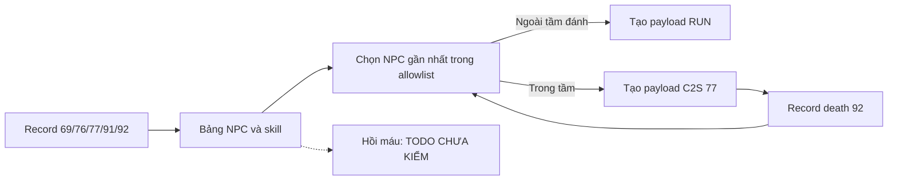

TÓM TẮT 5 DÒNG
1. [NGUỒN] DONE phạm vi offline: giải mã 69/76/77/91/92, bảng NPC theo UINT ID và C2S 77 theo skill/target.
2. [NGUỒN] Vòng săn chọn gần nhất trong tầm/allowlist, đi tới, đánh lặp và chuyển mục tiêu sau death; không gửi mạng.
3. [NGUỒN] Test `python -I -m unittest discover -s JX1_OPS/BOT -v` đạt 65/65, gồm 12 test mới dùng đúng vector E-08.
4. [CHƯA KIỂM] Hồi máu [CHƯA KIỂM] có TODO; ABI/runtime, các semantic chưa rõ và kill credit BOT vẫn [CHƯA KIỂM].
5. [NGUỒN] Không mạng thật/VM, không chạy exe game/server, không ghi mật khẩu/khóa; chưa commit/push vì không được yêu cầu. R-04a không build.

# E-02 — Hành vi BOT: đi, đánh quái và nhận diện NPC

Loại: công cụ
Chủ đề: Giải mã trạng thái NPC và lập vòng săn offline dựa trên skill/target.
Từ khóa: hành vi BOT, behavior, NPC, skill 77, NPC_DEATH, săn quái, hồi máu, E-02
Trạng thái: DONE — chỉ trong phạm vi thư viện offline; hồi máu, ABI/runtime và kill credit vẫn CHƯA KIỂM theo kết luận gốc.
Độ phủ: đã triển khai 4 trên tổng 5 nhóm hành vi được giao; hồi máu là 1 nhóm chưa phủ, có TODO theo điều kiện task. Bảng tách chi tiết NPC và thêm hướng dẫn/test, không đổi mẫu số 5 nhóm.
Liên quan: [E-08](E-08-goi-danh-quai-xac-nhan-kill.md), [E-01b](E-01b-thieu-giao-thuc.md), [E-03](E-03-dieu-phoi-dan-so.md), [E-05a](E-05a-khung-tester.md), [R-04a](R-04a.md).
Cần tôi quyết định: không — không thay đổi nhãn CHƯA KIỂM; hồi máu cần task và bằng chứng giao thức riêng.

## Sơ đồ chính



## Phạm vi và độ phủ

[ĐÃ XÁC MINH — đọc tĩnh R-04a] Phạm vi lấy từ `JX1_OPS/TASKS/E-02.md:11`, đối chiếu mã hiện tại. Vector và 65 test là kết quả lịch sử được báo cáo gốc ghi; R-04a không chạy lại. Mã nguồn/báo cáo đọc bằng UTF-8.

| Phần tử của phạm vi | Đã phủ / chưa phủ | Nguồn file:dòng và giới hạn |
| --- | --- | --- |
| Giải mã S2C 76 NPC xuất hiện | Đã phủ offline | `JX1_OPS/BOT/behavior.py:59`, `JX1_OPS/BOT/test_behavior.py:61`; ABI runtime chưa kiểm. |
| Giải mã S2C 77 NPC đồng bộ | Đã phủ offline | `JX1_OPS/BOT/behavior.py:68`, `JX1_OPS/BOT/test_behavior.py:61`; không fallback layout Cocos. |
| Giải mã S2C 91 bị thương và 92 chết | Đã phủ offline | `JX1_OPS/BOT/behavior.py:77`, `JX1_OPS/BOT/behavior.py:79`, `JX1_OPS/BOT/test_behavior.py:106`; không suy kill credit. |
| Gói C2S 77 theo skill/target | Đã phủ offline | `JX1_OPS/BOT/behavior.py:84`, `JX1_OPS/BOT/test_behavior.py:77`; ID có bit cao bị giới hạn theo handler. |
| Vòng săn gần nhất → đi → đánh → chuyển mục tiêu | Đã phủ offline | `JX1_OPS/BOT/behavior.py:166`, `JX1_OPS/BOT/test_behavior.py:144`; không gửi mạng, không chứng minh tới nơi/hit. |
| Hồi máu | Chưa phủ — TODO | `JX1_OPS/BOT/behavior.py:200`; thiếu packet, điều kiện dùng và dữ liệu HP bản thân. |
| Hướng dẫn và test vector E-08 | Đã phủ tài liệu/test lịch sử | `JX1_OPS/BOT/README.md:82`, `JX1_OPS/BOT/test_behavior.py:37`; không chạy lại trong R-04a. |

## Phạm vi và kết quả

Ngày 17/11/2026, workspace `D:\JX-wt\E-02`, nhánh
`task/E-02-hanh-vi`. Git status trước ghi chỉ có task E-02 untracked;
giữ nguyên nội dung đó và chỉ thêm mục Kết quả theo yêu cầu trực tiếp.
Các file triển khai nằm trong `JX1_OPS/BOT/`, báo cáo ở
`JX1_OPS/REPORTS/E-02-hanh-vi-bot.md`, khớp `vung_file` và đường dẫn
REPORTS tương đối trong task. Không sửa nguồn server/client hoặc BAI_HOC.

Đã đọc E-08-goi-danh-quai-xac-nhan-kill, E-01b-thieu-giao-thuc,
E-03-dieu-phoi-dan-so và mã BOT liên quan. Không khảo sát lại source canonical.

| Yêu cầu | Triển khai / bằng chứng |
| --- | --- |
| NPC xuất hiện/đồng bộ | `behavior.decode_record`, `Hunt.feed`: 76 prefix 42 + tên 0..64 byte; 77 GS đúng 227 byte; khóa uint32, không dùng index/tên |
| Skill/đánh | 69 length/count đúng ràng buộc E-08, lưu level/add/exp; `attack_target` dùng C2S 77 13 byte, X=-1/Y=ID |
| Hurt/death | 91 đúng 17 byte, frame phản ứng/vị trí; 92 đúng 69 byte, chỉ gói này đặt dead, chuyển target ở bước sau |
| Vòng săn | `Hunt.step`: gần nhất trong search range, kind_normal đã biết từ 76 và allowlist; RUN khi ngoài attack range, attack khi trong tầm, lặp có interval |
| Hồi máu | `Hunt.heal`: `[CHƯA KIỂM] TODO`, báo lỗi rõ ràng, không tạo packet chưa có bằng chứng |
| Hướng dẫn | README có API, trách nhiệm context/position/skill/allowlist, giới hạn và cách test |

Không tự kích hoạt hành vi trong Session/CLI đang có; đây là module offline
nhận plaintext đã giải framing/XOR và trả `Action.payload` cho bên gọi kiểm
tra. Không có socket/sleep/vòng nền. Cấu hình tầm/interval phải được bên gọi
chọn; chưa tuyên bố gameplay runtime hoạt động. Population E-03 độc lập;
chưa nối executor/busy/ACK giữa hai module.

## Vector và kiểm chứng

`test_behavior.py` chép trực tiếp vector tổng hợp E-08: 69=11 byte,
76=45 byte, 77 GS=227 byte, 91=17 byte, 92=69 byte, C2S 77=13 byte.
Không dựng expected bằng chính encoder đang được test, không gửi vector.
Fixture NPC `0x12345678` ở MPS=(1000,2000); level/template=10/20,
ratio=750, maxHP=400 cho ước lượng 300; hurt=6 frame; skill 7/level 2,
add=1, exp=1234. Skill 7 chỉ là dữ liệu test, API không mặc định dùng nó.

12 test mới bao phủ:

- Byte/offset/length của mọi vector E-08, uint32 kể cả ID=0xFFFFFFFF;
  C2S từ chối ID có bit cao vì Y signed bị handler nguồn từ chối.
- Cắt ở mọi byte các vector, record thừa, Cocos 223 byte không được fallback,
  tên 0/64 byte, 69 rỗng/80 skill và các length/count sai.
- Gộp 76/77 giữ identity, 91 không đổi HP/dead, 92 không cần hurt trước;
  death lặp/death chưa biết NPC, tail sau NUL, snapshot trễ không hồi sinh.
- RUN chưa đủ chứng minh tới nơi; vị trí quan sát mới cho phép attack;
  attack lặp, interval chặn spam, target death chuyển sang NPC tiếp.
- Nearest/tie-break/biên range, bỏ player/ngoài tầm/ngoài allowlist,
  không tin nKind chưa gán của 77, thiếu skill/level 0/69 rỗng chặn lệnh.
- Frame lỗi không sửa bảng một phần, reset context xóa tombstone/skill/timer,
  thời gian lùi/NaN/vô cực và cấu hình sai bị từ chối; heal có TODO.

Lệnh thực sự đã chạy tại worktree này:

```text
python -I -m unittest discover -s JX1_OPS/BOT -v
Ran 65 tests in 0.142s
OK
```

53 test có sẵn và 12 test mới đều đạt. Test cũ dùng channel/socket giả trong
bộ nhớ; không gọi kết nối thật. Không build, capture, kết nối VM/server hay
chạy binary game/server. Python là công cụ test được người dùng cho phép.

## Giới hạn và các nhãn [CHƯA KIỂM]

- Chọn rõ profile GS LE/pack1; ABI binary/sizeof thực và Cocos nhận đúng
  profile này [CHƯA KIỂM]. Không suy layout từ length hoặc fallback.
- 76 không có map ID; 77/91 cũng không có map ID. Bên gọi cung cấp context,
  map ID và vị trí, reset khi đổi map/phiên/vòng đời ID; chặn dữ liệu context
  cũ. ID reuse, respawn và stale death trong cùng context [CHƯA KIỂM].
- Dead tombstone tồn tại đến reset; 76/77 không tự phục sinh. Snapshot 77
  doing death/revive của NPC đã biết bị bỏ qua theo E-08. HP ratio=0 hay mất
  NPC không xác nhận chết. Remove/TTL/pathfinding/obstacle chưa triển khai.
- `target_deaths` chỉ ghi mục tiêu đang chọn chết, một lần/context, không có
  killerID/sequence; `bot_kill_credit=[CHƯA KIỂM]`, không nhận BOT kết liễu.
- Không dùng tên làm khóa; encoding thật [CHƯA KIỂM]. Không dùng nKind,
  nNpcMaxLife/nNpcDefen/nNpcMaxDefen/nIsSerLock/nIsMove hoặc field sender chưa
  khởi tạo để ra quyết định. Không dùng nLifeYu để suy HP thiếu/hồi máu.
- HP là ước lượng snapshot, không damage từng hit/ACK. Giới hạn INT trong
  pipeline HP lớn [CHƯA KIỂM]; int64 wire không chứng minh pipeline int64.
- Dangge/Zhongji, ASpeed/CSpeed, hệ số sự kiện/lucky, m_GameliveTime,
  nZhuaVal/nTongBanNum, hướng, enhancement/waitTime và thời lượng frame/tick
  runtime vẫn [CHƯA KIỂM] như E-08; module không quy đổi/sử dụng chúng.
- Quan hệ thù địch, skill thực sự tồn tại/hợp lệ, attack/search range và
  cooldown thực [CHƯA KIỂM]; allowlist và tham số là dữ liệu bên gọi phải
  xác định, không suy mọi kind_normal là quái. Gửi request chỉ là yêu cầu.
- Hồi máu **[CHƯA KIỂM] TODO**: cần packet/skill/item, điều kiện dùng và dữ
  liệu HP bản thân đủ bằng chứng. Không giả định SIT hay một skill cố định.

## Lỗi công cụ và bàn giao

- `rg : The term 'rg' is not recognized ...`: một lần; dùng Get-ChildItem,
  Get-Content trong phạm vi cần đọc, không cài thêm công cụ.
- Đọc task lần đầu thiếu UTF-8 gây hiển thị sai dấu: đọc lại đúng encoding,
  không sửa nội dung gốc vì lỗi hiển thị.
- Đầu ra đọc gộp bị truncate: đọc riêng file/đoạn liên quan, không khảo sát
  rộng hơn. Không còn blocker triển khai hay test; không có test thất bại.
- Đã rà diff một lượt cho đúng năm file đầu ra (gồm mục Kết quả task).
  `git diff --no-index` trả exit 1 vì file mới có khác biệt, không phải lỗi
  test. Kiểm whitespace bằng `git diff --check` và `--no-index --check`.

**DONE** trong phạm vi offline. Chưa kiểm runtime/ABI/hồi máu/kill credit như
nêu trên; không có kiểm tra mạng/build được phép nhưng bị bỏ sót. Bước tiếp
chỉ khi được duyệt riêng: xác minh context/hostility/range/cooldown và dữ
liệu hồi máu; giữ nhãn chưa kiểm đến khi có bằng chứng.

Commit SHA: chưa có; không yêu cầu stage/commit. Push/GitHub link: chưa có,
không thực hiện vì task cấm mạng thật. Toàn bộ đầu ra giữ local.

## Sổ thông số bổ sung khi chuẩn hóa

| Nhóm | Tên/hằng số | file:dòng | Giá trị | Đơn vị | Ảnh hưởng | Đổi an toàn (CÓ/CẨN THẬN/KHÔNG) | Nguồn đo |
| --- | --- | --- | --- | --- | --- | --- | --- |
| NPC | `NPC_NORMAL` | `JX1_OPS/BOT/worldsync.py:20`, `JX1_OPS/BOT/behavior.py:68` | 227 | byte/record GS | Layout giải mã NPC 77 | KHÔNG — cần bằng chứng ABI | Đọc tĩnh; chưa đo runtime |
| HP | Mẫu số `life_ratio` | `JX1_OPS/BOT/behavior.py:48` | 1000 | phần nghìn | `max_life * life_ratio // 1000`; chỉ ước lượng snapshot | KHÔNG — hợp đồng decoder | Đọc tĩnh; không phải damage từng hit |
| Vòng săn | `search_range`, `attack_range`, `action_interval` | `JX1_OPS/BOT/behavior.py:111` | Bên gọi cung cấp; interval > 0, attack ≤ search | khoảng cách theo tọa độ đầu vào; giây theo `now` | Chọn mục tiêu và nhịp tạo lệnh | CẨN THẬN — range/cooldown thật chưa kiểm | Đọc tĩnh; chưa đo gameplay |

## Đã xác minh / Chưa xác minh

- **ĐÃ XÁC MINH:** file thật có decoder năm S2C ID, `attack_target`, `Hunt.feed`, `Hunt.step` và `Hunt.heal` như bảng phạm vi. `JX1_OPS/TASKS/E-02.md:11` cho phép TODO hồi máu khi thiếu giao thức; giữ trạng thái DONE offline và làm lộ phần chưa triển khai.
- **CHƯA XÁC MINH:** R-04a không chạy lại 65 test, không build/exe/VM/mạng; không đo ABI, hồi máu, respawn, ID reuse, hostility, range, cooldown hoặc kill credit. Không dùng source client bản A hay dữ liệu server `gs` để suy semantic chưa có bằng chứng trong task này.

## Bàn giao chuẩn hóa R-04a

Giữ kết luận DONE offline và mọi nhãn CHƯA KIỂM của thân báo cáo. Chỉ mục và commit chuẩn hóa xem `JX1_OPS/REPORTS/R-04a.md`; chưa nối Session/CLI/population hoặc triển khai hồi máu.

## Phát hiện khi chuẩn hóa

- Bản gốc có tóm tắt nhưng thiếu tiêu đề ID/chủ đề, metadata, Mermaid và bảng độ phủ đầy đủ. Tóm tắt được giữ nội dung, chỉ gắn nhãn nguồn và ghi giới hạn build của R-04a.
- Hồi máu là phần tử thứ năm có điều kiện của task, hiện vẫn TODO (`JX1_OPS/BOT/behavior.py:200`). Không được đọc chữ DONE thành hoàn tất cả gameplay/hồi máu.
- Số 65 test là lịch sử E-02; mã hiện có thêm phần khác trong BOT, không lấy tổng test hiện tại để sửa số liệu cũ.
