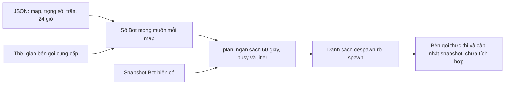

TÓM TẮT 5 DÒNG
1. [NGUỒN] DONE: bổ sung thư viện population độc lập, chưa nối server.
2. [NGUỒN] Cấu hình JSON hỗ trợ trọng số, đường cong 24 giờ, trần tổng mặc định 100 và trần map.
3. [NGUỒN] plan(current, now) giữ Bot bận, giới hạn thay đổi trong 60 giây và jitter có seed.
4. [NGUỒN] Kiểm tra yêu cầu đạt 53/53 test: 41 test cũ và 12 test mới.
5. [NGUỒN] Không chạy exe game/server, không kết nối mạng, không ghi mật khẩu/khóa; chưa commit/push. R-04a không build/VM hoặc chạy lại test.

# E-03 — Điều phối dân số Bot theo bản đồ và giờ

Loại: công cụ
Chủ đề: Thư viện thuần lập kế hoạch spawn/despawn Bot theo cấu hình, thời gian và snapshot hiện có.
Từ khóa: dân số Bot, population, Planner, spawn, despawn, bản đồ, hourly_curve, jitter, E-03
Trạng thái: DONE — giữ kết luận gốc trong phạm vi thư viện offline, chưa nối server.
Độ phủ: đã phủ 4 trên tổng 4 file đầu ra của module; ví dụ phủ 3 trên tổng 3 map mẫu và 24 trên tổng 24 mốc giờ. Không tính là độ phủ bản đồ server.
Liên quan: [E-01b](E-01b-thieu-giao-thuc.md), [E-02](E-02-hanh-vi-bot.md), [E-05a](E-05a-khung-tester.md), [R-04a](R-04a.md), [hướng dẫn tra cứu](../DESIGN/HUONG-DAN-TRA-CUU.md).
Cần tôi quyết định: không — tích hợp snapshot, executor và dữ liệu thật cần task riêng.

## Sơ đồ chính



## Phạm vi và độ phủ

[ĐÃ XÁC MINH — đọc tĩnh R-04a] Bốn file đối chiếu từ `JX1_OPS/TASKS/E-03.md:16` và module thật; ba map cùng 24 hệ số lấy trực tiếp JSON. Nguồn BOT/báo cáo UTF-8. Đối chiếu giới hạn với `G/Settings/MapList.ini:2`, trong đó G = `C:\Jx1CocoV3\Folder\ServerNew-20260116T043145Z-3-001\ServerNew\_bin_v2_\gs`; file đọc theo GBK/CP936, tên Việt trong dữ liệu chưa xác minh mã hóa. Không dùng `Count=1000` làm số map đã tải hoặc đã phủ.

| Phần tử của phạm vi | Đã phủ / chưa phủ | Nguồn file:dòng và giới hạn |
| --- | --- | --- |
| Thư viện `population/__init__.py` | Đã phủ offline | `JX1_OPS/BOT/population/__init__.py:37`, `JX1_OPS/BOT/population/__init__.py:101`, `JX1_OPS/BOT/population/__init__.py:139`; Config, desired và plan. |
| Ví dụ `population.example.json` | Đã phủ dữ liệu mẫu | `JX1_OPS/BOT/population/population.example.json:1`; ba map và 24 mốc được tách đủ dưới đây. |
| `test_population.py` | Đã phủ test nguồn; kết quả chạy là lịch sử | `JX1_OPS/BOT/population/test_population.py:32`; 12 hàm test, không chạy trong R-04a. |
| `population/README.md` | Đã phủ hợp đồng sử dụng | `JX1_OPS/BOT/population/README.md:28`, `JX1_OPS/BOT/population/README.md:35`; timezone, snapshot và cửa sổ 60 giây. |
| Map mẫu `map-a` | Đã phủ ví dụ; chưa gắn map thật | `JX1_OPS/BOT/population/population.example.json:3`: weight 3, cap 60. |
| Map mẫu `map-b` | Đã phủ ví dụ; chưa gắn map thật | `JX1_OPS/BOT/population/population.example.json:4`: weight 2, cap 50. |
| Map mẫu `map-c` | Đã phủ ví dụ; chưa gắn map thật | `JX1_OPS/BOT/population/population.example.json:5`: weight 1, cap 20. |
| Mốc giờ 00..23 | Đã phủ 24/24 hệ số mẫu | `JX1_OPS/BOT/population/population.example.json:7`: 0.3, 0.2, 0.2, 0.2, 0.2, 0.3, 0.4, 0.5, 0.6, 0.6, 0.6, 0.7, 0.7, 0.6, 0.6, 0.6, 0.7, 0.8, 0.9, 1.0, 1.0, 0.9, 0.7, 0.5; chưa phải số đo online. |
| Map ID thật, busy thật, người chơi thật, executor và ACK | Chưa phủ — ngoài thư viện offline | `JX1_OPS/TASKS/E-03.md:16`, `G/Settings/MapList.ini:5`; chưa có ánh xạ map mẫu → key map server. |

## Phạm vi và kết quả

- `JX1_OPS/BOT/population/__init__.py`: `Config.from_json`, `Planner.desired`,
  `Planner.plan`, các record `MapConfig`, `Bot`, `Command`.
- `population.example.json`: cấu hình ba map tổng hợp; cao điểm 19–20 giờ đạt
  100 Bot, 03 giờ đạt 20 Bot.
- `test_population.py`: 12 test mới bao phủ trần, trọng số/phần dư, tái phân bổ
  khi chạm trần map, giờ cao điểm, cửa sổ trượt qua ranh giới phút, giữ Bot bận,
  loại Bot map lạ, jitter/seed, hội tụ, dữ liệu lỗi và thời gian lùi.
- `README.md` trong module: hợp đồng snapshot, thực thi lệnh tuần tự, timezone,
  thuật toán phân bổ, giới hạn và cách chạy kiểm tra.

Giới hạn thay đổi tính cả spawn và despawn, không reset theo phút đồng hồ.
Jitter chèn khoảng chờ giữa các đợt, thứ tự chọn được xáo bằng RNG riêng có seed.
Planner không thực thi lệnh và không sửa snapshot đầu vào.

## Bằng chứng kiểm tra

Lệnh đã chạy tại `D:\JX-wt\E-03`, nhánh `task/E-03-dieu-phoi`:

```text
python -I -m unittest discover -s JX1_OPS/BOT
.....................................................
----------------------------------------------------------------------
Ran 53 tests in 0.141s

OK
```

Không build, chạy binary game/server hoặc kiểm tra kết nối. Chỉ chạy Python
theo lệnh được duyệt. Không sử dụng thư viện ngoài, credential hoặc dịch vụ ngoài.

## Lỗi, cách xử lý và giới hạn còn lại

- `rg` không có trên máy (`The term 'rg' is not recognized`); không thử lại,
  dùng `Get-ChildItem` và `Get-Content` để đọc các file cần thiết. Không còn blocker.
- Lần đọc đầu bằng encoding mặc định của PowerShell hiển thị sai dấu tiếng Việt;
  đọc lại bằng UTF-8 thành công, không sửa nội dung nguồn vì lỗi hiển thị.
- Snapshot đã vượt trần không thể được bảo đảm hạ ngay khi phải đồng thời giữ
  Bot bận và giới hạn tốc độ; chỉ giảm Bot nhàn rỗi theo ngân sách, chặn spawn
  khi chạm trần tổng. Test có bao phủ trường hợp Bot bận vượt trần.
- Trần tính các Bot được quản lý, chưa bao gồm người chơi thật. Chưa xác minh
  map ID, trạng thái busy, ACK thực thi hoặc hành vi server runtime.
- Bên gọi phải giữ planner và cập nhật snapshot sau khi áp dụng từng batch;
  chưa có persistence, cơ chế nhiều worker hay thực thi bất đồng bộ.

## Trạng thái bàn giao

**DONE** trong phạm vi thư viện offline. Test yêu cầu đã chạy và đạt; runtime
server chưa kiểm, không thuộc phạm vi được duyệt. Chỉ bổ sung module, báo cáo
và mục Kết quả của task; giữ nguyên file task có sẵn chưa được Git theo dõi.
Commit SHA: chưa có vì task không yêu cầu commit. Push: chưa thực hiện vì task
cấm kết nối mạng; không có link GitHub để xác nhận.

## Sổ thông số bổ sung khi chuẩn hóa

| Nhóm | Tên/hằng số | file:dòng | Giá trị | Đơn vị | Ảnh hưởng | Đổi an toàn (CÓ/CẨN THẬN/KHÔNG) | Nguồn đo |
| --- | --- | --- | --- | --- | --- | --- | --- |
| Trần | `total_cap` | `JX1_OPS/BOT/population/__init__.py:40` | 100 mặc định | Bot quản lý | Không bao gồm người chơi thật | CẨN THẬN — chưa đo tải server | Đọc tĩnh |
| Làm mượt | `max_changes_per_minute` | `JX1_OPS/BOT/population/__init__.py:41`, `JX1_OPS/BOT/population/__init__.py:161` | 10 mặc định; cửa sổ 60 | thay đổi/60 giây | Tính cả spawn và despawn | CẨN THẬN | Đọc tĩnh, chưa thực thi lệnh |
| Jitter | `jitter_seconds`, `seed` | `JX1_OPS/BOT/population/__init__.py:42`, `JX1_OPS/BOT/population/population.example.json:10` | mặc định 2.0 giây/seed 0; ví dụ 3 giây/seed 3 | giây; seed không đơn vị | Khoảng chờ và khả năng tái lập | CẨN THẬN | Đọc tĩnh; tách mặc định và ví dụ |
| Theo giờ | `hourly_curve` | `JX1_OPS/BOT/population/__init__.py:52`, `JX1_OPS/BOT/population/population.example.json:7` | 24 hệ số trong [0,1] | hệ số theo giờ 0..23 | floor(total_cap × hệ số), theo giờ datetime bên gọi | CẨN THẬN — timezone do bên gọi | Đọc tĩnh, chưa đo online |

## Đã xác minh / Chưa xác minh

- **ĐÃ XÁC MINH:** bốn file của module hiện có; đủ ba map mẫu và 24 hệ số JSON; điều kiện trần, busy và ngân sách tại `JX1_OPS/BOT/population/__init__.py:139`. `G/Settings/MapList.ini:5` có key map số, không cung cấp ánh xạ các nhãn mẫu trong JSON.
- **CHƯA XÁC MINH:** không chạy lại 53 test, không build/exe/VM/mạng; chưa kiểm map thật, snapshot/ACK, người chơi thật, persistence hoặc nhiều worker. Số test gốc được giữ nguyên.

## Bàn giao chuẩn hóa R-04a

Giữ trạng thái DONE của thư viện offline, thêm khả năng tra cứu và chỉ mục `JX1_OPS/REPORTS/_CHIMUC/R-04a.tsv`. Commit chuẩn hóa và bước PM xem `JX1_OPS/REPORTS/R-04a.md`; không sửa JSON/source.

## Phát hiện khi chuẩn hóa

- Bản gốc thiếu tiêu đề ID/chủ đề, metadata, Mermaid và bảng phạm vi. Đã bổ sung, giữ nguyên kết luận/số liệu lịch sử.
- Ba map tổng hợp không đại diện cho độ phủ bản đồ game. Đọc `G/Settings/MapList.ini:2` thấy `Count=1000` nhưng chưa đếm các map hoạt động; không đưa con số này vào mẫu số độ phủ E-03.
- `jitter_seconds` mặc định là 2.0 (`JX1_OPS/BOT/population/__init__.py:42`), ví dụ đặt 3 (`JX1_OPS/BOT/population/population.example.json:10`); đây là hai loại giá trị, không đổi số liệu gốc.
- `MapList.ini` không phải UTF-8 hợp lệ; đọc GBK/CP936 có tên Việt hiển thị khác thường. Chỉ dùng key số/ASCII, chưa kết luận mã hóa tên Việt hay sửa dữ liệu.
