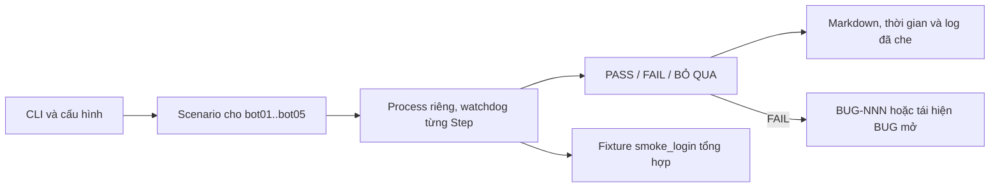

TÓM TẮT 5 DÒNG
1. [NGUỒN] Đã làm kiểm tra trước: đúng worktree/nhánh, cây sạch, đọc đủ nguồn bắt buộc; chỉ sửa vùng task cho phép.
2. [NGUỒN] Có Scenario/Step, process riêng từng bot, tuần tự/song song 1..5, watchdog timeout, PASS/FAIL/BỎ QUA và log/hex đã che.
3. [NGUỒN] Có báo cáo Markdown và BUG-NNN tăng số, khử trùng BUG mở, ghi tái hiện lần N; máy chủ giả chứng minh 15/15 bước PASS.
4. [NGUỒN] TESTER 14/14 đạt; BOT 41/41 đạt; không chạy exe, không kết nối VM/mạng ngoài; gs001 thật chưa kiểm.
5. [CHƯA KIỂM] PARTIAL: cú pháp nguyên văn `python -I -m JX1_OPS.TESTER.run` chưa đạt; CLI file trực tiếp giữ -I đã đạt; Git bị chặn index.lock, PM cần commit. R-04a không chạy lại test/build/exe/VM.

# E-05a — Khung tester nhiều bot, chỉ kiểm offline

Loại: công cụ
Chủ đề: Khung kịch bản nhiều Bot, kiểm thời hạn, ghi kết quả và BUG từ máy chủ giả.
Từ khóa: khung kiểm thử, TESTER, Scenario, Step, smoke_login, watchdog, BUG-NNN, isolated, E-05a
Trạng thái: PARTIAL — giữ kết luận gốc: tiêu chí CLI nguyên văn -I -m chưa đạt và Git lịch sử bị chặn.
Độ phủ: đã phủ 4 trên tổng 5 mục tiêu chức năng; CLI đúng nguyên văn còn chưa phủ. Fixture lịch sử phủ 5 Bot × 3 bước = 15/15 ô; không phải độ phủ gs001 thật.
Liên quan: [E-01b](E-01b-thieu-giao-thuc.md), [E-02](E-02-hanh-vi-bot.md), [fixture 15 PASS](TEST/2026-11-17-smoke_login-2.md), [BUG tổng hợp](TEST/BUG-002.md), [R-04a](R-04a.md).
Cần tôi quyết định: có — theo bàn giao gốc: chấp nhận cú pháp CLI file trực tiếp giữ -I hoặc giao việc đóng gói để hỗ trợ nguyên văn -I -m.

## Sơ đồ chính



## Phạm vi và độ phủ

[ĐÃ XÁC MINH — đọc tĩnh R-04a] Năm mục tiêu lấy trực tiếp từ `JX1_OPS/TASKS/E-05a.md:22` đến mục CLI tại dòng 26. Ba bước lấy từ `JX1_OPS/TESTER/scenarios.py:48`; năm Bot lấy đủ từ bảng fixture đã lưu, không chạy lại máy chủ giả. Tài liệu và mã TESTER đọc bằng UTF-8.

| Phần tử của phạm vi | Đã phủ / chưa phủ | Nguồn file:dòng và giới hạn |
| --- | --- | --- |
| 1. Scenario/Step, cách ly Bot, tuần tự/song song, lỗi và timeout | Đã phủ offline | `JX1_OPS/TESTER/core.py:14`, `JX1_OPS/TESTER/core.py:31`, `JX1_OPS/TESTER/core.py:201`; không đo thời gian thực trong R-04a. |
| 2. Báo cáo Bot × bước, thời gian, log/hex có hướng và ID, giới hạn 256 byte | Đã phủ offline | `JX1_OPS/TESTER/core.py:112`, `JX1_OPS/TESTER/reporting.py:95`; body gói bị che theo thiết kế gốc. |
| 3. BUG-NNN, khử trùng BUG mở, tái hiện lần N | Đã phủ offline | `JX1_OPS/TESTER/reporting.py:64`, `JX1_OPS/TESTER/test_tester.py:292`; BUG mẫu là lỗi tổng hợp, không phải lỗi gs001. |
| 4. smoke_login dùng máy chủ giả | Đã phủ fixture lịch sử | `JX1_OPS/TESTER/scenarios.py:48`, `JX1_OPS/TESTER/test_tester.py:217`; không gọi fixture trong R-04a. |
| 5. CLI nguyên văn `python -I -m JX1_OPS.TESTER.run` | Chưa phủ đúng nguyên văn; CLI file trực tiếp đã đạt ở lượt gốc | `JX1_OPS/TASKS/E-05a.md:26`, `JX1_OPS/TESTER/run.py:8`; không sửa resolve môi trường hoặc chạy CLI để đổi kết luận cũ. |
| bot01: connect_fake / sync_fake / close_fake | Đã phủ 3/3 PASS lịch sử | `JX1_OPS/REPORTS/TEST/2026-11-17-smoke_login-2.md:9`. |
| bot02: connect_fake / sync_fake / close_fake | Đã phủ 3/3 PASS lịch sử | `JX1_OPS/REPORTS/TEST/2026-11-17-smoke_login-2.md:10`. |
| bot03: connect_fake / sync_fake / close_fake | Đã phủ 3/3 PASS lịch sử | `JX1_OPS/REPORTS/TEST/2026-11-17-smoke_login-2.md:11`. |
| bot04: connect_fake / sync_fake / close_fake | Đã phủ 3/3 PASS lịch sử | `JX1_OPS/REPORTS/TEST/2026-11-17-smoke_login-2.md:12`. |
| bot05: connect_fake / sync_fake / close_fake | Đã phủ 3/3 PASS lịch sử | `JX1_OPS/REPORTS/TEST/2026-11-17-smoke_login-2.md:13`. |
| Đăng nhập/tạo nhân vật/gameplay gs001 thật | Chưa phủ — ngoài E-05a | `JX1_OPS/TASKS/E-05a.md:27`, `JX1_OPS/REPORTS/TEST/2026-11-17-smoke_login-2.md:3`; phần mã TESTER bổ sung về sau không đổi phạm vi lịch sử. |

## Nội dung gốc E-05a

## Worker kiểm tra trước khi làm

- `Get-Location`: `D:\JX-wt\E-05a`; `git status --short --branch`: `## task/E-05a-tester`, không có thay đổi local. Khớp worktree/branch trong task trước khi ghi.
- Đã đọc `JX1_OPS/TASKS/E-05a.md`, `BOT/README.md`, `BOT/session.py`, `BOT/cli.py`, `REPORTS/E-01b-thieu-giao-thuc.md`. Đọc thêm đúng vector tại `BOT/test_bot.py`, `BOT/test_worldsync.py`, codec/API liên quan để nối smoke.
- Không Dispatcher/queue/preflight/model/config; không sửa BOT/canonical hay nguồn `C:\Jx1CocoV3`. Không gọi dịch vụ ngoài, không chạy exe game/server, không kết nối VM/server thật, không dùng tài khoản thật.
- Socket thật duy nhất là `127.0.0.1` của fixture test theo mục tiêu 4. Không DNS/IPv6/địa chỉ VM; `Config` chặn mọi host khác trước mở socket.

## Phần đã triển khai

`TESTER/core.py`: `Scenario`, `Step`, `Context`, `Result`, `Config`, `SkipStep`, `Redactor`, `run_scenario`. Một process spawn riêng mỗi bot giữ state giữa bước; `workers=1` tuần tự, `2..5` song song. Callable cấp module kiểm kỳ vọng bằng assertion/exception hoặc trả False; None/True là PASS. `SkipStep` là BỎ QUA. FAIL dừng bot, bỏ qua phần còn lại, tiếp tục bot khác. Worker chết sớm/IPC đóng được quy về FAIL.

Watchdog dùng đồng hồ monotonic, poll 5 ms; quá hạn terminate/kill process, mỗi join tối đa 100 ms. Không dùng thread timeout để bỏ lại hàm treo. Startup riêng tối đa 10s; có sai số lập lịch/cleanup, không khẳng định bảo đảm thời gian thực cứng của hệ điều hành. Test hàm ngủ 60s với hạn 0.15s kết thúc cả lượt dưới 4s kể cả spawn, không còn child process.

`TESTER/reporting.py`: bảng bot x bước có trạng thái và giây từng bước, chi tiết log và bằng chứng; lấy nhánh/commit Git chỉ đọc với timeout. Tên report theo ngày/scenario, thêm hậu tố lần chạy để giữ lịch sử. `.tester.lock` dùng O_EXCL bảo vệ đoạn đọc số BUG/khử trùng/ghi report; gặp writer khác thì báo lỗi hữu hạn, không tự xóa lock cũ.

BUG-NNN đọc số lớn nhất, tạo file exclusive; fingerprint SHA-256 của scenario + bước + thông báo đã che. BUG `Status: OPEN` cùng fingerprint được thêm dòng `tái hiện lần N`, bot, nhánh/commit. BUG CLOSED không khử trùng. Có tái hiện, kỳ vọng, thực tế, log, độ nặng, bot, nhánh/commit. Thông báo khác sinh BUG mới.

Log giới hạn 20 mục x 400 ký tự/bước; message tối đa 1600 ký tự. Che trước IPC và tại ranh giới ghi file: giá trị đã đăng ký trong `Config.secrets`, biến môi trường tên nhạy cảm, biểu diễn hex/MD5/uint32 và cặp nhãn bí mật. stdout/stderr tự do của bước bị bỏ, không ghi report. Kịch bản nối sau phải đăng ký mọi bí mật tự đọc và không tự log biến đổi bí mật ngoài hợp đồng; chưa có tài khoản/config thật trong kho.

Gói tối đa 4/bước, mỗi gói tối đa 256 byte, có gửi/nhận, ID và độ dài gốc. **Body luôn che bằng 00, chỉ giữ ID**, kể cả unknown/auth/key/GUID; report không phải packet capture có thể replay. Đây là giới hạn chẩn đoán có chủ ý để tránh lộ dữ liệu chưa biết schema. Test chứng minh gói lỗi ID 0xff dài 401 byte chỉ ghi 256 byte hex đã che; hướng gửi cũng có test riêng.

`TESTER/scenarios.py::SMOKE_LOGIN`: ba bước connect_fake/sync_fake/close_fake. Dùng `BOT.Channel.handshake` và `BOT.Session.poll`, không gọi đăng nhập thật/role/character creation. Fixture gửi vector ACCOUNT_BEGIN và world/PING/END tổng hợp từ BOT test, kiểm PING_REPLY, ACK END 9 byte, CP_LOCK. Không thay guard kết nối của BOT.

`TESTER/run.py`: parse scenario, bots range hoặc comma-list, host, port, out, workers; thiếu/sai cấu hình in usage và exit 2 trước socket. FAIL exit 1, thành công exit 0. README ghi API, mẫu chạy, giới hạn và cách xử lý lock.

## Kiểm chứng đã chạy

```text
python -I -m unittest discover -s JX1_OPS/TESTER -v
Ran 14 tests in 3.429s
OK; exit 0

python -I -m unittest discover -s JX1_OPS/BOT -v
Ran 41 tests in 0.173s
OK; exit 0
```

14 test TESTER bao gồm: 5 bot tuần tự và song song (15 bước/mode), giữ state/cách ly bot, exception và bỏ qua phần sau, timeout cưỡng chế + giữ bằng chứng, worker os._exit, SkipStep/False, socket loopback nhận ID lỗi + BUG/hex, che bí mật trong worker/report/BUG, biến môi trường/khóa, BUG tăng số/OPEN/CLOSED/thông báo khác/lần tái hiện/lịch sử report, lock, cấu hình lỗi không mở socket, validation, và subprocess CLI `python -I .../run.py` end-to-end. BOT không sửa; 41 test vẫn pass.

Chạy fixture riêng để lưu đầu ra bằng `python -I -c` import `TESTER/test_tester.py::fake_server`, gọi cùng `run.main`:

```text
fixture_malformed=False exit=0 connections=5 server_errors=0
fixture_malformed=True  exit=1 connections=1 server_errors=0
fixture_malformed=True  exit=1 connections=1 server_errors=0
```

- [smoke_login-2](TEST/2026-11-17-smoke_login-2.md): 5 bot, 15/15 PASS, ACK kiểm bởi máy chủ giả.
- [smoke_login-3](TEST/2026-11-17-smoke_login-3.md), [smoke_login-4](TEST/2026-11-17-smoke_login-4.md): cố ý ID 0xff, bước sync FAIL và close BỎ QUA.
- [BUG-002](TEST/BUG-002.md): chỉ một BUG mở cho cùng lỗi tổng hợp trên bot01 và bot02, có `tái hiện lần 2`; không phải lỗi gs001.
- [report lượt đầu](TEST/2026-11-17-smoke_login.md) và [BUG-001](TEST/BUG-001.md) giữ bằng chứng lỗi harness stdin; BUG đã CLOSED, nguyên nhân/khắc phục dưới đây.

Không chạy build game, exe hay kiểm gs001 thật. Login/gameplay thật **chưa kiểm**; E-05b còn nguyên phạm vi của task sau.

## Lỗi, cách khắc phục và giới hạn còn lại

1. PowerShell mặc định đọc UTF-8 sai dấu ở lần đọc task đầu; đọc lại bằng `-Encoding UTF8`, nội dung file không bị sửa.
2. Lần đọc thêm nhầm `BOT/test_session.py` trả `Cannot find path ... because it does not exist`; đọc đúng `BOT/test_bot.py` đã có trong danh sách. Không tạo file thay thế hay tìm toàn repo.
3. TESTER lần đầu 13/14 đạt, case worker chết sớm gặp `BrokenPipeError: [WinError 109] The pipe has been ended` tại Pipe.poll trên Windows. Bắt OSError/EOF quanh poll/recv, quy về FAIL; chạy lại đạt 14/14. Rà cleanup để không phát traceback có dữ liệu nhạy cảm; bộ 14 test cuối vẫn đạt như trên.
4. Harness tạo report qua `python -I -` gặp `OSError: [Errno 22] Invalid argument: ...<stdin>` do Windows spawn cần main importable; không có kết nối fixture, 5 worker được ghi FAIL và khử trùng BUG-001. Giữ file lỗi, đóng BUG-001 kèm nguyên nhân. Chuyển harness sang `python -I -c` với callable import từ module, đạt như bằng chứng trên. CLI file trực tiếp không có lỗi này.
5. Một patch ghép thêm README sai context bị `apply_patch verification failed`; không áp dụng nửa patch. Áp lại với đúng context, test cuối đạt.
6. Cú pháp nguyên văn task `python -I -m JX1_OPS.TESTER.run --help` đã thử và thất bại trước khi nạp module: `ModuleNotFoundError: No module named 'JX1_OPS'`. Python isolated bỏ cwd/PYTHONPATH, checkout chưa cài không nằm trong đường tìm module. Code bên trong package không thể sửa bước resolve trước import. Đã cung cấp `python -I JX1_OPS/TESTER/run.py ...` với bootstrap đường tuyệt đối từ __file__, test subprocess đạt; module mode hoạt động khi package được tìm thấy. Không tự cài package hay sửa môi trường/site-packages ngoài vùng cho phép. **Tiêu chí đúng nguyên văn -I -m chưa đạt**, vì vậy tổng trạng thái PARTIAL; PM có thể duyệt cú pháp file hoặc giao riêng việc đóng gói/cài đặt.

## Bàn giao Git

HEAD gốc dùng trong các report fixture: `e4f16af5e0fe0410a01c0e182078a44ab04f548d`; nhánh `task/E-05a-tester`.
Đã xem diff một lượt; `git diff --check` exit 0, không báo whitespace ở thay đổi tracked. Diff file mới dùng `--no-index` (exit 1 biểu thị có khác biệt, không phải test thất bại); đầu ra gộp dài bị cắt một phần, nội dung file đã được xem khi triển khai. Không kiểm tra lại remote/refs/workspace.

**Commit BLOCKED. BỊ CHẶN – CHƯA PUSH.** Đã thử stage đúng vùng một lần:

```text
git add -- JX1_OPS/TESTER/ JX1_OPS/REPORTS/TEST/ JX1_OPS/REPORTS/E-05a-khung-tester.md JX1_OPS/TASKS/E-05a.md
fatal: Unable to create 'D:/jx1-reports/.git/worktrees/E-05a/index.lock': Permission denied
exit 1
```

Metadata Git ở ngoài writable root; phiên không cho nâng quyền. Không thử index/object/ref khác, không đổi ACL/config/credential, không chạy commit trên index chưa stage. **Chưa có commit SHA mới hoặc link GitHub**; SHA nêu trên chỉ là HEAD gốc. Không push vì task chỉ yêu cầu commit; kết quả giữ local để PM commit.

PM chạy trong đúng worktree/nhánh khi có quyền ghi metadata Git:

```text
git -C D:\JX-wt\E-05a add -- JX1_OPS/TESTER/ JX1_OPS/REPORTS/TEST/ JX1_OPS/REPORTS/E-05a-khung-tester.md JX1_OPS/TASKS/E-05a.md
git -C D:\JX-wt\E-05a commit -m "E-05a: thêm khung tester offline nhiều bot và báo cáo BUG"
```

Không cần làm lại code/test đã có bằng chứng nếu PM không thay đổi nội dung. Phần cần quyết định tiếp là chấp nhận cú pháp file trực tiếp giữ `-I` hoặc giao riêng đóng gói để hỗ trợ nguyên văn `-I -m`; chưa kiểm gs001 thật.

## Sổ thông số bổ sung khi chuẩn hóa

| Nhóm | Tên/hằng số | file:dòng | Giá trị | Đơn vị | Ảnh hưởng | Đổi an toàn (CÓ/CẨN THẬN/KHÔNG) | Nguồn đo |
| --- | --- | --- | --- | --- | --- | --- | --- |
| Song song | `workers` | `JX1_OPS/TESTER/core.py:201`, `JX1_OPS/TESTER/run.py:44` | 1..5 | process Bot | Cách ly trạng thái và mức song song offline | CẨN THẬN — chưa đo tải thật | Đọc tĩnh |
| Gói lỗi | Độ dài lưu tối đa | `JX1_OPS/TESTER/core.py:129` | 256 | byte/gói | Giới hạn bằng chứng hex đã che | CẨN THẬN — phải giữ che dữ liệu | Đọc tĩnh; không capture |
| Watchdog | Khoảng poll | `JX1_OPS/TESTER/core.py:267` | 0.005 | giây | Nhịp kiểm tiến trình, không bảo đảm real-time cứng | CẨN THẬN | Đọc tĩnh; chưa đo lại |
| Fixture | Timeout connect / sync / close | `JX1_OPS/TESTER/scenarios.py:49` | 3 / 3 / 1 | giây/bước | Chỉ kịch bản smoke_login | CẨN THẬN | Đọc tĩnh; 15 PASS là lịch sử |

## Đã xác minh / Chưa xác minh

- **ĐÃ XÁC MINH:** năm mục tiêu, code khung và đủ 15 ô PASS trong fixture đã lưu. Các liên kết TEST/BUG tồn tại. Mã hiện tại có bootstrap tại `JX1_OPS/TESTER/run.py:8` và các kịch bản thêm tại `JX1_OPS/TESTER/run.py:18`; chỉ ghi nhận có thay đổi sau mốc gốc.
- **CHƯA XÁC MINH:** không chạy lại TESTER 14/BOT 41 test, fixture, CLI -I -m, build, exe, VM hoặc mạng. Các kết quả thời gian, lỗi CLI và commit trong thân là lịch sử E-05a; chưa xác nhận gameplay thật.

## Bàn giao chuẩn hóa R-04a

Giữ nguyên PARTIAL và quyết định CLI cần PM/chủ xử lý theo phần gốc. Chỉ mục và commit chuẩn hóa xem `JX1_OPS/REPORTS/R-04a.md`; không sửa mã hoặc môi trường để giải tiêu chí CLI.

## Phát hiện khi chuẩn hóa

- Tóm tắt gốc đặt sau tiêu đề, thiếu nhãn nguồn, metadata, Mermaid và bảng độ phủ. Đã chuyển tóm tắt lên đầu, giữ nguyên nội dung năm dòng và bổ sung giới hạn R-04a.
- `JX1_OPS/TASKS/E-05a.md:4` ghi `status: done`, trong khi phần Kết quả task và báo cáo gốc ghi PARTIAL do CLI/Git; giữ PARTIAL trong metadata báo cáo và chỉ mục, không tự sửa task E-05a.
- Code hiện tại có bootstrap và các kịch bản ngoài smoke_login; không dùng phần thêm sau để xóa lỗi CLI hay nâng trạng thái báo cáo lịch sử.
