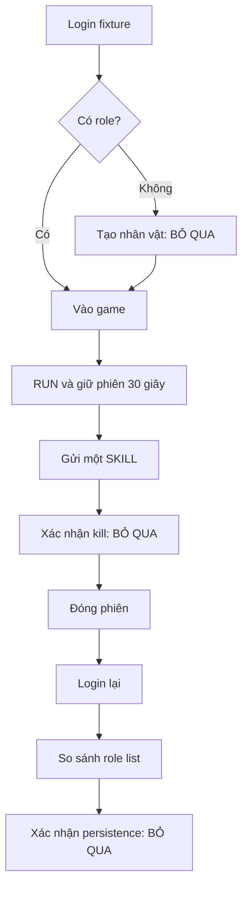

# TÓM TẮT 5 DÒNG

1. DONE: thêm `full_cycle` và CLI `--scenario full_cycle`, chỉ dùng máy chủ giả loopback/API BOT hiện có.
2. Login, vào game, RUN + giữ phiên 30 s, một SKILL, vào lại và so sánh role list đã cài; không nhận là xác minh gameplay thật.
3. Tạo nhân vật, xác nhận kill, logout ứng dụng và toàn bộ trạng thái lưu có BỎ QUA cùng lý do/gói cần bổ sung.
4. TESTER 18/18 đạt; BOT 41/41 đạt; test CLI hai bot chạy 30 s thật và kiểm hai phiên game/bot.
5. Gs001 thật: [CHƯA KIỂM]; không chạy exe/kết nối VM/mạng ngoài; không commit/push vì task không yêu cầu.

# E-05b — Kịch bản full-cycle
Loại: kiểm thử
Chủ đề: Độ phủ từng bước của kịch bản full-cycle trong fixture BOT/TESTER.
Từ khóa: chu kỳ đầy đủ, full_cycle, BOT, TESTER, đăng nhập, nhân vật, SKILL, verify_kill, E-05b
Trạng thái: DONE — theo kết quả fixture trong báo cáo gốc; gameplay thật chưa xác minh.
Độ phủ: 10/10 bước journey được liệt kê; mô hình fixture, bảo vệ và test history cũng được lập bảng.
Liên quan: `JX1_OPS/REPORTS/E-05a-khung-tester.md`, `JX1_OPS/REPORTS/E-07-goi-tao-nhan-vat-logout.md`, `JX1_OPS/REPORTS/E-08-goi-danh-quai-xac-nhan-kill.md`, `JX1_OPS/REPORTS/E-09a-real-login-allowlist.md`, `JX1_OPS/REPORTS/E-10-bot-tao-role-logout-offline.md`, `JX1_OPS/DESIGN/CHUAN-BAO-CAO.md`
Cần tôi quyết định: không

## Sơ đồ luồng


## Phạm vi và độ phủ
| Phần tử | Độ phủ theo báo cáo gốc |
|---|---|
| Login và role list fixture | Đã phủ; PASS trong fixture, không phải login thật |
| Tạo nhân vật | Đã xét; BỎ QUA theo điều kiện role, chưa có request tạo |
| Vào game và permit/sync | Đã phủ trong fixture |
| RUN và giữ 30 giây | Đã phủ thao tác gửi/giữ; chưa xác minh di chuyển liên tục |
| Một SKILL | Đã phủ thao tác gửi; chưa xác minh trúng mục tiêu |
| Xác nhận kill | Đã xét; BỎ QUA, thiếu bằng chứng kill |
| Logout ứng dụng | Đã xét; đóng phiên TCP không thay ACK logout |
| Vào lại | Đã phủ login/role/permit lần hai trong fixture |
| So sánh role | Đã phủ tên/giới tính/hệ/level |
| Xác nhận persistence | Đã xét; BỎ QUA, chưa có giải mã và xác nhận lưu |
| Fixture loopback và bảo vệ dữ liệu | Đã trình bày máy chủ giả, giới hạn loopback và redaction; không phải kết nối server thật |
| Test history và kết quả fixture | Đã ghi 18/18 TESTER, 41/41 BOT và CLI fixture; không chạy lại trong retrofit |

## Giải mã tên
| Tên gốc | Mã hóa | Chữ đúng | Nguồn file:dòng |
|---|---|---|---|
| Không có tên riêng nhân vật, kỹ năng, trang bị, quái hoặc bản đồ trong phạm vi | — | Không áp dụng; tên bước/gói là nhãn kỹ thuật | — |

## Sắp theo cấu trúc game
Không áp dụng: báo cáo kiểm thử chuỗi bước, không liệt kê dữ liệu kỹ năng theo phái/nhánh/cấp học, trang bị theo bộ hoặc quái/NPC theo bản đồ. Một thao tác SKILL trong fixture không định danh kỹ năng game.

## Đề xuất tối ưu
Không có đề xuất cân chỉnh gameplay; báo cáo chỉ bao phủ fixture, không có phép đo runtime.

## Phạm vi và kết quả

Ngày 17/11/2026, worktree `D:\JX-wt\E-05b`, nhánh `task/E-05b-kichban`.
Kiểm Git trước khi ghi đúng một lần: chỉ có task `JX1_OPS/TASKS/E-05b.md`
untracked; giữ nguyên phần task ngoài mục Kết quả. Đã đọc bốn tài liệu task yêu
cầu và code TESTER/BOT liên quan. Chỉ sửa TESTER, báo cáo này và mục Kết quả.

`TESTER/scenarios.py::FULL_CYCLE` có 10 bước; `run.py::main` chọn scenario theo
CLI. Trường hợp fixture có role: 6 PASS, 4 BỎ QUA/bot. Trường hợp chưa có role:
login PASS, 9 bước sau BỎ QUA. FAIL dừng bot và bỏ qua phần sau theo core có sẵn.
Exit 0 khi không có FAIL vẫn có thể chứa BỎ QUA; không coi đó là hoàn thành
gameplay hoặc xác minh lưu dữ liệu thật.

| Bước | Đã cài / kết quả fixture | Thiếu/gói hoặc xử lý cần bổ sung |
| --- | --- | --- |
| login | PASS: `packets.login/check_login_response/role_list`, `Channel` | Profile role list/NDataLen, binary/encoding thật chưa xác minh theo E-01b |
| create_character | BỎ QUA nếu có role; nếu thiếu ghi rõ chưa tạo được | Request tạo nhân vật, response/mã kết quả, cập nhật role list; BOT chưa có, không đoán ID/layout |
| enter_game | PASS: SELECT_ROLE 108, permit 52, LOGIC_LOGIN 66, `Session.poll`, ACK END 67 đủ 9 byte, CP_LOCK 124 | ABI/binary sync thật chưa xác minh |
| walk_30s | PASS phạm vi gửi RUN 76 tới tọa độ fixture rồi `hold(30)` | Chưa giải mã vị trí/normal sync 68/70 và xác nhận di chuyển; không nhận là đi liên tục 30 s |
| attack_one | PASS phạm vi gửi một SKILL 77, NPC fixture được chỉ định | Skill/NPC tổng hợp, chưa chứng minh mục tiêu thật hoặc hit/kill |
| verify_kill | BỎ QUA rõ lý do | Giải mã skill 69, NPC 76/77, hurt 91/death 92 và liên kết đúng NPC/kết quả; E-01b mới tách/bỏ qua record |
| logout | Đã `Session.close`/`Channel.close`; BỎ QUA xác nhận logout | Request/response logout ứng dụng và xác nhận lưu; đóng TCP không thay thế logout |
| reenter | PASS: login/role list/permit và sync IN_GAME lần hai | Nếu chưa tạo được role thì BỎ QUA do phụ thuộc |
| verify_role | PASS: so sánh `Role` tên/giới tính/hệ/level; khác hoặc mất role là FAIL | Role list không đại diện toàn bộ nhân vật |
| verify_persistence | BỎ QUA rõ lý do | Snapshot/giải mã vị trí, HP, trang bị, hành trang, các field player/item và xác nhận lưu; không đoán semantic từ record bị bỏ qua |

## Máy chủ giả và bảo vệ phạm vi

`test_full_cycle.py::cycle_server` mở duy nhất `127.0.0.1` với cổng ngẫu nhiên.
Dùng codec framing/XOR BOT và handshake vector fixture E-05a; role list và permit
theo struct BOT hiện có. Cổng loopback cũng làm giá trị sync tổng hợp trong RAM.
Fixture xử lý login, SELECT_ROLE, LOGIC_LOGIN, PING_REPLY, ACK END, CP_LOCK,
RUN/SKILL, đóng TCP và phiên thứ hai. Chỉ lưu ID gói/action cùng thời gian phục
vụ assertion; không lưu payload đăng nhập, mật khẩu, GUID hay khóa.

Kịch bản dùng API `packets`/`Channel` cho phần Bishop; không dùng `Session.login`
vì API đó giới hạn đích VM. Không sửa BOT/guard hoặc monkeypatch connector ra
VM. Permit được validate bởi BOT, sau đó chỉ mở lại endpoint loopback Config.
Mật khẩu tổng hợp sinh ngẫu nhiên trong RAM và đăng ký redactor; không lấy
credential thật từ môi trường, CLI hay file. Giá trị map/tọa độ/skill/NPC chỉ
của fixture, không suy từ world record chưa giải mã.

## Kiểm chứng

Đã chạy đúng hai lệnh yêu cầu, exit 0:

```text
python -I -m unittest discover -s JX1_OPS/TESTER
Ran 18 tests in 34.488s
OK

python -I -m unittest discover -s JX1_OPS/BOT
Ran 41 tests in 0.173s
OK
```

14 test TESTER E-05a giữ nguyên. Bốn test mới:

- CLI file trực tiếp với `-I`, `full_cycle`, hai bot song song: 12 PASS/8 BỎ QUA,
  không FAIL. Fixture nhận bốn phiên game, đúng RUN/SKILL, PING_REPLY/ACK/CP_LOCK;
  khoảng RUN tới SKILL ít nhất 29.9 s (dung sai lập lịch/nhận TCP), code hold 30 s thật.
- Chưa có nhân vật: không gửi SELECT_ROLE/tạo nhân vật/game; 1 PASS/9 BỎ QUA.
- Role level đổi ở lượt hai: `verify_role` FAIL, bước sau BỎ QUA. Case âm bỏ bước
  chờ/skill để không lặp 30 s; case CLI trên kiểm chờ thật.
- Permit trỏ Main VM: BOT từ chối trước khi mở phiên game; fixture không có
  phiên game. Code mọi socket vẫn bị cố định loopback, không thử kết nối Main VM.

Report CLI trong test ghi vào thư mục tạm, được assert nội dung và dọn sau test;
không tạo BUG/report lỗi fixture lâu dài trong `REPORTS/TEST`. Không chạy build
game/server, exe hoặc test nào khác. Gs001 thật: **[CHƯA KIỂM]**.

## Lỗi công cụ và bàn giao

`rg : The term 'rg' is not recognized ...` một lần; chuyển sang
`Get-ChildItem`/`Get-Content` có phạm vi. PowerShell mặc định đọc task sai dấu
ở lượt đầu; đọc lại UTF-8 để hiểu đúng, không sửa encoding task. Một đầu ra
gộp dài bị cắt; đã đọc bổ sung đúng phần API/test cần thiết. Không có test thất
bại, không cài công cụ hoặc thay đổi môi trường/quyền/credential.

Không có commit SHA mới/link GitHub: task không yêu cầu commit hoặc push,
kết quả giữ local để rà soát. Chưa có thao tác stage/commit/push hay kết nối
GitHub. Không sửa `docs-analysis/BAI_HOC.md`, BOT hoặc nguồn canonical.

Đã rà diff một lượt, `git diff --check` không báo lỗi whitespace. Diff file
mới dùng `--no-index` trả exit 1 do có khác biệt, không phải test thất bại.
Sau test chỉ dọn import không dùng, sửa mô tả module và hoàn thiện tài liệu;
không đổi hành vi code đã kiểm, không chạy lại test không cần thiết.

## Đã xác minh / Chưa xác minh
Đã xác minh: kết quả lịch sử trong báo cáo gốc ghi TESTER 18/18 và BOT 41/41, cùng test CLI full-cycle; xem `JX1_OPS/REPORTS/E-05b-kich-ban-full-cycle.md:109` và `:113`. Không chạy lại các test trong task retrofit.
Chưa xác minh: gs001 thật, gameplay, ACK logout ứng dụng, kill credit và dữ liệu persistence; xem giới hạn đã nêu tại `JX1_OPS/REPORTS/E-05b-kich-ban-full-cycle.md:85` và `:130`.

## Bàn giao
Chuẩn hóa bổ sung, không sửa code/test hoặc kết luận cũ. Đưa dòng chỉ mục vào `_CHIMUC/R-04b.tsv`; commit bị chặn bởi quyền ghi Git metadata, chi tiết ở báo cáo R-04b; không push.
Kỹ năng đã dùng: jx1-retrofit, jx1-report, jx1-knowledge.

## Phát hiện khi chuẩn hóa
Không phát hiện thiếu bước ngoài các bước BỎ QUA đã được báo cáo gốc liệt kê. Không có tên riêng game để giải mã hoặc dữ liệu game để sắp theo cấu trúc.
