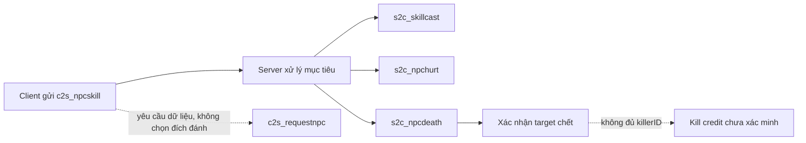

# TÓM TẮT 5 DÒNG

1. DONE khảo sát tĩnh: có offset, kiểu, độ dài và vector tổng hợp cho S2C 69/76/77/91/92 và C2S đánh mục tiêu 77.
2. S2C 69 là danh sách kỹ năng; S2C 91 là phản ứng bị thương, không chứa lượng damage hoặc người đánh.
3. Nối NPC bằng UINT ID trên wire; C2S 77 dùng skillID, X=-1, Y=ID đích, không dùng index NPC nội bộ.
4. S2C 92 xác nhận NPC đích chết; không có killerID nên việc BOT được tính kill vẫn [CHƯA KIỂM].
5. Không sửa source/BOT, không build/test/chạy exe/kết nối mạng; ABI binary và runtime [CHƯA KIỂM]; không commit/push vì không được yêu cầu.

# E-08 — Gói đánh quái và xác nhận kill
Loại: khảo sát
Chủ đề: Các message skill/NPC và giới hạn xác nhận NPC chết so với kill credit.
Từ khóa: đánh quái, NPC, kỹ năng, c2s_npcskill, s2c_npcdeath, s2c_skillcast, kill credit, E-08
Trạng thái: DONE — khảo sát tĩnh theo báo cáo gốc; enum/dispatch client bản A được đối chiếu, server chưa đối chiếu.
Độ phủ: 10/10 phần tử phạm vi được liệt kê; không suy ra gameplay hoặc kill credit từ fixture.
Liên quan: `JX1_OPS/REPORTS/E-05b-kich-ban-full-cycle.md`, `JX1_OPS/REPORTS/E-07-goi-tao-nhan-vat-logout.md`, `JX1_OPS/DESIGN/CHUAN-BAO-CAO.md`
Cần tôi quyết định: không

## Sơ đồ quan hệ gói


## Phạm vi và độ phủ
| Phần tử | Độ phủ theo báo cáo gốc | Đối chiếu client bản A |
|---|---|---|
| S2C danh sách kỹ năng (69) | Đã mô tả cấu trúc/giới hạn | Symbol trong `KProtocolDef.h:57` |
| S2C nhận diện NPC (76) | Đã mô tả record | `s2c_syncnpc` và dispatch `SyncNpc`, `KProtocolDef.h:64`, `KProtocolProcess.cpp:57` |
| S2C đồng bộ NPC (77) | Đã mô tả profile và vector | `s2c_syncnpcmin`/`SyncNpcMin`, `KProtocolDef.h:65`, `KProtocolProcess.cpp:58` |
| S2C hurt (91) | Đã mô tả event, không có damage amount | Enum/handler client, `KProtocolDef.h:79`, `KProtocolProcess.cpp:72` |
| S2C death (92) | Đã mô tả event và giới hạn killer | Enum/handler client, `KProtocolDef.h:80`, `KProtocolProcess.cpp:73` |
| C2S đánh bằng skill (77) | Đã mô tả target và vector | `c2s_npcskill`, `KProtocolDef.h:261` |
| S2C skill cast (96) | Đã mô tả để nối event | Enum/handler client, `KProtocolDef.h:84`, `KProtocolProcess.cpp:77` |
| C2S yêu cầu dữ liệu NPC (73) | Đã phân biệt với chọn mục tiêu | `c2s_requestnpc`, `KProtocolDef.h:257` |
| Nối death với kill credit | Đã nêu rõ chưa đủ bằng chứng | Chưa xác minh; báo cáo gốc không có killerID trong event |
| Vector hex | Đã ghi vector tổng hợp, không gửi | Không phải capture hoặc runtime; giữ nguyên giới hạn báo cáo gốc |

## Giải mã tên
| Tên gốc | Mã hóa | Chữ đúng | Nguồn file:dòng |
|---|---|---|---|
| `Mob` | ASCII | `Mob` (nhãn fixture, không định danh quái trong dữ liệu game) | `JX1_OPS/REPORTS/E-08-goi-danh-quai-xac-nhan-kill.md:327` |

## Sắp theo cấu trúc game
Không áp dụng: không có danh mục skill cụ thể theo phái/nhánh/cấp học, trang bị theo bộ hoặc quái/NPC theo bản đồ. `skillID=7` và `Mob` trong vector là dữ liệu fixture, không phải dữ liệu game đã xác nhận.

## MỤC SỔ THÔNG SỐ
| Nhóm | Tên/hằng số | file:dòng | Giá trị | Đơn vị | Ảnh hưởng | Đổi an toàn (CÓ/CẨN THẬN/KHÔNG) | Nguồn đo |
|---|---|---|---|---|---|---|---|
| Client S2C | `s2c_syncnpc` | `D:\JX-build\qh9A\Classes\gamecore\KProtocolDef.h:52,64` | 76 | ID gói | Đồng bộ dữ liệu NPC | KHÔNG | Đếm enum từ base 64; đọc tĩnh, chưa đo runtime |
| Client S2C | `s2c_syncnpcmin` | `D:\JX-build\qh9A\Classes\gamecore\KProtocolDef.h:52,65` | 77 | ID gói | Đồng bộ NPC | KHÔNG | Đếm enum từ base 64; đọc tĩnh, chưa đo runtime |
| Client S2C | `s2c_npchurt` / `s2c_npcdeath` | `D:\JX-build\qh9A\Classes\gamecore\KProtocolDef.h:79,80` | 91 / 92 | ID gói | Phản ứng hurt / event death | KHÔNG | Đếm enum từ base 64; đọc tĩnh, chưa đo runtime |
| Client S2C | `s2c_skillcast` | `D:\JX-build\qh9A\Classes\gamecore\KProtocolDef.h:84` | 96 | ID gói | Thông báo cast để đối chiếu event | KHÔNG | Đếm enum từ base 64; đọc tĩnh, chưa đo runtime |
| Client C2S | `c2s_requestnpc` / `c2s_npcskill` | `D:\JX-build\qh9A\Classes\gamecore\KProtocolDef.h:248,257,261` | 73 / 77 | ID gói | Yêu cầu dữ liệu NPC / gửi lệnh skill | KHÔNG | Đếm enum từ base 64; đọc tĩnh, chưa đo runtime |

## Đề xuất tối ưu
Không đề xuất thay đổi giao thức trong retrofit; cần kiểm tương thích client/server riêng trước mọi thay đổi.

## Phạm vi, nguồn và quy ước

Ngày 17/11/2026, workspace `D:\JX-wt\E-08`, nhánh `task/E-08-gap`.
Kiểm Git một lần trước ghi: chỉ `JX1_OPS/TASKS/E-08.md` untracked; giữ
nguyên nội dung có sẵn. Chỉ tạo báo cáo này và thêm mục Kết quả cuối task.
Đã đọc E-05b-kich-ban-full-cycle, E-01b-thieu-giao-thuc và các phần liên quan
của A-06-bang-goi-tin (ánh xạ ID, ABI, bảng kích thước và giới hạn).

Ký hiệu dẫn nguồn (số dòng tính từ 1):

- C = `C:\Jx1CocoV3\Folder\Client2912-20260116T044348Z-3-001\Client2912\Client\Classes\gamecore\`.
- S = `C:\Jx1CocoV3\SwordOnline\SwordOnline\jxOnline\gameserver\Headers\`.
- SS = `C:\Jx1CocoV3\SwordOnline\SwordOnline\jxOnline\gameserver\Sources\Core\Src\`.
- H = `C:\Jx1CocoV3\SwordOnline\SwordOnline\jxOnline\header\`.

Mọi offset bên dưới là **thập phân, từ byte ProtocolType = 0**, gồm byte ID
gói, chưa gồm framing TCP/XOR. Profile tính từ source: little-endian,
`#pragma pack(1)` (S/KProtocol.h:18-19; C/KProtocol.h:10-11), BYTE=uint8,
WORD=uint16, UINT=uint32, int=int32, __int64=int64; char là byte thô.
NAME_LENGHT=64, MAX_SKILL_STATE=18 (H/GameDataDef.h:114,134).
Đây là kích thước suy từ khai báo, **không phải sizeof/offsetof đo bằng
compiler/binary thực tế [CHƯA KIỂM]**. Không chọn ABI bằng cách đoán theo length.

| Hướng | ID dec / hex | Symbol | Tổng byte record |
| --- | --- | --- | --- |
| S2C | 69 / 45 | s2c_synccurplayerskill | 3 + 8*n, n=0..80 |
| S2C | 76 / 4C | s2c_syncnpc | 42 + L (byte tên) |
| S2C | 77 / 4D | s2c_syncnpcmin | GS 227; Cocos 223 |
| S2C | 91 / 5B | s2c_npchurt | 17 |
| S2C | 92 / 5C | s2c_npcdeath | 69 |
| C2S | 77 / 4D | c2s_npcskill | 13 |

ID có bằng chứng từ chuỗi enum S/KProtocolDef.h:53-85,250-263 và
C/KProtocolDef.h:52-84,248-261; đối chiếu A-06. Byte 4D có ý nghĩa khác
nhau theo **hướng**. Bảng C/KProtocol.cpp:21,28-29,43-44 quy định biến/cố định;
SS/KProtocol.cpp:184 quy định C2S skill 13 byte.

## S2C 69 — danh sách kỹ năng, không phải một đòn đánh

S/KProtocol.h:1398-1411; C/KProtocol.h:1345-1358.

| Offset | Byte | Kiểu / trường | Đơn vị, ý nghĩa |
| --- | --- | --- | --- |
| 0 | 1 | BYTE ProtocolType | 69 |
| 1 | 2 | WORD m_wProtocolLong | 2 + 8*n, gồm WORD này, không gồm ID |
| 3+8*i | 2 | WORD SkillId | mã kỹ năng, i=0..n-1 |
| 5+8*i | 1 | BYTE SkillLevel | cấp kỹ năng |
| 6+8*i | 1 | BYTE SkillAdd | điểm cộng mAddPoint |
| 7+8*i | 4 | int CurSkillExp | nCurSkillExp, điểm kinh nghiệm kỹ năng |

SS/KPlayer.cpp:1091-1135 khởi length=2, gom skill hợp lệ rồi cộng 8*j và
gửi length+1. C/KProtocolProcess.cpp:3301-3315 tính count=(length-2)/8,
xóa danh sách của NPC người chơi cục bộ rồi nạp lại. Gói không có NPC ID đích,
castID, HP hay damage. Không dùng nó làm ACK đánh hoặc kill.
Ranh giới parser: length>=2, (length-2)%8=0, count<=80; tổng tối đa 643 byte.

## S2C 76 — nhận diện NPC đầy đủ

S/KProtocol.h:301-321; C/KProtocol.h:293-312. Prefix 42 byte; struct đủ
vùng tên là 106 byte. Gửi thực tế length=41+strlen(name), tổng=42+L
(SS/KNpc.cpp:7666-7718); **không truyền NUL cuối tên**.

| Offset | Byte | Kiểu / trường | Đơn vị, ý nghĩa |
| --- | --- | --- | --- |
| 0 | 1 | BYTE ProtocolType | 76 |
| 1 | 2 | WORD m_wLength | 41+L, không gồm ID gói |
| 3 | 1 | BYTE Camp | enum phe gốc |
| 4 | 1 | BYTE CurrentCamp | enum phe hiện tại |
| 5 | 1 | BYTE m_bySeries | enum ngũ hành |
| 6 | 4 | int m_btMenuState | bit/trạng thái menu của player; NPC thường=0 |
| 10 | 1 | BYTE m_Doing | NPCCMD |
| 11 | 1 | BYTE m_btKind | loại NPC; kind_normal=0, kind_player=1 |
| 12 | 4 | int MapX | tọa độ MPS X |
| 16 | 4 | int MapY | tọa độ MPS Y |
| 20 | 4 | UINT ID | m_dwID định danh NPC trên wire |
| 24 | 4 | int NpcSettingIdx | MAKELONG(level, settingIdx): low16 level, high16 template |
| 28 | 2 | WORD NpcEnchant | mã gold type; player=0 |
| 30 | 4 | int Dangge | m_CurrentdanggeRate, thang trị cụ thể [CHƯA KIỂM] |
| 34 | 4 | int Zhongji | m_CurrentzhongjiRate, thang trị cụ thể [CHƯA KIỂM] |
| 38 | 4 | int nLifeDamagePerCent | tỷ lệ **HP còn lại**, thang 1000 |
| 42 | L | char m_szName | L byte tên, không phải số ký tự Unicode |

MPS là tọa độ pixel logic thế giới, không phải pixel màn hình hay số ô.
SS/KNpc.cpp:6996-7012 gọi NewMap2Mps; SS/KSubWorld.cpp:356-378 tính
regionOrigin + (cell<<5) + (offset>>10), tức ô 32 đơn vị MPS và offset
nội bộ là fixed point 1/1024 đơn vị MPS. Gói 76/77/91 không mang mapID;
cần ngữ cảnh map/phiên đã biết.

SS/KNpc.cpp:7685,7703-7709 gán ID, tỷ lệ, template và tên;
C/KProtocolProcess.cpp:2168-2175 tra SearchID rồi thêm NPC nếu cần,
2192-2193 tách level/template. C:2251-2252 copy đúng số byte từ length.
Parser phải giới hạn 0<=L<=64 theo vùng field và tự kết thúc chuỗi trong
bộ nhớ riêng; đường sprintf của sender không chứng minh tên đầu vào an toàn
ở biên 64. Encoding tên thật [CHƯA KIỂM], vector dùng ASCII.

## S2C 77 — cập nhật NPC, layout GS và Cocos

S/KProtocol.h:323-369; C/KProtocol.h:314-360. Bảng dưới là **GS 227 byte**.
Mỗi dòng liệt kê từng field theo đúng thứ tự; các offset ghép tương ứng thứ tự
tên field, mỗi field có độ dài ở cột Byte/field.

| Offset | Byte/field | Kiểu / trường | Đơn vị, ý nghĩa theo sender |
| --- | --- | --- | --- |
| 0 | 1 | BYTE ProtocolType | 77 |
| 1 | 4 | UINT ID | m_dwID, khóa nối NPC |
| 5,9 | 4 | int MapX,MapY | MPS X,Y |
| 13,17 | 4 | int m_wOffX,m_wOffY | fixed point 1/1024 MPS, **không phải WORD** |
| 21 | 1 | BYTE Camp | m_CurrentCamp |
| 22 | 1 | BYTE nKind | loại NPC; chưa thấy gán ở sender khảo sát |
| 23 | 1 | BYTE Doing | m_Doing / NPCCMD |
| 24 | 1 | BYTE nState | bitmask freeze,poison,confuse,stun,hide,ignore-negative |
| 25,29 | 4 | int ASpeed,CSpeed | attack/cast speed; thang trị [CHƯA KIỂM] |
| 33,37 | 4 | int Dangge,Zhongji | chỉ số rate, thang trị [CHƯA KIỂM] |
| 41 | 1 | BYTE RankFFID | m_btRankFFId, mã rank |
| 42,46,50 | 4 | int AIsLukey,AIsJinYan,AIsJinQian | biến hệ số sự kiện; thang trị [CHƯA KIỂM] |
| 54 | 4 | int IsXingYunXing | cờ/trị lucky, enum [CHƯA KIỂM] |
| 58 | 64 | char nName | tên trong vùng cố định; tail sau NUL không có nghĩa |
| 122 | 4 | int mFactionNo | số faction |
| 126 | 4 | int nLifeDamagePerCent | HP còn lại theo phần nghìn |
| 130 | 4 | int mliveTime | m_GameliveTime; đơn vị cụ thể [CHƯA KIỂM] |
| 134 | 4 | UINT nGuiShuDwid | m_GuiShuDwid (owner), không phải killerID |
| 138 | 4 | int nZhuaVal | m_ZhuaVal; thang trị [CHƯA KIỂM] |
| 142 | 4 | UINT nTongBanNum | m_TongBanNum; semantic/đơn vị [CHƯA KIỂM] |
| 146,150 | 4 | int nAttackFrame,nCastFrame | số frame động tác |
| 154,158,162 | 4 | int nNpcMaxLife,nNpcDefen,nNpcMaxDefen | chưa thấy gán ở sender; không dùng suy HP/giáp |
| 166 | 1 | BYTE nIsSerLock | chưa thấy gán ở sender |
| 167 | 4 | int nExpPer | m_Experience cho NPC; không tự coi là % |
| 171 | 4 | int gsLukey | m_GoldLucky; thang trị [CHƯA KIỂM] |
| 175 | 4 | int nMaskType | mã mask |
| 179 | 1 | BYTE nIsSynDir | chỉ gán nếu !IsPlayer và m_IsSynDir>=1 |
| 180 | 4 | int nDir | hướng nội bộ; số hướng [CHƯA KIỂM], cùng điều kiện trên |
| 184 | 1 | BYTE nIsMove | đoạn gán bị comment, không dùng |
| 185 | 4 | int nReForm | m_ReviveFrame nếu m_IsRe, ngược lại 0; frame |
| 189 | 8 | __int64 nCurrentLifeMax | HP tối đa, đơn vị điểm HP |
| 197 | 4 | int nLifeYu | khi HP>0 gán **1**, không phải lượng HP thiếu |
| 201,205 | 4 | int nNpcTitle,nCurNpcTitle | mã title |
| 209 | 18 | BYTE StateInfo[18] | trạng thái kỹ năng thô, không phải HP |

**Cocos 223 byte:** mọi offset đến 188 như GS; nCurrentLifeMax tại 189 chỉ
4 byte (int), nLifeYu=193, nNpcTitle=197, nCurNpcTitle=201, StateInfo=205.
Không trộn offset sau 189 của hai profile. E-01b chọn GS; chưa chứng minh
binary GS đang chạy khớp source hoặc Cocos nhận đúng profile này [CHƯA KIỂM].

SS/KNpc.cpp:7896-8052 tạo biến stack không zero-init, gán các field và gửi
sizeof(NPC_NORMAL_SYNC). Các field đánh dấu chưa gán phía trên không có giá trị
xác định trên đường này; nLifeYu cũng không được gán trong nhánh HP<=0
(7911-7930). nExpPer chỉ thấy gán nhánh NPC. Không suy rằng byte chưa gán=0.

Tỷ lệ HP: SS/KNpc.cpp:7921 gọi `_CalcPercent(current,max,1000)`; helper
475-487 nhận **INT**, nhánh thường chia nguyên, nhánh lớn dùng FLOAT.
C/KProtocolProcess.cpp:2521-2547 với NPC khác bản thân tính
`HP_est = max * ratio / 1000`, hiển thị giảm HP qua `old-HP_est` nếu dương.
Đây là ước lượng từ snapshot, không có attackerID/damageID và không phải
damage từng hit. `ratio=0` có thể do lượng tử hóa khi NPC còn ít HP.
Giới hạn/chuyển hẹp INT của helper khi max HP lớn [CHƯA KIỂM]; không nhận
int64 trên wire là bằng chứng toàn pipeline HP hỗ trợ chính xác int64.
C:2414-2415 bỏ qua normal sync khi Doing=do_revive hoặc do_death; phải giữ
gói death riêng làm bằng chứng. NPCCMD do_hurt=9, do_death=10, do_revive=21
(H/GameDataDef.h:2112-2135).

## S2C 91 và 92 — bị thương và chết

| Gói | Offset | Byte | Kiểu / trường | Đơn vị, ý nghĩa |
| --- | --- | --- | --- | --- |
| 91 | 0 | 1 | BYTE ProtocolType | 5B |
| 91 | 1 | 4 | UINT ID | NPC **bị thương** |
| 91 | 5 | 4 | int nFrames | số frame phản ứng, không phải damage/ms |
| 91 | 9,13 | 4 mỗi field | int nX,nY | vị trí MPS hiện tại của nạn nhân |
| 92 | 0 | 1 | BYTE ProtocolType | 5C |
| 92 | 1 | 4 | UINT ID | NPC **đã chết** |
| 92 | 5 | 64 | char nDeathName[64] | tên NPC chết, không phải tên người giết |

S/KProtocol.h:409-415,465-472; C/KProtocol.h:395-401,451-458.
Không có length WORD cho hai gói cố định này. Death luôn đủ 69 byte dù tên
ngắn. SS/KNpc.cpp:2509-2534 gán ID=m_dwID, tên=Name rồi broadcast vùng lân cận;
tail sau NUL không được zero-init, không dùng làm dữ liệu so sánh.
DoDeath:2429-2443 còn có đường chết không có attacker hợp lệ và vẫn tới NEXT
để gửi death. Vì vậy tên và sự kiện death không xác định người kết liễu.

Hurt sender SS/KNpc.cpp:3006-3054 lấy nFrames=m_Frames.nTotalFrame,
GetMpsPos(nX,nY). Công thức frame chứa hệ số 18, có clamp 0 thành 1;
**tick rate/thời lượng runtime [CHƯA KIỂM]**, không quy đổi chắc chắn sang giây.
DoHurt:2965-3001 có điều kiện bỏ qua và xác suất; damage có thể xảy ra mà
không có gói 91. C/KProtocolProcess.cpp:610-619 SearchID rồi do_hurt;
569-581 SearchID death rồi do_death, đặt HP=0. Không bắt buộc 91 phải đứng
trước 92, cũng không coi mất NPC/ra khỏi vùng nhìn là chết.

## C2S đánh và chọn mục tiêu; S2C cast hỗ trợ đối chiếu

S/KProtocol.h:508-514; C/KProtocol.h:494-500. C/KProtocol.cpp:237-250
`SendClientCmdSkill` điền đủ bốn field và gửi sizeof=13:

| Offset | Byte | Kiểu / trường | Đơn vị, ý nghĩa |
| --- | --- | --- | --- |
| 0 | 1 | BYTE ProtocolType | c2s_npcskill=77 (4D) |
| 1 | 4 | int nSkillID | skill muốn dùng; không có level trong request |
| 5 | 4 | int nMpsX | -1 nếu chọn NPC; nếu >=0 là MPS X |
| 9 | 4 | int nMpsY | bit ID đích khi X=-1; nếu X>=0 là MPS Y |

C/KNpcAI.cpp:827-828 và C/KPlayer.cpp:510-512 dùng index cho lệnh nội bộ,
nhưng **gửi m_dwID trên mạng**. Không thấy cần gói chọn mục tiêu riêng trong
đường đánh này; target được nhúng trong request. SS/KProtocolProcess.cpp:215,
5581-5606 nhận command, kiểm 0<skill<MAX_SKILL và Y>=0; khi X<0 chỉ nhận -1,
FindAroundNpc((DWORD)Y) rồi đổi sang index server. ID có bit cao khiến int Y âm
sẽ bị handler từ chối theo source này; không tự gửi thử để đoán miền ID.
Gửi command chỉ chứng minh yêu cầu, không chứng minh cast thành công/hit/kill.

S2C `s2c_skillcast=96 (60)` là thông báo cast liên quan, khác gói 69.
S/KProtocol.h:494-506 có 37 byte: BYTE ProtocolType@0, UINT casterID@1,
int skillID@5, level@9, X@13, Y@17, skillEnChance@21, isEnChance@25,
maxBei@29, waitTime@33 (mỗi int 4 byte; thang enhance/multiplier/time cụ thể
[CHƯA KIỂM]). SS/KNpc.cpp:3691-3717 đặt caster=m_dwID, khi X=-1 đổi
index đích thành Npc[nY].m_dwID; C/KProtocolProcess.cpp:835-864 đảo lại bằng
SearchID. Có thể nối caster/target từ đây nhưng vẫn không có hit/kill ACK.

C2S `c2s_requestnpc=73 (49)` là yêu cầu dữ liệu NPC, **không chọn mục tiêu
đánh**. Nó dùng alias NPC_REQUEST_COMMAND cùng layout death 69 byte
(S/KProtocol.h:409-415, SS/KProtocol.cpp:180). C/KProtocol.cpp:253-260 chỉ
gán ProtocolType và ID, vùng tên không khởi tạo; nếu viết BOT sau này cần
khởi tạo vùng dự phòng thay vì sao chép tail bất định. Chưa sửa BOT ở E-08.

## Nối sự kiện để xác nhận mục tiêu chết

Đề xuất cho bước verify_kill của E-05b (thiết kế từ source, chưa triển khai):

1. Lưu NPC theo `(phiên, map/ngữ cảnh thế giới, UINT ID, vòng đời quan sát)`
   từ 76/77. Giữ template/kind và trạng thái sống đã quan sát; không dùng tên
   làm khóa. Dùng lại ID qua lần spawn/đổi map [CHƯA KIỂM], cần reset theo ngữ cảnh.
2. Lưu targetID trước khi gửi C2S 77; skill lấy từ danh sách 69 đã giải mã,
   có cấp hợp lệ. Không đoán skill cố định từ vector dưới đây.
3. Nếu có S2C 96, đối chiếu casterID của BOT và targetID khi X=-1. Gói 91
   cùng targetID chỉ là phản ứng; snapshot 77 giảm HP là tín hiệu bổ sung.
4. Chỉ xác nhận **target_dead** khi nhận S2C 92 đủ 69 byte, đúng targetID,
   thuộc vòng đời đang chờ và sau mốc bắt đầu quan sát. Ghi duy nhất một lần;
   death khác ID, gói trùng hoặc stale không được tăng số kill.
5. **bot_kill_credit=[CHƯA KIỂM]**: không gói nào trong 69/76/77/91/92 có
   killerID hay sequence nối hit với cast. nGuiShuDwid là ownership snapshot,
   không đủ chứng minh last hit. Muốn xác minh credit cần thêm bằng chứng
   riêng (counter/quest/đường thưởng đã truy rõ), hoặc kịch bản cô lập được
   duyệt; hiện chưa có bằng chứng đó, không báo PASS rằng BOT kết liễu.

Đường damage có thật trong source: SS/KSkills.cpp:3348-3398 kiểm target index
và quan hệ rồi gọi ReceiveDamage(nLauncher,...,m_bDoHurt); SS/KNpc.cpp:4466
nhận launcher, và CalcDamage:5067,5713-5762 trừ HP, chỉ gọi DoHurt khi điều
kiện cho phép, gọi DoDeath(nMode,nAttacker) khi HP<=0. Poison/fire cũng có
đường DoDeath khác (KNpc.cpp:2039-2045,2090-2097). Launcher/attacker tồn tại
trong tính toán server nhưng **không được serialize vào 91/92**.

## Vector hex tổng hợp dựng theo layout

Đây là **plaintext record**, không phải capture, không phải frame TCP đã
mã hóa, không có credential/khóa. Giá trị minh họa không xác nhận skill/NPC
thật tồn tại. Khoảng trắng/ngắt dòng không thuộc payload.

69, một skill ID=7, level=2, add=1, exp=1234, WORD length=10; tổng 11 byte:

```text
45 0A 00 07 00 02 01 D2 04 00 00
```

69 rỗng (3 byte): `45 02 00`.

76, ID=0x12345678, MPS=(1000,2000), stand=1, kind_normal=0,
level=10/template=20, ratio=1000, tên ASCII Mob (L=3); WORD=44,
tổng 45 byte:

```text
4C 2C 00 00 00 00 00 00 00 00 01 00
E8 03 00 00 D0 07 00 00 78 56 34 12 0A 00 14 00
00 00 00 00 00 00 00 00 00 00 E8 03 00 00 4D 6F 62
```

77 GS, cùng ID/vị trí, Doing=stand, ratio=750, maxHP=400, nLifeYu=1.
Mọi field còn lại **đặt zero riêng cho fixture** (kể cả tên), không dự đoán
giá trị stack sender thật. Hexdump đủ 227 byte; cột trái là offset hex,
không thuộc payload. HP ước lượng theo công thức client=300:

```text
0000: 4D 78 56 34 12 E8 03 00 00 D0 07 00 00 00 00 00
0010: 00 00 00 00 00 00 00 01 00 00 00 00 00 00 00 00
0020: 00 00 00 00 00 00 00 00 00 00 00 00 00 00 00 00
0030: 00 00 00 00 00 00 00 00 00 00 00 00 00 00 00 00
0040: 00 00 00 00 00 00 00 00 00 00 00 00 00 00 00 00
0050: 00 00 00 00 00 00 00 00 00 00 00 00 00 00 00 00
0060: 00 00 00 00 00 00 00 00 00 00 00 00 00 00 00 00
0070: 00 00 00 00 00 00 00 00 00 00 00 00 00 00 EE 02
0080: 00 00 00 00 00 00 00 00 00 00 00 00 00 00 00 00
0090: 00 00 00 00 00 00 00 00 00 00 00 00 00 00 00 00
00A0: 00 00 00 00 00 00 00 00 00 00 00 00 00 00 00 00
00B0: 00 00 00 00 00 00 00 00 00 00 00 00 00 90 01 00
00C0: 00 00 00 00 00 01 00 00 00 00 00 00 00 00 00 00
00D0: 00 00 00 00 00 00 00 00 00 00 00 00 00 00 00 00
00E0: 00 00 00
```

91, cùng targetID, phản ứng 6 frame, MPS=(1000,2000); 17 byte:

```text
5B 78 56 34 12 06 00 00 00 E8 03 00 00 D0 07 00 00
```

92, cùng targetID, tên Mob, zero tail do fixture chọn; đủ 69 byte
(5 byte header + 64 byte tên):

```text
5C 78 56 34 12 4D 6F 62 00 00 00 00 00 00 00 00
00 00 00 00 00 00 00 00 00 00 00 00 00 00 00 00
00 00 00 00 00 00 00 00 00 00 00 00 00 00 00 00
00 00 00 00 00 00 00 00 00 00 00 00 00 00 00 00
00 00 00 00 00
```

C2S 77, skill=7 đánh targetID=0x12345678, X=-1; 13 byte:

```text
4D 07 00 00 00 FF FF FF FF 78 56 34 12
```

C2S 77, skill=7 đánh tọa độ MPS=(1000,2000); 13 byte:

```text
4D 07 00 00 00 E8 03 00 00 D0 07 00 00
```

Không gửi các vector. Các vector 69/76/77/91/92 dùng cùng layout nguồn,
nhưng không khẳng định thứ tự trên là chuỗi server luôn phát ra.

## Kiểm chứng, lỗi công cụ và bàn giao

DONE phần khảo sát tĩnh được duyệt. Đã đối chiếu struct, đường điền/gửi,
handler nhận và hướng enum; đã đếm byte vector/offset bằng thao tác dữ liệu
trong bộ nhớ, không tạo parser/script phụ. Rà diff và whitespace cho đúng
hai file đầu ra. Không sửa BOT, TESTER, source canonical hoặc BAI_HOC.

Kết quả đếm các khối hex đã ghi: 11, 45, 227, 17, 69, 13, 13 byte;
đầu file đủ 5 dòng tóm tắt. `git diff --no-index --check` cho hai file không
báo whitespace. Lệnh xem diff file untracked với NUL trả exit 1 vì có khác
biệt, không phải lỗi kiểm thử. Phần task trước mục Kết quả giữ nguyên.

Lỗi trong lượt và cách xử lý:

- `rg : The term 'rg' is not recognized ...`: một lần, dùng Get-Content và
  Select-String/Get-ChildItem có phạm vi, không cài công cụ.
- Lượt đọc đầu thiếu -Encoding UTF8 làm tiếng Việt sai dấu: đọc lại task
  bằng UTF8, không đổi file gốc.
- Đầu ra gộp báo cáo/source quá dài bị truncate và PowerShell format-table
  rút ngắn dòng: chuyển sang trích đoạn có số dòng và chuỗi text. Chỉ đọc
  lại phần liên quan bị cắt, không lặp khảo sát toàn repo.
- `Cannot find path '...gameserver\Headers\KNpc.h' because it does not exist.`:
  một lần; xác định đúng `SS/KNpc.h`, đọc khai báo cần thiết ở dòng 1187.
  Không còn blocker đọc source.

Build/test, exe game/server, kết nối mạng/VM, capture và ABI runtime đều
**không chạy theo yêu cầu**; không nhận là kiểm thử đạt. Các thang trị/encoding
đánh dấu [CHƯA KIỂM] và credit kill còn cần xác minh riêng trong phạm vi được
duyệt sau. Bước tiếp cho BOT là triển khai decoder theo profile đã xác minh,
phân biệt target_dead với bot_kill_credit và kiểm vector offline trong task
khác; E-08 không tự sửa code hay thử runtime.

Không có commit SHA/link GitHub mới: người dùng chỉ cho ghi báo cáo và mục
Kết quả, không yêu cầu stage/commit/push; kết quả giữ local. Không truy cập
GitHub, không thay credential/config/quyền để công bố.

## Đã xác minh / Chưa xác minh
Đã xác minh trên client bản A: enum `s2c_syncnpc`/`s2c_syncnpcmin` và dispatch `SyncNpc`/`SyncNpcMin` (`D:\JX-build\qh9A\Classes\gamecore\KProtocolDef.h:64,65`, `KProtocolProcess.cpp:57,58`); dispatch hurt/death/skill-cast (`D:\JX-build\qh9A\Classes\gamecore\KProtocolProcess.cpp:72,73,77`); request enum `c2s_requestnpc`/`c2s_npcskill` (`D:\JX-build\qh9A\Classes\gamecore\KProtocolDef.h:257,261`).
Chưa xác minh: layout và handler server trên root task, ABI/binary, runtime và kill credit. Các test/vectors trong báo cáo gốc không được chạy lại trong retrofit.

## Bàn giao
Giữ nguyên mọi kết luận/vector gốc; không sửa BOT hoặc game source. Commit retrofit bị chặn bởi quyền ghi Git metadata; chi tiết ở báo cáo R-04b, không push.
Kỹ năng đã dùng: jx1-retrofit, jx1-report, jx1-knowledge, jx1-read-client, jx1-read-server, jx1-parameters.

## Phát hiện khi chuẩn hóa
Server root được giao không có `Sources`, `Headers` hoặc `Core`; vì vậy chỉ có thể đối chiếu enum/dispatch phía client, không thể tái kiểm chứng layout/semantics server. `Mob` và `skillID=7` là nhãn/giá trị fixture, không phải dữ liệu game đã xác nhận.
