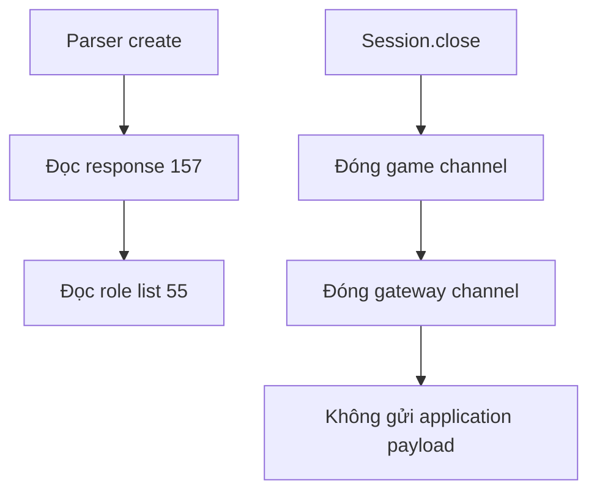

# TÓM TẮT 5 DÒNG
1. DONE trong phạm vi offline: tiếp tục phần E-10 có sẵn, kiểm chứng dựng C2S 69, đọc S2C 157/55 và logout bằng socket giả.
2. Vector BotAbc khớp E-07: request 25 byte, response 66 byte, list một role 82 byte; không ghi mật khẩu/khóa mới.
3. Logout chặn I/O, đóng game trước Bishop, dọn dữ liệu phiên và thử đóng cả hai kể cả khi một close báo OSError; gửi 0 application byte.
4. 76/76 test đạt, gồm 11 test E-10, chạy Python -I với socket thật bị chặn; không mạng/VM/DB/exe game/server.
5. ABI/binary, codec, giá trị tạo role runtime và DB persistence [CHƯA KIỂM]; không commit/push vì không được yêu cầu và cấm mạng.

# E-10 — BOT tạo role và logout offline
Loại: kiểm thử
Chủ đề: Parser payload tạo role/role list và cleanup logout offline trong BOT.
Từ khóa: tạo nhân vật, new_player, role_list, logout, socket giả, offline, BOT, E-10
Trạng thái: DONE — 76/76 test được ghi trong báo cáo gốc; không chạy lại trong retrofit.
Độ phủ: 7/7 thành phần implementation/documentation/test được liệt kê; runtime/server vẫn chưa xác minh.
Liên quan: `JX1_OPS/REPORTS/E-07-goi-tao-nhan-vat-logout.md`, `JX1_OPS/REPORTS/E-05b-kich-ban-full-cycle.md`, `JX1_OPS/REPORTS/E-09a-real-login-allowlist.md`, `JX1_OPS/DESIGN/CHUAN-BAO-CAO.md`
Cần tôi quyết định: không

## Sơ đồ quan hệ


## Phạm vi và độ phủ
| Phần tử | Độ phủ theo báo cáo gốc | Đối chiếu trong nguồn task |
|---|---|---|
| Tạo role: request `c2s_newplayer` | Đã kiểm parser/vector 25 byte trong test offline | Client A gán protocol tại `KuiNewPlayer.cpp:641` |
| Response create/delete role | Đã kiểm parser 66 byte và bool | Client A struct tại `KProtocol.h:1511` |
| Role list | Đã kiểm parser count, record và length | Client A đọc list tại `Klogin.cpp:1033` |
| Cleanup `Channel.close` | Đã kiểm trạng thái đóng và chặn I/O sau đóng | Thành phần BOT theo báo cáo gốc; không có source server tương ứng |
| `Session.close`/`logout` | Đã kiểm thứ tự đóng game/gateway và không gửi payload | Offline behavior theo test history; không phải logout game server thật |
| README/hướng dẫn API | Đã ghi cách dùng offline và giới hạn chưa kiểm | Báo cáo gốc dẫn `README.md:47` |
| Regression test | Báo cáo gốc ghi 76/76 tổng suite, gồm 11 test E-10 | Không chạy lại trong retrofit |

## Giải mã tên
| Tên gốc | Mã hóa | Chữ đúng | Nguồn file:dòng |
|---|---|---|---|
| `BotAbc` | ASCII | `BotAbc` (tên role fixture, không phải nhân vật game đã xác nhận) | `JX1_OPS/REPORTS/E-10-bot-tao-role-logout-offline.md:105` |

## Sắp theo cấu trúc game
Không áp dụng: các tên role và packet là fixture/API; báo cáo không nêu danh mục kỹ năng, trang bị, quái/NPC hoặc bản đồ để xếp theo cấu trúc game.

## Phạm vi và checkpoint

Ngày 17/11/2026; workspace `D:\JX-wt\E-10`, branch `task/E-10`.
Đọc task E-10, báo cáo E-07 được chỉ định và mã/test BOT cần thiết.
Git status đầu lượt đã có thay đổi local tại `BOT/README.md`, `BOT/packets.py`,
`BOT/session.py`, cùng `BOT/test_roles_logout.py` và task E-10 untracked.
Chưa có báo cáo E-10. Giữ nguyên phần cài đặt local này, tiếp tục kiểm chứng;
không reset, không khởi động lại công việc và không sửa source canonical.
Lượt này chỉ thêm báo cáo này và mục Kết quả vào task theo chỉ dẫn riêng
của task; không sửa file khác ngoài phạm vi.

## Kết quả cài đặt được kiểm chứng

| Thành phần | Bằng chứng trong BOT | Hành vi |
| --- | --- | --- |
| C2S 69 | `packets.py:144`, `new_player` | Header `<BIIBI>` 14 byte, body gender/series BYTE, map LE16, tên byte + NUL; tổng 19+L, nDataLen=5+L. |
| S2C 157 | `packets.py:165`, `new_player_response` | Đúng 66 byte, bool tại offset 65; từ chối ID/length/bool sai, bỏ vùng tên không đáng tin. |
| S2C 55 | `packets.py:124`, `role_list` | Kiểm nDataLen=1+67*N, count và tổng length; record `<64sBBB>`, Level một byte, tên phải có NUL và khác rỗng. |
| Cleanup channel | `session.py:99`, `Channel.close` | Đặt closed trước đóng socket, bỏ pending/frame dở và tham chiếu trạng thái XOR; chặn send/receive/handshake sau close. |
| Logout | `session.py:231`, `Session.close`; `session.py:250`, `logout` | Đặt CLOSED, bỏ tham chiếu/timer/dữ liệu phiên, đóng game rồi gateway còn sót; giữ lỗi OSError đầu tiên sau khi thử đóng cả hai. Đóng lặp là no-op. |
| Hướng dẫn | `README.md:47` | Nêu API offline, trách nhiệm codec/filter của bên gọi và giới hạn chưa kiểm. |

`new_player` nhận tên `bytes` 6..16 byte, không NUL; kiểm độ rộng wire,
region uint32 >0. Không tự nhận codec hay kiểm bộ lọc tên TCVN3.
Identity=0, bLeave=0 là lựa chọn chuẩn hóa BOT; E-07 ghi client không gán
bLeave, nên không coi byte 0 là capture thực.

Thứ tự đóng hai kênh là chính sách cleanup BOT, không suy thành thứ tự FIN/RST
thực tế. Logout tương ứng vector E-07 ε: không gửi byte 00, frame rỗng,
request save nội bộ hay chờ ACK 56/sentinel 791030. Không có thread nền
trong Session hiện tại. Không khẳng định dữ liệu DB đã được lưu.

Phạm vi là API dựng/đọc payload offline và cleanup. Chưa tích hợp tạo role
vào `Session.login` hoặc CLI. Không tự select-role/refresh list/re-login sau
create; E-07 mô tả create thành công đi thẳng permit/game. Response 157 dùng
chung new/delete, bên gọi phải đang chờ create trên Bishop.

## Kiểm thử và bằng chứng

Chạy toàn bộ suite BOT bằng stdin PowerShell, tránh vấn đề escape của `-c`:

```powershell
@'
import socket
import unittest
from unittest.mock import patch
suite = unittest.defaultTestLoader.discover('JX1_OPS/BOT')
with patch.object(socket, 'socket', side_effect=AssertionError('Offline: network forbidden')), patch.object(socket, 'create_connection', side_effect=AssertionError('Offline: network forbidden')):
    result = unittest.TextTestRunner(verbosity=2).run(suite)
raise SystemExit(not result.wasSuccessful())
'@ | python -I -B -
```

Kết quả thực: exit code 0, `Ran 76 tests in 0.196s`, `OK`.
`-I` cô lập Python; `-B` không ghi bytecode. Socket thật bị chặn trong lúc
chạy suite; các luồng phiên dùng connector/socket bộ nhớ, không loopback.

11 test E-10 tại `test_roles_logout.py:22` và `:94` kiểm:

- Request BotAbc đúng nguyên vector 25 byte E-07, prefix WORD 1B 00; biên tên, số và NUL bị chặn khi sai.
- Response OK/FAIL 66 byte, prefix 44 00; vùng tên có byte rác bị bỏ qua; mọi vị trí cắt, length dư, ID/bool sai bị từ chối.
- List rỗng và một role đúng vector E-07, prefix 54 00; nhiều role/Level=255; chặn count/nDataLen sai, thiếu record, thiếu NUL, tên rỗng và Level DWORD.
- Logout mọi State, phiên dở/không kênh, game trước gateway, không phát payload; lỗi close game vẫn đóng gateway và dọn phiên; gọi lặp an toàn.
- Channel bỏ pending/frame dở, xóa tham chiếu XOR và chặn I/O sau đóng.

Các test còn lại kiểm hồi quy framing, crypto, login/sync, hành vi và
population hiện có. Không sửa hay chép thêm literal mật khẩu/khóa từ fixture
cũ vào báo cáo. Không chạy build, CLI connect, exe, VM, DB hay kiểm runtime.

## Lỗi trong lượt và xử lý

- Đọc task lần đầu bằng encoding mặc định hiển thị sai dấu; đọc lại UTF-8 thành công.
- `rg` không có trong PATH: `The term 'rg' is not recognized ...`; chuyển sang Get-ChildItem giới hạn BOT/E-10 và Select-String theo file cụ thể, không sửa môi trường.
- Lượt đọc gộp BOT bị công cụ cắt đầu ra; đọc riêng phần session/test/framing cần thiết, không dựa vào phần bị cắt để kết luận.
- Lệnh Python `-c` đầu tiên bị PowerShell/native argument bỏ dấu quote, gây `SyntaxError: '(' was never closed`, exit 1; chưa chạy test. Đổi sang here-string/stdin với `python -I -B -` như trên, test đạt. Không tạo script phụ.

Không lặp lỗi quá ba lần; không có lỗi test còn tồn tại hoặc blocker offline.

## Phần chưa xác minh và bàn giao

Giữ nguyên các giới hạn E-07 **[CHƯA KIỂM]**: revision/binary và sizeof ABI;
encoding tên có dấu/round-trip DB; map/gender/series được runtime chấp nhận;
ảnh hưởng lỗi copy tên phía Bishop; role list thật sau create/re-login;
độ bền DB và nhánh SQL; full TRoleData/CPackager/framing nội bộ;
application logout ACK ngoài đường client E-07 đã đọc. Không thêm parser/gói
nội bộ 10/56/57/53/59 làm request hoặc save ACK của BOT.

Trạng thái **DONE** cho phạm vi E-10 offline. Runtime/DB cần task được duyệt
riêng, không phải bằng chứng của 76 test này. Chưa stage/commit/push;
commit SHA và link GitHub mới: không có. Lý do: người dùng không yêu cầu
commit/push và cấm mạng; **CHƯA PUSH**, không có lần push bị từ chối.

## Đã xác minh / Chưa xác minh
Đã xác minh trên client bản A: create role dùng `c2s_newplayer` tại `KuiNewPlayer.cpp:641`; response có `bSucceeded` tại `KProtocol.h:1511`; role-list parser tại `Klogin.cpp:1033`. Báo cáo gốc ghi test suite `Ran 76 tests` và 11 test E-10 (`JX1_OPS/REPORTS/E-10-bot-tao-role-logout-offline.md:99`, `:103`); không chạy lại.
Chưa xác minh: server thực, ABI/binary, codec thực, runtime tạo role và DB persistence.

## Bàn giao
Giữ nguyên kết luận DONE trong phạm vi offline của báo cáo gốc; không chạy code/test/exe/VM/mạng trong retrofit. Commit bị chặn bởi quyền ghi Git metadata; không push.
Kỹ năng đã dùng: jx1-retrofit, jx1-report, jx1-knowledge, jx1-read-client, jx1-read-server.

## Phát hiện khi chuẩn hóa
`BotAbc` là tên role fixture ASCII, không phải nhân vật game được xác nhận. Không có danh sách game entity để sắp theo cấu trúc game.
