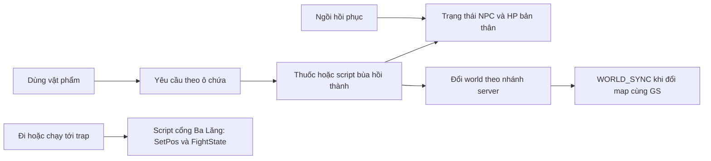

# TÓM TẮT 5 DÒNG

1. DONE khảo sát tĩnh: dùng vật phẩm C2S 97/61 (8 byte), ngồi C2S 130/82 (2 byte), đi/chạy 75/4B và 76/4C (9 byte).
2. Server dùng vị trí ô chứa để chọn vật phẩm; trường m_nItemID trong request không được KPlayer::EatItem sử dụng.
3. S2C 70/46 (31 byte) đồng bộ HP bản thân; S2C 144/90 xác nhận ngồi có 69 byte, không phải 5 byte.
4. Cổng Ba Lăng đã đọc chỉ SetPos/FightState cùng map; NewWorld gọi ChangeWorld, đổi map cùng GS gửi S2C 73/49 (304 byte theo profile nêu dưới).
5. Không sửa source, không mạng/VM/exe/build; vector là dữ liệu tổng hợp, ABI binary/runtime [CHƯA KIỂM]; chưa commit/push vì chưa được yêu cầu.

# E-11 — Hồi máu, dùng vật phẩm và đổi bản đồ

Loại: khảo sát
Chủ đề: Khảo sát tĩnh gói dùng vật phẩm, ngồi hồi phục và đồng bộ khi đổi bản đồ.
Từ khóa: hồi máu, vật phẩm, Ba Lăng, c2s_playereatitem, NPC_SIT_SYNC, NPC_RUN_COMMAND, ChangeWorld, WORLD_SYNC
Trạng thái: DONE — chuẩn hóa R-04c; giữ nguyên kết luận khảo sát cũ và các giới hạn runtime.
Độ phủ: đã phủ 12 trên tổng 16 hạng mục đối chiếu nguồn hiện hành; 7 gói và 5 script đã đọc, 4 hạng mục server/dữ liệu chưa phủ; gói chạy có khác biệt phiên bản.
Liên quan: JX1_OPS/REPORTS/E-08-goi-danh-quai-xac-nhan-kill.md; JX1_OPS/REPORTS/E-12-khao-sat-goi-tuong-tac.md; JX1_OPS/REPORTS/R-04c.md; JX1_OPS/DESIGN/CHUAN-BAO-CAO.md
Cần tôi quyết định: có — PM xác định profile gói chạy trước khi dùng lại vector cho bản A; không chặn chuẩn hóa tài liệu.

## Sơ đồ quan hệ chính

[NGUỒN] Sơ đồ định vị các nhánh trong nội dung gốc; không biểu diễn một phép thử game đã chạy.



## Phạm vi và độ phủ

[NGUỒN] Đối chiếu R-04c ngày 18/11/2026, chỉ đọc. Q = `D:/JX-build/qh9A/Classes/gamecore/` (client bản A); G-R = `C:/Jx1CocoV3/Folder/ServerNew-20260116T043145Z-3-001/ServerNew/_bin_v2_/gs/`. Các ký hiệu C/DC/S/SS/H/G trong thân gốc vẫn giữ đúng nghĩa cũ, không thay bằng Q.

Mẫu gồm 7 bản ghi được nêu trong bảng gói gốc, 4 file duy nhất trong thư mục cổng Ba Lăng, 1 script bùa hồi thành và 4 khoảng trống đã nêu trong thân gốc. “Đã phủ” chỉ là đã mở nguồn hiện hành để đối chiếu phần được ghi; không xác nhận sender/handler server C++ hoặc ABI binary.

| Hạng mục | Độ phủ R-04c | Nguồn và giới hạn |
|---|---|---|
| Dùng vật phẩm `PLAYER_EAT_ITEM_COMMAND` | đã phủ | `Q/KProtocol.h:896`; trường ô chứa và item, chưa kiểm lại handler server. |
| Yêu cầu ngồi `NPC_SIT_COMMAND` | đã phủ | `Q/KProtocol.h:2111`; `Q/KProtocol.cpp:652`. |
| Đồng bộ ngồi `NPC_SIT_SYNC` | đã phủ | `Q/KProtocol.h:395`; `Q/KProtocol.cpp:96`. |
| HP bản thân `CURPLAYER_NORMAL_SYNC` | đã phủ | `Q/KProtocol.h:1208`; `Q/KProtocol.cpp:22`. |
| Đi bộ `NPC_WALK_COMMAND` | đã phủ | `Q/KProtocol.h:502`; `Q/KProtocol.cpp:230`. |
| Chạy `NPC_RUN_COMMAND` | đã phủ — có khác biệt | `Q/KProtocol.h:515`; `Q/KProtocol.cpp:219`; xem phát hiện cuối file. |
| Đồng bộ world `WORLD_SYNC` | đã phủ | `Q/KProtocol.h:1367`; `Q/KProtocol.cpp:25`; chưa đo ABI. |
| Cổng `cong10h.lua` | đã phủ | `G-R/script/trap/thon/balang/cong10h.lua:7`. |
| Cổng `cong2h.lua` | đã phủ | `G-R/script/trap/thon/balang/cong2h.lua:7`. |
| Cổng `cong4h.lua` | đã phủ | `G-R/script/trap/thon/balang/cong4h.lua:7`. |
| Cổng `cong8h.lua` | đã phủ | `G-R/script/trap/thon/balang/cong8h.lua:7`. |
| Bùa hồi thành `TownPortal` | đã phủ | `G-R/script/system/usetownportal.lua:8`, `G-R/script/system/usetownportal.lua:21`, `G-R/script/system/usetownportal.lua:60`; chỉ kiểm script. |
| Công thức hồi máu/ngồi trong server C++ | chưa phủ nguồn hiện hành | Nguồn gián tiếp giữ ở `SS/KNpc.cpp:1637`; cây SS cũ ngoài root server dữ liệu được giao lần này. |
| `NewWorld` / `ChangeWorld` trong server C++ | chưa phủ nguồn hiện hành | Nguồn gián tiếp `SS/ScriptFuns.cpp:6728`, `SS/KNpc.cpp:15223`; không dùng script để suy thay handler. |
| Bảng thuốc, độ lớn hiệu ứng và cooldown | chưa phủ | Bản gốc chưa chỉ định tên bảng thuốc đã đọc; không mở rộng thành toàn bộ thuốc trong game. |
| Ánh xạ ô trap trong dữ liệu đóng gói | chưa phủ | Bản gốc chưa giải PAK hoặc chỉ định file ánh xạ; 4 script không chứng minh trap đã nạp. |

## Phạm vi và nguồn

Ngày 17/11/2026, workspace `D:\JX-wt\E-11`, branch `task/E-11`.
Git status trước ghi: chỉ task `JX1_OPS/TASKS/E-11.md` untracked; giữ nguyên phần có sẵn.
Chỉ tạo báo cáo này và thêm `## Kết quả` vào task theo chỉ thị cụ thể trong task.
Không sửa source client/server, BOT, cấu hình, backlog, BAI_HOC hoặc file khác.
Đã đọc báo cáo E-08 tại `JX1_OPS/REPORTS/E-08-goi-danh-quai-xac-nhan-kill.md` và dùng cùng quy ước offset/vector.

Đường dẫn task có placeholder/sai lệch: `D:\Jx1CocoV3\Folder` và
`D:\JX-source\SwordOnline` không tồn tại. Các nguồn thực sự đọc:

- C = `C:\Jx1CocoV3\Folder\Client2912-20260116T044348Z-3-001\Client2912\Client\Classes\gamecore\` (client canonical, chỉ đọc).
- DC = `D:\JX-source\client\Classes\gamecore\` (bản copy, chỉ đọc).
- S = `D:\JX-source\server\jxOnline\gameserver\Headers\`.
- SS = `D:\JX-source\server\jxOnline\gameserver\Sources\Core\Src\`.
- H = `D:\JX-source\server\jxOnline\header\`.
- G = `C:\Jx1CocoV3\Folder\ServerNew-20260116T043145Z-3-001\ServerNew\_bin_v2_\gs\` (script gói server, chỉ đọc).

`C/KProtocol.h`, `KProtocolDef.h`, `KItemList.cpp` trùng SHA-256 với bản DC tương ứng.
Ba file `KProtocol.cpp`, `KProtocolProcess.cpp`, `KPlayer.cpp` khác nhau giữa hai cây;
đã đọc lại đúng các hàm liên quan trên C, dẫn dòng C riêng, không dùng dòng DC thay thế.
Server D là source khảo sát, không chứng minh khớp executable nào [CHƯA KIỂM].

Header task ghi `worktree: D:\JX-wt$id`, khác workspace được người dùng chỉ định rõ;
branch thực tế khớp `task/E-11`. Tra trực tiếp `E-11` trong backlog không có kết quả.
Không tự sửa hai metadata này hoặc nhận việc khác; cần PM chuẩn hóa trước khi gộp.
Nội dung và tiêu chí đầu ra lấy từ chỉ thị E-11 trực tiếp của người dùng.

## Quy ước byte và bảng gói

[NGUỒN] Offset thập phân bắt đầu tại byte ProtocolType=0; gồm ID gói,
chưa gồm framing TCP/XOR. Profile source: little-endian, pack(1)
(C/KProtocol.h:10-11; S/KProtocol.h:18-19), BYTE=1, UINT/int=4,
BOOL=4 trong profile Win32/Cocos (`DC/../engine/KbugInfo.h:38` định nghĩa BOOL int),
NAME_LENGHT=64 (C/GameDataDef.h:152; H/GameDataDef.h:134).
Không có phép đo sizeof/offsetof bằng compiler hoặc binary; profile ABI thực tế [CHƯA KIỂM].

| Hướng | ID dec / hex | Symbol | Tổng byte record |
| --- | --- | --- | --- |
| C2S | 97 / 61 | c2s_playereatitem | 8 |
| C2S | 130 / 82 | c2s_npcsit | 2 |
| S2C | 144 / 90 | s2c_npcsit | 69 |
| S2C | 70 / 46 | s2c_synccurplayernormal | 31 |
| C2S | 75 / 4B | c2s_npcwalk | 9 |
| C2S | 76 / 4C | c2s_npcrun | 9 |
| S2C | 73 / 49 | s2c_syncworld | 304 |

ID được đếm từ enum reset=64, đối chiếu cả hai đầu:
C/KProtocolDef.h:52-61,132,248-281,314;
S/KProtocolDef.h:53-62,133,250-283,316.
Bảng độ dài: C/KProtocol.cpp:22,25,96;
SS/KProtocol.cpp:25,98,204,237. Byte 4C/49 có ý nghĩa khác theo hướng,
không dùng riêng ID để chọn layout.

## Dùng vật phẩm/thuốc — C2S 97

Struct C/KProtocol.h:896-903; S/KProtocol.h:906-913, không có WORD length.

| Offset | Byte | Trường | Ý nghĩa |
| --- | --- | --- | --- |
| 0 | 1 | BYTE ProtocolType | 61 |
| 1 | 1 | BYTE m_btPlace | enum ITEM_POSITION, không phải room index nội bộ |
| 2 | 1 | BYTE m_btX | cột ô chứa |
| 3 | 1 | BYTE m_btY | hàng ô chứa |
| 4 | 4 | int m_nItemID | client gán nItemID được truyền vào ApplyUseItem |

C/KPlayer.cpp:1964-2007 gọi `m_ItemList.UseItem`, chỉ gửi khi trả
`REQUEST_EAT_MEDICINE`; gán đủ năm field rồi gửi sizeof.
`m_nItemID` là chỉ số Item cục bộ trong đường này (`Item[nItemID]`),
không được tự đổi nghĩa thành GetID()/wire instance ID.
C/KItemList.cpp:2277-2288 dùng chung request cho `item_medicine`,
`item_townportal`, `item_task`, `item_mine`; trang bị đi nhánh khác.

SS/KProtocolProcess.cpp:235,5706-5710 bỏ yêu cầu khi đang giao dịch,
sau đó gọi EatItem. SS/KPlayer.cpp:5909-5913 **chỉ** truyền Place/X/Y vào
`EatMecidineC`; không đọc m_nItemID. SS/KItemList.cpp:8053-8092 chọn vật phẩm:

- `pos_equiproom=3`: tra `m_Room[room_equipment].FindItem(X,Y)`.
- `pos_immediacy=11`: tra `m_Room[room_immediacy].FindItem(X,Y)`;
  thuốc dùng xong có thể tự lấp ô bằng thuốc cùng detail từ túi.
- Place khác hoặc ô trống: trả FALSE.

Giá trị enum có ở C/GameDataDef.h:263-275; H/GameDataDef.h:260-272.
Không tái dùng room enum làm Place, không giả định item ở ô vẫn là item cũ
sau một thao tác hoặc đồng bộ. Request không có quantity hay lượng HP mong muốn.

SS/KItemList.cpp:2709-2735 kiểm loại/map được phép rồi áp thuộc tính thuốc
qua `KItem::ApplyMagicAttribToNPC(...,3,Val)`; SS/KItem.cpp:149-178 gọi
ModifyAttrib cho thuộc tính item. Đây là hiệu ứng từ dữ liệu item, không có
con số hồi máu cố định trong packet. SS/KNpcAttribModify.cpp:27,2407-2424
ánh xạ `magic_lifepotion_v` tới `LifePotionV`: nếu thời gian mới >0,
`time=max(time_old,time_new)`, `value=(value_old*time_old+value_new*time_new)/time`.
SS/KNpc.cpp:2133-2143 giảm thời gian, cộng value khi thời gian còn lại chia hết
GAME_UPDATE_TIME, clamp HP tối đa. `magic_life_v` còn có đường cộng trực tiếp
(SS/KNpcAttribModify.cpp:42,1644-1647). Thuốc cụ thể dùng thuộc tính nào,
magnitude/cooldown và thời lượng theo giây [CHƯA KIỂM]; chưa đọc bảng thuốc.

Thuốc/bùa stack>1 giảm một và SynPlayerItem, hết stack thì Remove/ItemSet.Remove
(SS/KItemList.cpp:2848-2860). Nếu đang ngồi, dùng xong nhánh này gửi do_stand
(2862-2865); không giả định thuốc và thiền luôn cộng dồn liên tục.
Item task/mine có đường skill hoặc script riêng và điều kiện tiêu hao riêng
(2795-2846), không coi tất cả là thuốc hồi máu.

Bùa hồi thành đi cùng 61 nhưng gọi `UseTownPortalScript` khi FightMode bật và HP>0
(SS/KItemList.cpp:2738-2764). SS/KPlayer.cpp:7148-7180 gọi
`G/script/system/usetownportal.lua` hàm TownPortal. Script:8-65 có điều kiện
map/trạng thái rồi gọi `UseTownPortal`; SS/KPlayer.cpp:7199-7205 ghi điểm quay lại,
ChangeWorld về điểm hồi sinh và tắt FightMode. Dùng request thành công hoặc mất
bùa không tự chứng minh đổi map thành công; script có thể chặn.

## Ngồi/thiền và hồi phục

C/KProtocol.h:2111-2115; S/KProtocol.h:2242-2246:

| Offset | Byte | Trường | Ý nghĩa |
| --- | --- | --- | --- |
| 0 | 1 | BYTE ProtocolType | 82 |
| 1 | 1 | BYTE m_btSitFlag | client chuẩn hóa nonzero thành 1; 0 yêu cầu dừng ngồi |

C/KProtocol.cpp:557-564 gửi flag boolean. Server đăng ký tại
SS/KProtocolProcess.cpp:268; handler:6041-6060 kiểm player/NPC index,
flag nonzero gửi `do_sit`; **flag 0 gọi SendSerCommandSoftStop** trong bản D,
không phải toggle và không phải bằng chứng đứng ngay lập tức.
SS/KNpc.cpp:3547-3597 kiểm map/region, đang ngồi thì return; nếu hợp lệ đặt
`m_Doing=do_sit` rồi broadcast `NPC_SIT_SYNC`.

S2C 144/90 (C/KProtocol.h:395-401; S/KProtocol.h:411-417):

| Offset | Byte | Trường | Ý nghĩa |
| --- | --- | --- | --- |
| 0 | 1 | BYTE ProtocolType | 90 |
| 1 | 4 | UINT ID | NPC ngồi, nối bằng wire NPC ID |
| 5 | 64 | char nDeathName[64] | field thừa do dùng chung typedef với death |

SS/KNpc.cpp:3564-3588 chỉ gán ProtocolType và ID, gửi đủ sizeof=69;
64 byte còn lại không khởi tạo trên đường này. Không cắt record còn 5 byte,
không đọc tail thành tên/ACK. C/KProtocolProcess.cpp:663-675 SearchID,
ConformIdx rồi gửi do_sit cho NPC tương ứng.

Hồi khi ngồi nằm trong ProcessState, nhánh gameTime%18=0
(SS/KNpc.cpp:78,1418-1443,1637-1659):
`HP += max(1,(maxHP<<1)/1000)`, Mana tương tự; clamp tới max.
Sau đó vẫn có hồi tự nhiên theo CurrentLifeReplenish và hệ số phần trăm
(1659-1669). Đây là công thức mỗi lần nhánh chạy, **không khẳng định tốc độ
giây runtime**, đặc biệt có source hỗ trợ nhịp 36 trong ServeMove (6374-6379).
OnSit chỉ giữ frame động tác (3600-3606). Không tự suy ra cần một skill thiền
hay FightMode=0 từ các hàm ngồi đã đọc; skill hồi máu riêng ngoài phạm vi.

S2C `s2c_npcstand=145/91` tồn tại nhưng không nên chờ làm ACK bắt buộc:
đoạn broadcast trong `DoStand` ở SS/KNpc.cpp:3304-3334 đang comment.
C/KProtocolProcess.cpp:678-699 nhận bằng struct khác
NPC_PLAYER_TYPE_NORMAL_SYNC (C/KProtocol.h:362-371), không phải layout 69 byte
của sit. Xác nhận dừng qua trạng thái NPC đồng bộ phù hợp; thời điểm thực tế [CHƯA KIỂM].

## Theo dõi HP bản thân — S2C 70

CURPLAYER_NORMAL_SYNC: C/KProtocol.h:1208-1221; S/KProtocol.h:1263-1276.
Tên prefix `m_sh` **không có nghĩa short**; bản source đã đọc dùng int 4 byte.

| Offset | Byte | Trường | Ý nghĩa |
| --- | --- | --- | --- |
| 0 | 1 | BYTE ProtocolType | 46 |
| 1,5,9 | 4 mỗi field | int m_shLife,m_shStamina,m_shMana | HP, thể lực, mana hiện tại |
| 13 | 1 | BYTE m_btTeamData | 0 không đội, 1 thành viên, 3 đội trưởng |
| 14,18,22 | 4 mỗi field | int m_shLifeMax,m_shStaminaMax,m_shManaMax | trị tối đa |
| 26 | 4 | int m_shAngryMax | nộ tối đa |
| 30 | 1 | BYTE m_nForbiddenFlag | cờ hạn chế |

SS/KPlayer.cpp:1147-1172 gán và gửi đầy đủ; có lời gọi trong vòng xử lý
player:341. C/KProtocolProcess.cpp:2068-2099 đọc HP, clamp <=0 thành 0,
HPmax <=0 thành 100. Gói không mang NPC ID: áp cho nhân vật của chính phiên.
Không áp layout int64 của NPC_NORMAL_SYNC từ E-08 vào gói này.

Đề xuất BOT: lưu HP/HPmax trước yêu cầu, đối chiếu S2C 70 mới sau đó;
giảm stack/remove và tăng HP là hai tín hiệu khác nhau. HP tăng có thể do hồi tự nhiên,
ngồi, thuốc hoặc skill khác, không phải receipt gắn với request 61.
Không có sequence/transaction ID trong các record trên. Liên kết nhân quả runtime,
ngưỡng/cooldown an toàn và tự lấp thanh thuốc [CHƯA KIỂM].

## Trap, cổng làng và ChangeWorld

Di chuyển tới trap dùng command vị trí, không truyền mapID hoặc scriptID trong gói đi/chạy:
C/KProtocol.cpp:214-222; S/KProtocol.h:518-523.

| Offset | Byte | Trường | Ý nghĩa |
| --- | --- | --- | --- |
| 0 | 1 | BYTE ProtocolType | 4B đi, 4C chạy |
| 1 | 4 | int nMpsX | MPS X |
| 5 | 4 | int nMpsY | MPS Y |

SS/KProtocolProcess.cpp:5436-5481 clamp tọa độ âm về 0, gửi do_walk/do_run;
**NpcRunCommand gọi CheckTrap ở vị trí hiện tại trước khi enqueue lệnh chạy** (5465).
SS/KNpc.cpp:3537-3544 OnWalk gọi ServeMove; ServeMove:6358-6501 cập nhật cell/region,
không có CheckTrap trong thân hàm đã đọc. OnRun nhánh do_runattack có CheckTrap (3523-3527).
Vì vậy không tuyên bố cứ đi bộ qua cổng là script chắc chắn chạy ở binary hiện hành.
Nhịp gọi trap khác hoặc hành vi cổng runtime [CHƯA KIỂM].

SS/KRegion.cpp:592-617 nạp uTrapId vào các ô m_dwTrap; GetTrap:1564-1573
kiểm biên rồi trả ô. SS/KNpc.cpp:15589-15616 chỉ nhận kind_player hợp lệ,
lấy trap ở cell hiện tại; trùng m_TrapScriptID thì bỏ, lưu ID mới,
ID=0 thì bỏ; ID khác 0 gọi Player.ExecuteScriptD(ID,"main",...).
SS/KPlayer.cpp:8089-8100 tra g_GetScript; không thấy script thì trả FALSE.
Trap data đang đóng gói gắn ô nào với script nào [CHƯA KIỂM]; không giải PAK.

Ví dụ cụ thể đã đọc, `G/script/trap/thon/balang/`:

| File:dòng | Ra cổng khi FightState=0 | Vào cổng khi FightState khác 0 |
| --- | --- | --- |
| cong10h.lua:7-13 | SetPos(1539,3112), SetFightState(1) | SetPos(1542,3116), SetFightState(0) |
| cong2h.lua:7-12 | SetPos(1631,3096), SetFightState(1) | SetPos(1628,3100), SetFightState(0) |
| cong4h.lua:7-13 | SetPos(1654,3242), SetFightState(1) | SetPos(1652,3237), SetFightState(0) |
| cong8h.lua:7-13 | SetPos(1562,3256), SetFightState(1) | SetPos(1564,3251), SetFightState(0) |

Cả bốn có nhánh SVScheck(1)==1 tại dòng 3-5 chỉ SetPos rồi return.
Không có NewWorld trong bốn script; không dùng việc đổi FightState làm bằng chứng đổi map.
Tọa độ bảng là đối số Lua SetPos, không tự chép thành MPS trong packet.

Đổi world: `NewWorld` đăng ký tại SS/ScriptFuns.cpp:25919,
`LuaEnterNewWorld`:6728-6750 nhận mapID, X,Y; nhân X,Y với 32 rồi gọi ChangeWorld.
Tham số 4 tùy chọn là changeServer, mặc định true. Ví dụ dựng từ phép tính,
`NewWorld(53,100,200)` tương ứng ChangeWorld(53,3200,6400,true),
không chứng minh có route/script/map này đang hoạt động.

SS/KNpc.cpp:15223-15336:

1. SearchWorld(mapID); không nạp tại GS và là player: nếu cho phép thì
   TobeExchangeServer, trả -1. Đây là nhánh đổi server riêng, chưa truy giao thức handoff [CHƯA KIỂM].
2. Cùng subworld index: gọi SetPos, không đi qua SendSyncData của nhánh đổi map.
3. Đổi map cùng GS: đổi tọa độ MPS sang cell, tìm điểm không vướng,
   kiểm region; bỏ NPC ở map cũ, gọi OnLeaveMap, gửi NPC_REMOVE tới vùng cũ.
4. Thêm NPC tại map mới, DoStand; gọi SendSyncData:15321,
   đổi danh sách player và chạy OnNewMap:15330; trả 1.

Không có request "ChangeWorld(mapID,X,Y)" trong đường trap được chứng minh ở trên;
ChangeWorld là lời gọi server/Lua. BOT cần route hợp lệ, không phát minh byte teleport.
Lỗi map không nạp, region không hợp lệ hoặc script chặn không phải đổi map thành công.

## Đồng bộ world — S2C 73

WORLD_SYNC: C/KProtocol.h:1367-1388; S/KProtocol.h:1421-1442.
Tổng **304 byte theo profile BOOL=4**, không có length WORD và không có MPS nhân vật.

| Offset | Byte | Trường | Ý nghĩa |
| --- | --- | --- | --- |
| 0 | 1 | BYTE ProtocolType | 49 |
| 1 | 4 | int SubWorld | map ID, không phải index nội bộ |
| 5 | 4 | int Region | không thấy sender gán |
| 9 | 1 | BYTE Weather | mã thời tiết |
| 10 | 4 | UINT Frame | m_dwCurrentTime |
| 14 | 4 | int SRegion | m_RegionID của region hiện tại |
| 18,82,146,210 | 64 mỗi field | char WarMaster,WarTong,WarGongTong,WarShouTong | các chuỗi tên theo map |
| 274 | 1 | BYTE WarIsWho | dữ liệu chiến thành |
| 275 | 4 | int mShuiType | dữ liệu thuế |
| 279 | 1 | BYTE IsWarCity | cờ thành |
| 280,284,288 | 4 mỗi field | int WarCityManey,WarCityJB,WarCityGX | dữ liệu thành |
| 292 | 4 | int WPKFlag | chế độ PK map |
| 296 | 4 | BOOL m_IsShowLoop | cờ vòng hiển thị theo source |
| 300 | 4 | int m_GameStat | m_GuziGameStat |

SS/KSubWorld.cpp:1750-1782 tạo biến stack không zero-init, gán SubWorld,
SRegion, Weather, Frame, m_GameStat, m_IsShowLoop, WarMaster;
các field thành còn lại chỉ gán khi map type chứa "City". Region@5 không gán,
tail chuỗi cũng không bảo đảm zero. WPKFlag được client đọc ngoài điều kiện City
(C/KProtocolProcess.cpp:3244), nên không tự coi WPKFlag của map thường là 0.

C/KProtocolProcess.cpp:3214-3248 so sánh SubWorld; khác thì LoadMapC(SubWorld,SRegion),
cập nhật frame/weather. Cho BOT, chỉ khi nhận đủ record đúng profile và mapID đích
mới có tín hiệu world sync; sau đó còn phải nhận vị trí bản thân/NPC phù hợp mới
xác nhận sẵn sàng đi/đánh. S2C 73 có thể dùng ở lần vào game, không phải ACK chỉ
dành cho trap, và không chứng minh binary tải map thành công.
Xử lý xóa cache NPC/path/target theo ngữ cảnh map là đề xuất, chưa triển khai.

## Vector hex tổng hợp dựng từ mã

Không capture, không gửi. Đây là plaintext record; các số minh họa không xác nhận
item/map/NPC có thật. Mọi byte dự phòng/chuỗi đặt zero **do fixture chọn**,
không mô phỏng dữ liệu stack không khởi tạo của sender. Cột trái hexdump là offset hex.

C2S 97, túi Place=3, X=2,Y=1, nItemID cục bộ=42; 8 byte:

```text
61 03 02 01 2A 00 00 00
```

C2S 97, thanh nhanh Place=11,X=2,Y=0, nItemID=42; 8 byte:

```text
61 0B 02 00 2A 00 00 00
```

C2S 130, ngồi và yêu cầu dừng; mỗi record 2 byte:

```text
82 01
82 00
```

S2C 144, NPC ID=0x12345678, tail zero fixture; đủ 69 byte:

```text
0000: 90 78 56 34 12 00 00 00 00 00 00 00 00 00 00 00
0010: 00 00 00 00 00 00 00 00 00 00 00 00 00 00 00 00
0020: 00 00 00 00 00 00 00 00 00 00 00 00 00 00 00 00
0030: 00 00 00 00 00 00 00 00 00 00 00 00 00 00 00 00
0040: 00 00 00 00 00
```

S2C 70, HP=300/400, stamina=100/100, mana=80/200, team=0,
angryMax=0, forbidden=0; 31 byte:

```text
46 2C 01 00 00 64 00 00 00 50 00 00 00 00 90 01 00 00 64 00 00 00 C8 00 00 00 00 00 00 00 00
```

C2S đi và chạy tới MPS=(1000,2000); mỗi record 9 byte:

```text
4B E8 03 00 00 D0 07 00 00
4C E8 03 00 00 D0 07 00 00
```

S2C 73, mapID=53, Frame=180, SRegion=0x00020001; các field khác zero
chỉ để dựng fixture (kể cả Region chưa gán ở sender); đủ 304 byte:

```text
0000: 49 35 00 00 00 00 00 00 00 00 B4 00 00 00 01 00
0010: 02 00 00 00 00 00 00 00 00 00 00 00 00 00 00 00
0020: 00 00 00 00 00 00 00 00 00 00 00 00 00 00 00 00
0030: 00 00 00 00 00 00 00 00 00 00 00 00 00 00 00 00
0040: 00 00 00 00 00 00 00 00 00 00 00 00 00 00 00 00
0050: 00 00 00 00 00 00 00 00 00 00 00 00 00 00 00 00
0060: 00 00 00 00 00 00 00 00 00 00 00 00 00 00 00 00
0070: 00 00 00 00 00 00 00 00 00 00 00 00 00 00 00 00
0080: 00 00 00 00 00 00 00 00 00 00 00 00 00 00 00 00
0090: 00 00 00 00 00 00 00 00 00 00 00 00 00 00 00 00
00A0: 00 00 00 00 00 00 00 00 00 00 00 00 00 00 00 00
00B0: 00 00 00 00 00 00 00 00 00 00 00 00 00 00 00 00
00C0: 00 00 00 00 00 00 00 00 00 00 00 00 00 00 00 00
00D0: 00 00 00 00 00 00 00 00 00 00 00 00 00 00 00 00
00E0: 00 00 00 00 00 00 00 00 00 00 00 00 00 00 00 00
00F0: 00 00 00 00 00 00 00 00 00 00 00 00 00 00 00 00
0100: 00 00 00 00 00 00 00 00 00 00 00 00 00 00 00 00
0110: 00 00 00 00 00 00 00 00 00 00 00 00 00 00 00 00
0120: 00 00 00 00 00 00 00 00 00 00 00 00 00 00 00 00
```

## Kiểm chứng, lỗi và bàn giao

DONE phần khảo sát tĩnh của E-11: đối chiếu enum, struct, sender/handler,
luồng thuốc/hồi/ngồi, bốn cổng Ba Lăng, NewWorld/ChangeWorld và world sync.
Đã dựng/đếm vector bằng `python -I` với struct.pack trong bộ nhớ;
không tạo parser/script phụ trên đĩa. Kiểm tra byte của vector trong báo cáo
và whitespace được thực hiện trước bàn giao; không phải test runtime.

Kết quả: bảy khối hex khớp hoàn toàn struct.pack/fixture kỳ vọng, lần lượt
8, 8, 4 (hai record 2 byte), 69, 31, 18 (hai record 9 byte), 304 byte.
Đầu file đủ 5 dòng tóm tắt. `git diff --no-index --check` cho hai file không
báo whitespace; lệnh xem diff với NUL trả 1 vì có nội dung mới, không phải lỗi test.

Các lỗi/cách xử lý trong cùng lượt:

- Get-Content đường `REPORTS/E-08-...` báo `Cannot find path`; đọc đúng
  `JX1_OPS/REPORTS/E-08-...`, thành công.
- Hai đường gốc source dạng task không tồn tại; dùng C canonical client và
  bản D source có sẵn nêu trên; không chép/sửa nguồn.
- `rg` báo `The term 'rg' is not recognized`; dùng Get-ChildItem/Select-String
  và đọc có giới hạn bằng Python -I. Không cài công cụ.
- Python lần đầu in comment gặp `UnicodeEncodeError` do stdout cp1252;
  đặt `sys.stdout.reconfigure(encoding='utf-8')`, đọc lại các đoạn cần thiết thành công.
- Assertion đếm tóm tắt ban đầu thất bại do mốc tách chứa tiếng Việt qua shell;
  đổi sang ranh giới Markdown ASCII `\n## `, chạy lại PASS 5 dòng.
- Một số đầu ra dài bị tool cắt; các đoạn protocol chính được trích lại theo
  file và khoảng dòng cụ thể, không suy kết luận từ phần bị cắt.
- Task có worktree placeholder và thiếu dòng E-11 trong backlog; giữ nguyên,
  ghi để PM sửa metadata khi review. Không chỉnh ngoài vùng task.

Không build/test game, không chạy exe, không mạng thật/VM, không thay đổi cấu hình,
không ghi credential/khóa. ABI executable, framing thực tế, dữ liệu map/trap/thuốc
đang nạp, thứ tự gói, thời gian và toàn bộ hành vi runtime [CHƯA KIỂM].
Commit SHA: không có commit mới. Chưa push vì người dùng không yêu cầu commit/push;
không có bằng chứng GitHub và không tuyên bố đã công bố.

Bước tiếp theo: PM sửa metadata và review báo cáo; chỉ sau một task kiểm thử riêng
được duyệt mới đo ABI/capture, xác nhận hồi máu, trigger trap và đổi map runtime.

## Đã xác minh / Chưa xác minh (R-04c)

- **ĐÃ XÁC MINH:** đã đọc các vị trí Q/G-R trong bảng; thư mục `script/trap/thon/balang` có đúng 4 file đã liệt kê. Bốn cổng có `SetPos` và `SetFightState`; script bùa có lời gọi `UseTownPortal` tại dòng 21 và 60.
- **ĐÃ XÁC MINH:** tài liệu đầu vào đọc được bằng UTF-8 không BOM; các đoạn thêm được lưu cùng mã hóa. Lua được đọc theo GBK/CP936; comment C++ có mã hóa cũ/lẫn, chỉ dùng symbol và biểu thức ASCII để đối chiếu.
- **CHƯA XÁC MINH:** toàn bộ C++ server cũ, binary/ABI, dữ liệu thuốc và trap đóng gói, hành vi runtime; không chạy lại phép dựng vector của E-11, không build, exe, VM hoặc mạng trong R-04c. Các kết quả kiểm cũ ở trên là lịch sử E-11.

## Bàn giao chuẩn hóa R-04c

Kết quả và trạng thái commit của lượt chuẩn hóa nằm tại `JX1_OPS/REPORTS/R-04c.md`; SHA thực có sau commit được trả trong phản hồi bàn giao. Chỉ mục: `JX1_OPS/REPORTS/_CHIMUC/R-04c.tsv`. Bước PM: review khác biệt profile trước khi tái dùng vector; không coi chuẩn hóa là quyền chạy thử.

## Phát hiện khi chuẩn hóa

1. **[NGUỒN] Khác phiên bản gói chạy:** `Q/KProtocol.h:520` có thêm `int nMapID`; `Q/KProtocol.cpp:225` gán trường này và `Q/KProtocol.cpp:227` gửi `sizeof(NetCommand)`. Theo profile BYTE=1, int=4, pack(1) tại `Q/KProtocol.h:11`, layout này là `1 + 4 + 4 + 4 = 13` byte (suy từ source, chưa đo compiler/binary). Bản gốc mô tả 9 byte trên cây nguồn cũ; giữ nguyên số liệu, bằng chứng và vector cũ, không áp 9 byte mặc định cho Q.
2. **[NGUỒN] Dòng sender đã lệch:** bản gốc dẫn `C/KProtocol.cpp:214` cho di chuyển và `C/KProtocol.cpp:557` cho ngồi; tại Q, các điểm tương ứng nằm ở `Q/KProtocol.cpp:219`, `Q/KProtocol.cpp:230`, `Q/KProtocol.cpp:652`. Đây là dẫn nguồn riêng của bản A, không thay số dòng C trong lịch sử.
3. **[NGUỒN] Tóm tắt gốc được bảo toàn:** các dòng 1–4 chưa có nhãn nguồn riêng theo chuẩn mới; không thêm nhãn vào phát biểu cũ để tránh nâng mức xác minh. Nhãn và giới hạn mới đặt trong các mục R-04c.
4. **[CHƯA KIỂM] Phạm vi hữu hạn:** 12/16 không phải tỷ lệ toàn bộ vật phẩm, bản đồ hoặc giao thức game. Các dòng “chưa commit/push” trong thân gốc chỉ mô tả lượt E-11, không phải kết quả Git của R-04c.
