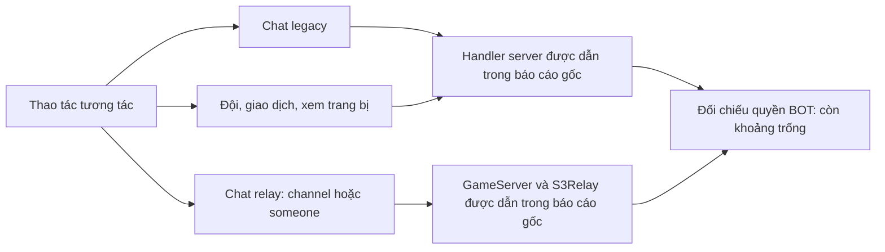

TÓM TẮT 5 DÒNG
1. DONE cho khảo sát tĩnh: đã đối chiếu chat, mời/chấp nhận đội, giao dịch và xem trang bị bằng source client/server.
2. Chat có hai họ gói: legacy 0x5E và relay 0xFB; client có đường gửi relay, không được lấy hàm SendChat cũ làm chuẩn duy nhất.
3. Đã dựng vector hex bằng python -I; các opcode khảo sát khớp hai header, chưa gửi bất kỳ gói nào.
4. Server có kiểm trạng thái/độ dài/đích nhưng chưa chứng minh đáp ứng quyền BOT; chấp nhận lời mời đội có nhánh tự rời đội cũ.
5. [CHƯA KIỂM] binary/runtime, codec tiếng Việt đầy đủ, cạnh tranh/timeout/mất kết nối; không build, không mạng/VM, không chạy exe game/server.

# E-12 — Khảo sát tĩnh giao thức tương tác cho E-04

Loại: khảo sát
Chủ đề: Định vị gói chat, tổ đội, giao dịch và xem trang bị cùng giới hạn quyền tương tác BOT.
Từ khóa: tương tác, trò chuyện, tổ đội, giao dịch, trang bị, BOT, c2s_extendchat, CHAT_SOMEONECHAT_CMD, CanInteract
Trạng thái: DONE — chuẩn hóa R-04c; kết luận khảo sát cũ và các khoảng trống quyền BOT được giữ nguyên.
Độ phủ: đã phủ 11 trên tổng 14 hạng mục đối chiếu; 11 dạng gói phía client đã mở nguồn, 3 hạng mục server/codec/quyền BOT chưa phủ đầy đủ.
Liên quan: JX1_OPS/REPORTS/E-11-hoi-mau-vat-pham-doi-ban-do.md; JX1_OPS/DESIGN/B-01-LOC-HIEN-THI.md; DESIGN/BOT/SHARED_BOT_SOCIAL_AND_INTERACTION_SYSTEM.md; JX1_OPS/REPORTS/R-04c.md
Cần tôi quyết định: có — các luật BOT và task kiểm runtime tiếp theo do PM quyết định; không chặn chuẩn hóa tài liệu.

## Sơ đồ quan hệ chính

[NGUỒN] Sơ đồ tóm lược hai họ chat và các nhóm tương tác trong nội dung gốc; không xác nhận quyền BOT đã được triển khai.



## Phạm vi và độ phủ

[NGUỒN] R-04c ngày 18/11/2026 đọc Q = `D:/JX-build/qh9A/Classes/gamecore/`. Các root C/S/R/H trong thân gốc là nguồn lịch sử riêng; Q không thay thế chúng. Mẫu 11 gói được đối chiếu theo các struct hiện có trong `Q/KProtocol.h` và symbol trong `Q/KProtocolDef.h`; 3 hàng cuối thể hiện các khoảng trống của báo cáo. “Đã phủ” là định vị schema client, không xác nhận gói được server chấp nhận hoặc đo lại opcode/ABI.

| Hạng mục | Độ phủ R-04c | Nguồn và giới hạn |
|---|---|---|
| Chat legacy `PLAYER_SEND_CHAT_COMMAND` | đã phủ | `Q/KProtocol.h:711`; `Q/KProtocolDef.h:278`. |
| Chat relay tới người `CHAT_SOMEONECHAT_CMD` | đã phủ | `Q/KProtocol.h:2432`; `Q/KProtocolDef.h:443`. |
| Chat relay tới kênh `CHAT_CHANNELCHAT_CMD` | đã phủ | `Q/KProtocol.h:2442`; `Q/KProtocolDef.h:444`. |
| Đội trưởng nhận người xin vào | đã phủ | `Q/KProtocolDef.h:271`; mới xác nhận symbol `c2s_teamacceptmember`, chưa mở lại sender/handler. |
| Mời vào đội | đã phủ | `Q/KProtocol.h:2040`; `Q/KProtocolDef.h:303`. |
| Trả lời lời mời đội | đã phủ | `Q/KProtocol.h:2060`; `Q/KProtocolDef.h:305`. |
| Xin giao dịch | đã phủ | `Q/KProtocol.h:1964`; `Q/KProtocolDef.h:299`. |
| Trả lời giao dịch | đã phủ | `Q/KProtocol.h:1979`; `Q/KProtocolDef.h:318`. |
| Đặt tiền giao dịch | đã phủ | `Q/KProtocol.h:1986`; `Q/KProtocolDef.h:300`. |
| Quyết định giao dịch | đã phủ | `Q/KProtocol.h:1998`; `Q/KProtocolDef.h:301`. |
| Xem trang bị | đã phủ | `Q/KProtocol.h:1451`; `Q/KProtocolDef.h:321`. |
| Handler C++ GameServer/S3Relay và guard độ dài đầy đủ | chưa phủ nguồn hiện hành | Thân gốc dẫn `S/Sources/Core/Src/KProtocolProcess.cpp:5682`, `R/ChannelMgr.cpp:854`; các cây C++ này ngoài root server dữ liệu được giao lần này. |
| Codec tiếng Việt và ABI/lớp truyền đầy đủ | chưa phủ | Thân gốc dẫn `C/gamescene/KgameWorld.cpp:3096`, `C/network/ClientStage.cpp:136`; không coi ASCII fixture là kiểm codec. |
| Quyền BOT, cạnh tranh phiên, timeout/mất kết nối | chưa phủ runtime | Giữ nguyên 7 hàng yêu cầu thiết kế trong mục 7; chưa có phép thử chứng minh cơ chế quyền. |

## Nội dung khảo sát gốc

Ngày: 2026-11-17. Nhánh được kiểm tra: `task/E-12`, thư mục được người dùng xác nhận: `D:\JX-wt\E-12`.
Nhãn [NGUỒN] là kết luận từ source đã đọc; vector là dữ liệu giả dựng offline, không phải capture hoặc kết quả server chấp nhận.

## 1. Phạm vi và đường dẫn bằng chứng

Quy ước đường dẫn bên dưới, số dòng là 1-based:

| Ký hiệu | Thư mục gốc thực tế đã đọc |
|---|---|
| C | `C:\Jx1CocoV3\Folder\Client2912-20260116T044348Z-3-001\Client2912\Client\Classes` |
| S | `D:\JX-source\server\jxOnline\gameserver` |
| R | `D:\JX-source\server\jxOnline\gateway\Sources\MultiServer\S3Relay` |
| H | `D:\JX-source\server\jxOnline\header` |

Đường dẫn D client và `D:\JX-source\SwordOnline` trong task không tồn tại. Đã tra đúng thư mục cha, dùng bản client tương ứng tại C và server tại `D:\JX-source\server\jxOnline`; không suy ra đây là source khớp binary đang triển khai. `D:\JX-source\client\Classes` có tồn tại nhưng không dùng làm bằng chứng thay cho C.

Tài liệu B-01 thực tế nằm tại `JX1_OPS/DESIGN/B-01-LOC-HIEN-THI.md:50`, không phải `DESIGN/B-01-LOC-HIEN-THI.md`. Tài liệu BOT đã đọc tại `DESIGN/BOT/SHARED_BOT_SOCIAL_AND_INTERACTION_SYSTEM.md`, đặc biệt dòng 28, 37, 52, 113, 125, 174.

Chỉ tạo báo cáo và nối mục Kết quả vào task theo chỉ thị cuối task. Không thay nội dung task có sẵn, không sửa client/server. Trường worktree của task đang là chuỗi mẫu `D:\JX-wt$id`; dùng đường dẫn cụ thể do người dùng cung cấp, không sửa metadata mẫu.

## 2. Quy ước gói và opcode

[NGUỒN] `C/gamecore/KProtocol.h:10`, `S/Headers/KProtocol.h:18`: pack(1). Bảng dưới dựng theo BYTE=1, WORD=2, UINT/int=4, little-endian; không chứa con trỏ/native long. [CHƯA KIỂM] ABI của bản build đích.

Đã đếm tuần tự enum từ `c2s_gameserverbegin=64` tại C dòng 248 và S dòng 250, bỏ dòng comment. Các giá trị sau khớp cả hai header:

| Chức năng | Opcode | Payload sau opcode | Tổng byte | Header C / S |
|---|---|---|---:|---|
| Đội trưởng nhận người xin vào | `c2s_teamacceptmember=57` | NpcID:u32 | 5 | KProtocolDef.h:271 / Headers/KProtocolDef.h:273 |
| Chat legacy | `c2s_playersendchat=5E` | xem mục 3 | 16+P+N | KProtocolDef.h:278 / Headers/KProtocolDef.h:280 |
| Xin giao dịch | `c2s_tradeapplystart=73` | NpcID:u32 | 5 | KProtocolDef.h:299 / Headers/KProtocolDef.h:301 |
| Đặt tiền giao dịch | `c2s_trademovemoney=74` | tiền:i32 | 5 | KProtocolDef.h:300 / Headers/KProtocolDef.h:302 |
| Quyết định giao dịch | `c2s_tradedecision=75` | decision:u8 | 2 | KProtocolDef.h:301 / Headers/KProtocolDef.h:303 |
| Mời đội | `c2s_teaminviteadd=77` | NpcID:u32 | 5 | KProtocolDef.h:303 / Headers/KProtocolDef.h:305 |
| Trả lời lời mời đội | `c2s_teamreplyinvite=79` | result:u8, leaderPlayerIdx:i32 | 6 | KProtocolDef.h:305 / Headers/KProtocolDef.h:307 |
| Trả lời giao dịch | `c2s_tradereplystart=86` | decision:u8, requesterPlayerIdx:i32 | 6 | KProtocolDef.h:318 / Headers/KProtocolDef.h:320 |
| Xem trang bị | `c2s_viewequip=89` | NpcID:u32, m_bPrcess:u8 | 6 | KProtocolDef.h:321 / Headers/KProtocolDef.h:323 |

Mã hex trong bảng là byte hex, không phải số thập phân. Phân biệt NpcID và chỉ số player: không tái sử dụng giá trị của loại này cho loại kia.

`c2s_extendchat=FB`: C/gamecore/KProtocolDef.h:384–388; S/Headers/KProtocolDef.h:387–391. Subopcode `chat_someonechat=20`, `chat_channelchat=21` từ global=31, C dòng 18, 440–444; S dòng 19, 446–450.

## 3. Chat: kênh, độ dài, mã hóa và nơi chặn

### 3.1 Legacy

[NGUỒN] Struct `PLAYER_SEND_CHAT_COMMAND`: C/gamecore/KProtocol.h:711–723; S/Headers/KProtocol.h:720–732.
Offset: 0 opcode:u8; 1 length:u16; 3 channel:u8; 4 type:u8; 5 prefixLen:u8; 6 sentenceLen:u16; 8 targetID:u32; 12 targetIdx:i32; 16 prefix rồi sentence. `length=15+P+N`, tổng byte `length+1`. `MSG_G_CHAT=0`: S/Sources/Core/Src/MsgGenreDef.h:14.

Giới hạn byte: `MAX_SENTENCE_LENGTH=256`, prefix tối đa 16 tại C/gamecore/GameDataDef.h:24,485 và H/GameDataDef.h:23,469. Server loại `sentenceLen>=256`, nên N hợp lệ tối đa 255; prefix P tối đa 16. Đây là số byte, không phải 255 ký tự Unicode.

Kênh legacy: NONE=0, ALL=1, SCREEN=2, SINGLE=3, TEAM=4, FACTION=5, TONG=6, SCREENSINGLE=7, SYSTEM=8, NUM=9 tại S/Sources/Core/Src/KPlayerChat.h:29–38. Đây không phải bảng channelid của relay.

Chuỗi xử lý: `KProtocolProcess::PlayerSendChat` tại S/Sources/Core/Src/KProtocolProcess.cpp:5682 → `KPlayer::ServerSendChat` tại KPlayer.cpp:5390 → `KPlayerChat::ServerSendChat` tại KPlayerChat.cpp:423.

- KPlayerChat.cpp:425–437: null, channel ngoài khoảng, prefix/N vượt giới hạn, length sai công thức đều return.
- Dòng 444–449: ALL gặp `break` ngay đầu, không thể coi đoạn broadcast phía sau là đường thực thi hiện hành.
- Dòng 474–498: SCREEN hạn tần suất `m_nTimer<CHAT_SPEED`, gửi vùng lân cận. CHAT_SPEED=20 ở KPlayerChat.h:21; [CHƯA KIỂM] quy đổi thời gian tick ra giây.
- Dòng 491–496: `TextGMFilter` nằm trong block comment; không coi đây là bộ lọc nội dung đang chạy.
- Dòng 501–547: SINGLE kiểm tra đích/index/ID; không thấy điều kiện cùng party hoặc CanInteract trong nhánh đã đọc.
- Dòng 551–558: TEAM yêu cầu người gửi đang có đội, cũng dùng timer.
- Dòng 626–658: SCREENSINGLE tìm đích quanh người gửi, kiểm tra đích có bật nhận kênh rồi gửi thẳng; không được giả định mọi chat màn hình đều qua BroadCast.

C/gamecore/KPlayer.cpp:1899–1918 chỉ đặt chat lên NPC; lời gọi `m_cChat.SendSentence` đã comment ở 1912. Vì vậy header legacy còn tồn tại không chứng minh UI hiện hành gửi gói 5E.

### 3.2 Relay mà client có đường gửi

[NGUỒN] C/gamescene/KgameWorld.cpp:3012–3053 dựng CHAT_CHANNELCHAT_CMD; 3060–3124 dựng CHAT_SOMEONECHAT_CMD. `CoreShell::SendNewDataToServer`, C/gamecore/CoreShell.cpp:104–107, chuyển đến SendPackToServer.

Outer `tagExtendProtoHeader` tại C/gamecore/KRelayProtocol.h:81 gồm `FB:u8, length:u16`, length bằng tổng gói trừ 1.

| Gói | Layout phần sau outer 3 byte | Byte cố định trước text |
|---|---|---:|
| Channel | subop:u8, wSize:u16, packageID:u32, filter:u8, channelid:u32, itemDwid:u32, cost:u8, sentlen:u8 | 18 |
| Someone | subop:u8, wSize:u16, packageID:u32, someone[64], itemDwid:u32, sentlen:u8 | 76 |

Struct C/gamecore/KProtocol.h:2432–2452; S/Headers/KProtocol.h:2575–2595. NAME_LENGHT=64 tại C/gamecore/GameDataDef.h:152 và H/GameDataDef.h:134. `wSize=sizeof(inner)+N-1`. Text nằm ngay sau struct, `sentlen` chỉ 1 byte: biểu diễn được 0..255; với yêu cầu không rỗng dùng 1..255. Hai hàm dựng gói chỉ kiểm N>0 rồi gán vào BYTE, chưa thấy clamp N<=255 ở chính các hàm đó; không coi đây là bằng chứng an toàn cho toàn UI.

Kênh hiển thị CH_TEAM/CH_WORLD không được gán thẳng thành channelid relay. Client lấy thông tin từ kênh đã kích hoạt: C/gameui/Kuiplayerfun.cpp:2920–2960 dùng GetChannelIndex, ResourceIndex và queue/timer. R/ChannelMgr.cpp:999–1011 tra bảng channelid và so cost với cấu hình server. Vector channelid=2 dưới đây chỉ là giá trị giả, không khẳng định là kênh thế giới hợp lệ tại runtime.

Điểm server nhận/chặn:

1. S/Sources/MultiServer/GameServer/KSOServer.cpp:3594–3658 (`PlayerFschatProcess`): yêu cầu dữ liệu, client relay và player index; FB chuyển tới m_pChatClient. Channel khác 0 gọi PayForSpeech, false thì return (3640–3646). Someone kiểm kết nối người gửi tại 3654; không phải kiểm đích cùng party. [CHƯA KIỂM] thân PayForSpeech và xác thực đầy đủ buffer/độ dài tại dispatcher trước đó.
2. R/ChatConnect.cpp:132–183 phân phối someone/channel đến ChannelMgr. Hai Proc0 cast struct, lấy SrcInfo ở cuối buffer; không nhận tham số kích thước vào hàm ChannelMgr. [CHƯA KIỂM] toàn bộ guard của tầng nhận trước Proc0.
3. R/ChannelMgr.cpp:854–874: SomeoneChat loại sentlen<=0 hoặc >MAX_SENTLEN, tên không legal, người gửi không tra được; tra tên đích. MAX_SENTLEN=256 tại dòng 17, nhưng sentlen là BYTE nên điều kiện >256 không loại được truncation từ 256/257 ở bên gửi.
4. R/ChannelMgr.cpp:969–1011: loại channelid=-1, text rỗng, người gửi không tồn tại, channel không tồn tại, cost không khớp. Dòng 1035 và 1268–1274: IsNeedRelegate quyết định định tuyến theo tên kênh/filter; chữ filter ở đây không chứng minh có lọc từ cấm. Dòng 1083,1107,1123,1168–1171 định tuyến team/faction/tong/screen/broadcast; nhánh thông thường từ 1195 tạo sync và gửi subscriber.

### 3.3 Encoding văn bản và lớp truyền

[NGUỒN] C/gamescene/KgameWorld.cpp:3096 dùng U2V cho tên whisper; 3826 dùng TEncodeText, 3897–3899 có nhánh U2G rồi strlen/TEncodeText. Không thể coi mọi text wire là UTF-8 thuần. [CHƯA KIỂM] định nghĩa U2V/U2G, code page chính xác, đường tiếng Việt VN nào được build và byte của chuỗi “Tôi đang ở trong một party khác.”; vì vậy vector dùng ASCII A/BOT.

C/network/ClientStage.cpp:136–172: keyMode khác 0 bị return; outer transport là WORD tổng độ dài gồm chính 2 byte đó, rồi payload đã KSG_EncodeBuf. Header KSG_EncodeDecode.h:35–48 gọi KSG_DecodeEncode. C/network/KSG_EncodeDecode.cpp:14–35 XOR từng word 4 byte với cùng uKey, phần dư với các byte thấp liên tiếp; cập nhật state `key=key*31+134775813` theo unsigned 32 bit. Không xuất khóa thật, không dựng cipher phiên thật. Các vector mục 6 là payload trước lớp XOR, chưa gồm WORD transport.

## 4. Tổ đội: mời và hai loại chấp nhận khác nhau

[NGUỒN] C/gamecore/KPlayerTeam.cpp:70–78 gửi InviteAdd(NpcID); 127–137 gửi ReplyInvite(result, leader index). Struct tại C/gamecore/KProtocol.h:2040–2065 và S/Headers/KProtocol.h:2169–2194.

- S/Sources/Core/Src/KProtocolProcess.cpp:5832,5843–5864 dispatch mời/trả lời.
- KPlayerTeam.cpp:397–425: người mời phải có đội, là đội trưởng, đội mở; tìm người quanh mình qua FindAroundPlayer; đích phải có m_bCanTeamFlag; lưu m_nInviteList trước khi gửi s2c_teaminviteadd với chỉ số đội trưởng.
- KProtocolProcess.cpp:5846–5864: chỉ số leader trong khoảng, leader online theo m_nIndex, cùng subworld, người nhận được phép lập/vào đội.
- KPlayerTeam.cpp:433–475: kiểm leader/đội mở, lời mời có trong danh sách (tham số mặc định ischeckList=true tại KPlayerTeam.h:37), đích tồn tại, result=0 là từ chối, sức chứa/CalcCaptainPower.
- **Khoảng lệch BOT:** KPlayerTeam.cpp:478–482 tự LeaveTeam nếu người nhận đang có đội rồi mới AddMember tại 486. Cần chặn BOT đã thuộc party khác trước nhánh này; không suy ra lời mời hiện tại giữ độc quyền BOT đúng thiết kế.
- Gói 57 là đội trưởng nhận người xin vào, không thay thế gói 79 trả lời lời mời. Client C/gamecore/KPlayer.cpp:1789–1793; server KProtocolProcess.cpp:5647 → KPlayer.cpp:1904–1957 AddTeamMember. Đường này từ chối đích đã có đội (1937), yêu cầu m_nApplyCaptainID khớp đội trưởng (1939), kiểm đủ chỗ trước AddMember.

`FindAroundPlayer` tại S/Sources/Core/Src/KPlayer.cpp:2361–2381 tìm region hiện tại và 8 region nối; trong hàm đã đọc không có guard CanInteract/IsBot. Có mặt ở gần không đồng nghĩa được phép tương tác.

## 5. Giao dịch và xem trang bị

### 5.1 Giao dịch

[NGUỒN] Client C/gamecore/KPlayer.cpp:2795–2799 gửi TRADE_APPLY_START_COMMAND; KPlayerTrade.cpp:159–164 gửi reply. Các struct C/gamecore/KProtocol.h:1964–2002 và S/Headers/KProtocol.h:2093–2131. Server dispatch tại S/Sources/Core/Src/KProtocolProcess.cpp:5812–5824,6206–6208.

- KPlayer.cpp:6605–6632: chặn __forBitTrade hoặc người xin đang CheckTrading; tìm đích quanh, yêu cầu đích TRADEOPEN; chặn bày sạp rồi ghi requester.m_nApplyIdx và chuyển lời xin. Dòng 6622 dùng `Player[CLIENT_PLAYER_INDEX]` cho một vế kiểm sạp trong thân server: cần review riêng, chưa kết luận tác động runtime.
- KPlayer.cpp:7054–7085: reply chặn __forBitTrade/CheckTrading phía người trả lời, index ngoài khoảng/offline, cặp m_nApplyIdx không khớp; 0 từ chối, nhận phải còn TRADEOPEN. 7106–7114 backup inventory, StartTrade và đặt TRADING hai phía.
- **Khoảng trống cần xác minh:** trong chính handler reply đã đọc không thấy kiểm lại CheckTrading của requester, khoảng cách, CanInteract hoặc quyền BOT trước khi Release/StartTrade hai phía. Không khẳng định đã có khóa nguyên tử chống hai request gần đồng thời.
- KPlayer.cpp:6640–6653: chỉ cho đặt tiền khi đang giao dịch và chưa khóa; số âm/vượt tiền mang theo được đổi về 0.
- KPlayer.cpp:6724–6803: yêu cầu đang giao dịch/kết nối hợp lệ; decision 2 khóa, 3 bỏ khóa, 4 bỏ xác nhận, 0 hủy, 1 xác nhận. Hủy RecoverTrade/ClearRoom/Release hai phía tại 6773–6780 và khôi phục menu. Xác nhận cần cả hai khóa; chờ đối tác xác nhận tại 6805–6812; kiểm tiền và chỗ chứa tại 6817–6846.
- KPlayer.cpp:6933–6944: gửi kết quả, đưa menu hai phía về NORMAL và Release; sau đó xử lý đổi tiền/vật phẩm và lưu tại 6946–7036. Đây là thứ tự source, không phải chứng minh giao dịch bền vững/atomic qua crash.

[CHƯA KIỂM] mọi luật vật phẩm ràng buộc, đường đổi vật phẩm, overflow, rollback khi lưu lỗi, timeout, disconnect, restart, duplicate request và đồng thời. Không coi StartTrade/Release hiện có là khóa BOT đầy đủ.

### 5.2 Xem trang bị

[NGUỒN] VIEW_EQUIP_COMMAND là 6 byte, C/gamecore/KProtocol.h:1451–1456, S/Headers/KProtocol.h:1505–1510. Server S/Sources/Core/Src/KProtocolProcess.cpp:8058–8077 giới hạn `defMAX_VIEW_EQUIP_TIME`, cập nhật timestamp trước kiểm đích, chặn xem chính mình, chỉ tìm người quanh rồi gọi SendEquipItemInfo(nIndex,m_bPrcess).

S/Sources/Core/Src/KPlayer.cpp:11904–11929 kiểm index người xem, chuẩn bị s2c_viewequip và đọc các ô m_EquipItem; ô trống được zero. Client có handler nhận tại C/gamecore/KProtocolProcess.cpp:298. [CHƯA KIỂM] caller client gửi yêu cầu, ý nghĩa/range m_bPrcess, giá trị thời gian cooldown, toàn bộ schema SViewItemInfo; không dựng vector sync trang bị thiếu dữ liệu.

Trong handler đã đọc chưa thấy quyền BOT/CanInteract hay privacy trang bị. Cần guard trước SendEquipItemInfo; không chỉ lọc gói NPC hiển thị.

## 6. Vector hex dựng từ mã, không gửi mạng

Giả định giả lập: NpcID=0x01020304, player index=2, số tiền=100, ASCII A; pack(1), little-endian. Mỗi vector sau gồm opcode nhưng chưa gồm WORD transport và chưa XOR:

| Ý nghĩa | Hex đầy đủ |
|---|---|
| Mời đội | `77 04 03 02 01` |
| Đồng ý lời mời đội | `79 01 02 00 00 00` |
| Từ chối lời mời đội | `79 00 02 00 00 00` |
| Đội trưởng nhận người xin vào | `57 04 03 02 01` |
| Xin giao dịch | `73 04 03 02 01` |
| Đồng ý giao dịch | `86 01 02 00 00 00` |
| Từ chối giao dịch | `86 00 02 00 00 00` |
| Đặt 100 tiền | `74 64 00 00 00` |
| Khóa / xác nhận / hủy | `75 02` / `75 01` / `75 00` |
| Xem trang bị, process=0 | `89 04 03 02 01 00` |
| Legacy SCREEN, P=0,N=1,type=0,đích=0 | `5e 10 00 02 00 00 01 00 00 00 00 00 00 00 00 00 41` |
| Relay channel, channelid=2,cost=0,item=0,filter=1 | `fb 15 00 21 12 00 ff ff ff ff 01 02 00 00 00 00 00 00 00 00 01 41` |

Relay whisper tới tên giả BOT, item=0, 80 byte; field someone[64] có BOT và 61 byte zero:

```text
fb 4f 00 20 4c 00 ff ff ff ff 42 4f 54 00 00 00
00 00 00 00 00 00 00 00 00 00 00 00 00 00 00 00
00 00 00 00 00 00 00 00 00 00 00 00 00 00 00 00
00 00 00 00 00 00 00 00 00 00 00 00 00 00 00 00
00 00 00 00 00 00 00 00 00 00 00 00 00 00 01 41
```

Cách tái dựng offline bằng `python -I` và thư viện chuẩn (không tạo parser/script trong repo):

```python
import struct
channel = struct.pack('<BH', 0xfb, 21) + struct.pack(
    '<BHIBIIBB', 0x21, 18, 0xffffffff, 1, 2, 0, 0, 1) + b'A'
whisper = struct.pack('<BH', 0xfb, 79) + struct.pack(
    '<BHI64sIB', 0x20, 76, 0xffffffff, b'BOT', 0, 1) + b'A'
legacy = struct.pack('<BHBBBHIi', 0x5e, 16, 2, 0, 0, 1, 0, 0) + b'A'
assert (len(channel), len(whisper), len(legacy)) == (22, 80, 17)
for p in (channel, whisper, legacy):
    assert int.from_bytes(p[1:3], 'little') == len(p) - 1
    print(p.hex(' '))
```

Đã chạy dựng vector, đối chiếu enum hai header và kiểm length/sentlen hai gói relay: PASS offline. [CHƯA KIỂM] server parser chấp nhận, nguồn hợp lệ, channel hợp lệ, đủ quyền/trạng thái; không thể replay trực tiếp các byte này lên socket vì còn transport/key phiên.

## 7. Đối chiếu B-01 P2 và hệ thống BOT, bàn giao E-04

| Yêu cầu thiết kế | Bằng chứng/điểm chèn cần dùng |
|---|---|
| Người thật không tương tác trực tiếp nhau | B-01 mục 5 P2: guard CanInteract tại handler sau resolve đích, trước side effect; bao cả invite, reply invite, AddTeamMember, trade request/reply, xem trang bị. FindAroundPlayer hiện chỉ tìm gần. |
| BOT chat nhiều phiên | BOT dòng 28: giữ state chat độc lập với trade/party; xác thực người gửi và đích ở cả legacy lẫn relay. Chưa có bằng chứng session BOT trong source đã đọc. |
| BOT trong party từ chối whisper từ ngoài | Kiểm quyền sau resolve tên/ID của relay và trước phân phối; legacy SINGLE/SCREENSINGLE cũng phải có guard tương ứng. Nhánh relay không mặc nhiên đi qua KPlayerChat. Phản hồi đúng “Tôi đang ở trong một party khác.” cần codec được kiểm riêng. |
| BOT không bị party khác chiếm | Chặn ở GetInviteReply trước LeaveTeam và kiểm lại lúc AddMember; bao AddTeamMember và các entry hợp lệ khác. Không sửa đường AI/NPC dùng chung chỉ vì B-01 có đề xuất lọc tìm đích. |
| Một giao dịch trên một BOT | Kiểm và cấp quyền cả hai phía trước StartTrade; gắn đối tác/phiên, release khi xong/hủy/lỗi theo thiết kế. Source hiện có state/menu nhưng chưa đủ chứng minh chống cạnh tranh/replay. |
| BOT quảng bá từ inventory thật | Dùng channel relay hợp lệ do server cấp, kiểm inventory lúc soạn/gửi và rate limit ở server; không hard-code channelid từ ví dụ hex. Dừng quảng bá khi hết trạng thái chờ tương ứng. |
| Giữ lọc hiển thị tách chặn tương tác | B-01 dòng 50: không chỉ chặn sync. Legacy SCREENSINGLE gửi thẳng, relay có tuyến riêng; cần xem cả đường trả về relay trước khi kết luận chat màn hình đã được P1 lọc. |

Các điểm mở trong BOT mục 7 (dòng 174) vẫn cần đặc tả: ưu tiên hai yêu cầu, cooldown, chat lúc giao dịch, giao dịch trong party, rời đội/mất kết nối, phục hồi restart. Báo cáo này không tự quyết các luật đó.

Tiếp theo của E-04: dùng bảng opcode/layout và các điểm chặn trên để lập đặc tả; xác minh codec/ABI và dispatcher đầy đủ trước viết harness. Khi có task runtime được duyệt riêng, kiểm ma trận BOT mục 5: hai người chat cùng BOT, whisper ngoài party, hai lời mời/hai giao dịch gần đồng thời, hủy/mất kết nối/timeout, quảng bá đúng tài sản. Chưa thực hiện các ca đó trong E-12.

## 8. Kiểm chứng, lỗi đã gặp và trạng thái bàn giao

- DONE: khảo sát source và báo cáo tĩnh trong phạm vi; không tuyên bố DONE cho E-04 hay cơ chế quyền BOT.
- Đã kiểm nhánh/status một lần trước sửa: task/E-12; task E-12.md là untracked có sẵn, được giữ nguyên nội dung rồi nối Kết quả.
- Đường dẫn source thiếu: lỗi PowerShell `Cannot find path ... because it does not exist.`; đã khắc phục bằng tra thư mục cha cụ thể, không quét ổ đĩa. B-01 tìm được bằng tên file Git chính xác dưới JX1_OPS/DESIGN.
- `rg` lỗi `The term 'rg' is not recognized...`; chuyển sang Select-String và Python đọc trực tiếp file chỉ định. Không cài công cụ.
- Get-Content mặc định làm chữ Việt sai; dùng UTF-8 cho tài liệu. Một lần Python in source lỗi `UnicodeEncodeError: 'charmap' codec can't encode character ...`; khắc phục stdout UTF-8/errors=replace, không thay source. Comment source có nhiều encoding cũ nên chỉ dựa symbol/biểu thức ASCII khi kết luận kỹ thuật.
- Một số tên file suy từ quy ước không tồn tại (`KCoreShell.cpp`, client KPlayerChat.h, server Core/Src/KProtocol.h); đã định vị đúng CoreShell.cpp và server Headers/KProtocol.h bằng danh sách file ở đúng thư mục. Không suy diễn thiếu chức năng chỉ vì thiếu file tên cũ.
- Vector nháp đầu tiên tính tay opcode lệch 1; đã bỏ, đếm lại enum ở cả hai header và dùng giá trị khớp tại mục 2/6. Không có vector nháp nào được gửi mạng.
- Kiểm cuối: chạy đúng đoạn Python trong báo cáo, so toàn bộ 80 byte whisper đã trình bày với struct dựng lại, kiểm công thức length cho cả ba gói, đầu tóm tắt và một heading Kết quả: PASS. Đã xem diff đúng hai file; rà hai file không thấy mẫu IPv4/token phổ biến. Một assertion chuỗi tiếng Việt ban đầu lỗi do literal qua pipeline PowerShell/Python; chạy lại với Unicode escape ASCII thì PASS, không thay byte vector.
- Build/test game, VM, socket/capture, binary matching: không chạy theo giới hạn task. Kiểm offline chỉ chứng minh phép dựng byte và công thức độ dài, không chứng minh runtime.
- Commit SHA: không có; `git add -- JX1_OPS/REPORTS/E-12-khao-sat-goi-tuong-tac.md JX1_OPS/TASKS/E-12.md` thất bại: `fatal: Unable to create 'D:/jx1-reports/.git/worktrees/E-12/index.lock': Permission denied`. Git metadata ngoài writable root; không đổi quyền, không thử vượt sandbox và không retry cùng lỗi.
- **BỊ CHẶN – CHƯA PUSH**: giữ hai file local; chưa stage/commit. Người dùng cấm mạng thật nên không push, không gọi GitHub. Bước lưu tiếp theo: phiên có quyền Git metadata stage đúng hai file, commit bắt đầu E-12 và ghi SHA khi thực sự thành công; chỉ push khi được cho phép mạng.

## Đã xác minh / Chưa xác minh (R-04c)

- **ĐÃ XÁC MINH:** đã mở các vị trí Q trong bảng, thấy đủ 11 dạng/symbol gói thuộc mẫu. Giới hạn tên, câu và prefix còn được định nghĩa tại `Q/GameDataDef.h:152`, `Q/GameDataDef.h:24`, `Q/GameDataDef.h:485`; đây là định nghĩa source.
- **ĐÃ XÁC MINH:** các tài liệu trong dòng Liên quan tồn tại. Báo cáo đầu vào là UTF-8 không BOM; comment header có mã hóa cũ/lẫn, các kết luận đối chiếu mới chỉ dùng token ASCII. Chưa xác định toàn bộ code page wire GBK/TCVN3/UTF-8.
- **CHƯA XÁC MINH:** server C++ lịch sử, guard đầy đủ, codec và runtime BOT; không chạy lại Python/vector, build, exe, VM hoặc mạng. Các dòng PASS và lỗi Git phía trên thuộc E-12, không phải phép kiểm hay lỗi mới của R-04c.

## Bàn giao chuẩn hóa R-04c

Chỉ mục nằm tại `JX1_OPS/REPORTS/_CHIMUC/R-04c.tsv`; báo cáo tổng hợp và trạng thái commit của lượt chuẩn hóa tại `JX1_OPS/REPORTS/R-04c.md`. SHA thực được trả sau commit trong phản hồi bàn giao. PM giữ các khoảng trống codec/guard/quyền BOT làm điều kiện cho task xác minh riêng.

## Phát hiện khi chuẩn hóa

1. **[NGUỒN] Khác root kiểm tra:** E-12 dùng client canonical C và server C++ S/R/H; R-04c chỉ đối chiếu client bản A Q và root server dữ liệu gs được giao. Các symbol/struct đã thấy không chứng minh hai phiên bản hay binary giống nhau; không thay bằng chứng cũ bằng số dòng Q.
2. **[NGUỒN] Mức kiểm hạng mục đội trưởng:** hàng `c2s_teamacceptmember` chỉ xác nhận enum tại `Q/KProtocolDef.h:271`; khác với việc đọc lại toàn bộ đường AddTeamMember. Độ phủ 11/14 phải đọc cùng giới hạn từng hàng.
3. **[NGUỒN] Tóm tắt gốc được giữ nguyên:** các dòng 1–4 chưa có nhãn nguồn riêng theo chuẩn mới. Nhãn mới không được dùng để nâng mức xác minh của các kết luận cũ.
4. **[CHƯA KIỂM] Kết quả Git lịch sử:** lỗi `index.lock` và các dòng “chưa commit/push” trong thân mô tả E-12. Kết quả Git R-04c chỉ được ghi ở bàn giao tổng hợp sau thao tác thực tế; 11/14 không phải độ phủ toàn bộ tương tác hay quyền BOT.
