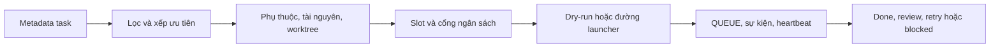

TÓM TẮT 5 DÒNG
1. DONE: đã thêm dispatcher P1, mặc định dry-run; chỉ giao thật khi PM chỉ rõ allowlist và snapshot ngân sách.
2. Lượt CLI 5 task giả đạt `done: 5`, `scan_errors: []`; 11 kiểm thử offline đạt.
3. Có giới hạn 3 worker/khóa, tài nguyên/worktree, timeout, retry, QUEUE, heartbeat và cổng ngân sách.
4. Không chạy Codex thật, Scheduled Task thật, VM, exe game/server hoặc mạng; không đọc nội dung khóa.
5. [CHƯA KIỂM] Hai task thật và đường dừng Scheduled Task do PM kiểm; chưa commit/push trong lượt này.

# E-13 — Công cụ điều phối tác vụ P1

Loại: công cụ
Chủ đề: Ghi nhận triển khai dispatcher P1, giới hạn giao việc và các kiểm thử offline lịch sử.
Từ khóa: điều phối, tác vụ, dispatcher, P1, dry-run, QUEUE, heartbeat, allowlist, retry
Trạng thái: DONE — chuẩn hóa R-04c; giữ nguyên kết quả P1 lịch sử, không xác nhận vận hành thật.
Độ phủ: đã phủ 3 trên tổng 3 file công cụ hiện có; định vị đủ 11 trên 11 định nghĩa kiểm thử P1; chưa tái chạy test hay hai task thật.
Liên quan: JX1_OPS/REPORTS/E-13b-watchdog.md; JX1_OPS/TOOLS/dispatcher/README.md; JX1_OPS/DESIGN/TONG-QUAN-DIEU-PHOI.md; JX1_OPS/REPORTS/R-04c.md
Cần tôi quyết định: không

## Sơ đồ quan hệ chính

[NGUỒN] Sơ đồ định vị P1 từ nội dung gốc và source hiện có; không phải quy trình được khởi chạy trong R-04c.

## Phạm vi và độ phủ

[NGUỒN] R-04c ngày 18/11/2026 liệt kê trực tiếp `JX1_OPS/TOOLS/dispatcher`: có 3 file dưới đây. Mã hiện tại đã gồm P1b; các số dòng là vị trí hiện hành, không đại diện snapshot tại thời điểm E-13. Mã nguồn/test chỉ được đọc, không import hoặc thực thi.

| File gốc | Độ phủ R-04c | Bằng chứng đọc tĩnh |
|---|---|---|
| `JX1_OPS/TOOLS/dispatcher/dispatcher.py` | đã phủ | `JX1_OPS/TOOLS/dispatcher/dispatcher.py:114` quét metadata; `JX1_OPS/TOOLS/dispatcher/dispatcher.py:301` cổng ngân sách; `JX1_OPS/TOOLS/dispatcher/dispatcher.py:469` vòng điều phối; `JX1_OPS/TOOLS/dispatcher/dispatcher.py:572` lựa chọn chế độ. |
| `JX1_OPS/TOOLS/dispatcher/test_dispatcher.py` | đã phủ | 11 định nghĩa P1 tại `JX1_OPS/TOOLS/dispatcher/test_dispatcher.py:63` đến định nghĩa bắt đầu ở `JX1_OPS/TOOLS/dispatcher/test_dispatcher.py:192`; liệt kê từng ca bên dưới. |
| `JX1_OPS/TOOLS/dispatcher/README.md` | đã phủ | `JX1_OPS/TOOLS/dispatcher/README.md:7` ví dụ dry-run; `JX1_OPS/TOOLS/dispatcher/README.md:47` quy tắc; `JX1_OPS/TOOLS/dispatcher/README.md:103` hai task thật chưa kiểm. |

| Định nghĩa kiểm thử P1 hiện có | Độ phủ định nghĩa | Nguồn |
|---|---|---|
| `test_five_fake_tasks_and_key_capacity` | đã phủ — chưa chạy lại | `JX1_OPS/TOOLS/dispatcher/test_dispatcher.py:63` |
| `test_dependency_resource_and_priority` | đã phủ — chưa chạy lại | `JX1_OPS/TOOLS/dispatcher/test_dispatcher.py:77` |
| `test_transient_retry_rotates_key_and_fallback` | đã phủ — chưa chạy lại | `JX1_OPS/TOOLS/dispatcher/test_dispatcher.py:89` |
| `test_timeout_and_retry_exhaustion` | đã phủ — chưa chạy lại | `JX1_OPS/TOOLS/dispatcher/test_dispatcher.py:99` |
| `test_only_active_undone_codex_and_strict_input` | đã phủ — chưa chạy lại | `JX1_OPS/TOOLS/dispatcher/test_dispatcher.py:107` |
| `test_keys_discovered_without_opening_files` | đã phủ — chưa chạy lại | `JX1_OPS/TOOLS/dispatcher/test_dispatcher.py:119` |
| `test_budget_missing_stale_limits_and_reservations` | đã phủ — chưa chạy lại | `JX1_OPS/TOOLS/dispatcher/test_dispatcher.py:126` |
| `test_exclusive_lock_and_restart_blocks_old_worker` | đã phủ — chưa chạy lại | `JX1_OPS/TOOLS/dispatcher/test_dispatcher.py:145` |
| `test_cli_five_fake_workers_and_readonly_dry_run` | đã phủ — chưa chạy lại | `JX1_OPS/TOOLS/dispatcher/test_dispatcher.py:157` |
| `test_429_cooldown_and_output_not_transport_error` | đã phủ — chưa chạy lại | `JX1_OPS/TOOLS/dispatcher/test_dispatcher.py:173` |
| `test_real_launcher_arguments_without_execution` | đã phủ — chưa chạy lại | `JX1_OPS/TOOLS/dispatcher/test_dispatcher.py:192` |

| Phần vận hành ngoài xác minh R-04c | Độ phủ | Giới hạn |
|---|---|---|
| Hai task thật, provider và launcher | chưa phủ runtime | `JX1_OPS/TOOLS/dispatcher/README.md:103` vẫn giao PM kiểm riêng. |
| Scheduled Task launch/stop, cây tiến trình, heartbeat ngoài | chưa phủ runtime | `JX1_OPS/TOOLS/dispatcher/dispatcher.py:377` có đường stop hiện hành; sự tồn tại của mã không phải phép đo vận hành. |
| Chi phí thực và đồng bộ dashboard | chưa phủ runtime | `JX1_OPS/TOOLS/dispatcher/dispatcher.py:301` chỉ thể hiện cổng snapshot/dự phòng. |

## Phạm vi và cách tích hợp

Đọc đúng task E-13, DESIGN/TONG-QUAN-DIEU-PHOI.md, chay_codex.ps1,
stop_guard.py, mailbox_hook.py và mục Dispatcher cũ trong ENVIRONMENT.md.
Git ban đầu: nhánh `task/E-13`, chỉ `?? JX1_OPS/TASKS/E-13.md`; giữ nguyên
nội dung task có sẵn, chỉ nối mục kết quả theo yêu cầu riêng trong task.

ENVIRONMENT.md chỉ nhắc `jx1_task_dispatcher.py`, không cho vị trí mã.
Không tìm thấy tại TOOLS hoặc các đường dẫn cụ thể đã thử
`D:\JX-tools\jx1_task_dispatcher.py`, `D:\JX-tools\dispatcher\jx1_task_dispatcher.py`,
`C:\Jx1CocoV3\jx1_task_dispatcher.py`, `C:\Jx1CocoV3\tools\jx1_task_dispatcher.py`,
`C:\Jx1CocoV3\scripts\jx1_task_dispatcher.py`.
Không quét rộng tìm mã cũ. Mở rộng quy trình launcher hiện có bằng scheduler
Python trong vùng dispatcher; không sửa/chép launcher và hook ngoài phạm vi.
[CHƯA KIỂM] Mã dispatcher cũ có thể nằm nơi khác chưa được chỉ định.

## Kết quả triển khai

- `TOOLS/dispatcher/dispatcher.py`: quét front matter tối thiểu, priority/tuổi,
  trạng thái riêng, depends_on, resource/worktree lock, key pool, 3 worker/khóa
  và tối đa 16; chỉ lấy tên file khóa qua metadata, không mở nội dung.
- Retry tối đa 2 (3 lượt), đổi khóa/backoff, astra → sol cho readonly gặp 503,
  nghỉ khóa 10 phút sau 3 lỗi 429 liên tiếp; lưu cooldown qua restart.
- Timeout fake kill/reap được kiểm; timeout thật giữ blocked và dừng giao mới
  chờ PM xác minh cây tiến trình. Đây là giới hạn an toàn có chủ ý của P1 vì
  launcher thật chạy tách qua Task Scheduler; không nhận là đã kiểm kill-tree.
- QUEUE.json/QUEUE.md, SU-KIEN.log, heartbeat 60 giây, lock độc quyền, lưu
  launching trước spawn để tránh giao trùng khi crash; restart chặn worker cũ.
- Snapshot ngân sách UTC tối đa 300 giây, chặn 400 USD/ngày, 1.500 USD tích lũy
  bằng snapshot + dự phòng bảo thủ. [CHƯA KIỂM] Đồng bộ dashboard/chi phí thực;
  dự phòng không phải hard cap provider và không chặn worker đã chạy vượt dự phòng.
- `README.md`: lệnh kiểm, cách PM vận hành riêng, schema/giới hạn và xử lý lock.
  P2 (gộp tự động, bảng hiệu quả) không nằm trong lần này.

## Bằng chứng kiểm thử

Lệnh: `python -I JX1_OPS/TOOLS/dispatcher/test_dispatcher.py`.

Kết quả chạy cuối: `Ran 11 tests`, `OK` (exit 0);
`CLI 5 fake tasks: {"states": {"done": 5}, "scan_errors": []}`.
Test sinh fixture/STATE riêng trong thư mục dispatcher rồi tự dọn.

Đã kiểm dry-run không tạo STATE; 5 worker đồng thời/giới hạn 3 mỗi khóa;
dependency, tài nguyên, priority; retry 503 đổi khóa/fallback; timeout hai lượt
rồi blocked; 429 cooldown; bỏ done/task agent khác và chặn metadata lỗi;
không mở file khi khám phá tên khóa; ngân sách thiếu/cũ/trần/dự phòng;
lock độc quyền và restart; đối số launcher qua mock, không thực thi launcher.

Trong tự rà soát đã sửa trước bàn giao: lưu launching trước spawn; giữ dự phòng
khi snapshot mới tới; không nhầm token/output 429/503 thành transport error;
cho phép retry quản lý nội bộ vượt qua `.done` lỗi cũ. Các kiểm thử cuối đạt.
Không gặp lỗi chạy lệnh/test cần thử lại hoặc lỗi quyền truy cập.

## Chưa xác minh và bước PM

[CHƯA KIỂM] Hai task thật; Codex/provider; Scheduled Task launch/stop và cây con;
đọc log Codex thật; đường dẫn binary trong launcher; monitor heartbeat bên ngoài.
Launcher chưa hỗ trợ `--skip-git-repo-check`, dispatcher giữ nguyên giao diện có
sẵn, không giả nhận đã truyền cờ này. PM duyệt prompt/ngân sách, dry-run allowlist,
rồi chạy hai task thật sau; không bật VM hoặc chạy exe game/server để kiểm.

## Trạng thái bàn giao

DONE trong phạm vi P1 và kiểm offline. Không build dự án/game vì không liên quan
và không được yêu cầu. Chỉ tạo/sửa vùng dispatcher, báo cáo E-13 và mục kết quả
task được task yêu cầu rõ. Commit SHA: chưa có (không tạo commit trong lượt này).
Chưa push: task không yêu cầu công bố; không dùng mạng theo ràng buộc người dùng.

## Đã xác minh / Chưa xác minh (R-04c)

- **ĐÃ XÁC MINH:** 3 file nguồn và 11 định nghĩa kiểm thử P1 được định vị như bảng; giới hạn slot tại `JX1_OPS/TOOLS/dispatcher/dispatcher.py:504`, cổng ngân sách tại `JX1_OPS/TOOLS/dispatcher/dispatcher.py:309`, heartbeat tại `JX1_OPS/TOOLS/dispatcher/dispatcher.py:297` vẫn có trong source hiện hành.
- **ĐÃ XÁC MINH:** các liên kết trong khối thông tin tồn tại; tài liệu và source công cụ được đọc UTF-8, báo cáo đầu vào không BOM.
- **CHƯA XÁC MINH:** không chạy lại 11 test, CLI giả, dispatcher, launcher, Scheduled Task, provider, build, exe hoặc VM. Các kết quả `Ran 11 tests` và `done: 5` ở thân gốc chỉ là bằng chứng do báo cáo E-13 ghi lại.

## Bàn giao chuẩn hóa R-04c

Chỉ mục: `JX1_OPS/REPORTS/_CHIMUC/R-04c.tsv`. Trạng thái commit của lượt chuẩn hóa được ghi tại `JX1_OPS/REPORTS/R-04c.md`; SHA thực được trả trong phản hồi bàn giao sau commit. Việc vận hành dispatcher không nằm trong R-04c; PM dùng E-13b để biết phần phát triển tiếp sau P1.

## Phát hiện khi chuẩn hóa

1. **[NGUỒN] Snapshot đã phát triển:** source/test/README hiện hành đã gồm P1b, với 26 định nghĩa test tổng cộng; 11 ca P1 là nhóm được liệt kê riêng ở đây, không phải toàn suite hiện tại. Kết quả “11 kiểm thử đạt” gốc được giữ nguyên và không được nhận là vừa tái kiểm.
2. **[NGUỒN] Giới hạn stop có bối cảnh thời gian:** E-13 mô tả timeout thật giữ blocked; hiện tại có đường `Stop-ScheduledTask` tại `JX1_OPS/TOOLS/dispatcher/dispatcher.py:386`, được E-13b trình bày thêm. Giữ nguyên kết luận P1, không dùng source mới để xác nhận kill-tree đã hoạt động.
3. **[NGUỒN] Giữ nguyên tóm tắt:** dòng giới hạn build/exe/VM của chuẩn mới chưa nằm ở dòng 5 của bản gốc, và một số dòng chưa có nhãn nguồn riêng. Không sắp xếp hoặc viết lại tóm tắt lịch sử; giới hạn R-04c được nêu rõ trong mục xác minh.
4. **[CHƯA KIỂM] Dữ liệu ngoài phạm vi:** không mở file khóa, log worker, QUEUE/STATE vận hành hoặc snapshot chi phí thật. Các dòng “chưa commit/push” cũ chỉ thuộc E-13.
