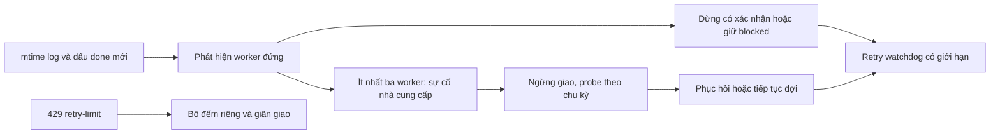

TÓM TẮT 5 DÒNG
1. DONE trong vùng ghi được giao: watchdog mtime 600/300 giây, tối đa hai lần chạy lại.
2. Retry-limit 429 có giãn giao 20 giây và bộ đếm riêng, không tiêu hao lỗi thật.
3. Ba worker đứng đồng thời mở sự cố nhà cung cấp; probe giả kiểm được chu kỳ 120 giây và hồi phục.
4. 26/26 test offline đạt; [CHƯA KIỂM] runtime thật/API/VM/Task Scheduler.
5. Đã cập nhật README, giữ thay đổi local trong vùng cho phép; chưa commit/push.

# E-13b — Theo dõi worker đứng và sự cố nhà cung cấp

Loại: công cụ
Chủ đề: Ghi nhận watchdog, giãn giao do 429, thăm dò phục hồi và dấu hoàn thành theo mtime.
Từ khóa: điều phối, worker đứng, watchdog, mtime, 429, provider_incident, probe, .seen-all, P1b
Trạng thái: DONE — chuẩn hóa R-04c; giữ nguyên kết quả triển khai và kiểm thử offline cũ.
Độ phủ: đã phủ 3 trên tổng 3 file công cụ hiện có; định vị đủ 15 trên 15 định nghĩa kiểm thử bổ sung P1b; 11 ca nền được liệt kê ở E-13, chưa tái chạy.
Liên quan: JX1_OPS/REPORTS/E-13-dispatcher-p1.md; JX1_OPS/TOOLS/dispatcher/README.md; JX1_OPS/DESIGN/TONG-QUAN-DIEU-PHOI.md; JX1_OPS/REPORTS/R-04c.md
Cần tôi quyết định: không

## Sơ đồ quan hệ chính

[NGUỒN] Sơ đồ tóm lược logic được báo cáo và source hiện hành mô tả; không biểu diễn thăm dò API hay dừng task đã thực hiện trong R-04c.



## Phạm vi và độ phủ

[NGUỒN] R-04c ngày 18/11/2026 liệt kê trực tiếp thư mục `JX1_OPS/TOOLS/dispatcher`, thấy đúng 3 file. Bộ test hiện có 11 định nghĩa nền P1 và 15 định nghĩa bổ sung P1b; bảng này đếm định nghĩa, không đếm phép thử đã chạy lại.

| File gốc | Độ phủ R-04c | Bằng chứng đọc tĩnh |
|---|---|---|
| `JX1_OPS/TOOLS/dispatcher/dispatcher.py` | đã phủ | `JX1_OPS/TOOLS/dispatcher/dispatcher.py:146` ngưỡng watchdog; `JX1_OPS/TOOLS/dispatcher/dispatcher.py:232` dấu hoàn thành; `JX1_OPS/TOOLS/dispatcher/dispatcher.py:256` phục hồi; `JX1_OPS/TOOLS/dispatcher/dispatcher.py:392` phát hiện đứng/retry. |
| `JX1_OPS/TOOLS/dispatcher/test_dispatcher.py` | đã phủ | Các định nghĩa bổ sung bắt đầu tại `JX1_OPS/TOOLS/dispatcher/test_dispatcher.py:248`, kết thúc ở ca bắt đầu tại `JX1_OPS/TOOLS/dispatcher/test_dispatcher.py:481`; liệt kê đủ bên dưới. |
| `JX1_OPS/TOOLS/dispatcher/README.md` | đã phủ | `JX1_OPS/TOOLS/dispatcher/README.md:64` giãn giao; `JX1_OPS/TOOLS/dispatcher/README.md:67` watchdog; `JX1_OPS/TOOLS/dispatcher/README.md:78` sự cố; `JX1_OPS/TOOLS/dispatcher/README.md:105` kết quả test lịch sử. |

| Định nghĩa kiểm thử P1b hiện có | Độ phủ định nghĩa | Nguồn |
|---|---|---|
| `test_watchdog_thresholds_and_log_progress` | đã phủ — chưa chạy lại | `JX1_OPS/TOOLS/dispatcher/test_dispatcher.py:248` |
| `test_watchdog_missing_log_and_two_retries_only` | đã phủ — chưa chạy lại | `JX1_OPS/TOOLS/dispatcher/test_dispatcher.py:272` |
| `test_watchdog_prefers_less_loaded_key` | đã phủ — chưa chạy lại | `JX1_OPS/TOOLS/dispatcher/test_dispatcher.py:284` |
| `test_stop_failure_keeps_slot_and_blocks_new_launch` | đã phủ — chưa chạy lại | `JX1_OPS/TOOLS/dispatcher/test_dispatcher.py:294` |
| `test_watchdog_key_load_preference_survives_waiting_for_slot` | đã phủ — chưa chạy lại | `JX1_OPS/TOOLS/dispatcher/test_dispatcher.py:306` |
| `test_retry_limit_does_not_consume_failures_and_paces_all_launches` | đã phủ — chưa chạy lại | `JX1_OPS/TOOLS/dispatcher/test_dispatcher.py:322` |
| `test_retry_limit_detection_requires_exit_one_and_transport_diagnostic` | đã phủ — chưa chạy lại | `JX1_OPS/TOOLS/dispatcher/test_dispatcher.py:353` |
| `test_provider_incident_pauses_probes_every_120_seconds_and_recovers` | đã phủ — chưa chạy lại | `JX1_OPS/TOOLS/dispatcher/test_dispatcher.py:365` |
| `test_incident_restart_and_fake_probe_never_reads_keys` | đã phủ — chưa chạy lại | `JX1_OPS/TOOLS/dispatcher/test_dispatcher.py:395` |
| `test_two_stalls_do_not_trigger_incident_and_fresh_done_wins_deadline` | đã phủ — chưa chạy lại | `JX1_OPS/TOOLS/dispatcher/test_dispatcher.py:407` |
| `test_seen_all_tracks_mtime_and_survives_restart` | đã phủ — chưa chạy lại | `JX1_OPS/TOOLS/dispatcher/test_dispatcher.py:417` |
| `test_stale_done_is_ignored_until_mtime_changes` | đã phủ — chưa chạy lại | `JX1_OPS/TOOLS/dispatcher/test_dispatcher.py:436` |
| `test_real_probe_request_is_mocked_and_secrets_never_persist` | đã phủ — chưa chạy lại | `JX1_OPS/TOOLS/dispatcher/test_dispatcher.py:449` |
| `test_watchdog_kills_and_reaps_actual_isolated_fake_worker` | đã phủ — chưa chạy lại | `JX1_OPS/TOOLS/dispatcher/test_dispatcher.py:468` |
| `test_real_stop_command_is_mocked_and_checks_scheduled_task` | đã phủ — chưa chạy lại | `JX1_OPS/TOOLS/dispatcher/test_dispatcher.py:481` |

| Phần vận hành ngoài xác minh R-04c | Độ phủ | Giới hạn |
|---|---|---|
| Dừng Scheduled Task và toàn bộ cây tiến trình thật | chưa phủ runtime | `JX1_OPS/TOOLS/dispatcher/dispatcher.py:377` là mã, chưa phải kết quả thực thi. |
| Endpoint, payload và hồi phục provider thật | chưa phủ runtime | `JX1_OPS/TOOLS/dispatcher/README.md:107` còn ghi chưa gọi API. |
| STATE, mtime/log và `.seen-all` ngoài fixture | chưa phủ runtime | `JX1_OPS/TOOLS/dispatcher/dispatcher.py:232` mô tả cơ chế; không mở dữ liệu vận hành. |

## Phạm vi và thay đổi

Đã đọc task, README và source ban đầu. Chỉ ghi source, test, README trong
`JX1_OPS/TOOLS/dispatcher/**` và báo cáo này. Đã lưu checkpoint nháp trong
chính báo cáo này trước khi hoàn tất kiểm thử.

- `dispatcher.py`: lưu mtime nanosecond và thời điểm tiến triển cho từng worker;
  dừng khi log không tăng 600 giây, hoặc 300 giây với `readonly: true`.
  Không có log cũng quá hạn. Dùng monotonic cho thời hạn; `.done` mới được ưu
  tiên trước watchdog/timeout. Tối đa hai retry watchdog, ưu tiên khóa ít tải.
- Stop thật được triển khai bằng `Stop-ScheduledTask` và kiểm tra
  `Get-ScheduledTask.State`; stop không xác nhận thì giữ slot, ghi lý do và
  chặn giao mới. Trong task này chỉ mock lệnh PowerShell, không thực thi nó.
- `exit=1` với lỗi transport cuối `429 exceeded retry limit` được giao lại sau
  20 giây; nhận cả thứ tự `exceeded retry limit ... 429`. Bộ đếm `failures`
  độc lập với `attempts`, `rate_limit_retries`, `watchdog_retries`; provider retry
  không tiêu hao lỗi thật. Từ khi nhận lỗi này, giãn mọi lượt giao tối thiểu
  20 giây, lưu cổng thời gian qua restart. Output thành công và lỗi vĩnh viễn
  xuất hiện sau lỗi 429 không bị nhận nhầm thành retry-limit.
- Từ ba worker cùng đứng trong một tick: ghi `provider_incident`, dừng worker
  đứng, tạm ngừng giao mới. Probe đầu sau 120 giây, thất bại tiếp tục đợi
  120 giây, thành công mở giao ngay trong tick, vẫn giữ giới hạn retry/slot,
  key_pool, allowlist và ngân sách. Trạng thái sự cố tồn tại qua restart.
- Probe thật chỉ được gọi từ chế độ thật với `--probe-url` HTTPS được PM cung
  cấp, đường dẫn chính xác `/v1/responses`; không tự đọc cấu hình provider.
  Payload nhỏ `gpt-6.1-sol`, 16 output token, `store: false`, timeout 15 giây,
  UA `codex_cli_rs/0.166.0`. Khóa chỉ đọc khi probe từ `--keys-dir`, mặc định
  `C:\Users\PC\.jx1keys`; không ghi giá trị khóa hoặc response/exception vào log,
  không theo redirect. Fake mode mặc định không đọc khóa/không gọi mạng.
- `STATE/TRANG-THAI.md` khi vận hành có khối quản lý riêng ghi “sự cố nhà cung
  cấp” rồi trạng thái hồi phục, giữ phần nội dung khác. Chỉ fixture tạm trong
  dispatcher được tạo trong lượt test; không sửa STATE vận hành của repository.
- Không tìm thấy triển khai `.seen-all` cũ trong source được tìm. Bổ sung file
  JSON `.seen-all` trong STATE, theo dõi đường dẫn và mtime `.done`, phát
  `done-observed` vào `SU-KIEN.log` khi mtime đổi; không lặp khi mtime giữ nguyên,
  không mất dấu qua restart. Marker cũ trước launch không kết thúc lượt mới.
- README mô tả tham số, hành vi, giới hạn và phần chưa kiểm runtime.

## Kiểm chứng đã chạy

Suite đã chạy ba lần sau các sửa đổi, Python luôn có `-I`:

```powershell
python -I JX1_OPS/TOOLS/dispatcher/test_dispatcher.py
```

Kết quả lần cuối:

```text
Ran 26 tests in 3.277s
OK
CLI 5 fake tasks: {"states": {"done": 5}, "scan_errors": []}
```

Bao gồm 11 test hồi quy P1 và 15 test P1b: biên 300/600 giây, log tăng mtime,
log chưa có, tối đa hai retry, đổi khóa khi ít việc hơn, giữ slot khi stop lỗi,
429 nhiều hơn hai lần không làm mất retry lỗi thật, cổng 20 giây, nhận diện lỗi
transport cuối, ngưỡng sự cố ba worker, không báo sự cố khi chỉ hai worker đứng
và worker thứ ba đã xong, probe thất bại/hồi phục ở 120/240 giây, giữ nội dung
TRANG-THAI, restart khi sự cố, `.seen-all` theo mtime qua restart, bỏ `.done`
cũ, dựng HTTP request bằng mock, mock Stop-ScheduledTask và kiểm trạng thái,
kill/reap một tiến trình `python -I` worker giả thực sự.
Kiểm tra cuối có exit code 0. Đã rà diff source/test/README; `git diff --check`
không phát hiện lỗi whitespace. Fixture được dọn, thư mục dispatcher chỉ còn
ba file source/test/README.

## Lỗi gặp và cách xử lý

- `rg : The term 'rg' is not recognized as the name of a cmdlet...`:
  chuyển sang `Get-ChildItem`/`Select-String` và `git grep` cho các tìm kiếm cần
  thiết, không cài công cụ hoặc thay cấu hình.
- Lần test đầu: 22/23 test đạt; `test_watchdog_thresholds_and_log_progress`
  lỗi `StopIteration` vì fixture khai báo `readonly` hai lần, parser từ chối
  đúng thiết kế. Sửa helper fixture chỉ tạo mặc định khi chưa có override.
  Bổ sung kiểm chứng kill/reap và stop mock cần thiết, chạy lại 25/25 đạt.
- Rà diff phát hiện lý do chờ slot có thể che mất ưu tiên khóa ít tải của
  watchdog ở tick sau. Giữ cờ `watchdog_pending` riêng đến khi launch thành
  công; thêm test chờ slot rồi tiếp tục chọn đúng khóa ít tải. Lần cuối 26/26 đạt.
- Khi rà source, siết nhận diện 429 thành chẩn đoán transport cuối để không
  nhận nhầm lỗi cũ khi phía sau có lỗi vĩnh viễn; test âm tương ứng đã đạt.
- Một lệnh sửa báo cáo bị công cụ từ chối với `invalid patch: multiple
  operations target ...` do gộp delete/add cùng đường dẫn. Đã dùng một thao
  tác update cho mỗi file; không mất nội dung checkpoint.

## Chưa kiểm và bàn giao

- **[CHƯA KIỂM]** Không chạy Codex thật, API thật, Task Scheduler thật, VM hoặc
  exe game. Không đọc/ghi khóa thật và không có kết nối mạng trong kiểm thử.
- **[CHƯA KIỂM]** Chưa chứng minh `Stop-ScheduledTask` loại bỏ toàn bộ tiến trình
  con trên máy vận hành; source chỉ xác nhận Scheduled Task hết `Running`.
  PM cần kiểm runtime riêng trước khi giao thật.
- **[CHƯA KIỂM]** Endpoint provider và khả năng nhận payload probe cần PM xác
  nhận bằng `--probe-url` khi được phép chạy thật. HTTP 200 chưa `completed`
  hoặc có `error` tiếp tục giữ trạng thái sự cố.
- Không sửa `JX1_OPS/TASKS/E-13b.md`: yêu cầu ghi `## Kết quả` vào file task
  mâu thuẫn với `vung_file` và chỉ thị người dùng “chỉ ghi vào vùng file của
  task”. File này là untracked ngay trước khi làm; giữ nguyên. Kết quả đặt ở
  mục cuối báo cáo này để PM cập nhật task khi có phạm vi phù hợp.
- Commit SHA: chưa có; không tạo commit vì lượt này yêu cầu sửa/kiểm thử trong
  vùng file, không yêu cầu commit. Chưa push vì không được dùng mạng; không thử
  push và không thay credential/config. Bản sửa giữ local để review.

## Kết quả

**DONE** phần triển khai và test offline trong vùng được phép. 26/26 test đạt.
Không có blocker kỹ thuật còn tồn tại trong test; các mục runtime thật ở trên
chưa được xác minh. Chưa cập nhật file task ngoài vùng ghi; chưa commit/push.

## Đã xác minh / Chưa xác minh (R-04c)

- **ĐÃ XÁC MINH:** bảng đã liệt kê 3 file và 15 định nghĩa P1b từ nguồn thật; 11 định nghĩa P1 được liên kết sang E-13. Source hiện hành có ngưỡng 300/600 giây tại `JX1_OPS/TOOLS/dispatcher/dispatcher.py:146`, ngưỡng sự cố tại `JX1_OPS/TOOLS/dispatcher/dispatcher.py:404`, chu kỳ 120 giây tại `JX1_OPS/TOOLS/dispatcher/dispatcher.py:262`, giãn giao 20 giây tại `JX1_OPS/TOOLS/dispatcher/dispatcher.py:446`.
- **ĐÃ XÁC MINH:** báo cáo/source công cụ đọc được UTF-8; báo cáo đầu vào không BOM; các tài liệu Liên quan có thật. Không cần dùng dữ liệu game client/server cho mẫu file công cụ này.
- **CHƯA XÁC MINH:** không tái chạy suite 26 test, không sinh worker giả, không import dispatcher, không gọi API, Scheduled Task, build, exe hay VM. Các lần 22/23, 25/25 và 26/26 trong thân gốc là lịch sử E-13b được giữ nguyên.

## Bàn giao chuẩn hóa R-04c

Chỉ mục: `JX1_OPS/REPORTS/_CHIMUC/R-04c.tsv`. Trạng thái commit chuẩn hóa được ghi tại `JX1_OPS/REPORTS/R-04c.md`; SHA thực được trả sau commit trong phản hồi bàn giao. PM giữ giới hạn stop/probe thật của bản gốc làm bước xác minh riêng, không thực hiện trong R-04c.

## Phát hiện khi chuẩn hóa

1. **[NGUỒN] Đếm đúng phạm vi kiểm thử:** 26 định nghĩa hiện có = 11 P1 + 15 P1b, không phải 26 ca mới do E-13b bổ sung. Báo cáo gốc đã phân biệt hai nhóm; bảng mới làm rõ từng phần tử, không thay kết quả cũ.
2. **[NGUỒN] Chưa đạt hình thức tóm tắt mới tuyệt đối:** dòng 5 gốc là bàn giao, không phải dòng giới hạn build/exe/VM; nhiều dòng thiếu nhãn riêng. Theo yêu cầu bảo toàn tóm tắt, không viết lại hoặc chuyển vị trí các dòng; mục xác minh mới nêu giới hạn của R-04c.
3. **[NGUỒN] Phạm vi task lịch sử:** đoạn gốc nói không cập nhật task E-13b vì mâu thuẫn vùng ghi là lịch sử được giữ nguyên; không dùng làm căn cứ bỏ yêu cầu cập nhật mục Kết quả của task R-04c đã được người dùng chỉ định rõ.
4. **[CHƯA KIỂM] Kết quả vận hành và Git:** source không xác nhận stop/probe thật; các dòng “chưa commit/push” gốc chỉ thuộc E-13b, khác kết quả Git của lượt chuẩn hóa được bàn giao riêng.
