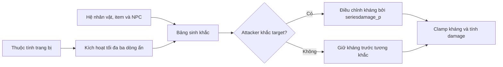

## TÓM TẮT 5 DÒNG
1. [NGUỒN] Kim=0, Mộc=1, Thủy=2, Hỏa=3, Thổ=4; bảng sinh/khắc server và client thống nhất.
2. [NGUỒN] Server trừ `seriesdamage_p` vào kháng khi đúng cặp khắc, rồi tính `D0*(100-R_eff)/100`.
3. [NGUỒN] Trang bị kích hoạt tối đa ba dòng ẩn; bảng nguồn kích hoạt client thiếu phần tử thứ ba so với server.
4. [NGUỒN] Client cộng `m_CurrentSerisesEnhance` trong nhánh vật lý; UI có lỗi kháng băng vượt trần; chưa sửa mã.
5. DONE phạm vi khảo sát tĩnh: có công thức, bảng số liệu và test; [CHƯA KIỂM] dữ liệu đang nạp, binary/runtime; không sửa mã.

# H-01 — Ngũ hành, trang bị và sát thương

Loại: khảo sát
Chủ đề: Đối chiếu ngũ hành, kích hoạt thuộc tính trang bị, tương khắc sát thương và hiển thị client.
Từ khóa: ngũ hành, 五行, series_metal, series_wood, seriesdamage_p, magic_seriesdamage_p, GetEquipEnhance, CalcDamage
Trạng thái: DONE — đã chuẩn hóa cấu trúc; giữ nguyên kết luận khảo sát tĩnh.
Độ phủ: 5/5 hệ; 15/15 ô trang bị; 6/6 kênh damage được liệt kê; dữ liệu runtime và từng bảng đang nạp chưa phủ.
Liên quan: H-02, H-03, H-04, JX1_OPS/DESIGN/MUC-LUC-TRI-THUC.md, JX1_OPS/DESIGN/HUONG-DAN-TRA-CUU.md.
Cần tôi quyết định: không



## Phạm vi và độ phủ

| Phần tử phạm vi | Độ phủ | Bằng chứng |
|---|---|---|
| Hệ 0 — Kim | Đã phủ | `H-01-ngu-hanh.md:108-121`; `D:/JX-build/qh9A/Classes/gamecore/GameDataDef.h:332` |
| Hệ 1 — Mộc | Đã phủ | `H-01-ngu-hanh.md:108-121`; `D:/JX-build/qh9A/Classes/gamecore/GameDataDef.h:333` |
| Hệ 2 — Thủy | Đã phủ | `H-01-ngu-hanh.md:108-121`; `D:/JX-build/qh9A/Classes/gamecore/GameDataDef.h:334` |
| Hệ 3 — Hỏa | Đã phủ | `H-01-ngu-hanh.md:108-121`; `D:/JX-build/qh9A/Classes/gamecore/GameDataDef.h:335` |
| Hệ 4 — Thổ | Đã phủ | `H-01-ngu-hanh.md:108-121`; `D:/JX-build/qh9A/Classes/gamecore/GameDataDef.h:336` |
| Ô trang bị 0 — head | Đã phủ trong ma trận | `D:/JX-build/qh9A/Classes/gamecore/GameDataDef.h:213`; `H-01-ngu-hanh.md:142-164` |
| Ô trang bị 1 — body | Đã phủ trong ma trận | `D:/JX-build/qh9A/Classes/gamecore/GameDataDef.h:214`; `H-01-ngu-hanh.md:142-164` |
| Ô trang bị 2 — belt | Đã phủ trong ma trận | `D:/JX-build/qh9A/Classes/gamecore/GameDataDef.h:215`; `H-01-ngu-hanh.md:142-164` |
| Ô trang bị 3 — weapon | Đã phủ trong ma trận | `D:/JX-build/qh9A/Classes/gamecore/GameDataDef.h:216`; `H-01-ngu-hanh.md:142-164` |
| Ô trang bị 4 — foot | Đã phủ trong ma trận | `D:/JX-build/qh9A/Classes/gamecore/GameDataDef.h:217`; `H-01-ngu-hanh.md:142-164` |
| Ô trang bị 5 — cuff | Đã phủ trong ma trận | `D:/JX-build/qh9A/Classes/gamecore/GameDataDef.h:218`; `H-01-ngu-hanh.md:142-164` |
| Ô trang bị 6 — amulet | Đã phủ trong ma trận | `D:/JX-build/qh9A/Classes/gamecore/GameDataDef.h:219`; `H-01-ngu-hanh.md:142-164` |
| Ô trang bị 7 — ring1 | Đã phủ trong ma trận | `D:/JX-build/qh9A/Classes/gamecore/GameDataDef.h:220`; `H-01-ngu-hanh.md:142-164` |
| Ô trang bị 8 — ring2 | Đã phủ trong ma trận | `D:/JX-build/qh9A/Classes/gamecore/GameDataDef.h:221`; `H-01-ngu-hanh.md:142-164` |
| Ô trang bị 9 — pendant | Đã phủ trong ma trận | `D:/JX-build/qh9A/Classes/gamecore/GameDataDef.h:222`; `H-01-ngu-hanh.md:142-164` |
| Ô trang bị 10 — horse | Đã phủ trong ma trận | `D:/JX-build/qh9A/Classes/gamecore/GameDataDef.h:223`; `H-01-ngu-hanh.md:142-164` |
| Ô trang bị 11 — mask | Đã phủ trong ma trận | `D:/JX-build/qh9A/Classes/gamecore/GameDataDef.h:224`; `H-01-ngu-hanh.md:142-164` |
| Ô trang bị 12 — pifeng | Đã phủ trong ma trận | `D:/JX-build/qh9A/Classes/gamecore/GameDataDef.h:225`; `H-01-ngu-hanh.md:142-164` |
| Ô trang bị 13 — yinjian | Đã phủ trong ma trận | `D:/JX-build/qh9A/Classes/gamecore/GameDataDef.h:226`; `H-01-ngu-hanh.md:142-164` |
| Ô trang bị 14 — shiping | Đã phủ trong ma trận | `D:/JX-build/qh9A/Classes/gamecore/GameDataDef.h:227`; `H-01-ngu-hanh.md:142-164` |
| Kênh damage_physics | Đã phủ | `H-01-ngu-hanh.md:183-188` |
| Kênh damage_cold | Đã phủ | `H-01-ngu-hanh.md:183-188` |
| Kênh damage_fire | Đã phủ | `H-01-ngu-hanh.md:183-188` |
| Kênh damage_light | Đã phủ | `H-01-ngu-hanh.md:183-188` |
| Kênh damage_poison | Đã phủ | `H-01-ngu-hanh.md:183-188` |
| Kênh damage_magic/default | Đã phủ | `H-01-ngu-hanh.md:183-188` |
| Đối tượng item, skill, NPC | Đã phủ 3/3 nhóm; cấu hình/runtime cụ thể chưa phủ | `H-01-ngu-hanh.md:122-131` |
| Dữ liệu đang nạp, kháng từng quái, binary/runtime | Chưa phủ; giữ nguyên giới hạn gốc | `H-01-ngu-hanh.md:245-261` |

## Giải mã tên

Tên gốc Hoa trong comment client được lưu mã GBK; bảng dưới giải mã theo comment của enum. Không xác nhận tên hiển thị trong runtime.

| Tên gốc | Mã hóa | Chữ đúng UTF-8 | Nguồn file:dòng |
|---|---|---|---|
| 金系 | GBK | Kim hệ | `D:/JX-build/qh9A/Classes/gamecore/GameDataDef.h:332` |
| 木系 | GBK | Mộc hệ | `D:/JX-build/qh9A/Classes/gamecore/GameDataDef.h:333` |
| 水系 | GBK | Thủy hệ | `D:/JX-build/qh9A/Classes/gamecore/GameDataDef.h:334` |
| 火系 | GBK | Hỏa hệ | `D:/JX-build/qh9A/Classes/gamecore/GameDataDef.h:335` |
| 土系 | GBK | Thổ hệ | `D:/JX-build/qh9A/Classes/gamecore/GameDataDef.h:336` |
| 头 | GBK | Đầu (itempart_head) | `D:/JX-build/qh9A/Classes/gamecore/GameDataDef.h:213` |
| 身体 | GBK | Thân/áo (itempart_body) | `D:/JX-build/qh9A/Classes/gamecore/GameDataDef.h:214, 1505` |
| 腰带 | GBK | Đai lưng (itempart_belt) | `D:/JX-build/qh9A/Classes/gamecore/GameDataDef.h:215, 1506` |
| 武器 | GBK | Vũ khí (itempart_weapon) | `D:/JX-build/qh9A/Classes/gamecore/GameDataDef.h:216, 1507` |
| 靴子 | GBK | Giày (itempart_foot) | `D:/JX-build/qh9A/Classes/gamecore/GameDataDef.h:217, 1508` |
| 手镯或护腕 | GBK | Vòng tay hoặc hộ thủ (itempart_cuff) | `D:/JX-build/qh9A/Classes/gamecore/GameDataDef.h:218, 1509` |
| 项链 | GBK | Dây chuyền (itempart_amulet) | `D:/JX-build/qh9A/Classes/gamecore/GameDataDef.h:219, 1510` |
| 戒子 | GBK | Nhẫn (itempart_ring1/ring2) | `D:/JX-build/qh9A/Classes/gamecore/GameDataDef.h:220-221, 1511-1512` |
| 香囊或玉佩 | GBK | Túi thơm hoặc ngọc bội (itempart_pendant) | `D:/JX-build/qh9A/Classes/gamecore/GameDataDef.h:222, 1513` |
| 马 | GBK | Ngựa (itempart_horse) | `D:/JX-build/qh9A/Classes/gamecore/GameDataDef.h:223, 1514` |
| 面具 | GBK | Mặt nạ (itempart_mask) | `D:/JX-build/qh9A/Classes/gamecore/GameDataDef.h:224, 1515` |
| 披风 | GBK | Phi Phong/áo choàng (itempart_pifeng) | `D:/JX-build/qh9A/Classes/gamecore/GameDataDef.h:1516` |
| 印鉴 | GBK | Ấn giám (itempart_yinjian) | `D:/JX-build/qh9A/Classes/gamecore/GameDataDef.h:1517` |
| 饰品 | GBK | Trang sức (itempart_shiping) | `D:/JX-build/qh9A/Classes/gamecore/GameDataDef.h:1518` |

## Sắp theo cấu trúc game

| Cấu trúc | Nội dung đã kiểm kê |
|---|---|
| Ngũ hành | Kim → Mộc → Thủy → Hỏa → Thổ; quan hệ sinh/khắc nằm ở bảng ngay dưới đây trong nội dung gốc |
| Trang bị | 15 vị trí item; mỗi vị trí có ba ô nguồn kích hoạt server/client theo ma trận hiện có |
| Chiến đấu | Attacker/target → tương khắc → sáu kênh damage/kháng → xử lý tiếp theo |
| Đồng bộ/hiển thị | Item, skill và NPC được trình bày riêng; trạng thái đang nạp chưa xác minh |

## Phạm vi

Khảo sát ngày 17/11/2026 trên `D:\JX-source\server` và `C:\Jx1CocoV3\Folder\Client2912-20260116T044348Z-3-001`. Chỉ đọc source và tính số học bằng PowerShell; không build, VM, mạng, exe game/server hoặc Python. `[NGUỒN]` chỉ xác nhận source, không xác nhận executable.

Tiền tố: `S/`=`D:\JX-source\server\jxOnline\gameserver\Sources\Core\Src\`; `H/`=`D:\JX-source\server\jxOnline\header\`; `C/`=`C:\Jx1CocoV3\Folder\Client2912-20260116T044348Z-3-001\Client2912\Client\Classes\gamecore\`.

`D:\JX-source\server\jxOnline\gameserver\Sources\Core\Core.vcxproj:704` liệt kê `Src\KNpc.cpp`; không dùng `KNpc_backup.cpp`. [CHƯA KIỂM] chưa build hoặc xác nhận binary khớp source.

Tham chiếu client chỉ dùng C/ như định nghĩa trên; không suy rộng sang client mirror hoặc toàn cây.

## Bảng ngũ hành

Enum tại `H/GameDataDef.h:329` và `C/GameDataDef.h:332`: 0 Kim, 1 Mộc, 2 Thủy, 3 Hỏa, 4 Thổ. `series_num=5` tại `H/GameDataDef.h:334`, `C/GameDataDef.h:337`; không coi 5 là hệ thứ sáu.

| ID | Hệ | Sinh | Được sinh | Khắc | Bị khắc |
|---:|---|---:|---:|---:|---:|
| 0 | Kim | 2 Thủy | 4 Thổ | 1 Mộc | 3 Hỏa |
| 1 | Mộc | 3 Hỏa | 2 Thủy | 4 Thổ | 0 Kim |
| 2 | Thủy | 1 Mộc | 0 Kim | 3 Hỏa | 4 Thổ |
| 3 | Hỏa | 4 Thổ | 1 Mộc | 0 Kim | 2 Thủy |
| 4 | Thổ | 0 Kim | 3 Hỏa | 2 Thủy | 1 Mộc |

Nguồn hoạt động: `S/KMath.cpp:367`, gán tại `:371`, `:379`, `:383`, `:387`, `:391`; client `C/KMath.cpp:138`, `:141`, `:146`, `:150`, `:154`, `:158`. `g_IsAccrue`, `g_IsConquer`, `g_IsConquered` dùng bảng sinh/khắc/bị khắc (`S/KMath.h:78`, `:89`, `:100`), theo chiều nguồn → đích.

## Item, skill, quái

| Đối tượng | Server | Client/hiển thị |
|---|---|---|
| Item | `S/KItem.cpp:742` nhận `m_nSeries`; `S/KItemList.cpp:464` đưa vào dữ liệu | `C/KItem.cpp:614` nhận hệ; `C/KItem.cpp:2242` hiển thị nhãn/màu |
| Skill | `S/KSkills.cpp:3044` đọc `Series=-1`; `:3047` đọc riêng `IsPhysical`; `:3725` ghi `magic_seriesdamage_p` | `C/KSkills.cpp:2936`; `C/KSkills.h:75` có `getSkillSeries()`; tooltip `C/KSkills.cpp:3866`–`:3879` |
| NPC | `S/KNpcTemplate.cpp:656` đọc Series mặc định 0; `S/KNpc.cpp:11444` chép template | `C/KNpc.cpp:6990` chép; `C/KProtocolProcess.cpp:2217` nhận; `C/KNpc.cpp:5391` chọn sprite |

Server gửi `NPC_SYNC.m_bySeries` tại `S/KNpc.cpp:7963`; client gán tại `C/KProtocolProcess.cpp:2217`. Kháng quái đọc năm khóa `FireResist`…`PhysicsResist` với `m_Series` tại `S/KNpcTemplate.cpp:948`–`:961`; wrapper Lua tại `:992`, `:1009`. [CHƯA KIỂM] bảng/Lua đang nạp và số kháng từng quái.

### Kích hoạt trang bị

`S/KItemList.cpp:2674` và `C/KItemList.cpp:2046` thực hiện:

```text
A = min(3, I(nhân vật sinh hệ item) + Σ I(ô nguồn có item và hệ nguồn sinh hệ item))
```

Ba ô nguồn do `MAX_ITEM_ACTIVE=3` (`S/KItemList.h:6`) và bảng `S/KItemList.cpp:54`; chặn tối đa 3 tại `S/KItemList.cpp:2703`, client `C/KItemList.cpp:2071`. `Equip` gọi `GetEquipEnhance` (`S/KItemList.cpp:1722`, `:1727`). Magic index chẵn 0/2/4 áp dụng trực tiếp, index lẻ 1/3/5 cần lượt kích hoạt (`S/KItem.cpp:145`, `:149`, `:159`, `:166`). Nhánh `TonEquip`/`UnTonEquip` đặt cứng nActive=3 (`S/KItemList.cpp:1423`, `:2000`); [CHƯA KIỂM] caller thực tế.

### Sai khác bảng kích hoạt client/server

Công thức tổng quát ở trên giống nhau nhưng tập ô nguồn khác nhau. `MAX_ITEM_ACTIVE=3` ở cả `S/KItemList.h:6` và `C/KItemList.h:6`. Server khởi tạo ba phần tử mỗi hàng (`S/KItemList.cpp:54`), client chỉ khởi tạo hai (`C/KItemList.cpp:51`). Phần tử thứ ba của mảng static client bằng 0 theo quy tắc C++; 0 là `itempart_head` (`C/GameDataDef.h:213`). Client vẫn đọc ba ô tại `C/KItemList.cpp:2062`, nên ô thứ ba thực tế là head, có thể đếm lặp. `C/KItemList.cpp:4652` (`GetActiveAttribNum`) trả về `GetEquipEnhance` cho item đang mặc.

| Trang bị đích | Ba nguồn server | Ba nguồn thực tế client |
|---|---|---|
| head | body, amulet, cuff | body, amulet, head |
| body | ring2, belt, foot | ring2, belt, head |
| belt | pendant, cuff, ring2 | pendant, cuff, head |
| weapon | amulet, body, head | amulet, body, head |
| foot | weapon, head, horse | weapon, head, head |
| cuff | foot, ring1, weapon | foot, ring1, head |
| amulet | belt, ring2, ring1 | belt, ring2, head |
| ring1 | weapon, head, belt | weapon, head, head |
| ring2 | cuff, pendant, amulet | cuff, pendant, head |
| pendant | foot, ring1, mask | foot, ring1, head |
| horse | mask, yinjian, shiping | mask, yinjian, head |
| mask | yinjian, shiping, pifeng | yinjian, shiping, head |
| pifeng | horse, mask, pendant | horse, mask, head |
| yinjian | pifeng, shiping, body | pifeng, shiping, head |
| shiping | horse, pifeng, yinjian | horse, pifeng, head |

Nguồn từng hàng: `S/KItemList.cpp:56`–`:70`, `C/KItemList.cpp:53`–`:67`. Ví dụ foot Thủy, head Kim, các nguồn khác và nhân vật không sinh Thủy: server A=1, client A=2. [CHƯA KIỂM] biểu hiện runtime. Trong hàm áp dụng magic, chỉ index lẻ hợp lệ mới tiêu thụ lượt kích hoạt (`S/KItem.cpp:164`, `:172`); base attrib áp dụng riêng (`:149`).

## Công thức ngũ hành và kháng phía server

`KNpc::CalcDamage` xét hệ NPC người đánh và mục tiêu (`S/KNpc.cpp:5101`), không đọc trực tiếp hệ item hoặc `KSkills::m_nSeries` để quyết định cặp khắc. Switch tại `:5103`–`:5154` trùng năm cặp khắc ở trên. Cùng hệ, tương sinh hoặc chiều bị khắc không có hệ số riêng trong switch này; vẫn có thể ảnh hưởng gián tiếp qua trạng thái/trang bị/dữ liệu.

Đặt S=`nSeriesDamage`, R là kháng hiện tại của kênh damage, M là trần tương ứng, I=1 nếu attacker khắc target, ngược lại I=0. Với M không âm, năm kênh physics/cold/fire/light/poison dùng:

```text
D0 = số ngẫu nhiên từ nMin/nMax                 // S/KNpc.cpp:5088–:5098
R_raw = R - I*S                                // :5100–:5157
R_eff = min(150, clamp(R_raw, -M, M))           // :5161–:5249
D_R = trunc_toward_zero(D0*(100-R_eff)/100)      // :5266; phép toán int C++
```

S giảm **điểm phần trăm kháng**, không phải luôn nhân damage với `(1+S/100)`. Trừ tương khắc trước rồi mới clamp; kháng dư trên trần có thể bù phần bị trừ. `MAX_RESIST=150` tại `H/GameDataDef.h:116`, `C/GameDataDef.h:134`; không có nghĩa mọi NPC có trần thực tế 150 hoặc 75.

| Kênh | Kháng/trần tương ứng | Dòng server |
|---|---|---|
| damage_physics | m_CurrentPhysicsResist / m_CurrentPhysicsResistMax | `S/KNpc.cpp:5161` |
| damage_cold | m_CurrentColdResist / m_CurrentColdResistMax | `S/KNpc.cpp:5185` |
| damage_fire | m_CurrentFireResist / m_CurrentFireResistMax | `S/KNpc.cpp:5202` |
| damage_light | m_CurrentLightResist / m_CurrentLightResistMax | `S/KNpc.cpp:5219` |
| damage_poison | m_CurrentPoisonResist / m_CurrentPoisonResistMax | `S/KNpc.cpp:5236` |
| damage_magic / default | Đặt nRes=0, bỏ tương khắc tại bước này | `S/KNpc.cpp:5254`, `:5257` |

`ReceiveDamage` truyền cùng `pTemp_SeriesDamage[0]` vào physics (`S/KNpc.cpp:4686`), cold (`:4727`), fire (`:4768`), light (`:4796`), poison (`:4843`), magic (`:4857`). Hệ ngũ hành, `IsPhysical` và loại damage là trường riêng; không tự gán hệ skill thành loại damage trong mọi trường hợp.

### Bảng số liệu suy ra, không phải log chiến đấu

D0=1000; M=75 trừ hàng ghi khác. Đã tính số học bằng PowerShell. D_R chỉ là bước sau kháng, trước hệ số PK, giảm damage và lá chắn.

| Cặp/kênh | S | R | M | R_eff | D_R |
|---|---:|---:|---:|---:|---:|
| Không khắc | 20 | 40 | 75 | 40 | 600 |
| Kim → Mộc | 20 | 40 | 75 | 20 | 800 |
| Không khắc | 20 | 90 | 75 | 75 | 250 |
| Kim → Mộc | 20 | 90 | 75 | 70 | 300 |
| Kim → Mộc | 200 | 40 | 75 | -75 | 1750 |
| Không khắc | 0 | -100 | 75 | -75 | 1750 |
| Không khắc, trần cao | 0 | 150 | 150 | 150 | -500 |
| Kim → Mộc, damage_magic | 20 | 40 | 75 | 0 | 1000 |

Kháng trên 100 có thể tạo D_R âm; hàm chỉ chặn nDamage âm về 1 ở cuối (`S/KNpc.cpp:5713`), sau các xử lý khác. Không suy ra HP thực mất bằng -500 hoặc luôn bằng 1. Nhánh `bFatally` trừ 1/10 máu và trả ngay (`:5075`); điều kiện bỏ qua trả 0 tại `:5070`, `:5072`. Sau kháng còn giảm player→NPC (`:5268`), hệ số PK/skill (`:5276`–`:5369`), NPC→player (`:5374`), mana shield (`:5616`), các lá chắn khác (`:5632`–`:5680`), giới hạn theo máu và trừ HP (`:5716`, `:5719`). [CHƯA KIỂM] toàn bộ damage cuối và cấu hình runtime; bảng chỉ cô lập bước ngũ hành/kháng.

### Tăng tương khắc: khác biệt hai đoạn ghép hiệu ứng

Parser skill ghi `magic_seriesdamage_p` vào `m_DamageAttribs[8]` (`S/KSkills.cpp:3725`). Handler trạng thái `KNpcAttribModify::SerisesDamage` cộng vào `m_CurrentSerisesEnhance` (`S/KNpcAttribModify.cpp:3968`, `:3971`; client `C/KNpcAttribModify.cpp:3671`). Đoạn server chỉ chép ba giá trị skill (`S/KNpc.cpp:6206`–`:6211`); client chép giá trị 0 rồi cộng thêm `m_CurrentSerisesEnhance` nếu `bIsPhysical` (`C/KNpc.cpp:3243`–`:3252`).

Đầu vào S=20, trạng thái +10: tại hai đoạn này server S=20; client vật lý S=30, không vật lý S=20. [CHƯA KIỂM] có đường xử lý khác bù bonus hay không và binary nào đang dùng; không kết luận bonus item chắc chắn mất ở runtime.

## Hiển thị client

Item có nhãn/màu ngũ hành (`C/KItem.cpp:2242`–`:2259`); NPC chọn sprite `series0.spr`…`series4.spr` theo m_Series (`C/KNpc.cpp:5391`, vẽ tại `:5410`). `C/CoreShell.cpp:1668` chọn tên hệ nhân vật qua khóa ngôn ngữ. [CHƯA KIỂM] tài nguyên/chuỗi thực tế.

Tooltip skill duyệt `m_DamageAttribs` (`C/KSkills.cpp:3866`, `:3870`) rồi lấy mô tả (`:3875`, `:3879`); lệnh ghép hiệu ứng NPC tại `:3869` đang comment. Tooltip đường này không tự chứng minh đã gồm bonus item/trạng thái. `C/KMagicDesc.cpp:726`, `:728` lấy mục Descript theo tên thuộc tính trong MagicDesc.Ini; [CHƯA KIỂM] nội dung ini/ngôn ngữ đang nạp.

`C/CoreShell.cpp:1622`–`:1663` tạo chuỗi năm kháng. Nếu R<=M: hiện R%. Nếu vượt trần: vật lý/lôi/hỏa/độc hiện `M% + trunc((R-M)/q)%`, q đọc SYSTEM/BASE_RESIST_DIVIDE_AFTER_MAX, mặc định 15. Băng dùng `(R-R)/q` (`:1638`), phần cộng luôn 0 khi q khác 0. Đoạn này không kiểm tra q=0; [CHƯA KIỂM] cấu hình và khả năng đi tới nhánh.

| Đầu vào giả định | Chuỗi từ source |
|---|---|
| R=60, M=75 | `60%` |
| R=105, M=75, q=15; physics/light/fire/poison | `75% + 2%` |
| R=105, M=75, q=15; cold | `75% + 0%` |

Switch kháng server không chia phần dư theo q: R=105/M=75/S=0 dùng R_eff=75, không phải 77. Đây là khác biệt công thức source và chuỗi UI; [CHƯA KIỂM] hành vi binary. Không dùng tooltip thay bằng chứng damage.

## MỤC SỔ THÔNG SỐ

| Nhóm | Tên/hằng số | file:dòng | Giá trị | Đơn vị | Ảnh hưởng | Đổi an toàn | Nguồn đo |
|---|---|---|---:|---|---|---|---|
| Ngũ hành | series_num | D:/JX-build/qh9A/Classes/gamecore/GameDataDef.h:332-337 | 5 | hệ | Số hệ enum client | CẨN THẬN | Đọc source tĩnh |
| Kích hoạt item | MAX_ITEM_ACTIVE | D:/JX-build/qh9A/Classes/gamecore/KItemList.h:6; KItemList.cpp:2062 | 3 | ô nguồn | Số phần tử nguồn lặp cho mỗi vị trí | CẨN THẬN | Đọc source tĩnh |
| Kháng | MAX_RESIST | H-01-ngu-hanh.md:179, tham chiếu H/GameDataDef.h:116 | 150 | điểm kháng | Trần được báo cáo trong khảo sát cũ; chưa đối chiếu ở gốc R-05a | CẨN THẬN | Nguồn gián tiếp; chưa kiểm lại |

## ĐỀ XUẤT TỐI ƯU

| Đề xuất cho lần xác minh sau | Lợi ích | Cách xác minh / giới hạn |
|---|---|---|
| Giữ ma trận 5×5 hệ attacker/target, từng kênh damage, cùng R/M/S và ghi riêng giá trị trước/sau kháng | Tách rõ tác động tương khắc khỏi PK, lá chắn và hiển thị UI | Chỉ chạy trong task test được duyệt; hiện tại là đề xuất, không có kết quả runtime |
| Đối chiếu riêng bảng kích hoạt client/server theo đủ 15 vị trí | Phát hiện sai khác ô nguồn thứ ba | Báo cáo hiện đối chiếu source gián tiếp cho server và tĩnh qh9A cho client; chưa kết luận biểu hiện binary |
## Đề xuất test cho TESTER — chưa chạy

Thực hiện sau khi môi trường test được duyệt riêng. Giữ min=max, kháng/trần/bonus cố định; ghi build, đầu vào, giá trị trước/sau kháng, HP trước/sau và ảnh tooltip. Nếu đo HP cuối cần loại trừ hoặc ghi đủ PK, giảm damage, crit/fatally, phản đòn và lá chắn.

| ID | Thiết lập | Kỳ vọng tĩnh/bằng chứng |
|---|---|---|
| H01-T01 | Ma trận 5×5 hệ attacker/target; S=20, R=40, M=75, D0=1000 | Đủ 25 trường hợp: năm cặp khắc D_R=800; 20 cặp còn lại 600. |
| H01-T02 | Cặp khắc, lần lượt sáu loại damage | Năm kênh có kháng giảm 20 điểm; magic D_R=1000. |
| H01-T03 | R=90/M=75/S=20; R=40/S=200; R=-100/S=0 | D_R tương ứng 300/1750/1750; xác nhận trừ trước clamp. |
| H01-T04 | Trần được phép 100/150; log bước kháng và lá chắn | Phân biệt D_R âm với HP cuối, kiểm tra chặn tại :5713. |
| H01-T05 | Giữ hệ NPC, đổi hệ skill/item; rồi đổi riêng hệ NPC | Cặp khắc tại CalcDamage theo hai NPC; ghi tác động gián tiếp riêng. |
| H01-T06 | Trang bị thường A=0/1/2/3; tháo/mặc từng nguồn, đổi hệ nhân vật | Index lẻ hợp lệ kích hoạt lần lượt, tối đa ba; tách loại/nhánh đặt cứng A=3. |
| H01-T07 | Foot Thủy/head Kim; nguồn khác và nhân vật không sinh Thủy | Server A=1/client A=2 theo bảng; so GetActiveAttribNum, dòng ẩn và chỉ số server. |
| H01-T08 | Skill S=20/trạng thái +10; vật lý và không vật lý | Log dữ liệu sau ghép: hai đoạn dự kiến server 20, client 30/20; xác minh có đường bù khác không. |
| H01-T09 | Mỗi kháng R=60 rồi 105; M=75/q=15 | UI 60%; vượt trần bốn kênh 75%+2%, băng 75%+0%; so R_eff server. |
| H01-T10 | Một NPC/template mỗi hệ, item và skill mẫu | Ghi Series bảng/Lua, hệ gửi/nhận, nhãn/màu/sprite; kiểm tra mặc định NPC 0, skill -1. |

## Giới hạn, lỗi và bàn giao

- Đã tiếp tục báo cáo dở có sẵn; chỉ bổ sung báo cáo này và mục kết quả task theo chỉ dẫn trực tiếp trong H-01.md. Không sửa source.
- `rg` không có (`CommandNotFoundException`); ba lệnh đọc độc lập trong cùng một đợt gặp lỗi. Chuyển sang Select-String/Get-Content theo file đã xác định và đọc được bằng chứng. Không cài công cụ/quét rộng.
- `apply_patch` không ghi được file, trả `Failed to write file ...H-01-ngu-hanh.md`. Kiểm tra file không ReadOnly, mở ReadWrite được; chuyển sang ghi UTF-8 qua PowerShell. Không đổi quyền hoặc vượt sandbox.
- [CHƯA KIỂM] dữ liệu item/skill/quái, Lua, ini/ngôn ngữ và sprite thực tế đang nạp; chưa lập danh sách số liệu từng item/skill/quái. Đã xác nhận trường và đường đọc, không suy diễn dữ liệu vận hành.
- [CHƯA KIỂM] build/binary/runtime. Không build/test game, VM, mạng, exe game/server, Python hoặc ghi secret. H01-T01…T10 là đề xuất, chưa PASS/FAIL runtime.
- Trạng thái: **DONE — khảo sát tĩnh**; giới hạn chưa xác minh đã đánh dấu. Commit SHA: chưa tạo commit; chưa push vì task không yêu cầu. Giữ kết quả local để bàn giao.
## Phát hiện khi chuẩn hóa

- Các tiền tố nguồn server/client trong bản khảo sát cũ trỏ tới `D:\JX-source\server` và client Client2912, khác gốc được phép của R-05a. Đã kiểm enum/ô trang bị trên client qh9A tại các dòng được dẫn; gốc server được giao là gói dữ liệu gs, không có C++ server source ở đó để đối chiếu lại CalcDamage. Giữ nguyên mọi kết luận server cũ; trạng thái đối chiếu version server chưa xác minh.
