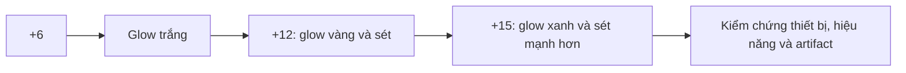

TÓM TẮT 1: Bản sửa phát sáng/sét vũ khí CÓ ghi chép đầy đủ: báo cáo docs-analysis/reports 61, 62, 63, 64, 65, 66, 67 (repo chính C:\Jx1CocoV3).
TÓM TẮT 2: Mã sửa nằm ngoài repo, ở client `D:\Android\b\Client` (không phải git), mỗi file sửa có bản sao `.bak-*`; APK mốc `jx-qh7.apk` (14/11 10:05) trong `D:\JX1_U003_build\serve`.
TÓM TẮT 3: Mốc hiệu ứng theo báo cáo 62/64: +6 sáng, +12 sáng mạnh + sét ít tia, +15 sáng nhất + sét nhiều tia; chỉ thấy vũ khí của chính mình.
TÓM TẮT 4: qh8 (14/11 10:51) là bản dang dở (Phi Phong, mất đá cường hóa), đừng lấy làm gốc; đã sao lưu qh7 sang `D:\JX-backup\qh7\` (chỉ copy, không đụng bản gốc).
TÓM TẮT 5: [CHƯA KIỂM] chưa mở APK, chưa đối chiếu mã với qh7 theo byte, chưa kiểm trên điện thoại phần sét; chưa đọc nhật ký jsonl Claude Code cũ (chỉ đọc báo cáo và thư mục build).

# H-04 - Hiệu ứng phát sáng / sét vũ khí theo cấp cường hóa

Loại: tổng hợp
Chủ đề: Tóm lược báo cáo cũ về hiệu ứng phát sáng và sét theo cấp cường hóa.
Từ khóa: phát sáng, glow, sét, lightning, cường hóa vũ khí, qh7, qh8, H-04
Trạng thái: PARTIAL — bản tổng hợp lịch sử được giữ nguyên; chi tiết APK/source và test runtime còn chưa xác minh.
Độ phủ: 7/7 báo cáo lịch sử được dẫn, 3/3 mốc +6/+12/+15; chưa kiểm lại toàn bộ APK và thiết bị.
Liên quan: H-03, H-04, H-09, H-14-mat-khung-hieu-ung.md, JX1_OPS/DESIGN/MUC-LUC-TRI-THUC.md.
Cần tôi quyết định: không

## Phạm vi và độ phủ

| Phần tử phạm vi | Độ phủ | Bằng chứng |
|---|---|---|
| Báo cáo lịch sử 61–67 | Đã dẫn 7/7 trong bản tổng hợp; không mở lại nhật ký cũ | `JX1_OPS/REPORTS/H-04-hieu-ung-vu-khi.md:54-67` |
| Các mốc hiệu ứng | Đã nêu 3/3 mốc +6, +12, +15 | `D:/JX-build/qh9A/Classes/vn/gamecore/KNpcResVN.cpp:514-556` |
| Điểm gọi sét | Đã xác nhận có hàm trong source qh9A; không chứng minh APK lịch sử | `D:/JX-build/qh9A/Classes/gamescene/KgameWorld.cpp:15025`, `KNpcResVN.cpp:618` |
| Danh sách source backup và APK qh1–qh8 | Đã ghi theo báo cáo lịch sử; chưa đối chiếu lại artifact | `JX1_OPS/REPORTS/H-04-hieu-ung-vu-khi.md:57-60` |
| Test trên điện thoại/FPS | Chưa phủ trong lượt này; tài liệu gốc đánh dấu chưa xác minh | `JX1_OPS/REPORTS/H-04-hieu-ung-vu-khi.md:62-67` |

## Giải mã tên

Báo cáo không nêu tên riêng cụ thể của kỹ năng, quái, NPC hoặc bản đồ; có nhắc loại trang bị Phi Phong. Tên file/mã artifact được giữ nguyên.

| Tên gốc | Mã hóa | Chữ đúng UTF-8 | Nguồn file:dòng |
|---|---|---|---|
| 披风 | GBK | Phi Phong / áo choàng, loại trang bị | D:/JX-build/qh9A/Classes/gamecore/GameDataDef.h:1516 |
| Không có thêm tên riêng kỹ năng/quái/NPC/bản đồ | Không áp dụng | Không áp dụng | `JX1_OPS/REPORTS/H-04-hieu-ung-vu-khi.md:54-67` |

## Sắp theo cấu trúc game

| Thứ tự | Phần |
|---|---|
| Cấp 0–5 | Chưa đạt mốc glow |
| Cấp 6–11 | Glow trắng |
| Cấp 12–14 | Glow vàng, bắt đầu sét |
| Cấp 15 trở lên | Glow xanh, sét mạnh hơn theo báo cáo lịch sử |
| Nghiệm thu | Nguồn qh9A được kiểm tĩnh; APK và trải nghiệm thiết bị chưa xác minh |

## ĐÃ XÁC MINH (có file trên đĩa)
- Báo cáo: 61 (vòng sáng dưới chân), 62 (kiếm sáng, shader `glow.fsh/vsh`, cờ `g_jxAdditive` trong `KgameWorld.cpp`, vẽ qua `KNpcResVN::Draw`), 63 (yêu cầu mốc, chủ dự án xác nhận ba mức glow trên điện thoại), 64 (sét +12/+15: `jxDrawBolts` trong `KgameWorld.cpp`, `KNpcResVN.cpp`), 65, 66 (sửa sét vượt ngoài kiếm, qh6), 67 (kiểm kê, nói client mới ở `D:\Android\b\Client`).
- Cấp cường hóa đọc từ `KItem::nEnChance` (0-31); logic đá/mô tả ở `KItem.cpp` (`EnChanceBao`, `BaoShiGetDesc`, có bản `KItem.cpp.bak-qh`).
- File đã sửa ở client (theo các `.bak-*` trong `D:\Android\b\Client`): `KNpc.cpp`, `KNpcRes.cpp`, `KNpcResVN.cpp` (bak-glow, bolt, bolt3, clip2, occl, occl2, occl3, ring), `KgameWorld.cpp` (bak-glow, bolt..bolt8, clip, clip2, pfl), `KgameWorld.h`, `KgameWorldVN.cpp.bak-qh`.
- APK dựng: glow 1-3, wglow1-7 trong `D:\Android\b\apk-glow` (13/11); qh1..qh8 trong `D:\JX1_U003_build\serve` (13-14/11). `jx-wglow7.apk` (19:35 13/11) là bản glow thuần, SHA256 bad74f3e...9e63; `jx-qh7.apk` (95.022.649 B) SHA256 c117e450...8c2b; `jx-qh8.apk` SHA256 901c6b00...5888. Nhật ký dựng qh7: `D:\JX-build\logs\qh7-build-apk.log` (kết thúc "apk done 14/11 10:05").
- Bảo quản: qh7 đã copy sang `D:\JX-backup\qh7\jx-qh7.apk`.

## CHƯA XÁC MINH
- Mã nguồn client hiện tại có còn đúng qh7 không (đã có thêm sửa sau 14/11?). Cần sao lưu cả thư mục `D:\Android\b\Client` (hoặc tag git sau khi đưa vào repo riêng) trước khi sửa tiếp.
- Ghi chép chi tiết trong nhật ký Claude Code cũ (jsonl) chưa đọc; ChatGPT nhắc qh7 là mốc nghiệm thu, báo cáo 67 nói APK qh3/qh5/qh6 từng không thấy trong kho (nay thấy trong `serve`).
- Sét chưa xác nhận trên điện thoại thật (chỉ LDPlayer); FPS lâu dài chưa đo.

## Ca test cho H-09
Đổi cấp cường hóa 5 -> 6 -> 12 -> 15, xác nhận phát sáng đúng mốc 6, sét xuất hiện từ 12, mạnh nhất ở 15 (ép cấp bằng file `/sdcard/jxwglow_<cấp>` + `/sdcard/jxtrace` theo báo cáo 62).
## Phát hiện khi chuẩn hóa

- Báo cáo cũ dẫn source ngoài gốc được giao (D:\Android\b\Client) và mô tả kiểm kê artifact theo thời điểm trước. R-05a chỉ đối chiếu tĩnh các ngưỡng hiện có trong client qh9A; không kiểm lại APK, điện thoại hoặc quan hệ source↔artifact, nên các kết luận cũ được giữ nguyên.
