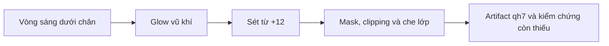

## TOM TAT 5 DONG

1. DONE: đã gom ghi chép cũ và kiểm lại file thật được dẫn tới; hoàn tất phạm vi khảo sát tĩnh, không nghiệm thu runtime.
2. Mốc trong nguồn sao lưu: dưới +6 không glow; +6 trắng, +12 vàng kèm sét, +15 xanh điện kèm sét mạnh hơn; chỉ nhân vật local ngoài menu.
3. Lịch sử chuyển từ vòng chân → glow vũ khí → sét 2/4 tia → runner 4/6 tia → sửa che lớp/cắt mặt nạ → thu nhỏ bán kính glow.
4. APK qh7 sao lưu khớp bản serve theo SHA-256; hai shader khớp nguồn, nhưng chưa chứng minh native APK khớp source mang tên Client-qh7.
5. Chỉ tạo báo cáo này; không sửa mã/task/cấu hình, không chạy game/build/test runtime, không dùng VM, không ghi khóa, không commit/push.

# H-04 — Lịch sử hiệu ứng vũ khí +6/+12/+15

Loại: tổng hợp
Chủ đề: Dòng lịch sử source/artifact và các ngưỡng glow/sét của vũ khí.
Từ khóa: hiệu ứng vũ khí, glow, sét, qh7, qh8, KNpcResVN, jxDrawBolts, H-04
Trạng thái: DONE — hoàn tất gom lịch sử và đối chiếu tĩnh; nội dung chưa xác minh được giữ nguyên.
Độ phủ: 4/4 giai đoạn hiệu ứng, 7/7 báo cáo lịch sử 61–67, 8/8 nhãn APK qh1–qh8 được đề cập; provenance native/runtime chưa phủ.
Liên quan: H-03, H-04-hieu-ung-vu-khi.md, H-14-mat-khung-hieu-ung.md, JX1_OPS/DESIGN/MUC-LUC-TRI-THUC.md.
Cần tôi quyết định: không

## Phạm vi và độ phủ

| Phần tử phạm vi | Độ phủ | Nguồn file:dòng |
|---|---|---|
| Các mức hiệu ứng | Đã phủ 4/4: dưới +6, +6–11, +12–14, +15 trở lên | `JX1_OPS/REPORTS/H-04.md:103-114` |
| Lịch sử báo cáo 61–67 | Đã xâu chuỗi 7/7 báo cáo và các mốc bản sửa | `JX1_OPS/REPORTS/H-04.md:82-103` |
| APK qh1–qh8 và qh7 backup/serve | Đã nêu 8/8 nhãn; qh3/5/6 được báo cáo sau là tìm thấy; không đối chiếu lại trong lượt này | `JX1_OPS/REPORTS/H-04.md:116-132` |
| Tham số hiệu ứng trong source backup | Đã lập bảng thông số; qh9A kiểm tĩnh tại các ngưỡng glow/sét, không đồng nhất với artifact qh7 | `JX1_OPS/REPORTS/H-04.md:141-177`; `D:/JX-build/qh9A/Classes/vn/gamecore/KNpcResVN.cpp:514-556`; `D:/JX-build/qh9A/Classes/gamescene/KgameWorld.cpp:15025` |
| Ca test và hiệu năng | Đề xuất đo; chưa test | `JX1_OPS/REPORTS/H-04.md:179-196` |

## Giải mã tên

Không có tên riêng cụ thể của kỹ năng, quái, NPC hoặc bản đồ trong phạm vi này; có tên loại trang bị Phi Phong trong ghi chép cũ. Các nhãn qh là mã artifact.

| Tên gốc | Mã hóa | Chữ đúng UTF-8 | Nguồn file:dòng |
|---|---|---|---|
| 披风 | GBK | Phi Phong / áo choàng; tên loại trang bị | D:/JX-build/qh9A/Classes/gamecore/GameDataDef.h:1516 |
| Không có tên riêng game cụ thể | Không áp dụng | Không áp dụng | `JX1_OPS/REPORTS/H-04.md:1-200` |

## Sắp theo cấu trúc game

| Cấu trúc/tiến trình | Nội dung |
|---|---|
| Cấp cường hóa | <6 tắt → 6–11 trắng → 12–14 vàng và có sét → ≥15 xanh điện, nhiều ứng viên sét hơn |
| Luồng vẽ | Chọn cấp vũ khí local → glow theo section → sét qua mask/clip/gate → redraw theo lớp che |
| Lịch sử triển khai | Báo cáo 61–67 theo thời gian và snapshot được giữ theo thứ tự đã ghi |
| Giới hạn xác minh | Hash/shader được báo cáo; quan hệ source native↔APK và test trên thiết bị vẫn chưa xác minh |

## Phạm vi và cách đọc bằng chứng

Ngày thực hiện: 17/11/2026. Task đọc trực tiếp tại `JX1_OPS/TASKS/H-04.md:11`. Git kiểm tra một lần trước ghi: nhánh `task/H-04`, có sẵn `?? JX1_OPS/TASKS/H-04.md`; giữ nguyên file đó. Không có commit ghim được cung cấp.

Đã liệt kê trực tiếp `D:/JX-backup/qh7`: chỉ có `jx-qh7.apk`, không có `.bak-*` hoặc ghi chú. Theo đường dẫn trong `JX1_OPS/REPORTS/H-14-mat-khung-hieu-ung.md:19`, đã đọc bản sao nguồn `D:/JX-backup/Client-qh7`, không sửa bản sao lưu hay client gốc. Theo `JX1_OPS/REPORTS/H-04-hieu-ung-vu-khi.md:1`, đã mở thật các báo cáo 61–67 ở repo chính, chỉ trích phần liên quan đã lọc.

Quy ước `file:dòng` là dòng vật lý từ 1:

| Ký hiệu | Đường dẫn thật đã đọc |
|---|---|
| B | `D:/JX-backup/Client-qh7` |
| K | `B/Classes/gamescene/KgameWorld.cpp` |
| N | `B/Classes/vn/gamecore/KNpcResVN.cpp` |
| F / V | `B/Resources/Shaders/glow.fsh` / `glow.vsh` |
| R61 | `C:/Jx1CocoV3/docs-analysis/reports/61-hao-quang-cuong-hoa.md` |
| R62 | `C:/Jx1CocoV3/docs-analysis/reports/62-kiem-sang-theo-cuong-hoa.md` |
| R63 | `C:/Jx1CocoV3/docs-analysis/reports/63-yeu-cau-cuong-hoa-chi-so-ky-nang-set.md` |
| R64 | `C:/Jx1CocoV3/docs-analysis/reports/64-hieu-ung-set-vu-khi.md` |
| R65 | `C:/Jx1CocoV3/docs-analysis/reports/65-chot-set-vu-khi-va-trang-ky-nang.md` |
| R66 | `C:/Jx1CocoV3/docs-analysis/reports/66-sua-set-vuot-ngoai-kiem.md` |
| R67 | `C:/Jx1CocoV3/docs-analysis/reports/67-kiem-ke-client-server-va-truy-vet-cuong-hoa.md` |

Trong bảng snapshot, `K.bak-X` và `N.bak-X` chỉ file cùng đường dẫn với K/N, thêm hậu tố `.bak-X`. Thời gian là LastWriteTime hiển thị trên máy, không chứng minh lúc tạo backup hay lúc thay đổi được đưa vào APK. Hậu tố thường chỉ bản **trước** thao tác X: ví dụ `K.bak-clip` chưa có grid clip, `K.bak-clip2` chưa có gate clip2. Không gán mỗi backup cho một APK chỉ từ tên/thời gian.

## DA XAC MINH

### Bảng thay đổi theo thời gian, nguyên nhân và trạng thái

“Ghi nhận cũ” nghĩa là đã đọc được kết quả trong tài liệu, không phải test được chạy lại trong lượt H-04 này.

| Mốc | Thay đổi và nguyên nhân | Bằng chứng file:dòng / trạng thái |
|---|---|---|
| 13/11, glow1–3; APK glow3 18:50:17 | Bản đầu dùng vòng sáng dưới chân theo cấp cao nhất của mọi trang bị. Chủ muốn kiếm tự sáng nên hướng này bị tắt sau đó. | `R61:6`, `R61:7`, `R62:9`; nguồn B `Classes/gamecore/KNpc.cpp:760` có `if(false)` ở :761. Ghi nhận cũ: vòng đỏ/vàng trên LDPlayer, chưa đủ bốn màu/điện thoại. |
| 13/11, wglow1–6; wglow6 19:31:55 | Chuyển sang shader cộng sáng và 9 lượt vẽ lệch các part vũ khí; chồng đúng vị trí một lượt khó thấy do kiếm mỏng/vốn sáng. Mốc ban đầu <10 trắng, 10–19 vàng, ≥20 xanh. | `R62:6`, `R62:7`, `R62:8`; `K.bak-bolt:8676`, `N.bak-bolt:531`. Có shader thật F/V; ghi nhận cũ thử ép cấp trên LDPlayer. |
| 13/11, wglow7 19:35:19 | Đổi mốc thành +6 trắng, +12 vàng, +15 xanh điện, dưới +6 tắt theo yêu cầu. Chưa có sét ở bước này. | `R62:16`, `R62:17`; `N.bak-bolt:497`, `N.bak-bolt:500`; hiện N:499–507 giữ các mốc. Ghi nhận cũ LDPlayer; R63:3 ghi chủ thử cường hóa thật trên điện thoại và thấy ba mức. |
| 13/11 ghi chú R63; qh1 20:44:27, qh2 23:20:32 | Yêu cầu bước kế là sét từ +12, +15 nhiều/sáng hơn. Thay đổi chỉ số/kỹ năng trong R63 là luồng cường hóa riêng, không coi là cơ chế tạo glow/sét. | `R63:8`, `R63:19`; APK qh1/2 tồn tại theo metadata. Chưa có bằng chứng để gán chính xác hiệu ứng cho từng APK qh1/2. |
| Snapshot K.bak-glow 13/11 19:01:44 → K.bak-bolt 23:29:39 → K.bak-bolt2 23:51:24 | Từ chưa có khối additive bổ sung sang glow, rồi thêm sét quanh rect vũ khí: +12 hai tia, +15 bốn tia; đổi hình mỗi 70 ms, cố ý bỏ ngẫu nhiên 30% mỗi tia. | `K.bak-bolt:8676`; `K.bak-bolt2:14909`, :14935, :14939, :14946. `N.bak-bolt3:549` đã gọi sét; `N.bak-bolt` chưa có lời gọi. Đã đọc nguồn; không suy toàn bộ nội dung qh3 từ snapshot này. |
| Snapshot K.bak-bolt3 13/11 23:55:14 | Biến thể hạt + sét; đổi mẫu 90 ms, xác suất bỏ tia high/low 0,25/0,45. | `K.bak-bolt3:14979`, :14984. Đã xác minh nội dung; không có ghi chú đủ để kết luận riêng bản này được nghiệm thu. |
| Snapshot K.bak-bolt5 14/11 00:03:40 → K.bak-bolt6 00:36:06 | Từ thu mask với fallback tâm rect khi ít điểm sang hoạt ảnh 16 pha, PCA trục kiếm, arc chạy dọc; ít hơn 8 điểm mask thì bỏ toàn bộ sét. | `K.bak-bolt5:15003`, :15005; `K.bak-bolt6:14977`, :15039, :15041. Mục tiêu bám hình kiếm; xác minh source, chưa gán APK chính xác. Không thấy bak-bolt4 trong thư mục K. |
| Snapshot N.bak-occl 14/11 00:10:06 → N.bak-occl2 01:15:40 | Thêm redraw các part sau lớp vũ khí cuối để thân/ngựa che glow/sét, xử lý hiệu ứng đè lên người khi quay lưng. | `N.bak-occl:533`, :538; `N.bak-occl2:552`, :556. N.bak-occl3 01:24:50 còn cách che theo lớp cuối và thêm log SORT (:527). |
| Snapshot K.bak-bolt7 14/11 00:45:35 → K.bak-bolt8 00:53:30 | Runner từ +12/+15 = 2/3 lên 4/6; bỏ 4 pha nghỉ mỗi runner, vệt 0,42→0,9; biên độ đổi từ theo bề rộng mask có trần 14 sang cố định 5,5. | `K.bak-bolt7:15149`, :15150, :15154, :15156; các dòng tương ứng K.bak-bolt8. Hạt nhỏ còn bật tại :15065. Không đồng nhất số runner với tổng arc/chấm thực vẽ. |
| qh3 thật 14/11 00:47:59; R64 ghi ngày 13/11 | Ghi chú bản sét đầu nói 2/4 tia, 70 ms và test LDPlayer. Ngày đầu tài liệu khác ngày APK trên đĩa. | `R64:3`, :7, :8, :9, :10; APK qh3 tồn tại, đã tính hash. Giữ nguyên hai loại mốc; không khẳng định R64 mô tả chính xác native của APK chỉ từ tên. |
| Snapshot K.bak-clip 14/11 01:30:13; qh4 00:55:50, qh5 01:32:34 | Hạt nhỏ tắt bằng cận vòng lặp 0. N.bak-clip2 đã chuyển sang glow từng section, chọn section chính và che lại sau từng section để sửa kiếm có hai lớp trước/sau thân. Grid lúc này giãn 4 px, grid sai vẫn cho qua. | `K.bak-clip:15065`; `K.bak-clip2:15046`, :15061; `N.bak-clip2:535`, :552, :574, :576. `R65:4`, :5, :6 ghi cấu hình 4/6 và thử sáu hướng LDPlayer; R65:8 chỉ rõ qh5. Chưa thử mọi vũ khí/điện thoại. |
| Snapshot K/N.bak-clip2 14/11 08:53:50 → K.bak-pfl / N.bak-ring; qh6 09:10:06 | Để xử lý tia rơi xa kiếm: giữ mask/rect riêng section chính; grid giãn 4→3; grid quá lớn thì bỏ sét, giới hạn dọc/ngang, thêm gate khi trục PCA đổi đột ngột. | `N.bak-ring:556`, :567; `K.bak-pfl:15046`, :15050, :15089. `R66:4`, :5, :6 ghi lỗi/video và sửa; R66:7 ghi khoảng 960 khung LDPlayer hai hướng, chưa tái hiện bản cũ để so trước/sau, kiếm khác chủ. Đây là ghi nhận cũ, không phải PASS tổng quát. |
| N.bak-ring và N đều mtime 14/11 10:03:25; qh7 10:05:39 | Diff trực tiếp đúng một dòng: bán kính glow `1+3*s` → `0,8+1*s`, giảm lan quanh vũ khí. | `N.bak-ring:538` ↔ `N:538`. Đã xác minh diff nguồn; thời gian/hash APK xác minh riêng. Chưa chứng minh dòng này chính là khác biệt native qh6→qh7. |
| K.bak-pfl 14/11 10:48:32 → K 10:48:48; qh8 10:51:12 | Chỉ diff quản lý sprite nhãn Phi Phong trong PaintPifeng; không sửa khối sét trong cặp này. Snapshot Client-qh7 vì thế có ít nhất thay đổi sau thời điểm APK qh7. | Diff trực tiếp `K:11224`, :11250, :11253. `JX1_OPS/HOP-THU/CHO-SONNET.md:346` ghi qh8 dang dở; đây là ghi chú, chưa kiểm UI qh8. |
| 17/11, thư #046/#047/#048 rồi #063 | Chủ xác nhận tính năng đã làm, H-04 gom tài liệu; sau đó báo lỗi mất khung ngay trên qh7. Mốc lưu trữ/nghiệm thu cũ không đồng nghĩa không còn lỗi. | `JX1_OPS/HOP-THU/CHO-SONNET.md:338`, :343, :353, :449; H-14:84 phân tích gate. Đã đọc lại điều kiện thật K:15098; chưa tái hiện runtime. |

### Cấu hình hiệu ứng còn trong nguồn sao lưu

| Cấp | Glow trong N:499–507 | Sét trong N:541, N:589 và K:15045–15048, K:15196 |
|---|---|---|
| <6 | Không đi vào khối glow | Không gọi sét từ khối này |
| 6–11 | Trắng, s=0,35 | Không có prepass chọn dominant nên không gọi sét |
| 12–14 | Vàng, s=0,65 | 4 runner ứng viên, arc lấy bước 2 trong 10, gain 0,6 |
| ≥15 | Xanh điện, s=1 | 6 runner ứng viên, arc lấy bước 1 trong 10, gain 1 |

Đây là số ứng viên trước clip/guard/che lớp, không phải số tia luôn nhìn thấy. N:481 chỉ cho NPC local ngoài menu. N:487 cache cấp 2 giây, N:489–490 lấy cấp kiếm đang mặc; khi trace bật, N:494 có thể thay cấp bằng tên file thử 1..31. Đường ép thử không chứng minh cấp trang bị thật hoặc trần nghiệp vụ. Không đồng nhất vòng chân R61 với glow vũ khí.

Nguồn hiện có giữ những đánh đổi từ lần sửa tia lạc: K:15059 bỏ sét nếu grid sai; K:15098 có thể bỏ lượt khi trục lệch >0,25 rad, khoảng gọi <400 ms, số lượt bỏ <10. Đây là hệ quả code có thể liên quan mất sét khi vung, **chưa là nguyên nhân runtime đã chứng minh**. Glow chạy riêng tại N:576, nên gate trong hàm sét không đủ giải thích glow cũng mất. N:592–597 redraw part phía sau có thể che cả hai; cần phân biệt bỏ draw với vẽ rồi bị che. Comment K:15200 nói nghỉ bốn khung, nhưng `t` modulo 16 ở :15199 khiến điều kiện `t>=16` không đạt.

### Định danh artifact đã kiểm trực tiếp

| File | Bytes / mốc metadata | SHA-256 tính lại trong lượt này |
|---|---|---|
| `D:/Android/b/apk-glow/jx-wglow7.apk` | 95.006.089 / 13/11 19:35:19 | `bad74f3e87a056c25cd45b67900b8d8bec680664c87f3f6e1eb4c391325c9e63` |
| `D:/JX1_U003_build/serve/jx-qh3.apk` | 95.017.945 / 14/11 00:47:59 | `e20cfe9b79930021312cf8b290c2feb4739c3c83587c68e9d4d3d8f776f5f32d` |
| `D:/JX1_U003_build/serve/jx-qh5.apk` | 95.020.585 / 14/11 01:32:34 | `82c4b49e67fa9a02871388bd173ce4af2416c9c6367a4623e2e121cc349ad7c5` |
| `D:/JX1_U003_build/serve/jx-qh6.apk` | 95.022.617 / 14/11 09:10:06 | `fb215f31ef05ec0644b1cb7fc02edb11e3179ef2576facd6651c6919d6979c04` |
| `D:/JX-backup/qh7/jx-qh7.apk`; bản cùng tên trong serve | 95.022.649 / bản serve 14/11 10:05:39 | Cả hai `c117e45097a827ac122147b6fa89ec0a4c59dfbb15db0b89087a23af227f8c2b` |
| `D:/JX1_U003_build/serve/jx-qh8.apk` | 95.022.761 / 14/11 10:51:12 | `901c6b004c4b8fd1e64ce71b0868a53a0bc1fddf31ad5bdca3fcde9468a55888` |
| K | Nguồn sao lưu, sau thời điểm APK qh7 | `b4d016c7decb00213ff9c4b6d4c567cc5e2ed7c04ae42507bae5f97745fb40ba` |
| N | Nguồn sao lưu | `69a2789abb6be0acbe3f3dcaf0a72048894b5fa4651b1f3988df157723dd6311` |
| F; entry APK qh7 `assets/Shaders/glow.fsh` | Đọc entry ZIP vào bộ nhớ, không giải nén ra đĩa | Cả hai `a4574b1e5c769e05674d8777cda25e494b4fc3a6125d34656ec655254cf56448` |
| V; entry APK qh7 `assets/Shaders/glow.vsh` | Như trên | Cả hai `57a488145ea1031f9e5556d466b754d70b21d023b23085632ed3c94801820940` |

`D:/JX-build/logs/qh7-build-apk.log:14` có dòng kết thúc `apk done` lúc 14/11 10:05:40, ghi 95.022.649 bytes và mtime 10:05:39. Chỉ đọc dòng hoàn tất, không chạy lại build. H-04 cũ :13 và R67:10 từng nêu thiếu qh3/5/6; nay đã xác minh chúng tồn tại tại serve ở trên. Không tìm thấy tên `.bak-bolt1`, `.bak-bolt4`, `.bak-wglow1..7`, `.bak-qh1..7` trong các thư mục source trọng điểm đã liệt kê; có `.bak-bolt`, các bolt2/3/5/6/7/8, clip/clip2/pfl, glow và các N backup trong bảng. Không khẳng định vắng ở nơi khác.

## CHUA XAC MINH

- Native APK qh7 được tạo từ snapshot/commit nào; shader khớp không chứng minh C++ khớp. H-14:36–40 còn ghi native artifact khác hash APK; lượt này không dùng kết quả đó như phép so native vừa chạy.
- Khác biệt đầy đủ giữa APK qh1..qh8; bản APK đầu tiên mất khung; quan hệ một-một giữa hậu tố backup và APK. qh4 có file/metadata nhưng chưa hash hoặc phân tích nội dung.
- Tình trạng điện thoại của sét cuối, cấp thật đang dùng, mọi loại vũ khí/hướng/cưỡi ngựa, tỷ lệ mất khung/FPS/RAM. Kết quả test cũ chỉ là ghi nhận theo R61–66; không đổi thành test đạt trong lượt này.
- Lý do sản phẩm cụ thể của thay đổi bán kính N:538; chỉ chắc diff làm giảm bán kính, không đoán đây là sửa đã nghiệm thu trên qh7. Lỗi UI qh8 và tình trạng tỉ lệ cường hóa hiện tại không được kiểm lại.
- Chưa đọc nhật ký hội thoại cũ/jsonl, không cần để hoàn thành bảng bằng chứng hiện có; không truy cập VM, không sửa các cờ thử trên thiết bị.

## SO THONG SO

Giá trị “hiện tại” dưới đây là **source B đã đọc**, không phải phép đo native qh7. TĨNH = đọc source; LỊCH SỬ = snapshot/báo cáo cũ; DẪN XUẤT = tính từ công thức, chưa đo. Bảng chỉ ghi tham số liên quan các thay đổi H-04; sổ chi tiết từng thành phần arc đã có ở H-14:235 và H-14:281, không sao chép toàn bộ.

| Nhóm | Tên/hằng số | file:dòng | Giá trị | Đơn vị | Ảnh hưởng | Đổi an toàn | Nguồn đo |
|---|---|---|---|---|---|---|---|
| Mốc | s_wLevel / s | N:499, N:502 | 6/12/15; 0,35/0,65/1 | cấp / gain | Bật và phân mức glow | CẨN THẬN | TĨNH |
| Cấp | s_wNext | N:487 | +2.000.000 | µs | Trễ cập nhật ngoại hình sau đổi cấp/kiếm | CẨN THẬN | TĨNH |
| Thử | jxwglow scan | N:492, N:494 | trace bật; 1..31, chọn tên đầu có mặt | cấp ép | Có thể che cấp thật | KHÔNG ngoài ca thử | TĨNH |
| Glow | pulse | N:503 | 0,9+0,1*sin(t_ms*0,006) | gain | Nhịp sáng; khoảng 0,8..1 | CẨN THẬN | TĨNH/DẪN XUẤT |
| Glow | RGB trắng/vàng/xanh | N:504 | (1;1;1)/(1;0,8;0,35)/(0,55;0,8;1) | RGB 0..1 | Màu từng mốc | CẨN THẬN | TĨNH N:504–506 |
| Glow | gain nền | N:507 | (0,15+1,05*s)*pulse | gain | Cường độ trước mỗi lượt | CẨN THẬN | TĨNH |
| Glow | bán kính | N:538; N.bak-ring:538 | 0,8+s; trước 1+3*s | px tọa độ render | 1,15/1,45/1,8; trước 2,05/2,95/4 tại ba mốc, trước ép int | CẨN THẬN | TĨNH/DIFF/DẪN XUẤT |
| Glow | offset / lượt | N:536, N:537, N:576 | 9; trục ±1, chéo ±0,7; tọa độ ép int N:580 | lượt/hệ số | Độ lan, chi phí vẽ và lượng tử hóa offset | CẨN THẬN | TĨNH |
| Glow | gain tâm / ngoài | N:583 | 0,8 / 0,45 × gain nền | gain | Phân bố sáng | CẨN THẬN | TĨNH |
| Section | secIdx/secPj | N:525, N:531 | tối đa 8 | section | Gom vũ khí theo sort | KHÔNG tăng tùy tiện | TĨNH |
| Mask | điểm / lấy thưa | K:8680, K:8727 | trần 600; stride=cnt/260+1 khi cnt>260 | điểm | Mật độ/độ chính xác mask | CẨN THẬN | TĨNH |
| Mask | cache / ảnh | K:8690, K:8692 | clear khi size>1500; ảnh ≤512×512 | entry/px | Chi phí readback và trường hợp không có mask | CẨN THẬN | TĨNH |
| Mask | alpha nội / biên | K:8712, K:8713 | ≥60 / láng giềng <40 | alpha 0..255 | Chọn thân và mép kiếm | CẨN THẬN | TĨNH |
| Mask | mẫu nội | K:8715 | (x+3*y)%5==0; giữ mọi edge | pixel | Mật độ mẫu nội | CẨN THẬN | TĨNH |
| Guard | rect / mask / span min | K:15044, K:15050, K:15089 | R≥8; mask≥8; abs(span)≥6 | px/điểm/px | Không đạt thì bỏ sét | CẨN THẬN | TĨNH |
| Clip | grid / GRD | K:15052, K:15055; K.bak-clip2:15046 | 200×200; 3, lịch sử 4 | px | Giữ tia sát kiếm, grid sai bỏ draw | CẨN THẬN | TĨNH/LỊCH SỬ |
| Clip | dọc trục | K:15071 | [-0,04;1,04] | tỷ lệ chiều kiếm | Cắt vượt chuôi/mũi | CẨN THẬN | TĨNH |
| Clip | band | K:15106 | clamp(pm+3;7;12) | px | Giới hạn bề ngang | CẨN THẬN | TĨNH |
| Neo | refy | K:15084 | tâm màn hình +10 | px | Chọn đầu gần nhân vật làm chuôi | CẨN THẬN | TĨNH |
| Gate | gap / góc / lượt bỏ | K:15098 | <400.000 / >0,25 / <10 | µs/rad/lượt | Có thể bỏ sét khi đổi tư thế; gap giữa hai lần gọi | CẨN THẬN | TĨNH |
| Sét | JX_FR / timer | K:14986, K:15048 | 16; 50.000 | pha/µs | 20 pha/s, vòng 800 ms; khác FPS render | CẨN THẬN | TĨNH/DẪN XUẤT |
| Arc | JX_NARC / step / gain | K:14986, K:15045 | 10; +12 bước2/gain0,6; +15 bước1/gain1 | ứng viên/gain | 5/10 arc xét trước các guard nội | CẨN THẬN | TĨNH K:15045–15047 |
| Hạt | JX_NSPK / loop | K:14986, K:15111 | 96 khởi tạo; 0 được vẽ | hạt | Hạt đã tắt từ K.bak-clip:15065 | CẨN THẬN | TĨNH/LỊCH SỬ |
| Runner | nRun | K:15196; K.bak-bolt7:15150 | +12:4/+15:6; trước 2/3 | tia ứng viên | Mật độ; không phải tổng tia thấy | CẨN THẬN | TĨNH/LỊCH SỬ |
| Runner | amp / tail / NP | K:15195, K:15202, K:15204 | 5,5 / 0,9 / 16 | px/tỷ lệ/đoạn | Uốn ngang, chiều vệt, độ mịn | CẨN THẬN | TĨNH |
| Runner | sóng / đứt đoạn | K:15209, K:15219 | 14,137; bỏ residue≥3 trong modulo5 | rad/điều kiện | Khoảng 2,25 vòng trên toàn chiều kiếm; giữ 3/5 residue đoạn | CẨN THẬN | TĨNH/DẪN XUẤT |
| Runner | kích thước / core gain | K:15225, K:15227 | halo3,78/core1,8; gain1,12×br×inten×fade | px/gain | Độ dày/độ sáng | CẨN THẬN | TĨNH |
| Lịch sử sét đầu | nb / refresh / bỏ tia | K.bak-bolt2:14935, :14939, :14946 | +12:2/+15:4; 70.000; 0,30 | tia/µs/xác suất | Sét đầu quanh rect, nhấp nháy chủ ý | CẨN THẬN | LỊCH SỬ |
| Lịch sử bolt3 | refresh / bỏ high-low | K.bak-bolt3:14979, :14984 | 90.000; 0,25/0,45 | µs/xác suất | Đổi mẫu và mật độ đời cũ | CẨN THẬN | LỊCH SỬ |
| Blend/shader | additive / normal / gain | K:14952, K:14959; F:10 | SRC_ALPHA,ONE / SRC_ALPHA,ONE_MINUS_SRC_ALPHA; RGB×u_glow.rgb×u_glow.a, giữ alpha texture | GL/công thức | Cộng sáng và che lớp | KHÔNG đổi riêng lẻ | TĨNH |

## DE XUAT TOI UU

| Đề xuất cho task sau, chưa triển khai | Lợi dự kiến | Rủi ro / cách đo lại |
|---|---|---|
| Chốt manifest gắn APK hash với source hash/patch/build trước mọi tối ưu | Tránh lấy snapshot có sửa sau qh7 làm baseline tuyệt đối; chưa có lợi FPS định lượng | Shader khớp chưa đủ. Dựng từ copy có provenance, tên APK riêng; giữ qh7 nguyên vẹn, so native/source theo quy trình build được duyệt. |
| Ưu tiên log lý do skip và section/frame/action để kiểm gate/clip/occlusion theo H-14 | Giảm dò sai; chưa ước tính được số khung khôi phục | Nới gate có thể đưa tia lạc trở lại. Đo riêng số lượt không gọi sét, return và draw bị che; thử cùng kiếm, hướng, động tác, ở 30/60/90 FPS trong task có quyền chạy. Không tự bỏ gate. |
| Đo chi phí 9 lượt glow/section, prepass mask và redraw part; sau đó mới cân nhắc giảm lượt/dồn batch/cache | Có khả năng giảm draw/readback, chưa có ms/FPS đo | Giảm lượt có thể đổi màu/độ lan, batching có thể sai thứ tự che. So ảnh cùng pha trên nền sáng/tối và frame time p50/p95, draw count, RAM trước/sau. Không tăng số tia/alpha để che mất khung. |
| Giữ ma trận hồi quy mốc 5→6→12→15, cấp thật và ép thử tách riêng | Bắt sai mốc, cache 2 giây và override còn sót | Đợi ít nhất chu kỳ cache, kiểm log real/used khi task thử được duyệt; xác nhận chỉ local/ngoài menu, đứng/đi/vung/cưỡi ngựa. Không thay cờ thử trong lượt này. |

## Kiểm tra thực chạy, lỗi và kết quả

- Đã chạy đọc file đánh số dòng bằng PowerShell, tìm có giới hạn bằng `Get-ChildItem`/`Select-String`, tính SHA-256 bằng `Get-FileHash`, đọc hai entry shader từ ZIP APK vào bộ nhớ để hash. Kết quả và giới hạn nằm ở các bảng trên; không chạy code trong APK.
- Đã chạy `git diff --no-index` trên hai cặp nguồn: N.bak-ring→N chỉ một dòng bán kính; K.bak-pfl→K chỉ PaintPifeng. Exit 1 của hai lệnh là có khác biệt, không phải lỗi đọc. Git cảnh báo LF/CRLF; không sửa Git config hay file nguồn.
- Lỗi công cụ: `rg` không có trên PATH ở lần tìm đầu; báo một lần, chuyển PowerShell thành công, không cài công cụ. Output tìm rộng bị cắt; đã thu hẹp về báo cáo 61–67, H-04/H-14 và vùng nguồn liên quan để đọc lại bằng chứng cần kết luận. Không tạo parser/script phụ.
- Chưa chạy compiler, shader validator, unit/integration test, APK/game, đo FPS/RAM, kết nối mạng hoặc VM. Không có kết luận PASS runtime. Việc cần tiếp nếu được giao riêng: chốt provenance native và tái hiện mất khung bằng cùng artifact/kiếm/động tác.
- Kiểm tra tài liệu cuối: xem diff báo cáo mới một lần bằng `git diff --no-index -- /dev/null JX1_OPS/REPORTS/H-04.md` và kiểm khoảng trắng bằng biến thể `--check`; kết quả ghi ở bàn giao chat. Không stage/commit/push, không có SHA commit mới.

Trạng thái: **DONE — hoàn tất gom lịch sử và đối chiếu tĩnh trong phạm vi H-04; các mục CHUA XAC MINH không được coi là đã nghiệm thu.**
## Phát hiện khi chuẩn hóa

- Báo cáo H-04-hieu-ung-vu-khi ghi chưa thấy qh3/qh5/qh6 trong kho; báo cáo này ghi các APK đó đã được tìm thấy trong thư mục serve ở lần đối chiếu sau. Đây là khác biệt thời điểm, được giữ nguyên và không được giải quyết ngầm.
- Source H-04 lịch sử là bản sao Client-qh7 ngoài gốc được giao. Client qh9A hiện tại xác nhận tĩnh các ngưỡng glow/sét, nhưng không xác nhận native của APK qh7 hay thay đổi lịch sử; mọi kết luận provenance giữ nguyên mức xác minh gốc.
