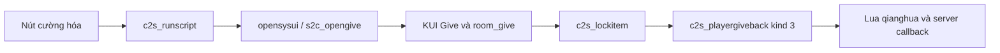

TÓM TẮT 5 DÒNG
1. DONE — hoàn tất khảo sát tĩnh UI cường hóa, không sửa mã, không build/chạy game, không mạng/VM.
2. Client gốc mở `KuiGive_New` qua `c2s_runscript` → script server → `s2c_opengive`, không mở cửa sổ trực tiếp bằng nút.
3. Đặt vật phẩm dùng khóa `c2s_lockitem`; xác nhận dùng `c2s_playergiveback`, `nKind=3`, tối đa 24 ID.
4. Coco đã có UI và protocol tương ứng, thêm nút VN “Cuong hoa”; hai file UI give giống hệt bản gốc theo SHA-256.
5. Chưa xác minh script Lua thực tế, tài nguyên SPR, hình ảnh runtime, kết quả cường hóa và độ tương thích binary; có ma trận test bên dưới.

# H-05 — UI cửa sổ cường hóa

Loại: khảo sát
Chủ đề: Luồng UI cường hóa từ mở cửa sổ đến đặt, xác nhận và đối chiếu client/server.
Từ khóa: cường hóa, KuiGive_New, c2s_runscript, c2s_lockitem, c2s_playergiveback, sysqianghua, PLAYER_GIVE, UI Coco
Trạng thái: DONE — khảo sát tĩnh; các giới hạn runtime giữ nguyên ở phần CHƯA XÁC MINH.
Độ phủ: đã liệt kê 6/6 phần tử; đối chiếu trực tiếp 3/6 tại root task và 0/11 ca đề xuất đã chạy.
Liên quan: H-06-he-thong-an.md; H-09.md; I-05-npc-chuc-nang.md; DESIGN/HUONG-DAN-TRA-CUU.md
Cần tôi quyết định: không

## Phạm vi và độ phủ

| Phần tử phạm vi | Độ phủ | Bằng chứng |
|---|---|---|
| Điểm vào và mở UI phía client A | Đã phủ tĩnh | `D:/JX-build/qh9A/Classes/gamescene/KgameWorld.cpp:14268`; `:14337` |
| Script mở UI trong gói server được giao | Đã phủ tĩnh | `C:/Jx1CocoV3/Folder/ServerNew-20260116T043145Z-3-001/ServerNew/_bin_v2_/gs/script/system/opensysui.lua:22`; `:26` |
| Đặt và xác nhận phía client A | Đã phủ tĩnh | `D:/JX-build/qh9A/Classes/gameui/KuiGive_New.cpp:805`; `:834`; `D:/JX-build/qh9A/Classes/gamecore/KProtocol.cpp:831` |
| So sánh O/C và hash | Giữ theo báo cáo cũ; chưa tái đối chiếu tại hai root task | `H-05-ui-cuong-hoa.md:106`; `:120` |
| Lua nghiệp vụ | Đã xác định giới hạn theo báo cáo cũ; chưa tái đối chiếu hết gói script | `H-05-ui-cuong-hoa.md:134` |
| Asset SPR và runtime | Chưa phủ | `H-05-ui-cuong-hoa.md:134` |

Ngày khảo sát: 2026-11-17. Trạng thái: **DONE (phạm vi khảo sát tĩnh)**.

## Phạm vi và nguồn bằng chứng

Chỉ đọc source cần cho luồng mở/đặt/xác nhận và bố cục. Không sửa mã, không kết nối mạng, không truy cập VM, không chạy executable game/server; Python chỉ dùng `python -I -` để đọc file, tính hash và in trích đoạn. Không ghi secret.

Quy ước `file:dòng` trong báo cáo:

| Ký hiệu | Root đã đọc | Vai trò |
|---|---|---|
| O | `C:/Jx1CocoV3/Folder/Client2912-20260116T044348Z-3-001/Client2912/Client/Classes` | Client gốc đúng họ đường dẫn Folder/Client2912 của task |
| C | `D:/Android/b/Client/Classes` | Bản Coco, chỉ đọc |
| S | `D:/JX-source/server/jxOnline/gameserver` | Nguồn server, chỉ đọc |
| M | `D:/JX-source/client/Classes` | Bản mirror tham chiếu lúc tìm symbol; kết luận so sánh dùng O và C |

`D:AndroidbClient` trong task không phải đường dẫn tuyệt đối chuẩn; thử `D:/AndroidbClient` không tồn tại. Đường dẫn `D:/Android/b/Client` có thật và khớp bản đồ code local. Không khẳng định M là bản gốc: hash của M với một số file core/scene bằng C trong khi khác O.

## ĐÃ XÁC MINH

### 1. Điểm vào và bố cục client gốc

- `O/gamescene/KgameWorld.cpp:1987` nối nút cường hóa vào `KgameWorld::qiangItemCallback`; `O/gamescene/KgameWorld.cpp:14135` là callback. Callback chặn khi shop, thiếu core, autoplay và skill 1705/1706 còn hiệu lực; tại `:14184` gọi `__opensysui(2,1)`. Đoạn tạo `Kuigive` trực tiếp ở `:14185` đang nằm trong comment.
- `O/gamescene/KgameWorld.cpp:14191` là `openGive`; counterpart `C/gamescene/KgameWorld.cpp:14281` đặt `nOpenUiState=BTN_ITME_GIVE`, tạo `KuiGive_New` tại `:14294`, đồng thời mở túi đồ theo `_ui_store_model` tại `:14301`. Vì vậy không dùng nhánh `Kuigive` cũ để suy ra bố cục đang được gọi.
- `O/vn/gamescence/KgameWorldVN.cpp:1290` chứa nút VN cũ bị comment. Coco có nút label thật ở `C/vn/gamescence/KgameWorldVN.cpp:1482`, callback tại `:1484`, vị trí `(visibleSize.width-140, visibleSize.height/2+140)` tại `:1485`, thêm vào `pFixedMenu` tại `:1487`.

Hai file give UI giống byte giữa O/C, nên các dòng `KuiGive_New.cpp` sau áp dụng cho cả hai. Kích thước thực tế nền lấy từ texture SPR, chưa đọc/render asset để đo pixel toàn cửa sổ.

| Thành phần | Giá trị tĩnh | Bằng chứng |
|---|---|---|
| Nền | Đọc SPR dưới `\\Spr\\Ui3\\...`; `m_size=texture contentSize` | `C/gameui/KuiGive_New.cpp:83`, `:95` |
| Vị trí nền | `(origin.x+visibleSize.width/2-m_size.width/2, origin.y+visibleSize.height/2)` | `:97` |
| Tiêu đề | Font 12; `(m_size.width/2,m_size.height-80)` | `:592` |
| Nội dung | RichText, bề rộng ban đầu `m_size.width-40`; vị trí `(20,m_size.height-105-nRenderSize.height)` | `:140`, `:581` |
| Gốc vùng item | `m_StartPos_g=(22,192)` | `:120` |
| Ô vật phẩm | 28 đơn vị; không đồng nghĩa ảnh runtime 28 pixel trên mọi thiết bị | `C/gameui/KuiGive_New.h:7` |
| Vị trí icon | `x=22+DataX*28+DataW*28/2`; `y=m_size.height-(192+DataY*28+DataH*28/2)` | `C/gameui/KuiGive_New.cpp:1499` |
| Xác nhận/hủy | 2 nút SPR; offset x lần lượt -38/+38, menu `(m_size.width/2,45)` | `:766`, `:780`, `:785` |
| Số lượng ID hỗ trợ | 24; header còn khai báo `MAX_ITEM_COUNT=60` cho item, không được hiểu 60 slot give | `C/gameui/KuiGive_New.h:8` |

### 2. Chuỗi gói tin mở → đặt → xác nhận

| Bước | Hướng và protocol | Dữ liệu/hành vi nguồn | Bằng chứng file:dòng |
|---|---|---|---|
| Yêu cầu mở | C→S `c2s_runscript`, `CLIENT_RUN_SCRIPT` | `nKind=2,nVala=1,nValb=0,nValc=0` | `C/gamescene/KgameWorld.cpp:14274`; `C/gamecore/CoreShell.cpp:247`; `C/gamecore/KProtocol.cpp:312` |
| Server nhận mở | Server dispatch | `nKind==2` gọi `\\script\\system\\opensysui.lua`, hàm `opensysui` | `S/Sources/Core/Src/KProtocolProcess.cpp:320`, `:8299`, `:8315` |
| Server trả cửa sổ | S→C `s2c_opengive`, `PLAYER_GIVE` | API `LuaGiveItemUI` đóng gói mô tả, title, callback, error, `m_nNum`; cap 24 | `S/Sources/Core/Src/ScriptFuns.cpp:24267`, `:24274`, `:24280`, `:24306` |
| Client nhận cửa sổ | `SyncGive` → `GDCNI_GIVE` → `openGive` | Chặn khi đang trade, clear `room_give`, chuyển dữ liệu UI | `C/gamecore/KProtocolProcess.cpp:165`, `:247`; `C/gameui/GameSpaceChangedNotify.cpp:204` |
| Đặt vật phẩm | UI operation `GOI_NEW_CHANGE_ITEM`, đích `room_give` | `KuiBtnControl` kiểm tra `BTN_ITME_GIVE`, chặn thao tác quá gần theo game time `<=2` | `C/gameui/KuiBtnControl.cpp:627`, `:643`, `:661` |
| Khóa khi đặt | C→S `c2s_lockitem`, `PLAYER_AUTOMUVE_ITEM_COMMAND` | Core setLock `pos_give`, `ApplyLockItem`, đặt item vào room client và cập nhật UI; server setLock theo ID | `C/gamecore/CoreShell.cpp:4154`, `:4215`, `:4232`; `C/gamecore/KPlayer.cpp:2046`; `S/Sources/Core/Src/KProtocolProcess.cpp:8171` |
| Lấy khỏi vùng give | C→S `c2s_lockitem` với lock=0 | Unlock local, gửi unlock, phục hồi UI túi và `PickUpItem(room_give)` | `C/gameui/KuiGive_New.cpp:894`, `:907`, `:929` |
| Xác nhận | C→S `c2s_playergiveback`, `PLAYER_GIVE_CALLBACK` | Gom ID local; nếu `m_nNeed` và callback bằng `sysqianghua`, chọn `GOI_GIVE_ITEM_QIANG`; core gửi `nKind=3` | `C/gameui/KuiGive_New.cpp:790`, `:837`; `C/gamecore/CoreShell.cpp:3176` |
| Serialize xác nhận | C→S, struct nguyên khối | Chuyển local index sang `Item[index].GetID()`, luôn duyệt 24 phần tử, gửi `sizeof(PLAYER_GIVE_CALLBACK)` | `C/gamecore/KProtocol.cpp:831` |
| Server thực hiện | `c2sGiveBack`, nhánh kind 3 | Tìm ID trong item list của người chơi, remove rồi add lại; kiểm `i<=0`/`i>24`; gọi callback trong `qianghua.lua` | `S/Sources/Core/Src/KProtocolProcess.cpp:290`, `:9251`, `:9403`, `:9426`, `:9442` |
| Hủy | C→S `c2s_playergiveback`, kind 0 | `GOI_GIVE_ITEM_FAIL`; server nhận nhánh kind 0, callback có `sysqianghua` gọi error của `qianghua.lua` | `C/gameui/KuiGive_New.cpp:937`, `:980`; `C/gamecore/CoreShell.cpp:3154`; `S/Sources/Core/Src/KProtocolProcess.cpp:9296`, `:9318` |

Điểm phân biệt: đặt item trong UI mới dùng **khóa ID**, không phải khẳng định một gói di chuyển server sang room give ở mỗi lần đặt. `GOI_ADDITEM_CLIENT` trong `Kuigive` cũ không phải đường đặt đang khảo sát. `g_StrCmp` kiểm chiều dài trước rồi so bộ nhớ (`C/engine/KStrBase.cpp:342`); không được đảo điều kiện này theo quy ước trả 0 của `strcmp`.

| Struct/giới hạn | Trường đã đọc | Bằng chứng |
|---|---|---|
| `CLIENT_RUN_SCRIPT` | `BYTE ProtocolType`, 4 `int` | `C/gamecore/KProtocol.h:1061`; `S/Headers/KProtocol.h:1116` |
| `PLAYER_GIVE` | `BYTE ProtocolType`, mô tả `[256]`, `BYTE m_nNum`, title/callback/error mỗi trường `[64]` | `C/gamecore/KProtocol.h:3430`; `S/Headers/KProtocol.h:3629` |
| `PLAYER_GIVE_CALLBACK` | `BYTE ProtocolType`, `UINT m_uId[24]`, `BYTE nKind`, `int nPrice`, callback/error `[64]` | `C/gamecore/KProtocol.h:3455`; `S/Headers/KProtocol.h:3654` |
| Packing client | `#pragma pack(1)` | `C/gamecore/KProtocol.h:10` |
| Giới hạn server kind 3 | `1..24` ID được đếm; điều kiện tính hợp lệ/tiêu hao còn phụ thuộc Lua | `S/Sources/Core/Src/KProtocolProcess.cpp:9259`, `:9426` |

Không báo byte length/opcode số là kết quả wire đã đo: chưa build kiểm `sizeof`, ABI/type-width, hay capture packet. `SendClientCmdGive` có cap biến `nItemNum=24` nhưng vòng lặp thực tế luôn đọc 24 ID (`C/gamecore/KProtocol.cpp:841`); số item của UI và số lần serialize cần phân biệt.

### 3. So sánh O/C và phần còn thiếu

| Hạng mục | O | C | Kết luận tĩnh |
|---|---|---|---|
| `Kuigive.cpp` cũ | Có | Có | Giống byte; không phải lớp được `openGive` tạo |
| `KuiGive_New.cpp` | Có | Có | Giống byte; không thiếu implementation UI này ở Coco |
| Protocol header | Có | Có | `KProtocol.h` và `KProtocolDef.h` giống byte giữa O/C |
| Mở/đặt/xác nhận | Có các symbol đã dẫn | Có các symbol đã dẫn | Không phát hiện đứt nhánh tại các đoạn đã đọc; chưa coi toàn bộ core giống nhau |
| Nút VN | Nút cũ trong comment | Label thật “Cuong hoa” được thêm | Coco có bổ sung điểm vào; không kết luận nút đang hiển thị trong APK thực tế |
| Script nghiệp vụ | Source C++ gọi Lua | Vẫn cần phản hồi server | Không tìm thấy `opensysui.lua`/`qianghua.lua` dưới `D:/JX-source/server` khi lọc tên `.lua`; cần bộ script được phép đọc để xác minh |
| Tỷ lệ/phí/nguyên liệu/preview kết quả | UI give dùng title và RichText từ server | Cùng implementation | Chưa chứng minh có widget riêng hoặc thông tin này trong nội dung Lua; không gọi đây là regression riêng của Coco |

Hash SHA-256 đầy đủ, theo thứ tự O và C; mỗi cặp cho cùng giá trị:

| File | SHA-256 |
|---|---|
| `gameui/Kuigive.cpp` | `e43f38774e37b31554a20f5336bc90263e3c7c48ea135595c427dcc6f5a37a1b` |
| `gameui/KuiGive_New.cpp` | `3bdfc43f197ece76a7bc84dc0830643fdf88ca2f08d4b0d0f82f9fca1194fc11` |
| `gamecore/KProtocol.h` | `1152e31d022ec8d78931fa3285f717bc553fe7727c6c0961ddc3214bb77ca084` |
| `gamecore/KProtocolDef.h` | `78cc6d34999b4ce8cfe1adfe13f358e15fcc4d9fc3985ec7bdacb752f2441810` |

Các thiếu sót/rủi ro cần bước tiếp theo, chưa sửa:

1. **Thiếu bằng chứng Lua:** chưa biết `opensysui(2,1,0,0)` thực sự gọi UI với `sysqianghua`/`m_nNum` nào, yêu cầu item, phí, tỷ lệ, callback thành công/thất bại. API C++ cung cấp cơ chế, chưa chứng minh dây nối script hoàn chỉnh.
2. **Thiếu bảo vệ biên hiển thị rõ trong callback UI:** vòng gom `m_giveItemData` vào `pUI.uId[i]` không có điều kiện `i<24` tại `KuiGive_New.cpp:800`; cap phòng/lưới ở tầng khác có thể bảo vệ nhưng chưa chứng minh invariant này. Giống nhau ở O/C, cần test biên; không khẳng định overflow đã xảy ra.
3. **Cần kiểm kê an toàn vật phẩm khi túi đầy:** server nhánh kind 3 có `ItemSet.Remove(nIdx[j])` nếu không add lại được tại `S/Sources/Core/Src/KProtocolProcess.cpp:9410`. Đây là nhánh source đáng kiểm thử với dữ liệu dùng thử, không phải kết luận đã mất đồ runtime.
4. **Thiếu trạng thái chờ/kết quả đã xác minh:** sau xác nhận, UI gọi callback đóng và `removeFromParent` (`C/gameui/KuiGive_New.cpp:854`); chưa chứng minh chống gửi lặp, timeout, unlock khi mất kết nối hoặc hiển thị kết quả nghiệp vụ.

## CHƯA XÁC MINH

- Lua thực tế và server binary đang dùng có khớp S hay không; không đọc/chạy bộ triển khai VM.
- APK đang cài có chứa thay đổi nút VN; cấu hình khởi tạo scene hiện tại, tài nguyên SPR/font/chuỗi dịch có đầy đủ hay không.
- Kích thước nền, số hàng/cột thực tế vùng give, hitbox, chồng lấn, scaling, notch, drag/touch trên thiết bị.
- Byte length/opcode thực tế, ABI 32/64 bit và tính tương thích ID giữa client/server. So sánh header O/C không chứng minh khớp server binary.
- Tăng cấp, đồng bộ thuộc tính, tiền/nguyên liệu bị trừ, hiệu ứng sau nâng cấp, lưu/relogin và tất cả ca test bên dưới.
- Không build, không unit/integration test, không packet capture. Các giới hạn này là chủ đích khảo sát tĩnh, không phải test PASS.

## Ca test cho TESTER — CHƯA CHẠY

Chỉ thực hiện sau khi có task cho phép runtime, trên môi trường thử và vật phẩm dùng thử; không dùng dữ liệu có giá trị. Giá trị nghiệp vụ phải lấy từ Lua/cấu hình đã xác minh, không tự đặt tỷ lệ/phí.

| ID | Thao tác/điều kiện | Tiêu chí và bằng chứng cần thu |
|---|---|---|
| T01 | Mở UI qua nút bản gốc và nút VN Coco, trạng thái bình thường | Một yêu cầu `c2s_runscript(2,1,0,0)`; một phản hồi `s2c_opengive`; cửa sổ và túi mở, title/nội dung đúng; ảnh + log đã lọc |
| T02 | Đang shop, autoplay, skill 1705 hoặc 1706 | Bị chặn theo từng điều kiện, không mở UI/gửi yêu cầu mở khi return; xác minh thông báo dịch |
| T03 | Đang trade rồi nhận open give | `SyncGive` bỏ qua; không chiếm/mất item trade |
| T04 | Đặt một item, lấy ra, đặt lại; bấm liên tiếp trong <=2 tick game | ID khóa/unlock đúng, không nhân đôi icon hay số lượng; đối chiếu item server/client |
| T05 | Xác nhận 0, 1, 24 ID; thử thêm khi vùng đầy | Không ghi tràn, không mất/nhân đôi item; xác minh giới hạn phòng và nhánh lỗi số lượng, không ép gửi gói ngoài UI |
| T06 | Trang bị hợp lệ + nguyên liệu/tiền đủ theo Lua | `c2s_playergiveback` kind 3 đúng ID; kết quả/tiêu hao đúng Lua; ghi trước/sau, kiểm lưu khi relogin |
| T07 | Item sai loại, thiếu nguyên liệu/tiền, mức tối đa | Từ chối đúng nghiệp vụ, giữ item/tiền và giải phóng khóa đúng quy tắc |
| T08 | Hủy sau đặt item; lấy item ra rồi hủy; đóng/mở lại | Kind 0 đúng ID/callback, không còn khóa treo, không mất item |
| T09 | Túi đầy/thiếu chỗ trả item | Chặn hoặc hoàn trả an toàn; ưu tiên kiểm nhánh `ItemSet.Remove` bằng item thử và bản ghi trước/sau |
| T10 | Bấm xác nhận lặp, mất kết nối ở bước mở/khóa/xác nhận | Không thực thi cường hóa nhiều lần ngoài yêu cầu; có trạng thái phục hồi và khóa/item nhất quán sau reconnect |
| T11 | Màn hình hẹp/rộng, font VN, item chiếm nhiều ô, thiếu SPR dùng thử | 2 nút bấm được, tiêu đề/nội dung không che item; lỗi tài nguyên không crash; ảnh từng trường hợp |

## Lỗi gặp và xử lý trong lượt

| Lỗi | Cách đã thử/kết quả | Tồn tại và hướng tiếp tục |
|---|---|---|
| `Get-Content` mặc định hiển thị sai dấu task | Đọc lại đúng một lần với `-Encoding utf8`, nội dung đọc được | Không còn blocker |
| `Cannot find path 'D:\AndroidbClient' because it does not exist.` | Dùng đường dẫn local `D:/Android/b/Client` từ bản đồ code, xác nhận có Classes | Ghi rõ chuẩn hóa đường dẫn, không sửa task gốc |
| `rg : The term 'rg' is not recognized` | Chuyển sang PowerShell rồi Python isolated đọc trực tiếp file cần | Không cài công cụ/config |
| Tìm bằng PowerShell vô tình gồm `.bak`/`graphify-out/graph.json`, output bị truncate | Bỏ kết quả tổng quát làm bằng chứng; giới hạn `.cpp`/`.h` đúng thư mục và file nguồn | Không dùng cache graph/bản backup để kết luận |
| `UnicodeEncodeError: 'charmap' codec can't encode character '\ufffd'` khi in source | Đặt stdout UTF-8 trong lần đọc Python tiếp theo; trích đoạn đọc được | Chuỗi legacy có mojibake; báo cáo chỉ giữ symbol/giá trị rõ nghĩa, chưa xác minh hình ảnh tiếng Việt |

## Bàn giao

- Hoàn thành phạm vi khảo sát tĩnh và ma trận TESTER; không sửa code/source/asset.
- Chỉ tạo báo cáo này và thêm `## Kết quả` vào task theo yêu cầu cụ thể của H-05.
- Commit SHA: **không có** — lượt này không tạo commit; task có sẵn ở trạng thái untracked lúc bắt đầu, giữ nội dung và chỉ append kết quả.
- Push: **chưa push** — không được yêu cầu và task cấm mạng thật. Không có xác nhận GitHub; không tuyên bố công bố.

## Phát hiện khi chuẩn hóa

- Báo cáo đã có tiêu đề và kết luận; còn thiếu khối thông tin, sơ đồ Mermaid, bảng phạm vi và mục này. Đã bổ sung cấu trúc, không thay kết luận cũ.
- Kết luận cũ về việc không tìm thấy `opensysui.lua`/`qianghua.lua` thuộc root nguồn được ghi trong báo cáo. Root server task giao có `script/system/opensysui.lua` và `script/system/qianghua.lua`; đã đọc `opensysui.lua:22-26`, nhưng chưa kiểm chứng Lua nghiệp vụ đầy đủ hoặc runtime. Giữ nguyên kết luận cũ và nêu khác biệt root để người đọc phân xử.
