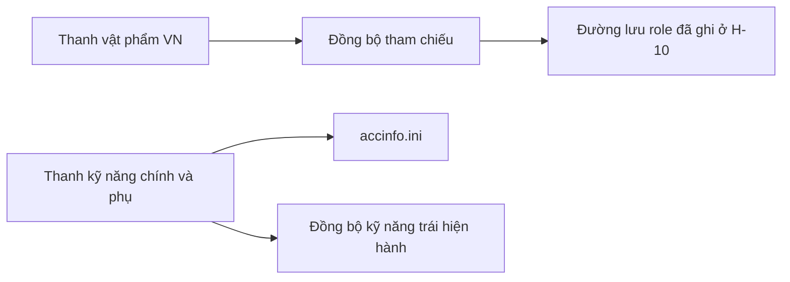

TÓM TẮT 5 DÒNG
1. PARTIAL — hoàn tất khảo sát tĩnh các đường gán/lưu/đồng bộ đã tìm thấy; phím nóng PC và hành vi runtime chưa xác minh. [NGUỒN]
2. Thanh vật phẩm tham chiếu có 3 ô ở client VN và server; server lưu vị trí gán trong TDBItemData.iparamb5. [NGUỒN]
3. Coco có 1 nút skill chính và tối đa 8 nút phụ; cấu hình giao diện được ghi/đọc ở client qua accinfo.ini. [NGUỒN]
4. Skill trái hiện hành có c2s_skillsync; dữ liệu này không đồng nghĩa với lưu toàn bộ thanh skill trên server. [NGUỒN]
5. Không sửa mã, không chạy game/exe, build, VM hay mạng; báo cáo kèm bảng bằng chứng và ca test chưa chạy. [CHƯA KIỂM]

# H-10 — Phím tắt và thanh nút

Loại: khảo sát
Chủ đề: Phạm vi phím tắt, ô vật phẩm và thanh kỹ năng của client VN, kèm đường lưu và đồng bộ.
Từ khóa: phím tắt, thanh nút, vật phẩm nhanh, kỹ năng, accinfo.ini, c2s_skillsync, H-10
Trạng thái: PARTIAL — đã khảo sát tĩnh; mapping phím PC, lưu bố cục trên server và hành vi khi chạy chưa được chứng minh.
Độ phủ: 7/10 nhóm của H-10; ba nhóm chưa phủ được ghi riêng bên dưới.
Liên quan: [H-11](H-11-nut-he-thong-cai-dat.md), [H-12](H-12-tu-dong-chien-dau.md), [Mục lục tri thức](../DESIGN/MUC-LUC-TRI-THUC.md).
Cần tôi quyết định: không

## Phạm vi và độ phủ

Bảng đếm theo nhóm khảo sát. `A` là `D:/JX-build/qh9A`; `C` và `S` bên dưới là gốc lịch sử của H-10. Mốc tại `A` được đọc tĩnh trong R-05c. Markdown dùng UTF-8; các mốc đọc lại dựa vào định danh ASCII, không dựa vào cách giải mã chú thích nguồn cũ.

| Nhóm | Độ phủ | Nguồn và giới hạn |
|---|---|---|
| Room và thanh vật phẩm VN | Đã phủ | `A/Classes/gamecore/GameDataDef.h:94–96` là 3 × 1; `A/Classes/vn/gameui/KuiItemImmediaBoxVN.h:11` có 3 ô, `.cpp:314` duyệt các ô để làm mới UI. |
| UI vật phẩm thường và mảng chọn kỹ năng trái/phải | Đã phủ | `A/Classes/gameui/KuiItemImmediaBox.h:92`, `A/Classes/gameui/KuiSortSkill_l.h:14`, `A/Classes/gameui/KuiSortSkill_r.h:16` đều có khai báo 9. Đây là số phần tử, chưa phải mapping bàn phím. |
| Gán, xóa và dùng vật phẩm nhanh | Đã phủ | `A/Classes/gamecore/KPlayer.cpp:5773`, `:5790`; `A/Classes/vn/gameui/KuiItemImmediaBoxVN.cpp:263–269`. |
| Đồng bộ, lưu và nạp tham chiếu vật phẩm phía server | Đã phủ ở H-10 | `S/gameserver/Sources/Core/Src/KItemList.cpp:10792`, `S/gameserver/Sources/Core/Src/KPlayerDBFuns.cpp:1124`, `:1681`. Chưa đối chiếu lại nguồn C++ server trong R-05c. |
| Kỹ năng chính: nút, gán và lưu trên client | Đã phủ | Một nút tại `A/Classes/vn/gamescence/KgameWorldVN.cpp:594`; gán và lưu tại `:2459`, `:2627–2642`. |
| Kỹ năng phụ: danh sách, gán và lưu trên client | Đã phủ | `A/Classes/gamescene/KgameWorld.h:32`, `:510` khai báo tối đa 8; `A/Classes/gamescene/KgameWorld.cpp:12770` gán hoặc gỡ, `A/Classes/vn/gamescence/KgameWorldVN.cpp:5236` đọc lại vào thanh nút. |
| Đồng bộ kỹ năng trái đang chọn | Đã phủ | `A/Classes/gamecore/KPlayer.cpp:3047`, `:3079`; handler server theo H-10 tại `S/gameserver/Sources/Core/Src/KProtocolProcess.cpp:6147`. |
| Mapping phím gốc PC | Chưa phủ | Thiếu nguồn UI PC có mapping; không đếm từ số ô. |
| Lưu toàn bộ bố cục thanh kỹ năng trên server | Chưa phủ | H-10 chưa tìm thấy bằng chứng lưu bố cục; đồng bộ kỹ năng trái là phạm vi riêng. |
| Đối chiếu bản chạy, dữ liệu role và gói tin thực | Chưa phủ | Các ca TESTER, kích thước gói và đối chiếu source với bản chạy chưa được thực hiện. |

Ngày khảo sát: 17/11/2026. Nhánh đã kiểm tra: `task/H-10`. Trước khi ghi, `git status --short --branch` chỉ có `?? JX1_OPS/TASKS/H-10.md`; giữ nguyên nội dung task có sẵn và chỉ nối mục kết quả.

## Phạm vi và cách đọc bằng chứng

Chỉ đọc source liên quan, không đọc dữ liệu tài khoản hoặc nội dung file cấu hình người chơi. Các ký hiệu đường dẫn dưới đây được nối với đường dẫn tương đối trong bảng, số dòng tính từ 1:

| Ký hiệu | Gốc source |
|---|---|
| C | `C:\Jx1CocoV3\Folder\Client2912-20260116T044348Z-3-001\Client2912\Client\Classes` |
| S | `D:\JX-source\server\jxOnline` |

Có đọc ban đầu `D:\JX-source\client\Classes` để tìm symbol; số dòng client trong báo cáo đều lấy lại từ **C**, không trộn số dòng giữa hai cây. Folder `Client2912...` chứa source Cocos và giao diện VN; tên folder không chứng minh đây là client PC nguyên bản. Không kiểm tra sự tương ứng source–binary.

## ĐÃ XÁC MINH

### Số ô và lớp dữ liệu

| Thành phần | Số lượng/giới hạn trong source | Bằng chứng file:dòng | Ý nghĩa |
|---|---:|---|---|
| Room vật phẩm nhanh, client | 3 × 1 = 3 | C `gamecore/GameDataDef.h:94`, `:95`, `:96` | `MAX_IMMEDIACY_ITEM` tính từ kích thước room; chú thích `//9` không phải giá trị hiện hành |
| Room vật phẩm nhanh, server | 3 × 1 = 3 | S `header/GameDataDef.h:76`, `:77`, `:78` | Hai phía khớp giới hạn 3 |
| UI vật phẩm VN | 3 | C `vn/gameui/KuiItemImmediaBoxVN.h:11`; `.cpp:314` | Vòng refresh đọc `m_refItem[0..2]` |
| UI vật phẩm lớp thường | 9 | C `gameui/KuiItemImmediaBox.h:92`; `.cpp:233` | Tồn tại đường UI cũ dùng `GetImmediacyItemIndex`, khác UI VN |
| Skill chính Coco | 1 | C `vn/gamescence/KgameWorldVN.cpp:543`, `:2340` | `pMainSkillItem`, `mainattackSkill`, gán skill trái |
| Skill phụ Coco | Tối đa 8 | C `gamescene/KgameWorld.h:31`, `:506`; `.cpp:12707`, `:12739` | Mảng `auxiliaryskill`, điền ô trống; không phải 8 skill phải hoạt động đồng thời |
| Skill chọn trái/phải trong core | 2 ID hiện hành | C `gamecore/KPlayer.cpp:3043`, `:3069` | Trạng thái chọn trái và phải khác danh sách nút phụ |
| Mảng shortcut trong cửa sổ chọn skill | 9 mỗi header trái/phải | C `gameui/KuiSortSkill_l.h:14`, `:69`; `KuiSortSkill_r.h:16`, `:72` | Chỉ xác nhận khai báo; chưa chứng minh là 9 phím nóng đang dùng |

Giao diện VN tạo `KuiItemImmediaBoxVN` ở C `vn/gamescence/KgameWorldVN.cpp:520`. `KgameWorldVN` kế thừa `KgameWorld` (C `vn/gamescence/KgameWorldVN.h:19`), override `setattackSprInfo` ở `:93`. Vì vậy không lấy con số 9 của UI thường hoặc mảng chọn skill để kết luận thanh VN có 9 ô.

### Gán, dùng, lưu vật phẩm

1. UI mô tả vật phẩm kiểm tra trùng theo hash tên trong 3 ô, rồi gọi `ApplyCreateItemRef(itemID, tag)` — C `vn/gameui/KuiItemdescVN.cpp:2628`, `:2633`.
2. Client gửi index ô và ID mạng vật phẩm bằng `PLAYER_CREATE_REF_ITEM_COMMAND` — C `gamecore/KPlayer.cpp:5749`. Xóa dùng `PLAYER_REMOVE_REF_ITEM_COMMAND` ở `:5758`.
3. Server đăng ký handler ở S `gameserver/Sources/Core/Src/KProtocolProcess.cpp:325`, `:326`; `KPlayer::CreateRefItem` tìm vật phẩm thuộc danh sách người chơi bằng `SearchID`, rồi gọi `PlaceItemToRef` — S `gameserver/Sources/Core/Src/KPlayer.cpp:12216`. Xóa ở `:12229`.
4. `PlaceItemToRef` kiểm tra index `[0,3)`, ghi hash tên vào `m_refItem[index].nameID`, gửi `s2c_refitemsync`; xóa đặt 0 và gửi lại — S `gameserver/Sources/Core/Src/KItemList.cpp:10792`, `:10811`. Đây là tham chiếu theo **tên**, không phải chuyển hẳn vật phẩm vào room nhanh.
5. Client nhận ID mạng, tìm vật phẩm rồi dựng lại hash tên và refresh UI VN — C `gamecore/KPlayer.cpp:5768`, `:5784`; handler ở `gamecore/KProtocolProcess.cpp:5280`.
6. Khi bấm nút VN, client duyệt vật phẩm có cùng hash tên và `pos_equiproom`, gọi `ApplyUseItem` với vị trí thật — C `vn/gameui/KuiItemImmediaBoxVN.cpp:260`, `:263`, `:269`. Nhánh thuốc gửi `c2s_playereatitem` — C `gamecore/KPlayer.cpp:1997`.

**Lưu trên server đã có bằng chứng source:** `SavePlayerItemList` ghi `FindHotKey(nItemIndex)` vào `TDBItemData.iparamb5` — S `gameserver/Sources/Core/Src/KPlayerDBFuns.cpp:1681`. `FindHotKey` so hash tên, trả `index + 1`, hoặc 0 nếu không gán — S `gameserver/Sources/Core/Src/KItemList.cpp:10826`. Khi nạp item, `iparamb5 > 0` được đổi về index 0-based và gọi lại `PlaceItemToRef` — S `gameserver/Sources/Core/Src/KPlayerDBFuns.cpp:1124`.

Role buffer dùng `TRoleData.dwItemOffset`, `nItemCount`, `pBuffer` — S `gameserver/Lib/S3DBInterface.h:184`, `:194`, `:199`, `:202`. Trường `iparamb5` khai báo ở `:275`; `SavePlayerItemList` lấy con trỏ item tại offset ở S `gameserver/Sources/Core/Src/KPlayerDBFuns.cpp:1624`, cập nhật số item và độ dài buffer ở `:1724`, `:1727`. Vị trí thật `ilocal/ix/iy` được lưu riêng ở `:1651`. Chưa kiểm tra DB thực hoặc lưu thành công lúc chạy.

Hệ quả tĩnh cần test: mọi vật phẩm trùng tên có thể được `FindHotKey` trả cùng một ô; reference phụ thuộc tên/hash và item còn trong danh sách lúc save/load. Chưa xác nhận hành vi khi dùng hết vật phẩm, đổi tên hoặc xung đột hash.

### Gán, dùng, lưu skill Coco

| Thao tác | Đường source | Nơi giữ/lưu |
|---|---|---|
| Chọn/gỡ skill chính | C `vn/gameui/KuiSkilldescVN.cpp:935`, `:948`, `:951` → `setattackSprInfo` | C `vn/gamescence/KgameWorldVN.cpp:2340` gán `mainattackSkill` và `SetLeftSkill(..., true)` |
| Chọn/gỡ skill phụ | C `vn/gameui/KuiSkilldescVN.cpp:956`, `:967` → `setaauxiliaryskillInfo(..., true)` | C `gamescene/KgameWorld.cpp:12637`, `:12650`, `:12739`; xóa khi đã có, thêm vào ô trống khi chưa có |
| Bấm nút chính | C `gamescene/KgameWorld.cpp:2982`, `:2996` | Gọi `g_pCoreShell->MainAttack(0)` |
| Bấm nút phụ | C `gamescene/KgameWorld.cpp:3997`, `:4024`, `:4025`, `:4058` | Nhánh skill thường đặt skill phải rồi `UseSkill`; aura gọi `SetAuraSkill` |
| Skill chính qua UI VN | C `vn/gamescence/KgameWorldVN.cpp:2491` | `accinfo.ini`, section `skill_<hash tên nhân vật>`, khóa `left/genre/path` |
| Skill phụ | C `gamescene/KgameWorld.cpp:12984` | `accinfo.ini`, section `skill_<hash tên>_<i>`, khóa `right/genre_p/model_p/path_p` |
| Khôi phục giao diện VN | C `vn/gamescence/KgameWorldVN.cpp:5015`, `:5033`, `:5048`, `:5060` | Đọc lại section chính và tối đa 8 section phụ |
| Skill trái trong cấu hình auto | C `gamecore/KPlayer.cpp:3023`, `:3028`, `:3032`, `:3039` | Khi `nIsNoLogin` bật: `jx50ai/autoset/%u_set.ini`, section `AAAA`, khóa `LeftSkill_0`; WriteInteger nằm trong nhánh Load thành công |

`ACC_FILE_PATH` định nghĩa bằng chuỗi `accinfo.ini` ở C `gameui/Uiglobaldata.h:13`. Chỉ đọc mã ghi/đọc các khóa skill; không mở file `accinfo.ini` hoặc cấu hình nhân vật thực tế.

`SetLeftSkill` ghi ID hiện hành và gửi `SKILL_LEFT_SYNC` với `m_Type=0` — C `gamecore/KPlayer.cpp:3043`, `:3046`, `:3054`. Server nhận trong `c2sskillsync` ở S `gameserver/Sources/Core/Src/KProtocolProcess.cpp:6147`, gọi `SetCurLeftSkillID`; hàm này cập nhật ID, index, level và tính enhance — S `gameserver/Sources/Core/Src/KPlayer.cpp:9504`. **Đã xác minh đồng bộ trạng thái hiện hành; chưa có bằng chứng server lưu bố cục 8 nút skill trong role buffer.** `SetRightSkill` ở C `gamecore/KPlayer.cpp:3064` đặt ID/index ở client và xử lý aura; thân hàm đã đọc không gửi gói riêng lưu thanh nút.

### Gói tin liên quan

| Hướng | Symbol | Payload ngoài ProtocolType | Bằng chứng |
|---|---|---|---|
| C → S | `c2s_create_ref_item` / `PLAYER_CREATE_REF_ITEM_COMMAND` | `int nIndex`, `UINT ndwID` | C `gamecore/KProtocol.h:3505`; S `gameserver/Headers/KProtocol.h:927` |
| C → S | `c2s_remove_ref_item` / `PLAYER_REMOVE_REF_ITEM_COMMAND` | `int nIndex` | C `gamecore/KProtocol.h:3512`; S `gameserver/Headers/KProtocol.h:934` |
| S → C | `s2c_refitemsync` / `REF_ITEM_SYNC` | `int nIndex`, `UINT ndwID`; ID 0 khi xóa | C `gamecore/KProtocol.h:3518`; S `gameserver/Headers/KProtocol.h:940`; `KItemList.cpp:10821` |
| C → S | `c2s_skillsync` / `SKILL_LEFT_SYNC` | `int m_nLeftskill`, `INT m_Type` | C `gamecore/KPlayer.cpp:3046`; S `gameserver/Headers/KProtocol.h:2313` |
| C → S | `c2s_playereatitem` / `PLAYER_EAT_ITEM_COMMAND` | ID item, place, X, Y | C `gamecore/KPlayer.cpp:1999`; `gamecore/KProtocol.h:899` |
| C → S | `c2s_npcskill` / `NPC_SKILL_COMMAND` | skill ID, X, Y | C `gamecore/KProtocol.cpp:237`, `:245` |

Không gán số opcode hoặc kích thước wire từ chú thích/suy đoán ABI. Các hàm gửi dùng `sizeof(...)`; chưa build để xác minh padding/packing, chưa capture gói tin. Đây là bản đồ symbol/payload source để TESTER đối chiếu sau.

### Điểm cần chú ý khi kiểm thử

- C `vn/gameui/KuiItemImmediaBoxVN.cpp:191` tạo tag `nBoxIndex + 1`; callback lấy tag rồi `idx--` ở `:244`, `:245`, nhưng dòng `:247` lại đọc `m_ImmediaItem[idx-1]`. Ô đầu có thể tạo chỉ số -1 ở biểu thức này; đường dùng item sau đó đọc `m_refItem[idx]` ở `:263`. Đây là dấu hiệu lệch chỉ số trong source, **chưa xác nhận lỗi runtime**, không sửa trong task khảo sát.
- `clearItemData` của VN vẫn lặp `IMMEDIA_ITEM_COUNT` (9) ở C `vn/gameui/KuiItemImmediaBoxVN.cpp:326`, trong khi refresh VN lặp 3 ở `:314`. Cần phân biệt đường gọi và guard thực tế; không kết luận có truy cập vượt vùng chỉ từ số vòng lặp này.

## CHƯA XÁC MINH

- **Phím gốc PC:** chưa có bảng mapping phím số/F1–F12/chuột được chứng minh bằng source UI PC. Tìm các mẫu `KEY_F1`, `VK_F1`, `DIK_F1`, `OnKeyDown`, `onKeyPressed`, `EventListenerKeyboard` trong các thư mục UI/world của C không có kết quả. `KKeyboard.cpp` phía cây server chỉ là lớp input tổng quát, không đủ làm bằng chứng mapping gameplay. Không suy ra phím 1–3 hoặc F1–F8 từ số ô.
- Chưa chứng minh 9 phần tử `ms_ShortcutSkills` được dùng làm phím nóng, hoặc UI thường 9 ô là bản PC nguyên gốc.
- Chưa xác nhận bản build đang dùng nhánh UI VN nào, đủ 8 nút phụ có hiển thị đồng thời hay không, tọa độ/chạm/cooldown/aura thực tế.
- Chưa xác nhận layout skill có được server lưu ở đường khác; bằng chứng đã tìm được là cấu hình local và sync skill trái. Chưa theo dõi DB runtime, đổi thiết bị, chuyển GS hoặc đăng nhập lại.
- Chưa xác minh opcode số, kích thước gói, source–binary, dữ liệu role đang tồn tại và khả năng tương thích client–server thực tế.

## Ca test cho TESTER — CHƯA CHẠY

Chỉ chạy trong phiên kiểm thử được phê duyệt riêng, dùng nhân vật/dữ liệu thử. Không cần đưa nội dung file tài khoản vào bằng chứng.

| ID | Thao tác | Kết quả/điều cần đối chiếu |
|---|---|---|
| H10-T01 | Gán 3 loại thuốc khác tên vào từng ô, bấm ô 1/2/3 | Đúng vật phẩm, đúng số lượng; tập trung ô đầu do dấu hiệu `idx-1`; log lỗi bộ nhớ nếu có |
| H10-T02 | Gán/xóa một ô rồi đăng xuất/đăng nhập | Gán/xóa được phục hồi đúng; đối chiếu create/remove/ref-sync và `iparamb5=0` hoặc 1..3 trên dữ liệu thử |
| H10-T03 | Có nhiều stack cùng tên, dùng hết một stack rồi đăng nhập lại | Xác định ô tham chiếu chuyển sang stack nào, số lượng tổng và trạng thái khi không còn item |
| H10-T04 | Gán skill chính và 8 skill phụ khác nhau, thêm skill thứ 9 | Kiểm tra giới hạn 8, không đè ngoài ý muốn; phân biệt skill chính với skill phải hiện hành |
| H10-T05 | Bấm lại chức năng gán phụ cho skill đã gán, rồi mở lại game | Nút được gỡ và cấu hình local không khôi phục nhầm; kiểm tra thứ tự các ô |
| H10-T06 | Gán skill chính/phụ, đăng nhập lại cùng thiết bị; sau đó dùng thiết bị thử khác có cấu hình sạch | Xác định persistence local so với server; đối chiếu khóa skill đã lọc, không thu thập khóa tài khoản |
| H10-T07 | Đổi skill chính, dùng skill phụ thường và aura; chuyển GS được phép | Đúng skill trái, skill phải, aura và cooldown; đối chiếu `c2s_skillsync` với gói thi triển |
| H10-T08 | Khi có client PC được xác nhận: thử phím số, F1–F12 và chuột trong vùng thử | Ghi mapping thực tế và cách gán/lưu; không coi bảng phím phổ biến là kết quả đã xác minh |
| H10-T09 | Trên harness/test được phép, đưa index ô -1/3 vào xử lý gán/xóa | Handler giữ giới hạn `[0,3)`, không làm thay đổi các ô hợp lệ; không gửi vào production |

## Lỗi công cụ, giới hạn và bàn giao

- `rg` không có trong PATH: `The term 'rg' is not recognized ...`; chuyển sang `Get-ChildItem`/`Select-String`, khảo sát tiếp bằng PowerShell, không cài công cụ.
- Một lần dò nhầm `gameserver/Sources/MultiServer/Goddess` trả `Cannot find path ... because it does not exist`; kết quả liệt kê xác định Goddess nằm ở `gateway/Sources/MultiServer/Goddess`. Không cần đọc DB server đó để chứng minh nhánh lưu item trong role buffer, nên không mở rộng khảo sát.
- Một số kết quả tìm rộng bị cắt; các kết luận chính được đọc lại bằng đoạn dòng hoặc truy vấn symbol hẹp. Không dùng phần bị cắt làm bằng chứng độc lập. Chú thích encoding cũ bị lỗi ký tự; báo cáo dựa vào symbol/câu lệnh.
- Đã chạy: đọc source và kiểm tra nội dung báo cáo/diff. Chưa chạy: build, unit/integration test, game, packet capture, DB query, VM, mạng. Không tạo parser/script phụ, không dùng Python.
- **Trạng thái: PARTIAL.** Phần còn thiếu là mapping PC và xác minh runtime; bước tiếp tục là cung cấp source UI PC đúng phiên bản hoặc giao TESTER chạy các ca trên trong môi trường được phép. Không bị chặn quyền đối với phần khảo sát tĩnh đã hoàn thành.
- **Commit SHA: chưa có; chưa commit. Chưa push** vì task không yêu cầu commit/push. Chỉ ghi báo cáo này và nối `## Kết quả` vào file task; không sửa source hoặc file ngoài vùng H-10.

## Phát hiện khi chuẩn hóa

- Một số dòng đổi giữa gốc C của H-10 và bản A; ví dụ giới hạn nút phụ ở `A/Classes/gamescene/KgameWorld.h:32`, `:510`. Giữ nguyên mốc của H-10. Phạm vi chưa phủ rõ nhất là mapping phím PC; bản A được phép đọc là client Cocos.
- Gốc `gs` được giao cho R-05c là dữ liệu server, không có `gameserver/Sources/Core/Src/KPlayerDBFuns.cpp` tại đường dẫn lịch sử. Đường lưu/nạp `iparamb5` tiếp tục được dẫn từ H-10.
