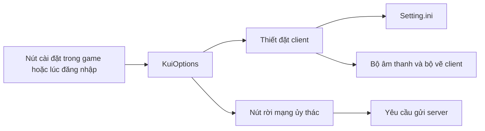

TÓM TẮT 5 DÒNG
TÓM TẮT 1: DONE phạm vi khảo sát tĩnh H-11: đã lập danh sách nút, 12 khóa cài đặt, đường lưu local và đối chiếu gốc/Coco. [NGUỒN]
TÓM TẮT 2: KuiOptions có 3 slider thấy được, 8 checkbox và 4 nút hành động trong game; zoom/Test GM bị ẩn, brightness chỉ là comment. [NGUỒN]
TÓM TẮT 3: IsHidePlayer chỉ chặn đường vẽ phía client; B-02 lọc gói phía server, không có liên kết cài đặt trong đường UI đã đọc. [NGUỒN]
TÓM TẮT 4: KuiOptions.cpp/.h giống SHA-256 ở hai cây; lỗi gán nhầm cờ ẩn kỹ năng và các bất nhất FPS/reset đã có ở bản gốc. [NGUỒN]
TÓM TẮT 5: Không sửa mã, không build/test runtime, không mạng/VM/exe gói; đã lưu báo cáo local, chưa commit do index.lock bị từ chối, chưa push. [CHƯA KIỂM]

# H-11 — Nút hệ thống và cài đặt

Loại: khảo sát
Chủ đề: Các đường mở cài đặt, tùy chọn và nút hệ thống, cách lưu và quan hệ với bộ vẽ client.
Từ khóa: nút hệ thống, cài đặt, ẩn người chơi, KuiOptions, KuiEscInfo, Setting.ini, IsHidePlayer, H-11
Trạng thái: DONE — hoàn thành phạm vi khảo sát tĩnh của H-11; hiệu lực trên bản chạy chưa kiểm.
Độ phủ: 12/12 khóa cài đặt; các nhóm nút, lưu và đối chiếu được kê riêng.
Liên quan: [H-10](H-10-phim-tat-thanh-nut.md), [H-12](H-12-tu-dong-chien-dau.md), [B-02](B-02-loc-hien-thi.md).
Cần tôi quyết định: không

## Phạm vi và độ phủ

Các dòng 1–12 là toàn bộ khóa đọc trong phần cài đặt hoạt động của `A/Classes/gameui/KuiOptions.cpp` (`A` = `D:/JX-build/qh9A`), không tính `Brightness` trong comment. Markdown và `KuiOptions.cpp` tại A đọc được bằng UTF-8. Tham chiếu O/C/S/V trong thân báo cáo là của H-11.

| Phần tử | Độ phủ | Bằng chứng |
|---|---|---|
| 1. Nhạc nền (`MusicSound`) | Đã phủ | `A/Classes/gameui/KuiOptions.cpp:125` |
| 2. Âm thanh (`SoundEffect`) | Đã phủ | `A/Classes/gameui/KuiOptions.cpp:145` |
| 3. Thu phóng (`ScaleZoom`) | Đã phủ | `A/Classes/gameui/KuiOptions.cpp:166`, `:180` (ẩn) |
| 4. Giới hạn FPS (`LimitFPS`) | Đã phủ | `A/Classes/gameui/KuiOptions.cpp:188`, `:462` |
| 5. Ẩn NPC (`IsHideNPC`) | Đã phủ | `A/Classes/gameui/KuiOptions.cpp:228` |
| 6. Ẩn người chơi (`IsHidePlayer`) | Đã phủ | `A/Classes/gameui/KuiOptions.cpp:241`; điều kiện vẽ ở `A/Classes/gamecore/KNpc.cpp:6067` |
| 7. Ẩn tên (`IsHideName`) | Đã phủ | `A/Classes/gameui/KuiOptions.cpp:254` |
| 8. Ẩn kỹ năng (`IsHideMis`) | Đã phủ | `A/Classes/gameui/KuiOptions.cpp:267`, `:488–489`; `A/Classes/gamecore/CoreDrawGameObj.cpp:181` |
| 9. Người chơi giống nhau (`IsShowSamePlayer`) | Đã phủ | `A/Classes/gameui/KuiOptions.cpp:296` |
| 10. Kỹ năng giống nhau (`IsShowSameSkill`) | Đã phủ | `A/Classes/gameui/KuiOptions.cpp:309`; hiệu lực hiển thị chưa được chứng minh. |
| 11. Ẩn nhà và cây (`IsHideHouseAndTree`) | Đã phủ | `A/Classes/gameui/KuiOptions.cpp:280` |
| 12. Tự khởi động auto (`IsOpenAutoPlay`) | Đã phủ | `A/Classes/gameui/KuiOptions.cpp:322`; phạm vi đánh tự động xem H-12. |
| Điểm vào từ bánh răng, thanh người chơi và đăng nhập | Đã phủ | `A/Classes/vn/gamescence/KgameWorldVN.cpp:781`, `:1886`, `:7210`, `:7300`; `A/Classes/vn/gameui/Klogin_f_VN.cpp:460`. |
| Bốn nút tác vụ | Đã phủ | Xóa thiết đặt, rời mạng ủy thác, đăng xuất, đóng lại: `A/Classes/gameui/KuiOptions.cpp:567`; ngoài game chỉ thêm nút đóng tại `:576`. |
| Năm nút menu cũ | Đã phủ | Thoát, trợ giúp, tùy chọn, ủy thác và đóng: `A/Classes/gameui/KuiEscInfo.cpp:130`, `:147`, `:165`, `:183`, `:202`. Hành vi cụ thể nằm ở thân H-11. |
| Mục ẩn hoặc comment | Đã phủ | Zoom ẩn, Test GM ẩn, Brightness trong comment tại `A/Classes/gameui/KuiOptions.cpp:180`, `:342`, `:204–213`. |
| Lưu, reset và ủy thác | Đã phủ | `A/Classes/gameui/KuiOptions.cpp:399`, `:585`, `:655`; `A/Classes/engine/KIniFile.cpp:211`; `gs/script/system/player/offline.lua:6` xác nhận script có hàm `offline`. |
| B-02 và đối chiếu gốc/Coco | Đã phủ ở H-11 | Giữ đối chiếu B-02 và bảng 16 tệp ở thân; hai file KuiOptions của A có SHA-256 trùng giá trị lịch sử H-11. |
| UI, đường lưu thực tế, ủy thác và hiệu năng | Chưa phủ | Chưa thao tác game, đo FPS hoặc xác minh APK, file cài đặt của thiết bị và kết quả offline. |

Ngày khảo sát: 2026-11-17. Trạng thái nội dung: **DONE (khảo sát tĩnh)**. Bằng chứng dưới đây là [NGUỒN]/[XÁC MINH TĨNH], không phải bằng chứng APK/server đang chạy. Build, mạng, VM và chạy exe không thuộc phạm vi được phép. Không dùng Python, không tạo script phụ, không ghi thông tin đăng nhập.

## Phạm vi và quy ước đường dẫn

| Ký hiệu | Gốc tuyệt đối | Vai trò |
|---|---|---|
| O | `C:/Jx1CocoV3/Folder/Client2912-20260116T044348Z-3-001/Client2912/Client` | Client gốc theo task |
| C | `D:/Android/b/Client` | Bản Coco theo bản đồ code local; chỉ đọc |
| M | `D:/JX-source/client/Classes` | Mirror dùng tìm symbol ban đầu; không dùng thay O/C để kết luận đối chiếu |
| S | `D:/JX-source/server/jxOnline/gameserver/Sources/Core/Src` | Nguồn server theo task |
| V | `D:/JX-wt/B-02/server/jxOnline/gameserver/Sources/Core/Src` | Source B-02 đang có local, chỉ đọc |

`O/Classes/...:dòng`, `C/Classes/...:dòng` là đường dẫn tương đối dưới gốc tương ứng. Với `KuiOptions.cpp/.h`, số dòng O và C giống nhau vì toàn file giống byte; các file world/core khác có số dòng riêng. Folder Client2912 chứa Cocos và giao diện VN; không coi tên “gốc” là bằng chứng đây là UI PC nguyên thủy hoặc source khớp binary.

Task tồn tại trong backlog tại `JX1_OPS/TASKS/BACKLOG.md:90`; worktree/branch ban đầu đúng `D:/JX-wt/H-11`, `task/H-11`. Ban đầu task H-11 là file untracked, chưa có báo cáo H-11. Chỉ tạo báo cáo này và nối mục Kết quả vào task theo chỉ thị cụ thể cuối task; không đổi metadata/phạm vi hay nội dung giao việc.

## ĐÃ XÁC MINH

### 1. Điểm vào và danh sách nút

| Nhóm/nút | Gốc O | Coco C | Hành vi theo source |
|---|---|---|---|
| Bánh răng thanh công cụ VN | `Classes/vn/gamescence/KgameWorldVN.cpp:730` | cùng file `:779`, thêm vào menu `:791` | `pSettings`, ảnh `ui_vn/toolbar/caidat.png`, mở options qua `mOptionsCallback` |
| Callback world VN | cùng file O `:1741`, tạo options `:1750` | C `:1875`, tạo `:1884` | `KuiOptions::create(true,...)`, đóng instance cũ theo tag trước khi mở |
| Callback KUiPlayerBar | cùng file O `:7110`, tạo `:7119` | C `:7289`, tạo `:7298` | Cũng mở `KuiOptions(true)`; implementation nằm trong file world VN, không có file `KUiPlayerBarVN.cpp` như tên đã thử |
| Options tại đăng nhập VN | `Classes/vn/gameui/Klogin_f_VN.cpp:460` | giống file và dòng | `KuiOptions::create(false,...)`; nhóm nút dưới chỉ có Đóng lại. `addDialogData` còn phụ thuộc `g_pCoreShell` (`KuiOptions.cpp:108`), nên không khẳng định đầy đủ widget xuất hiện trước đăng nhập |
| Xóa các thiết đặt | `Classes/gameui/KuiOptions.cpp:537` | giống | Gọi `delConfigCallBackFunc`; reset 12 khóa và slot skill local, đóng cửa sổ rồi gọi `KickOutGame` (`:585`, `:608`, `:621`, `:645`) |
| Rời mạng ủy thác | cùng file `:551` | giống | Callback `:650` → `OperationRequest(GOI_LIXIAN,0,0)` tại `:655`; đây là yêu cầu gửi server |
| Đăng xuất | cùng file `:558` | giống | Callback `:659` → `g_GameWorld->_quitGame()` (`:664`); bản VN cleanup kết nối/core và chuyển scene đăng nhập tại C `Classes/vn/gamescence/KgameWorldVN.cpp:1911`, `:1926`, `:1933` |
| Đóng lại | cùng file `:544` | giống | `leaveCallBackFunc` → callback caller → `removeFromParent` (`:668`, `:673`, `:682`); các thay đổi đã Save trước đó, không có Apply/Cancel transaction |

Trong game, 4 nút được thêm tại `O=C/Classes/gameui/KuiOptions.cpp:565`; ngoài game chỉ thêm nút đóng tại `:576`. Callback reset/ủy thác/logout đều yêu cầu `g_pCoreShell` và `g_GameWorld`, không phải thao tác cài đặt thuần túy ở login.

**Menu hệ thống cũ vẫn có source:** `O=C/Classes/gameui/KuiEscInfo.cpp:206` tạo 5 nút `ExitGameConfirm`, `GameHelpConfirm`, `OptionsConfirm`, `OfflineConfirm`, `LeaveConfirm`, tag 1–5 tại `:132`, `:149`, `:167`, `:185`, `:204`. Xử lý tại `:247`: tag 1 chỉ đóng menu (lệnh `_quitGame` bị comment tại `:262`), tag 2 không có hành động (`:267`), tag 3 mở options (`:271`), tag 4 gửi GOI_LIXIAN (`:281`), tag 5 đóng menu (`:285`). Không suy ra 5 tính năng hoạt động từ tên ảnh. Đường VN vừa truy vết mở KuiOptions trực tiếp, không qua menu cũ.

### 2. Bảng đầy đủ cài đặt, mặc định và tác dụng

Mọi khóa dưới đây nằm ở local `jx50ai/Setting.ini`, không có tên nhân vật/tài khoản trong section. Cột “mặc định” là fallback khi thiếu khóa của UI, không đồng nghĩa dữ liệu file đã có. Enum checkbox 5–12 ở `O=C/Classes/gameui/KuiOptions.h:22`.

| Điều khiển | Section/key | Miền UI / fallback | Nguồn O=C `Classes/gameui/KuiOptions.cpp` | Tác dụng và consumer |
|---|---|---|---|---|
| Nhạc nền | AAAA/MusicSound | 0..1 / 0.5 | tạo/đọc `:120`, `:125`; ghi `:398` | `__pSound->setBackgroundMusicVolume` `:389`; nhạc map dùng `_musicVolume` tại `O=C/Classes/gamecore/KMapMusic.cpp:217` |
| Âm thanh | AAAA/SoundEffect | 0..1 / 0.5 | `:140`, `:145`; ghi `:380` | `__pSound->setEffectsVolume` `:371`; đồng thời gọi `SetGameVolume` `:376`, xem lưu ý âm thanh bên dưới |
| Thu phóng | AAAA/ScaleZoom | 0.75..1.5 / 1.0 | `:161`, `:166`; ghi `:440` | Gọi `scaleKgameWorld` `:437`; slider bị `setVisible(false)` tại `:180` |
| FPS GAME | AAAA/LimitFPS | 30..90 / 60 | `:183`, `:185`, `:188`; ghi `:462` | `setAnimationInterval(1/_LimitFPS)` `:457`; handler clamp 30..120 `:453`, không cùng trần UI |
| ẩn npc | BBBB/IsHideNPC | 0/1 / 0 | đọc `:228`; ghi + biến `:476` | C `Classes/gamecore/KNpc.cpp:6064`: bỏ vẽ mọi kind khác player, ngoại trừ self; rộng hơn chỉ NPC hội thoại |
| ẩn người chơi | BBBB/IsHidePlayer | 0/1 / 0 | `:241`; `:480` | C `Classes/gamecore/KNpc.cpp:6067`: bỏ đường vẽ player khác self |
| ẩn tên nhân vật | BBBB/IsHideName | 0/1 / 0 | `:254`; `:484` | C `Classes/vn/gamescence/KgameWorldVN.cpp:4976`, `:5312`, `:6010`: ảnh hưởng nhãn tên/bang và thanh máu; self được miễn |
| ẩn kỹ năng | BBBB/IsHideMis | 0/1 / 0 | `:267`; `:488` | Consumer C `Classes/gamecore/CoreDrawGameObj.cpp:181` dùng `nIsHideMis`, miễn missile của self; handler lại gán `nIsShowSameMissle` `:489` |
| ẩn nhà và cây | BBBB/IsHideHouseAndTree | 0/1 / 0 | `:280`; `:492` | C `Classes/gamescene/KScenePlaceC.cpp:1672`, `KIpotLeaf.cpp:128`: guard đường vẽ cảnh; chưa chứng minh ẩn sạch mọi sprite nền |
| Người chơi giống nhau | BBBB/IsShowSamePlayer | 0/1 / 0 | `:296`; `:499` | C `Classes/gamecore/KNpc.cpp:680` dùng `nSamePlayerMaskID`; nhận sync bỏ cập nhật mask khi bật tại `KProtocolProcess.cpp:2651` |
| Kỹ năng giống nhau | BBBB/IsShowSameSkill | 0/1 / 0 | `:309`; `:503` | Gán `nIsShowSameMissle` `:504`; trong các consumer core/world đã tìm chưa thấy nhánh đọc thực thi cờ này; chưa chứng minh hiệu quả hình ảnh |
| Tự khởi động Auto Play | BBBB/IsOpenAutoPlay | 0/1 / 0 | `:322`; `:507` | C `Classes/vn/gamescence/KgameWorldVN.cpp:3957`: nếu chưa autoplay và chưa check thì gọi `ActiveAuto`; chi tiết chiến đấu thuộc H-12 |

| Thống kê theo hàm tạo KuiOptions | Số lượng | Ghi chú |
|---|---:|---|
| Slider tạo bằng code hoạt động | 4 | 3 hiện; zoom ẩn |
| Checkbox tạo bằng code hoạt động | 9 | 8 hiện; “Test GM”, tag 15, ẩn tại `:334`, `:342` |
| Khóa cấu hình có đọc/ghi trong bảng | 12 | 4 khóa AAAA + 8 khóa BBBB |
| Điều khiển cài đặt hiển thị theo source | 11 | 3 slider + 8 checkbox; phụ thuộc guard core và layout runtime |
| Nút hành động trong game / ngoài game | 4 / 1 | Không cộng nút mở cửa sổ |
| Tổng widget thấy được trong game theo code | 15 | 11 cài đặt + 4 nút; không phải kết quả đo màn hình |

Brightness chỉ nằm trong block comment `KuiOptions.cpp:204`–`:213`; không tính là slider có thể dùng. Không thấy tùy chọn độ phân giải, chất lượng texture, khử răng cưa hay chọn thiết bị âm thanh trong hàm tạo này. Không mở rộng kết luận thành “toàn client không có”.

### 3. Lưu local, phạm vi và hành động gửi server

[NGUỒN] `O=C/Classes/gameui/KuiOptions.cpp:111` Load Setting.ini, thử copy resource khi load thất bại tại `:113`–`:116`. Slider Save ngay tại `:381`, `:399`, `:441`, `:463`; checkbox Save chung tại `:528`. Kết quả Load/Save trong handler không được kiểm tra để báo thành công/thất bại cho người dùng.

`O=C/Classes/engine/KIniFile.cpp:211` triển khai Save bằng KFile/Create (`:254`), Write/Close (`:258`). `KFile.cpp:113`, `:125`, `:140` giải đường dẫn rồi `fopen(...,"wb+")`. `KFilePath.cpp:99`, `:122`, `:200` chọn root/writable path tùy nền tảng rồi nối đường dẫn; chưa đo đường dẫn sandbox trên thiết bị. Đọc đi qua KPakFile, có thứ tự local/PAK tùy mode (`KPakFile.cpp:256`, `:262`, `:270`), nên mẫu resource không phải chứng cứ nội dung file runtime.

- **Cài đặt dùng chung local:** 12 khóa trên dùng section AAAA/BBBB cố định; callback không gửi gói cập nhật tùy chọn hay ghi DB nhân vật. Chưa có bằng chứng đồng bộ cài đặt giữa thiết bị.
- **Reset skill riêng nhân vật:** `KuiOptions.cpp:621` đọc `ACC_FILE_PATH`; `O=C/Classes/gameui/Uiglobaldata.h:13` định nghĩa `accinfo.ini`. Tạo `nPlayerId` từ tên nhân vật, reset section `skill_%u` và `skill_%u_%d`, Save tại `:640`. Không trích bất cứ nội dung account thực tế nào.
- **Rời mạng ủy thác là thao tác server:** C `Classes/gamecore/CoreShell.cpp:3185` → `SendClientCmdLiXian`; `KProtocol.cpp:1293` đặt `c2s_playerlixian`, gửi pack `:1298`. S `KProtocolProcess.cpp:289` đăng ký, `:9191` gọi `ExecuteScriptC("\\script\\system\\player\\offline.lua","offline",...)` tại `:9193`. Chưa đọc/khẳng định điều kiện, chi phí, ghi DB hay kết quả offline script.
- **Đóng lại không hoàn tác:** cài đặt đã lưu theo event; chưa có cơ chế atomic write/rollback trong đường Save đã đọc. Không thử làm lỗi filesystem.

Mẫu `O=C/Resources/jx50ai/Setting.ini:1` chỉ có 5 dòng: section AAAA; MusicSound=0.5 (`:2`), SoundEffect=0.5 (`:3`), ScaleZoom=0.5 (`:4`), LimitFPS=0.5 (`:5`); không có BBBB. Thiếu BBBB dùng fallback 0. ScaleZoom và LimitFPS trong resource lệch miền slider.

### 4. Cờ ẩn người chơi và quan hệ B-02

[NGUỒN] C `Classes/gamecore/KNpc.cpp:10005` định nghĩa `IsPlayer()` là **self client** (`m_Index == Player[CLIENT_PLAYER_INDEX].m_nIndex`), không phải mọi NPC loại player. Vì vậy điều kiện `nIsHidePlayer && !IsPlayer() && m_Kind == kind_player` tại `:6067` miễn self nhưng không miễn đồng đội, bot hay VisGroup. O có cùng điều kiện tại `Classes/gamecore/KNpc.cpp:5892`; ẩn NPC tại O `:5889`, C `:6064`.

Đây là return trong `KNpc::Paint`, sau `DrawMenuState` tại C `:6062`, trước `m_DataRes.Draw` `:6097`. Không thấy callback checkbox xóa entity, chặn nhận gói, giảm slot server hay đổi policy tương tác. Chưa chứng minh sprite/nhãn đã cache được gỡ ngay; không hứa hiệu quả giảm băng thông hoặc quyền riêng tư. Các cờ `m_bIsHidePlayer/m_bIsHideNpc` của self còn có guard riêng tại C `:6070`, `:6080`, không phải biến checkbox `nIsHidePlayer`.

| Điểm so sánh | IsHidePlayer trong client | B-02 ở source V |
|---|---|---|
| Cấu hình | `jx50ai/Setting.ini`, BBBB/IsHidePlayer | `Settings/visibility.ini`; `KVisibility.cpp:117`, `:119` |
| Bật mặc định | Fallback 0 | Enabled fallback 0; reset state `:109` |
| Nơi áp dụng | `KNpc::Paint` trước Draw | `ViewerCanSee` `:178`, đường gửi `:242`, `:249` |
| Đối tượng ngoại lệ | self; không có group/bot check ở guard UI | owner ưu tiên `:185`, NPC thường `:189`, self/bot `:192`, map Open `:193`, party/group `:194`–`:196` |
| Quan hệ hai tầng | Có thể bỏ vẽ entity server vẫn gửi | Có thể không gửi entity, client không tự hiện lại chỉ bằng bỏ checkbox |

Kết luận tích hợp [SUY LUẬN TỪ NGUỒN]: bật ẩn player local có thể che cả bot/đồng đội mà B-02 cho gửi; bỏ checkbox không thể khôi phục người chơi server không gửi. Không có UI điều khiển VisGroup/Enabled trong KuiOptions đã đọc. Không gộp nhãn “ẩn người chơi” thành chức năng Solo/Group/Open. Source V chỉ là bằng chứng implementation local; `JX1_OPS/REPORTS/B-02-loc-hien-thi.md` là báo cáo tham chiếu, không xác nhận triển khai server hiện tại.

### 5. Phát hiện cần sửa ở task mã riêng

| ID | Phát hiện từ nguồn | Hệ quả cần TESTER xác nhận | Có ở gốc? |
|---|---|---|---|
| H11-F01 | `KuiOptions.cpp:488` ghi IsHideMis nhưng `:489` gán nIsShowSameMissle; consumer O `CoreDrawGameObj.cpp:164`, C `:181` đọc nIsHideMis | Bật/tắt ẩn kỹ năng có thể chưa đổi ngay; mở lại options (`:267`) hoặc vào lại world C `KgameWorldVN.cpp:341` mới nạp đúng biến | Có, file UI giống byte |
| H11-F02 | UI FPS 30..90 (`:185`), handler clamp 30..120 (`:453`) nhưng Save giá trị slider (`:462`); world C `KgameWorldVN.cpp:329` chỉ sửa giá trị <30 thành 60 | Sai khác nhãn/FPS áp dụng/file khi mở options hoặc file có giá trị bất thường; không khẳng định có lỗi crash | Có, world O `:315`, UI giống |
| H11-F03 | Resource FPS=0.5/zoom=0.5; fallback zoom UI=1.0 (`:166`), world=0.75 (C `:326`, O `:312`), reset=0.75 (`:604`) | Giá trị slider đã clamp và nhãn/biến có thể lệch trước event; cần kiểm mở lần đầu và reset | Có |
| H11-F04 | Reset ghi 12 khóa (`:595`, `:603`, `:608`) nhưng không gán lại toàn bộ biến/giới hạn FPS/scale ngay; gọi KickOutGame (`:645`) | Không coi reset đã áp dụng toàn bộ ngay. C `gamescene/KgameWorld.cpp:14619` tạo cảnh báo `G_TEXT_KICK_OUT`, không trực tiếp logout; cần theo dõi xác nhận và vào lại | Có trong UI; chưa so toàn bộ hàm KickOutGame O/C |
| H11-F05 | Callback Âm thanh gọi `SetGameVolume` (`:376`), hàm này lại đổi background volume `O=C/gamecore/KMapMusic.cpp:463`, `:474`; ScriptPlay đặt effects volume theo _musicVolume `:511` | Nhạc nền/âm hiệu có thể tác động chéo; chưa khẳng định mức nghe được hay backend audio tại runtime | Có, KMapMusic giống byte |
| H11-F06 | Kỹ năng giống nhau chỉ thấy khai báo/gán trong các file core/world đã tìm; không thấy consumer đọc thực thi | Chưa thể xác nhận tính năng giảm/đồng nhất hiệu ứng; không quảng bá là tối ưu đã hoạt động | Chưa kết luận consumer toàn O; UI giống |
| H11-F07 | `create()` gọi `addDialogData()` trước gán `isInGame` (`:63`, `:64`); ngoài game vẫn dựng cùng nhóm cài đặt nếu có core, chỉ khác hàng nút | Test login riêng, tránh cho rằng `false` tự tắt nhóm checkbox hay mọi đường callback có world hợp lệ | Có |

Khối tự ẩn NPC/player khi FPS thấp ở C `Classes/vn/gamescence/KgameWorldVN.cpp:3973`–`:4000` nằm trong `/*...*/`; không tính là tự động tối ưu đang hoạt động. Reset không xóa nguyên file, không xóa dữ liệu nhân vật server trong đường đã đọc; có reset skill local nên tên nút cần được TESTER kiểm rõ tác động.

### 6. Đối chiếu gốc và Coco bằng SHA-256

Đã chạy Get-FileHash trực tiếp, không dùng hash từ báo cáo cũ. Giống hash được coi là đối chiếu byte đủ tin cậy cho các file này, không mở rộng sang toàn client.

| File dưới O và C | Kết quả | SHA-256 nếu giống |
|---|---|---|
| Classes/gameui/KuiOptions.cpp | Giống | `9DA7AC65FFD7A8F2DDB6BA5C89B40D311E95CA070ED6022B2A04699B27D5BA2D` |
| Classes/gameui/KuiOptions.h | Giống | `C58020C2DFCCAA6E89BDD7311CFF0E268359A8AD886CF7E1D1BA0613AAD47CB8` |
| Classes/gameui/KuiEscInfo.cpp | Giống | `EBBD0328EA4C01CD072BAB92BD83E0276237F251F8833F0959EB0E3251A21FD7` |
| Resources/jx50ai/Setting.ini | Giống | `49BE1F9D2B96B0C9819D216710DDDECC60D4282B8468B4BC2DBD820D69AC9170` |
| Classes/engine/KIniFile.cpp | Giống | `FD31B6CB0E6B90CFD0A61ED87E4E6FE980CFA588123CE62C20B408598ABC246C` |
| Classes/engine/KFile.cpp | Giống | `B4F4DF067FFF98DAEFE6524D91145AB73011C5F81D39B52FAE623FB6B20170F7` |
| Classes/engine/KFilePath.cpp | Giống | `12CBED373D8EB081189BAA361404A07E2E16DCF0755716C52C901A5941688355` |
| Classes/engine/KPakFile.cpp | Giống | `2710369EC788437D515CD265956E576D7EDD45F11B9B122E8996AB41B83F3C86` |
| Classes/gamecore/KMapMusic.cpp | Giống | `5CF99894605E2626E0B20218AAA936C67D242AB177F5D3451B4CA8156978236A` |
| Classes/vn/gameui/Klogin_f_VN.cpp | Giống | `04DB9A5B386B360A505D0D573B02F37E02AF57D5F343071D72FA6A367D0EE0D0` |
| Classes/vn/gamescence/KgameWorldVN.cpp | Khác | Đọc riêng đoạn nạp cấu hình, điểm vào và consumer; dòng O/C ghi ở các bảng trên |
| Classes/gamecore/KNpc.cpp | Khác | Điều kiện hide player/NPC tương ứng O :5889/:5892, C :6064/:6067 |
| Classes/gamecore/CoreDrawGameObj.cpp | Khác | Guard nIsHideMis tương ứng O :164, C :181 |
| Classes/gamecore/KProtocol.cpp, CoreShell.cpp | Đều khác | Đường GOI_LIXIAN báo bằng dòng C; không kết luận toàn file tương đương |
| Classes/gameui/Uiglobaldata.h | Giống | Đã kiểm hash, dùng định nghĩa ACC_FILE_PATH :13; không trích dữ liệu account |

Tổng 16 file đối chiếu: 11 giống, 5 khác. Đây là tập file được chọn phục vụ H-11, không phải tỷ lệ tương đồng toàn dự án.

## CHƯA XÁC MINH

- Chưa build, chạy client/server, kết nối mạng/VM, thao tác UI hoặc thực thi script game; chưa có ca runtime PASS.
- Chưa chứng minh APK đang dùng source C, source O khớp binary, hoặc source V/B-02 đã được triển khai. Không khảo sát UI PC nguyên thủy ngoài source Cocos được giao.
- Chưa xác minh đường lưu vật lý, quyền ghi, ưu tiên file local/PAK ở bản chạy; dữ liệu resource không phải file cài đặt thực tế.
- Chưa xác minh checkbox gỡ sprite cache ngay, ẩn toàn bộ nhãn/chọn mục tiêu, tác động combat/AoE, hay đồng nhất kỹ năng thực sự.
- Chưa xác minh tách kênh âm thanh, mức âm lượng qua map/relogin, FPS thực đo, battery/CPU/GPU/memory/băng thông. Không suy ra hiệu năng từ return trong Paint.
- Chưa xác minh kết quả ủy thác, lưu DB/server hay điều kiện offline.lua. B-02/P1 không chứng minh P2 chống tương tác.
- Không sửa các phát hiện F01–F07 vì task cấm sửa mã. Không sửa canonical hay cấu hình cài đặt.

## Ca test bàn giao TESTER — chưa chạy

Chỉ chạy khi được PM cấp môi trường thử phù hợp; bảng này là kịch bản, không phải ủy quyền tự kết nối trong H-11. Dùng tài khoản thử, bản copy và lưu cấu hình trước các ca reset; log/ảnh phải lọc bí mật. Mỗi ca ghi build/hash, cấu hình trước/sau, ảnh và kết quả thực tế.

| Ca | Thao tác/biến thể | Tiêu chí quan sát và bằng chứng |
|---|---|---|
| T01 | Mở bánh răng VN, đóng, mở lại; làm ở trong game và màn login | Đối chiếu 3 slider + 8 checkbox; trong game 4 nút, login chỉ Đóng lại; không trùng cửa sổ/crash; ảnh layout trên kích thước màn hình mục tiêu |
| T02 | Đổi từng khóa, đóng bằng Đóng lại; relog và khởi động lại app | So file local trước/sau: đúng section/key, giữ giá trị; xác nhận không cần Apply; thử hai nhân vật/tài khoản trên cùng bản thử để kiểm phạm vi local dùng chung |
| T03 | Âm thanh/nhạc lần lượt 0, 0.5, 1; bấm UI, đánh skill, đổi map và script music | Ghi riêng âm hiệu/nhạc, kiểm tác động chéo F05; kiểm giữ âm lượng sau restart |
| T04 | Slider FPS 30/60/90 và file thử 0.5/120/giá trị >120 | Ghi nhãn, file và FPS đo; clamp nhất quán, không chia 0/crash; không mặc định FPS đạt con số chỉ vì animation interval đã đặt |
| T05 | Cấu hình sạch dùng resource; mở options, reset trên bản copy | Ghi chênh lệch ScaleZoom 0.5/0.75/1.0 và FPS 0.5/60; zoom/Test GM không hiện, brightness không có |
| T06 | Ẩn NPC với NPC thoại, quái, thú; bật/tắt khi đã ở màn hình và khi mới đi vào vùng | Self không bị ẩn; phân loại đúng phạm vi kind; quan sát sprite cũ, nhãn, chọn mục tiêu; không mặc định NPC thoại vẫn dùng được |
| T07 | Ẩn player với người thật khác, đồng đội và bot kiểu kind_player | Ghi rõ self/other, sprite, thanh máu/tên, target và missile; chứng minh có/không bỏ sprite cũ; đo packet riêng nếu cần, không coi hide local là ngừng sync |
| T08 | IsHideName bật/tắt | Kiểm tên, bang, thanh máu, self/other và khôi phục; so O/C cùng tình huống |
| T09 | IsHideMis bật/tắt lúc đang ở game; mở lại options, relog | Theo dõi nIsHideMis và nIsShowSameMissle nếu có debugger thử; tái hiện F01; missile self vẫn được miễn, của người khác đổi đúng lúc |
| T10 | IsShowSamePlayer/IsShowSameSkill bật/tắt, cùng người chơi ra/vào vùng | Ghi mask/trang phục, bóng, hiệu ứng và khả năng khôi phục; phân biệt F06 chưa có consumer với tính năng thật |
| T11 | Ẩn nhà/cây rồi di chuyển, đổi map, bật lại | Kiểm từng lớp trước/sau nhân vật, nền/collision/đường đi; không kết luận ẩn hình là bỏ va chạm |
| T12 | Tự khởi động Auto Play off/on, vào game/relog, tắt auto thủ công | Đếm lần ActiveAuto, kiểm cờ m_bIsHasCheckedAutoPlay và trạng thái UI; phần hành vi chiến đấu chuyển H-12 |
| T13 | Xóa các thiết đặt sau khi đổi cấu hình và gán main/sub skill | Đối chiếu 12 khóa reset, skill_%u/skill_%u_%d; kiểm cảnh báo KickOutGame, thời điểm áp dụng và relog; không xóa dữ liệu server |
| T14 | Đăng xuất và ủy thác trên server thử có script | Logout trở về login, tài nguyên/kết nối được dọn; ủy thác nhận đúng c2s_playerlixian và phản hồi thực; kiểm lỗi script/quyền/thất bại riêng |
| T15 | B-02 Enabled=0/1 × hide player=0/1; map Solo/Group/Open, self/party/bot/owner | Bỏ hide local không làm hiện entity server cấm gửi; bật hide local có thể che entity server cho gửi. Ghi ADD/REMOVE và kết quả tương tác riêng, không suy diễn P2 |
| T16 | Chặn ghi file chỉ trong bản copy thử; đổi cấu hình/đóng/restart | Kiểm UI có báo lỗi không, thay đổi chỉ ở RAM hay được lưu; xác nhận không phá cấu hình cũ và cách khôi phục |

## Kiểm tra, lỗi công cụ và bàn giao Git

- Đã đọc source/cấu hình mẫu, đối chiếu SHA-256 và kiểm tra nội dung báo cáo; không có test/build runtime. Báo cáo nháp đã được lưu tại chính đường dẫn này trước khi chốt, không tạo báo cáo phụ.
- Lần đọc task đầu dùng Get-Content mặc định làm sai dấu hiển thị; đã đọc lại UTF-8, không sửa encoding source.
- `rg : The term 'rg' is not recognized...`: chuyển sang Select-String/Get-ChildItem, không cài công cụ.
- Tên dự đoán `Classes/vn/gameui/KUiPlayerBarVN.cpp` không tồn tại; đã xác định implementation trong `Classes/vn/gamescence/KgameWorldVN.cpp`, không coi thiếu file là thiếu tính năng.
- Một lệnh Get-ChildItem dùng LiteralPath/Include không lọc đúng extension, khiến tìm kiếm đụng dữ liệu graphify và output bị cắt. Đã chuyển lọc `Where-Object { $_.Extension -in '.cpp','.h' }` trong đúng thư mục core/UI/world; kết luận không dựa dữ liệu graphify hay output bị cắt.
- Git stage đã thử đúng hai đường dẫn task/báo cáo, thất bại: `fatal: Unable to create 'D:/jx1-reports/.git/worktrees/H-11/index.lock': Permission denied`. Không đổi quyền, không ghi Git metadata ngoài workspace, không thử vượt sandbox. **Chưa commit; không có commit SHA mới.**
- **CHƯA PUSH**: người dùng cấm mạng thật và không yêu cầu push; không có lệnh mạng nào được chạy. Không có bằng chứng GitHub mới.
- PM tiếp tục: review báo cáo, stage/commit đúng hai file từ môi trường có quyền; đề nghị tiêu đề `H-11: khảo sát tĩnh nút hệ thống và cài đặt`; chuyển F01–F07 sang task mã riêng và T01–T16 cho TESTER. Không cần khảo sát lại phần đã có bằng chứng; chỉ bổ sung runtime được phép.

## Phát hiện khi chuẩn hóa

- `A/Classes/gameui/KuiOptions.cpp` và `.h` có SHA-256 trùng các giá trị tại mục đối chiếu H-11. Các mốc bánh răng và callback ở `A/Classes/vn/gamescence/KgameWorldVN.cpp:781`, `:1886`, `:7210`, `:7300` được kiểm riêng; không thay cho mốc O/C ở lịch sử H-11.
- Không dùng cây `D:/Android/b/Client` để kiểm lại đối chiếu lịch sử O/C. Việc xác nhận hàm `offline` trong script gốc không xác nhận trạng thái ủy thác đã lưu hoặc script được gọi trên bản đang chạy.
