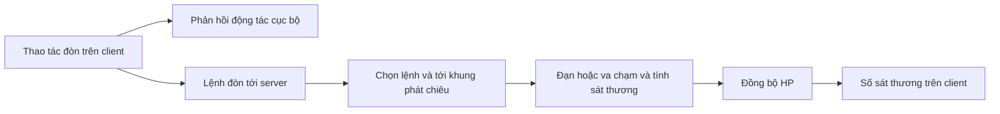

TÓM TẮT 5 DÒNG
1. DONE khảo sát tĩnh H-13 ngày 17/11/2026; toàn bộ runtime CHƯA ĐO, không chạy exe, không mạng/VM, không sửa mã hay cấu hình. [NGUỒN]
2. Source gs001 mặc định 18 Hz; chế độ 36 chỉ thêm nửa bước di chuyển, logic chiến đấu và đồng hồ game vẫn giữ lượt đầy đủ 18 Hz theo thiết kế source. [NGUỒN]
3. Đòn qua nhận lệnh → ACT/MOVE → phát chiêu ở 60% động tác → chờ/sinh đạn → va chạm → tính trúng/sát thương → đồng bộ HP → số nổi. [NGUỒN]
4. Có gộp buffer và nhịp đồng bộ; SendBloodNo không phát gói; sentinel unsigned trong Heaven cần kiểm chứng trước khi quy độ trễ cho batching. [NGUỒN]
5. Ưu tiên đo từng đoạn, kiểm tra flush/đồng bộ HP và phản hồi hình ảnh; không tăng tick; đã kèm ca TESTER, giới hạn bằng chứng và sổ thông số. (Chưa build, chạy exe hay VM.) [CHƯA KIỂM]

# H-13 — Tick và độ trễ đòn

Loại: khảo sát
Chủ đề: Đường đi một đòn từ thao tác client đến số sát thương và các chặng phụ thuộc nhịp server.
Từ khóa: nhịp xử lý, độ trễ đòn, số sát thương, LogicFps, JxHalfLoop, SyncNpcMin, gs001, H-13
Trạng thái: DONE — hoàn thành phạm vi khảo sát tĩnh của H-13; chưa đo tick hay độ trễ thực tế.
Độ phủ: 10/13 nhóm của H-13; ba nhóm xác minh trên bản chạy hoặc mở rộng đường xử lý chưa phủ.
Liên quan: [B-04a](B-04a-bo-do-tick-bang-thong.md), [H-10](H-10-phim-tat-thanh-nut.md), [H-14](H-14-mat-khung-hieu-ung.md).
Cần tôi quyết định: không

## Phạm vi và độ phủ

`A` là `D:/JX-build/qh9A`; `D` là gốc dữ liệu `gs` đã ghi dưới đây. Các trích dẫn `S/C/O` là nguồn của H-13; “đã phủ ở H-13” ghi rõ phần dẫn lại. Markdown dùng UTF-8; các mẫu bảng server được đối chiếu bằng tên cột ASCII và giá trị số.

| Nhóm | Độ phủ | Nguồn và giới hạn |
|---|---|---|
| Nhịp gs001 và lượt nửa ở chế độ 36 | Đã phủ ở H-13 | `S/MultiServer/GameServer/KSOServer.cpp:91`, `:1445`; `S/Core/Src/CoreServerShell.cpp:2237–2238`, `:2263`. |
| Đồng hồ, lịch xử lý và tải | Đã phủ ở H-13 | `S/Engine/Src/KTimer.cpp:131–135`, `S/Core/Src/KRegion.cpp:1127–1212`. Mô hình tải là ước lượng tĩnh. |
| Client phản hồi động tác và gửi lệnh đòn | Đã phủ | `A/Classes/gamecore/KPlayer.cpp:513–514`; `A/Classes/gamecore/KProtocol.cpp:324–343`, `A/Classes/network/SocketClient.cpp:231`. |
| Nhận lệnh, làn ACT/MOVE và khung phát chiêu | Đã phủ ở H-13 | `S/Core/Src/KProtocolProcess.cpp:5581`, `S/Core/Src/KNpc.cpp:6764`, `:3984–4016`. |
| Chờ, sinh đạn, va chạm, tính trúng và sát thương | Đã phủ ở H-13 | `S/Core/Src/KSkills.cpp:1776`, `S/Core/Src/KMissle.cpp:408–414`, `:1851`, `S/Core/Src/KNpc.cpp:4494`, `:5719`. |
| Đồng bộ HP và số nổi | Đã phủ | `S/Core/Src/KNpc.cpp:8193`, `:8212` dẫn lại từ H-13; `A/Classes/gamecore/KProtocolProcess.cpp:2529–2552` kiểm lại chênh HP cho NPC thuộc hai loại đã nêu. |
| Gộp và đẩy buffer, SendBloodNo | Đã phủ ở H-13 | `S/MultiServer/Heaven/ServerStage.cpp:375`, `:429`, `:497`; `S/Core/Src/KNpc.cpp:14549–14554`. Ảnh hưởng của giá trị đánh dấu `-1` chưa đo. |
| Đối chiếu client Coco và bản trong Folder | Đã phủ ở H-13 | Giữ bảng đối chiếu lịch sử về gói skill, phản hồi, bảo vệ lệnh di chuyển và số nổi. Bản A có `SKILL_MOVE_GUARD_TICKS` tại `A/Classes/gamecore/KProtocol.cpp:197`. |
| Dữ liệu phụ thuộc frame | Đã phủ | Kiểm lại các mẫu tại `D/Settings/Skills.txt:2–4`, `D/Settings/Missles.txt:2–4`, `D/Settings/Npcs.txt:2`, `D/Settings/gamesetting.ini:58`, `D/Settings/gamesetting_gs001.ini:56`. |
| Kế hoạch phân biệt các điểm chờ | Đã phủ ở H-13 | Mục ca TESTER và sổ thông số giữ nguyên; các ca chỉ là kế hoạch. |
| Khớp source với binary và cấu hình hiệu lực | Chưa phủ | Chưa xác nhận `gs001.exe`, `heaven.dll`, client và giá trị `LogicFps` đang dùng. |
| Tick, độ trễ, băng thông, tải và số lần đẩy gói thực tế | Chưa phủ | Chưa chạy phép đo trên bản game. |
| Mọi loại đòn, nhánh HP và đường vẽ/nén ngoài đoạn khảo sát | Chưa phủ | Kết luận tĩnh không mở rộng tới toàn bộ PvP, diện rộng, sát thương theo thời gian hay mọi đường vẽ. |

## Phạm vi và nguồn

Tiếp tục từ bản nháp có sẵn, giữ các phát hiện đã có và kiểm tra các đoạn source cần để hoàn thiện. Chỉ ghi báo cáo này. Git ban đầu: nhánh `task/H-13`; báo cáo và task đều đã tồn tại dạng untracked. Không stage/commit/push vì lượt giao việc không yêu cầu. Không đọc giá trị khóa/mật khẩu; cấu hình chỉ lọc đúng tên thông số liên quan.

Quy ước file:dòng, đánh số dòng vật lý theo LF (tránh chênh số dòng khi bộ giải mã coi byte điều khiển là ngắt dòng):

| Ký hiệu | Gốc đường dẫn |
|---|---|
| S | `D:\JX-source\server\jxOnline\gameserver\Sources` |
| C | `D:\JX-source\client\Classes` — bản source hiện tại/Coco trong khảo sát |
| O | `C:\Jx1CocoV3\Folder\Client2912-20260116T044348Z-3-001\Client2912\Client\Classes` — bản client gốc được task chỉ định |
| D | `C:\Jx1CocoV3\Folder\ServerNew-20260116T043145Z-3-001\ServerNew\_bin_v2_\gs` — dữ liệu server gốc trên đĩa |

“Gốc” ở đây là bản trong Folder, không khẳng định đó là client Kingsoft nguyên bản hay binary đang triển khai. Không sao chép bảng dữ liệu dài, binary hoặc log nhạy cảm vào báo cáo.

## ĐÃ XÁC MINH

### 1. Nhịp server, timer và chi phí tải

`S/MultiServer/GameServer/KSOServer.cpp:91` đặt `g_nLogicFps=18`, `:93` ánh xạ `GAME_FPS` sang biến này. `Breathe` ở `:1428` gọi `MessageLoop` trước gate thời gian (`:1434`); đọc `GameServer/LogicFps` một lần từ `gs001_cfg.ini`, chỉ chấp nhận 18/36 (`:1445`). Gate là `1000*m_nGameLoop <= m_Timer.GetElapse()*GAME_FPS` (`:1447`), chạy `MainLoop` rồi `Sleep(0)` (`:1456`, `:1458`); khi chưa đến hạn thì `Sleep(1)` (`:1468`). `MainLoop` tăng bộ đếm ở `:4443`.

`S/Engine/Src/KTimer.cpp:56` thử QueryPerformanceFrequency, `:61` chọn fallback tick nếu thất bại; `Start` dùng QPC hoặc GetTickCount64 (`:79`, `:82`). `GetElapse` trả mili giây, nhánh QPC chia nguyên sau nhân 1000 (`:131`, `:132`), fallback lấy hiệu GetTickCount64 (`:135`). Không có cơ sở coi `Sleep(1)` là thời gian thức chính xác; gate này có thể chạy bù các vòng đã trễ, mỗi lần Breathe thực hiện tối đa một MainLoop. Chưa đo độ chính xác scheduler, độ trễ wakeup hoặc backlog.

`S/Core/Src/CoreServerShell.cpp:2227` lại định nghĩa `GAME_FPS=18` riêng. Core đọc LogicFps độc lập (`:2237`); ở 36, mỗi lượt xen kẽ gọi `JxHalfLoop` rồi return (`:2238`), lượt đầy đủ mới gọi `g_SubWorldSet.MainLoop()` (`:2263`). Hai nơi đọc một lần độc lập, không phải cơ chế hot reload.

`S/Core/Src/KSubWorldSet.cpp:507` chỉ tăng sequence và gọi `JxHalfActivate`; `MainLoop` tăng loop ở `:516`, gọi SubWorld.Activate ở `:612`, tăng đồng hồ chung ở `:621`. `S/Core/Src/KSubWorld.cpp:295` tăng `m_dwCurrentTime` chỉ trong Activate đầy đủ. HalfActivate (`:270`) chỉ duyệt region hoạt động (`:275`, `:278`). `S/Core/Src/KNpc.cpp:6336` chỉ chia nửa di chuyển cho walk/run/runattack, lấy nửa tốc độ tại `:6348`; `ServeMove` trừ phần đã đi ở lượt đầy đủ (`:6374`, `:6376`). Đây là bằng chứng rằng 36 trong source hiện tại không tương đương chiến đấu chạy đầy đủ 36 lần/giây.

`S/Core/Src/KRegion.cpp:1127` chỉ Activate NPC khi IsActiveAll, duyệt danh sách NPC (`:1129`), NormalSync trước Activate (`:1138`, `:1141`); sau đó duyệt object (`:1154`), missile (`:1194`, `:1200`), player (`:1206`, `:1212`). `KNpc::Activate` tăng frame (`KNpc.cpp:960`), xử lý trạng thái (`:993`), AI (`:998`), lệnh (`:1000`) rồi động tác (`:1003`). Half region vẫn duyệt NPC và gọi NormalSync nếu đã di chuyển (`KRegion.cpp:1112`, `:1115`). Không thấy vòng song song đang hoạt động ở đoạn MainLoop đọc; các khối OpenMP/concurrency tại `KSubWorldSet.cpp:530` và `:622` nằm trong comment.

Mô hình tải tĩnh: chi phí lượt đầy đủ gồm NPC hoạt động × (state + AI + command + action), missile × (di chuyển + tìm mục tiêu/va chạm), player.Active và broadcast theo số người nhận lân cận. `KMissle.cpp:1846` tìm NPC theo ô trong vùng ảnh hưởng và `:1851` tính damage, nên AoE/mật độ có thể tăng chi phí hơn chỉ đếm người. Bot có nhân vật server sẽ đi qua NPC/player tương ứng; chưa xác định được một chi phí Bot riêng hoặc hệ số CPU/Bot. Không thể suy số người tối đa hay %CPU từ source.

Ở 36 hỗn hợp, chi phí gần `18*C_full + 18*C_half + chi phí flush/broadcast tăng`, không được kết luận CPU tăng đúng gấp đôi. Nếu đổi toàn bộ logic sang 36 thật mà giữ nguyên thuật toán, số lần xử lý logic/giây có thể gần gấp đôi trước các hiệu ứng tranh chấp/cache; đây chỉ là mô hình, CHƯA ĐO.

### 2. Đường đi một đòn và điểm chờ

| Chặng | Bằng chứng tĩnh | Ý nghĩa độ trễ |
|---|---|---|
| Client khởi động và gửi | `C/gamecore/KPlayer.cpp:513`, `:514`, `:531`, `:533` vừa SendSerCommand local vừa SendClientCmdSkill; `C/gamecore/KProtocol.cpp:338`, `:343` đóng `c2s_npcskill` và SendPackToServer | Có phản hồi động tác local; không phải mọi hình ảnh đều phải đợi server |
| Client ra socket | `C/network/ClientStage.cpp:157`, `:160`, `:172` thêm header, encode, Write; `C/network/SocketClient.cpp:230`, `:231` đặt TCP_NODELAY=1, `:440` gọi send | Đường này không có timer batching skill; encode không phải bằng chứng nén |
| Server dispatch | `S/MultiServer/GameServer/KSOServer.cpp:3763` → `S/Core/Src/CoreServerShell.cpp:523` → `KPlayerSet.cpp:1269`; `KProtocolProcess.cpp:215` ánh xạ c2s_npcskill, `:5581` kiểm tra lệnh rồi `:5603`/`:5606` SendSerCommand | Nhận gói chưa đồng nghĩa thi triển; còn đợi logic và kiểm tra mục tiêu |
| Làn lệnh | `S/Core/Src/KNpc.cpp:6892` gọi CmdLaneReceive; `:6764` lưu skill vào một ô ACT và xóa MOVE; `:6788` bỏ skill quá TTL; `:6799` xử lý khi đang bận; `:6829` gọi ProcCommandLegacy | Không phải hàng FIFO vô hạn; lệnh mới có thể thay lệnh cũ hoặc bị loại, dễ bị cảm nhận là “trễ/mất đòn” |
| Bắt đầu skill | `KNpc.cpp:1321` tìm skill, `:1324` DoSkill; `:3647` kiểm tra cooldown; `:3682`/`:3684` đặt mốc lần sau theo đồng hồ game; `:3693` tạo s2c_skillcast; `:3737`, `:3744` broadcast; `:3749` DoOrdinSkill | Gói động tác được tạo trước khi biết kết quả va chạm/sát thương, không phải xác nhận hit |
| Khung phát chiêu | `KNpc.cpp:3814`/`:3829` tính tổng frame động tác; `:3984` WaitForFrame, `:3989` kiểm tra 60%, `:4016` Cast; `:7136` tăng frame, `:7145` so sánh bằng với tích chia nguyên | Phát chiêu theo frame logic đầy đủ; làm tròn nguyên, có edge case tổng frame rất nhỏ cần test; không thể chỉ lấy 60% thời gian thực cho mọi skill |
| Sinh/chờ/bay đạn | `KSkills.cpp:1776`, `:1955` cộng nWaitTime và GetMissleGenerateTime; `:3038` đọc WaitTime; `KMissle.cpp:389`, `:408`, `:414` kiểm tra lifetime, tăng tuổi và mốc bắt đầu; `:710` kiểm tra va chạm | Có độ chờ do thiết kế skill và thời gian bay, không phải mạng |
| Trúng và sát thương | `KMissle.cpp:1851` ProcessDamage, `:1531`/`:1544` ReceiveDamage; `KNpc.cpp:4494`/`:4496` CheckHitTarget nếu bUseAR; `:4686` CalcDamage; `:5719` trừ HP | HP authoritative được tính trong xử lý logic/va chạm trên server; không phải khi client bấm nút hoặc nhận skillcast |
| Phát HP | `KNpc.cpp:8193` s2c_syncnpcmin, `:8212` HP theo phần nghìn, `:8335`, `:8343` broadcast; `KRegion.cpp:1138` sync ở counter lẻ, trước NPC.Activate và trước vòng missile | HP giảm sau lượt sync có thể phải đợi lượt sync sau; không phải cứ CalcDamage xong là lập tức phát HP mới |
| Client số nổi | `C/gamecore/KProtocolProcess.cpp:2529` HP cũ, `:2538` HP mới, `:2549` chỉ normal/partner, `:2551` SetBlood bằng chênh HP; `C/gamecore/KNpc.cpp:10501` xếp số nổi, `:10591` vẽ | Nhiều hit trước cùng một HP sync có thể thành một số; không có danh tính từng hit/attacker trong chênh lệch này |

Lưu ý riêng: `C/network/ClientStage.cpp:155`, `:156`, `:176` có CCLOG ở đường gửi, trong đó có `%s` trên pData nhị phân. Không bật/thu raw log này trong ca đo; chỉ dùng metadata đã lọc. Chưa biết macro có hoạt động ở binary chạy hay không. `SocketClient.cpp:451` có nhánh `_wait(150*1000,0,false)` khi socket chưa sẵn sàng; chưa lần ra đơn vị `_wait`, không quy đổi thành “150 ms” hay cho rằng xảy ra thường xuyên.

### 3. Batching, nén và đồng bộ khác nhau

`S/MultiServer/Heaven/ServerStage.cpp:375` PackDataToClient chỉ thêm vào write buffer (`:413`); nếu đạt/vượt giới hạn thì `_SendDataEx` và Empty (`:399`, `:408`, `:410`). SendPackToClient gom payload, thêm header WORD (`:479`), sao chép dữ liệu (`:484`), làm rỗng buffer (`:492`) rồi Write (`:497`). Đây là batching tầng ứng dụng và flush khi đầy; không thấy bước nén trong các hàm đọc. Các dòng KSG_EncodeBuf tại `:483`, `:488` ở đường flush này bị comment. Không suy từ đó rằng toàn hệ thống không mã hóa/nén hoặc TCP không còn hàng chờ.

`S/MultiServer/GameServer/KSOServer.cpp:4383` chỉ gọi flush khi `m_nGameLoop` lẻ ở 18, còn 36 gọi mỗi lượt; `SendCilentPackData` cũng có điều kiện đó (`:5371`). Do đó lịch gọi dự kiến là khoảng 9 flush/giây ở 18 và 36 ở chế độ hỗn hợp, nếu callsite đó thực sự được dùng và gửi được. Số lời gọi không phải số TCP segment.

**Điểm cần kiểm chứng trước tiên:** tham số `CIOCPServer::SendPackToClient` là `const unsigned long&` (`ServerStage.cpp:429`), trong vòng duyệt luôn kiểm tra `ulnClientID>=0` (`:443`) rồi bỏ qua index khác (`:445`). Lời gọi `-1` ở `KSOServer.cpp:4384` chuyển thành giá trị unsigned cực đại, không chọn client index thông thường trong implementation này. `KSOServer.cpp:77`, `:827`, `:835` nạp interface từ `heaven.dll`; chưa đối chiếu DLL với source. Vì vậy chỉ xác nhận **mâu thuẫn source**, chưa khẳng định runtime bị kẹt tới lúc buffer đầy. Không đề xuất sửa/đổi DLL trong task này.

`S/Core/Src/KNpc.cpp:1433` có nhịp gom damage 5 frame cho non-player rồi reset tổng; nhưng SendBloodNo chỉ giới hạn giá trị (`:14549`), toàn bộ BLOOD_SYNC/BROADCAST bị comment (`:14554`). Không được gán độ trễ số nổi hiện hành là 5/18 giây dựa vào đoạn này. Bỏ nhánh gom đó đơn độc không làm xuất hiện gói gửi.

NormalSync dùng counter lẻ và reset khi `counter > 2*N` (`KRegion.cpp:1147`), nên khoảng sync thông thường 2 lượt đầy đủ, có thể 3 lượt tại chỗ reset với danh sách ổn định; danh sách thay đổi cần đo riêng. Trật tự NPC→missile và sync→Activate khiến mẫu HP có thể cũ hơn damage vừa tính. Trong chế độ 36, NPC đang di chuyển có thêm NormalSync từ half-loop (`KRegion.cpp:1115`), nên không áp một độ trễ HP duy nhất cho đứng yên và chạy.

### 4. Client Coco so với bản trong Folder

| Hành vi | Hiện tại C | Bản gốc O | Kết luận giới hạn |
|---|---|---|---|
| Gói skill | `gamecore/KProtocol.cpp:324`, `:338`, `:343` | `gamecore/KProtocol.cpp:237`, `:245`, `:250` | Cùng loại c2s_npcskill và payload logic skill/x/y |
| Dự đoán động tác | `gamecore/KPlayer.cpp:531`, `:533`; `KNpc.cpp:2656`, `:2678` local Cast | `gamecore/KPlayer.cpp:510`, `:512` khởi động local + gửi | Không có cơ sở nói Coco đợi server mới bắt đầu mọi động tác |
| Bảo vệ lệnh skill | `gamecore/KProtocol.cpp:197`, `:244`, `:326` xóa pending MOVE, đặt guard 3 lượt, defer MOVE khi guard/động tác/pending skill còn tồn tại (`:206`, `:211`, `:213`) | Hàm gửi gốc `:238` đến `:250` không có phần guard này | Khác đường điều phối di chuyển; 3 là số lượt gọi bộ cập nhật guard, chưa quy ra ms |
| HP và số nổi NPC | `gamecore/KProtocolProcess.cpp:2529`, `:2538`, `:2551` | `gamecore/KProtocolProcess.cpp:2524`, `:2533`, `:2546` | Cùng cách lấy chênh HP từ sync; chưa thấy số damage dự đoán tại các đoạn này |
| Vẽ số nổi | `gamecore/KNpc.cpp:10520` đẩy slot cũ, `:10529` tuổi 50, `:10585` cách tầng 12, `:10594` giảm tuổi mỗi lần vẽ | Hàm hoạt động tại `gamecore/KNpc.cpp:10320`, đẩy slot `:10339`, tuổi `:10348`, khoảng tầng `:10404`, giảm tuổi `:10413` | Cùng cơ chế xếp số/tuổi/cách tầng ở các đoạn đọc; không coi tuổi 50 là 50 tick server hay độ trễ khởi phát |

`C/gamecore/KProtocolProcess.cpp:876` còn áp SendSerCommand khi nhận skillcast cho NPC phù hợp. Hiệu ứng thi triển có thể được dựng từ skill local hoặc gói skillcast; hiệu ứng trạng thái authoritative được server đặt sau ReceiveDamage (`S/Core/Src/KMissle.cpp:1547`) và trạng thái còn được chở trong NormalSync (`KNpc.cpp:8223`, `:8291`). Chưa kiểm kê mọi đường renderer/VFX, không khẳng định mọi hiệu ứng trúng đều đợi hoặc đều dự đoán. `SelfDamage` trừ HP ở `C/gamecore/KNpc.cpp:3735` nằm trong block comment (`:3733`), không phải bằng chứng client tự quyết sát thương. Tương tự, SetBlood/PaintBlood cũ ở `O/gamecore/KNpc.cpp:10241`/`:10259` nằm trong block comment `:10228` đến `:10287`; không dùng các hàm đó để kết luận C/O khác cách vẽ.

### 5. Dữ liệu phụ thuộc frame và rủi ro đổi tick

Chỉ trích mẫu ngắn từ dữ liệu gốc; chưa chứng minh file trên VM đang dùng hoặc giá trị hiệu lực sau Lua/level/thuộc tính.

| Mẫu | Giá trị gốc trên đĩa | Nơi dùng / ảnh hưởng |
|---|---|---|
| `D/Settings/Skills.txt:2` skill ID 1 | WaitTime=5; TimePerCast=0; TimePerCastOnHorse=0; MslsGenerate=0; MslsGenerateData=0; FlyEventTime=0 | Loader `S/Core/Src/KSkills.cpp:3018`, `:3019`, `:3029`, `:3038`; wait/generate cộng vào tuổi sinh đạn (`:1776`); 5 lượt đầy đủ tương đương 277,8 ms nếu 18 Hz đều |
| `D/Settings/Skills.txt:3`, `:4` ID 2/3 | WaitTime=5/0, các cột trên còn lại đều 0 | Đây là mẫu dữ liệu, không tuyên bố ID 1–3 là đòn TESTER phải dùng hoặc toàn bộ skill có cùng timing |
| `D/Settings/Missles.txt:2`, `:3`, `:4` ID 1/2/3 | LifeTime=16/32/16; Speed=12/20/31; Zspeed=0/0/0 | Loader `S/Core/Src/KMissle.cpp:229`, `:230`; tuổi tăng theo lượt; offset theo speed (`:767`); lifetime 16/32 tương đương 888,9/1777,8 ms ở 18 Hz trước phần start wait |
| `D/Settings/Npcs.txt:2` | AttackSpeed=18, CastSpeed=18; WalkSpeed=7, RunSpeed=7; WalkFrame=10, RunFrame=20, HurtFrame=12 | Tên AttackSpeed/CastSpeed thực chất được nạp vào m_AttackFrame/m_CastFrame (`S/Core/Src/KNpcTemplate.cpp:667`, `:668`), không nên hiểu là 18 đòn/giây |
| `D/Settings/gamesetting.ini:58`; `gamesetting_gs001.ini:56` | NpcAttackSpeed=100,100 | `S/Core/Src/KGameglobalSet.cpp:89` đọc vào hai hệ số; tổng frame là baseFrame*a/(b+currentSpeed) (`KNpc.cpp:3814`, `:3829`) |

Hồi chiêu so `NextCastTime` với `SubWorld.m_dwCurrentTime` (`KNpc.cpp:3647`, `:3684`); đông lạnh giảm `nTime` trong ProcessState (`:2064`). Di chuyển dùng quãng đường mỗi bước, động tác chạy dùng `(RunFrame*RunSpeed)/CurrentRunSpeed` (`:3457`), đạn dùng tuổi/speed mỗi lượt, trạng thái giảm theo lượt. Tăng nhịp logic đầy đủ mà không đổi các đại lượng tương ứng có thể làm chạy/đạn nhanh hơn, cooldown/niệm/hiệu ứng ngắn hơn, DPS/AI cao hơn. Nâng nhịp outer không đủ để sửa hết các đơn vị 18 Hz ở core, bảng dữ liệu, Lua và client.

`IsReachFrame` so sánh bằng sau chia nguyên; với số frame nhỏ không được tự thay 60% hay kẹp frame để “sửa trễ” khi chưa test skill chuyên biệt. Những delay thiết kế như WaitTime là một phần cân bằng, không phải mặc nhiên lỗi cần bỏ.

## CHƯA XÁC MINH

- **CHƯA ĐO** FPS/tick thực, RTT, mỗi đoạn latency, p50/p95/p99, jitter, CPU, số NPC/player/Bot thực, băng thông, số lần flush hoặc render FPS.
- Chưa xác minh gs001.exe/heaven.dll/client runtime khớp source C/S/O, cấu hình LogicFps hiệu lực, đường callback nhận socket và mọi callsite flush. Không mở VM hay chạy binary để kiểm tra.
- Chưa chốt thông số skill theo level/Lua/modifier, mọi loại melee/AoE/DoT hoặc đường HP của chính người chơi/PvP. Số nổi từ SyncNpcMin nêu trên chỉ được xác minh cho normal/partner khác nhân vật local.
- Chưa kiểm chứng mọi đường nén/encryption phía ngoài các hàm đã đọc; TCP_NODELAY client chỉ chứng minh ý định source, không chứng minh trạng thái socket runtime hoặc chính sách server.
- Chưa có cơ sở quy kết latency đang quan sát cho sentinel, batching, Nagle, mất gói, hay tải Bot; các ước lượng dưới đây là lý thuyết có điều kiện.

## Ước lượng tĩnh, không phải kết quả đo

Đặt `T=1000/18=55,56 ms`. Các trung bình giả sử sự kiện đến đều theo pha, hệ thống không quá tải; các đoạn cùng pha không độc lập nên **không cộng máy móc các cực đại/trung bình**.

| Thành phần | Ước lượng có điều kiện | Ý nghĩa |
|---|---|---|
| Đợi lượt logic đầy đủ | 0 đến dưới T, trung bình T/2≈27,78 ms | Ở source 36 hỗn hợp, chiến đấu vẫn chịu nhịp đầy đủ này; chưa kể slot bận/TTL |
| Nếu chiến đấu 36 thật | 0–27,78 ms, trung bình 13,89 ms | Lợi lượng tử hóa trung bình lý thuyết 13,89 ms cho một gate; không phải lợi đo được hoặc đề nghị triển khai |
| Flush dự kiến 18 | 2T≈111,11 ms giữa lần gọi, pha chờ trung bình≈55,56 ms | Chỉ nếu sentinel/callsite hoạt động đúng; buffer đầy có thể flush sớm |
| Flush mỗi lượt ở 18, giả định sửa tương lai | T≈55,56 ms giữa lần gọi, giảm pha chờ trung bình≈27,78 ms | Tăng tần suất gọi khoảng 2 lần, chưa biết packet/CPU thực; vẫn còn đợi tạo HP sync |
| Flush outer 36 hỗn hợp | 27,78 ms giữa lần gọi, trung bình pha≈13,89 ms | So lịch 18 có thể giảm trung bình pha≈41,67 ms, **không phải** giảm thời gian tính hit tương ứng |
| HP sync NPC đứng yên ổn định | thường 2T≈111,11 ms; có biên reset 3T≈166,67 ms | Còn phụ thuộc lượt damage xảy ra trước/sau sync và flush; half-move có thể thêm mẫu |
| 60% động tác | `floor(totalFrame*60/100)` là chỉ số mốc, với nhánh kết thúc kiểm tra trước | Chưa có totalFrame hiệu lực nên không đưa thời gian niệm cụ thể cho người chơi |

## ĐỀ XUẤT TỐI ƯU

Tất cả là đề xuất cho task triển khai/đo riêng, chưa sửa trong H-13.

| Ưu tiên | Đề xuất | Lợi ước tính | Rủi ro | Cách đo lại |
|---|---|---|---|---|
| 1 | Đối chiếu đúng gs001/core/heaven và đường flush; xử lý sentinel nếu xác nhận implementation runtime có lỗi | Nếu flush bỏ qua toàn bộ client, khôi phục tính đúng đắn trước; không thể dự đoán ms khi chưa biết buffer/callsite | Đổi DLL/interface sai có thể hỏng giao thức | Hash/build provenance + log metadata nhận/enqueue/flush/write trên bản test được duyệt |
| 2 | Tách HP/hit event ưu tiên tại thời điểm damage khỏi lịch sync vị trí; vẫn giữ HP server làm chuẩn, cân nhắc hit ID để đối soát | Có thể bỏ phần đợi HP periodic, mức cỡ 1–3 lượt logic theo pha, CHƯA ĐO | Thêm packet/fan-out, duplicate/out-of-order ở tầng ứng dụng, DoT/AoE nhiều hit; số nổi hiện tại là delta HP đã lượng tử hóa | Từ damage tới enqueue/receive/paint; kiểm tra nhiều hit/heal xen kẽ và kill |
| 3 | Thử flush ưu tiên sự kiện chiến đấu hoặc mỗi lượt 18, giữ batching thông thường cho dữ liệu khác | Theo mô hình pha flush: khoảng 27,78 ms trung bình khi từ mỗi 2 lượt sang mỗi lượt, nếu batching thực sự là nút thắt | Write/lock/syscall/header tăng; flush tức thời mọi gói dễ làm tải tăng mạnh | So p95 damage→receive, bytes/s, writes/s, CPU; cùng cấu hình tick |
| 4 | Dự đoán VFX va chạm local có thể thu hồi/đối soát, không tự trừ HP hay tạo số damage xác nhận | Phản hồi hình ảnh có thể sớm hơn phần chờ xác nhận còn lại; chưa có số ms đáng tin | Miss/né/chết/đổi mục tiêu, sửa vị trí, PvP, hiệu ứng lặp; local cast đã có nên cần đo phần thiếu thực sự | Đếm VFX dự đoán đúng/sai, thời gian hiệu chỉnh, xác nhận mỗi hit chỉ hiện một lần |
| 5 | Dùng thống kê ACT/MOVE để tách dropped/expired/busy khỏi latency, rà guard client | Lệnh bị mất được xử lý đúng quan trọng hơn tăng tick để che lỗi; chưa định lượng | BufferBusy=1 có thể tung skill muộn ngoài ý muốn; tăng TTL không sửa tải | Ca bấm skill khi chạy/bận; tỷ lệ recv→exec, expire/busy/overwrite và wait histogram |
| 6 | Profile theo active NPC, missile, fan-out trước khi xem xét nhịp logic | Giảm long tick/jitter nếu đúng hotspot, CHƯA ĐO | Tối ưu AI/collision có thể đổi hành vi | Ma trận tải và thời gian mỗi phase; luôn đối chiếu gameplay |

**Không tăng tick trong task này.** Với source hiện tại, đổi 18→36 outer chủ yếu thêm di chuyển/đồng bộ; đổi toàn logic thật có phạm vi rủi ro lớn hơn lợi lượng tử hóa một gate khoảng 13,89 ms trung bình. Ưu tiên xác minh flush, event HP và phản hồi hình ảnh trước. Không đề xuất bỏ WaitTime hoặc 60% đồng loạt.

## Ca test cho TESTER trên JX-Test-36 — CHƯA ĐO

Đây là kế hoạch cho lượt được duyệt riêng, không phải thao tác đã thực hiện. Không dùng Main VM/production, không mở Internet; tuân thủ phê duyệt riêng của từng exe và các điều kiện cô lập/quét/hash/log trước khi chạy. Không tự snapshot hoặc đổi tick. Nếu so 18/36, dùng hai bản test đã được duyệt sẵn hoặc xin phạm vi thử riêng; H-13 không cấp phép đổi cấu hình.

Mốc cần thu bằng đồng hồ monotonic trong từng tiến trình: input local → trước SendPackToServer → server sau giải mã/dispatch → lưu ACT → ProcCommandLegacy/DoSkill → OnSkill.Cast → collision/CalcDamage sau đổi HP → tạo HP/hit event → buffer enqueue → flush/socket write → client parse → SetBlood/VFX → lần render đầu. Log chỉ metadata (sequence test, ID giả lập, protocol, game frame, monotonic time, HP trước/sau test), không raw payload/account/khóa. Nếu chưa có trace các mốc này phải làm task instrumentation riêng; log tick hiện có không thay thế phép đo từng đòn. Đồng hồ hai máy không được trừ trực tiếp nếu chưa đồng bộ và lượng hóa sai số; ưu tiên khoảng thời gian nội tiến trình, RTT hoặc phép ghép trace có sai số công bố.

| Ca | Thiết lập và thao tác dự kiến | Tiêu chí cần ghi |
|---|---|---|
| T01 nhận diện build/flush | Hash/build provenance exe/core/heaven/client trên bản test; một skill hợp lệ, buffer nhỏ và chưa đầy, xác minh lời gọi all-client/targeted | Gói có ra socket trước khi buffer đầy? Sentinel thực tế, thời gian enqueue→write, không suy từ source |
| T02 đứng yên đơn mục tiêu | Client C và O cùng dữ liệu/skill/đích nếu tương thích; mục tiêu đủ HP, một đòn một lần, tối thiểu 100 lần hợp lệ và ghi cả lần bị loại | Phân phối nhận→exec→cast→damage→HP→paint; ghi totalFrame, speed, cooldown hiệu lực, hit/miss |
| T03 đi/chạy xen skill | Đứng yên so chạy, bấm skill rồi di chuyển, di chuyển rồi skill, nhiều skill khi đang diễn hoạt cảnh | ACT overwritten/expired/busy, guard client, tỷ lệ lệnh thi triển; tách mất lệnh khỏi trễ |
| T04 sát thương đa nguồn | Melee, projectile gần/xa, AoE, DoT, hai nguồn đánh một quái, hồi máu xen kẽ, đòn kết liễu, miss | HP đúng server, số nổi có gộp/mất/nhân đôi; số nổi không bị coi là log damage chính xác từng hit |
| T05 phase sync | NPC đứng yên/chạy, danh sách region ổn định rồi thêm/bớt NPC; ghép frame damage và frame NormalSync | Khoảng 2/3 lượt quanh reset; thêm sync half-loop; thứ tự damage/sync/flush |
| T06 ma trận tải | Tăng từng biến active NPC, player, Bot có nhân vật, missile/AoE; giữ bản đồ/kịch bản giống nhau; mỗi mức tối thiểu 60 giây sau ổn định | CPU tiến trình và core bận nhất, active counts, tick full/half p50/p95/p99/max, over-budget, write/bytes/s; không gộp NPC không hoạt động với active NPC |
| T07 client/render | C/O, FPS hiển thị khác nhau trên cấu hình test được duyệt; camera và số đối tượng giống nhau | Parse→SetBlood→render đầu, tuổi số nổi theo số lần vẽ, tải renderer, không nhầm thời gian tồn tại với độ trễ |
| T08 phương án tối ưu riêng | Baseline và từng phương án đơn lẻ được duyệt, giữ tick; nếu cần thử hai chế độ nhịp thì dùng cấu hình đã được cho phép | Cùng mẫu/tải, p50/p95/p99 kèm số mẫu và sai số; xác nhận cooldown, quãng đường, lifetime, DPS không lệch ngoài chủ ý |

Log sẵn có: `S/MultiServer/GameServer/KSOServer.cpp:1455` đo QPC quanh MainLoop, `:1457` tính avg/max/over và `:1460` in mỗi 60 giây; **không bao gồm MessageLoop trước gate hoặc Sleep, không có percentile, trộn full/half khi 36, SvrFPS là tỷ lệ tích lũy**. `S/Core/Src/KNpc.cpp:6690`, `:6701` in CmdLane mỗi 60000 ms với histogram; phải kiểm tra counter có reset hay tích lũy trước khi diễn giải, dùng delta giữa mẫu nếu tích lũy. Không ghi kết quả PASS/FAIL runtime khi chưa có dữ liệu.

## Kết quả và giới hạn bàn giao

**DONE — phần khảo sát tĩnh được giao.** Đã có bằng chứng cho nhịp, đường đòn, đơn vị frame, batching, đối chiếu C/O, lợi/hại tối ưu và kế hoạch đo. Runtime/build/test/kết nối mạng/VM: **CHƯA ĐO / CHƯA CHẠY**, đúng phạm vi chỉ đọc. Không đổi tick/mã/cấu hình, không chạy binary, không thu hoặc ghi secret.

Task yêu cầu thêm `## Kết quả` vào file task nhưng front matter chỉ cho ghi `none, JX1_OPS/REPORTS/H-13-*.md`, và người dùng nhắc chỉ ghi vùng task. Do đó kết quả nằm ở báo cáo này; **không sửa `JX1_OPS/TASKS/H-13.md`** để giữ rào chắn vùng ghi.

Lỗi công cụ đã xử lý trong lượt: `rg : The term 'rg' is not recognized` → chuyển PowerShell Select-String; `python -I -c` bị PowerShell bỏ dấu nháy dẫn tới SyntaxError → dùng here-string qua stdin, luôn `python -I -`; xuất source gặp UnicodeEncodeError cp1252 → đọc bytes, tách LF và chỉ xuất ASCII/backslashreplace. Phép kiểm tra heading qua stdin ban đầu nhận chữ Việt thành dấu hỏi do encoding của PowerShell → dùng Unicode escape, kiểm tra lại đạt UTF-8/đủ mục/tóm tắt 5 dòng. Không tạo parser/script phụ trên đĩa, không lặp một lỗi quá 3 lần. Việc tách LF cũng sửa sai lệch số dòng do giải mã ký tự điều khiển. Rà block comment phát hiện hàm vẽ cũ O đã vô hiệu; đã sửa đối chiếu sang hàm hoạt động, không kết luận khác renderer từ code chết. Đã kiểm tra các anchor file:dòng chính và diff báo cáo; kiểm tra whitespace không có chẩn đoán (git diff --no-index trả 1 khi hai file khác nhau). Không còn blocker đọc source; blocker kết luận runtime là thiếu phép đo và provenance binary, đã ghi rõ ở trên.

Kiểm tra cấu trúc cuối: phép kiểm tra ban đầu nhầm sổ có 9 cột, đã sửa kỳ vọng thành đúng 8 cột của task và chạy lại đạt; đây là lỗi phép kiểm tra, không phải thiếu cột báo cáo. UTF-8, tóm tắt 5 dòng và anchor client gốc sau hiệu chỉnh đều đạt kiểm tra tĩnh. Không chạy build/test gameplay.

Commit SHA: **không có**, không commit theo yêu cầu khảo sát/ghi báo cáo của lượt này. GitHub: **CHƯA PUSH** — không được yêu cầu công bố, không dùng mạng; không có lỗi push để suy diễn. Bản local là đầu ra bàn giao. Sổ cuối dưới đây phân biệt giá trị source/dữ liệu với runtime; cờ “KHÔNG” nghĩa không đổi trong H-13, không phải khẳng định vĩnh viễn không được chỉnh.

## MỤC SỔ THÔNG SỐ

Mọi dòng là **đọc tĩnh, CHƯA ĐO**; không áp dụng thông số. Các ID/protocol/chỉ số mảng/tọa độ/hệ số đổi đơn vị không phải nút tuning độc lập không được biến thành đề xuất chỉnh. Giá trị runtime chưa xác minh trừ khi ghi rõ là dữ liệu gốc trên đĩa. Các cột dữ liệu cùng hàng được tách thành từng thông số, không chép bảng gốc.

| Nhóm | Tên/hằng số | file:line | Giá trị hiện tại | Đơn vị | Ảnh hưởng | Đổi an toàn | Nguồn đo |
|---|---|---|---|---|---|---|---|
| Tick | g_nLogicFps / LogicFps outer | S/MultiServer/GameServer/KSOServer.cpp:91, :1445 | mặc định 18; chỉ nhận 18/36 | lượt/s | pacing outer | KHÔNG | source; runtime CHƯA ĐO |
| Tick | GAME_FPS core | S/Core/Src/CoreServerShell.cpp:2227 | 18 | frame/s quy ước | timer/core logic | KHÔNG | source |
| Tick | g_nJxLogicFps / LogicFps core | S/Core/Src/KNpc.cpp:6335; CoreServerShell.cpp:2237 | mặc định 18; 36 mới vào half-loop | lượt/s outer | tách movement/logic | KHÔNG | source |
| Tick | cadence half/full | S/Core/Src/CoreServerShell.cpp:2238 | xen kẽ 1/2 ở 36 | lượt | combat giữ lượt đầy đủ | KHÔNG | source |
| Tick | m_nGameLoop reset | S/MultiServer/GameServer/KSOServer.cpp:1436 | 1512000 | lượt outer | reset timer/day | CẨN THẬN | source |
| Timer | Sleep sau MainLoop | S/MultiServer/GameServer/KSOServer.cpp:1458 | 0 | ms tham số | nhường CPU | CẨN THẬN | source, wakeup CHƯA ĐO |
| Timer | Sleep chờ gate | S/MultiServer/GameServer/KSOServer.cpp:1468 | 1 | ms tham số | jitter/CPU idle | CẨN THẬN | source |
| Trace | chu kỳ log tick | S/MultiServer/GameServer/KSOServer.cpp:1460 | 60*g_nLogicFps | lượt | độ phân giải thống kê | CẨN THẬN | source |
| Network | cadence flush | S/MultiServer/GameServer/KSOServer.cpp:4383, :5371 | counter lẻ ở 18; mỗi lượt ở 36 | lượt outer | batching latency | CẨN THẬN | source; sentinel chưa xác minh runtime |
| Network | giới hạn write buffer | S/MultiServer/Heaven/ServerStage.cpp:168 | bufferSize−32; bufferSize hiệu lực chưa xác minh | byte | flush khi đầy, lượng gộp | CẨN THẬN | source |
| Network | TCP_NODELAY client | C/network/SocketClient.cpp:230 | 1 | bật/tắt | ý định bỏ Nagle client | CẨN THẬN | source |
| Network | chờ socket chưa sẵn sàng | C/network/SocketClient.cpp:451 | _wait(150*1000,0,false) | đơn vị API CHƯA XÁC MINH | backpressure | CẨN THẬN | source, không tự quy ms |
| Timeout | defMAX_PING_TIMEOUT | S/MultiServer/GameServer/KSOServer.cpp:4393 | 30*GAME_FPS | lượt outer | timeout ping | CẨN THẬN | source |
| Timeout | defMAX_PING_INTERVAL | S/MultiServer/GameServer/KSOServer.cpp:4394 | 5*GAME_FPS | lượt outer | lịch ping | CẨN THẬN | source |
| Timeout | defMAX_CONNECTION_TIMEOUT | S/MultiServer/GameServer/KSOServer.cpp:4395 | 15*GAME_FPS | lượt outer | timeout kết nối | CẨN THẬN | source |
| Sync | NPC NormalSync parity | S/Core/Src/KRegion.cpp:1138 | counter & 1 | lượt full | thời điểm HP/vị trí | CẨN THẬN | source |
| Sync | reset NPC counter | S/Core/Src/KRegion.cpp:1147 | >2*N | lượt full | biên sync có thể 3 lượt | CẨN THẬN | source |
| Sync | reset object counter | S/Core/Src/KRegion.cpp:1190 | >2*N; slot counter>>1 tại :1176 | lượt full | sync object | CẨN THẬN | source |
| Sync | độ phân giải HP | S/Core/Src/KNpc.cpp:8212; C/gamecore/KProtocolProcess.cpp:2538 | 1000 | phần nghìn HPmax | lượng tử hóa số nổi | CẨN THẬN | source; phải đổi đồng bộ hai đầu |
| Damage | ATTACKACTION_EFFECT_PERCENT | S/Core/Src/KNpc.cpp:60, :3989 | 60 | % frame | mốc Cast | CẨN THẬN | source |
| Damage | nhịp gom SendBloodNo | S/Core/Src/KNpc.cpp:1433 | 5 | lượt full | gom tổng; gửi đang comment | CẨN THẬN | source, không phải latency runtime |
| Damage | sentinel miss SendBloodNo | S/Core/Src/KNpc.cpp:4500, :14549 | 999999999 | mã đặc biệt | báo miss trong đường hiện không gửi | KHÔNG | source; không coi là damage thật |
| Damage | nDameXGTT nhánh 1 | S/Core/Src/KNpc.cpp:4512 | 300 | % theo công thức damage | modifier sát thương | CẨN THẬN | source, ngoài mục tiêu tuning tick |
| Damage | nDohurdXGTT nhánh 1 | S/Core/Src/KNpc.cpp:4513 | 60 | hệ số nhánh; chưa lần mọi nơi dùng | modifier hurt | CẨN THẬN | source |
| Damage | nDameXG skill 341 | S/Core/Src/KMissle.cpp:1478 | 40 | mã modifier nhánh | chọn hiệu ứng damage | CẨN THẬN | source; không hiểu mặc nhiên là % |
| Speed | naAttackSpeed | D/Settings/gamesetting.ini:58; gamesetting_gs001.ini:56; S/Core/Src/KGameglobalSet.cpp:89 | 100 | hệ số tử số | tổng frame attack/cast | CẨN THẬN | dữ liệu gốc, runtime chưa rõ |
| Speed | nbAttackSpeed | cùng file:dòng trên | 100 | hệ số mẫu số | tổng frame attack/cast | CẨN THẬN | dữ liệu gốc |
| Move | min CurrentRunSpeed | S/Core/Src/KNpc.cpp:3451 | 10 | đơn vị map/bước | kẹp tốc độ khi tính chạy | CẨN THẬN | source |
| Move | runattack cộng tốc độ | S/Core/Src/KNpc.cpp:3526, :6344 | 50 | đơn vị map/bước | movement runattack/half | CẨN THẬN | source |
| Move | nửa bước | S/Core/Src/KNpc.cpp:6348 | speed>>1 | đơn vị map/bước | chia movement giữa hai lượt | KHÔNG | source |
| Missile | kẹp Speed | S/Core/Src/KMissle.cpp:705 | 32 | đơn vị map/bước | tốc độ/va chạm | CẨN THẬN | source |
| Missile | hệ số quỹ đạo vòng | S/Core/Src/KMissle.cpp:804, :805 | speed+30 | đơn vị biểu thức map | quỹ đạo đặc thù | CẨN THẬN | source |
| Missile | hệ số quỹ đạo theo tuổi | S/Core/Src/KMissle.cpp:864, :865 | speed+currentLife+50 | đơn vị biểu thức map | quỹ đạo đặc thù | CẨN THẬN | source |
| Skill | fallback NextCastTime | S/Core/Src/KSkillList.cpp:83, :84, :518, :519 | 180 | mốc frame game trong nhánh khởi tạo | eligibility ban đầu | CẨN THẬN | source; không khẳng định cooldown 10s mọi skill |
| Skill | WaitTime ID 1/2/3 | D/Settings/Skills.txt:2, :3, :4 | 5 / 5 / 0; loader default 0 tại S/Core/Src/KSkills.cpp:3038 | lượt full | chờ sinh đạn | CẨN THẬN | dữ liệu gốc |
| Skill | TimePerCast ID 1/2/3 | D/Settings/Skills.txt:2, :3, :4 | 0 / 0 / 0; loader :3018 default 0 | lượt full | cooldown, có thể bị override | CẨN THẬN | dữ liệu gốc |
| Skill | TimePerCastOnHorse ID 1/2/3 | D/Settings/Skills.txt:2, :3, :4 | 0 / 0 / 0; loader :3019 default 0 | lượt full | cooldown trên ngựa | CẨN THẬN | dữ liệu gốc |
| Skill | MslsGenerate ID 1/2/3 | D/Settings/Skills.txt:2, :3, :4 | 0 / 0 / 0 | mode | lịch sinh đạn | CẨN THẬN | dữ liệu gốc |
| Skill | MslsGenerateData ID 1/2/3 | D/Settings/Skills.txt:2, :3, :4 | 0 / 0 / 0; loader :3029 default 0 | lượt theo mode | giãn các đạn | CẨN THẬN | dữ liệu gốc |
| Skill | FlyEventTime ID 1/2/3 | D/Settings/Skills.txt:2, :3, :4 | 0 / 0 / 0 | lượt, phụ thuộc event enabled | chu kỳ sự kiện bay | CẨN THẬN | dữ liệu gốc; KMissle.cpp:450 dùng modulo khi nhánh chạy |
| Missile mẫu | LifeTime ID 1/2/3 | D/Settings/Missles.txt:2, :3, :4 | 16 / 32 / 16; loader default 0 tại S/Core/Src/KMissle.cpp:229 | lượt full | thời gian tồn tại | CẨN THẬN | dữ liệu gốc |
| Missile mẫu | Speed ID 1/2/3 | D/Settings/Missles.txt:2, :3, :4 | 12 / 20 / 31; loader default 0 tại S/Core/Src/KMissle.cpp:230 | đơn vị map/bước | thời gian bay | CẨN THẬN | dữ liệu gốc |
| Missile mẫu | Zspeed ID 1/2/3 | D/Settings/Missles.txt:2, :3, :4 | 0 / 0 / 0 | đơn vị trục Z/bước, chưa đo | hình/quỹ đạo | CẨN THẬN | dữ liệu gốc |
| NPC mẫu | AttackSpeed → AttackFrame | D/Settings/Npcs.txt:2, :3, :4; S/Core/Src/KNpcTemplate.cpp:667 | 18 / 18 / 18; loader default 20 | frame cơ sở | thời gian attack | CẨN THẬN | dữ liệu gốc + loader |
| NPC mẫu | CastSpeed → CastFrame | D/Settings/Npcs.txt:2, :3, :4; S/Core/Src/KNpcTemplate.cpp:668 | 18 / 18 / 18; loader default 20 | frame cơ sở | thời gian cast | CẨN THẬN | dữ liệu gốc + loader |
| NPC mẫu | WalkSpeed | D/Settings/Npcs.txt:2, :3, :4; S/Core/Src/KNpcTemplate.cpp:666 | 7 / 7 / 7; loader default 5 | đơn vị map/bước | di chuyển | CẨN THẬN | dữ liệu gốc |
| NPC mẫu | RunSpeed | D/Settings/Npcs.txt:2, :3, :4; S/Core/Src/KNpcTemplate.cpp:669 | 7 / 7 / 7; loader default 10 | đơn vị map/bước | di chuyển | CẨN THẬN | dữ liệu gốc |
| NPC mẫu | WalkFrame | D/Settings/Npcs.txt:2, :3, :4; S/Core/Src/KNpcTemplate.cpp:663 | 10 / 10 / 10; loader default 15 | frame | động tác đi | CẨN THẬN | dữ liệu gốc |
| NPC mẫu | RunFrame | D/Settings/Npcs.txt:2, :3, :4; S/Core/Src/KNpcTemplate.cpp:664 | 20 / 20 / 20; loader default 15 | frame | động tác chạy | CẨN THẬN | dữ liệu gốc |
| NPC mẫu | HurtFrame | D/Settings/Npcs.txt:2, :3, :4; S/Core/Src/KNpcTemplate.cpp:665 | 12 / 12 / 12; loader default 10 | frame | động tác hurt | CẨN THẬN | dữ liệu gốc |
| NPC mẫu | DeathFrame | D/Settings/Npcs.txt:2, :3, :4; S/Core/Src/KNpcTemplate.cpp:662 | 20 / 25 / 20; loader default 12 | frame | động tác chết | CẨN THẬN | dữ liệu gốc |
| NPC mẫu | StandFrame | D/Settings/Npcs.txt:2, :3, :4; S/Core/Src/KNpcTemplate.cpp:670 | 28 / 24 / 24; loader default 15 | frame | động tác đứng | CẨN THẬN | dữ liệu gốc |
| NPC mẫu | StandFrame1 | D/Settings/Npcs.txt:2, :3, :4; S/Core/Src/KNpcTemplate.cpp:671 | 28 / 35 / 26; loader default 15 | frame | động tác đứng phụ | CẨN THẬN | dữ liệu gốc |
| NPC mẫu | ReviveFrame | D/Settings/Npcs.txt:2, :3, :4 | 810 / 810 / 810 | frame theo tên cột, chưa lần toàn nhánh | hồi sinh | CẨN THẬN | dữ liệu gốc |
| NPC mẫu | AIMaxTime | D/Settings/Npcs.txt:2, :3, :4 | 36 / 36 / 36 | đơn vị hiệu lực CHƯA XÁC MINH | AI | CẨN THẬN | dữ liệu gốc |
| CmdLane | Enable | S/Core/Src/KNpc.cpp:6656 | default 1; file override chưa xác minh | bật/tắt | hai làn ACT/MOVE | CẨN THẬN | source |
| CmdLane | TtlActMs | S/Core/Src/KNpc.cpp:6657 | default 250 | ms | hết hạn skill chờ | CẨN THẬN | source |
| CmdLane | TtlMoveMs | S/Core/Src/KNpc.cpp:6658 | default 120 | ms | hết hạn move | CẨN THẬN | source |
| CmdLane | kẹp TTL thấp | S/Core/Src/KNpc.cpp:6662, :6664 | 30 | ms | min TTL | CẨN THẬN | source |
| CmdLane | kẹp TTL cao | S/Core/Src/KNpc.cpp:6663, :6665 | 1000 | ms | max TTL | CẨN THẬN | source |
| CmdLane | BufferBusy | S/Core/Src/KNpc.cpp:6659 | default 0 | bật/tắt | loại/giữ skill khi bận | CẨN THẬN | source |
| CmdLane | Stats | S/Core/Src/KNpc.cpp:6660 | default 1 | bật/tắt | chi phí/thông tin log | CẨN THẬN | source |
| CmdLane trace | chu kỳ report | S/Core/Src/KNpc.cpp:6690 | 60000 | ms | tổng hợp thống kê | CẨN THẬN | source |
| CmdLane trace | biên histogram | S/Core/Src/KNpc.cpp:6679 | 30, 60, 120, 250, 500, >500 | ms | phân nhóm wait, không phải delay áp đặt | CẨN THẬN | source |
| Client | SKILL_MOVE_GUARD_TICKS | C/gamecore/KProtocol.cpp:197, :244 | 3 | lượt updater guard | defer MOVE sau skill | CẨN THẬN | source; ms CHƯA ĐO |
| Client số nổi | defMAX_SHOW_BLOOD_NUM | C/gamecore/KNpc.h:25 | 5 | slot | số nổi đồng thời | CẨN THẬN | source |
| Client số nổi | defMAX_SHOW_BLOOD_TIME | C/gamecore/KNpc.cpp:65, :10529, :10594 | 50 | lượt vẽ/giảm tuổi | thời gian hiển thị | CẨN THẬN | source |
| Client số nổi | defSHOW_BLOOD_MOVE_SPEED | C/gamecore/KNpc.cpp:66, :10585 | 0.1 | độ cao/lượt theo biểu thức | tốc độ nổi | CẨN THẬN | source |
| Client số nổi | BLOOD_LAYER_SPACING | C/gamecore/KNpc.cpp:67, :10585 | 12 | độ cao theo renderer | tách tầng | CẨN THẬN | source |
| Client gốc số nổi | defMAX_SHOW_BLOOD_TIME | O/gamecore/KNpc.cpp:63, :10348, :10413 | 50 | lượt vẽ/giảm tuổi | thời gian hiển thị | CẨN THẬN | source hoạt động |
| Client gốc số nổi | defSHOW_BLOOD_MOVE_SPEED | O/gamecore/KNpc.cpp:64, :10404 | 0.1 | độ cao/lượt theo biểu thức | tốc độ nổi | CẨN THẬN | source hoạt động |
| Client gốc số nổi | BLOOD_LAYER_SPACING | O/gamecore/KNpc.cpp:65, :10404 | 12 | độ cao renderer | cách tầng | CẨN THẬN | source hoạt động |
| Legacy comment | font PaintBlood cũ | O/gamecore/KNpc.cpp:10267; block :10228 đến :10287 | 14, không hoạt động | đơn vị font | không tác động đường vẽ đã đọc | KHÔNG | source comment |

## Phát hiện khi chuẩn hóa

- Mẫu `D/gs001_cfg.ini:21` có mục `[GameServer]`; không thấy dòng gán `LogicFps` trong tệp. Mốc 18/36 Hz ở thân báo cáo lấy từ C++ lịch sử H-13, không phải số đo hoặc giá trị đã đọc ở mẫu này. `KSOServer.cpp` không có tại các đường dẫn C++ đã kiểm dưới gốc dữ liệu `D`.
- Các mẫu `WaitTime`, `LifeTime`, `AttackSpeed`, `CastSpeed` và `NpcAttackSpeed` đã đọc lại từ `D` khớp H-13. Giữ đơn vị gốc trong sổ; các quy đổi frame sang thời gian vẫn phụ thuộc giả định về nhịp logic.
