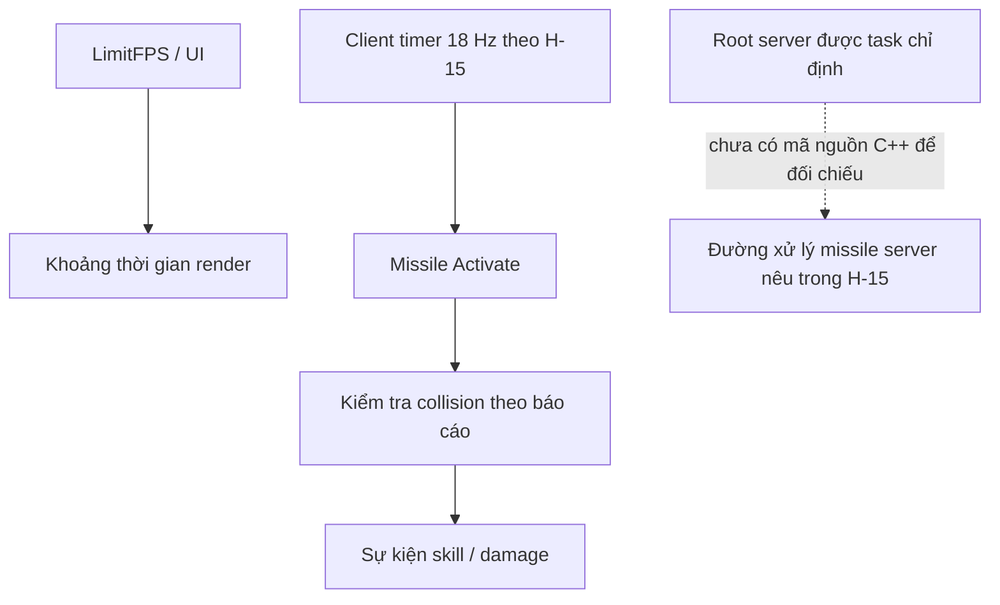

TÓM TẮT 1: DONE phần khảo sát source; PARTIAL đối chiếu H-13/H-14/J-05 vì thiếu tài liệu. Chưa kết luận nguyên nhân runtime.
TÓM TẮT 2: FPS UI đổi `Director` interval; client gốc đã định thời logic 18 Hz, missile đi theo tick, không theo từng frame render.
TÓM TẮT 3: Cả client/server kiểm tra vùng quanh vị trí đạn hiện tại trước khi áp bước kế tiếp; không thấy kiểm tra quét đoạn.
TÓM TẮT 4: Giả thuyết cần ưu tiên đo là nhịp lệnh joystick/skill và lệch hiển thị; tunneling có rủi ro cấu trúc nhưng chưa chứng minh liên hệ FPS.
TÓM TẮT 5: Không tái hiện/đo/build/chạy exe/VM/mạng; kế hoạch test và các giả thuyết chưa xác minh được ghi riêng.

# H-15 — Đạn xuyên quái khi FPS cao

Loại: khảo sát
Chủ đề: Khảo sát tĩnh mối liên hệ giữa FPS hiển thị, nhịp missile và va chạm quái.
Từ khóa: đạn xuyên quái, missile, FPS, collision, va chạm, H-15, LimitFPS, tick logic
Trạng thái: PARTIAL — giữ nguyên kết luận cũ; một số nguồn server và báo cáo đối chiếu không có trong checkout/root được task chỉ định.
Độ phủ: 7/13 tệp client có điểm neo đã kiểm tại qh9A, 6/13 chỉ xác nhận tồn tại; 0/9 tệp server có nội dung đối chiếu tại root task; chưa định vị bản ghi skill cụ thể; 0/3 báo cáo liên quan; runtime chưa chạy.
Liên quan: `JX1_OPS/DESIGN/TOI-UU-120FPS.md`, `JX1_OPS/DESIGN/MUC-LUC-TRI-THUC.md`, `JX1_OPS/TASKS/H-13.md`, `JX1_OPS/TASKS/H-14.md`, `JX1_OPS/TASKS/J-05.md`.
Cần tôi quyết định: không.

Sơ đồ tóm lược luồng được H-15 mô tả; nhánh server chưa được đối chiếu lại trên root do task chỉ định.

## Phạm vi và độ phủ

| Phần tử phạm vi | Tình trạng | Bằng chứng / giới hạn |
|---|---|---|
| Client `CoreShell.cpp` | Chưa đối chiếu nội dung; file có mặt | H-15:76,83; `D:/JX-build/qh9A/Classes/gamecore/CoreShell.cpp` tồn tại. |
| Client `GameDataDef.h` | Chưa đối chiếu nội dung; file có mặt | H-15:157; `D:/JX-build/qh9A/Classes/gamecore/GameDataDef.h` tồn tại. |
| Client `KgameWorldVN.cpp` | Đã kiểm điểm neo chính | `D:/JX-build/qh9A/Classes/vn/gamescence/KgameWorldVN.cpp:1574-1577,1614-1619`; số dòng khác phần timer trong H-15:75-76. |
| Client `KHRocker.cpp` | Đã kiểm điểm neo chính | `D:/JX-build/qh9A/Classes/gamescene/KHRocker.cpp:598,614-639`; đối chiếu phần joystick nêu ở H-15:83. |
| Client `KMissle.cpp` | Đã kiểm điểm neo chính | `D:/JX-build/qh9A/Classes/gamecore/KMissle.cpp:555,658,701-702,721`; đối chiếu phần missile nêu ở H-15:77-80. |
| Client `KNpc.cpp` | Đã kiểm điểm neo chính | `D:/JX-build/qh9A/Classes/gamecore/KNpc.cpp:60,1924`; đối chiếu phần cast nêu ở H-15:81. |
| Client `KPlayer.cpp` | Đã kiểm điểm neo chính | `D:/JX-build/qh9A/Classes/gamecore/KPlayer.cpp:578,672`; đối chiếu phần gói skill/di chuyển nêu ở H-15:82-83. |
| Client `KProtocol.cpp` | Đã kiểm điểm neo chính | `D:/JX-build/qh9A/Classes/gamecore/KProtocol.cpp:338-343`; đối chiếu phần gói skill nêu ở H-15:82. |
| Client `KProtocolProcess.cpp` | Chưa đối chiếu nội dung; file có mặt | H-15:84; `D:/JX-build/qh9A/Classes/gamecore/KProtocolProcess.cpp` tồn tại. |
| Client `KSkills.cpp` | Chưa đối chiếu nội dung; file có mặt | H-15:80; `D:/JX-build/qh9A/Classes/gamecore/KSkills.cpp` tồn tại. |
| Client `KSubWorld.cpp` | Chưa đối chiếu nội dung; file có mặt | H-15:76; `D:/JX-build/qh9A/Classes/gamecore/KSubWorld.cpp` tồn tại. |
| Client `KSubWorldSet.cpp` | Chưa đối chiếu nội dung; file có mặt | H-15:76; `D:/JX-build/qh9A/Classes/gamecore/KSubWorldSet.cpp` tồn tại. |
| Client `KuiOptions.cpp` | Đã kiểm điểm neo chính | `D:/JX-build/qh9A/Classes/gameui/KuiOptions.cpp:185-188,453-457`; đối chiếu FPS UI nêu ở H-15:73-74. |
| Server `CoreServerShell.cpp` | Chưa phủ; file không có trong root server task | H-15:88 trích từ `S/Core/Src`; root task ở `JX1_OPS/TASKS/R-05d.md:24`. |
| Server `KMissle.cpp` | Chưa phủ; file không có trong root server task | H-15:89-90,94 trích từ `S/Core/Src`; chưa đối chiếu mã tại root `gs`. |
| Server `KMissleSkill.cpp` | Chưa phủ; file không có trong root server task | H-15:67 trích từ `S/Core/Src`; chưa đối chiếu mã tại root `gs`. |
| Server `KNpc.cpp` | Chưa phủ; file không có trong root server task | H-15:98 trích từ `S/Core/Src`; chưa đối chiếu mã tại root `gs`. |
| Server `KProtocolProcess.cpp` | Chưa phủ; file không có trong root server task | H-15:96 trích từ `S/Core/Src`; chưa đối chiếu mã tại root `gs`. |
| Server `KRegion.cpp` | Chưa phủ; file không có trong root server task | H-15:88-89 trích từ `S/Core/Src`; chưa đối chiếu mã tại root `gs`. |
| Server `KSkills.cpp` | Chưa phủ; file không có trong root server task | H-15:94,97 trích từ `S/Core/Src`; chưa đối chiếu mã tại root `gs`. |
| Server `KSubWorldSet.cpp` | Chưa phủ; file không có trong root server task | H-15:88 trích từ `S/Core/Src`; chưa đối chiếu mã tại root `gs`. |
| Server `KSOServer.cpp` | Chưa phủ; file không có trong root server task | H-15:88 trích từ `S/MultiServer/GameServer`; chưa đối chiếu mã tại root `gs`. |
| Dữ liệu skill/missile (`LifeTime`, `Speed`, `CollidRange`, `DmgRange`, `FlyEventTime`, `ClientSend`) | Chưa phủ bản ghi cụ thể; H-15 không nêu skill ID để định vị | H-15:92-93,170-173; chưa đọc các bảng dữ liệu trong root `gs` và không đoán giá trị. |
| Báo cáo đối chiếu `H-13.md` | Chưa phủ; báo cáo không có, task có | H-15:65; `JX1_OPS/TASKS/H-13.md` tồn tại; `JX1_OPS/REPORTS/H-13.md` không có. |
| Báo cáo đối chiếu `H-14.md` | Chưa phủ; báo cáo không có, task có | H-15:65; `JX1_OPS/TASKS/H-14.md` tồn tại; `JX1_OPS/REPORTS/H-14.md` không có. |
| Báo cáo đối chiếu `J-05.md` | Chưa phủ; báo cáo không có, task có | H-15:65; `JX1_OPS/TASKS/J-05.md` tồn tại; `JX1_OPS/REPORTS/J-05.md` không có. |
| Tái hiện/đo runtime | Chưa chạy theo giới hạn task | `JX1_OPS/TASKS/R-05d.md:27`; không chạy build/exe/VM/mạng. |

Ngày khảo sát: 2026-11-17. Trạng thái: **PARTIAL** — hoàn tất phần khảo sát source hiện có; thiếu H-13/H-14/J-05 để đối chiếu. Không sửa mã. Các kết luận dưới đây dựa trên source, không khẳng định hành vi runtime. Không cần chạy runtime để hoàn tất phạm vi khảo sát tĩnh; kế hoạch đo dành cho task được duyệt sau.

## Phạm vi và nguồn

- Client gốc `C:/Jx1CocoV3/Folder/Client2912-20260116T044348Z-3-001/Client2912/Client` (viết tắt `C`).
- Server theo task `D:/JX-source/server/jxOnline/gameserver/Sources` (viết tắt `S`).
- Không tìm thấy task/report H-13, H-14 hoặc J-05 trong `JX1_OPS/TASKS` và `JX1_OPS/REPORTS` của checkout hiện tại; chưa thể đối chiếu nội dung các task đó.
- `rg` không có trong PATH (`rg : The term 'rg' is not recognized...`); đã dùng `Get-ChildItem` và `Select-String`, không cài thêm công cụ.
- `S/Core/Src/KMissleSkill.cpp` là file rỗng (0 byte); xử lý missile thực tế tìm được trong `S/Core/Src/KMissle.cpp`.

## ĐÃ XÁC MINH

### Client FPS và nhịp cập nhật

- `C/Classes/gameui/KuiOptions.cpp:182-192`: slider khai báo khoảng 30–90, nạp `AAAA/LimitFPS` (mặc định 60) và gắn `valueChanged`.
- `C/Classes/gameui/KuiOptions.cpp:450-463`: callback kẹp biến trong 30–120, gọi `Director::getInstance()->setAnimationInterval(1.0f / _LimitFPS)` rồi lưu giá trị slider vào `jx50ai/Setting.ini`. Do slider max là 90, thao tác UI thông thường không chọn được 120; giá trị 120 có thể xuất hiện từ cấu hình được nạp nhưng chưa kiểm runtime.
- `C/Classes/vn/gamescence/KgameWorldVN.cpp:306-319`: khởi tạo nạp `LimitFPS`, chỉ thay giá trị nhỏ hơn 30 thành 60, sau đó đặt animation interval. Không thấy đường này đặt tick server.
- **Chuỗi nhịp logic:** `C/Classes/vn/gamescence/KgameWorldVN.cpp:1529-1548` có vòng `while (nLoopCount * 1000 <= timerStart.GetElapse() * 18 ...)`, tối đa `MAX_BREATHE_LOOP=128` lần bù mỗi frame. `CoreShell.cpp:2806-2810` gọi `KSubWorldSet::MainLoop`; `KSubWorldSet.cpp:230-244` gọi `SubWorld[].Activate`; `KSubWorld.cpp:143-160` tăng giờ logic rồi gọi region; `KRegion.cpp:459-465` gọi missile. Các file cuối đều dưới `C/Classes/gamecore`. Vì vậy **bước missile là theo tick định thời 18 Hz, không đồng nghĩa theo FPS render**. Khi trễ, nhiều tick bù có thể chạy liền trong một frame; khi FPS cao, nhiều frame không chạy tick.
- `C/Classes/gamecore/KMissle.cpp:375-526`: `KMissle::Activate()` quản lý trạng thái đạn và cuối mỗi lần gọi tăng `m_nCurrentLife` đúng một đơn vị. Thời gian sống và điều kiện event kiểu modulo vì vậy tính theo số lần gọi, không theo mili-giây.
- `C/Classes/gamecore/KMissle.cpp:657-735, 1130-1147`: `KMissle::OnFly()` không nhận `dt`; tốc độ bị giới hạn tối đa 32 đơn vị mỗi lần gọi. Với `MISSLE_MMK_SingleLine`, offset là `m_nSpeed * m_nXFactor/YFactor`; offset được áp dụng sau kiểm tra va chạm.
- `C/Classes/gamecore/KMissle.cpp:554-623, 2107-2156`: `FsCheckCollision()` chọn `CheckNearestCollision()` quanh ô/vị trí hiện tại; vùng tìm NPC là lân cận ±1 ô theo mỗi trục. Không thấy kiểm tra đoạn nối vị trí cũ-mới. Một bước lớn có thể bỏ qua mục tiêu hẹp, tùy đơn vị tọa độ và dữ liệu skill.
- `C/Classes/gamecore/KMissle.cpp:469-490` và `C/Classes/gamecore/KSkills.cpp:702-802`: fly event được xét theo `m_nCurrentLife` và `m_nFlyEventTime`; collide event chọn skill sự kiện rồi cast tại vị trí đạn hoặc launcher. Đây là event của missile, không thấy trong đoạn này phụ thuộc trực tiếp khung hoạt ảnh của nhân vật.
- **Khung phát skill:** `C/Classes/gamecore/KNpc.cpp:58,2566-2608,3742-3748` cast tại ngưỡng `ATTACKACTION_EFFECT_PERCENT=60`, bằng phép so sánh bằng `nCurrentFrame == nTotalFrame * nPercent / 100`; đây là khung logic hành động, không phải frame render. Vòng tick bù chạy từng lần `Breathe`, chưa thấy bằng chứng `dt` nhỏ tự làm nhảy qua event. Việc đổi cơ chế tăng frame về sau có thể làm điều kiện bằng bị bỏ qua; cần đo trước khi sửa.
- **Gói skill:** `C/Classes/gamecore/KProtocol.cpp:237-250` gửi `c2s_npcskill` gồm skill ID, `nMpsX`, `nMpsY`, không mang FPS/dt/tọa độ va chạm missile. `KPlayer.cpp:493,512` dùng tọa độ hoặc cặp `-1, target dwID`.
- **Gói di chuyển:** `C/Classes/gamescene/KHRocker.cpp:587,598-639` schedule `updateMovement` không đặt interval; khi đang kéo và đủ ngưỡng, gọi `Goto`, trừ trạng thái attack/magic. `C/Classes/gamecore/CoreShell.cpp:5147` gọi `KPlayer::Walk`; `KPlayer.cpp:651-662` đã comment guard 5 tick và gửi Run ngay khi các điều kiện còn lại đạt. Do đó đường joystick có thể phát lệnh theo callback render, khác với nhịp missile. Không quy đổi thành số gói thực tế nếu chưa đo.
- **Nhận gói client gốc:** `C/Classes/vn/gamescence/KgameWorldVN.cpp:362,3553-3614` schedule 0,1 s và xả buffer đến hết trong `custom_update`; `C/Classes/gamecore/KProtocolProcess.cpp:3227` nhận `WorldSync->Frame` làm giờ thế giới. Trễ hiển thị/HP và vị trí đồng bộ cần tách khỏi thất bại sát thương server.

### Server missile và xác nhận sát thương

- `S/Core/Src/CoreServerShell.cpp:2227` định nghĩa đơn vị `GAME_FPS 18`. **Source hiện tại có nhánh thử 36:** `S/MultiServer/GameServer/KSOServer.cpp:91-93,1445-1456` nạp `[GameServer]/LogicFps` (18 mặc định, nhận 18 hoặc 36); không lấy `LimitFPS` từ client. `S/Core/Src/CoreServerShell.cpp:2234-2238` chạy xen kẽ `JxHalfLoop` rồi return ở chế độ 36; `KSubWorldSet.cpp:505-512`, `KRegion.cpp:1101-1119` chỉ xử lý nửa bước NPC, không gọi missile. Missile vẫn thuộc vòng logic đầy đủ ở đơn vị 18 Hz theo thiết kế source này; chưa xác minh cấu hình/binary runtime.
- `S/Core/Src/KRegion.cpp:1193-1201` gọi `Missle[].Activate()` trong vòng hoạt động region; `S/Core/Src/KMissle.cpp:344-526` tăng tuổi missile từng lần activate.
- `S/Core/Src/KMissle.cpp:650-735, 767-769`: `OnFly()` kẹp `m_nSpeed` tối đa 32 và với đường thẳng tính offset từ speed/factor mỗi lần tick; không dùng `dt`.
- `S/Core/Src/KMissle.cpp:526-642,2243-2347`: `FsCheckCollision()` kiểm vị trí/lân cận hiện tại qua `CheckNearestCollision`, không kiểm đường quét giữa hai vị trí. Nhánh `CollidRange==1` tìm ±1 ô theo mỗi trục; các so sánh offset chi tiết trong hàm nearest đang comment. Nhánh khác dò ô từ `-CollidRange` tới `+CollidRange`. Offset đường thẳng tính ở `:767-768`, áp qua `CheckBeyondRegion` ở `:968`, cộng vào offset hiện tại ở `:1179`. Riêng `MISSLE_MMK_SingleLine` có thân `_SERVER` rỗng (`:946-959`), không được áp kết luận bay đường thẳng cho nhánh này.
- `S/Core/Src/KMissle.cpp:1785-1849`: xử lý va chạm tìm NPC trong phạm vi lưới `nRange/2`; `m_nDamageRange` không phải hitbox pixel cố định. Giá trị range lấy từ dữ liệu skill/missile, nên cần ghi nhận đúng skill và file dữ liệu khi tái hiện.
- Tầm bay không phải một hitbox/tầm duy nhất cho mọi skill: `LifeTime` giới hạn số tick sống (`S/Core/Src/KMissle.cpp:229,389`), `Speed` và kiểu bay quyết định quãng đường mỗi tick. Với đạn thẳng, sau khi đổi fixed-point, quãng đường danh nghĩa xấp xỉ speed × số tick bay, thời gian là số tick/18 giây; chưa có bản ghi skill gây lỗi để tính số cụ thể. Homing/helix/circle và thời gian wait không dùng công thức thẳng đơn giản.
- `S/Core/Src/KMissle.cpp:1989-1997`: overload không tham số bỏ xử lý khi `m_bClientSend` bật. `S/Core/Src/KSkills.cpp:3038-3040` nạp cờ `ClientSend`; `:3223-3245` bỏ tạo missile magic attributes khi cờ này bật. Không suy từ tên cờ rằng client đang gửi kết quả hit; cần đối chiếu skill cụ thể. Overload nhận tọa độ còn được gọi trực tiếp từ nhánh `DmgRange==1` (`KMissle.cpp:598-599`), nên guard này không bao phủ mọi call site.
- Chuỗi sát thương: `S/Core/Src/KMissle.cpp:1789-1795` kiểm `m_ulDamageInterval` theo giờ game; `:1846-1851` tìm NPC và gọi `ProcessDamage`; `:1354-1382` còn kiểm xác suất/ID/nguồn damage, `:1531-1554` gọi `Npc[].ReceiveDamage`. Thấy hình ảnh collision chưa đảm bảo HP giảm; cần phân biệt miss/kháng/thiếu dữ liệu damage với không tìm thấy NPC.
- **Server nhận gì:** `S/Core/Src/KProtocolProcess.cpp:5581-5606` nhận skill ID và tọa độ đích hoặc `-1,target dwID`; tra mục tiêu bằng `FindAroundNpc`, rồi `SendSerCommand(do_skill,...)`. Trong gói này không có FPS, bước missile hay kết quả trúng. Tọa độ missile/đích và damage được tính từ trạng thái server, dữ liệu skill và thuộc tính launcher. Đây là xác minh cho gói `c2s_npcskill`, không khẳng định mọi protocol phụ đã kiểm hết.
- `S/Core/Src/KSkills.cpp:746-802, 826-829`: collide event gọi skill con theo cấu hình. Trong luồng được đọc, vị trí event lấy từ missile hoặc launcher (`:772-779`); chưa thấy tọa độ hit do client cung cấp. Chưa truy vết toàn bộ protocol để kết luận tuyệt đối về mọi đường skill.
- `S/Core/Src/KNpc.cpp:60,3979-4016,7143-7149`: `OnSkill` cast tại 60% khung logic bằng phép so sánh bằng như client; collide event sau đó thuộc missile. Source server hiện có `ProcCommandLegacy` lẫn `ProcCommand`/command lane (`:1296,6853,6875`); không áp kết luận ô lệnh đơn của báo cáo cũ cho bản hiện tại khi chưa phân tích nhánh đang bật.

## ĐÁNH GIÁ 5 GIẢ THUYẾT

1. **Bước đạn theo khung — có bước theo tick, nhưng chưa ủng hộ giả thuyết theo frame render.** Chuỗi client gốc định thời 18 Hz đã được truy vết đầy đủ; tăng FPS không tự tăng speed/tick. `g_fp.Activate` nằm sau paint và không phải bằng chứng gọi missile; không dùng nó để suy ra tần số missile. Ưu tiên đo số tick/s và số activate/missile/tick trước.
2. **Hit event bị bỏ/lặp khi dt nhỏ — chưa có bằng chứng cho nhánh dt nhỏ.** Missile không nhận `dt`; fly event phụ thuộc bộ đếm lần activate/modulo. Collide event có thể phụ thuộc thứ tự activate và trạng thái va chạm. Cần log số lần event/skill id để xác nhận mất hoặc lặp.
3. **Gửi gói dày/lệch tọa độ — cơ sở tĩnh rõ nhất ở joystick, chưa chứng minh mất skill.** Joystick callback theo render, guard gửi 5 tick bị comment; skill gửi ID/đích, server xử lý command riêng. Cần đo khi đứng yên và khi kéo joystick, cùng thứ tự nhận/consume/reject skill. Không lấy cơ chế command-slot cũ làm kết luận cho server hiện có command lane.
4. **Tunneling do bước lớn hơn bề rộng quái — có rủi ro cấu trúc.** Va chạm chỉ dò vị trí hiện tại/lân cận ô, không quét đoạn. Speed cap 32 là đơn vị nội bộ mỗi lần activate; chưa có kích thước hitbox/bề rộng mục tiêu được đo để chứng minh bước vượt hitbox.
5. **FPS UI đổi nhịp logic hai phía — bị phản chứng trên đường source đã đọc.** UI đổi Cocos interval, client Breathe vẫn định thời 18 Hz, server chọn 18/36 từ ini riêng và giữ đơn vị full logic 18. FPS có thể thay pha/thời điểm callback và input, nhưng không thấy UI đổi tần số logic cả hai phía.

## CHƯA XÁC MINH

- Chưa tái hiện; chưa đo FPS thực, số lần `KMissle::Activate`, bước tọa độ, collision/event, số gói hoặc máu quái.
- Chưa xác định skill cụ thể, kiểu di chuyển, giá trị `Speed`, `CollidRange`, `DmgRange`, `LifeTime`, `FlyEventTime`, `ClientSend` trong dữ liệu đang dùng.
- Chưa chứng minh build/source client gốc và server đang chạy khớp nhau; chưa xác minh mọi biến thể skill/protocol.
- Chưa đối chiếu H-13, H-14, J-05 vì các tài liệu đó không có trong checkout này.

## ĐỀ XUẤT TỐI ƯU

1. Giữ bước logic cố định 18 Hz đã có; nếu tái cấu trúc, dùng accumulator thời gian và nội suy render, kẹp thời gian tích lũy khi hitch/resume. Không nhân trực tiếp `m_nSpeed` hiện là tốc độ/tick với render dt; muốn đổi sang đơn vị/giây phải chuyển nhất quán speed, lifetime, interval, fixed-point và sự kiện ở cả hai phía. Ngưỡng kẹp cần đo; chưa chọn số tùy tiện.
2. Lưu vị trí trước/sau bước bay, broad-phase trên toàn bounding box và narrow-phase quét đoạn (segment vs hitbox); tránh chỉ kiểm ô cuối. Xác định rõ đơn vị và hitbox từ dữ liệu game trước khi chọn ngưỡng.
3. Đồng bộ event qua việc vượt ngưỡng `previous < trigger <= current` và cờ đã xử lý nếu sau này tăng frame theo thời gian; không dựa duy nhất phép bằng khi có thể nhảy frame. Chống lặp theo missile/target/tick hoặc chu kỳ damage hợp lệ; bảo toàn skill xuyên nhiều mục tiêu và damage lặp có chủ đích, không ép mọi missile chỉ hit một lần.
4. Với `ClientSend`, truy vết giao thức cụ thể trước khi đổi: định nghĩa rõ server-authoritative hit hay client intent đã được server kiểm chứng; giới hạn tốc độ gói và kiểm tra tọa độ/tầm hợp lệ.
5. Giữ tick server 18 Hz trong lần sửa đầu; không tăng tick chỉ để khớp FPS render.

## KẾ HOẠCH TÁI HIỆN

- Dùng bản test cô lập, cùng skill/dữ liệu/build, một nhân vật và một quái đứng yên; ghi HP trước/sau, ID skill/missile, `ClientSend`, `Speed`, `CollidRange`, `DmgRange`, vị trí missile mỗi bước, collide/fly event, packet count/timestamp và tick server.
- Chạy FPS 20/30/45/60/90/120, tối thiểu 30 phát mỗi mức; xáo trộn thứ tự mức, reset vị trí/HP giữa lần. Slider hiện chỉ chọn 30–90; 20 cần harness giới hạn riêng, 120 cần xác định cách đặt ở harness/config và ghi lại FPS thực tế.
- Tách lớp thử: (1) quái đứng yên, missile thẳng; (2) nhiều kiểu skill/`ClientSend`; (3) mục tiêu di chuyển; (4) mạng trễ/jitter. Sau đó đối chiếu client gốc và bản sửa cùng `JX-Test-36`/LDPlayer hoặc bot trong môi trường test được duyệt.
- Chỉ chấp nhận kết luận quan hệ nhân quả khi tỷ lệ hit/HP, bước tọa độ và log event/packet có khác biệt lặp lại theo FPS; khảo sát hiện tại chưa chạy các bước này.

## Kiểm tra và bàn giao

- Chỉ khảo sát tĩnh; không chạy Python, test, build, exe, VM hoặc kết nối mạng; không truy cập credential.
- Đã đọc client gốc và source server theo task. Không sửa source/code.
- Chỉ tạo báo cáo trong vùng file task và thêm mục kết quả vào file task. Không stage/commit/push; chưa có SHA commit.
- Khi rà chuỗi gọi, đã sửa nhận định nháp ban đầu về missile theo render và server cố định duy nhất 18: source gốc có timer 18 Hz và server có tùy chọn 36 xen nửa bước. Một số output tìm rộng bị cắt; đã đọc lại đoạn nguồn ngắn có dòng trước khi dùng kết luận. Đọc task lần đầu hiển thị sai dấu do encoding mặc định, đã đọc lại UTF-8; không thay encoding source.
- Lý do chưa push: người dùng cấm mạng thật, không yêu cầu công bố; **CHƯA PUSH**, không có bằng chứng GitHub và không có commit SHA mới. Không có thao tác Git write nào được chạy.
- Điểm tiếp tục: cung cấp/đưa vào checkout ba tài liệu H-13/H-14/J-05 để đối chiếu; task test riêng cần nhận diện skill/binary rồi chạy ma trận đã nêu. Không cần làm lại các đoạn source đã có file:dòng.

## MỤC SỔ THÔNG SỐ

Mọi giá trị ở đây là **đọc source hoặc tham số kế hoạch**, không phải kết quả đo. `C/Classes` và `S/Core/Src` được định nghĩa ở mục nguồn. Các dòng ghi “chưa biết” cố ý không suy ra giá trị skill thực tế từ fallback của hàm nạp. Chỉ đề xuất; không thay giá trị nào.

| Nhóm | Tên/hằng số | File:line | Giá trị | Đơn vị | Ảnh hưởng | Đổi an toàn (CÓ/CẨN THẬN/KHÔNG) | Nguồn đo |
|---|---|---|---|---|---|---|---|
| UI | slider minimum | `C/Classes/gameui/KuiOptions.cpp:185` | 30 | FPS | Mức chọn thấp nhất | CẨN THẬN | Source, chưa đo |
| UI | slider maximum | `C/Classes/gameui/KuiOptions.cpp:186` | 90 | FPS | Mức chọn cao nhất | CẨN THẬN | Source, chưa đo |
| UI | `LimitFPS` fallback | `C/Classes/gameui/KuiOptions.cpp:188` | 60 | FPS | Thiếu khóa cấu hình | CẨN THẬN | Source, chưa đo |
| UI | callback clamp dưới | `C/Classes/gameui/KuiOptions.cpp:453` | 30 | FPS | Kẹp giá trị trước áp dụng | CẨN THẬN | Source, chưa đo |
| UI | callback clamp trên | `C/Classes/gameui/KuiOptions.cpp:454` | 120 | FPS | Kẹp giá trị trước áp dụng | CẨN THẬN | Source, chưa đo |
| UI | reset `LimitFPS` | `C/Classes/gameui/KuiOptions.cpp:605` | 60 | FPS | Giá trị reset lưu ini | CẨN THẬN | Source, chưa đo |
| Client init | fallback/floor thay thế | `C/Classes/vn/gamescence/KgameWorldVN.cpp:313,317` | 60 | FPS | Khóa thiếu hoặc nhỏ hơn floor | CẨN THẬN | Source, chưa đo |
| Client init | floor kiểm tra | `C/Classes/vn/gamescence/KgameWorldVN.cpp:315` | 30 | FPS | Chặn mức thấp khi khởi tạo | CẨN THẬN | Source, chưa đo |
| Render | interval | `C/Classes/gameui/KuiOptions.cpp:457` | `1 / LimitFPS` | giây/frame | Nhịp Cocos | CẨN THẬN | Source, chưa đo |
| Client logic | timer multiplier | `C/Classes/vn/gamescence/KgameWorldVN.cpp:1544` | 18 | tick/s | Nhịp logic mục tiêu | KHÔNG | Source, không đổi riêng |
| Client logic | `MAX_BREATHE_LOOP` | `C/Classes/vn/gamescence/KgameWorldVN.cpp:1542` | 128 | tick/frame render | Trần vòng bù backlog | CẨN THẬN | Source, chưa đo hitch |
| Client nhận gói | schedule `custom_update` | `C/Classes/vn/gamescence/KgameWorldVN.cpp:362` | 0,1 | giây/lượt | Pha nhận trạng thái/HP | CẨN THẬN | Source, chưa đo |
| Client gửi move | `defMAX_PLAYER_SEND_MOVE_FRAME` | `C/Classes/gamecore/GameDataDef.h:29`; `KPlayer.cpp:651` | 5, guard joystick đang comment | tick | Gate đường đi khác, không chặn joystick ở đây | CẨN THẬN | Source, chưa đo |
| Joystick | ngưỡng distance | `C/Classes/gamescene/KHRocker.cpp:617` | 5 | đơn vị UI | Điều kiện gọi Goto | CẨN THẬN | Source, chưa đo |
| Client action | `ATTACKACTION_EFFECT_PERCENT` | `C/Classes/gamecore/KNpc.cpp:58` | 60 | % khung logic | Thời điểm cast | CẨN THẬN | Source, chưa đo |
| Server action | `ATTACKACTION_EFFECT_PERCENT` | `S/Core/Src/KNpc.cpp:60` | 60 | % khung logic | Thời điểm cast server | CẨN THẬN | Source, chưa đo |
| Server logic | `GAME_FPS` core | `S/Core/Src/CoreServerShell.cpp:2227` | 18 | đơn vị tick/s | Đơn vị đầy đủ gameplay | KHÔNG | Source, không đổi riêng |
| Server vòng ngoài | `LogicFps` mặc định | `S/MultiServer/GameServer/KSOServer.cpp:91,1445` | 18 | vòng/s | Nhịp gọi loop | CẨN THẬN | Source, chưa đọc cấu hình runtime |
| Server thử | lựa chọn `LogicFps` | `S/Core/Src/CoreServerShell.cpp:2237-2238` | 36 | vòng/s | Xen nửa bước NPC, không tăng missile tương ứng | CẨN THẬN | Source, chưa chạy JX-Test-36 |
| Client missile | cap `m_nSpeed` | `C/Classes/gamecore/KMissle.cpp:700-701` | 32 | đơn vị speed/tick | Bước theo kiểu bay; không phải cap mọi quỹ đạo | CẨN THẬN | Source, chưa đo |
| Server missile | cap `m_nSpeed` | `S/Core/Src/KMissle.cpp:705-706` | 32 | đơn vị speed/tick | Bước theo kiểu bay | CẨN THẬN | Source, chưa đo |
| Collision | nearest neighborhood | `C/Classes/gamecore/KMissle.cpp:2132-2133`; `S/Core/Src/KMissle.cpp:2270-2271` | ±1 | ô/trục | Vùng dò single collision | CẨN THẬN | Source, chưa đo kích thước |
| Data | `LifeTime` | `S/Core/Src/KMissle.cpp:229,389` | Chưa biết skill; fallback 0 | tick logic | Tuổi sống/tầm bay | CẨN THẬN | Source, thiếu bản ghi skill |
| Data | `Speed` | `S/Core/Src/KMissle.cpp:230` | Chưa biết skill; fallback 0 | đơn vị/tick | Bước dịch chuyển | CẨN THẬN | Source, thiếu bản ghi skill |
| Data | `CollidRange` | `S/Core/Src/KMissle.cpp:232` | Chưa biết skill; fallback 0 | ô | Vùng phát hiện | CẨN THẬN | Source, thiếu bản ghi skill |
| Data | `DmgRange` | `S/Core/Src/KMissle.cpp:237,1802` | Chưa biết skill; fallback 0 | ô, bán phạm vi dùng chia nguyên 2 | Vùng tìm NPC nhận damage | CẨN THẬN | Source, thiếu bản ghi skill |
| Data | `FlyEventTime` | `C/Classes/gamecore/KSkills.cpp:2915`; `KMissle.cpp:476` | Chưa biết skill; fallback 0 | tick logic | Chu kỳ fly event | CẨN THẬN | Source, thiếu bản ghi skill |
| Data | `ClientSend` | `S/Core/Src/KSkills.cpp:3039,3227` | Chưa biết skill; fallback 0 | cờ | Chặn tạo damage attributes/overload collision | CẨN THẬN | Source, thiếu bản ghi skill |
| Data | `m_ulDamageInterval` | `S/Core/Src/KMissle.cpp:1789-1794` | Chưa biết skill | tick giờ game | Khoảng damage hợp lệ | CẨN THẬN | Source nhánh tiêu thụ, chưa đo |
| Kế hoạch | FPS ma trận | `JX1_OPS/TASKS/H-15.md:11` | 20/30/45/60/90/120 | FPS thực đo | So sánh theo FPS, cần harness ngoài slider | CÓ | Task, chưa thực hiện |
| Kế hoạch | số phát mỗi mức | `JX1_OPS/TASKS/H-15.md:11` | ≥30 | lần/mức | Cỡ mẫu tối thiểu | CÓ | Task, chưa thực hiện |

## Phát hiện khi chuẩn hóa

- H-15:63-64 nêu root client/server khác root được chỉ định cho lần lập bảng phạm vi này (`JX1_OPS/TASKS/R-05d.md:24`). Không chuyển kết luận từ root cũ sang root được chỉ định; bảng trên ghi riêng phần đã kiểm và giới hạn.
- H-15:65 ghi không tìm thấy task H-13/H-14/J-05. Đối chiếu đường dẫn trong checkout cho thấy ba task đó tồn tại, còn ba báo cáo tương ứng không có tại `JX1_OPS/REPORTS/`. Giữ nguyên đoạn kết luận cũ theo yêu cầu, ghi nhận sai khác tại đây.
- H-15:67 trỏ tới `S/Core/Src/KMissleSkill.cpp` ở root server ngoài root được giao; nội dung đó không được kiểm lại. Trong root `gs` của task, các tệp C++ server mà H-15 trích không tồn tại tại các đường dẫn đã kiểm; chưa thể xác nhận nội dung mã server từ root được giao.
- Một số số dòng client qh9A khác các số dòng trong H-15, dù file/symbol chính được tìm thấy. Bảng độ phủ dùng file:dòng hiện tại của qh9A; không thay số liệu, phát biểu hay kết luận cũ.

liên quan: `JX1_OPS/DESIGN/TOI-UU-120FPS.md`; `JX1_OPS/DESIGN/MUC-LUC-TRI-THUC.md`; `JX1_OPS/TASKS/H-13.md`; `JX1_OPS/TASKS/H-14.md`; `JX1_OPS/TASKS/J-05.md`.
