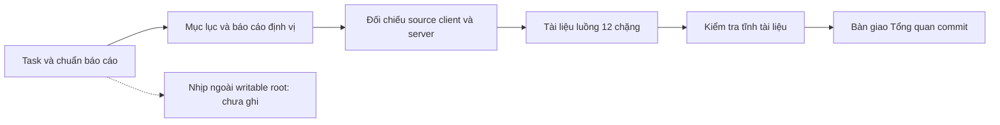

TÓM TẮT 1: [NGUỒN] Đầu ra chuyên môn HG-01 đã DONE ở mức tài liệu tĩnh; bàn giao chung PARTIAL vì chưa ghi được nhịp ngoài vùng ghi của phiên.
TÓM TẮT 2: [NGUỒN] Có sơ đồ và bảng 12 chặng, 11 chặng đối chiếu source/dữ liệu thật, một chặng tiền đề dẫn lại; `JX1_OPS/DESIGN/HIEU-DANG-NHAP-VAO-GAME.md:17–63`.
TÓM TẮT 3: [NGUỒN] Đã viết tài liệu đích, báo cáo này và mục Kết quả trong task; không thay kết luận báo cáo cũ; phạm vi theo `JX1_OPS/TASKS/HG-01.md:13,19–29` và prompt giao trực tiếp.
TÓM TẮT 4: [CHƯA KIỂM] Thiếu CLAUDE.md tại worktree; đã lần theo mục lục → A-02/K-01 → source thật; không tạo được `D:\JX-wt\HG-01.nhip` do nằm ngoài writable root.
TÓM TẮT 5: [CHƯA KIỂM] Chưa chạy build, exe, VM, mạng hay test game; không stage/commit/push theo yêu cầu, chưa có SHA; Tổng quan nhận bàn giao commit.

# HG-01 — Báo cáo bàn giao đường đăng nhập đến vào bản đồ

Loại: khảo sát
Chủ đề: Hoàn thiện tài liệu giải thích cho người không lập trình từ chọn nhân vật qua Bishop đến vào bản đồ.
Từ khóa: HG-01, đăng nhập, Bishop, Goddess, gs001, GUID, đồng bộ, LoadMapC, WorldSet, cổng
Trạng thái: PARTIAL — tài liệu chuyên môn hoàn tất; yêu cầu ghi tệp nhịp ngoài sandbox chưa thực hiện, không giả nhận đã ghi.
Độ phủ: 12/12 chặng được mô tả; 11/12 chặng đối chiếu source/dữ liệu tĩnh, 1/12 chỉ dẫn tài liệu; 0 phiên runtime được chạy.
Liên quan: `JX1_OPS/DESIGN/HIEU-DANG-NHAP-VAO-GAME.md`; `JX1_OPS/TASKS/HG-01.md`; `JX1_OPS/DESIGN/CHUAN-BAO-CAO.md`; `JX1_OPS/REPORTS/A-02-luong-dang-nhap.md`; `JX1_OPS/REPORTS/K-01-ban-do-truyen-tin-hieu.md`; `JX1_OPS/REPORTS/I-04-khao-sat-map.md`.
Cần tôi quyết định: không — Tổng quan có thể nhận tài liệu; việc đo runtime cần task/phạm vi riêng.

## Sơ đồ bàn giao

[THẤY] Tóm lược phần đối chiếu và đầu ra tại `JX1_OPS/DESIGN/HIEU-DANG-NHAP-VAO-GAME.md:17–63,105–132`; [TÀI LIỆU] bước tiền đề P1 giữ nhãn dẫn lại.



## Phạm vi và độ phủ

| Phần tử được giao | Đã phủ / chưa phủ | Bằng chứng và giới hạn |
|---|---|---|
| Đọc chuẩn trước khi làm | Đã phủ | [THẤY] Đã đọc `JX1_OPS/DESIGN/CHUAN-BAO-CAO.md:1–33`, sau đó nạp sáu skill được yêu cầu. |
| Nguồn mở đầu từ task | Phủ một phần nguồn định vị | [THẤY] `CLAUDE.md` không tồn tại tại worktree; [TÀI LIỆU] đã đọc `JX1_OPS/DESIGN/THE-GIOI-TONG-QUAN.md:1–221`, dùng mục lục `JX1_OPS/DESIGN/MUC-LUC-TRI-THUC.md:17` để tìm đúng báo cáo liên quan. Không tìm repository thay thế. |
| Client chọn nhân vật → Bishop → GS | Đã phủ tĩnh | [THẤY] Bảng S1–S6 tại `JX1_OPS/DESIGN/HIEU-DANG-NHAP-VAO-GAME.md:54–59`; mỗi bước có cổng, thông điệp và file:dòng. |
| Chuẩn bị map → đồng bộ → mở cảnh → vào thế giới | Đã phủ tĩnh | [THẤY] P0, S7–S10 tại tài liệu đích `:52,60–63`; đã tách nạp map server, mở cảnh client và xác nhận vào game. |
| Giải mã tên, cấu trúc game, sổ thông số | Đã phủ | [THẤY] Tài liệu đích `:65–103`; tên thành phần ASCII giữ nguyên; không đưa tên nhân vật/NPC/map cần giải mã vào đầu ra. |
| Nêu chỗ chưa kiểm, không đổi kết luận cũ | Đã phủ | [THẤY] Tài liệu đích `:105–138`; A-02/K-01/I-04 chỉ đọc, giữ nguyên kết luận nguồn. |
| Báo cáo và cuối task | Đã phủ | [THẤY] Báo cáo này và mục `## Kết quả` cuối `JX1_OPS/TASKS/HG-01.md`; không đổi trạng thái front matter `ready`. |
| Nhịp ở `D:\JX-wt\HG-01.nhip` | Chưa phủ — bị giới hạn vùng ghi | [CHƯA KIỂM] Phiên chỉ cho ghi trong `D:\JX-wt\HG-01`; tệp nhịp là tệp anh em bên ngoài root. Không thử vượt sandbox, không ghi giờ/% hồi tố và không tạo tệp thay thế ngoài vùng_file. |
| Chỉ mục dùng để Tổng quan gộp | Đã chuẩn bị dòng đề xuất | [THẤY] Dòng ở mục Bàn giao dưới đây; không ghi trực tiếp `REPORTS/_CHIMUC/HG-01.tsv` hoặc sửa mục lục vì không thuộc vùng được giao (`JX1_OPS/TASKS/HG-01.md:13,26`). |
| Build, exe, VM, mạng, tài khoản và runtime | Chưa phủ, không được phép chạy/đọc dữ liệu nhạy cảm | [THẤY] Giới hạn task `JX1_OPS/TASKS/HG-01.md:25–28`; không có phiên vào game đã kiểm trong HG-01. |

## Giải mã tên và sắp theo cấu trúc game

[THẤY] Tên thành phần gốc `Bishop`, `Goddess`, `PaySys`/`Sword3PaySys`, `gs001`, `Client2912`, `GUID`, `WorldSet_gs001.ini`, `MapList.ini` đều là ASCII; giữ nguyên trong UTF-8. Bảng đối chiếu tên gốc → mã hóa → chữ đúng/cách hiểu → nguồn nằm tại `JX1_OPS/DESIGN/HIEU-DANG-NHAP-VAO-GAME.md:65–77`. Không trích tên riêng game từ dữ liệu GBK/TCVN3 vào báo cáo này. Cách xếp theo chặng trải nghiệm và các lớp hệ thống, không theo thứ tự tệp, tại tài liệu đích `:79–81`.

## Đã xác minh — bằng chứng chính

| Kết quả | File:dòng / symbol đã đối chiếu |
|---|---|
| [THẤY] Client gửi tên nhân vật rồi chờ GS; mở kết nối mới theo phép vào, gửi GUID và dọn gateway | `O/gameui/KSelPlayer.cpp:1184–1190,1122–1154` — `KSelPlayer::EnterGame`, `FsGameServerConnectTo`, `tagLogicLogin`. |
| [THẤY] Bishop hỏi hồ sơ, chọn GS, chuyển dữ liệu và GUID, nhận phép vào rồi chuyển về client | `G/MultiServer/Bishop/GamePlayer.cpp:1903–1918,2158,2241–2246,2330,2433`; `G/MultiServer/Bishop/GameServer.cpp:1421–1446,991–1021,1073–1081`. |
| [THẤY] GS nhận hồ sơ, trả `bPermit`; khi client nối, tìm hồ sơ chờ có GUID tương ứng | `S/MultiServer/GameServer/KSOServer.cpp:3974–3994,5087`; `S/Core/Src/KPlayerSet.cpp:1723–1745` — `AddCharacter`, `AttachPlayer`. |
| [THẤY] Đồng bộ cơ sở gửi world trước thông tin NPC/nhân vật; client dùng ID để mở map | `S/Core/Src/KPlayer.cpp:983–1004`; `S/Core/Src/KSubWorld.cpp:1750–1757,1782`; `O/gamecore/KProtocolProcess.cpp:3214–3227`; `O/gamecore/KSubWorld.cpp:752–762`. |
| [THẤY] Xác nhận đồng bộ có đường riêng; GS gọi nhập thế giới rồi chuyển trạng thái chơi | `O/gamecore/KProtocolProcess.cpp:3332–3365`; `S/MultiServer/GameServer/KSOServer.cpp:3770–3783,5203–5233`; `S/Core/Src/CoreServerShell.cpp:514–519`; `S/Core/Src/KPlayer.cpp:7411–7456`. |
| [THẤY] Cổng macro/mặc định khác giá trị lịch sử; Count không chứng minh số map nạp thành công | `GH/ServerPort.h:4–8`; `G/MultiServer/Bishop/Network.cpp:72–73`; `S/MultiServer/GameServer/KSOServer.cpp:725–728`; `GS/maps/WorldSet_gs001.ini:2`; `S/Core/Src/KSubWorldSet.cpp:448–464`. [TÀI LIỆU] 51189 giữ theo `JX1_OPS/REPORTS/A-02-luong-dang-nhap.md:112`. |

[TÀI LIỆU] Alias gốc S/G/GH/O/GS được định nghĩa đầy đủ ở tài liệu đích `:107–115`, định vị từ `JX1_OPS/REPORTS/K-01-ban-do-truyen-tin-hieu.md:25–28` và `JX1_OPS/REPORTS/I-04-khao-sat-map.md:55`. Không ghim commit source vì task không cung cấp commit; không nhận source trên đĩa là binary đang chạy.

## Kiểm tra thực chạy, lỗi và cách xử lý

| Việc/lỗi | Cách thử hoặc xử lý | Kết quả |
|---|---|---|
| Git trước ghi | Chạy một lần `git status --short --branch` trong worktree | [THẤY] `task/HG-01`, sạch; hai tệp đầu ra chưa tồn tại. Không có checkpoint cần làm lại, không sửa local có sẵn. |
| PowerShell đọc tiếng Việt sai ở lượt đầu | Đổi đọc Markdown sang UTF-8, đặt mã hóa đầu ra UTF-8 | [THẤY] Đọc được chuẩn/task/skill có dấu; không sửa encoding của tệp nguồn. |
| `rg` không có | Lần gọi đầu báo CommandNotFound; chuyển sang `Select-String` và danh sách tên tệp giới hạn | [THẤY] Không cài công cụ, không tìm đệ quy thư mục source lớn. |
| `CLAUDE.md` thiếu | Thử mở đúng tệp trong worktree; dùng báo cáo được mục lục liên quan dẫn để định vị | [THẤY] Không tìm thấy; đã đối chiếu source thật để thay nguồn định vị, ghi rõ thiếu tệp ở đầu ra. |
| Lượt gộp kết quả đọc quá dài bị cắt | Thu hẹp đoạn, chỉ lấy bảng gốc/định danh/đoạn liên quan cần dùng | [THẤY] Không lấy phần bị cắt làm bằng chứng; các điểm trích dùng trong luồng có đối chiếu riêng. |
| Giải mã GBK client làm lệch số dòng | Loại số dòng đó; kiểm lại dòng vật lý qua UTF-8 và token ASCII | [THẤY] Dùng `EnterGame:1176`, gửi chọn role `:1185–1187`, gửi GUID `:1128–1134`; không dựa vào chú thích bị lỗi mã. |
| Thiếu marker Graphify đúng root | Kiểm đúng các đường dẫn marker ở root source đã biết, không quét tìm cả ổ | [THẤY] Không có marker ở các vị trí đã xét; dùng tệp/symbol thật, không dựng lại graph. |
| Kiểm tra tài liệu tĩnh bằng PowerShell | Đọc nghiêm UTF-8, kiểm BOM/ký tự thay thế, 5 dòng tóm tắt, khối Mermaid, 12 hàng chặng và đường dẫn source được trích | [THẤY] Tài liệu chuyên môn PASS: UTF-8 không BOM, không U+FFFD; 1 sơ đồ, 12 hàng chặng, 17 tệp source/dữ liệu được dẫn đều tồn tại. Không phải kiểm chứng nội dung binary/ABI. |
| Ghi nhịp ngoài writable root | Không thực hiện lệnh ghi vì chính sách chỉ cho ghi bên trong worktree và không cho nâng quyền | Chưa đáp ứng NHỊP; đây là giới hạn chính sách được biết trước, không phải lỗi truy cập hệ điều hành đã thử. Không hỏi lại quyền hoặc ghi giả thành công. |
| Build/test game/VM/mạng | Không chạy theo giới hạn task | [CHƯA KIỂM] Không có kết quả build, kiểm thử giao thức, hiệu năng hay phiên game thật của HG-01. |

## Mục sổ thông số và đề xuất tối ưu

[THẤY] Sổ thông số đầy đủ đã đặt trong đúng tài liệu task, không tạo sổ ngoài: `JX1_OPS/DESIGN/HIEU-DANG-NHAP-VAO-GAME.md:91–103`. Gồm cổng Bishop 56722/56732 với reader mặc định 0, Goddess 5001, PaySys 5002, GS mặc định 56766 có nhánh ghi đè, 51189 lịch sử, Count=800. Mỗi dòng có đơn vị, nguồn, ảnh hưởng, mức đổi an toàn và giới hạn đo. Đây là đọc tĩnh, không phải khuyến nghị đổi cổng/Count.

[CHƯA KIỂM — ĐỀ XUẤT] Task sau khóa bộ source/binary/asset và đo các mốc chọn role → permit → nối GS → mở map → ACK → nhập thế giới; không ghi khóa, mật khẩu, GUID thật hoặc payload nhạy cảm. Điểm đặt mốc và giới hạn tại tài liệu đích `:134–138`. Không đề nghị sửa game trong HG-01 và không có thay đổi tối ưu đã triển khai.

## Chưa xác minh

- [CHƯA KIỂM] `CLAUDE.md` được task dẫn nhưng không có tại worktree; nhịp ngoài root chưa ghi. Phần thiếu nguồn được thay bằng đối chiếu nguồn có thật, không nhận đã đọc tệp thiếu.
- [CHƯA KIỂM] Binary/APK/PAK có khớp source, ABI/sizeof/byte protocol, cổng đang mở, map nạp thành công, thời gian/timeout/reconnect và điều kiện kiểm permit/ACK. Vị trí cần kiểm tiếp đã liệt kê trong tài liệu đích `:121–132`.
- [CHƯA KIỂM] Kết quả script đăng nhập/map, ảnh hiển thị và phiên chơi thật. Không đọc dữ liệu tài khoản, khóa/mật khẩu, DB/dump hay chạy Main VM; giới hạn tại `JX1_OPS/TASKS/HG-01.md:25–28`.

## Bàn giao

[THẤY] Ba tệp thuộc giao việc: tài liệu đích, báo cáo này, mục `Kết quả` của task. Không stage/commit/push; chưa có SHA của thay đổi HG-01 và không có bằng chứng push. Tổng quan kiểm nhận rồi commit theo prompt giao trực tiếp; không gọi đây là lỗi Git hoặc ghi “đã push”.

[THẤY] Đề xuất Tổng quan thêm hàng sau vào `JX1_OPS/DESIGN/MUC-LUC-TRI-THUC.md` khi gộp; HG-01 không sửa tệp đó (`JX1_OPS/TASKS/HG-01.md:13,26`):

| Chủ đề | Báo cáo / tài liệu | File, hàm chính | Độ chắc |
|---|---|---|---|
| Đăng nhập, chọn nhân vật đến vào bản đồ | `DESIGN/HIEU-DANG-NHAP-VAO-GAME.md`, HG-01, A-02, K-01 | `KSelPlayer::EnterGame`, Bishop, `AttachPlayer`, `SyncWorld`, `SyncClientEnd`, `LaunchPlayer` | Khảo sát tĩnh; tiền đề tài khoản dẫn tài liệu; chưa kiểm runtime |

[THẤY] Dòng TSV đề xuất để Tổng quan tạo `REPORTS/_CHIMUC/HG-01.tsv` khi được gộp, theo chuẩn `JX1_OPS/DESIGN/CHUAN-BAO-CAO.md:30`; không mở rộng vùng ghi của worker:

```tsv
file	loại	chủ đề	từ khóa	trạng thái	độ phủ	liên quan
JX1_OPS/DESIGN/HIEU-DANG-NHAP-VAO-GAME.md	khảo sát	Đăng nhập từ chọn nhân vật đến vào bản đồ	đăng nhập, Bishop, Goddess, gs001, GUID, đồng bộ, LoadMapC	DONE tĩnh	12/12 mô tả; 11/12 đối chiếu trực tiếp; runtime chưa kiểm	A-02; K-01; I-04; HG-01
```

Kỹ năng đã dùng: jx1-retrofit, jx1-read-server, jx1-read-client, jx1-parameters, jx1-knowledge, jx1-report.
